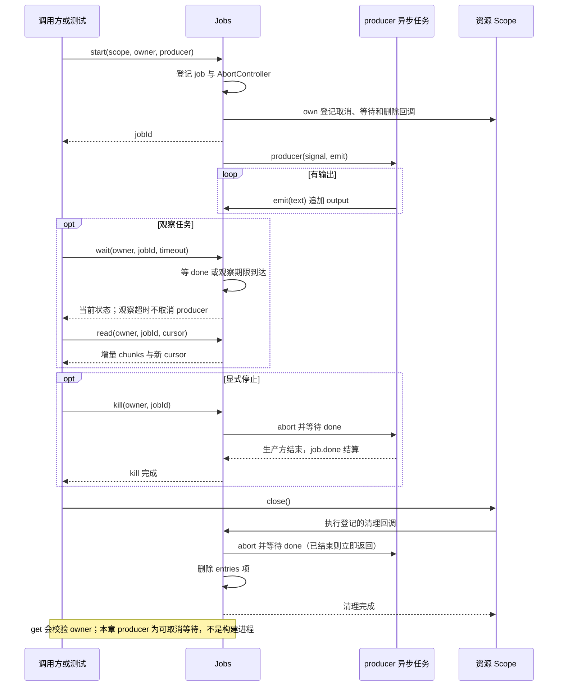

# 030 · 后台Job的wait和kill分开

阶段：R04。唯一前置：完成第 029 步，继续同一个工程。

## 什么时候会用到这一页

运行一个耗时构建时，Agent不应一直阻塞。先获得任务id，过10ms询问状态仍显示running，稍后读取新日志；只有明确kill或owner关闭才请求终止。

### 这次数据怎么走

```text
Jobs.start(scope,owner,producer) → 登记job与AbortController → producer异步emit输出 → wait只观察done或时间到 → read按块cursor取增量 → kill/Scope.close取消并等待done
```

### 对应时序图

从上往下读；实线箭头表示调用或发送，虚线箭头表示返回或事件通知。`opt`表示可选操作，`alt`表示不同结果，`loop`表示重复，`par`及其`and`分支表示并行；“未接入”及fixture说明按图中标注理解。



**当前接线位置：**030独立producer测试；051实际注册job_start/wait/read/kill，并用025 execute作生产方。该execute仍有默认5秒执行期限，所以当前job_start并不等于原版无前台截止的长期后台Shell。

## 这一步具体做什么

写完src/jobs.mjs与测试后运行 bun test ./tests/030-jobs.test.mjs。测试producer先emit first再等待60秒，但wait(10)返回running；用s2读取s1任务应拒绝，随后kill让producer因signal中止，最后close把entries清空。测试不真的等待60秒。

需要本章新文件的操作，先按下面代码创建文件，再执行；不要在上一步尚不存在的接口上试错。

## 代码为什么放在这一层

Jobs管理“谁拥有一份持续工作，以及怎么观察它”，生产方才负责具体做事。wait的timeout是观察期限，不是执行期限；read的cursor是输出块下标，不是027的字符串offset。取消是协作式，producer必须理会signal。

## 在哪里写、写什么

操作地点：终端中的 `$PROJECT`，编辑器打开同一个目录。只创建或替换下列文件，其他文件保留上一步版本。文件目录不存在先创建。

```sh
mkdir -p src
```

### 创建 `src/jobs.mjs`

````javascript
import { id } from './events.mjs'
import { setTimeout as delay } from 'node:timers/promises'

/** 后台任务有独立生产方、owner和输出游标；wait超时不会kill。 */
export class Jobs {
  entries = new Map()
  start(scope, owner, producer) {
    const job = { id: id('job'), owner, state: 'running', output: [], controller: new AbortController() }
    this.entries.set(job.id, job)
    job.done = Promise.resolve().then(() => producer(job.controller.signal, text => job.output.push(text)))
      .then(value => { job.state = 'completed'; job.value = value }, error => { job.state = job.controller.signal.aborted ? 'cancelled' : 'failed'; job.error = error.message })
    scope.own(async () => { job.controller.abort(); await job.done; this.entries.delete(job.id) })
    return job.id
  }
  get(owner, jobId) { const job = this.entries.get(jobId); if (!job || job.owner !== owner) throw Error('没有任务权限'); return job }
  /** 只等待观察，超时返回当前状态。 */
  async wait(owner, jobId, timeout = 1000) {
    const job = this.get(owner, jobId), clock = new AbortController()
    try { await Promise.race([job.done, delay(timeout, undefined, { signal: clock.signal }).catch(() => {})]) }
    finally { clock.abort() }
    return { id: job.id, state: job.state, value: job.value, error: job.error }
  }
  read(owner, jobId, cursor = 0) { const job = this.get(owner, jobId); return { cursor: job.output.length, chunks: job.output.slice(cursor) } }
  async kill(owner, jobId) { const job = this.get(owner, jobId); job.controller.abort(); await job.done }
}
````

```sh
mkdir -p tests
```

### 创建 `tests/030-jobs.test.mjs`

````javascript
import { test } from 'bun:test'
import assert from 'node:assert/strict'
import { setTimeout as delay } from 'node:timers/promises'
import { Jobs } from '../src/jobs.mjs'
import { Scope } from '../src/scope.mjs'

test('wait超时不杀任务，跨owner拒绝，kill才终止生产方', async () => {
  const jobs = new Jobs(), scope = new Scope()
  const jobId = jobs.start(scope, 's1', async (signal, emit) => { emit('first'); await delay(60_000, undefined, { signal }) })
  assert.equal((await jobs.wait('s1', jobId, 10)).state, 'running')
  assert.throws(() => jobs.read('s2', jobId), /权限/)
  assert.deepEqual(jobs.read('s1', jobId).chunks, ['first'])
  await jobs.kill('s1', jobId)
  assert.equal((await jobs.wait('s1', jobId)).state, 'cancelled')
  await scope.close(); assert.equal(jobs.entries.size, 0)
})
````

## 运行命令与通过标准

```sh
cd "$PROJECT"
bun test ./tests/030-jobs.test.mjs
bun test
```

测试应1项通过：wait超时仍running、输出first可读、跨owner拒绝、kill后cancelled、关闭后entries=0。没有输出内存上限、任务持久化或非协作producer强杀保证。

**本步证据的范围：**030-jobs.test.mjs用真实可取消的timers/promises等待作生产方，验证观察、权限、终止和清理；没有启动真实后台构建。

## VS Code：断在哪里、看什么

在src/jobs.mjs的this.entries.set、Promise.race和job.controller.abort打断点。start后看job.state="running"；F10通过wait返回时看仍running且controller.signal.aborted=false；kill时F11进入producer的delay中止路径，done处理后state="cancelled"。最后scope清理删除id。短等待测试受断点影响，应看state/信号而非测精确毫秒。

操作位置：VS Code 打开的是自己的 `$PROJECT`，断点也设在这里的源码，不在教材的 `steps` 目录。

上面的说明若指定CLI、子进程、页面或Electron附加调试，就先按该流程操作；下面这组步骤只用于本章测试入口。“当前测试”不会自动附加子进程，也不会命中浏览器或Electron中的断点。

变量只在所属作用域可见：停在方法内部时看this和参数；要看测试里的局部变量，先在“调用堆栈”选择对应测试帧。正在等待的异步调用者不一定保留可求值的帧，此时在测试调用前后加断点再看，不把未定义误判成业务状态丢失。

沿用第 000 步安装的 Bun 扩展与 `.vscode/launch.json`；本章列出替换配置时，使用本章完整版本。

1. 打开本步测试文件 `tests/030-jobs.test.mjs`，保持它为当前编辑器文件。
2. 在上面指定的函数内单击行号左侧设置断点。
3. “运行和调试”选择 **Bun：当前测试**，按 F5；它执行当前测试，工作目录固定为 PROJECT。
4. 在“变量 / 监视 / 调用堆栈 / 调试控制台”检查状态；F10 逐行执行，F11 进入函数，Shift+F11 返回，F5 继续，Shift+F5 停止。

验收：断点实际命中，能说出当前输入、状态和下一步；只看到进程启动不算完成。长时间暂停会影响真实取消、审批和网络超时，先检查时序，不删超时断言。修正后在集成终端运行 `bun test ./tests/030-jobs.test.mjs`，再运行 `bun test`，保留全部断言。

## 不看答案，确认自己能解释

闭卷说明wait(10)与kill的区别；画出owner关闭时为什么既要abort又要await done，而不能只从Map删除id。

完成后在 LEARNING.md 写一句实际结果和一个卡点。明天只重做这个卡点；第 3 天、第 7 天再做一次，能独立完成就继续下一页，不另开学习路线。

**再改一个条件验证：**安全练习：用会主动结束的producer emit两段，第一次read存cursor，第二次读取只拿新块；不要用忽略signal的无限循环，因为当前Jobs不能强制中断它。

## 与当前原版还差哪些

对照本仓库固定原版 `687f282e8625c6b8d11ff58211a90524be2e4317`；这里的“当前”指该本地基线，不是未经检查的上游最新版。

**这一页已经实现：**

- owner校验、稳定job id
- producer信号与输出块游标
- 观察超时不取消
- 作用域关闭取消、等待、删除

**原版仍有、或本步尚未对齐的部分：**

- 原版jobs-local维护有界输出环、stdout/stderr/log分流、绝对字节观察游标与独立模型消耗游标；本章output数组无界。
- 原版注册控制器、生命周期事件、完成通知、进度、列表与显式移除；教程没有完整接口。
- 原版受管进程后台句柄无前台deadline；051复用execute默认超时不等价。
- 原版持久记录任务元数据并明确重启语义；本章只在内存中。

**原版对照位置：**

- [packages/jobs/jobs/README.zh.md](../../../deepseek-harness/packages/jobs/jobs/README.zh.md)
- [packages/jobs/jobs-local/README.zh.md](../../../deepseek-harness/packages/jobs/jobs-local/README.zh.md)
- [packages/jobs/tool-jobs/README.zh.md](../../../deepseek-harness/packages/jobs/tool-jobs/README.zh.md)
- [packages/shell/bash-local/README.zh.md](../../../deepseek-harness/packages/shell/bash-local/README.zh.md)

本步测试通过只证明上面的具体行为；完整差距仍看 [COVERAGE.md](../COVERAGE.md)，不以文件数量、同名类或后面出现另一个模块代替接线证据。

下一步：[第 031 步](031.md)
