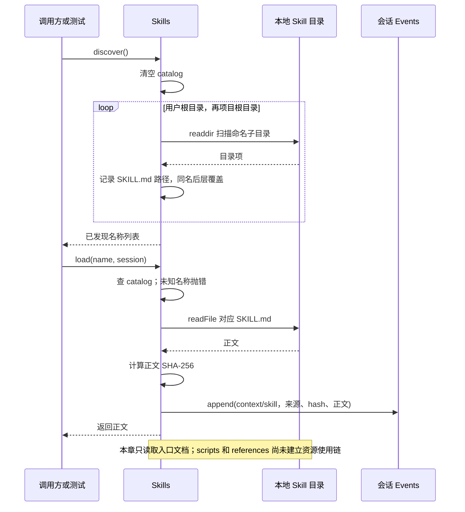
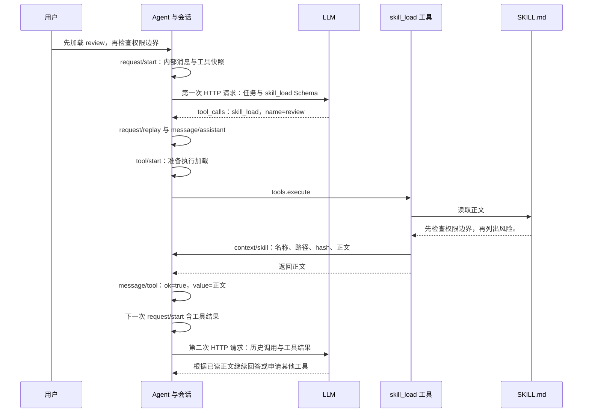

# 031 · 发现并按需加载Skill入口文档

阶段：R05。唯一前置：完成第 030 步，继续同一个工程。

## 什么时候会用到这一页

用户级review Skill提供通用规范，项目级同名review需要覆盖它；加载后即使磁盘规范改了，也要能解释当时Agent到底看过哪份正文。

### 这次数据怎么走

```text
Skills([userRoot,projectRoot]).discover → 扫描命名目录并后层覆盖 → load(name,session)读取SKILL.md → 计算hash → 追加context/skill事实 → 返回正文
```

### 对应时序图

从上往下读；实线箭头表示调用或发送，虚线箭头表示返回或事件通知。`opt`表示可选操作，`alt`表示不同结果，`loop`表示重复，`par`及其`and`分支表示并行；“未接入”及fixture说明按图中标注理解。



**当前接线位置：**031仅独立文件测试。051实际注册skill_load，每次discover再load；但没有把Skills.catalog做模型目录，也未把context/skill自动转换成指令快照。资源根目录、附属文件授权和脚本接线未在后续补齐。

## 这一步具体做什么

写完src/skills.mjs与本章测试再运行 bun test ./tests/031-skills.test.mjs。测试在临时目录创建user/review与project/review，确认discover只列一个review、load返回project；随后把项目文件改成changed，再检查已记录事件仍是project。

需要本章新文件的操作，先按下面代码创建文件，再执行；不要在上一步尚不存在的接口上试错。

## 代码为什么放在这一层

Skills在本章是入口目录＋正文加载器，不是脚本执行器。discover让名字定位到文件，load保留本次读取的来源/hash/内容。scripts、references、assets是附属资源，应按需使用，不应加载Skill时全部读取或执行。

## 同一次 Skill 加载：模型输入、模型输出和 eventlog 分别长什么样

用同一个例子往下看：用户说“先加载 review，再检查权限边界”；`review/SKILL.md` 的正文是 `先检查权限边界，再列出风险。`。**正文由宿主读取，模型输出的是加载请求；eventlog 由宿主写入。**模型不会自己写会话日志，也不会因为发现目录就已经读过正文。

下面的名称、路径、时间和回复都是演示值，JSON 按本仓库实现重构，没有调用真实模型。标为“字段节选”的对象省略了无关字段和中间事件，不能直接导入为完整会话。教学版与官方版使用不同的事件名、模型协议，不能混成一份日志。

| 看哪一份内容 | 谁产生 | 能回答什么 |
| --- | --- | --- |
| Skill 目录、工具 Schema | 宿主 | 模型知道有哪些 Skill、怎样申请加载吗？ |
| 发给模型的 HTTP 请求体 | 模型适配器 | 本次到底把哪些文字和工具定义发出去了？ |
| 模型响应及其流式分片 | LLM 服务 | 模型申请加载哪个 Skill，之后返回什么？ |
| eventlog | 宿主的会话与执行流程 | 申请、读取、工具结果和下一次模型输入留下了什么事实？ |
| OTel | 遥测插件 | 哪些事实在配置允许时被导出？它不是另一份自动生成的 Skill 正文。 |

### 教学版 031：`context/skill` 已经保存了什么

本章 `Skills.load()` 读取正文后计算 SHA-256，并调用 `session.append('context/skill', { name, path, hash, content })`。假设当前会话之前已有 8 个事件，得到的事件形状如下；`hash` 已按示例正文的精确字节计算；这里正文末尾没有换行。

```json
{
  "format": 1,
  "sessionId": "session_demo",
  "seq": 8,
  "time": 1793232000008,
  "type": "context/skill",
  "data": {
    "name": "review",
    "path": "/workspace/demo/.skills/review/SKILL.md",
    "hash": "7f3f0bebbe50182de4e80e1d09cec54ffb3e9d0734a9323066ca177cd4771357",
    "content": "先检查权限边界，再列出风险。"
  }
}
```

这份事件保存了当时读取的入口文档，之后修改磁盘文件不会改写它。它没有整个 Skill 目录的快照，`scripts/`、`references/` 也没有随之读取。更关键的是：**本章测试没有调用 LLM，`context/skill` 本身也没有被自动转换成模型消息。**

### 教学版 051：同一个正文怎样进入下一次模型请求

到第 051 步，`capabilities.mjs` 才把加载器注册成 `skill_load` 工具。模型可以从工具 Schema 知道这个工具，再按用户给出的名称调用；当前实现没有自动发布可用 Skill 的名称目录。下面展示的是这一条已接线的路径，不能把它算作第 031 步已经运行的功能。



**第一次投喂给 LLM 的 HTTP 请求体节选。**教学版 `DeepSeekModel` 使用 `/chat/completions`；工具 Schema 只说明怎么加载，里面没有 Skill 正文。

```json
{
  "model": "deepseek-flash",
  "stream": true,
  "messages": [
    { "role": "user", "content": "先加载 review，再检查权限边界。" }
  ],
  "tools": [{
    "type": "function",
    "function": {
      "name": "skill_load",
      "description": "skill_load：参数见Schema",
      "parameters": {
        "type": "object",
        "properties": { "name": { "type": "string" } },
        "required": ["name"],
        "additionalProperties": false
      }
    }
  }]
}
```

**模型返回的 SSE 节选。**这是模型服务返回的数据格式；它申请执行工具，不包含从磁盘读取的正文。实际参数可以分多帧发送，适配器拼接和验证后才交给执行流程。

```text
data: {"choices":[{"index":0,"delta":{"tool_calls":[{"index":0,"id":"call_review_1","type":"function","function":{"name":"skill_load","arguments":"{\"name\":\"review\"}"}}]},"finish_reason":null}]}

data: {"choices":[{"index":0,"delta":{},"finish_reason":"tool_calls"}]}

data: [DONE]
```

**同一次调用的 eventlog 字段节选。**累计到第 051 步的 Host 把事件写在 `<home>/sessions/<sessionId>/events.jsonl`，每行一个事件；模型相关的请求快照、回放和工具记录也在这份日志里。为方便比较，下面每项只展示 `type/data`，省略每项都有的 `format/sessionId/seq/time`；实际中还夹着 `request/end` 等事件。`arguments` 在内部已被解析成对象，`call_review_1` 把模型申请与工具结果连起来。

```json
[
  {
    "type": "request/start",
    "data": {
      "turnId": "turn_demo", "requestId": "request_demo_1", "step": 0,
      "config": { "backend": "deepseek", "model": "deepseek-flash" },
      "messages": [{ "role": "user", "content": "先加载 review，再检查权限边界。" }],
      "tools": [{ "name": "skill_load", "description": "skill_load：参数见Schema", "schema": { "type": "object", "properties": { "name": { "type": "string" } }, "required": ["name"], "additionalProperties": false } }]
    }
  },
  {
    "type": "message/assistant",
    "data": {
      "role": "assistant", "content": "", "thinking": [],
      "calls": [{ "kind": "tool", "id": "call_review_1", "name": "skill_load", "arguments": { "name": "review" } }]
    }
  },
  {
    "type": "tool/start",
    "data": {
      "turnId": "turn_demo",
      "call": { "kind": "tool", "id": "call_review_1", "name": "skill_load", "arguments": { "name": "review" } }
    }
  },
  {
    "type": "context/skill",
    "data": {
      "name": "review", "path": "/workspace/demo/.skills/review/SKILL.md",
      "hash": "7f3f0bebbe50182de4e80e1d09cec54ffb3e9d0734a9323066ca177cd4771357", "content": "先检查权限边界，再列出风险。"
    }
  },
  {
    "type": "message/tool",
    "data": {
      "role": "tool", "callId": "call_review_1", "name": "skill_load",
      "content": { "ok": true, "value": "先检查权限边界，再列出风险。" }
    }
  }
]
```

真实 Host 的第一项还会包含其他已注册工具，第二项使用这个适配器时还保存 `replay`。适配器的完整 assistant 回放消息同时出现在 `request/replay.data.value` 中，其中 `provider` 是 `deepseek`，`api` 是 `openai-chat`；如果服务返回了推理文本，还会保留 `reasoning_content`。原始 SSE 没有逐帧原样落盘：文字分片写成 `stream/text`，用量写成 `request/usage`，最终消息写成 `message/assistant`。不要把这些事件当成 HTTP 抓包文件。

**第二次投喂给 LLM 的 HTTP 消息节选。**正文通过 `message/tool` 进入历史投影，再由适配器转成 `role: tool`；它不是通过 `context/skill` 直接进入请求。工具返回的 `{ ok, value }` 被 `JSON.stringify` 成字符串。

```json
{
  "messages": [
    { "role": "user", "content": "先加载 review，再检查权限边界。" },
    {
      "role": "assistant", "content": "",
      "tool_calls": [{
        "id": "call_review_1", "type": "function",
        "function": { "name": "skill_load", "arguments": "{\"name\":\"review\"}" }
      }]
    },
    {
      "role": "tool", "tool_call_id": "call_review_1",
      "content": "{\"ok\":true,\"value\":\"先检查权限边界，再列出风险。\"}"
    }
  ]
}
```

同一正文因而可能出现三次：读取事实 `context/skill.data.content`、工具结果 `message/tool.data.content.value`、下一次内部请求快照 `request/start.data.messages`。这是不同环节的记录。`hash`、本地路径、事件序号不会因为记录过就自动发给模型。模型后续回答仍走普通 `message/assistant`；没有自动生成“这段回答遵循了哪版 Skill”的字段。

例如模型随后说“已加载 review，接下来先检查权限边界，再列出风险”，对应的教学版事件字段节选是：

```json
{
  "type": "message/assistant",
  "data": {
    "role": "assistant",
    "content": "已加载 review，接下来先检查权限边界，再列出风险。",
    "calls": [],
    "thinking": []
  }
}
```

这是模型生成的回复，前面的 `context/skill` 是磁盘读取事实。回复里声称接下来检查，不代表检查已经完成；后续真正执行的文件读取和命令仍要看各自的工具调用结果。

### 官方 DeepSeek Harness：同样的过程使用哪些事件

以下以本地固定提交 `687f282e8625c6b8d11ff58211a90524be2e4317` 为准。官方 Skill 加载工具叫 `skill`，通过 `ctx.tools.register()` 注册，调用与结果使用通用工具事件；它没有教学版的 `context/skill` 事件。

| 环节 | 官方 eventlog 中实际记录什么 | 进入模型请求时是什么 |
| --- | --- | --- |
| 发布可用目录 | `user/message`，`source.kind = skill-catalog`；`entries` 保存名称和描述 | `<available_skills>` 文本，只有摘要 |
| 记录模型与工具定义 | `request/header` 的 `header.config` 和 `header.tools`；路由状态变化还可产生 `request/context` | 当前请求的模型配置与工具 Schema |
| 模型申请加载 | `assistant/message`，内容块类型为 `tool-call`；记录来源模型、用量和 `stream` | 当前官方 DeepSeek Messages API 的 `tool_use` |
| 宿主开始调用 | `tool/call`，保存 `callId/name/arguments` | 这条执行事件本身不额外发给模型 |
| 宿主完成加载 | `tool/result`，消息正文是 `<skill_content>`，包含资源基底提示和指令正文 | 下一次请求中的 `tool_result` |
| 加载之后继续回答 | 普通 `assistant/message` | 后续模型输出，不能单凭发生顺序证明遵循了 Skill |

**官方 eventlog 的关键字段节选。**下面省略 `id`、完整目录文案、完整 `stream` 等字段，以及顶层 `seq/time`；其中 `arguments` 保存模型生成的 JSON 字符串。`assistant/message` 记录模型申请，`tool/call` 记录宿主进入调用，二者不是同一件事。

```json
[
  {
    "type": "user/message",
    "data": {
      "role": "user",
      "source": { "kind": "skill-catalog", "form": "catalog", "entries": [{ "name": "review", "description": "代码评审时使用。" }] },
      "content": [{ "type": "text", "text": "<available_skills>\n- `review`: 代码评审时使用。\n</available_skills>" }]
    }
  },
  {
    "type": "request/header",
    "data": {
      "reason": "initial",
      "header": {
        "config": { "provider": "deepseek-official", "model": "deepseek-v4-flash" },
        "tools": [{ "name": "skill", "description": "Load the full instructions for a skill. Call it before acting on a task that names or clearly matches a skill in the session skill catalog.", "parameters": { "type": "object", "properties": { "name": { "type": "string", "description": "The exact skill name from the available skills list." } }, "required": ["name"] } }]
      }
    }
  },
  {
    "type": "assistant/message",
    "data": {
      "turn": 1, "step": 1,
      "message": {
        "role": "assistant", "source": { "kind": "model", "provider": "deepseek-official", "model": "deepseek-v4-flash" },
        "content": [{ "type": "tool-call", "id": "call_review_1", "name": "skill", "arguments": "{\"name\":\"review\"}" }]
      }
    }
  },
  {
    "type": "tool/call",
    "data": { "turn": 1, "step": 1, "callId": "call_review_1", "name": "skill", "arguments": "{\"name\":\"review\"}" }
  },
  {
    "type": "tool/result",
    "surfaceOp": "append",
    "data": {
      "turn": 1, "step": 1,
      "message": {
        "role": "tool", "toolCallId": "call_review_1", "source": { "kind": "tool", "callId": "call_review_1" }, "isError": false,
        "content": [{ "type": "text", "text": "<skill_content name=\"review\">\n<skill_resources>\nBase directory for this skill: /workspace/demo/.dsh/skills/review\nResolve relative paths mentioned by this skill against the base directory before using them. Load referenced resources only as needed.\n</skill_resources>\n\n<skill_instructions>\n先检查权限边界，再列出风险。\n</skill_instructions>\n</skill_content>" }]
      }
    }
  }
]
```

实际 `tool/result` 顶层还用 `sourceEventSeqs` 引用它的 `tool/call` 事件序号；`toolCallId` 对应调用 ID，这两个字段不是一回事。完整 `assistant/message` 还包含 `stream`，保存已归一化、压缩的计时模型流，内容可有 reasoning、工具参数分片、usage、finish；它不是服务端原始 SSE 文本。系统提示词通过 `system/message` 记录，不放进 `request/header`。相同请求头没有变化时，也不必每一步重写一份。

**官方下一次投喂的 HTTP 请求体节选。**当前 `llm-deepseek` 使用 Messages API，不能套用前面教学版的 OpenAI 兼容字段。下面只展示工具声明和调用/结果所在的历史尾部；此前的用户任务、目录、系统提示词仍按实际上下文组装。

```json
{
  "tools": [{
    "name": "skill",
    "description": "Load the full instructions for a skill. Call it before acting on a task that names or clearly matches a skill in the session skill catalog.",
    "input_schema": { "type": "object", "properties": { "name": { "type": "string", "description": "The exact skill name from the available skills list." } }, "required": ["name"] }
  }],
  "messages": [
    {
      "role": "assistant",
      "content": [{ "type": "tool_use", "id": "call_review_1", "name": "skill", "input": { "name": "review" } }]
    },
    {
      "role": "user",
      "content": [{ "type": "tool_result", "tool_use_id": "call_review_1", "is_error": false,
        "content": [{ "type": "text", "text": "<skill_content name=\"review\">\n<skill_resources>\nBase directory for this skill: /workspace/demo/.dsh/skills/review\nResolve relative paths mentioned by this skill against the base directory before using them. Load referenced resources only as needed.\n</skill_resources>\n\n<skill_instructions>\n先检查权限边界，再列出风险。\n</skill_instructions>\n</skill_content>" }]
      }]
    }
  ]
}
```

这里 `role: user` 的 `tool_result` 是协议对工具结果的表示，不是用户重新发了一条消息。内部的 `tool-call/arguments` 变成 `tool_use/input`，`toolCallId` 变成 `tool_use_id`；事件的 `seq/time/source/surfaceOp` 不会原样放进 HTTP 消息。

官方模型服务返回工具申请时的 **Messages SSE 节选**如下；这里只列工具块，省略 `message_start`、`message_delta` 和 `message_stop`。后面的停止原因会是 `tool_use`。

```text
event: content_block_start
data: {"type":"content_block_start","index":0,"content_block":{"type":"tool_use","id":"call_review_1","name":"skill","input":{}}}

event: content_block_delta
data: {"type":"content_block_delta","index":0,"delta":{"type":"input_json_delta","partial_json":"{\"name\":\"review\"}"}}

event: content_block_stop
data: {"type":"content_block_stop","index":0}
```

官方还支持用户直接输入 `/review`：宿主加载正文，注入 `user/message`，其 `source` 是 `{ "kind": "skill-invocation", "name": "review", "form": "instructions" }`，`content` 同样是 `<skill_content>`。这条路径可以没有 `skill` 工具调用，不能用缺少 `tool/call` 判断 Skill 没加载。当前这些记录保留正文和资源提示，但没有自动附加 Skill 资源包的统一版本号或完整目录哈希。

加载后模型的普通回复也写成 `assistant/message`。例如下面的字段节选与前面的工具申请使用相同来源模型；这里同样省略完整事件必需的 `stream` 等字段：

```json
{
  "type": "assistant/message",
  "data": {
    "turn": 1, "step": 2,
    "message": {
      "role": "assistant",
      "source": { "kind": "model", "provider": "deepseek-official", "model": "deepseek-v4-flash" },
      "content": [{ "type": "text", "text": "已加载 review，接下来先检查权限边界，再列出风险。" }]
    }
  }
}
```

### OTel 和本地日志之间是什么关系

官方会话遥测把上述会话事件重新组成完整对象，序列化到 OTel Log 的 `attributes.content`；`body` 是固定的 `session-log`。例如，下面是 SDK 发出日志时的字段节选，不是 OTLP HTTP 外层封装；为缩短例子选用同一次调用的 `tool/call`。

```json
{
  "eventName": "session-log",
  "body": "session-log",
  "attributes": {
    "sessionId": "session_demo",
    "content": "{\"type\":\"tool/call\",\"seq\":17,\"time\":1793232000017,\"data\":{\"turn\":1,\"step\":1,\"callId\":\"call_review_1\",\"name\":\"skill\",\"arguments\":\"{\\\"name\\\":\\\"review\\\"}\"}}"
  }
}
```

`tool/result` 获准导出时，它的 XML 正文也走相同的 `attributes.content`。当前官方默认 `FEEDBACK_ONLY`，显式反馈才放行相应日志前缀，写进本地 eventlog 不等于立即上传；还要经过配置的脱敏处理。它没有因为加载 Skill 就自动生成一个独立 Skill Span。教学版第 064 步的 `Telemetry` 则默认关闭、只接收白名单属性，没有自动订阅并上传所有 `context/skill` 事件，也没有自动导出正文或 hash；两者不能互相代指。

### 对着源码和断点核验

教学版第 031 步先在自己的 `src/skills.mjs` 的 `session.append('context/skill', ...)` 停下，看 `name/path/hash/content`；此时还没有模型请求。做到第 051 步后，在 `src/loop.mjs` 的 `request/start`、`tool/start` 和 `message/tool` 写入处停下：第一次请求没有正文，加载后 `message/tool.content.value` 有正文，下一次 `request/start.data.messages` 才包含它。再停在 `src/deepseek.mjs` 的 `JSON.stringify(body)`，检查 HTTP 消息中的 `tool_call_id` 和字符串化结果。该操作需要自己的模型路由能返回一次 `skill_load` 调用，普通最终回答不会触发加载；本次文档补充没有运行真实模型。

官方实现可直接对照这些文件：

- [Skill 工具、目录和用户显式调用](../../../deepseek-harness/packages/skill/tool-skill/src/index.ts)：核对工具注册、返回值、`skill-catalog` 和 `skill-invocation`。
- [Skill XML 渲染](../../../deepseek-harness/packages/skill/skill/src/index.ts)：核对 `<skill_resources>` 与 `<skill_instructions>` 的实际正文。
- [通用工具调用日志](../../../deepseek-harness/packages/core/agent-loop/src/tool-calls.ts)：核对 `callId`、`toolCallId` 和 `sourceEventSeqs`。
- [当前 DeepSeek Messages 序列化](../../../deepseek-harness/packages/llm/llm-deepseek/src/serialize.ts)：核对 `input_schema`、`tool_use` 和 `tool_result`。
- [仓库现成的 skill-load 会话测试快照](../../../deepseek-harness/snapshots/session/skill-load/session.v4.jsonl)：实际样例加载的是 `editing-cordis-compositions`，随后回答 `DONE`。这是测试快照，路径、ID 等有占位符，顶层 `seq/time` 在展示时被移除；真实 V4 事件仍有这些字段，不能把快照当作本次实抓日志。
- [会话 OTel 导出](../../../deepseek-harness/packages/telemetry/otel/src/session-log.ts)：核对 `attributes.content = JSON.stringify(event)`。

## 在哪里写、写什么

操作地点：终端中的 `$PROJECT`，编辑器打开同一个目录。只创建或替换下列文件，其他文件保留上一步版本。文件目录不存在先创建。

```sh
mkdir -p src
```

### 创建 `src/skills.mjs`

````javascript
import { readFile, readdir } from 'node:fs/promises'
import { join } from 'node:path'
import { createHash } from 'node:crypto'

/** 固定用户层→项目层优先级，目录发现与按需加载分开。 */
export class Skills {
  constructor(roots) { this.roots = roots; this.catalog = new Map() }
  /** 只发现命名目录；同名后层覆盖前层。 */
  async discover() {
    this.catalog.clear()
    for (const root of this.roots) {
      let entries
      try { entries = await readdir(root, { withFileTypes: true }) } catch (error) { if (error.code === 'ENOENT') continue; throw error }
      for (const entry of entries.filter(entry => entry.isDirectory())) this.catalog.set(entry.name, join(root, entry.name, 'SKILL.md'))
    }
    return [...this.catalog.keys()].sort()
  }
  /** 加载来源、内容hash与正文一起入事实，历史请求可以解释。 */
  async load(name, session) {
    const path = this.catalog.get(name)
    if (!path) throw Error('未知Skill')
    const content = await readFile(path, 'utf8'), hash = createHash('sha256').update(content).digest('hex')
    session.append('context/skill', { name, path, hash, content })
    return content
  }
}

/** 规则也作为请求输入事实记录，不在历史回放时偷偷重新读新文件。 */
export async function instructions(path, session) {
  let content = ''
  try { content = await readFile(path, 'utf8') } catch (error) { if (error.code !== 'ENOENT') throw error }
  session.append('context/instructions', { path, content })
  return content
}
````

```sh
mkdir -p tests
```

### 创建 `tests/031-skills.test.mjs`

````javascript
import { test } from 'bun:test'
import assert from 'node:assert/strict'
import { mkdtemp, mkdir, writeFile, rm } from 'node:fs/promises'
import { tmpdir } from 'node:os'
import { join } from 'node:path'
import { Skills } from '../src/skills.mjs'
import { Events } from '../src/events.mjs'

test('同名Skill后层胜出，修改原文件不改变已记录上下文', async () => {
  const root = await mkdtemp(join(tmpdir(), 'own-skill-'))
  try {
    for (const name of ['user', 'project']) { await mkdir(join(root, name, 'review'), { recursive: true }); await writeFile(join(root, name, 'review', 'SKILL.md'), name) }
    const skills = new Skills([join(root, 'user'), join(root, 'project')]), session = new Events()
    assert.deepEqual(await skills.discover(), ['review'])
    assert.equal(await skills.load('review', session), 'project')
    await writeFile(join(root, 'project/review/SKILL.md'), 'changed')
    assert.equal(session.read()[0].data.content, 'project')
  } finally { await rm(root, { recursive: true, force: true }) }
})
````

## 运行命令与通过标准

```sh
cd "$PROJECT"
bun test ./tests/031-skills.test.mjs
bun test
```

测试应1项通过，后层覆盖且历史正文不被后来磁盘内容改写。没有验证frontmatter、资源路径解析、目录watch、实际模型遵循Skill或运行script。

**本步证据的范围：**031-skills.test.mjs用真实临时文件验证覆盖及事件快照；没有调用模型，没有script/reference资源使用测试。

## VS Code：断在哪里、看什么

在src/skills.mjs的this.catalog.set与session.append("context/skill",...)打断点。第一次循环看review指向user，再F10走到project覆盖同名键；load时看path位于project、content="project"、hash为SHA256。继续到测试改文件后，展开session.records确认旧content仍是project。

操作位置：VS Code 打开的是自己的 `$PROJECT`，断点也设在这里的源码，不在教材的 `steps` 目录。

上面的说明若指定CLI、子进程、页面或Electron附加调试，就先按该流程操作；下面这组步骤只用于本章测试入口。“当前测试”不会自动附加子进程，也不会命中浏览器或Electron中的断点。

变量只在所属作用域可见：停在方法内部时看this和参数；要看测试里的局部变量，先在“调用堆栈”选择对应测试帧。正在等待的异步调用者不一定保留可求值的帧，此时在测试调用前后加断点再看，不把未定义误判成业务状态丢失。

沿用第 000 步安装的 Bun 扩展与 `.vscode/launch.json`；本章列出替换配置时，使用本章完整版本。

1. 打开本步测试文件 `tests/031-skills.test.mjs`，保持它为当前编辑器文件。
2. 在上面指定的函数内单击行号左侧设置断点。
3. “运行和调试”选择 **Bun：当前测试**，按 F5；它执行当前测试，工作目录固定为 PROJECT。
4. 在“变量 / 监视 / 调用堆栈 / 调试控制台”检查状态；F10 逐行执行，F11 进入函数，Shift+F11 返回，F5 继续，Shift+F5 停止。

验收：断点实际命中，能说出当前输入、状态和下一步；只看到进程启动不算完成。长时间暂停会影响真实取消、审批和网络超时，先检查时序，不删超时断言。修正后在集成终端运行 `bun test ./tests/031-skills.test.mjs`，再运行 `bun test`，保留全部断言。

## 不看答案，确认自己能解释

闭卷写出discover与load各自是否读正文；给出SKILL.md引用references/rules.md时应以哪个目录解析，并指出当前实现没有把该基准显式返回。

完成后在 LEARNING.md 写一句实际结果和一个卡点。明天只重做这个卡点；第 3 天、第 7 天再做一次，能独立完成就继续下一页，不另开学习路线。

**再改一个条件验证：**安全练习：临时测试第二次调用load应读到changed，而第一次事件保持旧正文。完整“加载Skill→读reference→执行script”目前未实现；不要在load里自动执行scripts来假装补齐。

## 与当前原版还差哪些

对照本仓库固定原版 `687f282e8625c6b8d11ff58211a90524be2e4317`；这里的“当前”指该本地基线，不是未经检查的上游最新版。

**这一页已经实现：**

- 根目录顺序覆盖
- 按需读取SKILL.md
- 来源路径、正文hash与内容入会话事实
- 规则文件读取辅助函数

**原版仍有、或本步尚未对齐的部分：**

- 原版skill条目有resourceBase并向模型渲染相对资源路径指引；本章只返回正文。
- 原版filesystem提供方解析frontmatter、目录bundle及平铺md，按rank/作用域裁决并监视目录；本章仅目录名和手工discover。
- 原版tool-skill、模型目录和用户可调用Skill路径分开接线；本章只有后续基础skill_load。
- scripts/references不是自动加载或执行目录；教程缺少通过文件/执行工具消费这些资源的真实演示及边界测试。

**原版对照位置：**

- [packages/skill/skill/README.zh.md](../../../deepseek-harness/packages/skill/skill/README.zh.md)
- [packages/skill/skill/src/index.ts](../../../deepseek-harness/packages/skill/skill/src/index.ts)
- [packages/skill/skill-filesystem/README.zh.md](../../../deepseek-harness/packages/skill/skill-filesystem/README.zh.md)
- [packages/skill/tool-skill/README.zh.md](../../../deepseek-harness/packages/skill/tool-skill/README.zh.md)

本步测试通过只证明上面的具体行为；完整差距仍看 [COVERAGE.md](../COVERAGE.md)，不以文件数量、同名类或后面出现另一个模块代替接线证据。

下一步：[第 032 步](032.md)
