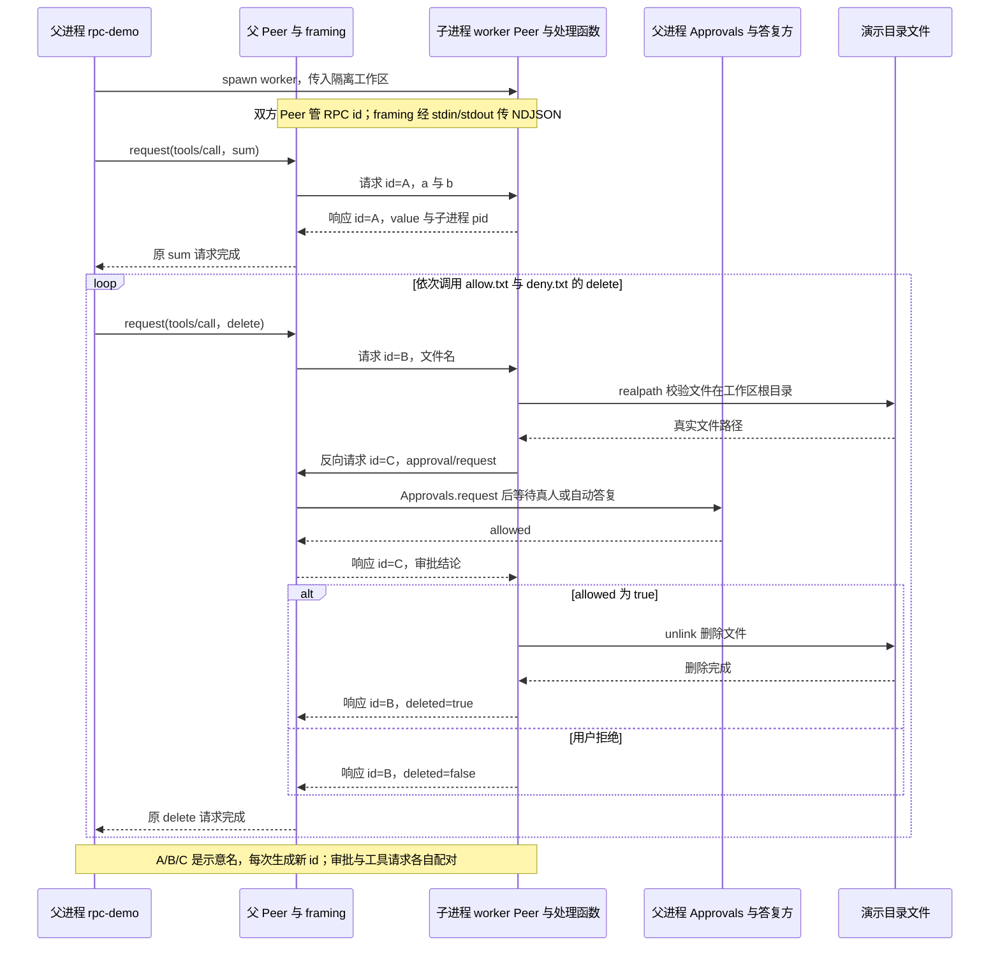
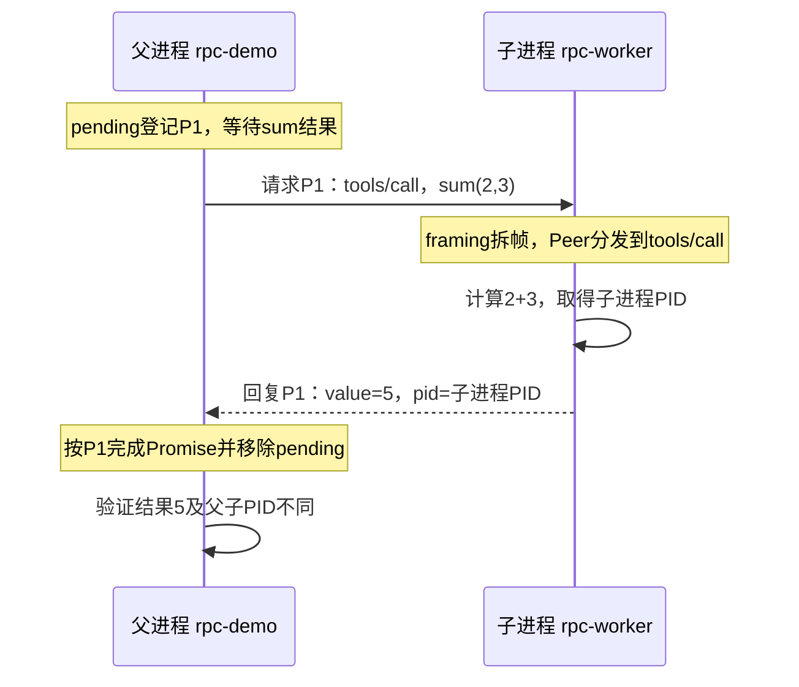
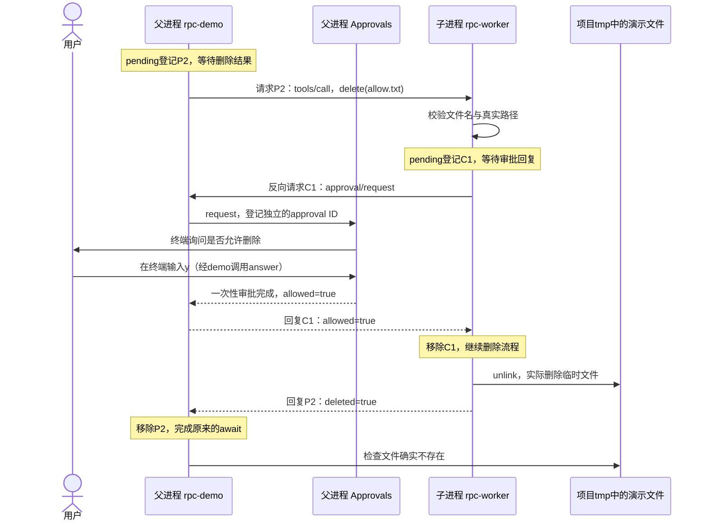
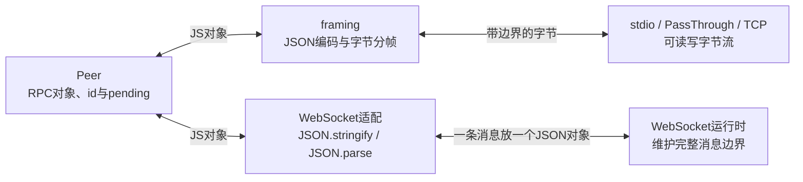

# 032 · 跨进程RPC调用工具，并反向请求审批

阶段：R05。唯一前置：完成第 031 步，继续同一个工程。

## 什么时候会用到这一页

主进程需要把工具交给独立worker执行：先算2+3，再请求删除临时文件。删除时worker没有UI，反向向主进程请求询问真人，收到允许才unlink。

### 这次数据怎么走

```text
rpc-demo父进程spawn worker → 两边new Peer并framing接stdin/stdout → tools/call请求 → worker处理sum或请求approval/request → demo复用Approvals询问用户 → worker按独立RPC id收回答案 → unlink或拒绝 → 原工具请求按原id回复
```

### 对应时序图

从上往下读；实线箭头表示调用或发送，虚线箭头表示返回或事件通知。`opt`表示可选操作，`alt`表示不同结果，`loop`表示重复，`par`及其`and`分支表示并行；“未接入”及fixture说明按图中标注理解。



**当前接线位置：**032已有真实跨进程demo，不再只有内存echo。035 LSP复用其Content-Length传输，043 Remote与044/045 SDK复用Peer/NDJSON；033 MCP和046 ACP走各自SDK；047 WebSocket承载自定义Remote协议。sum/delete处理函数仍是演示分支，未进入Agent的Tools。

## 这一步具体做什么

先写完本章rpc.mjs、rpc-demo.mjs、rpc-worker.mjs及两份测试，再在练习工程运行 bun src/rpc-demo.mjs。看到跨进程sum=5后，对allow.txt输入y，对deny.txt输入n；临时文件在项目tmp/rpc-032-随机后缀下，结束只清理本次子目录。随后运行 bun test ./tests/032-rpc.test.mjs ./tests/032-rpc-demo.test.mjs 自动复验允许/拒绝。

需要本章新文件的操作，先按下面代码创建文件，再执行；不要在上一步尚不存在的接口上试错。

## 代码为什么放在这一层

Peer管理method、id、pending和错误；framing把对象编码成字节并按NDJSON换行或Content-Length拆完整消息。两边都可发请求，所以父等待delete时仍能响应子发来的审批。反向只描述请求方向，批准仍由用户给出；--auto是验收预设，不是模型审批。 Peer和framing支持stdio但不限于stdio；PassThrough内存流和node:net TCP Socket也可接framing。WebSocket约定每条完整文本消息放一个JSON-RPC对象后，可用JSON.stringify/parse直接连接Peer，消息边界由WebSocket运行时处理。完整接线与Bun运行示例见本页末尾[三种传输实操](#peer和framing支持stdio但不限于stdio)。

## 为什么需要RPC，而不是只把JSON发过去

前面的进程、管道与PTY解决“启动程序、收发字节”。但当Harness要调用另一个进程里的能力时，仅仅收到一段JSON还不够：这是谁发起的调用？要执行哪个方法？回复对应哪次请求？失败后谁结束等待？这些是032的RPC要解决的问题。

RPC是Remote Procedure Call，即远程过程调用。这里的“远程”不一定是另一台服务器，也可以是本机另一个进程。同一个JavaScript进程里可以直接调用函数并await；跨进程无法直接拿到对方的函数对象，需要把调用变成消息。

例如Harness要请外部工具进程读取文件：

```text
同进程：await readFileTool({ path: 'a.txt' })

跨进程：Harness发送“调用readFile，参数是a.txt，请求ID是123”
         → 外部进程执行对应处理函数
         → 返回“请求123的结果是hello”
         → Harness完成请求123对应的Promise
```

下面用032的Peer API表达这个过程。此处的readFile是解释用的注册方法，不是本步已经实现的跨进程文件工具：

```js
// 外部进程注册处理函数；实际文件操作由处理函数自己实现。
remote.handle('readFile', async args => readFileTool(args))
// Harness发送方法名和参数，等待这个请求自己的回复。
const result = await local.request('readFile', { path: 'a.txt' })
```

在线上传输的消息类似：

```json
{"jsonrpc":"2.0","id":"123","method":"readFile","params":{"path":"a.txt"}}
```

```json
{"jsonrpc":"2.0","id":"123","result":"hello"}
```

032的`pending`表把请求ID关联到resolve、reject和超时定时器。回复到达时按ID查找等待者，而不是假设“先发的请求一定先返回”。例如先发慢请求A，再发快请求B，即使B先回复，也只会完成B的Promise，不会把结果交错。

| 问题 | RPC在032中怎么处理 |
| --- | --- |
| 对方该执行哪个能力 | 请求携带method和params，handle注册方法处理函数。 |
| 多个调用的回复如何对应 | 每次request生成唯一ID，pending表按ID完成对应Promise。 |
| 对方处理失败 | 返回带同一ID的error，调用方Promise拒绝。 |
| 只想发布消息，不要回复 | notify发送没有ID的通知，不创建等待者。 |
| 对方一直没回复 | 请求超时，清除本次pending并拒绝等待。 |
| 连接断了 | close拒绝全部未完成请求并清理定时器。 |
| 对方也需要调用Harness | 双方都是Peer，同一连接可以双向发请求。 |

反向调用的具体场景是：Harness请求外部服务执行操作，外部服务发现需要审批，于是反过来请求Harness询问用户；收到审批结果后，再完成原来的操作请求。两个方向各有自己的请求ID，不需要为了反向调用另建一套连接。032提供这种双向机制，下方跨进程demo会实际演示此流程，默认由终端中的人回答。

### RPC、分帧与传输各管一层

```text
领域能力：读取文件、执行工具、请求审批
                    ↓
RPC：方法名、参数、请求ID、结果与错误
                    ↓
分帧：NDJSON换行或Content-Length，确定消息边界
                    ↓
传输：管道、Socket等，搬运字节
```

所以“可以传JSON”只是具备数据表达方式，不自动具备RPC的请求关联和等待管理。你也可以自定义消息实现这些行为，但相当于自己设计一套调用协议；032采用JSON-RPC的基本消息形式，让这些责任明确下来。

RPC也不是所有场景都必需：只运行一次命令、收集输出并等待退出，025那样的执行接口就可以；需要长期连接、反复调用多个方法、并发等待或反向请求时，RPC更合适。它不自动提供权限、沙箱、重试或领域取消；032请求超时只是不再等待，对方操作可能仍在继续，真正取消需要明确的取消消息和处理逻辑。

本步是自写的通信基础示例：保留的基础测试用内存PassThrough连接两个Peer；新增demo则通过真实子进程管道连接，不是网络服务，也不是完整JSON-RPC合规实现。后续MCP、ACP采用各自SDK，不能因为学过032就认为这些SDK实际依赖这份rpc.mjs。

## Peer与framing怎么接线，为什么要传Peer进去

不要把它理解成“Peer必须包在framing对象里面”。本例的framing是一个接线函数，拿到现有Peer后连接输入输出；没有创建第二个Peer，也没有创建一个包裹Peer的新对象。代码分两步写：

```js
// 父进程：创建RPC管理对象，此时还不知道怎样从管道收发消息。
const peer = new Peer()
// 安装发送方法，并监听子进程输出，把完整消息交回这个Peer。
framing(peer, child.stdout, child.stdin)
```

子进程同样分开：

```js
// 子进程拥有自己独立的Peer及pending表。
const peer = new Peer()
// 从自身stdin收消息，向自身stdout发消息。
framing(peer, process.stdin, process.stdout)
```

为什么framing要接收peer？因为它需要完成两处接线：

```js
// 示意发送方向：给同一个Peer安装真正写管道的send实现。
peer.send = message => {
  writable.write(JSON.stringify(message) + '\n')
}
// 示意接收方向：从字节缓冲拆出完整JSON后，交给同一个Peer处理。
peer.receive(message)
```

上面是职责示意，完整代码还包含缓冲、长度检查和错误处理。传入peer后，framing才知道“拆好的消息交给谁”，也能告诉Peer“你生成的消息怎么发出去”。Peer构造函数虽然允许传send，本例先不传，随后由framing安装；因此必须先完成接线，再调用request或notify。

```text
发送：peer.request → 登记ID与pending → peer.send → 编码、加边界 → 写管道
接收：管道data → 缓冲并拆完整消息 → JSON.parse → peer.receive
                                                    ↓
                                    调用handler，或按ID完成等待者
```

framing最后返回的还是传入的peer，所以以前可以嵌套写成一行；这里改为分开写，只为让“创建”和“连接”两个动作更清楚。它没有让Peer获得另一套RPC逻辑：Peer管方法和请求关联，framing管字节边界与传输接线。理论上也可换成回调等接口连接两者，传Peer并非RPC协议强制要求，只是这份实现选择的接口。

### 分开发送和接收两个方向理解

发送时，Peer先构造RPC消息对象；接收时，Peer处理已有的RPC对象，不会再包装一遍。

```text
发送：
peer.request(method, params)
  → Peer生成id、登记pending，构造包含method/id/params的RPC对象
  → framing安装的send将对象JSON.stringify，再编码成UTF-8字节
  → 添加NDJSON换行或Content-Length头
  → 写入管道

接收：
管道收到字节
  → framing追加到buffer
  → 根据换行或Content-Length找出完整正文，不完整就继续等
  → 将完整正文解码，JSON.parse得到RPC对象
  → peer.receive处理对象
      ├─ 有method：调用注册的handler；请求有id时发送对应结果或错误
      └─ 是回复：按id找到pending，完成或拒绝Promise并清理等待记录
```

| 层 | 发送方向 | 接收方向 |
| --- | --- | --- |
| Peer | 构造请求、回复或通知的RPC对象；请求登记等待者 | 根据method分发调用，根据id关联回复，处理结果与错误 |
| framing | JSON序列化、UTF-8编码、添加边界、写字节 | 缓冲字节、识别边界、解码完整正文、解析JSON后交给Peer |

framing不是“按照JSON语法切分”：它不会通过数大括号判断消息结束，而是根据双方约定的真实换行或正文字节长度确定边界，再解析JSON。比如JSON里的字符串也可能包含大括号，不能拿它当边界。

可以记成：**Peer管“调用谁、回复谁”；framing管“怎么编码发送、哪里是一条完整消息”。** 两者合作，但不是发送与接收都再由Peer包装一次，也不是framing只负责切字符串。

## 分帧到底是在分什么

管道或网络流传来的是连续字节，不自带“这是第几条JSON消息”的边界。一次`data`回调不一定等于一条消息：可能只有半条，也可能同时包含几条。分帧器负责先找到完整消息的边界，再交给JSON解析器和Peer处理。

### 已实现接收半包，尚未实现主动切块发送

当前发送端先执行JSON.stringify，把完整正文编码成Buffer，添加NDJSON换行或Content-Length头部，组成完整packet，再调用一次 `writable.write(packet)`。**它没有按固定大小把packet切成若干小块、分多次write，也没有边序列化大对象边发送。**

| 能力 | 当前状态 | 具体做法或边界 |
| --- | --- | --- |
| 一条消息分多次收到，也能还原 | 已实现 | Buffer.concat累积字节，未收齐就保留，收齐后再JSON.parse。 |
| 一次收到多条消息，逐条处理 | 已实现 | for循环提取完整帧，剩下的半帧留给下一次data。 |
| 发送端主动把完整帧切成小块，多次写入 | 未实现 | 当前一次write完整packet；底层仍可能分多次交付。 |
| 大对象增量序列化、接收过程中增量解析 | 未实现 | 当前需要先生成完整发送帧，并收齐完整正文后才解析。 |
| 将大对象拆成多条RPC消息，再按分片编号重组 | 未实现 | 当前没有这种应用层分块协议。 |

所以“接收端可以拼回多个chunk”说明半包处理已经存在，不表示发送端实现了主动切块。一次write可能对应多次data，多次write也可能合在一次data里；接收端始终按消息边界处理，不按write次数猜测。

**能接收半包也不代表支持任意大的对象。** 当前接收端在累积buffer超过 `2 * 1024 * 1024` 字节时关闭Peer；这是累计缓冲区上限，头部和当次尚未拆出的其他帧也占空间。主动分多次write不会绕过这个上限。需要真正的大对象流式传输时，还需另行设计内存预算、增量处理或应用层分块；这些没有在032实现，也不以现有半包/粘包测试通过作为验收。

### NDJSON：靠换行分隔

发送方把每条JSON序列化成一行，在末尾添加一个真正的换行字节LF（十进制10）：

```text
{"id":1,"result":"你好"}␊
{"id":2,"result":"再见"}␊
```

这里用`␊`表示真实换行，实际传输不包含这个可见符号。接收方找到换行字节，就取出它前面的一条JSON；还没有换行就继续等待。JSON正文不能用多行缩进格式发送，否则会破坏这套边界规则。

字符串内容本身包含换行时，`JSON.stringify`会将其编码成反斜杠和n，不是消息分隔用的真实换行：

```js
// 正文里的换行被转义；最后拼接的换行才是消息边界。
const packet = JSON.stringify({ text: '第一行\n第二行' }) + '\n'
```

### Content-Length：先声明正文的字节数

032的另一种模式采用LSP使用的头部格式。头部和正文之间用空行`\r\n\r\n`隔开；头部声明后续JSON正文有多少字节：

```text
Content-Length: 14\r\n\r\n{"text":"中"}
```

上面用可见的`\r\n`展示控制字符，实际发送的是CR和LF字节。接收方先找到头部结束位置，再等待14字节正文；下一条消息紧接在这14字节之后，不依赖正文末尾换行。Content-Length只计算正文，不包含头部及其分隔空行。

| 对比项 | NDJSON | Content-Length模式 |
| --- | --- | --- |
| 消息边界 | 一条JSON后面的真实LF换行 | 头部空行后指定数量的字节 |
| 是否声明长度 | 不声明 | 声明UTF-8正文的字节数 |
| 正文能否包含格式化的真实换行 | 不能，需要每条JSON保持一行 | 可以，换行也计入正文长度 |
| 未收完整时 | 没找到分隔换行，保留缓冲继续收 | 头部或指定长度的正文没收齐，保留缓冲继续收 |

这只是032支持的两种传输格式，不代表所有RPC都必须使用它们，也不代表本例已实现完整LSP协议。

### 为什么中文不能用字符串length计算长度

JavaScript的`length`计算UTF-16代码单元数量；传输中这里使用UTF-8字节。ASCII字符一般占1字节，“中”占3字节，部分emoji占4字节且在JavaScript里占2个代码单元，不能简单按“字数”计算。

```js
// 同一段正文，在JavaScript字符串与UTF-8传输中有不同的长度。
const body = '{"text":"中"}'
console.log(body.length) // 12个UTF-16代码单元。
console.log(Buffer.byteLength(body, 'utf8')) // 14字节。
// 032先编码成Buffer，使用bytes.length生成Content-Length。
const bytes = Buffer.from(body, 'utf8')
console.log(bytes.length) // 14。
```

如果错误地声明`Content-Length: 12`，接收方就会提前截取正文，JSON可能缺少末尾内容；剩余字节还可能污染下一条消息。032因此先在Buffer里收齐字节，再对完整正文`toString()`和`JSON.parse()`，中文字符跨接收块也不会被逐块解码破坏。

### 半包：一条消息分几次收到

“半包”是这里对消息只收到一部分的俗称，不要求刚好一半，也不代表TCP包边界。

NDJSON可能这样到达：

```text
第一次data：{"id":1,"res
第二次data：ult":"你好"}␊
```

第一次没有消息分隔换行，不能马上JSON.parse；先存入buffer。第二次追加后找到换行，才解析完整消息。

Content-Length模式可能连头部都分开收到：

```text
第一次data：Content-Len
第二次data：gth: 14\r\n\r\n{"text":
第三次data："中"}
```

第一次头部不完整；第二次头部已完整但正文不足14字节；第三次收齐后才交给Peer。实际还可能把“中”的3个UTF-8字节拆到不同回调里，因此需要保留原始字节。

### 粘包：一次收到多条消息

“粘包”表示一次回调包含多条应用消息，流本来就不承诺按发送次数交付。

```text
一次data：{"id":1,"result":"A"}␊{"id":2,"result":"B"}␊
```

NDJSON循环找到第一个换行，取出消息1；再找下一个换行，取出消息2。Content-Length模式同样循环：读完第一条声明长度的正文，再从剩余buffer解析第二条头部与正文。

还可能混合出现：一次收到“消息1的尾部＋消息2全部＋消息3的开头”。032中`buffer = Buffer.concat(...)`负责追加，`for (;;)`负责尽量取完完整消息，`break`负责留下不完整的后缀等下次；不是收到一次data就只解析一次JSON。

调试时在`readable.on('data')`、`buffer.indexOf`和`JSON.parse`处打断点，分别观察原始字节、已确定的正文长度、尚未消费的后缀。闭卷复述：Peer处理请求与响应的含义，framing处理消息边界；两者不能互相替代。


## 真正运行跨进程工具与反向审批

在完成032的同一个练习工程中，创建下方代码区提供的`src/rpc-worker.mjs`、`src/rpc-demo.mjs`和`tests/032-rpc-demo.test.mjs`。保留原有rpc.mjs、023的approval.mjs和基础测试。

```sh
bun src/rpc-demo.mjs
```

主进程用当前Bun启动另一个Bun进程，子进程的stdin/stdout专用于NDJSON，诊断使用stderr。首先调用sum，真实返回5和子进程PID。然后依次请求删除临时文件allow.txt和deny.txt：第一次输入y回车，第二次输入n回车。只有明确输入小写y才允许；文件名不会决定真人模式下的答案。示例目录位于项目的`tmp/rpc-032-随机后缀/`中：程序根据src/rpc-demo.mjs的位置定位项目tmp目录，先用mkdir递归创建父目录，再用mkdtemp创建本次唯一子目录，不依赖终端当前目录。正常退出时只删除本次随机子目录，保留tmp及其中其他文件；不操作项目源码。tmp/应加入.gitignore，避免提交运行残留。不调用模型或外部收费服务。

```text
主进程                                  worker进程
  → tools/call(sum, 2, 3)                  → 计算
  ← result: 5
  → tools/call(delete, allow.txt)          → 检查路径
  ← approval/request(delete, allow.txt)    ← 反向发起新请求
  → 023 Approvals发布问题，终端等待你输入y
  → 审批result: allowed=true
  ← 删除完成result                         ← 真实unlink
```

原删除请求仍挂在主进程pending表中；反向审批请求挂在worker的pending表中，它们使用不同ID。主进程并没有因为正在await删除结果而停止接收消息，因此可以同时处理反向请求。模型不参与审批。023管理一次性答复，032管理跨进程请求关联。

两次审批都可以自行选择，程序按实际答复检查磁盘：允许必须删除、拒绝必须保留。结果摘要包含separateProcess=true、sum=5、answers、results、exitCode=0、rpcPending=0和approvalPending=0。正常完成还会验证未知方法返回关联错误；结束输入管道后等待worker实际退出，再清理临时目录。

自动验收时明确使用固定答复模式：

```sh
bun src/rpc-demo.mjs --auto
bun test ./tests/032-rpc.test.mjs ./tests/032-rpc-demo.test.mjs
```

--auto仅用于测试，固定允许allow.txt、拒绝deny.txt，不代表生产策略。预期2项测试通过：保留的内存LSP测试，以及真实跨进程CLI测试。新测试实际启动demo，demo再启动worker，断言不同PID、sum结果、两次审批、磁盘副作用及清理。没有用固定打印替代工具执行。

这一步演示的是独立RPC工具客户端与worker，没有把它接入模型Agent Loop、MCP或ACP；也没有实现取消协议或安全文件系统的完整竞态保护。路径检查后仍有TOCTOU窗口，远端请求超时不等于删除自动取消，不能直接把示例服务作为不可信调用方的生产文件服务。

### VS Code调试主进程和worker

在.vscode/launch.json的configurations中追加以下配置，不覆盖已有项：

```json
{
  "name": "Bun：032跨进程RPC主进程",
  "type": "bun",
  "request": "attach",
  "url": "ws://127.0.0.1:6499/rpc-032"
}
```

在练习工程终端运行：

```sh
bun --inspect-brk=127.0.0.1:6499/rpc-032 --preload ./scripts/vscode-debug.mjs src/rpc-demo.mjs
```

preload清除只属于主进程的Inspector环境，避免worker争抢同一个调试地址。VS Code选择上述配置并F5附加，终端保留用于输入y/n。断点放在主进程peer.request、approval/request处理函数、approvals.answer，以及rpc.mjs的pending.set和pending.get；观察工具调用尚未完成时，反向请求如何进入receive的method分支，以及审批result怎样唤醒worker。

### preload和调试环境变量到底做了什么

`--preload ./scripts/vscode-debug.mjs`是Bun启动参数：运行主程序之前，先加载并执行这个文件。`./`相对于启动命令所在的目录，所以先进入练习工程根目录；文件必须存在，不能只复制命令而漏掉脚本。第000步提供了该脚本，内容是：

```js
/** 当前调试器已启动；清理只属于本进程的配置，避免后续子进程继承。 */
export function clearInspectorEnvironment() {
  delete process.env.BUN_INSPECT
  delete process.env.BUN_INSPECT_NOTIFY
}

// preload执行时立即清理，不需要主程序再调用一次。
clearInspectorEnvironment()
```

`process.env`是当前进程的环境变量表。`BUN_INSPECT`用于Bun Inspector调试启动配置；`BUN_INSPECT_NOTIFY`用于调试启动通知。它们可能由调试启动环境设置，并非每次运行都存在；删除不存在的属性也不会报错。子进程通常继承父进程环境，这里spawn也会从`process.env`复制，因此这些值若残留，可能把父进程专用的调试地址或通知配置带给worker，造成端口争抢或调试通知混乱。

```text
Bun根据启动参数和环境初始化主进程Inspector（6499）
  → preload删除当前环境表中的两个属性
  → 主程序开始执行
  → 创建worker时不再复制父进程的这两个值
  → --debug-worker显式给worker指定独立Inspector（6500）
```

为什么删除后不影响主进程调试？环境变量是启动时读取的配置，不是已经运行的Inspector连接本身。主进程初始化Inspector后，删除环境表中的值不会关闭已创建的监听端口或断开调试会话；这两条delete也没有调用任何关闭调试器的API。就像程序读取端口配置并启动服务后，删除配置字段并不等于把服务关掉。

删除只修改当前进程及它之后传给子进程的环境快照，不会删除iTerm或VS Code父进程中的环境变量，也不会追溯修改已经启动的其他进程。显式传给worker的`--inspect-brk=...6500...`仍然有效：它是worker自己的命令行参数，不是被删除的环境变量。

当前demo在构造workerEnv时也会清除这两个变量，因此单独运行`bun src/rpc-demo.mjs --debug-worker`无需preload；保留此脚本是为了复用课程中的调试启动方式。它只是调试准备代码，不负责RPC握手、业务初始化或安全隔离。

### 单独调试rpc-worker子进程

支持两种方式：只调试worker，或父子进程一起调试。区别在于VS Code附加了哪些进程，不是是否运行父进程。

| 方式 | 终端启动命令 | VS Code附加顺序 | 可以观察什么 |
| --- | --- | --- | --- |
| 只调试worker | `bun src/rpc-demo.mjs --debug-worker` | 选择“Bun：032 RPC worker子进程”，F5附加6500并继续 | 子进程的工具处理、反向审批请求、删除操作与pending表 |
| 父子一起调试 | 使用下方带6499 Inspector和--debug-worker的完整命令 | 先附加主进程6499并继续，待其创建worker后，再附加子进程6500并继续 | 两边各自的变量、调用栈、请求发送和回复处理 |

即使只调试worker，也仍然要启动demo：父进程负责启动worker、发送工具请求和在终端询问审批，只是不附加父进程调试器。父子一起调试时有两个独立调试会话，可在VS Code调试工具栏或调用堆栈视图切换；一个进程的断点和pending表不能代表另一个进程的状态。审批的y/n始终在启动demo的终端里输入。

无需手动改spawn参数。把本章下方最新版rpc-demo.mjs和rpc-worker.mjs复制到练习工程，demo已支持`--debug-worker`。在.vscode/launch.json的configurations数组中追加以下配置，保留主进程配置：

```json
{
  "name": "Bun：032 RPC worker子进程",
  "type": "bun",
  "request": "attach",
  "url": "ws://127.0.0.1:6500/rpc-worker-032"
}
```

先按 [教程README](../README.md) 初始化REPO、COURSE和PROJECT，再在练习工程的终端运行：

```sh
cd "$PROJECT"
bun src/rpc-demo.mjs --debug-worker
```

命令在 `$PROJECT` 根目录执行；默认使用本仓库的 `harness-own/`，独立重做时沿用自己明确选定的同仓练习目录。worker以`--inspect-brk=127.0.0.1:6500/rpc-worker-032`启动，暂停等待调试器；此时主进程等待sum回复、没有继续打印结果是正常现象。VS Code打开同一个工程，选择“Bun：032 RPC worker子进程”，按F5附加，再继续执行。审批问题仍在启动demo的终端中回答，不能在Debug Console中输入y/n代替。

| 文件与断点位置 | 观察什么 |
| --- | --- |
| src/rpc-worker.mjs的tools/call处理函数入口 | name和args，确认调用在worker进程里执行。 |
| src/rpc-worker.mjs的peer.request('approval/request', ...) | worker反向发起审批，暂停当前删除操作。 |
| src/rpc-worker.mjs的if (decision?.allowed !== true) | 主进程返回的允许或拒绝结果。 |
| src/rpc-worker.mjs的await unlink(path) | 仅允许时命中；检查要删除的临时文件路径。 |
| src/rpc.mjs的request中pending.set | 在当前被调试进程里记录等待回复的请求ID。 |
| src/rpc.mjs的receive中pending.get | 按审批回复ID找到worker自己的等待者。 |

单独附加worker时，不会命中主进程的审批展示断点。若要同时调两边，运行：

```sh
bun --inspect-brk=127.0.0.1:6499/rpc-032 --preload ./scripts/vscode-debug.mjs src/rpc-demo.mjs --debug-worker
```

先选主进程配置F5附加并继续，让它启动worker；再选worker配置F5建立第二个调试会话并继续。两个端口不同：主进程6499，worker6500。VS Code调试工具栏切换当前进程的会话，分别观察两边pending表；不要把它们当成同一张内存表。

worker启动环境会清除主进程的Inspector变量，避免抢占地址；调试模式把主要工具请求、审批等待与worker反向审批等待延长到一小时，正常模式仍保留较短超时。这是调试便利设置，不是取消协议。结束时让demo正常完成；强制停止调试器不等于确认所有进程已退出，如需中断，在启动终端停止demo并确认worker已退出后再启动。普通模式两项测试已回归通过；VS Code附加步骤仅做静态核对，未交互验收。

## 用sum和delete看清父子进程怎样通信

父进程是rpc-demo，子进程是rpc-worker。父进程用child.stdin向子进程的process.stdin写消息；子进程用process.stdout向父进程的child.stdout写消息。两边各有一个Peer和自己的pending表，framing负责把对象编码为NDJSON并从字节流中拆出完整消息。以下P1、P2、C1是便于阅读的代号，实际代码使用随机UUID。

### sum：父进程发请求，子进程计算并回复

父进程调用`peer.request('tools/call', { name: 'sum', arguments: { a: 2, b: 3 } })`。request先把P1及其Promise等待者放进父进程pending表，再发送请求。子进程的Peer根据method找到tools/call处理函数，计算后返回相同ID的result。父进程收到回复，按P1完成原来的await并删除等待记录。



这不是父进程直接调用子进程里的JavaScript函数。中间传输的是JSON消息，子进程收到后调用自己注册的处理函数。sum不需要审批，因此子进程不用为这次入站调用在自己的pending表登记等待者；pending记录的是本进程主动发出、尚未收到回复的请求。

### delete：原请求未完成时，子进程反向请求审批

父进程发起P2删除请求并等待。子进程检查目标路径后，发起独立请求C1询问父进程是否允许删除，并暂停自己的删除流程。父进程接收C1，复用023的Approvals管理一次性答复，在终端向你询问。你输入y后，父进程回复C1；子进程才真正unlink文件，最后回复P2。



RPC请求ID与023的approval ID也不是同一个东西：P2关联工具结果，C1关联跨进程审批回复，approval ID用于父进程内准确结算一次用户答复。模型不参与本demo，也不替用户决定是否允许。

如果你输入n或其他非y内容，父进程回复C1的allowed=false；worker返回deleted=false、reason为用户拒绝，不执行unlink，父进程检查文件仍然存在。demo默认两次都由你决定；仅--auto模式固定允许allow.txt、拒绝deny.txt。

| 时刻 | 父进程Peer.pending | 子进程Peer.pending |
| --- | --- | --- |
| 父发起删除P2 | P2：等待工具结果 | 空 |
| 子发起审批C1 | P2：仍等待 | C1：等待审批结果 |
| 父回复允许 | P2：仍等待 | 收到回复后移除C1，继续删除 |
| 子回复删除结果 | 收到回复后移除P2 | 空 |

父进程await P2只是暂停当前异步流程，不会阻塞整个事件循环；管道data监听仍能收到C1并调用审批处理函数。这正是双方能在同一连接上互相请求的原因。反向请求走的还是同一对管道，不需要第二条审批连接。

## 在哪里写、写什么

操作地点：终端中的 `$PROJECT`，编辑器打开同一个目录。只创建或替换下列文件，其他文件保留上一步版本。文件目录不存在先创建。

```sh
mkdir -p src
```

### 创建 `src/rpc-demo.mjs`

````javascript
import assert from 'node:assert/strict'
import { spawn } from 'node:child_process'
import { mkdtemp, mkdir, writeFile, readFile, rm } from 'node:fs/promises'
import { join } from 'node:path'
import { fileURLToPath } from 'node:url'
import { createInterface } from 'node:readline/promises'
import { Peer, framing } from './rpc.mjs'
import { Approvals } from './approval.mjs'

// 默认真人回答；--auto仅用于明确标注的自动验收，不由模型决定审批。
const automatic = process.argv.includes('--auto')
const debugWorker = process.argv.includes('--debug-worker') // 显式开启子进程Inspector。
const rpcTimeout = debugWorker ? 3_600_000 : 40_000 // 调试时允许停在断点。
const workerArgs = debugWorker ? ['--inspect-brk=127.0.0.1:6500/rpc-worker-032'] : [] // 与主进程6499分开。
const workerEnv = { ...process.env } // 不继承主进程的Inspector地址。
delete workerEnv.BUN_INSPECT
delete workerEnv.BUN_INSPECT_NOTIFY
const temporaryRoot = fileURLToPath(new URL('../tmp/', import.meta.url)) // 固定项目tmp目录，不依赖启动时的cwd。
await mkdir(temporaryRoot, { recursive: true }) // mkdtemp不会自动创建父目录。
const root = await mkdtemp(join(temporaryRoot, 'rpc-032-')) // 只在本次随机子目录里演示删除。
const controller = new AbortController() // 进程断开时取消尚在等待的审批。
const input = automatic ? undefined : createInterface({ input: process.stdin, output: process.stdout })
const answers = [] // 保留实际审批结果供验收。
const child = spawn(process.execPath, [...workerArgs, fileURLToPath(new URL('./rpc-worker.mjs', import.meta.url)), root], {
  stdio: ['pipe', 'pipe', 'pipe'], env: workerEnv,
})
const ended = new Promise(resolve => {
  child.once('close', (code, signal) => resolve({ code, signal }))
  child.once('error', error => resolve({ error: error.message }))
})
let diagnostics = '' // 有界保存子进程诊断。
child.stderr.on('data', chunk => { diagnostics = (diagnostics + chunk).slice(-4096); if (debugWorker) process.stderr.write(chunk) })
const peer = new Peer() // 先创建RPC管理对象，尚未连接传输。
framing(peer, child.stdout, child.stdin) // 再安装发送方法，并把收到的完整消息交给peer。
child.on('error', () => peer.close())
child.on('close', () => { peer.close(); controller.abort() })
// 复用023的一次性审批管理；发布时开始问用户，答复后才唤醒请求。
const approvals = new Approvals(event => {
  if (event.type !== 'approval/request') return
  console.log('外部工具反向请求审批：删除 ' + event.question.path)
  void (async () => {
    const allowed = automatic
      ? event.question.path === 'allow.txt'
      : (await input.question('允许吗？输入 y 才允许：', { signal: controller.signal })).trim() === 'y'
    approvals.answer('demo', event.id, allowed)
  })().catch(() => controller.abort())
})
peer.handle('approval/request', async question => {
  const allowed = await approvals.request('demo', question, controller.signal, rpcTimeout)
  answers.push({ path: question.path, allowed })
  console.log('审批答复：' + (allowed ? '允许' : '拒绝'))
  return { allowed }
})
try {
  await writeFile(join(root, 'allow.txt'), '可删除')
  await writeFile(join(root, 'deny.txt'), '必须保留')
  const sum = await peer.request('tools/call', { name: 'sum', arguments: { a: 2, b: 3 } }, rpcTimeout)
  assert.equal(sum.value, 5); assert.notEqual(sum.pid, process.pid)
  console.log('跨进程sum：' + sum.value)
  const results = [] // 两次调用各有独立请求ID，审批有另外的请求ID。
  for (const path of ['allow.txt', 'deny.txt']) {
    const result = await peer.request('tools/call', { name: 'delete', arguments: { path } }, rpcTimeout)
    if (result.deleted) await assert.rejects(readFile(join(root, path)), { code: 'ENOENT' })
    else assert.ok((await readFile(join(root, path), 'utf8')).length > 0)
    results.push({ path, ...result })
  }
  await assert.rejects(peer.request('missing', {}), /未知方法/)
  child.stdin.end() // EOF让worker退出；不是只发信号便假定清理完成。
  const exit = await ended
  assert.equal(exit.code, 0, diagnostics)
  assert.equal(peer.pending.size, 0); assert.equal(approvals.pending.size, 0)
  console.log('032验收结果：' + JSON.stringify({ automatic, separateProcess: sum.pid !== process.pid, sum: sum.value, answers, results, exitCode: exit.code, rpcPending: peer.pending.size, approvalPending: approvals.pending.size }))
} finally {
  controller.abort(); input?.close(); peer.close(); child.stdin.destroy()
  if (child.exitCode === null && child.signalCode === null) child.kill('SIGKILL')
  await ended
  await rm(root, { recursive: true, force: true })
}
````

```sh
mkdir -p src
```

### 创建 `src/rpc-worker.mjs`

````javascript
import { resolve, dirname } from 'node:path'
import { realpath, unlink } from 'node:fs/promises'
import { Peer, framing } from './rpc.mjs'

// stdout只承载协议，诊断必须写stderr；不让日志破坏NDJSON边界。
const peer = new Peer() // 先创建RPC管理对象，尚未连接传输。
const root = await realpath(process.argv[2]) // 主进程指定隔离的演示工作区。
peer.handle('tools/call', async ({ name, arguments: args }) => {
  if (name === 'sum') {
    if (![args.a, args.b].every(Number.isFinite)) throw Error('sum参数必须为有限数字')
    return { value: args.a + args.b, pid: process.pid }
  }
  if (name !== 'delete') throw Error('未知工具')
  // 演示只接纳根目录下的普通文件；不把RPC当作权限或沙箱。
  if (typeof args.path !== 'string' || !args.path || /[\\/]/.test(args.path)) throw Error('只允许根目录文件名')
  const path = await realpath(resolve(root, args.path)) // 防止符号链接跳出目录。
  if (dirname(path) !== root) throw Error('路径越界')
  const decision = await peer.request('approval/request', { operation: 'delete', path: args.path }, process.execArgv.some(arg => arg.startsWith('--inspect')) ? 3_600_000 : 10_000)
  if (decision?.allowed !== true) return { deleted: false, reason: '用户拒绝' }
  await unlink(path)
  return { deleted: true }
})
// EOF时释放协议等待者；进程没有额外常驻计时器。

// 先完成目录初始化和方法注册，再开始接收，避免启动时请求先于handler到达。
framing(peer, process.stdin, process.stdout)
````

```sh
mkdir -p src
```

### 创建 `src/rpc.mjs`

````javascript
import { EventEmitter } from 'node:events'
import { randomUUID } from 'node:crypto'

/** JSON-RPC双向Peer，单一传输同时承载请求、响应、通知和反向审批。 */
export class Peer extends EventEmitter {
  pending = new Map()
  methods = new Map()
  closed = false
  constructor(send) { super(); this.send = send }
  handle(method, handler) { if (this.methods.has(method)) throw Error('重复RPC方法'); this.methods.set(method, handler); return () => this.methods.delete(method) }
  /** 请求超时只结束本次等待；领域取消须显式发送取消方法。 */
  request(method, params, timeout = 10_000) {
    if (this.closed) return Promise.reject(Error('RPC已关闭'))
    const id = randomUUID()
    return new Promise((resolve, reject) => {
      const timer = setTimeout(() => { this.pending.delete(id); reject(Error('RPC超时：' + method)) }, timeout)
      this.pending.set(id, { resolve, reject, timer })
      try { this.send({ jsonrpc: '2.0', id, method, params }) }
      catch (error) { clearTimeout(timer); this.pending.delete(id); reject(error) }
    })
  }
  notify(method, params) { if (!this.closed) this.send({ jsonrpc: '2.0', method, params }) }
  /** 任何handler异常变成关联错误，不能让整个连接静默消失。 */
  async receive(message) {
    if (message.jsonrpc !== '2.0') throw Error('RPC版本错误')
    if ('method' in message) {
      const handler = this.methods.get(message.method)
      if (!('id' in message)) { if (handler) await handler(message.params); else this.emit('notification', message); return }
      try {
        if (!handler) throw Object.assign(Error('未知方法'), { code: -32601 })
        const result = await handler(message.params)
        if (!this.closed) this.send({ jsonrpc: '2.0', id: message.id, result: result ?? null })
      } catch (error) { if (!this.closed) this.send({ jsonrpc: '2.0', id: message.id, error: { code: error.code ?? -32603, message: error.message } }) }
    } else {
      const pending = this.pending.get(message.id)
      if (!pending) return
      clearTimeout(pending.timer); this.pending.delete(message.id)
      if (message.error) pending.reject(Object.assign(Error(message.error.message), { code: message.error.code })); else pending.resolve(message.result)
    }
  }
  close() { this.closed = true; for (const pending of this.pending.values()) { clearTimeout(pending.timer); pending.reject(Error('RPC连接断开')) }; this.pending.clear(); this.emit('closed') }
}

/** 分帧器支持NDJSON和LSP Content-Length；都按字节长度而非字符数。 */
export function framing(peer, readable, writable, mode = 'ndjson') {
  let buffer = Buffer.alloc(0)
  peer.send = message => {
    const bytes = Buffer.from(JSON.stringify(message)), packet = mode === 'lsp' ? Buffer.concat([Buffer.from('Content-Length: ' + bytes.length + '\r\n\r\n'), bytes]) : Buffer.concat([bytes, Buffer.from('\n')])
    if (!writable.write(packet) && writable.writableLength > 1024 * 1024) throw Error('RPC消费者过慢')
  }
  readable.on('data', chunk => {
    buffer = Buffer.concat([buffer, chunk])
    if (buffer.length > 2 * 1024 * 1024) { peer.close(); return }
    for (;;) {
      let size, start
      if (mode === 'lsp') {
        const header = buffer.indexOf('\r\n\r\n'); if (header < 0) break
        const match = /^Content-Length: (\d+)$/im.exec(buffer.subarray(0, header).toString())
        if (!match) { peer.close(); return }
        size = Number(match[1]); start = header + 4; if (buffer.length < start + size) break
      } else { size = buffer.indexOf(10); start = 0; if (size < 0) break }
      const raw = buffer.subarray(start, start + size); buffer = buffer.subarray(start + size + (mode === 'lsp' ? 0 : 1))
      try { void peer.receive(JSON.parse(raw.toString())).catch(() => peer.close()) } catch { peer.close() }
    }
  })
  readable.on('end', () => peer.close()); readable.on('error', () => peer.close()); writable.on('error', () => peer.close())
  return peer
}
````

```sh
mkdir -p tests
```

### 创建 `tests/032-rpc-demo.test.mjs`

````javascript
import { test } from 'bun:test'
import assert from 'node:assert/strict'
import { spawnSync } from 'node:child_process'

// 启动真实CLI，再由CLI启动工具worker，检查实际磁盘副作用与退出清理。
test('跨进程RPC调用工具并反向审批：允许才删除，拒绝保留', () => {
  const result = spawnSync(process.execPath, ['src/rpc-demo.mjs', '--auto'], {
    cwd: process.cwd(), env: { ...process.env }, encoding: 'utf8', timeout: 10_000,
  })
  assert.equal(result.status, 0, result.stdout + result.stderr)
  const line = result.stdout.split('\n').find(row => row.startsWith('032验收结果：'))
  assert.ok(line, result.stdout)
  const report = JSON.parse(line.slice('032验收结果：'.length))
  assert.equal(report.separateProcess, true); assert.equal(report.sum, 5)
  assert.deepEqual(report.answers, [{ path: 'allow.txt', allowed: true }, { path: 'deny.txt', allowed: false }])
  assert.deepEqual(report.results, [{ path: 'allow.txt', deleted: true }, { path: 'deny.txt', deleted: false, reason: '用户拒绝' }])
  assert.equal(report.exitCode, 0); assert.equal(report.rpcPending, 0); assert.equal(report.approvalPending, 0)
}, 15_000)
````

```sh
mkdir -p tests
```

### 创建 `tests/032-rpc.test.mjs`

````javascript
import { test } from 'bun:test'
import assert from 'node:assert/strict'
import { PassThrough } from 'node:stream'
import { Peer, framing } from '../src/rpc.mjs'

test('双向LSP字节帧、中文、未知方法与断连等待清理', async () => {
  const left = new PassThrough(), right = new PassThrough() // 两个方向的字节通道。
  const a = new Peer(), b = new Peer() // 两边各自管理请求和等待表。
  framing(a, left, right, 'lsp') // A读取left，写入right。
  framing(b, right, left, 'lsp') // B读取right，写入left。
  b.handle('echo', text => text)
  assert.equal(await a.request('echo', '中文'), '中文')
  await assert.rejects(a.request('missing', {}), /未知/)
  b.handle('hang', () => new Promise(() => {}))
  const pending = a.request('hang', {}); a.close()
  await assert.rejects(pending, /断开/)
  b.close(); left.destroy(); right.destroy()
})
````

## 运行命令与通过标准

```sh
cd "$PROJECT"
bun src/rpc-demo.mjs
bun src/rpc-demo.mjs --auto
bun test ./tests/032-rpc.test.mjs ./tests/032-rpc-demo.test.mjs
bun test
```

两项测试应通过：内存LSP帧中文echo与真实CLI→Bun worker链路。demo报告sum=5、separateProcess=true，允许文件删除、拒绝文件保留、exitCode=0、rpcPending和approvalPending均0。真人回答结果取决于输入；不要要求输入n也必须删除。

**本步证据的范围：**032-rpc.test.mjs用PassThrough验证LSP分帧、中文、未知方法及断连拒绝；032-rpc-demo.test.mjs实际启动demo再spawn worker，以--auto验证真实文件副作用、独立PID和待处理表清空。

## VS Code：断在哪里、看什么

子进程断点：运行 bun src/rpc-demo.mjs --debug-worker，VS Code附加6500/rpc-worker-032，在src/rpc-worker.mjs的peer.handle、peer.request("approval/request",...)和await unlink(path)停下，看name、args、decision.allowed。父子一起：主进程以6499/rpc-032 inspect-brk启动并preload调试脚本，附加父后继续使worker启动，再附加6500；父在src/rpc-demo.mjs的审批handler停下，F11进Approvals，切换会话查看两张pending。F10跨await会等对端回复，先继续运行负责回复的另一个进程。

操作位置：VS Code 打开的是自己的 `$PROJECT`，断点也设在这里的源码，不在教材的 `steps` 目录。

上面的说明若指定CLI、子进程、页面或Electron附加调试，就先按该流程操作；下面这组步骤只用于本章测试入口。“当前测试”不会自动附加子进程，也不会命中浏览器或Electron中的断点。

变量只在所属作用域可见：停在方法内部时看this和参数；要看测试里的局部变量，先在“调用堆栈”选择对应测试帧。正在等待的异步调用者不一定保留可求值的帧，此时在测试调用前后加断点再看，不把未定义误判成业务状态丢失。

沿用第 000 步安装的 Bun 扩展与 `.vscode/launch.json`；本章列出替换配置时，使用本章完整版本。

1. 打开本步测试文件 `tests/032-rpc-demo.test.mjs`，保持它为当前编辑器文件。
2. 在上面指定的函数内单击行号左侧设置断点。
3. “运行和调试”选择 **Bun：当前测试**，按 F5；它执行当前测试，工作目录固定为 PROJECT。
4. 在“变量 / 监视 / 调用堆栈 / 调试控制台”检查状态；F10 逐行执行，F11 进入函数，Shift+F11 返回，F5 继续，Shift+F5 停止。

验收：断点实际命中，能说出当前输入、状态和下一步；只看到进程启动不算完成。长时间暂停会影响真实取消、审批和网络超时，先检查时序，不删超时断言。修正后在集成终端运行 `bun test ./tests/032-rpc-demo.test.mjs`，再运行 `bun test`，保留全部断言。

## 不看答案，确认自己能解释

闭卷画出P1工具请求、C1反向审批、C1回复、P1回复四条消息，标出父子各自pending；再把framing(new Peer(),...)拆成const peer=new Peer(); framing(peer,...)并解释为何不是两个Peer。

完成后在 LEARNING.md 写一句实际结果和一个卡点。明天只重做这个卡点；第 3 天、第 7 天再做一次，能独立完成就继续下一页，不另开学习路线。

**再改一个条件验证：**安全练习：正常模式同样对两个文件都输入n，观察都保留直到finally清理；给sum参数换成中文字符串应拒绝有限数校验。超时后真正取消远端操作协议尚未实现，不能只删pending宣称worker已停。

## 与当前原版还差哪些

对照本仓库固定原版 `687f282e8625c6b8d11ff58211a90524be2e4317`；这里的“当前”指该本地基线，不是未经检查的上游最新版。

**这一页已经实现：**

- 双向请求、回复、通知、关联错误与pending清理
- NDJSON及Content-Length字节分帧
- 真实Bun worker、sum与真人反向审批
- allow/delete与deny/保留的真实磁盘验收
- 父/子独立Inspector与调试等待预算

**原版仍有、或本步尚未对齐的部分：**

- 原版SDK有共享具名协议、initialize就绪边界与正式session通知；本章自定义tools/call和approval/request不兼容原版SDK。
- 原版SDK传输具备反向请求能力，但当前SDK服务器不发送反向请求；本章反向审批是解释双向RPC的示例，不能说是官方SDK既有调用链。
- worker没有统一Tools校验/策略/guard链，文件检查也不是完整沙箱，realpath到unlink之间仍有时间窗口。
- 未实现领域取消、断连期间副作用结果确认、完整畸形帧/并发/流控矩阵；请求超时仅停止等待。

**原版对照位置：**

- [packages/sdk/protocol/README.zh.md](../../../deepseek-harness/packages/sdk/protocol/README.zh.md)
- [packages/sdk/protocol/src/transport.ts](../../../deepseek-harness/packages/sdk/protocol/src/transport.ts)
- [packages/sdk/server/README.zh.md](../../../deepseek-harness/packages/sdk/server/README.zh.md)
- [packages/interaction/user-approval/README.zh.md](../../../deepseek-harness/packages/interaction/user-approval/README.zh.md)

本步测试通过只证明上面的具体行为；完整差距仍看 [COVERAGE.md](../COVERAGE.md)，不以文件数量、同名类或后面出现另一个模块代替接线证据。

下一步：[第 033 步](033.md)

## Peer和framing支持stdio，但不限于stdio

032的跨进程demo使用stdin/stdout管道，035也用它连接语言服务器。**stdio是传输选择；Peer管RPC对象，framing管字节流中的消息边界。** 本节按PassThrough、TCP、WebSocket的顺序，把同一个sum调用接到三种通道上。

先按 [教程README](../README.md) 初始化REPO、COURSE和PROJECT。操作地点仍是 `$PROJECT`，默认指向本仓库的 `harness-own/`；独立重做时沿用你明确选定的同仓练习目录。下面提供三个可复制文件，不自动修改该工程，也不改本章已有 `src/rpc.mjs`。先完成032原有代码，再创建这些脚本。所有命令用Bun；`node:stream`、`node:net`是Bun支持的兼容模块名，不需要另启动Node.js。

三个脚本都注册一个独立的sum方法，参数为 `{ a: 2, b: 3 }`，返回5，便于只观察传输接线。它们没有经过原worker的tools/call和审批链，也不需要启动那个worker。

### 先区分三个层次

| 层 | 输入输出 | 负责什么 |
| --- | --- | --- |
| Peer | JS消息对象 | 生成请求id、保存pending、按method找handler、按id完成等待。 |
| framing | 对象与字节流之间转换 | JSON编码/解码、NDJSON或Content-Length边界、半包缓存和粘包拆分。 |
| 传输 | 字节流或带边界的消息 | stdio管道、内存流、TCP或WebSocket，实际搬运数据。 |

当前framing要求读取端具备 `.on('data/end/error', ...)`，data交付字节Buffer，写入端具备 `.write(Buffer)` 和相应流状态；不能把任意名为socket的对象直接传进去。保持字节模式，不要先调用socket.setEncoding把data变成字符串。本节TCP特意使用 `node:net.Socket`，它是可读又可写的Duplex字节流；Bun原生TCP API的回调式socket需要另外适配。Node接口性质可对照[官方net.Socket文档](https://nodejs.org/api/net.html#class-netsocket)，实际运行兼容性以下面的Bun实测为准。

每个例子都为两端各创建一个Peer，并选择一套对应接线：



上图只展开一端，另一端按相同约定接收并还原。Peer不要求先创建子进程，下面三个脚本都在单个Bun进程内建立两端；TCP和WebSocket例子仍会建立真实的本机网络连接，没有启动远程外部服务。

### 文件1：scripts/rpc-pass-through-demo.mjs

在练习工程创建 `scripts/rpc-pass-through-demo.mjs`，复制完整内容：

```js
import assert from 'node:assert/strict'
import { PassThrough } from 'node:stream'
import { Peer, framing } from '../src/rpc.mjs'

const budget = Number(process.env.RPC_DEMO_TIMEOUT_MS ?? 5_000) // 普通5秒，断点调试可显式给一小时。
assert.ok(Number.isFinite(budget) && budget > 0, 'RPC_DEMO_TIMEOUT_MS必须是正有限毫秒数；0不表示关闭超时')

const bToA = new PassThrough() // B向A发送的字节管道，A从这里读取。
const aToB = new PassThrough() // A向B发送的字节管道，B从这里读取。
const a = new Peer() // A拥有自己的请求ID和pending等待表。
const b = new Peer() // B拥有另一份方法表与等待表，不与A共享。
framing(a, bToA, aToB, 'lsp') // 读取端在前，写入端在后。
framing(b, aToB, bToA, 'lsp') // 两条管道交叉接线，仍按Content-Length拆帧。
b.handle('sum', ({ a, b }) => a + b) // 固定演示请求参数和返回值。
b.handle('hold', () => new Promise(() => {})) // 故意不回复，只用于观察关闭时清理pending。

const deadline = setTimeout(() => {
  a.close() // 请求等待不能因为示例故障无限挂住。
  b.close()
  bToA.destroy()
  aToB.destroy()
}, budget) // 有界保护，不用sleep协调消息到达。
let sum // 保存本次RPC真正返回的结果。
try {
  sum = await a.request('sum', { a: 2, b: 3 }, budget)
  assert.equal(sum, 5)
  await assert.rejects(a.request('missing', {}, budget), /未知方法/) // Peer负责把远端错误对应回原请求。
  const pending = a.request('hold', {}, budget) // 此时A等待表里有一项。
  a.close() // 只关闭本地Peer，原等待会以RPC连接断开失败。
  await assert.rejects(pending, /RPC连接断开/)
} finally {
  a.close()
  b.close()
  bToA.destroy() // Peer.close不等于关闭字节流，流也必须由拥有者回收。
  aToB.destroy()
  clearTimeout(deadline) // 成功后不留下保护定时器。
}
assert.equal(a.pending.size, 0)
assert.equal(b.pending.size, 0)
assert.ok(bToA.destroyed && aToB.destroyed)
console.log(JSON.stringify({ transport: 'PassThrough', sum, unknownMethodRejected: true, pendingRejectedOnClose: true, pending: [a.pending.size, b.pending.size], streamsDestroyed: true }))
```

PassThrough是内存字节流，没有子进程。两条流分别负责一个方向，关键接线是：

```text
aToB：A写入 → B读取
bToA：B写入 → A读取

A：framing(a, bToA, aToB, 'lsp')
B：framing(b, aToB, bToA, 'lsp')
```

framing参数仍然是先读、后写，所以两端要交叉接。`mode: 'lsp'` 在这里只选择Content-Length帧格式，sum仍是自定义RPC方法，不会自动成为具有initialize、文档同步、语义导航的LSP服务。

在练习工程根目录执行：

```sh
cd "$PROJECT"
mkdir -p scripts
bun scripts/rpc-pass-through-demo.mjs
```

### 文件2：scripts/rpc-tcp-demo.mjs

接着创建 `scripts/rpc-tcp-demo.mjs`：

```js
import assert from 'node:assert/strict'
import { createServer, createConnection } from 'node:net'
import { Peer, framing } from '../src/rpc.mjs'

const budget = Number(process.env.RPC_DEMO_TIMEOUT_MS ?? 5_000) // 普通5秒，断点调试可显式给一小时。
assert.ok(Number.isFinite(budget) && budget > 0, 'RPC_DEMO_TIMEOUT_MS必须是正有限毫秒数；0不表示关闭超时')

let rejectFailure // 所有启动、连接和传输错误共用一个失败出口。
const failure = new Promise((resolve, reject) => { rejectFailure = reject }) // 在每个等待点与它竞速。
failure.catch(() => {}) // 即使错误发生在两个await之间，也不会成为未处理的拒绝。
const wait = promise => Promise.race([promise, failure]) // 出错或总期限到达，就结束当前等待。
const deadline = setTimeout(() => rejectFailure(Error('TCP示例超过总预算')), budget) // 不用sleep等待服务端启动。
let serverSocket // 服务端accept得到的node:net.Socket。
let serverPeer // 服务端这条连接专属的Peer。
let clientSocket // 客户端创建的node:net.Socket，同样是Duplex。
let clientPeer // 客户端这一侧的Peer。
let sum // 保存真正收到的RPC结果。
let port // 系统分配的临时端口，避免固定端口冲突。

const server = createServer(socket => {
  serverSocket = socket // 这个最小示例只创建一个客户端连接。
  serverPeer = new Peer()
  framing(serverPeer, socket, socket, 'lsp') // 同一个Duplex同时作为读取端和写入端。
  socket.once('close', () => serverPeer.close()) // 原framing只订阅end/error，本地destroy还要兜底close。
  socket.on('error', rejectFailure) // 连接错误同样终止外层等待。
  serverPeer.handle('sum', ({ a, b }) => a + b)
  serverPeer.handle('hold', () => new Promise(() => {})) // 用于验证断连会唤醒等待方。
})
server.on('error', rejectFailure) // listen失败也进入finally清理。

try {
  const listening = new Promise(resolve => server.once('listening', resolve)) // 先订阅，再开始监听。
  server.listen(0, '127.0.0.1') // 真实TCP回环连接，只绑定本机，端口由系统分配。
  await wait(listening)
  port = server.address().port
  clientSocket = createConnection({ host: '127.0.0.1', port })
  clientPeer = new Peer()
  framing(clientPeer, clientSocket, clientSocket, 'lsp') // 必须传node流，不能直接塞Bun.connect的原生socket。
  clientSocket.once('close', () => clientPeer.close()) // 本地destroy也立即清理pending。
  clientSocket.on('error', rejectFailure)
  const connected = new Promise(resolve => clientSocket.once('connect', resolve)) // 连接成功后再发业务请求。
  await wait(connected)
  sum = await wait(clientPeer.request('sum', { a: 2, b: 3 }, budget))
  assert.equal(sum, 5)
  await assert.rejects(wait(clientPeer.request('missing', {}, budget)), /未知方法/)
  const pending = clientPeer.request('hold', {}, budget) // 模拟已经发出但还没有回复的请求。
  clientSocket.destroy() // 主动断开底层TCP，close监听会关闭本地Peer。
  await assert.rejects(wait(pending), /RPC连接断开/)
} finally {
  clientPeer?.close()
  serverPeer?.close()
  clientSocket?.destroy() // 只清pending还不够，TCP socket也要关闭。
  serverSocket?.destroy()
  try {
    const closed = new Promise(resolve => {
      try { server.close(() => resolve()) } // 关闭监听；尚未成功监听时callback也会结束。
      catch { resolve() } // 同步启动失败时仍允许执行余下清理。
    })
    await Promise.race([closed, failure.catch(() => {})]) // 出错路径不再无限等待close回调。
  } finally {
    clearTimeout(deadline)
  }
}
await Promise.race([failure, Promise.resolve()]) // 清理阶段若耗尽总预算，也不能把失败当成成功。
assert.equal(clientPeer.pending.size, 0)
assert.equal(serverPeer.pending.size, 0)
assert.ok(clientSocket.destroyed && serverSocket.destroyed)
assert.equal(server.listening, false)
console.log(JSON.stringify({ transport: 'TCP', port, sum, unknownMethodRejected: true, pendingRejectedOnDisconnect: true, pending: [clientPeer.pending.size, serverPeer.pending.size], socketsDestroyed: true, serverListening: server.listening }))
```

客户端socket和服务端接收到的socket各是一个连接端点，每个端点都能读也能写，因此两侧各自这样接：

```js
// 同一个端点的socket既是readable，也是writable；对端使用自己的另一个socket。
framing(peer, socket, socket, 'lsp')
```

TCP传的是连续字节流，一次write不保证对应一次data。下面这些到达方式都可能发生，例子没有要求实际运行必须按其中一种分包：

```text
发送：完整帧A + 完整帧B
接收方式一：chunk1是A的半段，chunk2是A剩余部分加B
接收方式二：chunk1同时包含A和B
```

framing根据Content-Length缓存未完成部分、循环提取完整帧，再交给Peer。换成TCP后这层责任仍然存在；直接对每个data的chunk做JSON.parse，可能因为半包或多条JSON粘在一起而失败。

运行：

```sh
bun scripts/rpc-tcp-demo.mjs
```

脚本让操作系统分配本机空闲端口，等待listen/connect事件后再发请求，结束时关闭Peer、socket和监听服务；不需要手动抢固定端口，也不靠sleep等待连接。

### 文件3：scripts/rpc-websocket-demo.mjs

最后创建 `scripts/rpc-websocket-demo.mjs`：

```js
import assert from 'node:assert/strict'
import { Peer } from '../src/rpc.mjs'

const budget = Number(process.env.RPC_DEMO_TIMEOUT_MS ?? 5_000) // 普通5秒，断点调试可显式给一小时。
assert.ok(Number.isFinite(budget) && budget > 0, 'RPC_DEMO_TIMEOUT_MS必须是正有限毫秒数；0不表示关闭超时')

let rejectFailure // 启动、连接、消息处理错误共用的失败出口。
const failure = new Promise((resolve, reject) => { rejectFailure = reject }) // 与所有等待操作竞速。
failure.catch(() => {}) // 错误发生在等待点之间也不会成为未处理的拒绝。
const wait = promise => Promise.race([promise, failure]) // 失败后立即转入finally回收资源。
const deadline = setTimeout(() => rejectFailure(Error('WebSocket示例超过总预算')), budget) // 不靠sleep等连接。
let server // Bun的本机HTTP/WebSocket服务器。
let serverSocket // Bun服务端收到的WebSocket连接。
let serverPeer // 这条服务端连接自己的RPC Peer。
let clientSocket // Bun提供的原生WebSocket客户端。
let clientPeer // 客户端自己的RPC Peer。
let clientClosed // 等客户端close事件，不把调用close误认为已经关闭。
let resolveServerClosed // 服务端close事件的完成通知。
const serverClosed = new Promise(resolve => { resolveServerClosed = resolve }) // 明确等待服务器连接关闭，不靠sleep。
let sum // 本次真正返回的计算结果。
let echo // 本次真正往返的中文内容。
let port // Bun实际监听的临时端口。

try {
  server = Bun.serve({
    hostname: '127.0.0.1',
    port: 0, // 系统分配端口，不与其他示例抢固定地址。
    /** 只接收本示例的WebSocket升级，不在HTTP正文里传RPC。 */
    fetch(request, server) {
      if (server.upgrade(request)) return
      return new Response('需要WebSocket升级', { status: 426 })
    },
    websocket: {
      /** 一条WebSocket连接对应一个Peer；发送一次就是一条完整JSON文本消息。 */
      open(socket) {
        serverSocket = socket
        serverPeer = new Peer(message => socket.send(JSON.stringify(message)))
        serverPeer.handle('sum', ({ a, b }) => a + b)
        serverPeer.handle('echo', text => text)
        serverPeer.handle('hold', () => new Promise(() => {})) // 仅用于观察断连pending清理。
      },
      /** WebSocket已提供完整消息边界，直接解JSON交Peer，不再经过framing。 */
      message(socket, text) {
        if (typeof text !== 'string') {
          serverPeer?.close()
          rejectFailure(Error('服务端只接受JSON文本消息'))
          socket.close(1003, '只接受文本') // 二进制消息明确拒绝，不把Buffer或Blob强转字符串。
          return
        }
        try {
          const message = JSON.parse(text) // 本示例约定每条文本消息只装一个RPC对象。
          void serverPeer.receive(message).catch(error => {
            serverPeer.close()
            rejectFailure(error)
            socket.close(1002, 'RPC处理失败')
          })
        } catch (error) {
          serverPeer.close()
          rejectFailure(error)
          socket.close(1002, 'JSON无效')
        }
      },
      /** 对端断开后，关闭对应Peer，拒绝它尚未完成的请求。 */
      close() {
        serverPeer?.close()
        resolveServerClosed()
      },
      /** 其他服务端handler抛错时回调；本机Bun1.3.14实测只给第一个Error参数。 */
      error(error, socket) {
        serverPeer?.close()
        ;(socket ?? serverSocket)?.terminate() // 新版若给socket就使用它，当前版本用本示例捕获的连接。
        rejectFailure(error instanceof Error ? error : Error(String(error))) // 失败出口始终收到真实Error。
      },
    },
  }) // Bun.serve启动失败会直接跳到finally。
  port = server.port
  clientSocket = new WebSocket(`ws://127.0.0.1:${port}`)
  clientPeer = new Peer(message => clientSocket.send(JSON.stringify(message))) // 不添加Content-Length或换行分隔。
  clientClosed = new Promise(resolve => clientSocket.addEventListener('close', () => {
    clientPeer.close()
    resolve()
  }, { once: true })) // 断连会立即清掉客户端pending。
  clientSocket.addEventListener('error', () => {
    clientPeer.close()
    rejectFailure(Error('WebSocket客户端连接错误'))
  })
  clientSocket.addEventListener('message', event => {
    if (typeof event.data !== 'string') {
      clientPeer.close()
      rejectFailure(Error('客户端只接受JSON文本消息'))
      clientSocket.close(1003, '只接受文本')
      return
    }
    try {
      const message = JSON.parse(event.data) // 收到的是完整文本message，不是任意字节chunk。
      void clientPeer.receive(message).catch(error => {
        clientPeer.close()
        rejectFailure(error)
        clientSocket.close(1002, 'RPC处理失败')
      })
    } catch (error) {
      clientPeer.close()
      rejectFailure(error)
      clientSocket.close(1002, 'JSON无效')
    }
  })
  const opened = new Promise(resolve => clientSocket.addEventListener('open', resolve, { once: true })) // 发请求前必须等open。
  await wait(opened)
  sum = await wait(clientPeer.request('sum', { a: 2, b: 3 }, budget))
  assert.equal(sum, 5)
  echo = await wait(clientPeer.request('echo', '中文🙂', budget))
  assert.equal(echo, '中文🙂')
  await assert.rejects(wait(clientPeer.request('missing', {}, budget)), /未知方法/)
  const pending = clientPeer.request('hold', {}, budget) // 此时客户端等待一个故意不回复的请求。
  clientSocket.close(1000, '演示断开')
  await assert.rejects(wait(pending), /RPC连接断开/)
} finally {
  clientPeer?.close()
  serverPeer?.close()
  clientSocket?.close() // Peer.close不会替你关闭WebSocket。
  serverSocket?.terminate() // finally明确回收服务端这一条连接，触发close事件。
  try {
    server?.stop(true).catch(rejectFailure) // 请求停止监听；本机1.3.14有WS关闭后stop Promise不结束的情况，不拿它当关闭凭证。
    const connectionsClosed = Promise.all([clientClosed, serverSocket ? serverClosed : undefined]) // 真正等两侧close，而不是等到总期限。
    await Promise.race([connectionsClosed, failure.catch(() => {})]) // 已失败时也能有界回收。
  } finally {
    clearTimeout(deadline) // 成功后不留下保护定时器。
  }
}
await Promise.race([failure, Promise.resolve()]) // 清理时若总预算已失败，不输出伪成功。
assert.equal(clientPeer.pending.size, 0)
assert.equal(serverPeer.pending.size, 0)
assert.equal(clientSocket.readyState, WebSocket.CLOSED)
assert.equal(serverSocket.readyState, WebSocket.CLOSED)
console.log(JSON.stringify({ transport: 'WebSocket', port, sum, echo, unknownMethodRejected: true, pendingRejectedOnDisconnect: true, pending: [clientPeer.pending.size, serverPeer.pending.size], clientClosed: true, serverSocketClosed: true, serverStopRequested: true }))
```

这个文件只导入Peer，没有调用framing。发送方向把RPC对象交给JSON.stringify，再用ws.send发送；接收方向从完整message里JSON.parse，再交给Peer.receive。服务端使用Bun.serve的 `message(ws, message)` 回调，客户端使用WebSocket事件的 `event.data`，两者API形状不同。[Bun官方WebSocket文档](https://bun.sh/docs/runtime/http/websockets)

只看核心接线，就是下面两个动作；完整示例另外处理类型校验、异常和关闭：

| 方向 | 接线 |
| --- | --- |
| Peer向外发送 | 构造Peer时传入 `message => socket.send(JSON.stringify(message))`，作为peer.send。 |
| WebSocket向Peer交付 | message回调取到完整文本后，调用 `peer.receive(JSON.parse(text))`；客户端文本取自event.data。 |

当前framing会给peer安装自己的send函数；这里已经通过构造器装好WebSocket发送函数，接收也直接进入Peer，所以不再调用framing覆盖这套接线。

运行：

```sh
bun scripts/rpc-websocket-demo.mjs
```

示例只接受文本消息，显式处理二进制、解析错误和连接关闭；先等open，再发RPC。断开时调用peer.close拒绝仍在等待的请求，传输本身也要关闭；Peer不会替你关闭WebSocket或监听服务。

### 为什么WebSocket可以不经过当前framing

TCP的data事件交付的是字节片段；WebSocket运行时交付给message回调的是一条完整消息。WebSocket的一条消息在底层仍可能拆成多个协议帧，运行时会按协议组装；**省去的是本教程的framing函数，WebSocket协议自身的分帧和组装仍由运行时完成。** [RFC 6455 第5.4节](https://www.rfc-editor.org/rfc/rfc6455.html#section-5.4)

本例进一步约定：**一次ws.send发送一个完整JSON-RPC对象的JSON字符串，一次message事件解析一个对象。** 所以无需再添加Content-Length或NDJSON换行：

```text
TCP / stdio / PassThrough：
Peer对象 → JSON → UTF-8字节 + 应用消息边界 → 字节流
字节流chunk → framing收齐一帧 → JSON.parse → Peer对象

本例WebSocket：
Peer对象 → JSON.stringify → ws.send一条文本消息
message收到一条完整文本 → JSON.parse → Peer对象
```

WebSocket只提供消息边界，不会自动识别JSON或RPC。JSON.parse、按method分发、按id完成pending仍需我们的适配和Peer完成；如果应用自己把一段JSON拆成多条WebSocket消息，接收端还得按应用约定重组，不能直接沿用本例的一条消息解析一次的做法。

### 在VS Code里看三种接线的差别

先按上面三条Bun命令验收，再单独调试一个脚本。在练习工程已有 `.vscode/launch.json` 的configurations数组里追加下面这个对象，保留原有配置；先把要调试的demo文件切到当前编辑器，再选择“Bun：032当前传输示例”启动：

```json
{
  "name": "Bun：032当前传输示例",
  "type": "bun",
  "request": "launch",
  "program": "${file}",
  "cwd": "${workspaceFolder}",
  "runtime": "bun",
  "runtimeArgs": ["--preload", "${workspaceFolder}/scripts/vscode-debug.mjs"],
  "env": { "RPC_DEMO_TIMEOUT_MS": "3600000" },
  "stopOnEntry": false
}
```

三个例子的服务端和客户端都在同一个Bun进程，不需要另外附加子进程。未设置RPC_DEMO_TIMEOUT_MS时，示例总期限与Peer请求预算默认5秒；上面这个调试配置把两者都延长为一小时，便于停在断点看变量，时间到了仍会失败。参数必须为正的有限数，0不会关闭等待。这里运行的是普通脚本，控制的是示例自己的保护计时器和Peer请求预算。

调试时先识别当前Peer属于哪一端，结束后再用上面的普通Bun命令复验；请求超时只结束本地等待，不能当作对端操作已取消。

| 例子 | 断点 | 看什么 |
| --- | --- | --- |
| PassThrough | 两次framing接线、rpc.mjs的peer.send与receive | 两条流的方向；message先是对象，再变成bytes/packet。 |
| TCP | 服务端connection回调、客户端连接完成处、rpc.mjs的data回调 | 两个socket是不同端点；每个同时可读可写；chunk不保证是一条完整消息。 |
| WebSocket | Peer构造器里的发送回调、两端message处理处 | JSON字符串从send进入，完整消息从message出来，再解析成对象；不会进入framing。 |

### 运行验收与边界

三条运行命令各自输出一条JSON并退出，不能靠等到5秒保护期限才结束。共同验收是 `sum: 5`、`unknownMethodRejected: true`、`pending: [0, 0]`，再按下表看对应资源：

| 例子 | 额外输出 | 怎样算完成 |
| --- | --- | --- |
| PassThrough | pendingRejectedOnClose=true、streamsDestroyed=true | 本地关闭Peer会拒绝等待，两条内存流显式销毁。 |
| TCP | pendingRejectedOnDisconnect=true、socketsDestroyed=true、serverListening=false | 断连清pending，客户端和服务端socket销毁，监听已关闭。port是本轮动态端口。 |
| WebSocket | echo为中文🙂、pendingRejectedOnDisconnect=true、clientClosed=true、serverSocketClosed=true | 完整文本消息往返，断连后pending被拒绝，两端都进入CLOSED。serverStopRequested表示已请求停止监听。 |

hold方法故意不回复，只为制造一个可观察的pending，不执行真实后台工作；未知方法错误仍通过RPC原id回到调用方。脚本中的assert会检查结果，失败就非零退出，不要只看打印了sum就认为清理也通过。

本机Bun 1.3.14的WebSocket示例采用两侧close事件作为连接关闭凭证；实测该版本server.stop(true)返回的Promise在连接已关闭后仍可能不结束，所以给它挂catch但不await。serverStopRequested字段只表示发起停止，另以脚本退出后本轮端口拒连核对监听已释放。默认5秒和一小时预算都已实跑且立即结束，排除了靠总期限结束清理的假成功，见[本节验证记录](../evidence/032-transports-2026-10-26.json)。这是一对Peer的本地接线示例，未实现连接池、断线重连或生产流控。

如果Peer的request挂住，按“已连接 → 已安装send/receive → 对端注册handler → 对端已继续执行”检查。TCP断开还要处理socket的close事件：原framing只监听end/error，示例额外把close接到Peer.close；本地destroy不会自动等于RPC取消。所有例子都显式释放传输资源，Peer.close只清本地pending，不会取消对端handler已经开始的副作用。

本节演示同一份032 Peer在不同传输上的接线，不会替换MCP/ACP各自的SDK，也没有把047的Remote协议改成这套示例。已有跨进程工具与反向审批示例仍按原文运行。

合上文档，分别画出两条PassThrough流、TCP两端socket、WebSocket两个Peer，解释每一层收到的是对象、字节还是完整消息。隔天只看这三个文件名再运行一次，重点回忆为什么“有完整消息边界”仍需要JSON.parse和请求id。
