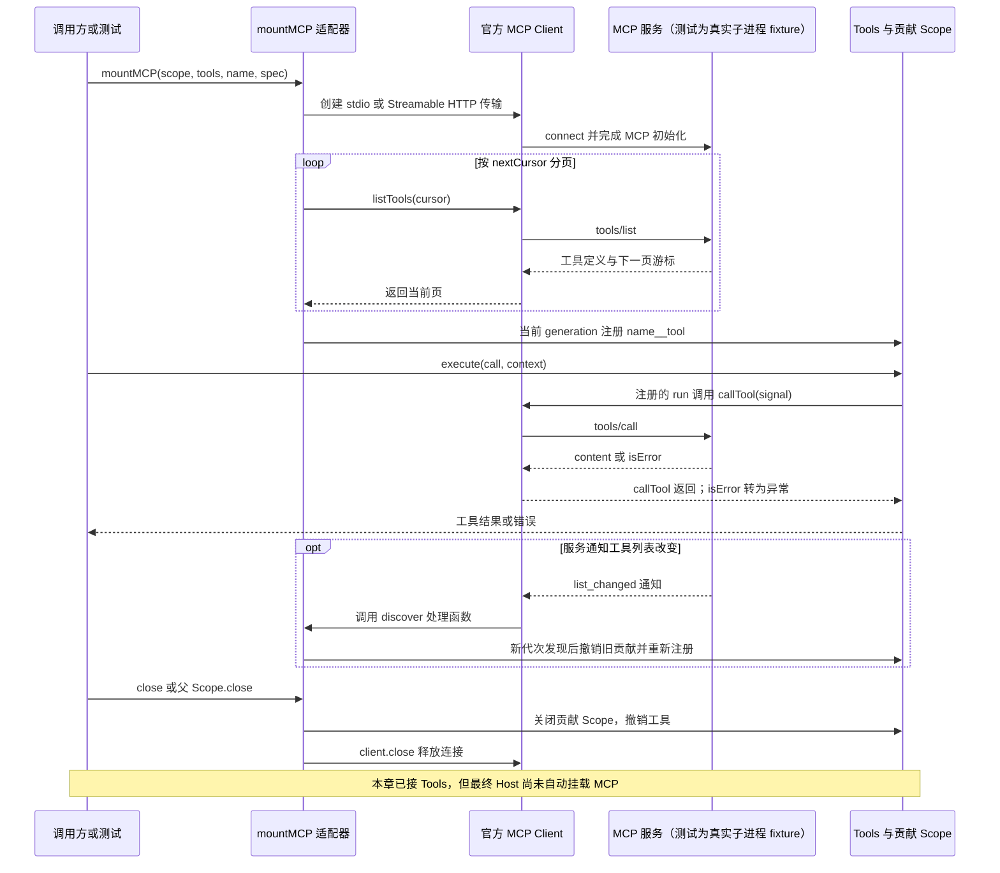
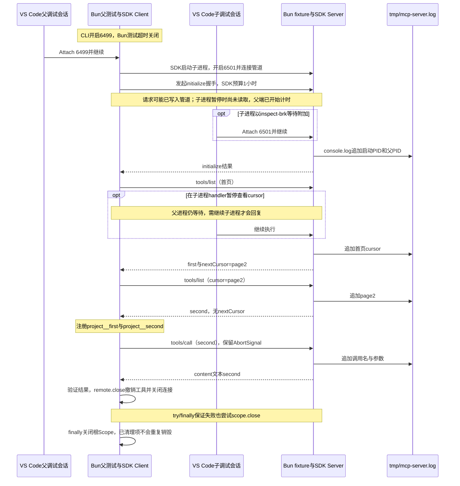

# 033 · 真正通过MCP发现和调用外部工具

阶段：R05。唯一前置：完成第 032 步，继续同一个工程。

<!-- harness-own-links:start -->
## 当前练习工程文件

以下链接指向 `harness-own` 的当前累计版本；本课下方的完整代码仍保留当步版本，二者可能不同。

[打开练习工程说明](../../../harness-own/README.md)

| 本课文件 | 当前练习工程文件 |
| --- | --- |
| `package.json` | [`harness-own/package.json`](../../../harness-own/package.json) |
| `src/mcp.mjs` | [`harness-own/src/mcp.mjs`](../../../harness-own/src/mcp.mjs) |
| `tests/033-mcp.test.mjs` | [`harness-own/tests/033-mcp.test.mjs`](../../../harness-own/tests/033-mcp.test.mjs) |
| `tests/fixtures/mcp.mjs` | [`harness-own/tests/fixtures/mcp.mjs`](../../../harness-own/tests/fixtures/mcp.mjs) |

<!-- harness-own-links:end -->

## 什么时候会用到这一页

外部MCP服务已经有工具，Agent不应另建第二张工具表。连接后分页发现工具，加服务器前缀注册到Tools，关闭连接时一并撤销，避免调用已失效服务。

### 这次数据怎么走

```text
mountMCP → SDK Client连接stdio或Streamable HTTP → listTools分页 → 当前generation构建Tools注册 → Tools.execute → client.callTool(signal) → 卸载贡献Scope撤销工具并close连接
```

### 对应时序图

从上往下读；实线箭头表示调用或发送，虚线箭头表示返回或事件通知。`opt`表示可选操作，`alt`表示不同结果，`loop`表示重复，`par`及其`and`分支表示并行；“未接入”及fixture说明按图中标注理解。



**当前接线位置：**033已经通过真实MCP进程调用Tools，但当前章没有模型。051 capabilities未调用mountMCP，最终Host没有自动装配MCP配置；后续没有证明Agent→MCP→服务的完整产品链。

## 这一步具体做什么

先写完src/mcp.mjs和tests/fixtures/mcp.mjs，按本章package.json安装依赖后运行 bun test ./tests/033-mcp.test.mjs。测试真实启动本地MCP服务进程；目录应出现project__first与project__second，执行second返回文本second，remote.close后目录为空。无需远端账户。

需要本章新文件的操作，先按下面代码创建文件，再执行；不要在上一步尚不存在的接口上试错。

## 代码为什么放在这一层

MCP适配器把外部协议翻译成现有Tools入口：模型看到的是统一工具名与schema，实际调用委托官方SDK。revision用于防止旧刷新覆盖新一代目录；Scope负责撤销注册，不代表已经自动取消所有在途副作用。

## 在哪里写、写什么

操作地点：终端中的 `$PROJECT`，编辑器打开同一个目录。只创建或替换下列文件，其他文件保留上一步版本。文件目录不存在先创建。

### 替换 [`package.json`](../../../harness-own/package.json)

````json
{
  "name": "harness-own",
  "version": "0.1.0",
  "type": "module",
  "private": true,
  "engines": {
    "bun": "1.3.14"
  },
  "scripts": {
    "start": "bun src/main.mjs",
    "test": "bun test ./tests"
  },
  "dependencies": {
    "@earendil-works/pi-ai": "1.1.0",
    "@modelcontextprotocol/sdk": "1.31.0"
  },
  "packageManager": "bun@1.3.14"
}
````

```sh
mkdir -p src
```

### 创建 [`src/mcp.mjs`](../../../harness-own/src/mcp.mjs)

````javascript
import { Client } from '@modelcontextprotocol/sdk/client/index.js'
import { StdioClientTransport } from '@modelcontextprotocol/sdk/client/stdio.js'
import { StreamableHTTPClientTransport } from '@modelcontextprotocol/sdk/client/streamableHttp.js'
import { ToolListChangedNotificationSchema } from '@modelcontextprotocol/sdk/types.js'
import { Scope } from './scope.mjs'

/** MCP连接是一个代次；断开/替换必须撤销该代次的工具。 */
export async function mountMCP(scope, tools, name, spec) {
  const client = new Client({ name: 'harness-own', version: '0.1.0' })
  const transport = spec.url ? new StreamableHTTPClientTransport(new URL(spec.url), { requestInit: { headers: spec.headers } }) : new StdioClientTransport({ command: spec.command, args: spec.args, env: spec.env })
  const owner = scope.child()
  owner.own(() => client.close())
  let contribution = new Scope(), revision = 0, chain = Promise.resolve()
  owner.own(() => contribution.close())
  try { await client.connect(transport) } catch (error) { await owner.close(); throw error }
  const discover = () => {
    const generation = ++revision
    chain = chain.then(async () => {
      const definitions = []; let cursor
      do { const page = await client.listTools(cursor ? { cursor } : undefined); definitions.push(...page.tools); cursor = page.nextCursor } while (cursor)
      if (generation !== revision || owner.closed) return
      const next = new Scope()
      await contribution.close(); contribution = next
      try {
        for (const definition of definitions) tools.register(next, {
          name: name + '__' + definition.name, description: definition.description ?? '', schema: definition.inputSchema,
          effect: 'network', exclusive: definition.annotations?.readOnlyHint !== true,
          async run(args, context) {
            const result = await client.callTool({ name: definition.name, arguments: args }, undefined, { signal: context.signal })
            if (result.isError) throw Error(JSON.stringify(result.content))
            return result.content
          },
        })
      } catch (error) { await next.close(); throw error }
    })
    return chain
  }
  client.setNotificationHandler(ToolListChangedNotificationSchema, discover)
  try { await discover() } catch (error) { await owner.close(); throw error }
  return { client, refresh: discover, close: () => owner.close(), instructions: client.getInstructions?.() ?? '',
    resources: async () => {
      const values = []; let cursor
      do { const page = await client.listResources(cursor ? { cursor } : undefined); values.push(...page.resources); cursor = page.nextCursor } while (cursor)
      return values
    },
    templates: () => client.listResourceTemplates(), read: uri => client.readResource({ uri }),
  }
}
````

```sh
mkdir -p tests
```

### 创建 [`tests/033-mcp.test.mjs`](../../../harness-own/tests/033-mcp.test.mjs)

````javascript
import { test } from 'bun:test'
import assert from 'node:assert/strict'
import { Scope } from '../src/scope.mjs'
import { Tools } from '../src/tools.mjs'
import { mountMCP } from '../src/mcp.mjs'

test('真实MCP跨进程握手、分页发现、调用及卸载', async () => {
  const scope = new Scope(), tools = new Tools()
  const remote = await mountMCP(scope, tools, 'project', { command: process.execPath, args: ['tests/fixtures/mcp.mjs'] })
  assert.deepEqual(tools.catalog().map(tool => tool.name), ['project__first', 'project__second'])
  const result = await tools.execute({ name: 'project__second', arguments: {} }, { signal: new AbortController().signal })
  assert.equal(result[0].text, 'second')
  await remote.close(); assert.equal(tools.catalog().length, 0)
  await scope.close()
})
````

```sh
mkdir -p tests/fixtures
```

### 创建 [`tests/fixtures/mcp.mjs`](../../../harness-own/tests/fixtures/mcp.mjs)

````javascript
import { Server } from '@modelcontextprotocol/sdk/server/index.js'
import { StdioServerTransport } from '@modelcontextprotocol/sdk/server/stdio.js'
import { ListToolsRequestSchema, CallToolRequestSchema } from '@modelcontextprotocol/sdk/types.js'

// 外部工具进程的固定样本，只替换外部系统，不替换Harness的MCP适配器。
const server = new Server({ name: 'fixture', version: '1' }, { capabilities: { tools: {} } })
server.setRequestHandler(ListToolsRequestSchema, request => ({ tools: [{ name: request.params?.cursor ? 'second' : 'first', inputSchema: { type: 'object', properties: {} } }], ...(request.params?.cursor ? {} : { nextCursor: 'page2' }) }))
server.setRequestHandler(CallToolRequestSchema, request => ({ content: [{ type: 'text', text: request.params.name }] }))
await server.connect(new StdioServerTransport())
````

## 运行命令与通过标准

```sh
cd "$PROJECT"
cp "$COURSE/locks/033.bun.lock" bun.lock
bun install --frozen-lockfile --ignore-scripts
bun test ./tests/033-mcp.test.mjs
bun test
```

测试应1项通过，覆盖真实stdio握手、两页发现、调用和卸载。没有实际验证HTTP、list_changed动态刷新、资源模板分页、OAuth或在途取消。

**本步证据的范围：**033-mcp.test.mjs启动真实官方SDK fixture，验证两页listTools、callTool和close卸载；固定样本替换外部服务而非MCP适配器。

## VS Code：断在哪里、看什么

按下方[033调试实操](#033调试实操父测试mcp子进程和日志文件)先验收基础测试，再完整替换列出的调试扩展文件，再在自己的PROJECT运行固定启动命令：父测试附加6499/mcp-parent-033，fixture子进程附加6501/mcp-033；先连接父进程并继续，等待它创建子进程，再建立子调试会话。父进程在src/mcp.mjs的client.connect、definitions.push、tools.register和client.callTool停下，看definitions.length=2与远端name="second"；子进程在tests/fixtures/mcp.mjs的分页和工具处理函数体停下，看cursor从undefined变为page2、工具name为second。--timeout 0关闭Bun测试时限，MCP_DEBUG=1才开启子Inspector并把SDK每次请求时限设为1小时；普通回归不带该开关。日志在PROJECT/tmp/mcp-server.log，用另一个终端tail -f查看。完整launch.json、preload和5份文件均在本页末尾，不能只附加父进程就等子进程断点命中。

操作位置：VS Code 打开的是自己的 `$PROJECT`，断点也设在这里的源码，不在教材的 `steps` 目录。

上面的说明若指定CLI、子进程、页面或Electron附加调试，就先按该流程操作；下面这组步骤只用于本章测试入口。“当前测试”不会自动附加子进程，也不会命中浏览器或Electron中的断点。

变量只在所属作用域可见：停在方法内部时看this和参数；要看测试里的局部变量，先在“调用堆栈”选择对应测试帧。正在等待的异步调用者不一定保留可求值的帧，此时在测试调用前后加断点再看，不把未定义误判成业务状态丢失。

沿用第 000 步安装的 Bun 扩展与 `.vscode/launch.json`；本章列出替换配置时，使用本章完整版本。

1. 打开本步测试文件 `tests/033-mcp.test.mjs`，保持它为当前编辑器文件。
2. 在上面指定的函数内单击行号左侧设置断点。
3. “运行和调试”选择 **Bun：当前测试**，按 F5；它执行当前测试，工作目录固定为 PROJECT。
4. 在“变量 / 监视 / 调用堆栈 / 调试控制台”检查状态；F10 逐行执行，F11 进入函数，Shift+F11 返回，F5 继续，Shift+F5 停止。

验收：断点实际命中，能说出当前输入、状态和下一步；只看到进程启动不算完成。长时间暂停会影响真实取消、审批和网络超时，先检查时序，不删超时断言。修正后在集成终端运行 `bun test ./tests/033-mcp.test.mjs`，再运行 `bun test`，保留全部断言。

## 不看答案，确认自己能解释

闭卷画出project__second→远端second名称映射；说明为什么关闭连接要移除工具，而不是仅把client变量设undefined。

完成后在 LEARNING.md 写一句实际结果和一个卡点。明天只重做这个卡点；第 3 天、第 7 天再做一次，能独立完成就继续下一页，不另开学习路线。

**再改一个条件验证：**安全练习：在固定fixture增加第三页并同步测试期望，验证do/while cursor；不要直接连接带写权限的真实服务试验。OAuth与重连需独立实现，当前spec.headers不是刷新流程。

## 与当前原版还差哪些

对照本仓库固定原版 `687f282e8625c6b8d11ff58211a90524be2e4317`；这里的“当前”指该本地基线，不是未经检查的上游最新版。

**这一页已经实现：**

- 官方MCP SDK stdio/HTTP传输选择
- 分页工具目录与前缀命名
- Scope撤销、generation刷新顺序
- 调用signal和isError处理
- 资源/模板/读取包装入口

**原版仍有、或本步尚未对齐的部分：**

- 原版mcp-client接入Loader配置、调用作用域、协议探测、服务指令快照与产品运行时；教程没有完整组合。
- 原版共享mcp-resources提供模型资源发现/读取路径；本章只返回辅助方法，没有相应工具/上下文接线。
- 当前测试仅stdio固定样本，尚未覆盖HTTP/OAuth、动态更新与故障恢复；不能因使用同一SDK宣称全功能相同。

**原版对照位置：**

- [packages/mcp/mcp-client/README.zh.md](../../../deepseek-harness/packages/mcp/mcp-client/README.zh.md)
- [packages/mcp/mcp-client/src/index.ts](../../../deepseek-harness/packages/mcp/mcp-client/src/index.ts)
- [packages/mcp/mcp-resources/README.zh.md](../../../deepseek-harness/packages/mcp/mcp-resources/README.zh.md)

本步测试通过只证明上面的具体行为；完整差距仍看 [COVERAGE.md](../COVERAGE.md)，不以文件数量、同名类或后面出现另一个模块代替接线证据。

下一步：[第 034 步](034.md)

## 033调试实操：父测试、MCP子进程和日志文件

先按 [教程README](../README.md) 初始化REPO、COURSE和PROJECT。操作地点始终是 `$PROJECT`，默认指向本仓库的 `harness-own/`；独立重做时沿用你明确选定的同仓练习目录。VS Code也打开这份练习目录，或在 `harness-course.code-workspace` 中选择 `harness-own` 文件夹。不要去教材的 `steps/033` 里运行测试。

这次只做一条完整流程：**先确认原测试能通过 → 按下方完整内容更新 5 个文件 → 普通运行验收 → 同时附加父、子两个进程 → 看文件日志 → 恢复普通运行。** 本节是让你手动复制的调试补充，教材不会自动修改你的工程。

### 第 1 步：先跑通普通测试

在练习工程根目录的终端执行：

```sh
cd "$PROJECT"
bun test ./tests/033-mcp.test.mjs
```

通过标准：`真实MCP跨进程握手、分页发现、调用及卸载` 显示通过。当前测试会启动真实的 Bun 子进程，发现两页工具、调用 `second`、关闭连接并撤销工具。fixture 返回的是固定工具样本，不涉及模型或付费请求。

如果这里失败，先修普通测试，别急着加入调试器。随后仍在这个工程里，按下文完整内容替换对应文件；不存在的目录先创建：

```sh
mkdir -p scripts tests/fixtures .vscode
```

### 第 2 步：先分清两个进程和两个超时

| 位置 | 跑的代码 | Inspector 地址 | 暂停时谁还在走 |
| --- | --- | --- | --- |
| 父进程 | `tests/033-mcp.test.mjs`、`src/mcp.mjs`、SDK Client | `6499/mcp-parent-033` | 子进程不会因此自动暂停。 |
| 子进程 | `tests/fixtures/mcp.mjs`、SDK Server | `6501/mcp-033` | 父进程仍可能在等待 RPC、计算超时。 |

只有给父进程加 `--inspect-brk`，fixture 不会自动变成同一个调试会话。下面用 `MCP_DEBUG=1` 明确要求父测试为子进程也开启 Inspector，两个进程各占一个端口。

| 超时 | 普通模式 | 本节调试模式 | 白话解释 |
| --- | --- | --- | --- |
| Bun 单个测试超时 | 默认 5,000 ms | CLI 加 `--timeout 0` | Bun 1.3.14 中表示关闭单测超时，已经用该版本实测。不是在 VS Code Attach 后临时改变，需要重新启动测试。 |
| MCP SDK 请求超时 | 默认 60,000 ms | `requestTimeout: 3_600_000` | 留 1 小时在断点里查看。这个值传给握手、工具分页、调用和本节暴露的辅助请求。 |

**两层必须分别设置。** 只加 `bun test --timeout 0`，停在子进程断点超过 60 秒，父进程仍可能报 MCP 请求超时。SDK 的 `timeout: 0` 会立即超时，不能拿它关闭 SDK 超时；本节选择明确的 1 小时预算。时间到了仍会超时，工具调用传入的 `AbortSignal` 也继续有效。

普通回归时不设置 `MCP_DEBUG`，适配器收到的 `requestTimeout` 是 `undefined`，SDK 仍使用默认 60 秒；普通 `bun test` 也恢复默认的 5 秒。调试预算只帮助看断点，不应拿来掩盖正常运行卡死。

### 文件 1：scripts/vscode-debug.mjs

文件位置：`$PROJECT/scripts/vscode-debug.mjs`。这是第 000 步的 preload 脚本，完整内容如下；已有同样内容就保留。

```js
/** 当前调试器已在启动时连接；这些地址只属于本进程，不能让子进程抢占。 */
export function clearInspectorEnvironment() {
  delete process.env.BUN_INSPECT
  delete process.env.BUN_INSPECT_NOTIFY
}

// 仅由 VS Code 的 --preload 加载，普通运行不加载此文件。
clearInspectorEnvironment()
```

`--preload` 让 Bun 在运行测试前先执行这个文件。删除的是当前环境表里将来可能被子进程继承的调试配置；父进程 Inspector 已按 CLI 参数启动，所以不会因此关闭父进程的调试连接。子进程自己的 `--inspect-brk=127.0.0.1:6501/mcp-033` 参数仍然有效。调试器只控制进程何时执行，业务请求和回复仍沿原来的 stdin/stdout 管道往返。

### 文件 2：src/mcp.mjs

文件位置：`$PROJECT/src/mcp.mjs`。在原有能力上增加可选 `spec.requestTimeout`，没有传时仍走 SDK 默认预算。`callTool` 保留 `context.signal`，关闭连接和撤销贡献的流程也保留。

```js
import { Client } from '@modelcontextprotocol/sdk/client/index.js'
import { StdioClientTransport } from '@modelcontextprotocol/sdk/client/stdio.js'
import { StreamableHTTPClientTransport } from '@modelcontextprotocol/sdk/client/streamableHttp.js'
import { ToolListChangedNotificationSchema } from '@modelcontextprotocol/sdk/types.js'
import { Scope } from './scope.mjs'

/** 一个连接对应一代工具贡献；可选requestTimeout仅控制SDK请求等待预算。 */
export async function mountMCP(scope, tools, name, spec) {
  const client = new Client({ name: 'harness-own', version: '0.1.0' }) // 当前连接的SDK客户端。
  const transport = spec.url
    ? new StreamableHTTPClientTransport(new URL(spec.url), { requestInit: { headers: spec.headers } })
    : new StdioClientTransport({ command: spec.command, args: spec.args, env: spec.env }) // HTTP或子进程管道传输。
  const requestOptions = { timeout: spec.requestTimeout } // undefined时SDK仍使用默认60000毫秒。
  const owner = scope.child() // 统一登记连接与本代工具的清理。
  owner.own(() => client.close())
  let contribution = new Scope() // 当前对Tools贡献的工具注册。
  let revision = 0 // 分辨异步发现结果是否已经过期。
  let chain = Promise.resolve() // 工具列表刷新按顺序执行。
  owner.own(() => contribution.close())
  try {
    await client.connect(transport, requestOptions)
  } catch (error) {
    await owner.close()
    throw error
  }

  /** 读完所有分页后，整体替换当前代次的工具贡献。 */
  const discover = () => {
    const generation = ++revision // 这次发现所属的代次。
    chain = chain.then(async () => {
      const definitions = [] // 汇集每页工具定义。
      let cursor // 服务端返回的下一页游标，不是数组下标。
      do {
        const page = await client.listTools(cursor ? { cursor } : undefined, requestOptions) // 每页请求都使用同一调试预算。
        definitions.push(...page.tools)
        cursor = page.nextCursor
      } while (cursor)
      if (generation !== revision || owner.closed) return
      const next = new Scope() // 先建立新一代注册的撤销范围。
      await contribution.close()
      contribution = next
      try {
        for (const definition of definitions) {
          tools.register(next, {
            name: name + '__' + definition.name,
            description: definition.description ?? '',
            schema: definition.inputSchema,
            effect: 'network',
            exclusive: definition.annotations?.readOnlyHint !== true,
            /** 自有工具入口转交MCP调用；取消信号仍传给SDK。 */
            async run(args, context) {
              const result = await client.callTool(
                { name: definition.name, arguments: args },
                undefined,
                { ...requestOptions, signal: context.signal },
              ) // SDK负责请求ID、等待回复和协议解析。
              if (result.isError) throw Error(JSON.stringify(result.content))
              return result.content
            },
          })
        }
      } catch (error) {
        await next.close()
        throw error
      }
    })
    return chain
  }

  client.setNotificationHandler(ToolListChangedNotificationSchema, discover)
  try {
    await discover()
  } catch (error) {
    await owner.close()
    throw error
  }
  return {
    client,
    refresh: discover,
    close: () => owner.close(), // 重复close仍由Scope保证撤销只执行一次。
    instructions: client.getInstructions?.() ?? '',
    /** 资源列表同样按nextCursor读完所有分页。 */
    resources: async () => {
      const values = [] // 收集所有资源，不只返回第一页。
      let cursor // 资源分页的游标。
      do {
        const page = await client.listResources(cursor ? { cursor } : undefined, requestOptions)
        values.push(...page.resources)
        cursor = page.nextCursor
      } while (cursor)
      return values
    },
    templates: () => client.listResourceTemplates(undefined, requestOptions), // 辅助请求同样使用预算。
    read: uri => client.readResource({ uri }, requestOptions), // read的参数仍是资源URI。
  }
}
```

这里的 fixture 只声明工具能力，没有声明资源能力；上面保留资源方法是维持适配器原接口，不要把调用 `resources()`、`templates()` 当成本 fixture 的通过标准。

### 文件 3：tests/033-mcp.test.mjs

文件位置：`$PROJECT/tests/033-mcp.test.mjs`。只在显式设置 `MCP_DEBUG=1` 时开启子进程 Inspector 和较长 SDK 预算；原来的三组断言完整保留，失败也进入 `finally` 关闭 Scope。

```js
import { test } from 'bun:test'
import assert from 'node:assert/strict'
import { Scope } from '../src/scope.mjs'
import { Tools } from '../src/tools.mjs'
import { mountMCP } from '../src/mcp.mjs'

test('真实MCP跨进程握手、分页发现、调用及卸载', async () => {
  const scope = new Scope() // 测试拥有子进程连接及注册工具。
  const tools = new Tools() // 当前测试使用的工具目录。
  const debugMcp = process.env.MCP_DEBUG === '1' // 普通测试不启动额外调试器。
  const args = debugMcp
    ? ['--inspect-brk=127.0.0.1:6501/mcp-033', 'tests/fixtures/mcp.mjs']
    : ['tests/fixtures/mcp.mjs'] // 子进程的Inspector参数必须写在脚本路径前。
  const requestTimeout = debugMcp ? 3_600_000 : undefined // 一小时只用于断点调试。
  try {
    const remote = await mountMCP(scope, tools, 'project', {
      command: process.execPath,
      args,
      requestTimeout,
    }) // 父进程停在这里时，可能正在等子进程的握手或分页回复。
    assert.deepEqual(tools.catalog().map(tool => tool.name), ['project__first', 'project__second'])
    const result = await tools.execute(
      { name: 'project__second', arguments: {} },
      { signal: new AbortController().signal },
    ) // 真实发送tools/call请求，仍提供取消信号。
    assert.equal(result[0].text, 'second')
    await remote.close() // 验证主动卸载，而不是只在测试结束时清理。
    assert.equal(tools.catalog().length, 0)
  } finally {
    await scope.close() // 断言或请求失败也尝试关闭连接、回收工具贡献。
  }
})
```

`args` 传给的是子进程 Bun。父测试进程的参数仍由后面完整的终端命令给出。`MCP_DEBUG` 在测试开始时读取，已经启动测试后再改环境变量不会影响这次运行。

### 文件 4：tests/fixtures/mcp.mjs

文件位置：`$PROJECT/tests/fixtures/mcp.mjs`。日志固定在当前文件所在工程的 `tmp/mcp-server.log`，不跟着终端 `cwd` 乱跑。普通 `console.log` 被改为追加文件，不碰 SDK 的协议输出。

```js
import { appendFileSync, mkdirSync } from 'node:fs'
import { format } from 'node:util'
import { Server } from '@modelcontextprotocol/sdk/server/index.js'
import { StdioServerTransport } from '@modelcontextprotocol/sdk/server/stdio.js'
import { ListToolsRequestSchema, CallToolRequestSchema } from '@modelcontextprotocol/sdk/types.js'

// 从tests/fixtures回到项目根目录，再定位tmp，不依赖启动命令的cwd。
const logDirectory = new URL('../../tmp/', import.meta.url)
mkdirSync(logDirectory, { recursive: true })
const logFile = new URL('mcp-server.log', logDirectory) // 所有运行追加到同一个文件。

/** 仅将console.log写文件；SDK仍可直接向stdout写协议消息。 */
console.log = (...args) => {
  const line = `[${new Date().toISOString()}] pid=${process.pid} ${format(...args)}\n` // 一条调用写一行。
  appendFileSync(logFile, line, 'utf8')
}

console.log('MCP服务启动', { pid: process.pid, parentPid: process.ppid })

// 固定外部工具样本；服务端和传输仍使用真实MCP SDK。
const server = new Server({ name: 'fixture', version: '1' }, { capabilities: { tools: {} } })

/** 第一页给first与下一页游标，第二页给second且不再给游标。 */
server.setRequestHandler(ListToolsRequestSchema, request => {
  const cursor = request.params?.cursor // 由客户端原样送回的分页标记。
  console.log('tools/list', { cursor: cursor ?? '(首页)' })
  return {
    tools: [{ name: cursor ? 'second' : 'first', inputSchema: { type: 'object', properties: {} } }],
    ...(cursor ? {} : { nextCursor: 'page2' }),
  }
})

/** 返回请求中的工具名，让父测试验证调用确实经过子进程。 */
server.setRequestHandler(CallToolRequestSchema, request => {
  const name = request.params.name // 这里收到second，不带父进程的project__前缀。
  console.log('tools/call', { name, arguments: request.params.arguments })
  return { content: [{ type: 'text', text: name }] }
})

await server.connect(new StdioServerTransport())
console.log('stdio传输已连接，等待MCP请求')
```

**为什么不能直接 `console.log('收到请求')` 到 stdout？** 这个子进程的 stdout 是 MCP 协议管道，父进程会把每一行当协议读。混入一句普通日志就可能得到 JSON 解析错误。这里重定向的是 fixture 的 `console.log`，SDK 的 `StdioServerTransport` 仍按原方式写协议，不会把回复藏进日志文件。`console.error` 仍写 stderr；此补充只要求 `console.log` 写文件。

`node:fs`、`node:util` 是 Bun 支持的 Node 兼容模块名，运行进程仍是 Bun，并没有换回 Node.js。写文件用同步追加是为了让这份小 fixture 日志在断点和退出时容易观察；它不是大量业务日志的异步队列方案。

### 文件 5：.vscode/launch.json

文件位置：`$PROJECT/.vscode/launch.json`。下面是可直接复制的完整配置，保留第 000 步 CLI 与当前测试入口、032 父子两个 Attach，再增加 033 父子两个 Attach。若你另外加过自己的配置，先保存副本，再把自己的项合并回 `configurations`。

```json
{
  "version": "0.2.0",
  "configurations": [
    {
      "name": "Bun：CLI 入口",
      "type": "bun",
      "request": "launch",
      "program": "${workspaceFolder}/src/main.mjs",
      "cwd": "${workspaceFolder}",
      "runtime": "bun",
      "runtimeArgs": ["--preload", "${workspaceFolder}/scripts/vscode-debug.mjs"],
      "args": ["读取 README"],
      "stopOnEntry": false
    },
    {
      "name": "Bun：当前测试",
      "type": "bun",
      "request": "launch",
      "program": "${file}",
      "cwd": "${workspaceFolder}",
      "runtime": "bun",
      "runtimeArgs": ["test", "--timeout", "0", "--preload", "${workspaceFolder}/scripts/vscode-debug.mjs"],
      "stopOnEntry": false
    },
    {
      "name": "Bun：032跨进程RPC主进程",
      "type": "bun",
      "request": "attach",
      "url": "ws://127.0.0.1:6499/rpc-032"
    },
    {
      "name": "Bun：032 RPC worker子进程",
      "type": "bun",
      "request": "attach",
      "url": "ws://127.0.0.1:6500/rpc-worker-032"
    },
    {
      "name": "Bun：033 MCP父测试进程",
      "type": "bun",
      "request": "attach",
      "url": "ws://127.0.0.1:6499/mcp-parent-033"
    },
    {
      "name": "Bun：033 MCP子进程",
      "type": "bun",
      "request": "attach",
      "url": "ws://127.0.0.1:6501/mcp-033"
    }
  ]
}
```

`program: "${file}"` 表示当前编辑器打开的文件，适合选择 `Bun：当前测试` 再按 F5 启动当前测试。它启动新父进程，并不会自动 Attach fixture。这里没有为该配置永久设置 `MCP_DEBUG=1`，所以单独选它运行 033 时，子进程正常执行，断点只覆盖父侧。

本节双进程调试仍统一使用下一步的终端命令，再选择两个 Attach 配置。032 与 033 的父进程都用 6499，不要同时启动这两章的调试。

你当前安装的 Bun 扩展 0.0.32 中，快捷命令 `Bun: Debug File` 不读取上述具名 `launch.json` 配置，也不会弹出参数输入框。要使用 `--timeout 0` 和 preload，选“运行和调试”里的 `Bun：当前测试`；要调本节父子进程，按下面的固定流程 Attach。这个扩展行为结论针对已检查的本机版本，不是所有未来版本的承诺。

### 第 3 步：更新完先普通验收

仍在终端执行，不要设置 `MCP_DEBUG=1`：

```sh
cd "$PROJECT"
bun test ./tests/033-mcp.test.mjs
```

通过标准：断言仍全部通过，并出现 `tmp/mcp-server.log`。打开文件，找到同一子进程 PID 的启动记录、两次 `tools/list` 和一次 `tools/call`。分页 cursor 先是 `(首页)`，再是 `page2`；调用名是 `second`。

日志是追加，不是覆盖。多运行一次会多一组记录，用 `pid` 区分；别把上一次留下的成功日志当成本次验收。

### 第 4 步：按固定顺序同时附加父子进程

先在 VS Code 里打开以下文件并设断点：

| 文件 | 断点位置 | 当前进程里看什么 |
| --- | --- | --- |
| `src/mcp.mjs` | `await client.connect(transport, requestOptions)` | 父进程：`spec.args` 含 6501，`requestOptions.timeout` 为 3,600,000。 |
| `src/mcp.mjs` | `client.listTools(...)` 前后 | 父进程：`cursor`、`page.nextCursor`、`definitions`。若停在 await 前，`page` 尚未赋值。 |
| `tests/fixtures/mcp.mjs` | `ListToolsRequestSchema` handler 的 `console.log` | 子进程：`cursor` 先为 undefined、再为 page2；`process.pid`。 |
| `tests/fixtures/mcp.mjs` | `CallToolRequestSchema` handler 的 `console.log` | 子进程：`name` 为 second、`request.params.arguments` 为 `{}`。 |
| `src/mcp.mjs` | `client.callTool(...)` 前后 | 父进程：转发前去掉 project__ 前缀，回复 `result.content[0].text` 为 second。 |
| `tests/033-mcp.test.mjs` | `await remote.close()` 前与之后的断言 | 父进程：卸载前目录两项，卸载后 `tools.catalog().length` 为 0。 |

在练习工程终端执行完整命令：

```sh
cd "$PROJECT"
MCP_DEBUG=1 bun --inspect-brk=127.0.0.1:6499/mcp-parent-033 test --timeout 0 --preload ./scripts/vscode-debug.mjs ./tests/033-mcp.test.mjs
```

然后严格按顺序操作：

1. VS Code“运行和调试”选择 **Bun：033 MCP父测试进程**，F5 附加 6499。父进程启动时暂停是正常状态。
2. 让父进程继续执行，越过你设置的断点，直到 `client.connect` 启动 MCP 子进程。如果父进程还停在创建子进程之前，6501 尚不存在，此时附加它一定失败。
3. 再选择 **Bun：033 MCP子进程**，点击配置旁的绿色启动按钮，建立第二个调试会话。这里要新增子调试会话，不是只按 F5 继续当前父会话。子进程以 `--inspect-brk` 启动，会等你附加并继续。
4. 在调用堆栈或调试工具栏切换父、子会话。子进程继续后会处理握手，随后在分页和工具调用的 handler 断点停下。
5. 父进程执行到 `await` 时，需要负责回复的子进程继续运行。别让子进程一直停着，却指望父进程单步拿到回复。
6. 让本次测试完整结束，确认断言通过、卸载后目录为空。然后按第 6 步用普通模式再跑一次。

另外开一个终端实时看日志：

```sh
cd "$PROJECT"
tail -f ./tmp/mcp-server.log
```

先普通跑过第 3 步，日志文件才存在；`tail -f` 可以随时 Ctrl+C 停止，不影响测试。父进程日志和 Inspector 启动信息仍可能显示在测试终端，只有 fixture 的 `console.log` 被写入上述文件。

**不要手动 `bun --inspect-brk ... tests/fixtures/mcp.mjs` 另起 fixture 来代替第 3 个动作。** 本测试的父进程通过 `StdioClientTransport` 自动创建子进程，并持有那份子进程的 stdin/stdout 管道。你手动新开的 fixture 有另一套管道，父测试没有连接它；看起来服务在等输入，也不会命中这次测试的请求。

### 原有数据流保留，再对应到调试时序

```text
mountMCP → SDK Client连接stdio或Streamable HTTP → listTools分页 → 当前generation构建Tools注册 → Tools.execute → client.callTool(signal) → 卸载贡献Scope撤销工具并close连接
```

上面仍是本章原有的数据流。下图只展开这次 **stdio 双进程调试**；HTTP 分支没有子进程，也不经过 6501。暂停是你调试时的动作，不是每次工具调用必然发生的业务步骤。



### 第 5 步：常见卡点按这个顺序定位

| 看到的现象 | 稳定复现与原因 | 怎么处理 |
| --- | --- | --- |
| `this test timed out after 5000ms` | 用普通 `bun test` 启动，再把执行暂停超过 5 秒；断点暂停照样消耗测试预算。 | 结束旧测试，用本节完整命令重新启动。Attach 本身不能修改测试超时。 |
| Bun 不超时，MCP 仍在约 60 秒后报错 | 只加 `--timeout 0`，却没把 `requestTimeout` 从测试传进 `mountMCP`，或漏传给 `connect`/`listTools`/`callTool`。子进程暂停时父请求仍在计时。 | 在父进程检查 `debugMcp` 与 `requestOptions.timeout`。必须为 3,600,000，三处请求都传入。这里不靠 sleep 模拟超时。 |
| 6501 连接被拒绝 | 父进程还没继续到创建 transport，或没设置 `MCP_DEBUG=1`。 | 先附加父、继续到创建子进程，再附加子；核对 `args`。 |
| 地址占用、附加到旧进程 | 上一次父/子测试还没结束，又用同一端口启动第二次。032 与 033 的父端口也同为 6499。 | 停止旧测试终端，确认旧子进程退出，再重新启动。用下方命令查当前监听者，按 PID 确认归属；不要直接杀不认识的进程。 |
| 父进程 F10 一直不返回 | 父进程正跨过 await 等子回复，而子进程停在 handler 断点。 | 切到子调试会话，继续执行；两个进程的断点和局部变量不是一份。 |
| fixture 断点完全不命中 | 只附加了 6499，或者手动单开 fixture，父测试连的是另一个子进程。 | 按本节固定顺序附加 6501；不要单独另起 fixture 替代 transport 创建的那个进程。 |
| 日志找不到或看到了旧日志 | 还没运行新 fixture，或 tail 指向另一份工程的 tmp。 | 先普通跑一次，核对 fixture 文件的真实位置和 `logFile.href`。这里路径基于 `import.meta.url`，不是 cwd；按 PID 看本次记录。 |
| 增加日志后协议报 JSON 错误 | 把普通文本写到了 fixture 的 stdout，例如 `process.stdout.write('调试日志')`。 | 恢复此处文件日志写法。不要把整个 stdout 重定向到文件，那会连 SDK 协议回复一起截走。 |

检查端口的终端命令：

```sh
lsof -nP -iTCP:6499 -sTCP:LISTEN
lsof -nP -iTCP:6501 -sTCP:LISTEN
```

关闭 VS Code 的 Attach 会话和确认测试、子进程都已经退出是两件事。中途打断时，先在启动测试的终端 Ctrl+C，再确认没有属于本次测试的残留监听；若存在，核对 PID 后终止那份残留进程再重试。`finally` 负责正常控制流中的清理，不能保证强制杀进程时仍有机会执行。

### 第 6 步：完成标准与闭卷检查

验收时逐项确认：

- 普通 `bun test ./tests/033-mcp.test.mjs` 全部断言通过，不需要 MCP_DEBUG，也不会等 Inspector。
- 调试时父、子两个会话都连接成功，分别命中 `src/mcp.mjs` 与 fixture 的断点；父子 PID 不同。
- 子进程实际收到两页请求，第二页 cursor 是 `page2`；实际调用工具名是 `second`。
- `tmp/mcp-server.log` 追加本次 PID 的日志；工具回复仍沿管道返回，父断言得到 `second`。
- 主动卸载后 `tools.catalog().length` 是 0；测试最终关闭根 Scope。
- 能解释 `--timeout 0` 关闭的是 Bun 单测超时，而 MCP SDK 调试预算仍是有限的 1 小时。

最后结束本次调试，在同一个工程根目录再跑普通模式：

```sh
cd "$PROJECT"
bun test ./tests/033-mcp.test.mjs
```

闭上文档，先口述“父进程哪里发起调用、子进程哪里接收、回复如何返回”，再只看自己记下的两个地址，重新完成一次双 Attach。如果卡住，只重做卡住的那一步；在 `LEARNING.md` 写下“卡在哪、看到什么、怎么确认修好”。隔天再做一次，只在能解释时继续后面的教程。

本节没有新增业务协议或宣称对齐原版全部 MCP 能力；它补的是现有跨进程测试的调试接线与诊断日志。VS Code 操作步骤需要你在本机交互验收，不能仅凭配置文件存在就算完成。
