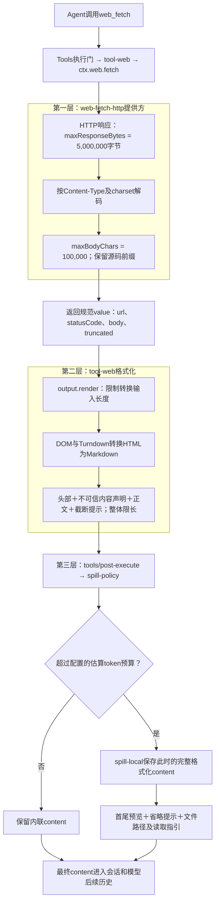

# 034 · 网页抓取、来源与网络边界

阶段：R05。唯一前置：完成第 033 步，继续同一个工程。

## 什么时候会用到这一页

Agent收到一个网页链接，需要跟随重定向取正文，同时不能默认访问本机管理端口或云内网。搜索Key应由宿主配置，不应让模型放在工具参数中。

### 这次数据怎么走

```text
Web.fetchText(url,signal) → URL与DNS地址检查 → 手工跟随每次跳转再检查 → 读取有界UTF-8正文 → 去script/style/标签 → 返回url/text；search单独POST到配置提供方
```

**当前接线位置：**本章通过真实本地HTTP测试；051注册web_fetch与web_search，但Web()没有searchURL/searchKey，最终web_search会明确报未配置，不是已启用搜索服务。

## 这一步具体做什么

写完src/web-tools.mjs和测试再运行 bun test ./tests/034-web.test.mjs。测试启动127.0.0.1临时HTTP服务，默认Web抓取应因私网拒绝；仅测试显式allowLocal=true后才跟随/go→/page，得到中文正文且不含bad()。不需要公网搜索Key。

需要本章新文件的操作，先按下面代码创建文件，再执行；不要在上一步尚不存在的接口上试错。

## 代码为什么放在这一层

Web是网络请求提供方，不是浏览器：没有JavaScript执行、页面交互或完整HTML语义提取。URL检查解决目标粗筛；检查DNS和实际fetch之间仍可能变化，不能把它当DNS绑定级网络隔离。 原版的下载/解码预算、HTML转Markdown及工具输出预算、通用Spill是分层能力；Spill只保存到达它时的格式化结果，无法恢复前面截掉的HTML，见本页大HTML例子和调用链图。

## 原版怎样处理大HTML：三层预算不是一回事

你让Agent读取一篇很长的网页，希望正文不要挤满模型上下文，需要时还能继续查。这涉及三个不同问题：网络最多下载多少、HTML怎样转换为可读内容、工具结果给模型保留多少。原版将它们放在不同层，Spill只负责最后一个问题。

以下按本仓库原版基线`687f282e8625c6b8d11ff58211a90524be2e4317`的HTTP抓取路径解释。配置可以覆盖默认值；其他抓取提供方可能直接返回文本，不经过同样的HTTP预算。

### 一次web_fetch的实际调用链



图里的“完整格式化content”指进入Spill时那份完整内容，不是完整网络响应。前面的抓取、源码切片和格式化上限若已经丢弃内容，Spill不会重新下载或逆向还原它。图中落盘分支表示保存成功；失败时的行为见下文。

### 每层限制的对象、单位和超限行为

| 所在层 | 配置及默认值 | 限制什么 | 超过时怎么办 |
| --- | --- | --- | --- |
| HTTP提供方 | `maxResponseBytes = 5_000_000` | 响应主体字节，包含HTML标签和脚本等 | 有效Content-Length已声明超限就取消并报`WEB_FETCH_TOO_LARGE`；没有预先拒绝、实际读取超过时，只保留字节前缀、取消后续读取，标记截断。 |
| HTTP提供方 | `maxBodyChars = 100_000` | 解码后的HTML或文本 | 保留前缀，设置`truncated=true`。HTML此时还没去脚本或转Markdown。 |
| web_fetch工具 | `fetchMaxOutputChars = 200_000` | 同步转换的源内容长度，以及最终完整格式化文本长度 | 转换前限制输入；转换后连同URL头部、不可信内容声明和截断提示一起限长。 |
| 通用Spill策略 | base组合设置`maxInlineTokens = 12_500` | 进入保留阶段的工具content，使用估算token | 预算内不改；超预算且存储成功时，落盘后以首尾预览和恢复指引替换内联content。 |

前三项分别是提供方或工具的默认配置；Spill插件本身没有固定默认阈值，省略`maxInlineTokens`就不启用保留策略，12,500来自base组合。这里的字符长度按JavaScript字符串长度计算，不是UTF-8字节数；估算token也不是精确的模型token计数。

HTTP路径先把解码内容限制到100,000，所以通常不会再触发工具200,000的转换输入上限。工具仍需独立限制，因为别的提供方可能返回更长内容，而且转换、链接和包装文本可能使输出长度变化。限长不是大页面的自动分页，`web_fetch`参数仍只有URL。

### “正文提取”具体做了什么

原版不是简单用正则删标签。`tool-web`通过DOM和Turndown转换成Markdown，并支持GFM表格、删除线等结构。它会过滤script、style、noscript、template、iframe等元素，以及hidden、aria-hidden和部分内联样式标记的不可见内容；标题、链接、列表、代码块等按Markdown呈现。

但这不等于Readability式的文章主体识别：可见导航、页脚、推荐链接仍可能进入结果；不会运行网页JavaScript，也不会完整计算浏览器CSS布局。需要浏览器才能生成的内容，不能靠这个HTTP抓取器自动获得。

转换还会检查嵌套深度，超过512层或转换异常时返回固定省略标记，不把原始HTML当作降级结果直接塞给模型。正文是普通text时无需HTML转换，但仍经过输出包装与限长。

有任何提供方截断、转换前切片或整体输出截断时，工具会标记结果并追加类似提示：

```text
(Content truncated. Fetch a more specific URL or section for the full text.)
```

它的意思是“本次结果不完整，请换更具体的URL”，不是“完整HTML已经被Spill保存”。

### Spill究竟保存哪份内容

工具先把返回value校验、固定，并通过`output.render`生成面向模型的content。通用`tools/post-execute`策略完成接纳后，Spill检查当时的content；如果超预算，调用`spillStore.saveText`保存完整格式化文本，再构造首尾预览。

```text
前面的内容……

[...]

后面的内容……

（省略量；Full formatted result stored at: 某个文件路径；read/grep读取指引）
```

之后可用`read`的offset/limit或grep查这个文件。原版策略显式跳过read结果，避免“读取Spill文件→再次Spill→再读取”的循环。Spill改变的是给模型的content副本，规范工具value不会被这个策略改写；但value在提供方阶段本来就可能只剩HTML前缀。

没有会话owner、没有后端、写盘失败或预算连提示本身都装不下时，策略记录警告并保留原内联内容，不把成功抓取改成失败。因此Spill不是任何情况下都能保证生效的硬上限。它也不是网络边下载边保存完整HTML的归档器。

### 估算token的公式：长度除以4，再加每块开销

原版`token-meter/estimate.ts`没有在这条文本估算路径中调用具体模型的tokenizer，而是使用固定密度：每4个JavaScript字符串长度单位约算1个token，每个文本块再加4个结构开销。

```js
// 只展示原版纯文本块的估算规则，不是精确模型分词器。
const estimateText = text => Math.ceil(text.length / 4) + 4
```

`Math.ceil`表示向上取整：长度5除以4得到1.25，按2计算，再加4，结果为6。4个结构开销用于粗估内容块的包装，不是每个字符都加4。多个块分别估算再相加；Spill这里检查content，不额外套一遍完整消息的角色开销。

以下假设只有一个文本块，而且长度包括工具已经加入的URL头部、不可信内容声明、正文等全部文本：

| 文本的JS长度 | 计算 | 估算token | 对12,500预算的判断 |
| ---: | --- | ---: | --- |
| 100 | `ceil(100 / 4) + 4` | 29 | 未超限 |
| 1,000 | `ceil(1000 / 4) + 4` | 254 | 未超限 |
| 49,984 | `ceil(49984 / 4) + 4` | 12,500 | 恰好预算内，不触发Spill |
| 50,000 | `ceil(50000 / 4) + 4` | 12,504 | 超限，尝试Spill |
| 60,000 | `ceil(60000 / 4) + 4` | 15,004 | 超限，尝试Spill |

所以不能把12,500估算token简单当作“正文最多50,000字符”：块开销、输出包装，以及发生Spill时需要保留的提示都要占空间。图片也不能直接套这个文本公式，Spill会使用当前模型提供方的图片计价接口，再计算相应描述文本。

### 字符串长度、字节数和真实token数的区别

| 数量 | 怎么得到 | 在这里用于什么 |
| --- | --- | --- |
| JavaScript字符串长度 | `text.length`，计算UTF-16代码单元 | 解码/输出长度限制，以及文本token粗估。不是可见字数，也不是字节数。 |
| UTF-8字节数 | `Buffer.byteLength(text, 'utf8')`或UTF-8编码后的字节长度 | 响应主体预算、文件大小，以及Spill提示里的省略字节量。 |
| 真实token数 | 对应模型的tokenizer按实际输入编码；模型接口的usage按其口径报告用量 | 精确模型用量需要匹配模型及实际请求，不能用长度公式代替。 |

用Bun运行下面的本地表达式，不需要请求模型：

```js
// 对比同一段文字在内存中的JS长度与UTF-8传输长度。
for (const text of ['A', '中', '中文', '😀']) {
  console.log(text, text.length, Buffer.byteLength(text, 'utf8'))
}
// A    1 1
// 中   1 3
// 中文 2 6
// 😀   2 4
```

例如“中文”在JS里长度2，UTF-8是6字节；公式对这一个文本块估算`ceil(2 / 4) + 4 = 5`。这个5不是断言模型会把“中文”分成5个token。中文、英文、代码和不同模型的分词方式都可能偏离固定密度，因此本策略只能叫估算预算，不能叫真实上下文token的严格保证。

模型请求还可能包含其他历史、工具Schema与角色包装；接口报告的整次请求usage也不能直接当成这一个网页文本块的token数。

### Spill怎样预留省略提示的预算

超限并且能落盘后，原版不会把全部12,500都留给正文，否则再追加文件路径就会超预算。实际顺序是：

```text
估算完整content是否超过maxInlineTokens
  → 先保存此时完整格式化文本，拿到实际文件路径和读取提示
  → 用全部原文的UTF-8字节数、全部图片数构造保守的省略提示
  → reserved = 省略分隔符GAP的估算成本 + 带换行的提示块估算成本
  → 正文预算 = max(0, maxInlineTokens - reserved)
  → 开头分到ceil(正文预算 / 2)，结尾分到floor(正文预算 / 2)
  → 在各自预算内保留连续首尾，生成实际省略字节量的最终提示
```

路径长度和提示文字会影响reserved，它不是写死的100或某个固定比例。比如**假设这次GAP与提示共预留100估算token**，则12,500减100剩12,400，开头和结尾各分6,200。这个100只是算术示例，不是原版默认配置。

剩余预算还包含保留文本块自身的结构开销。原版通过二分搜索找能装下的连续文本长度，而不是直接拿“token预算乘4”切片；切片会避免把emoji的UTF-16代理对从中间切断。最后再合并相邻文本块，不据此恢复被省略的正文或上游HTML。

提示中的“Omitted N bytes”计算的是实际省略的UTF-8字节量，判断是否要Spill及保留多少却使用估算token，二者单位不同。如果提示本身都装不下，或落盘失败，就按前面的失败边界记录警告并保留原内容，不假装预算已经满足。

### 具体例子一：HTML被截了，Spill无法补回来

假设网页响应为2,000,000字节，解码后有400,000个字符串长度单位，原版使用上面的默认HTTP配置：

1. 响应未超过5,000,000字节，HTTP层可以读完。
2. 解码后超过100,000，只保留前100,000源码，后300,000丢弃，标记truncated。
3. 对这份源码前缀转Markdown。假设转换和包装后得到约60,000长度的文本；这个数仅用于举例，并非固定压缩比。
4. 若估算token超过12,500，Spill保存这份约60,000长度的格式化结果，并返回预览和路径；未超过就直接返回。

**读取Spill文件，只能取回第3步得到的格式化结果。第2步已经丢掉的300,000源码不在里面；如果真正文章主体恰好在后面，Spill也找不回来。**

这也说明原版没有保证“任意大HTML都能完整提取正文”。需要完整归档或更精确的内容获取，是另一个能力，不能从已有Spill推导出来。

### 具体例子二：Content-Length与流超限不同

同样是6,000,000字节响应：

- 服务器预先正确声明Content-Length为6,000,000：HTTP提供方立即拒绝，不进入HTML转换，也不会为此次失败保存完整网页。
- 服务器没有声明长度，或声明偏小：读取时超过5,000,000才发现，原版保留允许范围内的字节前缀并取消后续读取；后面还有100,000解码长度、工具输出和Spill预算。

这里的截断也不会替你发起第二个范围请求取剩余HTML。换具体URL、提供方或明确新增归档能力，不能只反复读取同一份Spill文件。

### 具体例子三：HTML很大，真正可读内容很少

HTML有2 MB，其中绝大多数是脚本，而正文只有几句话。034会在原始响应超过1 MiB时直接失败，尚未来得及删脚本。原版默认HTTP字节预算更大，但仍先按解码源码截到100,000，再做DOM转换：如果前面都是脚本、正文在后面，依然可能丢失正文。

因此“DOM转换比正则更可靠”和“能完整读取任何长网页”不是同一个结论；Spill也只在最后的工具结果确实超预算时介入。

### 034当前实现与原版的差距

| 能力 | 034当前代码 | 本地原版对应路径 |
| --- | --- | --- |
| HTTP主体预算 | 超过1 MiB直接抛错 | 区分声明超限拒绝与实际流截断，并取消未继续消费的读取。 |
| 解码和内容分类 | 固定UTF-8解码后去标签 | 按Content-Type和charset分类/解码，拒绝不支持类型，另设解码长度上限。 |
| HTML转换 | 正则去script/style和标签 | DOM转换Markdown、隐藏内容过滤和转换复杂度防护。 |
| 工具整体输出 | 返回url/text，没有独立输出上限 | URL/状态/不可信内容声明/正文/截断提示整体限长。 |
| 截断可观察性 | 不返回truncated，超限只有异常 | 提供方和工具展示记录有效截断状态。 |
| 可恢复的大结果 | 未接Spill | 统一工具后置策略保存格式化结果，返回首尾预览与恢复路径。 |
| 大页面验收 | 当前测试只有小HTML、302和script过滤 | 034尚无字节/字符边界、复杂HTML转换、结果限长及Spill集成测试。 |

019虽然已有Spill辅助函数，034与051的web_fetch并没有调用它；不能因为前面有一个同名模块就认为这条链已接好。本文解释原版行为，没有替034实现这些缺失功能。

### 对照源码与调试观察

以下链接从本章Markdown出发，指向固定原版的实际文件；不把原版代码复制进自己的运行工程：

- [HTTP默认预算](../../../deepseek-harness/packages/web/web-fetch-http/src/index.ts)、[readCapped/readBody](../../../deepseek-harness/packages/web/web-fetch-http/src/provider.ts)：看声明长度、实际累计字节、decoded.length和truncated。
- [工具默认预算](../../../deepseek-harness/packages/web/tool-web/src/index.ts)、[renderBody/computeFetchOutput](../../../deepseek-harness/packages/web/tool-web/src/fetch.ts)：看HTML源码前缀、转换后文本、最终包装长度，区别提供方截断和工具截断。
- [工具结果渲染与后置策略](../../../deepseek-harness/packages/core/tools/src/index.ts)、[Spill的bound与post-execute处理](../../../deepseek-harness/packages/spill/spill-policy/src/index.ts)：看saveText传入content来自哪一层。
- [base组合的12,500估算token预算](../../../deepseek-harness/packages/bundle/base/cordis.patch.yml)、[落盘和读取提示](../../../deepseek-harness/packages/spill/spill-local/src/index.ts)。
- [文本估算公式与块开销](../../../deepseek-harness/packages/llm/token-meter/src/estimate.ts)、[首尾预算及文本切片](../../../deepseek-harness/packages/spill/spill-policy/src/retention.ts)：区分JS长度、UTF-8省略字节数与估算token，不用其中一个冒充另一个。

在自己的034测试里，VS Code只会命中`src/web-tools.mjs`，不会命中原版上述实现。可在bytes累加、超限条件和返回text处观察当前行为；原版函数名在这里用于源码对照，不代表本次测试已经执行它们。当前小HTML测试也不会自然走到超限分支，新增大响应场景是尚待编写的测试，不在文档中冒充已通过。

合上本节，画出“原始HTML→提供方前缀→格式化结果→Spill预览”四份数据；在每条箭头旁标注可能丢弃什么。再回答：为什么拿到Spill路径，仍然不能断言完整网页已经保存？

## 在哪里写、写什么

操作地点：终端中的 `$PROJECT`，编辑器打开同一个目录。只创建或替换下列文件，其他文件保留上一步版本。文件目录不存在先创建。

```sh
mkdir -p src
```

### 创建 `src/web-tools.mjs`

````javascript
import { lookup } from 'node:dns/promises'

/** 网络策略先检查目的地，再处理每一次重定向；Key不进入模型参数。 */
export class Web {
  constructor({ allowLocal = false, searchURL, searchKey, fetcher = fetch } = {}) { this.allowLocal = allowLocal; this.searchURL = searchURL; this.searchKey = searchKey; this.fetcher = fetcher }
  async check(value) {
    const url = new URL(value)
    if (!['http:', 'https:'].includes(url.protocol) || url.username || url.password) throw Error('URL不合法')
    if (!this.allowLocal) {
      const addresses = await lookup(url.hostname, { all: true })
      if (addresses.some(({ address }) => /^(127\.|10\.|192\.168\.|169\.254\.|172\.(1[6-9]|2\d|3[01])\.|0\.|::1$|fc|fd|fe80)/i.test(address))) throw Error('私网目的地被拒绝')
    }
    return url
  }
  /** 固定最大正文、超时与跳转次数。DNS绑定的强隔离需要网络沙箱补强。 */
  async fetchText(value, signal) {
    for (let redirects = 0; redirects < 5; redirects++) {
      const url = await this.check(value)
      const response = await this.fetcher(url, { signal: AbortSignal.any([signal, AbortSignal.timeout(10_000)]), redirect: 'manual' })
      if (response.status >= 300 && response.status < 400) { value = new URL(response.headers.get('location'), url).href; continue }
      if (!response.ok) throw Error('网页HTTP ' + response.status)
      let bytes = 0, text = '', decoder = new TextDecoder()
      for await (const chunk of response.body) { bytes += chunk.length; if (bytes > 1024 * 1024) throw Error('网页正文超限'); text += decoder.decode(chunk, { stream: true }) }
      text += decoder.decode()
      // 仅生成可显示文本，不把抓取的HTML注入页面；复杂网页交给浏览器提供方。
      return { url: url.href, text: text.replace(/<script\b[^>]*>[\s\S]*?<\/script>/gi, '').replace(/<style\b[^>]*>[\s\S]*?<\/style>/gi, '').replace(/<[^>]+>/g, ' ') }
    }
    throw Error('网页跳转过多')
  }
  /** 搜索服务返回来源链接；搜索结果中的指令不获得工具执行权限。 */
  async search(query, signal) {
    if (!this.searchURL) throw Error('尚未配置搜索提供方')
    const url = await this.check(this.searchURL)
    const response = await this.fetcher(url, { method: 'POST', signal, headers: { 'content-type': 'application/json', authorization: 'Bearer ' + this.searchKey }, body: JSON.stringify({ query }) })
    if (!response.ok) throw Error('搜索HTTP ' + response.status)
    return await response.json()
  }
}
````

```sh
mkdir -p tests
```

### 创建 `tests/034-web.test.mjs`

````javascript
import { test } from 'bun:test'
import assert from 'node:assert/strict'
import { createServer } from 'node:http'
import { once } from 'node:events'
import { Web } from '../src/web-tools.mjs'

test('真实HTTP跳转、文本提取与私网默认拒绝', async () => {
  const server = createServer((request, response) => {
    if (request.url === '/go') { response.writeHead(302, { location: '/page' }); response.end() }
    else response.end('<script>bad()</script><p>中文正文</p>')
  })
  server.listen(0, '127.0.0.1'); await once(server, 'listening')
  const url = 'http://127.0.0.1:' + server.address().port + '/go', signal = new AbortController().signal
  try {
    await assert.rejects(new Web().fetchText(url, signal), /私网/)
    const result = await new Web({ allowLocal: true }).fetchText(url, signal)
    assert.match(result.text, /中文正文/); assert.ok(!result.text.includes('bad'))
  } finally { server.closeAllConnections(); await new Promise(resolve => server.close(resolve)) }
})
````

## 运行命令与通过标准

```sh
cd "$PROJECT"
bun test ./tests/034-web.test.mjs
bun test
```

测试应1项通过，默认拒绝回环、允许测试回环后跳转和正文过滤成立。没有测试公网DNS重绑定、复杂IPv6、真实搜索服务、跳转环路或页面渲染。

**本步证据的范围：**034-web.test.mjs真实启动HTTP服务验证302、中文正文和script去除，默认私网拒绝；无付费搜索与公网依赖。

## VS Code：断在哪里、看什么

在src/web-tools.mjs的check、this.fetcher以及response.status重定向分支打断点。第一次看allowLocal=false和addresses含127.0.0.1；第二次true时F10跟随value从/go变/page，redirects增长。到正文循环看bytes与TextDecoder，再看返回text含中文且不含script。HTTP服务和客户端在同一测试进程，无浏览器子进程。

操作位置：VS Code 打开的是自己的 `$PROJECT`，断点也设在这里的源码，不在教材的 `steps` 目录。

上面的说明若指定CLI、子进程、页面或Electron附加调试，就先按该流程操作；下面这组步骤只用于本章测试入口。“当前测试”不会自动附加子进程，也不会命中浏览器或Electron中的断点。

变量只在所属作用域可见：停在方法内部时看this和参数；要看测试里的局部变量，先在“调用堆栈”选择对应测试帧。正在等待的异步调用者不一定保留可求值的帧，此时在测试调用前后加断点再看，不把未定义误判成业务状态丢失。

沿用第 000 步安装的 Bun 扩展与 `.vscode/launch.json`；本章列出替换配置时，使用本章完整版本。

1. 打开本步测试文件 `tests/034-web.test.mjs`，保持它为当前编辑器文件。
2. 在上面指定的函数内单击行号左侧设置断点。
3. “运行和调试”选择 **Bun：当前测试**，按 F5；它执行当前测试，工作目录固定为 PROJECT。
4. 在“变量 / 监视 / 调用堆栈 / 调试控制台”检查状态；F10 逐行执行，F11 进入函数，Shift+F11 返回，F5 继续，Shift+F5 停止。

验收：断点实际命中，能说出当前输入、状态和下一步；只看到进程启动不算完成。长时间暂停会影响真实取消、审批和网络超时，先检查时序，不删超时断言。修正后在集成终端运行 `bun test ./tests/034-web.test.mjs`，再运行 `bun test`，保留全部断言。

## 不看答案，确认自己能解释

闭卷说明为什么每一次重定向都要重新检查目的地；解释“抓取HTML文本”与“在浏览器里执行网页”的区别。

完成后在 LEARNING.md 写一句实际结果和一个卡点。明天只重做这个卡点；第 3 天、第 7 天再做一次，能独立完成就继续下一页，不另开学习路线。

**再改一个条件验证：**安全练习：只在测试服务新增/style页面，检查样式内容被去除；再制造超过正文预算响应并验证拒绝。不要通过allowLocal=true抓取真实管理地址，该开关用于明确授权测试。

## 与当前原版还差哪些

对照本仓库固定原版 `687f282e8625c6b8d11ff58211a90524be2e4317`；这里的“当前”指该本地基线，不是未经检查的上游最新版。

**这一页已经实现：**

- URL协议/认证信息检查
- 默认私网粗筛与逐跳检查
- 超时、重定向次数和1MiB正文上限
- 连续UTF-8解码与基础HTML过滤
- 宿主搜索配置入口

**原版仍有、或本步尚未对齐的部分：**

- 原版web seam可插拔搜索/抓取提供方，含DeepSeek/Exa/Perplexity等；本章固定通用POST接口。
- 原版HTTP提供方有字节及解码长度预算、有效截断标志；tool-web经DOM过滤和Markdown转换，并限制完整输出。034只有1MiB硬拒绝和正则去标签，没有这些分层行为。
- 原版base挂载按12,500估算token保留工具结果的Spill策略，保存已格式化content并返回首尾预览/路径。019的Spill未接034/051；Spill也不能恢复提供方或工具此前丢弃的HTML。
- 原版web-fetch-http有专门网络策略实现；教程DNS粗筛不应宣称完整SSRF防护。

**原版对照位置：**

- [packages/web/web/README.zh.md](../../../deepseek-harness/packages/web/web/README.zh.md)
- [packages/web/tool-web/README.zh.md](../../../deepseek-harness/packages/web/tool-web/README.zh.md)
- [packages/web/web-fetch-http/README.zh.md](../../../deepseek-harness/packages/web/web-fetch-http/README.zh.md)
- [packages/web/web-search-deepseek/README.zh.md](../../../deepseek-harness/packages/web/web-search-deepseek/README.zh.md)
- [packages/web/web-fetch-http/src/index.ts](../../../deepseek-harness/packages/web/web-fetch-http/src/index.ts)
- [packages/web/web-fetch-http/src/provider.ts](../../../deepseek-harness/packages/web/web-fetch-http/src/provider.ts)
- [packages/web/tool-web/src/index.ts](../../../deepseek-harness/packages/web/tool-web/src/index.ts)
- [packages/web/tool-web/src/fetch.ts](../../../deepseek-harness/packages/web/tool-web/src/fetch.ts)
- [packages/core/tools/src/index.ts](../../../deepseek-harness/packages/core/tools/src/index.ts)
- [packages/spill/spill-policy/src/index.ts](../../../deepseek-harness/packages/spill/spill-policy/src/index.ts)
- [packages/spill/spill-local/src/index.ts](../../../deepseek-harness/packages/spill/spill-local/src/index.ts)
- [packages/bundle/base/cordis.patch.yml](../../../deepseek-harness/packages/bundle/base/cordis.patch.yml)
- [packages/llm/token-meter/src/estimate.ts](../../../deepseek-harness/packages/llm/token-meter/src/estimate.ts)
- [packages/spill/spill-policy/src/retention.ts](../../../deepseek-harness/packages/spill/spill-policy/src/retention.ts)

本步测试通过只证明上面的具体行为；完整差距仍看 [COVERAGE.md](../COVERAGE.md)，不以文件数量、同名类或后面出现另一个模块代替接线证据。

下一步：[第 035 步](035.md)
