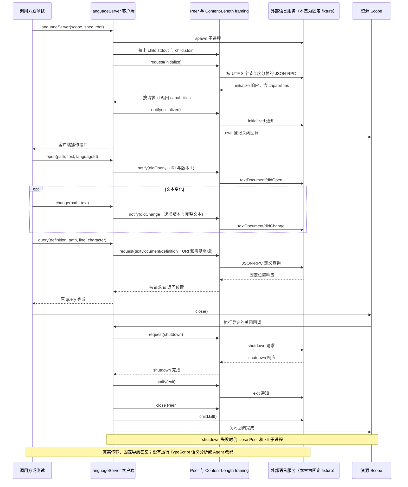
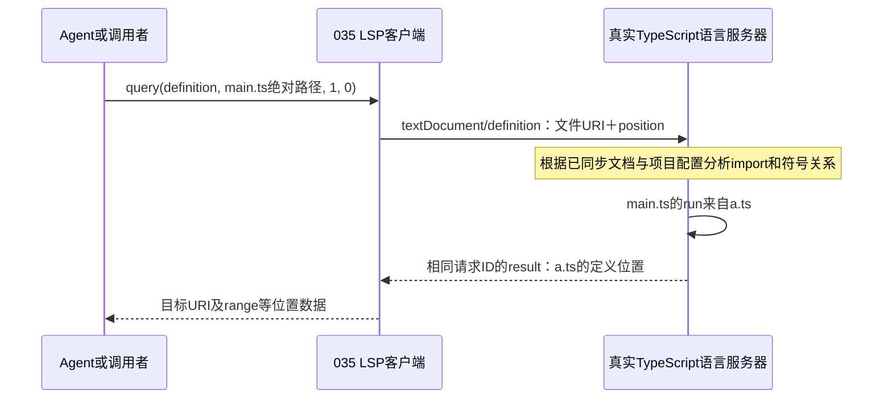
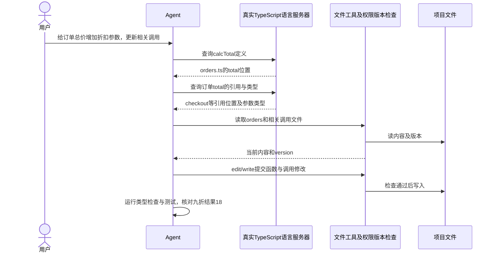
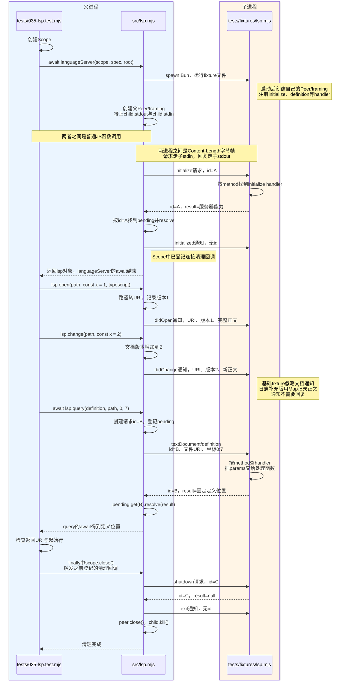
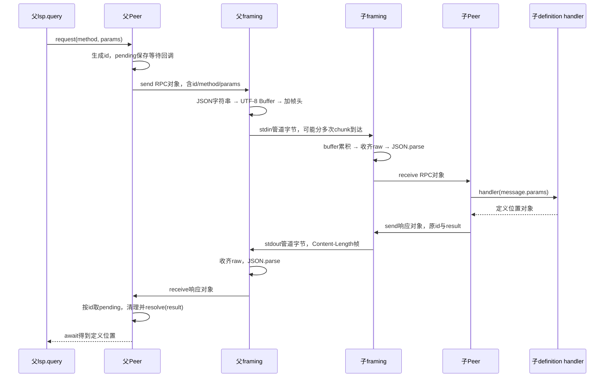
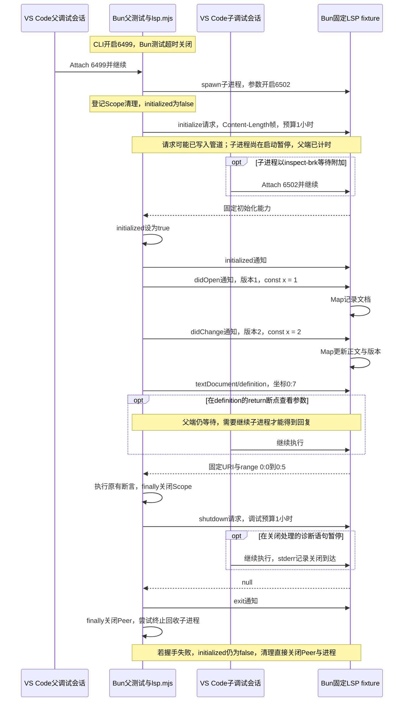

# 035 · 语言服务走真实进程和文档版本

阶段：R05。唯一前置：完成第 034 步，继续同一个工程。

## 什么时候会用到这一页

a.ts和b.ts都定义run，main.ts却从a.ts导入并调用run。文本搜索会匹配多个位置；真实TypeScript语言服务器可依据main.ts的文件URI、光标坐标和import关系定位a.ts。下面用具体三文件例子解释；本章固定fixture只演示协议，不负责真正语义分析。 后面的订单总价例子进一步展示：真实语言服务识别calcTotal导入别名、提供定义/引用/类型信息，实际文件修改仍由Agent调用工具完成。

### 这次数据怎么走

```text
languageServer(scope,spec,root) → spawn语言服务器 → Peer/framing使用Content-Length → initialize/initialized → didOpen/didChange版本通知 → textDocument/definition → 返回位置 → shutdown/exit
```

### 对应时序图

从上往下读；实线箭头表示调用或发送，虚线箭头表示返回或事件通知。`opt`表示可选操作，`alt`表示不同结果，`loop`表示重复，`par`及其`and`分支表示并行；“未接入”及fixture说明按图中标注理解。



**当前接线位置：**035确实复用032并启动外部LSP进程；051未注册LSP工具，最终Agent没有自动获得代码导航。诊断/符号辅助接口也未接入产品。

## 这一步具体做什么

先写完src/lsp.mjs及tests/fixtures/lsp.mjs，再运行 bun test ./tests/035-lsp.test.mjs。测试启动固定LSP对端，发送example.ts打开与修改通知，再查第0行第7列definition，检查返回URI和起始行。fixture不会分析TypeScript，因此不需要先安装tsserver。

需要本章新文件的操作，先按下面代码创建文件，再执行；不要在上一步尚不存在的接口上试错。

## 代码为什么放在这一层

LSP规定编辑器与语言服务如何交流；本章重用032的RPC字节分帧，用URI和文档版本维持状态。它是通用进程客户端骨架，不是完整代码导航工具，也不是语言分析器。 本章query直接传从0开始的行列，character按默认UTF-16位置解释，不是UTF-8字节数；这与Content-Length按字节分帧是两件事。 src/lsp.mjs同时封装LSP客户端与子进程管理：每次调用languageServer就spawn并握手一次，返回对象的open/change/query复用同一子进程和Peer，最后由scope.close执行已登记的shutdown/exit与回收回调；本步未实现自动按文件类型启动或连接池。

## 同名函数：文本搜索找到名字，语义导航找到关系

你准备修改一个`run()`调用，项目里却有好几个叫run的函数。文本搜索能列出候选位置，但仅凭“字符串相同”，还不知道这个调用究竟指向谁。语言服务器分析import、作用域和类型等代码关系，再回答指定位置上的符号定义在哪里；这就是语义导航，类似VS Code的F12“转到定义”。

下面是用于理解的三文件例子，不要求替换本章的固定LSP测试对端：

```ts
// /project/src/a.ts：一个run函数。
export function run() { return 'A' }
```

```ts
// /project/src/b.ts：另一个同名函数。
export function run() { return 'B' }
```

main.ts的实际两行内容如下；文件路径是`/project/src/main.ts`，不把说明性注释算进坐标：

```ts
import { run } from './a'
run()
```

| 方式 | 给它什么 | 能得到什么 |
| --- | --- | --- |
| 文本搜索 | 搜索字符串run | a.ts、b.ts的定义、main.ts的import和调用等候选匹配；还可能包含注释或普通字符串。 |
| 语义导航 | main.ts的文件标识＋第二行run上的光标位置 | 在正确配置的TypeScript语言服务里，沿import关系定位到a.ts的run定义，而不是b.ts。 |

这不是说文本搜索没用：先找关键词、文件或错误文案时，它通常更直接。需要区分同名符号、确认真实定义或引用关系时，再用语言服务器消除歧义。真实语言服务也依赖正确的项目配置、依赖和文档同步，不能只按名字猜一个结果。

### 文件URI：告诉服务端正在问哪个文件

请求不能只说“查run”，因为不同文件里相同名字的含义可能不同。LSP使用文档URI标识文件，例如：

```text
本机路径：/project/src/main.ts
文件URI：file:///project/src/main.ts
```

URI是文件地址标识，不是在发HTTP请求，也不意味着文件内容已上传。035的`document(path)`用`pathToFileURL(path).href`完成转换；`open`与`change`再发送正文和版本，使语言服务器知道当前文档内容。

```js
import { pathToFileURL } from 'node:url'

// 使用当前主机上的绝对路径，转换器会处理空格、中文和百分号等编码。
const uri = pathToFileURL('/project/src/main.ts').href
```

不要手工用`'file://' + path`拼接：文件名有特殊字符时容易产生不同的文件标识。这里的/project是解释用路径，运行实际项目时要用真实存在的工程路径。

### 行列坐标：告诉服务端正在问哪个符号

本章`lsp.query(method, path, line, character)`把坐标原样传入LSP协议，**line和character都从0开始**。上面main.ts中，第二行开头的run就是`line=1, character=0`：

```text
编辑器显示第1行：import { run } from './a'    → LSP line=0
编辑器显示第2行：run()                      → LSP line=1
                ↑
                第1列，LSP character=0
```

下面表示客户端已经连接真实语言服务，并已同步该文件内容时的查询方式；它不是现有fixture已经能分析这三个文件的证明：

```js
// 查询main.ts第二行开头run的定义，path传绝对路径。
const locations = await lsp.query('definition', '/project/src/main.ts', 1, 0)
```

035会将它编码为类似请求；示意ID用于关联回复，实际ID由Peer生成：

```json
{
  "jsonrpc": "2.0",
  "id": "definition-1",
  "method": "textDocument/definition",
  "params": {
    "textDocument": { "uri": "file:///project/src/main.ts" },
    "position": { "line": 1, "character": 0 }
  }
}
```

行列位置应落在要查询的符号上；光标指向空白或无关符号时可能返回空结果。返回位置通常包含目标文件URI与range，也可能按服务器能力使用位置数组或LocationLink；不能只假定所有服务器都返回本章fixture的单个对象形状。

### character不是UTF-8字节偏移

本章没有协商其他positionEncoding，按LSP默认的UTF-16位置解释character。这和JavaScript字符串下标一致：普通中文通常占1个单位，部分emoji占2个；不是按屏幕宽度或UTF-8字节数算。

```js
// prefix的JS长度是4：中=1、emoji=2、空格=1；其UTF-8长度则是8字节。
const prefix = '中😀 '
console.log(prefix.length) // 4
console.log(Buffer.byteLength(prefix, 'utf8')) // 8
```

如果一行注释文字是`中😀 run`，其中r的字符串下标是4，不是UTF-8字节偏移8；这只是坐标算术示例，不是说注释中的run可以跳转到函数定义。真实代码的位置要基于实际文件每一行的内容计算。

再和032区分一次：**Content-Length按UTF-8字节数分帧，position.character按协商的位置编码定位符号。** 同一条请求里的这两种长度不能互换。

原版Harness对模型公开的lsp工具使用从1开始的行列，再转换到内部从0开始的位置；035的`query`直接接协议坐标。不要把原版工具参数或VS Code显示的第2行第1列，不经转换就传成`query(..., 2, 1)`。

### 一次定义查询怎样返回



真实语言服务可能跨多个文件分析，不是本客户端自己递归搜索run字符串；035的Peer负责请求与回复关联，framing负责Content-Length字节边界，语言服务器才负责代码理解。

### 当前035测试证明到哪里

本章现有测试启动的`tests/fixtures/lsp.mjs`会固定返回定义位置，并没有TypeScript解析器。因此测试证明的是“真实子进程＋握手＋文档通知＋URI/坐标请求＋结果返回”链路，不证明上面a/b/main的语义解析已经运行。

在VS Code调本章测试时，可在`src/lsp.mjs`的`document`、`query`和`peer.request`处停下，看path怎样变URI、line/character怎样进入params；当前实际输入是example.ts及`0, 7`，不是上例的`1, 0`。fixture运行在另一个进程，父进程不会因设了服务端断点而自动附加它。原版坐标转换可对照[tool-lsp实现](../../../deepseek-harness/packages/lsp/tool-lsp/src/index.ts)。

合上说明，指出main.ts第二行run的URI、从0开始的坐标，以及根据import应返回哪个文件；再解释为什么搜索到b.ts的同名定义还不能证明它就是当前调用的定义。

## 一个修改任务：给订单总价增加折扣参数

你对Agent说：“给订单总价计算增加折扣参数，并修改相关调用处。”下面说明接入真实TypeScript语言服务后，Agent怎样利用导航信息完成工作；不是当前fixture已经运行的端到端案例，也不要求现在把这些文件加入练习工程。

```ts
// orders.ts：这次要修改的订单计算函数。
export function total(price: number, count: number) {
  return price * count
}
```

```ts
// statistics.ts：同名，但负责统计数组总和，不应因名字相同就被修改。
export function total(values: number[]) {
  return values.reduce((a, b) => a + b, 0)
}
```

```ts
// checkout.ts：导入时使用别名，实际调用名字已经不是total。
import { total as calcTotal } from './orders'
calcTotal(10, 2)
```

如果只搜索total，Agent会遇到多个同名定义；只搜索`total(`，又可能漏掉`calcTotal(10, 2)`这样的别名调用。文本搜索仍能帮助读代码，但仅凭匹配列表不能确认每个调用的符号关系。

### 语言服务能给Agent提供哪些信息

| Agent的问题 | 真实TypeScript语言服务可提供的信息 | Agent据此做什么 |
| --- | --- | --- |
| checkout里的calcTotal定义在哪？ | 沿import别名定位orders.ts的total。 | 找对要修改的函数，避免误改statistics.ts。 |
| 哪些代码引用了这个订单函数？ | 返回当前项目分析范围内的符号引用位置，包含导入别名相关引用。 | 逐个读取相关文件，检查哪些调用和测试需要一起修改。 |
| calcTotal接受什么参数，返回什么？ | 悬停类型信息，例如`(price: number, count: number) => number`。 | 理解原接口，再决定怎样增加折扣参数。 |

服务返回的是位置或类型信息，并不替Agent决定折扣业务规则。例如本例决定用0.9表示九折，需要由任务要求或Agent与用户确认的约定确定，不能从函数名字推导出来。引用结果也依赖项目配置和可分析代码范围，不代表自动找到字符串拼接、运行时注册或项目外的所有使用者。

### 谁负责实际改文件

在本例的Harness流程里，Agent拿到导航结果后，仍需使用文件工具读取目标内容、取得版本，再通过edit/write提交修改；工具入口继续负责参数、权限及文件版本检查。语言服务器提供导航和类型信息，文件工具执行磁盘修改，测试负责验证结果。

假设任务已经明确折扣系数的含义，可以把订单函数和调用调整成下面这样；statistics.ts保持原有用途：

```ts
// orders.ts：折扣系数作为新增必填参数；这是业务修改示意。
export function total(price: number, count: number, discountRate: number) {
  return price * count * discountRate
}
```

```ts
// checkout.ts：根据任务要求，为调用补上九折系数。
import { total as calcTotal } from './orders'
calcTotal(10, 2, 0.9) // 预期18。
```



图里类型检查和测试是Agent另外执行的验证步骤，不是definition请求自动完成的事；查到了引用位置，也不等于已经修改成功。035目前未注册到Agent工具表，这条完整工作流仍需真实服务、工具装配和验收。

### 当前fixture具体做不到哪些

| 当前代码 | 已做到 | 没做到 |
| --- | --- | --- |
| tests/fixtures/lsp.mjs | 独立Bun进程、initialize回复、固定definition位置、shutdown/exit。 | 没有TypeScript解析器，不分析orders/statistics/checkout，也不理解import别名。 |
| 固定definition处理函数 | 把请求里的文件URI放进回复，固定返回第0行的range。 | 不会沿calcTotal跳到orders.ts；名字、坐标变化也不会产生真实符号判断。 |
| 文档open/change链路 | 客户端发通知，并维护自己的版本Map。 | fixture没有保存和分析文档，因此不能据此证明修改后导航已使用新内容。 |
| 其他导航能力 | 客户端有通用query封装。 | fixture没有references或hover处理函数，调用会报未知方法；真实方法所需参数与能力检查也还需补齐。 |
| Agent业务接线 | 有独立协议与进程测试。 | 没有自动查询定义、遍历引用、调用edit修改、运行测试的完整任务流程。 |

因此，这个例子说明“语言服务值得接进Agent的原因”，不能作为当前035已经能完成订单重构的证据。现有测试仍只验收固定对端的通信流程，未运行上述业务修改。

合上这一节，用一句话分别回答：是谁判断calcTotal指向orders.ts，谁决定折扣含义，谁把修改写入磁盘，谁验证结果18？再指出当前fixture缺在哪一环。

## 在哪里写、写什么

操作地点：终端中的 `$PROJECT`，编辑器打开同一个目录。只创建或替换下列文件，其他文件保留上一步版本。文件目录不存在先创建。

```sh
mkdir -p src
```

### 创建 `src/lsp.mjs`

````javascript
import { spawn } from 'node:child_process'
import { Peer, framing } from './rpc.mjs'
import { pathToFileURL } from 'node:url'

/** 每个语言服务器一个进程与文档版本表，RPC传输复用前面的字节框架。 */
export async function languageServer(scope, spec, root) {
  // 显式传当前环境，语言服务器不继承 Bun 缓存的父进程调试地址。
  const child = spawn(spec.command, spec.args ?? [], { cwd: root, env: { ...process.env }, stdio: ['pipe', 'pipe', 'pipe'] })
  const peer = framing(new Peer(), child.stdout, child.stdin, 'lsp'), versions = new Map(), diagnostics = new Map()
  child.stderr.resume(); child.on('error', () => peer.close()); child.on('close', () => peer.close())
  peer.handle('textDocument/publishDiagnostics', params => diagnostics.set(params.uri, params))
  const initialization = await peer.request('initialize', { processId: process.pid, rootUri: pathToFileURL(root + '/').href, capabilities: { textDocument: { synchronization: { didSave: true } } } })
  peer.notify('initialized', {})
  scope.own(async () => { try { await peer.request('shutdown', null, 1000); peer.notify('exit') } catch {} ; peer.close(); child.kill() })
  const document = path => ({ uri: pathToFileURL(path).href })
  return { capabilities: initialization.capabilities, diagnostics,
    open(path, text, languageId) { const doc = document(path); versions.set(doc.uri, 1); peer.notify('textDocument/didOpen', { textDocument: { ...doc, languageId, version: 1, text } }) },
    change(path, text) { const doc = document(path), version = (versions.get(doc.uri) ?? 0) + 1; versions.set(doc.uri, version); peer.notify('textDocument/didChange', { textDocument: { ...doc, version }, contentChanges: [{ text }] }) },
    query(method, path, line, character) { return peer.request('textDocument/' + method, { textDocument: document(path), position: { line, character } }) },
    symbols: query => peer.request('workspace/symbol', { query }),
  }
}
````

```sh
mkdir -p tests
```

### 创建 `tests/035-lsp.test.mjs`

````javascript
import { test } from 'bun:test'
import assert from 'node:assert/strict'
import { languageServer } from '../src/lsp.mjs'
import { Scope } from '../src/scope.mjs'
import { resolve } from 'node:path'

test('真实进程LSP握手、文档通知、定义查询、关闭', async () => {
  const scope = new Scope()
  try {
    const lsp = await languageServer(scope, { command: process.execPath, args: ['tests/fixtures/lsp.mjs'] }, process.cwd())
    const path = resolve('example.ts')
    lsp.open(path, 'const x = 1', 'typescript')
    lsp.change(path, 'const x = 2')
    const result = await lsp.query('definition', path, 0, 7)
    assert.ok(result.uri.endsWith('example.ts')); assert.equal(result.range.start.line, 0)
  } finally { await scope.close() }
})
````

```sh
mkdir -p tests/fixtures
```

### 创建 `tests/fixtures/lsp.mjs`

````javascript
import { Peer, framing } from '../../src/rpc.mjs'
// 独立进程的固定LSP对端；Harness仍真实走Content-Length和生命周期。
const peer = framing(new Peer(), process.stdin, process.stdout, 'lsp')
peer.handle('initialize', () => ({ capabilities: { definitionProvider: true, textDocumentSync: 1 } }))
peer.handle('textDocument/definition', params => ({ uri: params.textDocument.uri, range: { start: { line: 0, character: 0 }, end: { line: 0, character: 5 } } }))
peer.handle('shutdown', () => null)
peer.handle('exit', () => process.exit(0))
````

## 运行命令与通过标准

```sh
cd "$PROJECT"
bun test ./tests/035-lsp.test.mjs
bun test
```

测试应1项通过，真实进程握手、通知发送、定义请求与关闭路径可走通。返回位置由fixture固定给出，不证明真实语言语义、诊断、新旧版本同步或取消能力。

**本步证据的范围：**035-lsp.test.mjs用真实Bun子进程与Content-Length协议，但语言服务为固定fixture，只验证协议和生命周期，不验证TypeScript分析。

## VS Code：断在哪里、看什么

先看本页[三个文件的父子通信与时序图](#先看三个文件父子进程怎样交流)：测试与lsp.mjs同属父进程，fixture由spawn启动；两条管道负责字节往返，framing解帧、Peer按method分发并按id回送结果。该节也对照实际四份日志解释一次initialize为何对应13条记录，区分initialized通知、请求次数与日志条数。 按下方[035调试实操](#035调试实操lsp父子进程与超时)先验收基础测试，再完整替换列出的5个调试扩展文件。父测试附加6499/lsp-parent-035，固定LSP子进程附加6502/lsp-035；先附加父并继续，让它创建子，再选择子配置点击绿色启动按钮建立第二会话。--timeout 0关闭Bun单测时限；LSP_DEBUG=1把本章Peer的初始化、查询、符号和shutdown等待改为一小时，普通默认仍为10秒与1秒，不能把Peer timeout填0。父进程断在request包装、versions.set和query，看版本1变2、发出的line=0/character=7；子进程断在fixture的definition与shutdown处理函数体，看文件URI、坐标与固定返回位置。基础版在LSP_DEBUG时转发stderr，后面的日志扩展在RPC_TRACE时也转发；stdout仍留给Content-Length协议。完整代码、launch.json、preload、运行顺序、清理和验收标准见本页末尾；两边的局部变量与调用堆栈属于不同进程。 想看Peer/framing中间数据，继续看本页“传递前、传递中、传递后的结构”：逐层观察params、RPC信封、bytes/packet、接收buffer/raw和按原id返回的result，附同一请求的完整示例、时序图及断点观察表达式。 随后按日志小节新增2份完整文件、改父子两处接线，RPC_TRACE=1可将父/子Peer与framing分开写成4份JSONL；每次用独立目录，按同一请求id对照，chunk仅记原始字节，解析完整帧后再关联id。日志与Inspector分别开关。

操作位置：VS Code 打开的是自己的 `$PROJECT`，断点也设在这里的源码，不在教材的 `steps` 目录。

上面的说明若指定CLI、子进程、页面或Electron附加调试，就先按该流程操作；下面这组步骤只用于本章测试入口。“当前测试”不会自动附加子进程，也不会命中浏览器或Electron中的断点。

变量只在所属作用域可见：停在方法内部时看this和参数；要看测试里的局部变量，先在“调用堆栈”选择对应测试帧。正在等待的异步调用者不一定保留可求值的帧，此时在测试调用前后加断点再看，不把未定义误判成业务状态丢失。

沿用第 000 步安装的 Bun 扩展与 `.vscode/launch.json`；本章列出替换配置时，使用本章完整版本。

1. 打开本步测试文件 `tests/035-lsp.test.mjs`，保持它为当前编辑器文件。
2. 在上面指定的函数内单击行号左侧设置断点。
3. “运行和调试”选择 **Bun：当前测试**，按 F5；它执行当前测试，工作目录固定为 PROJECT。
4. 在“变量 / 监视 / 调用堆栈 / 调试控制台”检查状态；F10 逐行执行，F11 进入函数，Shift+F11 返回，F5 继续，Shift+F5 停止。

验收：断点实际命中，能说出当前输入、状态和下一步；只看到进程启动不算完成。长时间暂停会影响真实取消、审批和网络超时，先检查时序，不删超时断言。修正后在集成终端运行 `bun test ./tests/035-lsp.test.mjs`，再运行 `bun test`，保留全部断言。

## 不看答案，确认自己能解释

闭卷写出initialize、initialized、didOpen、didChange、definition的先后关系，并解释为什么中文正文的Content-Length必须按UTF-8字节计算。

完成后在 LEARNING.md 写一句实际结果和一个卡点。明天只重做这个卡点；第 3 天、第 7 天再做一次，能独立完成就继续下一页，不另开学习路线。

**再改一个条件验证：**安全练习：给固定fixture增加hover返回值并用query调用，理解协议扩展；这仍是协议演练。真正接入TypeScript语言服务需要配置服务器与文档同步，当前教程未提供端到端证明。

## 与当前原版还差哪些

对照本仓库固定原版 `687f282e8625c6b8d11ff58211a90524be2e4317`；这里的“当前”指该本地基线，不是未经检查的上游最新版。

**这一页已经实现：**

- Content-Length真实进程握手
- 文档open/change与版本表
- query/symbols及诊断收集入口
- Scope关闭时shutdown/exit

**原版仍有、或本步尚未对齐的部分：**

- 原版lsp按扩展名路由提供方，规范化definition/references/implementation/hover及结构化错误；本章暴露任意query。
- 原版lsp-stdio/tool-lsp配对fs/subprocess并处理文件同步和能力验证；本章没有对应统一工具接线。
- 原版公共LSP seam刻意不含诊断与符号列表；教程的这些辅助接口是自定义范围，不能算原版完整覆盖。

**原版对照位置：**

- [packages/lsp/lsp/README.zh.md](../../../deepseek-harness/packages/lsp/lsp/README.zh.md)
- [packages/lsp/lsp-stdio/README.zh.md](../../../deepseek-harness/packages/lsp/lsp-stdio/README.zh.md)
- [packages/lsp/tool-lsp/README.zh.md](../../../deepseek-harness/packages/lsp/tool-lsp/README.zh.md)
- [packages/lsp/tool-lsp/src/index.ts](../../../deepseek-harness/packages/lsp/tool-lsp/src/index.ts)

本步测试通过只证明上面的具体行为；完整差距仍看 [COVERAGE.md](../COVERAGE.md)，不以文件数量、同名类或后面出现另一个模块代替接线证据。

下一步：[第 036 步](036.md)

## 035调试实操：LSP父子进程与超时

先按 [教程README](../README.md) 初始化REPO、COURSE和PROJECT。操作地点始终是 `$PROJECT`，默认指向本仓库的 `harness-own/`；独立重做时沿用你明确选定的同仓练习目录。VS Code也打开这份练习目录，或在 `harness-course.code-workspace` 中选择 `harness-own` 文件夹。不要在教材的 `steps/035` 目录里操作，本节只提供给你手动复制的完整文件，不会自动修改练习工程。

这次只走一条线：**先跑通原测试 → 更新前5个调试文件 → 普通运行 → 父子Attach查看定义查询与中间结构 → 正常退出 → 再补2份日志文件与两处接线 → 查看4份日志 → 普通运行复验。** 不需要自己再开一个语言服务器。

本页前面的业务时序图对应基础035；下方调试版会把Scope清理提前到initialize之前。先用前5份完整内容完成双Attach，再按后面的日志小节继续添加第6、7份文件与两处接线。

### 先看三个文件：父子进程怎样交流

你说的 `tests/lsp-test.mjs`，在本教材中实际叫 `tests/035-lsp.test.mjs`；fixture实际路径是 `tests/fixtures/lsp.mjs`。**三个文件涉及两个进程：测试文件和src/lsp.mjs在同一个父Bun进程，fixture由spawn启动，运行在独立子Bun进程。**

| 文件 | 在哪里执行 | 负责什么 |
| --- | --- | --- |
| `tests/035-lsp.test.mjs` | 父进程 | 创建Scope，调用languageServer，依次open/change/query，断言结果，finally关闭Scope。 |
| `src/lsp.mjs` | 同一个父进程 | spawn子服务，建立父侧Peer/framing，把方法调用变成RPC，按id等待回复，登记连接清理。 |
| `tests/fixtures/lsp.mjs` | 子进程 | 建立子侧Peer/framing，注册initialize、definition、shutdown等处理函数，返回固定结果。 |

#### src/lsp.mjs：LSP客户端与子进程管理器

从业务调用方看，src/lsp.mjs把open/change/query转交给外部语言服务；从LSP协议看，它扮演**客户端**：主动发initialize、文档通知和查询，并按请求ID接收响应。它还扮演**子进程管理器**：创建语言服务器进程，持有这条连接，把关闭回调交给Scope。这个模块可以在Agent Server进程中使用，它与外部语言服务器通信时仍是LSP Client。

启动时机由调用者决定。**每执行一次 `languageServer(scope, spec, root)`，函数就立即执行spawn，创建一个子进程；等待initialize成功并发送initialized后，才返回lsp对象。** 单纯import模块不会启动进程。本步没有根据文件扩展名自动选择服务器、首次query才启动、全局共享连接池或断线自动重启的逻辑。

```text
import模块（只加载定义） → 调用languageServer → spawn一次 → 建立Peer/framing并握手 → 返回lsp → 多次open/change/query复用同一child与peer → scope.close触发清理 → shutdown响应后发exit → 关闭Peer并请求回收子进程
```

| 你执行的操作 | src/lsp.mjs实际做什么 | 是否新建子进程 |
| --- | --- | --- |
| `await languageServer(scope, spec, root)` | spawn、建立管道与Peer、initialize/initialized握手，返回接口。 | 每次调用新建1个。 |
| `lsp.open(path, text, languageId)` | 将路径转成URI，记录版本1，发送didOpen通知。 | 复用已有进程。 |
| `lsp.change(path, text)` | 更新该URI的版本，发送包含新正文的didChange通知。 | 复用已有进程。 |
| `await lsp.query(method, path, line, character)` | 创建新的RPC请求ID，在同一Peer上等待对应结果。 | 复用已有进程；新ID代表新请求。 |
| `await scope.close()` | 执行该连接之前登记的关闭回调。 | 关闭已有连接并请求回收其子进程。 |
| 再调用一次 `languageServer(...)` | 再走一遍spawn与握手，得到另一份接口。 | 新建另一个，不会自动查找前一个。 |

能复用是因为返回的open/change/query函数都通过闭包使用同一次languageServer调用里的peer、versions等状态，peer始终连着同一个child的stdin/stdout。保持这份lsp对象，就保持了这条连接的访问入口；多次query只增加各自的pending等待记录，不会重新spawn，也不会重新initialize。同一个接口可以发送多个文档URI，versions按URI区分各文档版本。

下面用一次启动、两次查询演示复用。在练习工程根目录创建 `scripts/lsp-lifecycle-demo.mjs`，完整内容如下；脚本直接使用本章已有接口：

```js
import { resolve } from 'node:path'
import { Scope } from '../src/scope.mjs'
import { languageServer } from '../src/lsp.mjs'

const scope = new Scope() // 这次演示拥有语言服务器连接及其子进程。
try {
  const lsp = await languageServer(scope, {
    command: process.execPath, // 用当前Bun启动服务器测试替身。
    args: ['tests/fixtures/lsp.mjs'],
  }, process.cwd()) // 只调用这一次，所以只创建一个子进程并握手一次。

  const path = resolve('example.ts') // fixture使用的文档URI，不要求创建磁盘文件。
  lsp.open(path, 'const x = 1', 'typescript') // 在已有连接中发送版本1。
  const first = await lsp.query('definition', path, 0, 7) // 第一次查询，产生一个请求ID。

  lsp.change(path, 'const x = 2') // 同一进程、同一URI，文档版本更新为2。
  const second = await lsp.query('definition', path, 0, 7) // 同一进程上的第二个查询ID。
  console.log(JSON.stringify({ first, second }, null, 2)) // 父侧完整显示嵌套位置，不会污染子stdout协议。
} finally {
  await scope.close() // 正常结束或查询失败，都执行已登记的连接清理。
}
```

在 `$PROJECT` 根目录运行：

```sh
cd "$PROJECT"
bun scripts/lsp-lifecycle-demo.mjs
```

完成标准：输出first和second两份位置，然后脚本结束；两者均为当前fixture固定返回的example.ts上 `0:0 → 0:5`，不表示代码语义已被分析。按后文完成分文件日志接线后，可用同一个脚本进一步观察：一次initialize、两次definition、最后一次shutdown的request，合计4个不同请求ID；两次definition对应的子进程PID相同，open/change也是发给这个子进程。

`scope.close()` 不是直接执行测试文件里的子进程代码，它会调用src/lsp.mjs之前用 `scope.own(...)` 登记的回调。正常关闭顺序是：

1. 父Peer发shutdown请求，等待子服务响应；本fixture返回null。
2. 收到响应后发exit通知，通知本身无需回复。
3. 关闭父Peer，清定时器并拒绝仍未完成的RPC等待。
4. 调用child.kill，请求回收这次连接创建的子进程。

若shutdown失败或超时，仍继续关闭Peer和请求回收进程；下方调试版还会在initialize前登记清理，握手未成功时跳过shutdown直接回收。这仍依赖调用方finally里的scope.close触发，languageServer报错不会自行执行Scope回调；基础版握手后才登记，初始化失败时存在清理缺口。这里的回调没有等待子进程close事件，因此“scope.close返回”不能单独证明子进程已经彻底退出；按后面的PID/端口方法确认实际回收。exit后立即kill的时序也意味着子侧exit handler不一定有机会执行。

从开始调用scope.close起就停止使用这份lsp：当前实现先等shutdown，再关闭Peer，没有额外closing状态阻止清理过程中的并发操作。Scope关闭后，query会被已关闭的Peer拒绝；open/change仍可能更新本地versions，但不会继续发通知，不能用“不报错”判断连接有效。需要重新工作时，重新创建Scope并调用languageServer建立新连接；重复关闭原Scope不会再执行一遍清理。你可以闭卷回答：哪一行真正启动进程、两次query为什么只初始化一次、谁把清理函数登记给Scope。

#### 管道怎么接起来

`spawn` 的 `stdio: ['pipe', 'pipe', 'pipe']` 会创建标准输入、标准输出、标准错误的管道。两条业务通信方向如下：

```text
父进程                                      子进程
child.stdin.write(字节) ──────────────────→ process.stdin收到字节
child.stdout收到字节 ←──────────────────── process.stdout.write(字节)
```

父侧 `child.stdin` 和子侧 `process.stdin` 是同一条管道的两端；stdout同理。因此下面两行分别在两个进程中执行，里面的peer也是两个独立对象：

```js
// src/lsp.mjs，父侧：读子输出，向子输入写入。
framing(peer, child.stdout, child.stdin, 'lsp')
```

```js
// tests/fixtures/lsp.mjs，子侧：读自己的输入，向自己的输出写入。
framing(peer, process.stdin, process.stdout, 'lsp')
```

framing参数的顺序是“Peer、读取端、写入端、分帧模式”，后文的日志扩展还会添加可选trace参数。父侧调用 `peer.request(...)`，实际会走framing安装的发送函数，把消息写进 `child.stdin`；子侧stdin触发data回调，收到这些字节。子回复走相反方向。管道可以暂存字节，不要求两边代码在同一时刻执行。

6499和6502是Inspector调试地址，供VS Code附加；本章LSP业务消息经上述stdin/stdout管道传输。stderr另用于调试信息和错误告警，日志文件也不参与传输。

#### 收到字节，为什么能识别内容

```text
管道送来字节 → framing按Content-Length收齐一条正文 → JSON.parse还原RPC对象 → Peer用message.method查methods表 → 调用handler(message.params) → 返回值带原id传回父端 → 父Peer按id唤醒等待 → 测试里的await得到结果
```

比如消息里的method是 `textDocument/definition`，子侧此前执行过 `peer.handle('textDocument/definition', 处理函数)`，所以Peer能按这个字符串找到函数。framing只负责边界和JSON解码；Peer负责方法分发与请求关联；真正的语言分析应由handler后面的语言服务完成。

**当前fixture返回的是传入URI上的固定range `0:0 → 0:5`，没有分析TypeScript。** 基础fixture也没有didOpen/didChange处理函数；后面的日志补充版用Map记录文档正文和版本，仍不做语义导航。

#### 按三个文件串起一次完整交互

```text
测试创建Scope并调用languageServer → lsp.mjs启动fixture并完成initialize/initialized → 返回lsp接口 → 测试open/change/query → lsp.mjs发RPC → fixture执行handler并回复 → lsp.mjs按id解开等待 → 测试断言 → scope.close触发已登记的回调 → shutdown/exit与进程回收
```



图中的A、B、C分别代表初始化、定义查询、关闭三个不同请求ID，每个响应沿用相应请求的ID。initialized、didOpen、didChange、exit都是通知，没有响应箭头。Scope没有单独画成参与者；测试的 `scope.close()` 会执行lsp.mjs之前登记的回调，不是在返回的lsp对象上调用close方法。

图中只标“Scope已登记清理”：基础版本在握手后登记，下方调试版提前到initialize之前，正常返回lsp接口前两者都已登记。退出阶段发送exit后立即尝试child.kill，因此不要求子侧exit handler一定命中；清理失败边界仍按本节后面的说明验收。

#### initialize为什么会有多条日志

**本页附带的四份日志样例里，initialize请求只有一次，同一次请求在多个位置各记了一条。** 这次初始化ID是 `2096a68f-599e-4787-8896-70e98479a6a2`，可在四个样例文件中搜索它：

| 文件 | 同一个ID出现的stage | 记录的是什么 |
| --- | --- | --- |
| [父Peer](../evidence/035-rpc-logging/lsp-parent.peer.jsonl) | request、receive、resolve | 发起一次初始化，收到其响应，唤醒原等待。 |
| [父framing](../evidence/035-rpc-logging/lsp-parent.framing.jsonl) | send-object、send-bytes、receive-frame | 请求对象、编码后的请求字节、解析出的响应对象。 |
| [子framing](../evidence/035-rpc-logging/lsp-child.framing.jsonl) | receive-frame、send-object、send-bytes | 解析出的请求、准备回复的对象、回复字节。 |
| [子Peer](../evidence/035-rpc-logging/lsp-child.peer.jsonl) | receive、handler-input、handler-result、send-response | 收到请求、调用函数、得到能力、准备响应。 |

这一个ID合计对应13条日志，实际只发出一条initialize请求和一条对应响应。send-object与send-bytes是同一条消息的不同表示；receive与handler-input也没有再次发请求。receive-chunk可能含半包或多条消息，没有ID，不能靠chunk条数计算调用次数。

还要区分三个协议动作：

```text
父 → 子：initialize请求，带id=A，询问服务器能力
子 → 父：响应，带原id=A和result.capabilities
父 → 子：initialized通知，无id，表示客户端已接受初始化结果
```

`initialized` 比 `initialize` 多一个d，是另一种通知，不能当作第二次初始化请求。父Peer的响应日志外层也可能标 `method: 'initialize'`，这是日志从pending表补回的关联信息；实际响应位于该条日志的message字段，里面只有jsonrpc、id、result，没有method。

判断到底发起几次，只在父Peer日志中统计下面条件：

```js
// 只数真正发起initialize请求的记录，响应与其他stage不计入。
record.stage === 'request' && record.method === 'initialize'
```

当前样例满足条件的只有1条。每重新运行测试或创建一份新的languageServer连接，会再发起一次，使用新的ID；本节按运行创建日志目录，便于区分不同轮次。如果同一份运行记录中出现多条request，再结合PID、请求ID和languageServer的调用次数定位是否创建了多条连接。

### 第 1 步：先确认原测试能通过

在练习工程根目录执行：

```sh
cd "$PROJECT"
bun test ./tests/035-lsp.test.mjs
```

通过标准：`真实进程LSP握手、文档通知、定义查询、关闭` 通过，显示 **1 pass、0 fail**。测试自动启动 `tests/fixtures/lsp.mjs`，父子进程之间真实经过 stdin/stdout、Content-Length 分帧和 RPC。fixture 返回固定定义位置，没有 TypeScript 语义分析，也没有模型请求。

这里的 `example.ts` 只是传给 fixture 的文件 URI 和内存正文，**不需要创建真实的 `example.ts` 文件**。真实语言服务器可能还需要项目配置、依赖和磁盘文件，本节不把固定 fixture 当成那套实现。

如果普通测试失败，先处理普通测试，再加调试器。在同一个练习工程里创建缺少的目录：

```sh
mkdir -p scripts tests/fixtures .vscode
```

### 第 2 步：分清两个进程和两个超时

| 进程 | 正在运行的文件 | Inspector 地址 | 暂停时发生什么 |
| --- | --- | --- | --- |
| 父进程 | `tests/035-lsp.test.mjs`、`src/lsp.mjs`、父侧 Peer | `6499/lsp-parent-035` | 子进程不会自动跟着暂停。 |
| 子进程 | `tests/fixtures/lsp.mjs`、子侧 Peer | `6502/lsp-035` | 父进程可能仍在等待回复，并计算 RPC 超时。 |

父侧断点看“发了什么、等到了什么”；子侧断点看“收到什么、准备返回什么”。两份内存、两套断点、两个 VS Code 调试会话。

| 超时 | 普通运行 | 本节调试运行 | 设置在哪里 |
| --- | --- | --- | --- |
| Bun 单个测试的超时 | 默认 5,000 ms | `--timeout 0` 关闭单测超时 | 后面的终端启动命令。这里沿用已经实测的 Bun 1.3.14 行为。 |
| 自有 Peer 的 `initialize`、`query`、`symbols` 请求 | 10,000 ms | 3,600,000 ms，即 1 小时 | `src/lsp.mjs` 的 `request` 包装函数，只在 `LSP_DEBUG=1` 时替换预算。 |
| 自有 Peer 的 `shutdown` 请求 | 1,000 ms | 3,600,000 ms | 同一个包装函数；普通模式仍保留原来的 1 秒关闭预算。 |

**这两层要分别处理。** `--timeout 0` 只影响 Bun，不会关闭自有 Peer 的定时器。035 的 Peer 也不是 033 的 MCP SDK：这里默认请求预算是 10 秒，关闭预算是调用处显式传的 1 秒，不是 MCP SDK 的 60 秒。

**不要给 `peer.request` 传 `0` 来关闭超时。** 当前实现内部使用 `setTimeout(..., timeout)`，`0` 会让等待很快超时。这里只给调试留一小时，时间到了仍会失败。子进程暂停等待附加时，父进程可能已经把 `initialize` 写进管道并开始计时；不是附加完成后才开始握手。

### 文件 1：scripts/vscode-debug.mjs

文件位置：`$PROJECT/scripts/vscode-debug.mjs`。沿用第 000、032、033 步的 preload，完整内容如下；已有同样内容就保留。

```js
/** 父进程Inspector已在启动时建立，清掉以后可能被子进程继承的地址。 */
export function clearInspectorEnvironment() {
  delete process.env.BUN_INSPECT
  delete process.env.BUN_INSPECT_NOTIFY
}

// 由命令行--preload在执行测试前加载，普通测试不用主动导入。
clearInspectorEnvironment()
```

`--preload` 的意思是“先执行这份脚本，再执行测试”。删除环境变量不会关闭父进程已经启动的 Inspector；它防止子进程继承父进程的调试地址。下面的 `src/lsp.mjs` 还会在子进程环境副本上明确删除一次，让这条启动路径自身也能正确隔离地址。

### 文件 2：src/lsp.mjs

文件位置：`$PROJECT/src/lsp.mjs`。保留本章原有接口，补上调试预算、子进程环境处理和握手失败时的清理。完整替换为：

```js
import { spawn } from 'node:child_process'
import { pathToFileURL } from 'node:url'
import { Peer, framing } from './rpc.mjs'

/** 一个语言服务器对应一个子进程，文档版本和诊断归这条连接所有。 */
export async function languageServer(scope, spec, root) {
  const debugLsp = process.env.LSP_DEBUG === '1' // 只有显式调试才延长请求预算、显示子进程stderr。
  const childEnv = { ...process.env } // 子进程使用独立环境副本，保留正常PATH等配置。
  delete childEnv.BUN_INSPECT // 不把父进程Inspector地址传给子进程。
  delete childEnv.BUN_INSPECT_NOTIFY // 不把父进程Inspector通知配置传给子进程。
  const child = spawn(spec.command, spec.args ?? [], {
    cwd: root,
    env: childEnv,
    stdio: ['pipe', 'pipe', 'pipe'],
  }) // 子进程自己的Inspector由spec.args开启，不靠继承父地址。
  const peer = new Peer() // 父侧负责RPC请求ID、等待回复和分发通知。
  framing(peer, child.stdout, child.stdin, 'lsp') // 收子stdout、发子stdin，按Content-Length拆装字节帧。
  const versions = new Map() // 记录每个文档URI最后发送的版本。
  const diagnostics = new Map() // 保存服务器最近推送的诊断。
  let initialized = false // 握手成功后才允许走shutdown请求。

  if (debugLsp) child.stderr.pipe(process.stderr) // 把6502 Inspector启动信息显示在父终端。
  else child.stderr.resume() // 普通模式仍消费stderr，避免管道积压。
  child.on('error', () => peer.close()) // 启动失败时结束父侧等待。
  child.on('close', () => peer.close()) // 子进程退出时结束所有未完成请求。

  /** 普通请求默认10秒；显式调试统一留一小时，包括关闭请求。 */
  const request = (method, params, timeout = 10_000) => {
    return peer.request(method, params, debugLsp ? 3_600_000 : timeout)
  }

  // 先登记清理，再发initialize，握手失败时调用方finally仍有资源可回收。
  scope.own(async () => {
    try {
      if (initialized) {
        await request('shutdown', null, 1_000) // 普通关闭预算仍是1秒，调试时可停在子侧断点。
        peer.notify('exit') // shutdown有回复，exit是无需回复的通知。
      }
    } catch {
      // 对端已退出或关闭请求失败时，仍执行finally回收。
    } finally {
      peer.close() // 未完成握手时直接到这里，不再额外等待一小时shutdown。
      child.kill() // 回收这条连接创建的进程；强杀整个父进程不保证finally有机会执行。
    }
  })

  peer.handle('textDocument/publishDiagnostics', params => {
    diagnostics.set(params.uri, params) // 服务器主动通知，无需客户端发送同名请求。
  })
  const initialization = await request('initialize', {
    processId: process.pid,
    rootUri: pathToFileURL(root + '/').href,
    capabilities: { textDocument: { synchronization: { didSave: true } } },
  }) // 默认10秒，调试时1小时；返回前子进程必须继续执行。
  initialized = true
  peer.notify('initialized', {}) // 告诉服务器客户端已经接受初始化结果。

  /** 文件绝对路径转成LSP使用的文件URI。 */
  const document = path => ({ uri: pathToFileURL(path).href })
  return {
    capabilities: initialization.capabilities,
    diagnostics,
    /** 第一次打开文档时发送完整正文，版本从1开始。 */
    open(path, text, languageId) {
      const doc = document(path) // 同一个文档用同一个URI定位。
      versions.set(doc.uri, 1)
      peer.notify('textDocument/didOpen', {
        textDocument: { ...doc, languageId, version: 1, text },
      })
    },
    /** 本章使用全文变更通知，每次发送前递增版本。 */
    change(path, text) {
      const doc = document(path) // 用URI找到上次版本。
      const version = (versions.get(doc.uri) ?? 0) + 1 // 本次change从1递增到2。
      versions.set(doc.uri, version)
      peer.notify('textDocument/didChange', {
        textDocument: { ...doc, version },
        contentChanges: [{ text }],
      })
    },
    /** 行列坐标仍使用本章协议接口的零基坐标。 */
    query(method, path, line, character) {
      return request('textDocument/' + method, {
        textDocument: document(path),
        position: { line, character },
      })
    },
    /** 保留原有工作区符号查询接口；本fixture没有实现这个handler。 */
    symbols(query) {
      return request('workspace/symbol', { query })
    },
  }
}
```

包装函数的目的只有一个：集中选择 RPC 等待预算。`initialize`、`query`、`symbols`、`shutdown` 都经由 `request(...)`；**包装函数内部那一处 `peer.request(...)` 必须保留**，改成调用 `request(...)` 会递归调用自己。

这里也修正了一个容易误解的地方：`env: { ...process.env }` 只是复制，不会删除已有的调试变量。真正删除的是上面的两个 `delete childEnv...`。子进程随后仍能通过它自己的 CLI 参数开启 6502。

清理在 `initialize` 前登记，不是握手成功后才登记。初始化没成功时 `initialized` 还是 false，Scope 关闭就直接关 Peer、回收子进程；初始化成功后才尝试 `shutdown → exit`，最后仍会关 Peer、回收进程。这解决的是本章测试的资源回收，不代表实现了完整语言服务器自动重启。

### 文件 3：tests/035-lsp.test.mjs

文件位置：`$PROJECT/tests/035-lsp.test.mjs`。普通模式不开子进程 Inspector；只在 `LSP_DEBUG=1` 时把 `--inspect-brk` 放到 fixture 文件名之前。原来的两处断言和 `finally` 清理保留。

```js
import { test } from 'bun:test'
import assert from 'node:assert/strict'
import { resolve } from 'node:path'
import { languageServer } from '../src/lsp.mjs'
import { Scope } from '../src/scope.mjs'

test('真实进程LSP握手、文档通知、定义查询、关闭', async () => {
  const scope = new Scope() // 测试拥有语言服务器连接和它创建的子进程。
  const debugLsp = process.env.LSP_DEBUG === '1' // 仅显式调试时插入子进程Inspector参数。
  const args = [
    ...(debugLsp ? ['--inspect-brk=127.0.0.1:6502/lsp-035'] : []),
    'tests/fixtures/lsp.mjs',
  ] // 参数属于子进程Bun；父进程参数由后面的终端命令给出。
  try {
    const lsp = await languageServer(scope, {
      command: process.execPath,
      args,
    }, process.cwd()) // 握手完成之前，这个await不会返回。
    const path = resolve('example.ts') // 只用来生成URI，不需要在磁盘创建文件。
    lsp.open(path, 'const x = 1', 'typescript') // didOpen通知的文档版本为1。
    lsp.change(path, 'const x = 2') // didChange通知的文档版本为2。
    const result = await lsp.query('definition', path, 0, 7) // 零基行列送到子进程。
    assert.ok(result.uri.endsWith('example.ts'))
    assert.equal(result.range.start.line, 0)
  } finally {
    await scope.close() // 断言、握手或查询失败也尝试关闭本测试的连接。
  }
})
```

`LSP_DEBUG` 在进程里启动连接时读取。测试已经启动后再在另一个终端设置它，不会修改已经运行的那份进程。这里仍通过 `process.execPath` 启动 Bun，不要求安装另一份 Node.js。

### 文件 4：tests/fixtures/lsp.mjs

文件位置：`$PROJECT/tests/fixtures/lsp.mjs`。定义查询仍返回原来的固定位置，只把 handler 展开，方便在 `return` 上打断点。另外记录文档通知，便于查看版本和正文；这份 Map 不会把 fixture 变成真正的 TypeScript 服务。

```js
import { Peer, framing } from '../../src/rpc.mjs'

const peer = new Peer() // 子侧负责处理请求、生成对应ID的回复。
const documents = new Map() // 仅用于观察父侧送来的文档正文和版本，不做语义分析。

/** 固定声明本fixture支持定义查询及全文同步。 */
peer.handle('initialize', params => {
  return {
    capabilities: { definitionProvider: true, textDocumentSync: 1 },
  }
})

/** 记录父侧首次打开文档时发送的版本1与正文。 */
peer.handle('textDocument/didOpen', params => {
  const document = params.textDocument // 在这里看uri、languageId、version和text。
  documents.set(document.uri, { ...document })
})

/** 记录父侧发送的全文变更，本测试会从版本1更新为2。 */
peer.handle('textDocument/didChange', params => {
  const document = params.textDocument // 只含URI和递增版本。
  const previous = documents.get(document.uri) // 查看上一份正文和版本。
  const text = params.contentChanges[0].text // 本章发送全文，不是range增量编辑。
  documents.set(document.uri, { ...previous, ...document, text })
})

/** 固定返回传入URI上的0:0到0:5，不解析源文件，也不查找真实定义。 */
peer.handle('textDocument/definition', params => {
  return {
    uri: params.textDocument.uri,
    range: {
      start: { line: 0, character: 0 },
      end: { line: 0, character: 5 },
    },
  }
})

/** 收到关闭请求后先给RPC回复，等待客户端另发exit通知。 */
peer.handle('shutdown', () => {
  // 调试时输出到stderr，给关闭处理提供可观察、可设置断点的执行语句。
  if (process.env.LSP_DEBUG === '1') console.error('LSP shutdown', { pid: process.pid })
  return null
})

/** exit是通知，没有对应的RPC返回值。 */
peer.handle('exit', () => {
  process.exit(0)
})

// 先登记全部handler，再把stdin/stdout接到Content-Length分帧器。
framing(peer, process.stdin, process.stdout, 'lsp')
```

子进程的 stdout 是协议管道，**不要往里面直接 `console.log` 普通日志**，也不要把 stdout 整体重定向到文件。那样父进程收到的就不再是纯 Content-Length 协议帧。需要临时日志可用 `console.error(...)` 写 stderr；本节调试模式已经把 stderr 接到父终端。要长期写日志，可沿用 033 的追加文件方法，路径和文件名换成本章自己的日志。

关闭阶段把断点放在 `console.error('LSP shutdown', ...)` 这一行；它仅在调试模式执行。这里给处理函数增加了明确的执行位置，避免只在纯 `return null` 上等待一个未绑定的断点，返回内容仍是固定的 null。

`didOpen`、`didChange` 是通知，没有 RPC 返回值；当前测试的两处断言只检查定义回复的 URI 后缀和起始行。上面新增的 Map 是给断点观察用的，没有新增“真实 TypeScript 语义导航已通过”的证明。`symbols()` 和诊断接收接口虽然保留，但本 fixture 没有工作区符号查询、类型分析、真实引用查找或诊断计算，别拿它们当作本次通过标准。

### 文件 5：.vscode/launch.json

文件位置：`$PROJECT/.vscode/launch.json`。下面是完整文件，保留 033 文档中的 6 个配置，再追加 035 父、子两个 Attach。你自己另外添加的配置请先备份，随后合并回 `configurations`，别直接丢掉。

```json
{
  "version": "0.2.0",
  "configurations": [
    {
      "name": "Bun：CLI 入口",
      "type": "bun",
      "request": "launch",
      "program": "${workspaceFolder}/src/main.mjs",
      "cwd": "${workspaceFolder}",
      "runtime": "bun",
      "runtimeArgs": ["--preload", "${workspaceFolder}/scripts/vscode-debug.mjs"],
      "args": ["读取 README"],
      "stopOnEntry": false
    },
    {
      "name": "Bun：当前测试",
      "type": "bun",
      "request": "launch",
      "program": "${file}",
      "cwd": "${workspaceFolder}",
      "runtime": "bun",
      "runtimeArgs": ["test", "--timeout", "0", "--preload", "${workspaceFolder}/scripts/vscode-debug.mjs"],
      "stopOnEntry": false
    },
    {
      "name": "Bun：032跨进程RPC主进程",
      "type": "bun",
      "request": "attach",
      "url": "ws://127.0.0.1:6499/rpc-032"
    },
    {
      "name": "Bun：032 RPC worker子进程",
      "type": "bun",
      "request": "attach",
      "url": "ws://127.0.0.1:6500/rpc-worker-032"
    },
    {
      "name": "Bun：033 MCP父测试进程",
      "type": "bun",
      "request": "attach",
      "url": "ws://127.0.0.1:6499/mcp-parent-033"
    },
    {
      "name": "Bun：033 MCP子进程",
      "type": "bun",
      "request": "attach",
      "url": "ws://127.0.0.1:6501/mcp-033"
    },
    {
      "name": "Bun：035 LSP父测试",
      "type": "bun",
      "request": "attach",
      "url": "ws://127.0.0.1:6499/lsp-parent-035"
    },
    {
      "name": "Bun：035 LSP子进程",
      "type": "bun",
      "request": "attach",
      "url": "ws://127.0.0.1:6502/lsp-035"
    }
  ]
}
```

`program: "${file}"` 就是当前编辑器打开的文件。选择 **Bun：当前测试** 再按 F5，会新开当前测试的父进程；它不会自动附加父测试创建的那个 LSP 子进程。上面没有给“当前测试”永久加 `LSP_DEBUG=1`，普通运行不会停下来等子调试器。

你本机已经检查过的 Bun 扩展 0.0.32 中，快捷命令 **Bun: Debug File** 不读取这些具名 `launch.json` 配置。要用本节配置，从“运行和调试”下拉框选择对应配置；双进程调试统一走下方终端命令和两个 Attach。

### 第 3 步：更新完整文件后先普通验收

终端执行，先不要设置 `LSP_DEBUG=1`：

```sh
cd "$PROJECT"
bun test ./tests/035-lsp.test.mjs
```

应显示 **1 pass、0 fail**，不会等待 6502 调试器。此时请求仍使用 10 秒预算，关闭请求仍是 1 秒，测试默认仍是 5 秒。失败时不要用放大超时来掩盖问题，先检查这 5 份文件的位置、导入路径和普通测试报错。

### 第 4 步：设置断点并启动父子调试

先在 VS Code 设置这些断点。断点所在的行是否已经执行，会影响局部变量是否已赋值；停在赋值行之前，先单步执行后再查看它。

| 文件 | 断点位置 | 在哪个会话看什么 |
| --- | --- | --- |
| `src/lsp.mjs` | `const child = spawn(...)` | 父：`debugLsp === true`，`spec.args` 含 6502；`childEnv` 中没有两个父 Inspector 环境变量。这个断点前子进程还未启动。 |
| `src/lsp.mjs` | `request` 内的 `return peer.request(...)` | 父：`method` 依次有 initialize、textDocument/definition、shutdown；调试时实际传入预算为 3,600,000。 |
| `tests/fixtures/lsp.mjs` | initialize handler 的 `return` | 子：`params.processId` 是父进程 PID，`params.rootUri` 是练习工程 URI；`process.pid` 是不同的子进程 PID。 |
| `tests/fixtures/lsp.mjs` | didOpen handler 的 `documents.set(...)` | 子：`document.version === 1`，`document.text === 'const x = 1'`。执行 set 后 Map 才有记录。 |
| `tests/fixtures/lsp.mjs` | didChange handler 的 `documents.set(...)` | 子：`previous.version === 1`、`document.version === 2`、`text === 'const x = 2'`。 |
| `tests/fixtures/lsp.mjs` | definition handler 的 `return` | 子：`params.textDocument.uri` 以 example.ts 结尾，`params.position` 是 `{ line: 0, character: 7 }`；`documents.get(params.textDocument.uri)` 中是版本2和新正文。 |
| `tests/035-lsp.test.mjs` | `assert.ok(result.uri.endsWith('example.ts'))` | 父：回复中的 `result.range` 为固定 `0:0 → 0:5`；不是语义计算出的真实定义位置。 |
| `tests/fixtures/lsp.mjs` | shutdown handler 的 `console.error('LSP shutdown', ...)` | 子：在实际关闭处理语句停下，继续后才回复null；调试关闭阶段也使用1小时预算。日志只写stderr。 |

在练习工程的终端执行完整命令：

```sh
cd "$PROJECT"
LSP_DEBUG=1 bun --inspect-brk=127.0.0.1:6499/lsp-parent-035 test --timeout 0 --preload ./scripts/vscode-debug.mjs ./tests/035-lsp.test.mjs
```

按下面的顺序操作，不要跳过“让父进程创建子进程”：

1. VS Code“运行和调试”选择 **Bun：035 LSP父测试**，按 F5 附加 6499。父进程刚启动时暂停是正常的。
2. 让父进程继续，越过 `spawn` 前的断点。看到终端中的 6502 Inspector 信息，说明它已经创建了 LSP 子进程。父进程此时可能已经开始等 initialize 回复。
3. 选择 **Bun：035 LSP子进程**，点击配置旁的绿色启动按钮，建立第二个调试会话。已有父会话时只按 F5，可能只是继续当前会话；你需要的是新增子会话。
4. 继续子进程，命中 initialize、didOpen、didChange、definition 等 handler 的断点。在调用堆栈或调试工具栏切换父、子会话，别把父进程的局部变量和子进程混着看。
5. 停在 definition 的 `return` 时查看 URI、`params.position` 和文档 Map。此时父测试在 `await lsp.query(...)` 等回复。切到父会话单步并不会替你执行子侧 return，必须让子进程继续。
6. 子进程返回后，在父测试的断言前查看 `result`。继续父进程进入 `finally`；若子侧 shutdown 也打了断点，再继续子会话，让父侧关闭请求收到回复。
7. 让本次测试完整结束，确认 **1 pass、0 fail**，再做下方的普通模式复验。

想观察“断点暂停也会消耗时间”，可以在子侧 definition 断点停留超过 10 秒再继续，再在 shutdown 断点停留超过 1 秒：前者超过普通查询和测试的预算，后者超过普通关闭预算。本节调试命令关闭了 Bun 单测时限，Peer 也给了一小时，不会因为这几秒就失败。不要把这种等待写成业务里的 sleep。

**不要手动另跑 `bun --inspect-brk ... tests/fixtures/lsp.mjs` 来代替步骤 2、3。** 父进程通过 `spawn` 创建子进程，并保存它的 stdin/stdout。你另外启动的 fixture 有另一套管道，父测试没有连接它，就收不到本次请求。6502 调试的是父测试创建的那一个子进程。

### 跟着一次请求，看传递前、传递中、传递后的结构

这段专门看 `Peer` 和 `framing` 的中间数据。仍用上面的完整命令和双Attach重新启动一轮，不增加新的 demo，也不用修改 `src/rpc.mjs`。父、子两边都运行这份文件，但各有自己的对象和缓冲区。

先记住两件事：**Peer 管“调用哪个方法、回复属于哪个请求”；framing 管“对象怎么变成字节、字节怎么收齐再还原成对象”。** 中间数据在内存中，不会自动生成文件。

```text
父侧业务参数对象 → Peer加上method/id形成RPC对象 → framing序列化JSON并编码为UTF-8字节 → 加Content-Length帧头 → 写入子stdin管道 → 子framing累积字节并提取完整正文 → JSON.parse还原RPC对象 → 子Peer按method找到handler → handler收到params → 返回值按原id沿反方向返回
```

#### 传递前：先是业务参数，再是RPC消息对象

父测试调用：

```js
// 询问example.ts第0行第7列对应的定义；实际URI取自你自己的工程绝对路径。
const result = await lsp.query('definition', path, 0, 7)
```

`src/lsp.mjs` 先组成下面的业务参数。这里为了让长度可复算，统一用示意路径 `/project/example.ts`：

```json
{
  "textDocument": { "uri": "file:///project/example.ts" },
  "position": { "line": 0, "character": 7 }
}
```

随后调用 `peer.request('textDocument/definition', params, timeout)`。父侧 Peer 生成请求ID，把等待本次回复的 `resolve/reject/timer` 记进 `pending`，再交给 `this.send(...)`：

```json
{
  "jsonrpc": "2.0",
  "id": "req-1",
  "method": "textDocument/definition",
  "params": {
    "textDocument": { "uri": "file:///project/example.ts" },
    "position": { "line": 0, "character": 7 }
  }
}
```

此时仍是 **JS对象**。`params` 是业务参数，外面的 `jsonrpc/id/method` 是 RPC 信封。`req-1` 只是便于讲解的示意ID；当前 Peer 实际使用 `randomUUID()`，你在断点会看到更长的UUID，不要把代码改成固定ID。

父端同时有一份不会发到管道里的等待记录：

```text
pending: Map
  实际请求UUID → { resolve: 函数, reject: 函数, timer: 超时句柄 }
```

发送的只有RPC信封。函数、定时器、整个Peer对象都不会被传给子进程。

#### 传递中：JSON字符串 → 正文字节 → 完整协议帧

`framing` 之前已经给 `peer.send` 装上“编码并写管道”的函数。Peer调用 `this.send(message)`，就进入这段函数；不是把Peer对象塞进管道。

代码中的 `JSON.stringify(message)` 先得到下面这条紧凑JSON字符串，**没有缩进和换行**：

```json
{"jsonrpc":"2.0","id":"req-1","method":"textDocument/definition","params":{"textDocument":{"uri":"file:///project/example.ts"},"position":{"line":0,"character":7}}}
```

`Buffer.from(...)` 默认用UTF-8把它变成 `bytes`。这份示例的 `bytes.length` 是 **164字节**。随后加帧头得到 `packet`，整个包是 **187字节**：

```text
Content-Length: 164\r\n\r\n{"jsonrpc":"2.0","id":"req-1","method":"textDocument/definition","params":{"textDocument":{"uri":"file:///project/example.ts"},"position":{"line":0,"character":7}}}
```

上面为了看清边界，把真实回车和换行显示成 `\r\n`；管道里实际是控制字节 `0d 0a 0d 0a`，不是反斜杠加字母。帧头占23字节，164只计算JSON正文；正文后面不必再追加换行。你的实际URI和UUID不同，长度也会变，代码每次用 `bytes.length` 计算，不要照抄164。

| 中间产物 | 类型 | 里面是什么 |
| --- | --- | --- |
| `message` | JS对象 | 有jsonrpc、id、method、params的RPC信封。 |
| `JSON.stringify(message)` | 字符串 | 完整JSON正文，尚未加Content-Length。当前代码没有另存名为json的局部变量。 |
| `bytes` | Buffer | 仅JSON正文的UTF-8字节。 |
| `packet` | Buffer | 帧头字节 + 空行分隔字节 + 正文字节。 |
| 管道收到的 `chunk` | Buffer | 操作系统本次交付的一段字节，不保证等于整个packet。 |

父侧 `writable` 是 `child.stdin`，子侧 `readable` 是 `process.stdin`。一次 `write(packet)` 不保证对应一次 `data(chunk)`：帧头可能先来，正文后到；多个包也可能一起到。`chunk` 没有 `method` 属性，必须收齐并解析后才能得到RPC字段。

#### 传递后：收齐正文，还原信封，再把params交给handler

子侧 `framing` 按下面顺序处理：

1. `buffer = Buffer.concat([buffer, chunk])`：累积本次与之前没处理完的字节。
2. 找到 `\r\n\r\n`，读出Content-Length。在这份示例里，`header === 19` 是分隔符的字节下标，`size === 164` 是正文字节数，`start === 23` 是正文起点。**变量header是数字，不是帧头字符串。**
3. 若 `buffer.length < start + size`，说明正文没收齐，本次先退出循环，保留buffer，等下一次data；不会提前调用Peer。
4. 收齐后把正文切到 `raw`，把剩余字节留在 `buffer`。`raw` 不含帧头；剩余buffer可能为空，也可能含下一条消息。
5. `JSON.parse(raw.toString())` 还原出RPC对象，交给 `peer.receive(...)`。这时对象字段与父侧RPC信封一致，但已经是子进程中新解析出的对象，不共享父端内存。
6. 子侧Peer根据 `message.method` 查 `methods`，执行 `handler(message.params)`。所以fixture的definition handler只收到最开始那份业务参数，**不会收到外层id/method，也不会收到Content-Length帧头**。

这里有两个“还原后的结构”，不要混起来：

```js
// 子侧Peer.receive(message)收到：完整RPC信封。
// message = { jsonrpc: '2.0', id: 'req-1', method: 'textDocument/definition', params: {...} }

// fixture的definition handler收到：信封里面的业务参数。
// params = { textDocument: { uri: 'file:///project/example.ts' }, position: { line: 0, character: 7 } }
```

#### 回复：值装进result，用原id唤醒父侧等待

本章固定handler返回：

```json
{
  "uri": "file:///project/example.ts",
  "range": {
    "start": { "line": 0, "character": 0 },
    "end": { "line": 0, "character": 5 }
  }
}
```

子侧Peer再包成响应信封，**沿用原请求id，不再生成新id**：

```json
{
  "jsonrpc": "2.0",
  "id": "req-1",
  "result": {
    "uri": "file:///project/example.ts",
    "range": {
      "start": { "line": 0, "character": 0 },
      "end": { "line": 0, "character": 5 }
    }
  }
}
```

正常响应没有 `method/params`，用 `result` 放返回值；错误响应则用 `error`。响应也经过子侧framing编码、子stdout到父child.stdout管道、父侧framing解码。父Peer通过 `message.id` 找到原pending，清定时器、移除等待记录，再调用 `pending.resolve(message.result)`。最终 `await lsp.query(...)` 得到的是里面的定义位置，**不带外层jsonrpc/id**。

`didOpen/didChange` 则是通知：有 `method/params`，没有 `id`，Peer不登记pending，对端不回RPC响应。别在文档通知后等一份对应的result。



#### 在VS Code里亲眼看这些中间值

文件位置是练习工程的 `$PROJECT/src/rpc.mjs`，由032实现，本次不用改。保持父子两个Attach已经连接。**在“调用堆栈”中选中表里对应的进程和函数帧**，再用“监视”或“调试控制台”输入表达式。不同帧里的变量不能混用；若断点停在赋值语句前，先F10越过那条赋值。

| 顺序、会话和函数 | 断在哪条语句前 | 观察表达式与预期 |
| --- | --- | --- |
| ① 父 `Peer.request` | `try { this.send(...) }`；此时pending.set已执行 | `method` 为textDocument/definition；`params` 是业务参数；`id` 是UUID；`this.pending.has(id)` 为true。 |
| ② 父 `framing` 的peer.send回调 | `if (!writable.write(packet) ...)`；此时bytes、packet已赋值 | `message` 是请求信封；`bytes.toString('utf8')` 是紧凑JSON；`bytes.length` 是正文长度；`JSON.stringify(packet.toString('utf8'))` 让帧头的回车换行可见；`packet.toString('hex')` 可看原始字节。此行尚未write。 |
| ③ 子 `framing` 的data回调 | `if (buffer.length > ...)`；此时concat已执行 | `chunk.length`、`buffer.length`、`chunk.toString('hex')`。buffer是累计值；chunk只是这次收到的片段。 |
| ④ 子 `framing` 的LSP分支 | `if (!match)`；header和match已赋值 | `header` 是分隔符下标；有合法头时 `match[1]` 是正文长度字符串。越过后面size/start赋值才有数值。 |
| ⑤ 子 `framing` 拆完一帧 | `try { void peer.receive(JSON.parse(...)) ... }`；raw已赋值 | `size`、`start`、`raw.length`、`raw.toString('utf8')`、`JSON.parse(raw.toString('utf8'))`。`buffer.length` 此时是剩余字节数。 |
| ⑥ 子 `Peer.receive` 请求分支 | `const handler = this.methods.get(message.method)` | `message.id`、`message.method`、`message.params`。此行前handler尚未赋值，执行后才查看handler。 |
| ⑦ 子 fixture 的definition handler | handler里的 `return` | `params` 只有业务参数。想看id，切换调用堆栈到子Peer.receive的帧。 |
| ⑧ 子 `Peer.receive` 回复前 | `if (!this.closed) this.send({ ..., result: ... })`；await handler已完成 | `result` 是定义位置；`message.id` 仍是原请求UUID。 |
| ⑨ 父 `Peer.receive` 响应分支 | `if (!pending) return`；pending已取出 | `message` 是响应信封；`message.result` 是定义位置；`this.pending.has(message.id)` 为true。越过删除pending的语句后变false，resolve后query才能返回。 |
| ⑩ 父测试 | 两处断言前 | `result` 直接是定义位置，没有外层RPC信封。 |

先禁用上节的其他断点，只给①加条件断点 `method === 'textDocument/definition'`。重新启动并附加父子两个会话，都继续，直到父进程在①停下，复制实际UUID。然后再启用②到⑨的断点，继续追这条请求。②发送回调也可用 `message.method === 'textDocument/definition'` 过滤请求；⑥可用同样条件。响应没有method，追回复时核对 `message.id` 是否等于刚复制的UUID，不能用请求的method条件过滤回复。

同一路径的rpc.mjs被父子两进程加载，文件断点可能在两边都生效。每次暂停先核对调用堆栈里的进程与消息；命中非表中指定的进程或请求时，继续当前会话。不要让实际处理消息的一端一直暂停，却只单步另一端等结果。

注意④⑤的断点会遇到其他消息：④先看buffer、帧头与长度，此时raw尚未赋值；到了⑤才看raw中的method/id，继续到这次definition。不是每次data回调都已经收齐一帧，也不是每次都一定执行到⑤。不要为了造半包加入sleep，分包本来就是管道允许发生的情况。

源码有几处把多条语句写在同一行。若F10已经跨过你想观察的块，重新运行到该断点；④的 `header/match` 只在LSP的if块内可见，⑤外层看不到它们。源码没有名为 `parsed` 的变量，JSON.parse直接内联；用表里的只读表达式观察即可。②的箭头回调里用 `peer.pending`，不要假定 `this` 是Peer；⑨响应分支里用 `message.result`，那里没有局部result变量。

若显示暂停了却看不到params，先核对选中的调用栈帧：停在顶层注册handler的语句不等于已经进入handler。⑦必须停在definition函数体的return处，选中该handler帧，能看到URI和坐标后再记录观察结果；想看完整RPC信封则切换到Peer.receive帧。

未收齐的chunk可能停在中文UTF-8字符中间，直接 `chunk.toString()` 可能显示替代字符；用十六进制看原始字节，等完整raw后再看解码文本。需要打印中间值时写stderr或文件，别把console.log加进子stdout协议管道。

完成标准：你能拿同一个UUID，把①的业务参数、②的字节帧、⑤还原的信封、⑦的handler参数、⑨的响应信封和⑩最终返回值逐一对上；说清每一步是对象、字符串还是Buffer，而不是只看到最后测试通过。

### 把中间产物分开写日志：父子各两份文件

接下来把上面在断点中看到的数据保存下来。仍在 `$PROJECT` 操作：新增 `src/rpc-trace.mjs`，更新 `src/rpc.mjs`，再改父子两处framing接线。这里继续提供代码给你手动复制，不会自动修改练习工程。

前面通过VS Code观察变量，本节通过追加JSONL记录当时的值。**JSONL是一行一个JSON对象**：JSON字符串里的回车换行会转义，不会把一条日志切成多行。不要把子进程stdout重定向到日志文件，日志直接追加到单独的文件。

| 文件 | 谁写 | 看什么 |
| --- | --- | --- |
| `lsp-parent.peer.jsonl` | 父进程的Peer | 发起请求、收到响应、按id唤醒等待。 |
| `lsp-parent.framing.jsonl` | 父进程的framing | 发出请求帧、收到子stdout片段、拆出响应帧。 |
| `lsp-child.peer.jsonl` | 子进程的Peer | 收到请求、handler入参/返回值、生成响应。 |
| `lsp-child.framing.jsonl` | 子进程的framing | 收到子stdin片段、拆出请求帧、发出响应帧。 |

```text
父peer日志(request) → 父framing日志(send-object/send-bytes) → stdin管道 → 子framing日志(receive-chunk/receive-frame) → 子peer日志(receive/handler-input/handler-result/send-response) → 子framing日志(send-object/send-bytes) → stdout管道 → 父framing日志(receive-chunk/receive-frame) → 父peer日志(receive/resolve)
```

#### 文件 6：src/rpc-trace.mjs

文件位置：`$PROJECT/src/rpc-trace.mjs`，新增完整文件：

```js
import { appendFileSync, mkdirSync } from 'node:fs'
import { resolve, join } from 'node:path'
import { fileURLToPath } from 'node:url'

/** 只有显式开启RPC_TRACE时才创建日志回调；普通运行不建目录、不写文件。 */
export function createRpcTrace(role) {
  if (process.env.RPC_TRACE !== '1') return undefined
  const directory = process.env.RPC_TRACE_DIR === undefined
    ? fileURLToPath(new URL('../tmp/rpc-035/', import.meta.url))
    : resolve(process.env.RPC_TRACE_DIR) // 默认跟随项目src位置；显式目录按当前cwd解析。
  let enabled = true // 一次写入或序列化失败后禁用这份logger。
  let ready = false // 第一次真正记录时才创建日志目录。
  let sequence = 0 // 同一个role的两份文件共用递增序号，便于合并排序。

  /** 同步序列化并追加一条JSONL，不保存业务对象引用或异步队列。 */
  return (layer, stage, details = {}) => {
    if (!enabled) return
    try {
      if (!['lsp-parent', 'lsp-child'].includes(role)) throw Error('日志role必须是lsp-parent或lsp-child')
      if (!['peer', 'framing'].includes(layer)) throw Error('日志layer必须是peer或framing')
      if (!ready) {
        mkdirSync(directory, { recursive: true })
        ready = true
      }
      const record = {
        ...details,
        timestamp: new Date().toISOString(),
        pid: process.pid,
        role,
        seq: ++sequence,
        layer,
        stage,
      } // 固定元数据不允许被details覆盖。
      if (stage !== 'receive-chunk') {
        record.id = details.id ?? null // 通知或尚不知道请求身份时为null。
        record.method = details.method ?? null // 响应帧本身不带method，可凭id关联请求。
      } else {
        delete record.id // chunk可能是半包或粘包，不能归给某个请求。
        delete record.method
      }
      const line = JSON.stringify(record) + '\n' // 在回调返回前固定所有对象的当前值。
      const path = join(directory, `${role}.${layer}.jsonl`) // 两角色、两层，最终共四个日志文件。
      appendFileSync(path, line, 'utf8')
    } catch (error) {
      enabled = false
      try {
        process.stderr.write(`[RPC_TRACE] 日志已停用：${error?.message ?? String(error)}\n`)
      } catch {
        // stderr也不可写时直接放弃日志，不能让诊断影响RPC。
      }
    }
  }
}
```

默认不启用；只有命令行显式给出 `RPC_TRACE=1` 才写文件。默认目录在项目的 `tmp/rpc-035`，由这个模块的位置确定，不随当前工作目录漂移；`RPC_TRACE_DIR` 可以指定另一份目录。日志采用追加方式，不自动删除旧记录。下面的运行命令会创建本次专用目录，避免把上一次的成功记录看成本次结果。

每条记录带 `timestamp/pid/role/seq/layer/stage` 和该阶段的数据。`seq` 只表示**同一进程**的日志调用顺序，不能把父seq=5和子seq=5当成同一件事；跨进程主要按RPC请求id对照，时间辅助阅读。

#### 文件 7：src/rpc.mjs

文件位置：`$PROJECT/src/rpc.mjs`，完整替换为下方展开版。它保留原有Peer和四参数framing用法，在第5参数增加可选的日志回调。日志同步制作JSON快照，回调异常与写文件失败不会改变RPC结果；日志失败时检查stderr告警。

```js
import { EventEmitter } from 'node:events'
import { randomUUID } from 'node:crypto'

/** 给诊断回调同步的JSON快照；回调失败后只告警一次，永不改变业务返回值。 */
function safeTrace(trace) {
  if (typeof trace !== 'function') return () => {} // 普通四参接线不克隆、不写日志。
  let enabled = true // 自定义回调第一次失败后不再调用它。
  return (layer, stage, details = {}) => {
    if (!enabled) return
    try {
      const snapshot = JSON.parse(JSON.stringify(details)) // 回调只能修改副本，不能改动RPC消息。
      trace(layer, stage, snapshot)
    } catch (error) {
      enabled = false
      try {
        process.stderr.write(`[RPC_TRACE] 回调已停用：${error?.message ?? String(error)}\n`)
      } catch {
        // 日志失败不能使请求、响应或close失败。
      }
    }
  }
}

/** 错误只摘取可读字段，不把Error对象、函数或定时器放进日志。 */
function errorData(error) {
  return { message: error?.message ?? String(error), code: error?.code ?? null }
}

/** JSON-RPC双向Peer，保留请求、响应、通知、反向调用和关闭行为。 */
export class Peer extends EventEmitter {
  pending = new Map() // id对应等待者、定时器与仅供日志关联的method。
  methods = new Map() // method对应处理函数。
  closed = false // 已关闭后拒绝新请求，也不再发送通知。
  trace = safeTrace() // framing接线时替换成安全回调；普通情况是空函数。

  constructor(send) {
    super()
    this.send = send // 兼容原有构造函数；framing通常会再装上字节发送函数。
  }

  /** 同名handler不能重复注册，返回函数只撤销本次注册。 */
  handle(method, handler) {
    if (this.methods.has(method)) throw Error('重复RPC方法')
    this.methods.set(method, handler)
    return () => this.methods.delete(method)
  }

  /** 超时只结束本次等待；领域取消仍要通过明确的取消方法实现。 */
  request(method, params, timeout = 10_000) {
    if (this.closed) {
      const error = Error('RPC已关闭') // 不生成新id，也不发送新请求。
      this.trace('peer', 'reject', { id: null, method, error: errorData(error), reason: 'closed' })
      return Promise.reject(error)
    }
    const id = randomUUID() // 本次请求的关联ID，回复必须带回相同值。
    const message = { jsonrpc: '2.0', id, method, params } // 业务参数外面增加RPC信封。
    this.trace('peer', 'request', { id, method, params, message, timeoutMs: timeout })
    return new Promise((resolve, reject) => {
      const timer = setTimeout(() => {
        this.pending.delete(id)
        const error = Error('RPC超时：' + method) // 只记录错误数据，不记录定时器句柄。
        this.trace('peer', 'timeout', { id, method, timeoutMs: timeout })
        this.trace('peer', 'reject', { id, method, error: errorData(error), reason: 'timeout' })
        reject(error)
      }, timeout) // 传0仍是立即安排超时，不是无限等待。
      this.pending.set(id, { resolve, reject, timer, method }) // method只用于给响应日志补回方法名。
      try {
        this.send(message)
      } catch (error) {
        clearTimeout(timer)
        this.pending.delete(id)
        this.trace('peer', 'reject', { id, method, error: errorData(error), reason: 'send-failed' })
        reject(error)
      }
    })
  }

  /** 通知没有id、没有等待表，也不期待对端回复。 */
  notify(method, params) {
    if (this.closed) return
    const message = { jsonrpc: '2.0', method, params } // 不把日志里的null id写进协议通知。
    this.trace('peer', 'notify', { id: null, method, params, message })
    this.send(message)
  }

  /** 请求按method找handler，响应按id找等待者；handler异常仍返回关联错误。 */
  async receive(message) {
    const method = message.method ?? this.pending.get(message.id)?.method ?? null // 响应自身不带method，父侧可从等待表补回。
    this.trace('peer', 'receive', { id: message.id ?? null, method, message })
    if (message.jsonrpc !== '2.0') throw Error('RPC版本错误')
    if ('method' in message) {
      const handler = this.methods.get(message.method) // 查当前连接自己的方法表。
      if (!('id' in message)) {
        if (handler) {
          this.trace('peer', 'handler-input', { id: null, method, params: message.params })
          try {
            const result = await handler(message.params) // 通知handler可以执行，但不会产生RPC响应。
            this.trace('peer', 'handler-result', { id: null, method, result: result ?? null })
          } catch (error) {
            this.trace('peer', 'reject', { id: null, method, error: errorData(error), reason: 'notification-handler' })
            throw error // 保留原来由framing关闭异常连接的行为。
          }
        } else {
          this.emit('notification', message)
        }
        return
      }
      try {
        if (!handler) throw Object.assign(Error('未知方法'), { code: -32601 })
        this.trace('peer', 'handler-input', { id: message.id, method, params: message.params })
        const result = await handler(message.params) // 此处返回的是业务结果，还没有外层RPC信封。
        this.trace('peer', 'handler-result', { id: message.id, method, result: result ?? null })
        if (!this.closed) {
          const response = { jsonrpc: '2.0', id: message.id, result: result ?? null } // 复用请求id。
          this.trace('peer', 'send-response', { id: message.id, method, message: response })
          this.send(response) // 日志表示发送尝试；真正是否送达还需看对端receive。
        }
      } catch (error) {
        this.trace('peer', 'reject', { id: message.id, method, error: errorData(error), reason: 'handler-or-send' })
        if (!this.closed) {
          const response = {
            jsonrpc: '2.0',
            id: message.id,
            error: { code: error.code ?? -32603, message: error.message },
          } // 保留原有错误响应结构。
          this.trace('peer', 'send-response', { id: message.id, method, message: response })
          this.send(response)
        }
      }
    } else {
      const pending = this.pending.get(message.id) // 已超时或已关闭的请求不会再次被唤醒。
      if (!pending) return
      clearTimeout(pending.timer)
      this.pending.delete(message.id)
      if (message.error) {
        const error = Object.assign(Error(message.error.message), { code: message.error.code }) // 远端错误仍让原Promise失败。
        this.trace('peer', 'reject', { id: message.id, method: pending.method, error: errorData(error), reason: 'response-error' })
        pending.reject(error)
      } else {
        this.trace('peer', 'resolve', { id: message.id, method: pending.method, result: message.result })
        pending.resolve(message.result)
      }
    }
  }

  /** 清除等待定时器并拒绝未完成请求，日志异常不会中断关闭过程。 */
  close() {
    this.trace('peer', 'close', { id: null, method: null, pendingCount: this.pending.size, pendingIds: [...this.pending.keys()] })
    this.closed = true
    for (const [id, pending] of this.pending) {
      clearTimeout(pending.timer)
      const error = Error('RPC连接断开') // 每条等待都有自己的关联ID。
      this.trace('peer', 'reject', { id, method: pending.method, error: errorData(error), reason: 'close' })
      pending.reject(error)
    }
    this.pending.clear()
    this.emit('closed')
  }
}

/** 分帧器仍兼容原四参调用，第五参只观察中间产物，不承载业务消息。 */
export function framing(peer, readable, writable, mode = 'ndjson', trace) {
  let buffer = Buffer.alloc(0) // 这条连接已经收到、尚未消费完的字节。
  peer.trace = safeTrace(trace) // Peer和framing全部经同一安全包装记录，默认是空函数。
  peer.send = message => {
    peer.trace('framing', 'send-object', { id: message.id ?? null, method: message.method ?? null, message })
    const bytes = Buffer.from(JSON.stringify(message)) // JSON正文的UTF-8字节，长度不是字符串字符数。
    const packet = mode === 'lsp'
      ? Buffer.concat([Buffer.from('Content-Length: ' + bytes.length + '\r\n\r\n'), bytes])
      : Buffer.concat([bytes, Buffer.from('\n')]) // LSP加帧头，NDJSON在正文后加LF。
    peer.trace('framing', 'send-bytes', {
      id: message.id ?? null,
      method: message.method ?? null,
      bodyUtf8: bytes.toString('utf8'),
      bodyHex: bytes.toString('hex'),
      bodyBytes: bytes.length,
      packetUtf8: packet.toString('utf8'),
      packetHex: packet.toString('hex'),
      packetBytes: packet.length,
    }) // 写入前的发送尝试；有日志不等于对端已经读取。
    if (!writable.write(packet) && writable.writableLength > 1024 * 1024) throw Error('RPC消费者过慢')
  }
  readable.on('data', chunk => {
    buffer = Buffer.concat([buffer, chunk])
    peer.trace('framing', 'receive-chunk', {
      chunkBytes: chunk.length,
      chunkHex: chunk.toString('hex'),
      bufferBytes: buffer.length,
    }) // chunk可能含半个中文字符或多帧，因此既不猜id/method，也不提供误导的UTF-8正文。
    if (buffer.length > 2 * 1024 * 1024) {
      peer.close()
      return
    }
    for (;;) {
      let size // 这次完整JSON正文应占多少字节。
      let start // 正文在当前累计buffer中的开始位置。
      if (mode === 'lsp') {
        const header = buffer.indexOf('\r\n\r\n') // 先找完帧头，头不全就等后续chunk。
        if (header < 0) break
        const match = /^Content-Length: (\d+)$/im.exec(buffer.subarray(0, header).toString()) // 原实现支持的帧头格式不变。
        if (!match) {
          peer.close()
          return
        }
        size = Number(match[1])
        start = header + 4
        if (buffer.length < start + size) break // 正文半包：不解析、不交给Peer。
      } else {
        size = buffer.indexOf(10) // NDJSON把LF前面的字节当作一条完整JSON。
        start = 0
        if (size < 0) break
      }
      const raw = buffer.subarray(start, start + size) // 只截本帧正文，不包含帧头或分隔LF。
      buffer = buffer.subarray(start + size + (mode === 'lsp' ? 0 : 1)) // 留下粘在后面的其他帧或半帧。
      try {
        const message = JSON.parse(raw.toString()) // 字节收齐以后才解码UTF-8并还原JSON对象。
        peer.trace('framing', 'receive-frame', {
          id: message.id ?? null,
          method: message.method ?? null,
          rawUtf8: raw.toString('utf8'),
          rawHex: raw.toString('hex'),
          rawBytes: raw.length,
          message,
          size,
          start,
          remainingBytes: buffer.length,
        })
        void peer.receive(message).catch(() => peer.close()) // Peer处理请求或按id唤醒等待，异常仍关闭连接。
      } catch {
        peer.close() // 保留原有JSON解析失败即关闭的行为。
      }
    }
  })
  readable.on('end', () => peer.close()) // 原有传输结束、读写错误清理不变。
  readable.on('error', () => peer.close())
  writable.on('error', () => peer.close())
  return peer
}
```

这里用同步追加是为了让这份小型fixture记录“当时的值”，不把对象引用留到稍后再序列化。写文件会增加运行开销，这套观察代码不作为生产日志性能方案。RPC的请求超时、关闭逻辑仍按原实现工作；未传回调时不记录日志。

前面那张断点表对应原032的紧凑实现。替换后代码已经拆行，按语句内容重新设置断点；仍可观察message、bytes、packet、chunk、buffer、raw等变量。以当前实际选中的函数帧和已执行的赋值为准。

#### 改两处接线，让日志知道自己是父还是子

打开 `$PROJECT/src/lsp.mjs`，在原有import后添加：

```js
import { createRpcTrace } from './rpc-trace.mjs' // 为本进程创建可选的文件日志回调。
```

把原来的这行：

```js
framing(peer, child.stdout, child.stdin, 'lsp')
```

替换为：

```js
const trace = createRpcTrace('lsp-parent') // 父进程写自己的peer与framing日志。
framing(peer, child.stdout, child.stdin, 'lsp', trace) // 收子stdout、发子stdin。
```

再把该文件原有的stderr处理替换为下面两行，让只开文件日志时也能看到子进程的日志失败告警：

```js
if (debugLsp || process.env.RPC_TRACE === '1') child.stderr.pipe(process.stderr) // 调试或记录协议日志时显示子stderr。
else child.stderr.resume() // 普通模式消费stderr，避免管道积压。
```

打开 `$PROJECT/tests/fixtures/lsp.mjs`，在原有import后添加：

```js
import { createRpcTrace } from '../../src/rpc-trace.mjs' // 子进程也有独立日志回调。
```

把文件最后的这行：

```js
framing(peer, process.stdin, process.stdout, 'lsp')
```

替换为：

```js
const trace = createRpcTrace('lsp-child') // 子进程写自己的peer与framing日志。
framing(peer, process.stdin, process.stdout, 'lsp', trace) // 收自己的stdin、发自己的stdout。
```

原来的 `new Peer()` 不用添加参数。framing把安全日志回调接到这个Peer，所以同一侧的两层日志有相同的pid、role和递增seq。只有附加参数负责观察，没有把日志文件当作父子进程的通信通道。

#### 运行并找到四份日志

先普通运行，确认改动没有破坏协议：

```sh
cd "$PROJECT"
bun test ./tests/032-rpc.test.mjs ./tests/032-rpc-demo.test.mjs ./tests/035-lsp.test.mjs
```

应显示 **3 pass、0 fail**。这条命令没设置RPC_TRACE，不应新建日志目录。若你之前用export永久设置过，先执行 `unset RPC_TRACE RPC_TRACE_DIR`；已经存在的历史文件不会自动删除。

接着在同一个终端运行：

```sh
mkdir -p tmp
rpc_trace_dir="$(mktemp -d "$PWD/tmp/rpc-035.XXXXXX")"
RPC_TRACE=1 RPC_TRACE_DIR="$rpc_trace_dir" bun test ./tests/035-lsp.test.mjs
printf '%s\n' "$rpc_trace_dir"
ls "$rpc_trace_dir"
```

通过标准：测试 **1 pass、0 fail**，输出目录里出现上面的四份jsonl文件。子进程从父进程继承RPC_TRACE和RPC_TRACE_DIR，所以父子写到同一个本次目录，用不同文件名区分。LSP_DEBUG控制调试预算/Inspector，RPC_TRACE控制文件日志，它们是两个独立开关；这条日志验收命令不用附加调试器。

在VS Code中打开打印出的目录，先打开 `lsp-parent.peer.jsonl`，搜索 `textDocument/definition`，复制这次记录的实际id；随后在其余三份日志中搜索同一个id。你应看到父发请求、子收请求、子发响应、父收响应的完整往返。

也可以在终端查看最后几条日志：

```sh
tail -n 5 "$rpc_trace_dir/lsp-parent.peer.jsonl"
tail -n 5 "$rpc_trace_dir/lsp-parent.framing.jsonl"
tail -n 5 "$rpc_trace_dir/lsp-child.peer.jsonl"
tail -n 5 "$rpc_trace_dir/lsp-child.framing.jsonl"
```

需要边断点边看日志时，再创建本次专用目录并执行双Attach启动命令：

```sh
rpc_trace_dir="$(mktemp -d "$PWD/tmp/rpc-035.XXXXXX")"
printf '%s\n' "$rpc_trace_dir"
RPC_TRACE=1 RPC_TRACE_DIR="$rpc_trace_dir" LSP_DEBUG=1 bun --inspect-brk=127.0.0.1:6499/lsp-parent-035 test --timeout 0 --preload ./scripts/vscode-debug.mjs ./tests/035-lsp.test.mjs
```

然后按上节顺序附加6499和6502。父端暂停时子端不一定暂停，各自文件记录的进展可能不同。在另一个终端运行tail时，把本次目录的绝对路径填进去；当前终端里的rpc_trace_dir变量不会自动出现在另一个终端。

本仓库也附上了本次临时工程真实生成的四份样例，你可以先打开看：

- [父Peer日志](../evidence/035-rpc-logging/lsp-parent.peer.jsonl)
- [父framing日志](../evidence/035-rpc-logging/lsp-parent.framing.jsonl)
- [子Peer日志](../evidence/035-rpc-logging/lsp-child.peer.jsonl)
- [子framing日志](../evidence/035-rpc-logging/lsp-child.framing.jsonl)

在四份样例里搜索 `2a60d174-1653-4253-8eed-8641e437bd21`，就是同一次definition查询；父PID为8700，子PID为8701。样例的URI指向验证用临时工程，不是你的harness-own文件。你自己运行后，用自己日志里的新UUID和PID对照。

#### 每个阶段的日志结构怎么读

下面是三个阶段的字段节选，省略公共元数据以及较长的十六进制字段；为阅读而缩进展示，实际文件是一行一个JSON。req-1和/project/example.ts沿用前文示意值，真实日志是随机UUID与你的工程路径，字节数随之变化。

父framing的send-bytes：对象已编码，正准备写入管道。

```json
{
  "role": "lsp-parent",
  "layer": "framing",
  "stage": "send-bytes",
  "id": "req-1",
  "method": "textDocument/definition",
  "bodyBytes": 164,
  "packetBytes": 187,
  "packetUtf8": "Content-Length: 164\r\n\r\n{\"jsonrpc\":\"2.0\",\"id\":\"req-1\",\"method\":\"textDocument/definition\",\"params\":{\"textDocument\":{\"uri\":\"file:///project/example.ts\"},\"position\":{\"line\":0,\"character\":7}}}"
}
```

子framing的receive-frame：完整正文已提取并解析。

```json
{
  "role": "lsp-child",
  "layer": "framing",
  "stage": "receive-frame",
  "id": "req-1",
  "method": "textDocument/definition",
  "rawBytes": 164,
  "size": 164,
  "start": 23,
  "remainingBytes": 0,
  "message": {
    "jsonrpc": "2.0",
    "id": "req-1",
    "method": "textDocument/definition",
    "params": {
      "textDocument": {
        "uri": "file:///project/example.ts"
      },
      "position": {
        "line": 0,
        "character": 7
      }
    }
  }
}
```

子Peer的handler-input：真正交给业务函数的参数。

```json
{
  "role": "lsp-child",
  "layer": "peer",
  "stage": "handler-input",
  "id": "req-1",
  "method": "textDocument/definition",
  "params": {
    "textDocument": {
      "uri": "file:///project/example.ts"
    },
    "position": {
      "line": 0,
      "character": 7
    }
  }
}
```

其余stage按下表对照：

| layer / stage | 主要字段 | 对应哪一层结构 |
| --- | --- | --- |
| peer / request或notify | params、message | 业务参数与已包装的RPC信封。notify的id为null，但协议message本身仍省略id。 |
| framing / send-object | message | 传给分帧器的RPC对象。 |
| framing / send-bytes | bodyUtf8、bodyHex、bodyBytes、packetUtf8、packetHex、packetBytes | JSON正文字节与完整发送帧。JSONL里packetUtf8的\r\n是实际控制字符的转义展示。 |
| framing / receive-chunk | chunkBytes、chunkHex、bufferBytes | 这次收到的片段、累计缓冲区长度；没有id/method。 |
| framing / receive-frame | rawUtf8、rawHex、rawBytes、message、size、start、remainingBytes | 完整单帧正文、还原对象与剩余字节数。 |
| peer / handler-input与handler-result | params或result | 业务函数的入参与返回值；通知的handler-result也不会产生RPC响应。 |
| peer / send-response | message | 用原id包装好的结果或错误信封。 |
| peer / receive与resolve | message或result | 收到的完整RPC信封，以及最后交给父侧await的业务结果。 |
| peer / reject、timeout、close | error、reason或pendingCount等 | 定位哪里结束等待；不会输出resolve/reject函数或timer句柄。 |

`send-object/send-bytes` 记录的是调用write之前的**发送尝试**，不能单独证明对端收到。找到对端同id的receive-frame/receive记录，才证明它已经完成解析。日志中的message是RPC对象快照；packetUtf8和bodyUtf8是方便阅读的字符串，packetHex和bodyHex是可还原字节的十六进制文本；这些字段是日志结构，不是协议新增字段。

receive-chunk记录没有id/method，因为一个chunk可能是半包或多个消息。等receive-frame完成解析后才按message.id关联；initialized、didOpen、didChange等通知本来就没有请求id，日志用null表示，不能等对应响应。不要为了让每条chunk都能搜到id而猜测归属。

最后闭上代码，用一次definition的实际id，把四个文件中的往返圈出来：发送前是什么对象、传输时有多少字节、接收后还原出什么对象、handler拿到什么参数、最终父侧resolve了什么值。若对不上，先从最早缺失的stage查接线，不要靠增加sleep让日志顺序碰巧一致。


### 原有数据流保留，再对应到调试时序

```text
languageServer(scope,spec,root) → spawn语言服务器 → Peer/framing使用Content-Length → initialize/initialized → didOpen/didChange版本通知 → textDocument/definition → 返回位置 → shutdown/exit
```

上面仍是本章原有的数据流。下图只展开这次父子进程调试；其中“暂停、附加、继续”是人为调试动作，不是语言服务器每次业务调用都必需的步骤。



### 第 5 步：出错时这样定位

| 现象 | 稳定复现路径与原因 | 怎么确认修好 |
| --- | --- | --- |
| `this test timed out after 5000ms` | 普通 `bun test` 启动后，在断点停过5秒；Attach不会修改旧进程的测试预算。 | 结束旧进程，用本节带 `--timeout 0` 的完整命令重新启动。 |
| Bun不报超时，但出现 `RPC超时：initialize` 或 `textDocument/definition` | 只关闭了测试时限，没有设置LSP_DEBUG，或某个请求还绕过包装函数使用默认10秒。 | 父侧停在request内，核对debugLsp为true，所有四类请求都经包装函数；实际预算3,600,000。 |
| 普通模式关闭时很快结束，调试关闭却一直等 | 普通shutdown预算只有1秒，超时被catch处理后会继续回收，测试可能仍显示通过；调试时子进程若停在shutdown断点，父侧仍等1小时。 | 切到子会话继续shutdown handler；检查包装后的关闭预算。普通测试通过不能单独证明shutdown收到了回复。 |
| 6502连接被拒绝 | 没有LSP_DEBUG=1，或父进程尚未执行spawn。 | 父侧核对spec.args；继续越过spawn，看到子端Inspector信息再附加。 |
| 端口占用或附加到旧进程 | 同一端口启动了第二份测试；032、033、035父端口都用6499。 | 停止旧测试，按PID确认归属后再处理残留；不要同时调这三章的父进程。 |
| fixture断点不命中 | 只附加6499，或点击Debug File另起了一份无连接的fixture。 | 使用本节第二个Attach连接父进程真正创建的6502。 |
| 父进程跨过await时一直不返回 | 子进程停在initialize、definition或shutdown断点，没有执行return。 | 切到子会话继续，再回父会话查看回复。 |
| 显示 `RPC连接断开` | 子进程提前退出、启动失败、被停止，或stdout被日志破坏后分帧失败。 | 在调试模式查看子stderr和启动错误；确认stdout只用于协议，fixture路径相对工程根目录有效。 |
| 断言通过，却没有真实类型跳转 | fixture固定回复相同URI上的0:0到0:5，不解析TypeScript。 | 这是本章边界；本次验收证明跨进程协议接线，真实语义能力需要另外接真实语言服务器。 |

检查监听者时，在另一个终端执行：

```sh
lsof -nP -iTCP:6499 -sTCP:LISTEN
lsof -nP -iTCP:6502 -sTCP:LISTEN
```

停止 Attach 调试会话不等于确认父子进程都已退出。正常结束时由测试的 `finally → scope.close` 清理；中途退出时，先在启动测试的终端 Ctrl+C，再核对是否还有属于这次测试的监听PID。若有，确认PID归属后终止那份残留进程再重试。强制杀进程时不能假定 JavaScript 的 finally 一定执行。

当前清理在发送 `exit` 通知后立即关 Peer 并调用 `child.kill()`；终止信号可能先于子侧处理 `exit` 到达。因此不要把“fixture 的 exit handler 必须命中”或“子进程退出码必须为0”当作验收条件。这里验证的是 shutdown 能收到回复、父测试通过、自己的子进程最终不再占用调试端口。

### 第 6 步：通过标准与闭卷回忆

这次全部满足才算完成：

- 普通运行 **1 pass、0 fail**，没有LSP_DEBUG时不等Inspector。
- VS Code中有父、子两个调试会话；分别命中src/lsp.mjs与fixture断点，PID不同。
- 子侧观察到didOpen版本1、正文const x = 1，随后didChange版本2、正文const x = 2。
- definition收到example.ts的文件URI和零基坐标 `{ line: 0, character: 7 }`；父侧收到固定range `0:0 → 0:5`，原有两处断言通过。
- definition断点停留超过10秒、shutdown断点停留超过1秒后仍能继续完成，不因普通测试/查询/关闭时限失败；知道Peer调试预算仍是有限的一小时。
- 能继续shutdown断点，让测试正常关闭，并确认本次父子调试端口不再被残留进程占用。

结束调试后，在同一个终端用不带调试环境变量的命令复验：

```sh
cd "$PROJECT"
bun test ./tests/035-lsp.test.mjs
```

前面的 `LSP_DEBUG=1 bun ...` 只给那一条命令设置环境变量，随后这次普通命令不会继承它；如果你自己曾用 `export LSP_DEBUG=1` 长期设置过，先执行 `unset LSP_DEBUG` 再普通复验。

合上文档，用自己的话说清“谁spawn谁、两个端口分别调谁、initialize什么时候开始计时、正文通知为何没有回复、查询结果怎么按ID返回”。然后只看自己记下的两个地址，再做一次双Attach。在 `LEARNING.md` 记下卡住的一点、看到的变量和修正方法；隔天不看操作步骤再重复一次。若只能照着按钮点，先重练卡住的环节，不用额外换路线。

本节补的是现有LSP跨进程测试的调试接线、超时和清理边界。VS Code界面中的双Attach和断点要由你在本机交互验收，不能只看配置存在就认定已经调通，也不能把固定fixture的通过当作真实TypeScript语言服务的能力验收。
