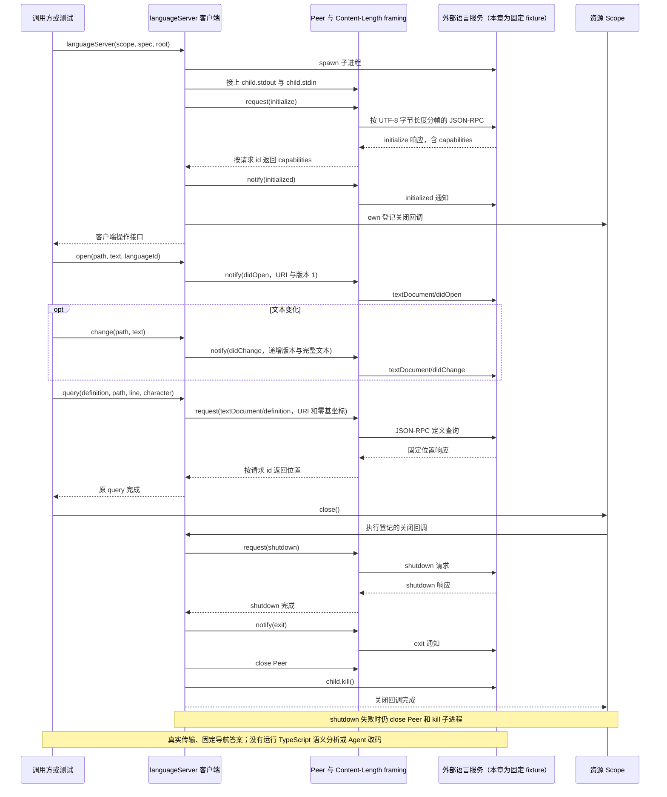
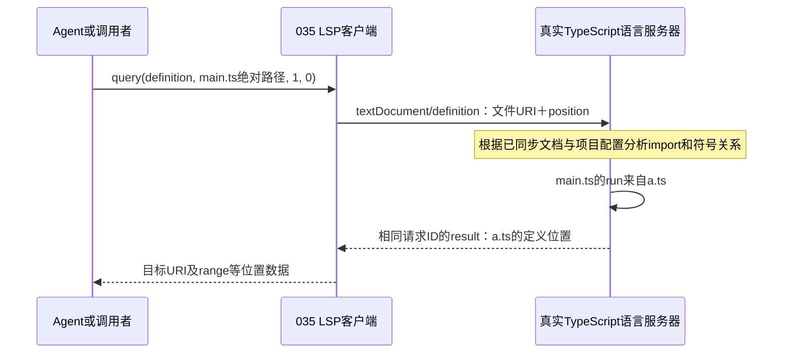
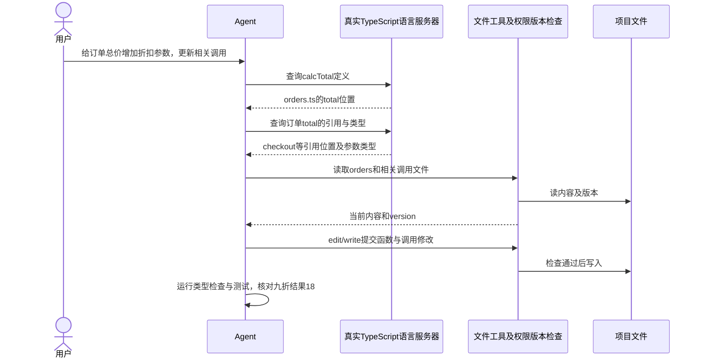

# 035 · 语言服务走真实进程和文档版本

阶段：R05。唯一前置：完成第 034 步，继续同一个工程。

## 什么时候会用到这一页

a.ts和b.ts都定义run，main.ts却从a.ts导入并调用run。文本搜索会匹配多个位置；真实TypeScript语言服务器可依据main.ts的文件URI、光标坐标和import关系定位a.ts。下面用具体三文件例子解释；本章固定fixture只演示协议，不负责真正语义分析。 后面的订单总价例子进一步展示：真实语言服务识别calcTotal导入别名、提供定义/引用/类型信息，实际文件修改仍由Agent调用工具完成。

### 这次数据怎么走

```text
languageServer(scope,spec,root) → spawn语言服务器 → Peer/framing使用Content-Length → initialize/initialized → didOpen/didChange版本通知 → textDocument/definition → 返回位置 → shutdown/exit
```

### 对应时序图

从上往下读；实线箭头表示调用或发送，虚线箭头表示返回或事件通知。`opt`表示可选操作，`alt`表示不同结果，`loop`表示重复，`par`及其`and`分支表示并行；“未接入”及fixture说明按图中标注理解。



**当前接线位置：**035确实复用032并启动外部LSP进程；051未注册LSP工具，最终Agent没有自动获得代码导航。诊断/符号辅助接口也未接入产品。

## 这一步具体做什么

先写完src/lsp.mjs及tests/fixtures/lsp.mjs，再运行 bun test ./tests/035-lsp.test.mjs。测试启动固定LSP对端，发送example.ts打开与修改通知，再查第0行第7列definition，检查返回URI和起始行。fixture不会分析TypeScript，因此不需要先安装tsserver。

需要本章新文件的操作，先按下面代码创建文件，再执行；不要在上一步尚不存在的接口上试错。

## 代码为什么放在这一层

LSP规定编辑器与语言服务如何交流；本章重用032的RPC字节分帧，用URI和文档版本维持状态。它是通用进程客户端骨架，不是完整代码导航工具，也不是语言分析器。 本章query直接传从0开始的行列，character按默认UTF-16位置解释，不是UTF-8字节数；这与Content-Length按字节分帧是两件事。

## 同名函数：文本搜索找到名字，语义导航找到关系

你准备修改一个`run()`调用，项目里却有好几个叫run的函数。文本搜索能列出候选位置，但仅凭“字符串相同”，还不知道这个调用究竟指向谁。语言服务器分析import、作用域和类型等代码关系，再回答指定位置上的符号定义在哪里；这就是语义导航，类似VS Code的F12“转到定义”。

下面是用于理解的三文件例子，不要求替换本章的固定LSP测试对端：

```ts
// /project/src/a.ts：一个run函数。
export function run() { return 'A' }
```

```ts
// /project/src/b.ts：另一个同名函数。
export function run() { return 'B' }
```

main.ts的实际两行内容如下；文件路径是`/project/src/main.ts`，不把说明性注释算进坐标：

```ts
import { run } from './a'
run()
```

| 方式 | 给它什么 | 能得到什么 |
| --- | --- | --- |
| 文本搜索 | 搜索字符串run | a.ts、b.ts的定义、main.ts的import和调用等候选匹配；还可能包含注释或普通字符串。 |
| 语义导航 | main.ts的文件标识＋第二行run上的光标位置 | 在正确配置的TypeScript语言服务里，沿import关系定位到a.ts的run定义，而不是b.ts。 |

这不是说文本搜索没用：先找关键词、文件或错误文案时，它通常更直接。需要区分同名符号、确认真实定义或引用关系时，再用语言服务器消除歧义。真实语言服务也依赖正确的项目配置、依赖和文档同步，不能只按名字猜一个结果。

### 文件URI：告诉服务端正在问哪个文件

请求不能只说“查run”，因为不同文件里相同名字的含义可能不同。LSP使用文档URI标识文件，例如：

```text
本机路径：/project/src/main.ts
文件URI：file:///project/src/main.ts
```

URI是文件地址标识，不是在发HTTP请求，也不意味着文件内容已上传。035的`document(path)`用`pathToFileURL(path).href`完成转换；`open`与`change`再发送正文和版本，使语言服务器知道当前文档内容。

```js
import { pathToFileURL } from 'node:url'

// 使用当前主机上的绝对路径，转换器会处理空格、中文和百分号等编码。
const uri = pathToFileURL('/project/src/main.ts').href
```

不要手工用`'file://' + path`拼接：文件名有特殊字符时容易产生不同的文件标识。这里的/project是解释用路径，运行实际项目时要用真实存在的工程路径。

### 行列坐标：告诉服务端正在问哪个符号

本章`lsp.query(method, path, line, character)`把坐标原样传入LSP协议，**line和character都从0开始**。上面main.ts中，第二行开头的run就是`line=1, character=0`：

```text
编辑器显示第1行：import { run } from './a'    → LSP line=0
编辑器显示第2行：run()                      → LSP line=1
                ↑
                第1列，LSP character=0
```

下面表示客户端已经连接真实语言服务，并已同步该文件内容时的查询方式；它不是现有fixture已经能分析这三个文件的证明：

```js
// 查询main.ts第二行开头run的定义，path传绝对路径。
const locations = await lsp.query('definition', '/project/src/main.ts', 1, 0)
```

035会将它编码为类似请求；示意ID用于关联回复，实际ID由Peer生成：

```json
{
  "jsonrpc": "2.0",
  "id": "definition-1",
  "method": "textDocument/definition",
  "params": {
    "textDocument": { "uri": "file:///project/src/main.ts" },
    "position": { "line": 1, "character": 0 }
  }
}
```

行列位置应落在要查询的符号上；光标指向空白或无关符号时可能返回空结果。返回位置通常包含目标文件URI与range，也可能按服务器能力使用位置数组或LocationLink；不能只假定所有服务器都返回本章fixture的单个对象形状。

### character不是UTF-8字节偏移

本章没有协商其他positionEncoding，按LSP默认的UTF-16位置解释character。这和JavaScript字符串下标一致：普通中文通常占1个单位，部分emoji占2个；不是按屏幕宽度或UTF-8字节数算。

```js
// prefix的JS长度是4：中=1、emoji=2、空格=1；其UTF-8长度则是8字节。
const prefix = '中😀 '
console.log(prefix.length) // 4
console.log(Buffer.byteLength(prefix, 'utf8')) // 8
```

如果一行注释文字是`中😀 run`，其中r的字符串下标是4，不是UTF-8字节偏移8；这只是坐标算术示例，不是说注释中的run可以跳转到函数定义。真实代码的位置要基于实际文件每一行的内容计算。

再和032区分一次：**Content-Length按UTF-8字节数分帧，position.character按协商的位置编码定位符号。** 同一条请求里的这两种长度不能互换。

原版Harness对模型公开的lsp工具使用从1开始的行列，再转换到内部从0开始的位置；035的`query`直接接协议坐标。不要把原版工具参数或VS Code显示的第2行第1列，不经转换就传成`query(..., 2, 1)`。

### 一次定义查询怎样返回



真实语言服务可能跨多个文件分析，不是本客户端自己递归搜索run字符串；035的Peer负责请求与回复关联，framing负责Content-Length字节边界，语言服务器才负责代码理解。

### 当前035测试证明到哪里

本章现有测试启动的`tests/fixtures/lsp.mjs`会固定返回定义位置，并没有TypeScript解析器。因此测试证明的是“真实子进程＋握手＋文档通知＋URI/坐标请求＋结果返回”链路，不证明上面a/b/main的语义解析已经运行。

在VS Code调本章测试时，可在`src/lsp.mjs`的`document`、`query`和`peer.request`处停下，看path怎样变URI、line/character怎样进入params；当前实际输入是example.ts及`0, 7`，不是上例的`1, 0`。fixture运行在另一个进程，父进程不会因设了服务端断点而自动附加它。原版坐标转换可对照[tool-lsp实现](../../../deepseek-harness/packages/lsp/tool-lsp/src/index.ts)。

合上说明，指出main.ts第二行run的URI、从0开始的坐标，以及根据import应返回哪个文件；再解释为什么搜索到b.ts的同名定义还不能证明它就是当前调用的定义。

## 一个修改任务：给订单总价增加折扣参数

你对Agent说：“给订单总价计算增加折扣参数，并修改相关调用处。”下面说明接入真实TypeScript语言服务后，Agent怎样利用导航信息完成工作；不是当前fixture已经运行的端到端案例，也不要求现在把这些文件加入练习工程。

```ts
// orders.ts：这次要修改的订单计算函数。
export function total(price: number, count: number) {
  return price * count
}
```

```ts
// statistics.ts：同名，但负责统计数组总和，不应因名字相同就被修改。
export function total(values: number[]) {
  return values.reduce((a, b) => a + b, 0)
}
```

```ts
// checkout.ts：导入时使用别名，实际调用名字已经不是total。
import { total as calcTotal } from './orders'
calcTotal(10, 2)
```

如果只搜索total，Agent会遇到多个同名定义；只搜索`total(`，又可能漏掉`calcTotal(10, 2)`这样的别名调用。文本搜索仍能帮助读代码，但仅凭匹配列表不能确认每个调用的符号关系。

### 语言服务能给Agent提供哪些信息

| Agent的问题 | 真实TypeScript语言服务可提供的信息 | Agent据此做什么 |
| --- | --- | --- |
| checkout里的calcTotal定义在哪？ | 沿import别名定位orders.ts的total。 | 找对要修改的函数，避免误改statistics.ts。 |
| 哪些代码引用了这个订单函数？ | 返回当前项目分析范围内的符号引用位置，包含导入别名相关引用。 | 逐个读取相关文件，检查哪些调用和测试需要一起修改。 |
| calcTotal接受什么参数，返回什么？ | 悬停类型信息，例如`(price: number, count: number) => number`。 | 理解原接口，再决定怎样增加折扣参数。 |

服务返回的是位置或类型信息，并不替Agent决定折扣业务规则。例如本例决定用0.9表示九折，需要由任务要求或Agent与用户确认的约定确定，不能从函数名字推导出来。引用结果也依赖项目配置和可分析代码范围，不代表自动找到字符串拼接、运行时注册或项目外的所有使用者。

### 谁负责实际改文件

在本例的Harness流程里，Agent拿到导航结果后，仍需使用文件工具读取目标内容、取得版本，再通过edit/write提交修改；工具入口继续负责参数、权限及文件版本检查。语言服务器提供导航和类型信息，文件工具执行磁盘修改，测试负责验证结果。

假设任务已经明确折扣系数的含义，可以把订单函数和调用调整成下面这样；statistics.ts保持原有用途：

```ts
// orders.ts：折扣系数作为新增必填参数；这是业务修改示意。
export function total(price: number, count: number, discountRate: number) {
  return price * count * discountRate
}
```

```ts
// checkout.ts：根据任务要求，为调用补上九折系数。
import { total as calcTotal } from './orders'
calcTotal(10, 2, 0.9) // 预期18。
```



图里类型检查和测试是Agent另外执行的验证步骤，不是definition请求自动完成的事；查到了引用位置，也不等于已经修改成功。035目前未注册到Agent工具表，这条完整工作流仍需真实服务、工具装配和验收。

### 当前fixture具体做不到哪些

| 当前代码 | 已做到 | 没做到 |
| --- | --- | --- |
| tests/fixtures/lsp.mjs | 独立Bun进程、initialize回复、固定definition位置、shutdown/exit。 | 没有TypeScript解析器，不分析orders/statistics/checkout，也不理解import别名。 |
| 固定definition处理函数 | 把请求里的文件URI放进回复，固定返回第0行的range。 | 不会沿calcTotal跳到orders.ts；名字、坐标变化也不会产生真实符号判断。 |
| 文档open/change链路 | 客户端发通知，并维护自己的版本Map。 | fixture没有保存和分析文档，因此不能据此证明修改后导航已使用新内容。 |
| 其他导航能力 | 客户端有通用query封装。 | fixture没有references或hover处理函数，调用会报未知方法；真实方法所需参数与能力检查也还需补齐。 |
| Agent业务接线 | 有独立协议与进程测试。 | 没有自动查询定义、遍历引用、调用edit修改、运行测试的完整任务流程。 |

因此，这个例子说明“语言服务值得接进Agent的原因”，不能作为当前035已经能完成订单重构的证据。现有测试仍只验收固定对端的通信流程，未运行上述业务修改。

合上这一节，用一句话分别回答：是谁判断calcTotal指向orders.ts，谁决定折扣含义，谁把修改写入磁盘，谁验证结果18？再指出当前fixture缺在哪一环。

## 在哪里写、写什么

操作地点：终端中的 `$PROJECT`，编辑器打开同一个目录。只创建或替换下列文件，其他文件保留上一步版本。文件目录不存在先创建。

```sh
mkdir -p src
```

### 创建 `src/lsp.mjs`

````javascript
import { spawn } from 'node:child_process'
import { Peer, framing } from './rpc.mjs'
import { pathToFileURL } from 'node:url'

/** 每个语言服务器一个进程与文档版本表，RPC传输复用前面的字节框架。 */
export async function languageServer(scope, spec, root) {
  // 显式传当前环境，语言服务器不继承 Bun 缓存的父进程调试地址。
  const child = spawn(spec.command, spec.args ?? [], { cwd: root, env: { ...process.env }, stdio: ['pipe', 'pipe', 'pipe'] })
  const peer = framing(new Peer(), child.stdout, child.stdin, 'lsp'), versions = new Map(), diagnostics = new Map()
  child.stderr.resume(); child.on('error', () => peer.close()); child.on('close', () => peer.close())
  peer.handle('textDocument/publishDiagnostics', params => diagnostics.set(params.uri, params))
  const initialization = await peer.request('initialize', { processId: process.pid, rootUri: pathToFileURL(root + '/').href, capabilities: { textDocument: { synchronization: { didSave: true } } } })
  peer.notify('initialized', {})
  scope.own(async () => { try { await peer.request('shutdown', null, 1000); peer.notify('exit') } catch {} ; peer.close(); child.kill() })
  const document = path => ({ uri: pathToFileURL(path).href })
  return { capabilities: initialization.capabilities, diagnostics,
    open(path, text, languageId) { const doc = document(path); versions.set(doc.uri, 1); peer.notify('textDocument/didOpen', { textDocument: { ...doc, languageId, version: 1, text } }) },
    change(path, text) { const doc = document(path), version = (versions.get(doc.uri) ?? 0) + 1; versions.set(doc.uri, version); peer.notify('textDocument/didChange', { textDocument: { ...doc, version }, contentChanges: [{ text }] }) },
    query(method, path, line, character) { return peer.request('textDocument/' + method, { textDocument: document(path), position: { line, character } }) },
    symbols: query => peer.request('workspace/symbol', { query }),
  }
}
````

```sh
mkdir -p tests
```

### 创建 `tests/035-lsp.test.mjs`

````javascript
import { test } from 'bun:test'
import assert from 'node:assert/strict'
import { languageServer } from '../src/lsp.mjs'
import { Scope } from '../src/scope.mjs'
import { resolve } from 'node:path'

test('真实进程LSP握手、文档通知、定义查询、关闭', async () => {
  const scope = new Scope()
  try {
    const lsp = await languageServer(scope, { command: process.execPath, args: ['tests/fixtures/lsp.mjs'] }, process.cwd())
    const path = resolve('example.ts')
    lsp.open(path, 'const x = 1', 'typescript')
    lsp.change(path, 'const x = 2')
    const result = await lsp.query('definition', path, 0, 7)
    assert.ok(result.uri.endsWith('example.ts')); assert.equal(result.range.start.line, 0)
  } finally { await scope.close() }
})
````

```sh
mkdir -p tests/fixtures
```

### 创建 `tests/fixtures/lsp.mjs`

````javascript
import { Peer, framing } from '../../src/rpc.mjs'
// 独立进程的固定LSP对端；Harness仍真实走Content-Length和生命周期。
const peer = framing(new Peer(), process.stdin, process.stdout, 'lsp')
peer.handle('initialize', () => ({ capabilities: { definitionProvider: true, textDocumentSync: 1 } }))
peer.handle('textDocument/definition', params => ({ uri: params.textDocument.uri, range: { start: { line: 0, character: 0 }, end: { line: 0, character: 5 } } }))
peer.handle('shutdown', () => null)
peer.handle('exit', () => process.exit(0))
````

## 运行命令与通过标准

```sh
cd "$PROJECT"
bun test ./tests/035-lsp.test.mjs
bun test
```

测试应1项通过，真实进程握手、通知发送、定义请求与关闭路径可走通。返回位置由fixture固定给出，不证明真实语言语义、诊断、新旧版本同步或取消能力。

**本步证据的范围：**035-lsp.test.mjs用真实Bun子进程与Content-Length协议，但语言服务为固定fixture，只验证协议和生命周期，不验证TypeScript分析。

## VS Code：断在哪里、看什么

在src/lsp.mjs的await peer.request("initialize"...)、versions.set和query打断点。F10握手后看capabilities.definitionProvider=true；open后Map版本1，change后为2；query发出的line=0、character=7。想看字节数可F11进rpc.mjs的mode==="lsp"发送分支。fixture是子进程，父的断点不跨进程；只观察父收到的结果URI。

操作位置：VS Code 打开的是自己的 `$PROJECT`，断点也设在这里的源码，不在教材的 `steps` 目录。

上面的说明若指定CLI、子进程、页面或Electron附加调试，就先按该流程操作；下面这组步骤只用于本章测试入口。“当前测试”不会自动附加子进程，也不会命中浏览器或Electron中的断点。

变量只在所属作用域可见：停在方法内部时看this和参数；要看测试里的局部变量，先在“调用堆栈”选择对应测试帧。正在等待的异步调用者不一定保留可求值的帧，此时在测试调用前后加断点再看，不把未定义误判成业务状态丢失。

沿用第 000 步安装的 Bun 扩展与 `.vscode/launch.json`；本章列出替换配置时，使用本章完整版本。

1. 打开本步测试文件 `tests/035-lsp.test.mjs`，保持它为当前编辑器文件。
2. 在上面指定的函数内单击行号左侧设置断点。
3. “运行和调试”选择 **Bun：当前测试**，按 F5；它执行当前测试，工作目录固定为 PROJECT。
4. 在“变量 / 监视 / 调用堆栈 / 调试控制台”检查状态；F10 逐行执行，F11 进入函数，Shift+F11 返回，F5 继续，Shift+F5 停止。

验收：断点实际命中，能说出当前输入、状态和下一步；只看到进程启动不算完成。长时间暂停会影响真实取消、审批和网络超时，先检查时序，不删超时断言。修正后在集成终端运行 `bun test ./tests/035-lsp.test.mjs`，再运行 `bun test`，保留全部断言。

## 不看答案，确认自己能解释

闭卷写出initialize、initialized、didOpen、didChange、definition的先后关系，并解释为什么中文正文的Content-Length必须按UTF-8字节计算。

完成后在 LEARNING.md 写一句实际结果和一个卡点。明天只重做这个卡点；第 3 天、第 7 天再做一次，能独立完成就继续下一页，不另开学习路线。

**再改一个条件验证：**安全练习：给固定fixture增加hover返回值并用query调用，理解协议扩展；这仍是协议演练。真正接入TypeScript语言服务需要配置服务器与文档同步，当前教程未提供端到端证明。

## 与当前原版还差哪些

对照本仓库固定原版 `687f282e8625c6b8d11ff58211a90524be2e4317`；这里的“当前”指该本地基线，不是未经检查的上游最新版。

**这一页已经实现：**

- Content-Length真实进程握手
- 文档open/change与版本表
- query/symbols及诊断收集入口
- Scope关闭时shutdown/exit

**原版仍有、或本步尚未对齐的部分：**

- 原版lsp按扩展名路由提供方，规范化definition/references/implementation/hover及结构化错误；本章暴露任意query。
- 原版lsp-stdio/tool-lsp配对fs/subprocess并处理文件同步和能力验证；本章没有对应统一工具接线。
- 原版公共LSP seam刻意不含诊断与符号列表；教程的这些辅助接口是自定义范围，不能算原版完整覆盖。

**原版对照位置：**

- [packages/lsp/lsp/README.zh.md](../../../deepseek-harness/packages/lsp/lsp/README.zh.md)
- [packages/lsp/lsp-stdio/README.zh.md](../../../deepseek-harness/packages/lsp/lsp-stdio/README.zh.md)
- [packages/lsp/tool-lsp/README.zh.md](../../../deepseek-harness/packages/lsp/tool-lsp/README.zh.md)
- [packages/lsp/tool-lsp/src/index.ts](../../../deepseek-harness/packages/lsp/tool-lsp/src/index.ts)

本步测试通过只证明上面的具体行为；完整差距仍看 [COVERAGE.md](../COVERAGE.md)，不以文件数量、同名类或后面出现另一个模块代替接线证据。

下一步：[第 036 步](036.md)
