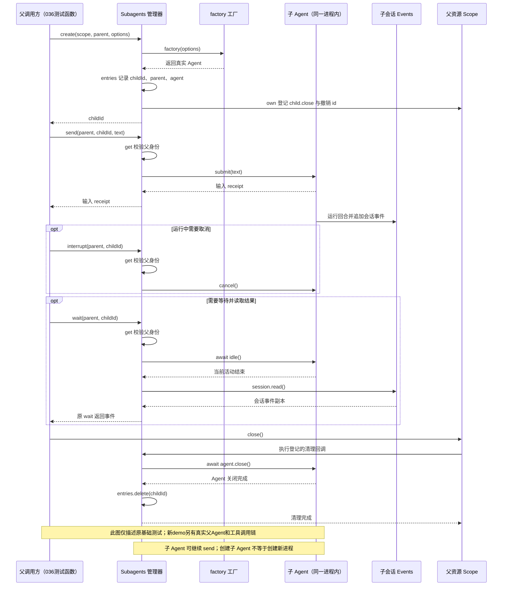
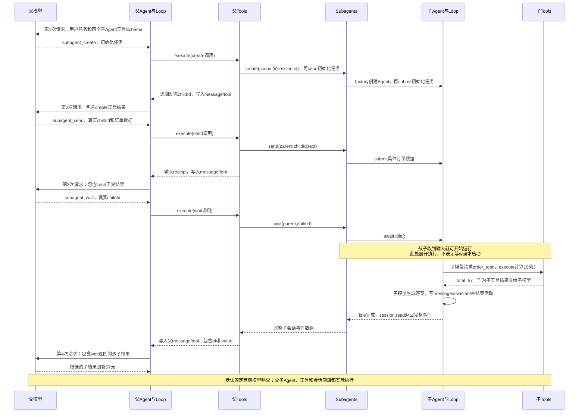
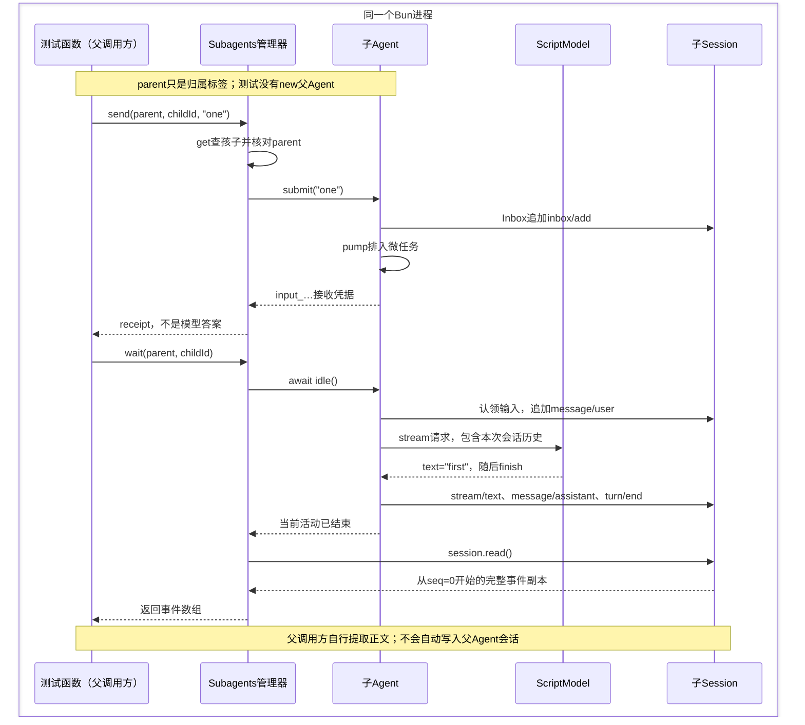
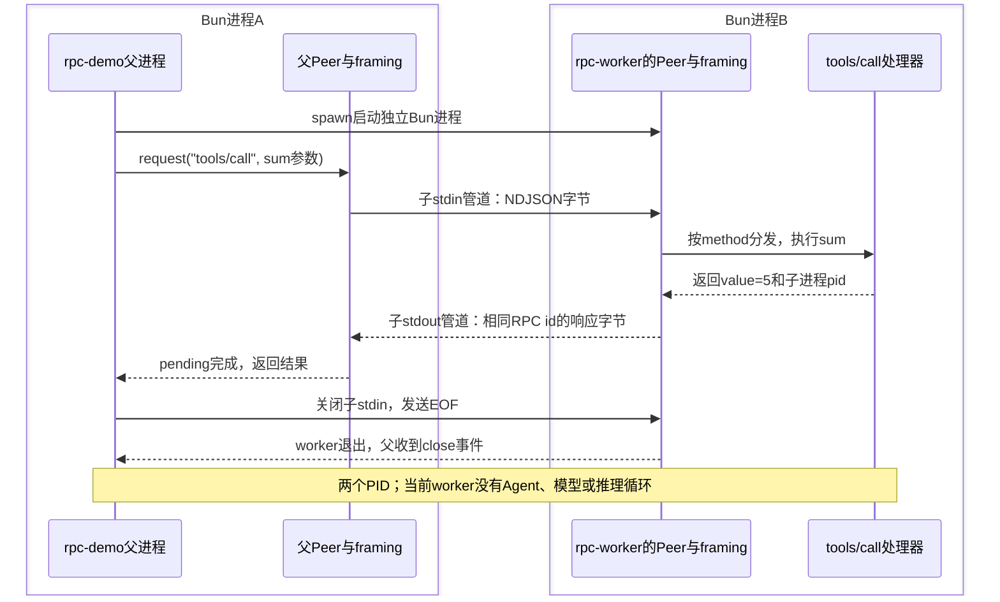

# 036 · 子Agent可以继续对话

阶段：R05。唯一前置：完成第 035 步，继续同一个工程。

## 什么时候会用到这一页

父Agent收到订单任务，通过模型工具创建子Agent、提交单价19元数量3的订单、等待孩子实际调用order_total，再根据wait返回的结果回答57元。原基础测试保留，新增普通demo贯通真实父子Agent；默认固定外部模型响应，不联网。

### 这次数据怎么走

```text
Subagents.create(scope,parent,options) → factory创建真实Agent → 记录parent/agent → send提交输入 → wait等待Agent.idle并读会话 → interrupt取消 → 父scope关闭时child.close并撤销id
```

### 对应时序图

从上往下读；实线箭头表示调用或发送，虚线箭头表示返回或事件通知。`opt`表示可选操作，`alt`表示不同结果，`loop`表示重复，`par`及其`and`分支表示并行；“未接入”及fixture说明按图中标注理解。



**当前接线位置：**036已新增subagentTools注册四个父模型工具，并在src/subagents-demo.mjs装配真实父Agent和子Agent，完成create→send→wait→父回答。默认只固定外部模型响应，--live显式让父子都调用DeepSeek；原基础测试的parent仍只是标签。051另在Host中组合持久会话与agent.children，不是本章demo的依赖。

## 这一步具体做什么

按本页完整代码创建src/subagent-tools.mjs、src/subagents-demo.mjs和新增测试，保留原管理器。先运行 bun src/subagents-demo.mjs，观察父工具create→send→wait、孩子order_total、父回答57元；再运行原测试和036-subagent-tools.test.mjs。入口只向父Agent.submit，不直接替模型调用管理器。

需要本章新文件的操作，先按下面代码创建文件，再执行；不要在上一步尚不存在的接口上试错。

## 代码为什么放在这一层

Subagents管理孩子，subagentTools把create/send/wait/interrupt包装进父Tools；Loop在每次请求前把catalog交给模型，再把真实工具结果写入message/tool。父模型从create结果读取动态childId，从wait完整事件提取孩子最终结果后才回答。父子各有Agent、Session、Tools和Settings，均在同一Bun进程；parent由闭包绑定父session.id，不自动继承历史或权限。

## Subagents管理孩子，工具把它接到父Agent

实际使用场景是：主Agent正在修改代码，把“检查取消逻辑”交给一个子Agent；拿到审阅结果后，还想继续问同一个孩子“这个问题怎么修”。孩子需要保留自己的会话，才能接着上一轮回答。

本章现在有两层证据：**原来的基础测试由测试函数扮演父调用方；新增的subagents-demo则创建真实父Agent，由父模型通过工具创建孩子、提交订单计算任务、等待结果，再回答用户。** 两者都使用同一个Subagents管理器。默认demo固定外部模型响应，父子Agent、Loop、工具执行和会话回填都真实运行；固定响应不代表远端模型自主推理。

| 对象 | 当前负责什么 | 对应代码 |
| --- | --- | --- |
| 测试函数 | 代替父调用方，创建孩子、提交输入、读取结果 | tests/036-subagents.test.mjs中的test回调。 |
| 新demo的父Agent | 接收用户任务，让模型选择工具，执行工具并将结果交给下一次模型请求 | src/subagents-demo.mjs中的parent；工具注册在src/subagent-tools.mjs。 |
| Subagents | 登记、查找和控制孩子；把孩子清理托管给Scope | entries、create/get/send/wait/interrupt。 |
| factory | 决定怎样创建Agent，以及用什么会话、模型、工具和配置 | 传给new Subagents的函数。 |
| 子Agent | 接收输入，运行模型/工具循环，保存执行状态与会话 | new Agent(new Events(), model, new Tools(), new Settings())。 |
| Scope | 关闭时触发登记的资源清理 | scope.own登记agent.close和entries.delete。 |

```text
原基础测试所在的同一个Bun进程（新demo另有真实父Agent）
├── 测试函数：当前的父调用方，没有创建父Agent
├── Subagents管理器：entries保存子Agent对象的引用
└── 子Agent对象
    ├── Inbox：接收one、two
    ├── Loop：按输入运行回合，调用模型和工具
    ├── Session：保存该孩子自己的会话事件
    └── Model：当前测试的ScriptModel，固定回答first、second
```

new Subagents(factory)只创建管理器，不会立即创建Agent。调用create时才执行factory，拿到真实Agent对象，放入entries；管理器本身没有Inbox、模型或推理循环。

### 主线demo：父Agent通过工具委派订单计算，再根据孩子结果回答

这次用户只向父Agent提交一次任务：“单价19元，数量3，请交给子Agent计算，再告诉我总价。”应用入口只调用父Agent.submit和idle，不替父模型直接调用children.create/send/wait，也不直接把孩子的答案拼进用户输出。

先按本页后面的完整代码创建src/subagent-tools.mjs、src/subagents-demo.mjs和新增测试，保留原来的src/subagents.mjs。然后在同一个工程根目录运行demo。不要在教材的steps/036目录直接运行；那里只保存本步增量，缺少前035步累计创建的依赖。

```text
用户 → 父Agent.submit → 父Loop取tools.catalog交给父模型
     → 父模型请求subagent_create({task}) → 父Tools.execute
     → 工具run调用Subagents.create并send初始化任务 → 返回childId
     → 父Loop写message/tool → 下一次父模型请求读到真实childId
     → 父模型请求subagent_send({id,text}) → 孩子收到具体订单数据
     → 父模型请求subagent_wait({id}) → 等待孩子自己的Loop完成
     → 子模型请求order_total → 子Tools真正计算19×3=57
     → 子模型读工具结果，在子Session写最终答案
     → wait返回完整子事件 → 父Loop写message/tool
     → 父模型从这些事件中读出57 → 父Agent回答用户
```



**工具注册和把工具交给模型，是两个动作。** src/subagent-tools.mjs调用tools.register，将名称、参数Schema和本地run函数登记到父工具表；父Loop在每次请求前调用tools.catalog，只把名称、说明、Schema交给model.stream。模型返回工具名称和参数后，父Loop才调用tools.execute，经过参数校验与父工具守卫，再执行run。模型看不到run函数，也不会直接拿到children对象。

| 父模型可调用的工具 | 参数 | 工具run实际做什么 | run返回值 |
| --- | --- | --- | --- |
| subagent_create | task字符串 | create创建孩子，再send这条初始化任务 | {id: "child_…"} |
| subagent_send | id、text字符串 | 给已有孩子追加一条输入 | {receipt: "input_…"} |
| subagent_wait | id字符串 | 等孩子idle，再读子Session | 完整事件数组 |
| subagent_interrupt | id字符串 | 调用孩子cancel，请求取消当前活动 | {} |

create本身已经提交task；demo随后调用send是在追加具体订单数据，不是重新提交同一任务。孩子因而有两轮用户输入：第一轮建立计算任务，第二轮处理订单；第二轮还要经过“子模型→order_total工具→子模型”，所以默认共发起3次子模型请求。

以create返回值为例，run返回的是下面左边对象；Loop写入父会话并交给下一次模型请求的工具内容带外层ok/value：

```js
// run返回的业务结果；childId由管理器实际生成，不能预先写死。
const runResult = { id: 'child_示意编号' }
// 父模型下一次请求看到的工具内容；callId另用于关联本次工具调用。
const toolContent = { ok: true, value: runResult }
```

wait的value是子会话事件数组，不是单独的正文字符串。默认父模型响应实现会从这份真实返回的数组提取孩子最后的assistant内容，再构成回答；不读取demo外部的childAgent引用。把订单数量改掉，孩子工具计算结果与父最终答案都要一起变化，才能排除“只是按顺序打印预写答案”。

父子各有独立Tools、Session和Settings。父Tools拥有四个管理工具；子Tools只注册order_total，不默认把父工具表复制过去。管理器parent由注册器闭包绑定为父session.id，模型只填写childId；这个归属标签仍不是完整的权限继承树。所有对象在同一Bun进程，远端DeepSeek只负责模型推理，不会在远端运行本地order_total。

### 运行新demo：先观察固定响应，再接真实DeepSeek

操作位置始终是自己的工程根目录。完成本页文件后，先运行这一条主线：

```sh
cd "$PROJECT"
bun src/subagents-demo.mjs
bun test ./tests/036-subagents.test.mjs ./tests/036-subagent-tools.test.mjs
```

默认不会访问网络，也不需要模型密钥。固定的只是父子两侧的外部模型响应；管理器没有被测试替身替换，工具也没有绕过Tools.execute。成功时应看到父create、send、wait，以及孩子order_total的实际执行，随后父回答包含57元；末尾输出运行报告和正常清理结果。随机childId、sessionId、receipt和PID每次会变，不要按示例字符串做断言。

准备接真实模型时，沿用016已创建的本机.env，只补齐下面配置；API地址使用DeepSeek的OpenAI兼容接口根地址：

```dotenv
DEEPSEEK_API_KEY=在本机填写自己的Key
DEEPSEEK_BASE_URL=https://api.deepseek.com
DSH_MODEL=填写自己账号可调用且支持工具的模型ID
```

```sh
# Bun从工程根目录自动加载.env；只有显式live才发真实网络请求。
bun src/subagents-demo.mjs --live
```

live会让父、子两侧都使用相同的显式DeepSeek配置，不会出现父用DeepSeek、孩子偷偷退回离线模型的情况；缺Key或请求失败应非零退出。默认固定响应的通过记录不能当成live已经通过。这个验收demo仍严格要求孩子输出结果JSON、父按指定句式回答；真实模型没有遵循格式、工具顺序或计算结果时会断言失败并非零退出，不会放宽检查来制造成功记录。

### VS Code调试：一次F5同时观察父、子Agent

VS Code打开自己的PROJECT。在已有.vscode/launch.json的configurations数组追加下面这个完整配置对象，保留原来的其他配置：

```json
{
  "name": "Bun：036父Agent工具委派",
  "type": "bun",
  "request": "launch",
  "program": "${workspaceFolder}/src/subagents-demo.mjs",
  "cwd": "${workspaceFolder}",
  "runtime": "bun",
  "runtimeArgs": ["--preload", "${workspaceFolder}/scripts/vscode-debug.mjs"],
  "args": [],
  "stopOnEntry": false
}
```

选择“Bun：036父Agent工具委派”，按F5。父子是同一个进程里的两个对象，一次启动就能命中两边断点，不需要单独Attach worker。普通demo不经过bun test，没有测试框架默认5秒超时；调试真实请求仍会受到远端连接超时影响，先用默认固定响应停断点。

| 断点位置 | 看什么 | 验收现象 |
| --- | --- | --- |
| src/subagent-tools.mjs的add，F11进入src/tools.mjs的register | 在add看name、properties、parent；在register看tool.name、tool.schema | 父工具表出现四个管理工具；parent是父session.id |
| src/loop.mjs的catalog与model.stream | tools.catalog()、history | 父请求含四个管理工具；子请求含order_total |
| src/tools.mjs的execute | call.name、call.arguments、tool.run | create、send、wait均从父Loop进入这个门 |
| src/subagent-tools.mjs的create/send/wait处理函数 | create看childId；send看receipt；wait跨过await后看events | send/wait的args.id使用create真实返回的同一个编号 |
| src/subagents-demo.mjs的order_total执行函数 | 单价、数量、计算结果 | 真实执行19×3，得到57 |
| src/loop.mjs追加message/tool与下一次model.stream | 追加时看results[index]；下一轮声明完成后看history的最后一条tool消息 | wait结果经父会话回填后，父模型才生成最终答案 |
| src/subagents-demo.mjs的最终报告与scope.close | 父子关闭状态、工具数、监听数、entries.size | 正常完成后资源归零 |

遇到父子都命中同一个loop.mjs断点，用当前函数参数中的session.id和catalog的工具名区分；不要把文件相同误认为它们共用会话。变量只在执行到对应声明之后可读；F10跨过await后再检查返回值。调试测试则打开新增的tests/036-subagent-tools.test.mjs，沿用“Bun：当前测试”的长超时配置；结束后在终端重新执行正常测试命令，不能只凭断点命中判通过。

### 验收与内化：确认答案确实经过孩子算了一遍

先不看实现，预测“父第几次模型请求能知道childId、第几次能看到孩子答案”。再运行并对照：固定响应下父应请求4次，工具顺序为create→send→wait；子应请求3次，order_total执行1次；父答案包含57元，并且来源于wait的返回事件。

最后一行“036验收结果”里重点核对下面字段；waitedEvents默认是23，但它表示整份事实数量，不是答案长度或模型请求数：

```json
{
  "parentRequests": 4,
  "childRequests": 3,
  "parentToolSequence": ["subagent_create", "subagent_send", "subagent_wait"],
  "parentGuardCalls": ["subagent_create", "subagent_send", "subagent_wait"],
  "factoryCalls": 1,
  "childToolRuns": 1,
  "childTurns": 2,
  "parentReadWaitResult": true,
  "childResult": { "unitPrice": 19, "quantity": 3, "total": 57 },
  "finalText": "子Agent已计算：订单总价为57元。",
  "reason": "completed"
}
```

同一报告的cleanup里，parentClosed和childClosed应为true，children、parentTools、childTools、parentListeners、childListeners应为0。若只看到“已准备好”，还不能算完成：要继续检查父send是否提交订单、孩子是否调用order_total、父最后一条request/start是否包含subagent_wait的工具结果。孩子有答案而父没有答案时，沿“wait返回→父message/tool→父下一次模型请求”排查，不用另写一条直接读取孩子对象的捷径。

然后打开新增测试，观察它改变订单数量后父答案如何跟着实际计算变化。合上资料，用自己的话讲清tools.register、catalog、execute、message/tool四个位置，第二天只重做讲不清的那一段；第3天再用另一组数量重跑，检查是否还依赖原来的57。

这次主线没有演示interrupt的运行中取消，也没有补齐父cancel自动传播、wait响应父signal、深度/并发预算、权限取交集、完成推送或失败恢复。scope正常关闭时会回收孩子和注册工具；原管理器在child.close抛错时可能留下登记，不能把本次正常路径验收说成所有异常都已兜住。

### 为什么主Agent与Subagents的方法名不一样

主Agent对象和子Agent对象使用的是同一个Agent类，基本方法都是submit、idle、cancel、close。Subagents是管理多个孩子的外层入口，调用者还要告诉它“控制哪个孩子、属于哪个父调用方”，所以多了parent、childId两个参数。

| 单个Agent的方法 | Subagents管理器入口 | 管理器额外做什么 |
| --- | --- | --- |
| agent.submit(text) | send(parent, childId, text) | 按childId定位孩子，核对归属，再提交输入；同样返回接收凭据。 |
| await agent.idle()，再agent.session.read() | await wait(parent, childId) | 定位、核对归属，等空闲后读取整份会话事件。 |
| agent.cancel() | interrupt(parent, childId) | 定位、核对归属，再请求取消当前活动；不等待取消完成。 |
| await agent.close() | 由创建时传入的scope.close()触发清理 | 正常清理时关闭登记的孩子，再删除entries中的记录；当前没有管理器close方法。 |

例如父调用方想让一个孩子检查取消逻辑，先写的是管理器入口：

```js
// 管理器先查找和校验，再转交给对应的Agent对象。
const receipt = children.send(parent, childId, '检查取消逻辑')
```

send内部展开后就是：

```js
// 以下是等价展开说明，和上一段二选一观察，不要连续执行成两次提交。
const childAgent = children.get(parent, childId) // 定位孩子，检查parent归属标签。
const receipt = childAgent.submit('检查取消逻辑') // 最终调用的仍是Agent.submit。
```

这里submit与send、cancel与interrupt的差异主要是外层命名选择；wait则组合了两个动作，不能直接与idle画等号：

```js
// 这是管理器wait的等价展开；结果是完整事件数组，不是最终答案字符串。
const childAgent = children.get(parent, childId) // 先完成定位和归属校验。
await childAgent.idle() // 第一步只等活动结束，不返回会话内容。
const events = childAgent.session.read() // 第二步才取得该孩子的会话事件副本。
```

```text
主Agent对象：submit / idle / cancel / close
子Agent对象：submit / idle / cancel / close
                   ↑
Subagents管理器：send / wait / interrupt
                 先查找孩子、校验归属，再调用上面的Agent方法
```

新增的src/subagent-tools.mjs现在就将管理器方法包装成父Agent可调用的工具，运行时路径是：

```text
父Agent Loop → Tools执行subagent_send工具
            → Subagents.send(parent, childId, text)
            → 子Agent.submit(text) → 子Agent自己的Loop
```

原基础测试仍直接调用管理器；新demo从真实父Loop进入工具再调用管理器。051是在持久Host中组合这些能力，不再是本教程第一次出现子Agent工具的位置。读代码时先看调用对象：agent.submit是在控制一个已经拿到的Agent对象，children.send是在管理器里按编号控制一个孩子。接口可以改成相同名字，但定位与归属校验这层职责仍然需要保留。

### parent、childId分别是什么

原测试的关键代码可以拆开看：

```js
// parent是本例调用方使用的归属标签，不是父Agent对象，也不是进程ID。
const parent = 'parent'
// childId是管理器生成的孩子编号，形如child_…；不是子会话的session_…编号。
const childId = await children.create(scope, parent)
```

create内部保存的结构相当于：

```js
// 这是登记结构示意；agent是factory返回的真实对象引用。
entries.set(childId, { parent: 'parent', agent })
```

以后调用send/wait/interrupt，都带上这个parent标签和childId。get先找到登记项，再比较 `child.parent !== parent`；传入stranger就抛出“没有子Agent权限”。**这里检查的是管理器内的归属标签是否相等，没有根据字符串自动找到一个父Agent，也没有建立跨进程身份认证。**

create也没有把parent传给factory，factory实际只收到options。父对象、父历史、工具和权限都不会因为填了parent而自动复制。原基础测试只有一个孩子；新demo也明确创建一个孩子，并没有证明多个孩子之间的并发隔离。

### 发任务与拿结果：两条方向不同的路径

```text
发任务：父调用方 → Subagents.send → get核对归属 → 子Agent.submit
       → Inbox记录输入 → pump认领输入 → Loop → 模型/工具

拿结果：模型输出 → 子Agent把消息写入自己的Session
       → Subagents.wait等待该Agent空闲 → session.read → 返回给父调用方
```

这些箭头在036中都是同一进程的方法调用或内存读写，没有经过Peer、framing、JSON序列化或stdin/stdout管道。默认new Events()也没有接磁盘persist，当前测试的会话保存在内存中。



**send的返回值是输入凭据，wait的返回值是会话事件数组。** 数组里除了assistant消息，还有inbox/add、inbox/claim、用户消息、请求、流片段、turn/end等事实。wait等待Agent当前活动收敛，没有按某张receipt只返回一条回答；本例每次send后立即wait，便于观察一轮。

第二次给同一个childId发送two，会使用同一个Agent和Session。第二次wait不带读取游标，仍返回第一轮加第二轮的全部事件；如果界面每次把整份结果都追加一次，就会重复显示旧内容。

### 基础对照例子：直接调用管理器，打印两轮回答和历史

主线运行入口是后面新增的src/subagents-demo.mjs。下面保留直接调用管理器的对照例子：它把原测试拆成可以停断点、打印中间值的普通脚本，不需要模型密钥，也不会启动子进程。需要单独观察send/wait时，在自己的练习工程根目录创建 `scripts/subagents-036-demo.mjs`，复制下面完整代码；这段没有父Agent，不能替代新demo的验收。

```js
import assert from 'node:assert/strict'
import { Subagents } from '../src/subagents.mjs'
import { Scope } from '../src/scope.mjs'
import { Agent } from '../src/agent.mjs'
import { Events } from '../src/events.mjs'
import { Tools } from '../src/tools.mjs'
import { Settings } from '../src/config.mjs'
import { ScriptModel, answer } from '../src/model.mjs'

const parent = 'parent' // 当前调用方的归属标签；这里没有new父Agent。
const scope = new Scope() // 调用方持有的资源作用域，最终负责关闭孩子。
const model = new ScriptModel([answer('first'), answer('second')]) // 固定两轮输出，观察通信而非远端推理。
let factoryCalls = 0 // 核对管理器构造时不会提前创建Agent。
let childPid // 工厂执行时的进程ID，与脚本PID比较。
const children = new Subagents(async () => {
  factoryCalls += 1 // create调用工厂时才会增长。
  childPid = process.pid // 普通new Agent不会启动另一个Bun进程。
  return new Agent(new Events(), model, new Tools(), new Settings())
})
assert.equal(factoryCalls, 0)
let report // 等资源清理完成后再打印最终验收。

try {
  const childId = await children.create(scope, parent) // 创建一个真实孩子，得到管理器编号。
  const agent = children.get(parent, childId) // 得到本进程里的同一个Agent对象引用。
  assert.equal(factoryCalls, 1)
  assert.equal(childPid, process.pid)
  assert.notEqual(childId, agent.session.id) // 管理器编号与会话编号不是一回事。

  const receipt = children.send(parent, childId, 'one') // 同步返回input_…，此时不是答案。
  assert.equal(typeof receipt, 'string')
  const firstEvents = await children.wait(parent, childId) // 等第一轮结束，读取整份事件。
  const firstAnswers = firstEvents.filter(event => event.type === 'message/assistant').map(event => event.data.content) // 从事件中选出正文。
  assert.deepEqual(firstAnswers, ['first'])

  children.send(parent, childId, 'two') // 复用同一孩子和它的历史。
  const secondEvents = await children.wait(parent, childId) // 第二次仍包含第一轮事件。
  const secondAnswers = secondEvents.filter(event => event.type === 'message/assistant').map(event => event.data.content) // 这里应有两条回答。
  const secondUserHistory = model.requests[1].messages.filter(message => message.role === 'user').map(message => message.content) // 观察第二次模型请求的用户历史。
  assert.deepEqual(secondAnswers, ['first', 'second'])
  assert.deepEqual(secondUserHistory, ['one', 'two'])
  assert.equal(model.requests.length, 2)
  assert.equal(children.get(parent, childId), agent) // 两轮没有换Agent对象。
  assert.throws(() => children.interrupt('stranger', childId), /权限/) // 标签不匹配，取消不会转交给孩子。

  report = { parent, childId, sessionId: agent.session.id, pid: process.pid, childPid, sameProcess: childPid === process.pid, factoryCalls, receipt, firstAnswers, secondAnswers, secondUserHistory, modelRequests: model.requests.length }
} finally {
  await scope.close() // 正常路径下依次关闭孩子并删除登记，失败时也尝试清理。
}
assert.equal(children.entries.size, 0)
console.log(JSON.stringify({ ...report, entriesAfterClose: children.entries.size }, null, 2))
```

在自己的工程根目录运行：

```sh
mkdir -p scripts
# 把上面的代码保存为scripts/subagents-036-demo.mjs后再执行。
bun scripts/subagents-036-demo.mjs
bun test ./tests/036-subagents.test.mjs
```

验收重点是 `sameProcess: true`、`factoryCalls: 1`、`firstAnswers: ["first"]`、`secondAnswers: ["first", "second"]`、`secondUserHistory: ["one", "two"]`、`modelRequests: 2`、`entriesAfterClose: 0`。childId、sessionId、receipt带随机后缀，PID也随运行变化，不要把样例编号写死。

在VS Code里先给demo的receipt、firstEvents、secondEvents、secondUserHistory和scope.close处设断点，再进入src/subagents.mjs的get/send/wait，以及src/agent.mjs的submit/pump/idle。在自己工程已有的 `.vscode/launch.json` 的configurations数组中追加下面这个对象，保留原有配置：

```json
{
  "name": "Bun：036子Agent通信示例",
  "type": "bun",
  "request": "launch",
  "program": "${workspaceFolder}/scripts/subagents-036-demo.mjs",
  "cwd": "${workspaceFolder}",
  "runtime": "bun",
  "stopOnEntry": false
}
```

选择“Bun：036子Agent通信示例”，按F5。它运行普通脚本，不经过bun test，也没有Peer请求超时；此例没有子进程，不需要Attach worker。若从现有“Bun：当前测试”配置调试，就打开原本的tests/036-subagents.test.mjs，在对应send/wait前后观察同样的变量。对照断点行执行前后看变量：尚未执行的const还不能读取。

### 子Agent会主动把答案发给父Agent吗

036当前没有这条主动推送路径。孩子将输出写进自己的Session，父调用方调用wait读取；不自动调用父Agent.submit，也不自动把孩子的assistant消息加入父历史。

新demo已经补上“怎样交回”：父Loop执行subagent_wait工具，run函数调用children.wait读到孩子的事件，再由父Loop写成message/tool，下一次父模型请求才读到结果并回答。孩子没有直接调用父Agent.submit；这仍是父方主动wait的返回路径。051则在Host中创建持久子会话并管理agent.children，不要把该步的取消传播和持久化当成本章已有能力。

interrupt也是转交控制：它调用孩子的cancel，孩子再对当前活动的AbortController发出abort；它不等待取消完成、不删除childId，也不杀进程。需要观察取消是否收敛，还要wait。原测试只验证stranger的取消被拒绝，没有验证运行中取消的完整路径；idle和Scope清理抛错时也没有额外恢复机制，不能据此声称所有失败都一定撤销登记。

### 与032的RPC worker、独立进程区别在哪

| 对比点 | 032的rpc-worker | 036的子Agent |
| --- | --- | --- |
| 创建方式 | spawn另一个Bun进程，运行rpc-worker.mjs。 | factory在当前Bun进程直接new Agent。 |
| 对端运行什么 | tools/call处理器，执行sum、delete；当前worker没有Agent Loop。 | 有自己的Inbox、Session和模型/工具执行循环的Agent对象。 |
| 发送任务 | Peer封装RPC对象，framing编码成NDJSON字节，写入子进程stdin。 | Subagents找到对象，直接调用agent.submit(text)。 |
| 返回结果 | worker回复RPC；主进程按请求id完成pending。 | 孩子写自己的Session，调用方wait空闲后读事件副本。 |
| 反向请求 | worker可经Peer向主进程发approval/request，询问用户。 | 当前Subagents没有反向发消息API，也没有接父Agent Inbox。 |
| 关闭方式 | 回收Peer、管道和子进程，等待实际退出。 | Scope触发agent.close，等待活动结束后删除entries登记。 |

032的跨进程路径单独画出来：



036的childId定位一个可多轮使用的Agent；032的RPC id定位一次请求和响应；操作系统PID定位一个进程。这三个编号不能混用。

**子Agent表示任务和会话的父子关系；子进程表示运行位置。** 同一个进程里可以有多个Agent对象；另一个进程里的程序也可以只是工具处理器。原版的spawn-in-process、fork-in-process提供方都在进程内，fork指从父已完成轮次的快照起步，不是操作系统fork；其他外部提供方可以启动独立运行时，按各自协议通信。036只演示进程内工厂创建，不能推断所有原版子Agent都同进程或都走032这份RPC。

合上说明，先用一句话解释“谁创建、谁管理、谁执行”，再画出send和wait的两条方向。第二天重做打印例子，重点预测第二次wait为什么仍有first，以及填入parent字符串为什么不会凭空生成父Agent。

## 在哪里写、写什么

操作地点：终端中的 `$PROJECT`，编辑器打开同一个目录。只创建或替换下列文件，其他文件保留上一步版本。文件目录不存在先创建。

```sh
mkdir -p src
```

### 创建 `src/subagent-tools.mjs`

````javascript
/** 把管理器包装成模型工具；父身份来自装配闭包，不由模型提交。 */
export function subagentTools(scope, tools, children, parent) {
  // 四个工具仍进入已有Tools.register/execute，沿用参数校验、守卫和注销。
  const add = (name, description, properties, run, effect = 'execute') => tools.register(scope, {
    name, description, effect, exclusive: effect !== 'read',
    schema: { type: 'object', properties, required: Object.keys(properties), additionalProperties: false },
    run,
  })
  // 模型得到的是这些参数Schema；run函数不会被发送给模型。
  const string = { type: 'string' }
  add('subagent_create', '创建子Agent并提交初始任务；返回id，后续send/wait使用此id。', { task: string }, async args => {
    const childId = await children.create(scope, parent) // 工厂创建真实Agent并登记归属。
    children.send(parent, childId, args.task) // create工具组合创建与首次提交。
    return { id: childId }
  })
  add('subagent_send', '向已有子Agent补充任务；返回接收凭据，不是最终答案。', { id: string, text: string }, args => {
    const receipt = children.send(parent, args.id, args.text) // 先提交输入，便于断点观察真实接收凭据。
    return { receipt }
  })
  add('subagent_wait', '等待子Agent空闲并读取完整会话事件；从message/assistant中读取回答。', { id: string }, async args => {
    const events = await children.wait(parent, args.id) // 等孩子空闲后，才能在这里观察整份返回事件。
    return events
  }, 'read')
  add('subagent_interrupt', '请求取消子Agent当前活动；不等待取消完成。', { id: string }, args => {
    children.interrupt(parent, args.id)
    return {}
  })
}
````

```sh
mkdir -p src
```

### 创建 `src/subagents-demo.mjs`

````javascript
import assert from 'node:assert/strict'
import { Agent } from './agent.mjs'
import { Settings } from './config.mjs'
import { DeepSeekModel } from './deepseek.mjs'
import { Events } from './events.mjs'
import { answer, call } from './model.mjs'
import { Scope } from './scope.mjs'
import { Subagents } from './subagents.mjs'
import { subagentTools } from './subagent-tools.mjs'
import { Tools } from './tools.mjs'

/** 固定外部模型响应，但根据真正收到的工具结果决定下一次调用。 */
function fixedModel(next) {
  return {
    requests: [],
    async *stream(request) {
      this.requests.push(request)
      for (const part of next(request)) { request.signal.throwIfAborted(); yield part }
    },
  }
}

/** 工具结果由Loop包装成{ok,value}，失败时不能继续伪装成功。 */
function toolValue(message) {
  assert.equal(message?.role, 'tool', '下一步必须先收到工具结果')
  assert.equal(message.content.ok, true, '工具失败：' + message.content.error)
  return message.content.value
}

/** 从wait得到的孩子会话中提取最后一条已提交的assistant正文。 */
function lastAnswer(events) {
  return events.findLast(event => event.type === 'message/assistant' && !event.data.calls?.length)?.data.content ?? ''
}

/** 真实父/子Agent共用已有Loop；默认离线，显式--live才请求DeepSeek。 */
export async function runSubagentsDemo({ unitPrice = 19, quantity = 3, live = false, key,
  baseURL = 'https://api.deepseek.com', modelId = 'deepseek-flash', write = console.log } = {}) {
  if (live && !key) throw Error('真实请求缺少DEEPSEEK_API_KEY；请先配置本机.env，不会回退到离线样本')
  assert.ok(Number.isFinite(unitPrice) && unitPrice >= 0 && Number.isSafeInteger(quantity) && quantity > 0, '订单参数不合法')
  // 只打印业务进度；保护本次Key，不打印模型实例或请求鉴权头。
  const log = text => write(live && key ? String(text).replaceAll(key, '[已隐藏]') : text)
  const scope = new Scope(), parentSession = new Events(), parentTools = new Tools()
  const stats = { parentRequests: 0, childRequests: 0, factoryCalls: 0, childToolRuns: 0, guardCalls: [] }
  const childRecords = [] // 保存真实孩子对象以便验收和正常退出后核对资源。
  const initialTask = '你是订单计算助手。此条只是初始化，请回答“已准备好”，等待下一条订单JSON再计算。'
  const order = { unitPrice, quantity } // 固定外部模型样本会把这份数据作为工具参数提交。
  const parentPrompt = `请严格依次完成：1.调用subagent_create，task为${JSON.stringify(initialTask)}；2.取返回的id调用subagent_send，text为${JSON.stringify(JSON.stringify(order))}；3.用同一id调用subagent_wait；4.读取返回事件中孩子最后一条assistant的JSON，按其中total回答“子Agent已计算：订单总价为TOTAL元。”，把TOTAL换成真实结果，不要自己计算或提前回答。`

  // 父模型只看自己的历史；孩子编号必须来自create的真实工具结果。
  const parentSample = fixedModel(request => {
    assert.deepEqual(request.tools.map(tool => tool.name), ['subagent_create', 'subagent_send', 'subagent_wait', 'subagent_interrupt'])
    assert.ok(request.tools.every(tool => !('run' in tool)), '模型不应得到宿主执行函数')
    const last = request.messages.at(-1)
    if (last?.role === 'user') return call('subagent_create', { task: initialTask }, 'parent-create')
    const value = toolValue(last) // 每次先读上一次真实结果，而非预填childId。
    if (last.name === 'subagent_create') return call('subagent_send', { id: value.id, text: JSON.stringify(order) }, 'parent-send')
    const creation = request.messages.find(message => message.role === 'tool' && message.name === 'subagent_create')
    const childId = toolValue(creation).id // send只返回receipt，要从先前create结果取孩子编号。
    if (last.name === 'subagent_send') return call('subagent_wait', { id: childId }, 'parent-wait')
    assert.equal(last.name, 'subagent_wait')
    const result = JSON.parse(lastAnswer(value)) // 这里只读wait返回的事件，不直接访问孩子或stats。
    return answer(`子Agent已计算：订单总价为${result.total}元。`)
  })

  /** 观察每个Agent实际进入的模型请求；live也不改变Agent和工具接线。 */
  function modelFor(role, sample) {
    const provider = live ? new DeepSeekModel({ key, baseURL, model: modelId }) : sample
    return {
      async *stream(request) {
        const counter = role === '父' ? 'parentRequests' : 'childRequests'
        stats[counter]++
        if (stats[counter] > 8) throw Error(role + 'Agent超过本演示8次模型请求预算')
        log(`[${role}模型请求 #${stats[counter]}] 工具=${request.tools.map(tool => tool.name).join(',')}`)
        yield* provider.stream(request)
      },
    }
  }

  /** 订阅的是应用日志，不是把孩子输出主动注入父模型。 */
  function observe(role, session, ownerScope) {
    ownerScope.own(session.on(event => {
      if (event.type === 'tool/start') log(`[${role}工具] ${event.data.call.name} ${JSON.stringify(event.data.call.arguments)}`)
      if (event.type === 'message/tool' && event.data.name !== 'subagent_wait') log(`[${role}工具结果] ${event.data.name} ${JSON.stringify(event.data.content)}`)
      if (event.type === 'message/tool' && event.data.name === 'subagent_wait') log(`[父工具结果] subagent_wait 返回${event.data.content.value?.length ?? 0}条子会话事件`)
      if (event.type === 'message/assistant' && event.data.content) log(`[${role}回答] ${event.data.content}`)
      if (event.type === 'turn/error') log(`[${role}轮次错误] ${event.data.message}`)
    }))
  }

  const children = new Subagents(async () => {
    stats.factoryCalls++
    const childScope = scope.child(), session = new Events(), tools = new Tools() // 独立孩子会话/工具表，不复用父工具表。
    const sample = fixedModel(request => {
      const last = request.messages.at(-1)
      if (last?.role === 'tool') return answer(JSON.stringify(toolValue(last))) // 最终JSON必须来自真实order_total。
      if (last?.content === initialTask) return answer('已准备好')
      return call('order_total', JSON.parse(last.content), 'child-total')
    })
    tools.register(childScope, {
      name: 'order_total', description: '计算订单总价，返回unitPrice、quantity和total；必须实际调用后回答JSON。', effect: 'read', exclusive: false,
      schema: { type: 'object', properties: { unitPrice: { type: 'number' }, quantity: { type: 'number' } }, required: ['unitPrice', 'quantity'], additionalProperties: false },
      run(args) {
        stats.childToolRuns++
        return { ...args, total: args.unitPrice * args.quantity } // 真正的计算发生在子Agent工具内部。
      },
    })
    const settings = new Settings({ model: modelId, maxTokens: 1024, thinking: { type: 'disabled' },
      system: '你是订单计算助手。初始化消息只回答已准备好。收到订单JSON后必须先调用order_total，再把工具返回value对象原样输出为JSON，禁止代码围栏和解释。' })
    const agent = new Agent(session, modelFor('子', sample), tools, settings)
    childRecords.push({ scope: childScope, session, tools, agent, pid: process.pid })
    observe('子', session, childScope)
    log(`[创建孩子] parent=${parentSession.id} childSession=${session.id} pid=${process.pid}`)
    return agent // 管理器会把agent.close登记到父scope，关闭后撤销childId。
  })
  subagentTools(scope, parentTools, children, parentSession.id)
  // 本例没有安装生产权限策略；这里记录统一守卫确实经过，真实项目仍需接审批/限制。
  parentTools.guard = async tool => { stats.guardCalls.push(tool.name) }
  observe('父', parentSession, scope)
  const parentSettings = new Settings({ model: modelId, maxTokens: 2048, thinking: { type: 'disabled' },
    system: '严格依次执行用户要求的subagent_create、subagent_send、subagent_wait，每次等上一个工具结果后再调用下一个。拿到wait结果后才回答。' })
  const parent = new Agent(parentSession, modelFor('父', parentSample), parentTools, parentSettings)
  scope.own(() => parent.close())
  log(`[运行方式] ${live ? '真实DeepSeek：父子均使用同一显式提供方，消耗模型额度' : '离线固定模型响应：父子Agent、Loop、工具与结果回填均真实执行，不联网'}`)
  let report // 先保存运行证据，finally清理后再补充资源状态。
  try {
    parent.submit(parentPrompt) // 应用只提交父任务；不直接调用children.create/send/wait。
    await parent.idle()
    const events = parentSession.read(), toolEvents = events.filter(event => event.type === 'message/tool')
    const sequence = toolEvents.map(event => event.data.name), waitEvent = toolEvents.find(event => event.data.name === 'subagent_wait')
    const childEvents = toolValue(waitEvent?.data), childFinal = JSON.parse(lastAnswer(childEvents))
    const finalText = lastAnswer(events), expectedTotal = unitPrice * quantity
    assert.deepEqual(sequence, ['subagent_create', 'subagent_send', 'subagent_wait'])
    assert.deepEqual(stats.guardCalls, sequence) // 每次委派都经过父Tools的统一守卫。
    assert.ok(toolEvents.every(event => event.data.content.ok), '父工具调用必须都成功')
    assert.equal(childFinal.total, expectedTotal)
    assert.equal(finalText.trim(), `子Agent已计算：订单总价为${expectedTotal}元。`)
    assert.equal(stats.factoryCalls, 1); assert.equal(stats.childToolRuns, 1)
    assert.equal(events.findLast(event => event.type === 'turn/end')?.data.reason, 'completed')
    assert.deepEqual(childEvents.filter(event => event.type === 'turn/end').map(event => event.data.reason), ['completed', 'completed'])
    const childId = toolValue(toolEvents[0].data).id
    // 父最后一次模型请求必须真正携带wait工具结果，不能只在应用日志里看过孩子答案。
    const finalRequest = events.findLast(event => event.type === 'request/start').data
    const replayedWait = finalRequest.messages.findLast(message => message.role === 'tool' && message.name === 'subagent_wait')
    assert.deepEqual(toolValue(replayedWait), childEvents)
    assert.ok(childId.startsWith('child_')); assert.notEqual(childId, childRecords[0].session.id)
    report = { mode: live ? 'live' : 'offline', parentSessionId: parentSession.id, childId, childSessionId: childRecords[0].session.id,
      pid: process.pid, sameProcess: childRecords.every(record => record.pid === process.pid), parentRequests: stats.parentRequests, childRequests: stats.childRequests,
      parentToolSequence: sequence, parentGuardCalls: stats.guardCalls, factoryCalls: stats.factoryCalls, childToolRuns: stats.childToolRuns,
      childTurns: childEvents.filter(event => event.type === 'turn/end').length, waitedEvents: childEvents.length, childResult: childFinal,
      parentReadWaitResult: replayedWait.content.ok, finalText, reason: 'completed' }
    if (!live) { assert.equal(report.parentRequests, 4); assert.equal(report.childRequests, 3) }
  } finally { await scope.close() }
  report.cleanup = { parentClosed: parent.closed, children: children.entries.size, parentTools: parentTools.entries.size,
    parentListeners: parentSession.listeners.size, childClosed: childRecords.every(record => record.agent.closed),
    childTools: childRecords.reduce((sum, record) => sum + record.tools.entries.size, 0),
    childListeners: childRecords.reduce((sum, record) => sum + record.session.listeners.size, 0) }
  assert.deepEqual(report.cleanup, { parentClosed: true, children: 0, parentTools: 0, parentListeners: 0, childClosed: true, childTools: 0, childListeners: 0 })
  log('036验收结果：' + JSON.stringify(report))
  return report
}

// 默认不读Key、不发网络；只有显式--live才采用本机DeepSeek配置。
if (import.meta.main) {
  const live = process.argv.slice(2).includes('--live'), key = live ? process.env.DEEPSEEK_API_KEY : undefined
  try {
    if (process.argv.slice(2).some(arg => arg !== '--live')) throw Error('只支持无参数或--live；订单固定为19元×3件')
    await runSubagentsDemo({ live, key, baseURL: live ? process.env.DEEPSEEK_BASE_URL ?? 'https://api.deepseek.com' : 'https://api.deepseek.com',
      modelId: live ? process.env.DSH_MODEL ?? 'deepseek-flash' : 'deepseek-flash' })
  } catch (error) {
    console.error('036演示失败：' + (live && key ? String(error.message).replaceAll(key, '[已隐藏]') : error.message))
    process.exitCode = 1
  }
}
````

```sh
mkdir -p src
```

### 创建 `src/subagents.mjs`

````javascript
import { id } from './events.mjs'

/** 子Agent是可继续对话的资源，不是一次性的Promise快捷方式。 */
export class Subagents {
  entries = new Map()
  constructor(factory) { this.factory = factory }
  async create(scope, parent, options = {}) {
    const childId = id('child'), agent = await this.factory(options)
    this.entries.set(childId, { parent, agent })
    scope.own(async () => { await agent.close(); this.entries.delete(childId) })
    return childId
  }
  /** 所有观察控制均检查父身份。 */
  get(parent, childId) { const child = this.entries.get(childId); if (!child || child.parent !== parent) throw Error('没有子Agent权限'); return child.agent }
  send(parent, childId, text) { return this.get(parent, childId).submit(text) }
  async wait(parent, childId) { const agent = this.get(parent, childId); await agent.idle(); return agent.session.read() }
  interrupt(parent, childId) { this.get(parent, childId).cancel() }
}
````

```sh
mkdir -p tests
```

### 创建 `tests/036-subagent-tools.test.mjs`

````javascript
import { test } from 'bun:test'
import assert from 'node:assert/strict'
import { Agent } from '../src/agent.mjs'
import { Settings } from '../src/config.mjs'
import { Events } from '../src/events.mjs'
import { ScriptModel, answer } from '../src/model.mjs'
import { Scope } from '../src/scope.mjs'
import { Subagents } from '../src/subagents.mjs'
import { subagentTools } from '../src/subagent-tools.mjs'
import { runSubagentsDemo } from '../src/subagents-demo.mjs'
import { Tools } from '../src/tools.mjs'

test('父模型从动态编号继续send/wait，读孩子真实计算结果再回答', async () => {
  const report = await runSubagentsDemo({ write: () => {} }) // 跑普通demo的同一入口，不另造内存echo。
  assert.deepEqual(report.parentToolSequence, ['subagent_create', 'subagent_send', 'subagent_wait'])
  assert.equal(report.parentRequests, 4); assert.equal(report.childRequests, 3)
  assert.equal(report.childToolRuns, 1); assert.equal(report.childTurns, 2)
  assert.equal(report.childResult.total, 57)
  assert.equal(report.finalText, '子Agent已计算：订单总价为57元。')
  assert.equal(report.cleanup.children, 0); assert.equal(report.cleanup.parentTools, 0)
})

test('改变订单后父答案跟随孩子工具结果，不能写死样本57', async () => {
  const report = await runSubagentsDemo({ unitPrice: 23, quantity: 5, write: () => {} })
  assert.equal(report.childResult.total, 115)
  assert.equal(report.finalText, '子Agent已计算：订单总价为115元。')
})

test('子Agent工具仍受参数、守卫和归属检查约束，关闭后全部注销', async () => {
  const scope = new Scope(), tools = new Tools(), context = { signal: new AbortController().signal }
  let factoryCalls = 0 // 参数错误或守卫拒绝时，工厂不该创建任何孩子。
  const children = new Subagents(async () => {
    factoryCalls++
    return new Agent(new Events(), new ScriptModel([answer('ready')]), new Tools(), new Settings())
  })
  subagentTools(scope, tools, children, 'parent-session')
  try {
    assert.equal(tools.catalog().length, 4)
    assert.ok(tools.catalog().every(tool => !('run' in tool)))
    await assert.rejects(tools.execute({ name: 'subagent_create', arguments: { task: 123 } }, context), /类型/)
    tools.guard = async () => { throw Error('用户拒绝') }
    await assert.rejects(tools.execute({ name: 'subagent_create', arguments: { task: 'prepare' } }, context), /拒绝/)
    assert.equal(factoryCalls, 0)
    tools.guard = async () => {}
    const foreignId = await children.create(scope, 'stranger') // 归属检查发生在Tools包装后，不能靠知道编号绕过。
    await assert.rejects(tools.execute({ name: 'subagent_send', arguments: { id: foreignId, text: 'wrong owner' } }, context), /权限/)
    await assert.rejects(tools.execute({ name: 'subagent_wait', arguments: { id: foreignId } }, context), /权限/)
    await assert.rejects(tools.execute({ name: 'subagent_interrupt', arguments: { id: foreignId } }, context), /权限/)
  } finally { await scope.close() }
  assert.equal(children.entries.size, 0)
  assert.equal(tools.catalog().length, 0)
  await assert.rejects(tools.execute({ name: 'subagent_create', arguments: { task: 'closed' } }, context), /未知工具/)
})

test('显式live缺凭据时失败，不能静默回退成离线成功', async () => {
  await assert.rejects(runSubagentsDemo({ live: true, write: () => {} }), /DEEPSEEK_API_KEY/)
})
````

```sh
mkdir -p tests
```

### 创建 `tests/036-subagents.test.mjs`

````javascript
import { test } from 'bun:test'
import assert from 'node:assert/strict'
import { Subagents } from '../src/subagents.mjs'
import { Scope } from '../src/scope.mjs'
import { Agent } from '../src/agent.mjs'
import { Events } from '../src/events.mjs'
import { Tools } from '../src/tools.mjs'
import { Settings } from '../src/config.mjs'
import { ScriptModel, answer } from '../src/model.mjs'

test('真实子Agent可继续对话，父关闭后资源撤销', async () => {
  const scope = new Scope(), model = new ScriptModel([answer('first'), answer('second')])
  const children = new Subagents(async () => new Agent(new Events(), model, new Tools(), new Settings()))
  const child = await children.create(scope, 'parent')
  children.send('parent', child, 'one'); await children.wait('parent', child)
  children.send('parent', child, 'two'); await children.wait('parent', child)
  assert.equal(model.requests.length, 2)
  assert.throws(() => children.interrupt('stranger', child), /权限/)
  await scope.close(); assert.equal(children.entries.size, 0)
})
````

## 运行命令与通过标准

```sh
cd "$PROJECT"
bun src/subagents-demo.mjs
bun test ./tests/036-subagents.test.mjs ./tests/036-subagent-tools.test.mjs
bun test
```

原036与新增测试共5项通过；默认demo父模型4次、子模型3次、孩子2个turn，父工具顺序subagent_create/send/wait且均经过守卫，order_total执行1次，父回答57元且最后模型请求携带wait结果。改成23元×5件应回答115元。正常关闭后父子Agent关闭，管理器、工具表、监听归零；live需另行运行验收。

**本步证据的范围：**原036测试验证子Agent两轮和父标签；新增036-subagent-tools.test.mjs实际运行同一个普通demo，验证父4次/子3次请求、create/send/wait、真实order_total与结果回填，并用23×5→115排除写死57；另验参数错误、守卫拒绝、陌生孩子send/wait/interrupt拒绝、Scope注销和live缺Key失败。总计5测试通过，默认不调用远端模型。

## VS Code：断在哪里、看什么

主入口src/subagents-demo.mjs用本页“Bun：036父Agent工具委派”配置F5启动，不经过测试框架。断在src/subagent-tools.mjs的tools.register及create/send/wait处理函数，src/loop.mjs的catalog、model.stream和message/tool，src/tools.mjs的execute，以及demo的order_total与scope.close。用session.id和工具名区分父子，观察动态childId与wait事件进入父模型历史；正常退出后看cleanup。调试新增tests/036-subagent-tools.test.mjs时沿用“Bun：当前测试”长超时配置。

操作位置：VS Code 打开的是自己的 `$PROJECT`，断点也设在这里的源码，不在教材的 `steps` 目录。

上面的说明若指定CLI、子进程、页面或Electron附加调试，就先按该流程操作；下面这组步骤只用于本章测试入口。“当前测试”不会自动附加子进程，也不会命中浏览器或Electron中的断点。

变量只在所属作用域可见：停在方法内部时看this和参数；要看测试里的局部变量，先在“调用堆栈”选择对应测试帧。正在等待的异步调用者不一定保留可求值的帧，此时在测试调用前后加断点再看，不把未定义误判成业务状态丢失。

沿用第 000 步安装的 Bun 扩展与 `.vscode/launch.json`；本章列出替换配置时，使用本章完整版本。

1. 打开本步测试文件 `tests/036-subagent-tools.test.mjs`，保持它为当前编辑器文件。
2. 在上面指定的函数内单击行号左侧设置断点。
3. “运行和调试”选择 **Bun：当前测试**，按 F5；它执行当前测试，工作目录固定为 PROJECT。
4. 在“变量 / 监视 / 调用堆栈 / 调试控制台”检查状态；F10 逐行执行，F11 进入函数，Shift+F11 返回，F5 继续，Shift+F5 停止。

验收：断点实际命中，能说出当前输入、状态和下一步；只看到进程启动不算完成。长时间暂停会影响真实取消、审批和网络超时，先检查时序，不删超时断言。修正后在集成终端运行 `bun test ./tests/036-subagent-tools.test.mjs`，再运行 `bun test`，保留全部断言。

## 不看答案，确认自己能解释

闭卷画出tools.register→catalog→父模型工具调用→Tools.execute→Subagents→子Agent→wait→父message/tool→父模型回答；解释为什么create已提交初始化任务、send是第二条输入，为什么父4次请求、子3次请求，以及childId、sessionId、callId各定位什么。

完成后在 LEARNING.md 写一句实际结果和一个卡点。明天只重做这个卡点；第 3 天、第 7 天再做一次，能独立完成就继续下一页，不另开学习路线。

**再改一个条件验证：**先预测23元×5件时父最终答案，再运行新增测试核对115；不要同时改父回答模板。第二天闭卷复述动态childId如何传到send/wait，第3天换数量重新验证。父取消自动传播、权限取交集和多孩子隔离尚未实现，不能由同parent标签推断。

## 与当前原版还差哪些

对照本仓库固定原版 `687f282e8625c6b8d11ff58211a90524be2e4317`；这里的“当前”指该本地基线，不是未经检查的上游最新版。

**这一页已经实现：**

- factory生成可继续对话的真实Agent
- 按parent标签校验子Agent归属，发送、等待、取消接口与父scope正常关闭回收
- 将四个Subagents入口注册为父模型工具，经过参数校验、统一守卫与Scope注销
- 普通demo贯通父模型create/send/wait、子工具计算、wait结果进入父模型历史后回答
- 默认固定响应验收与显式DeepSeek live入口；live未运行不得算作已验证

**原版仍有、或本步尚未对齐的部分：**

- 原版subagent有spawn/fork/ACP/DSH SDK/Codex/Claude Code等具名提供方和统一activation生命周期；教程仅factory。
- 原版有准入/并发/深度预算、完成通知、持久谱系与后代排空；本章没有完整控制。
- 原版进程内作用域可继承工具限制/守卫；教程新Tools/Settings或Host子会话不等于父权限链。

**原版对照位置：**

- [packages/subagent/subagent/README.zh.md](../../../deepseek-harness/packages/subagent/subagent/README.zh.md)
- [packages/subagent/subagent-spawn-in-process/README.zh.md](../../../deepseek-harness/packages/subagent/subagent-spawn-in-process/README.zh.md)
- [packages/subagent/subagent-fork-in-process/README.zh.md](../../../deepseek-harness/packages/subagent/subagent-fork-in-process/README.zh.md)
- [packages/subagent/tool-subagent-control/README.zh.md](../../../deepseek-harness/packages/subagent/tool-subagent-control/README.zh.md)

本步测试通过只证明上面的具体行为；完整差距仍看 [COVERAGE.md](../COVERAGE.md)，不以文件数量、同名类或后面出现另一个模块代替接线证据。

下一步：[第 037 步](037.md)
