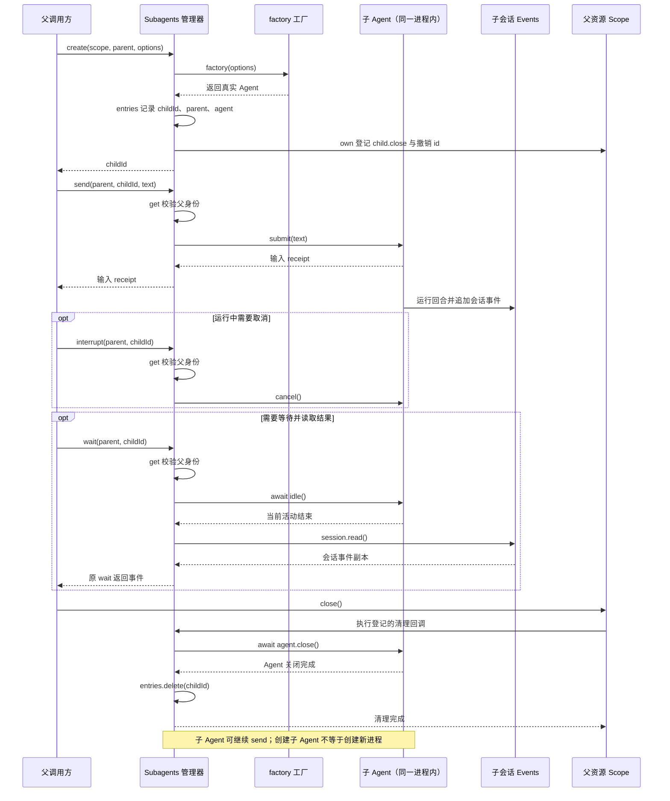

# 036 · 子Agent可以继续对话

阶段：R05。唯一前置：完成第 035 步，继续同一个工程。

## 什么时候会用到这一页

父Agent把审阅文档交给子Agent，得到结果后还要补问同一个子Agent，而不是每次重建一次性请求；其他父Agent即使知道child id也不能控制它。

### 这次数据怎么走

```text
Subagents.create(scope,parent,options) → factory创建真实Agent → 记录parent/agent → send提交输入 → wait等待Agent.idle并读会话 → interrupt取消 → 父scope关闭时child.close并撤销id
```

### 对应时序图

从上往下读；实线箭头表示调用或发送，虚线箭头表示返回或事件通知。`opt`表示可选操作，`alt`表示不同结果，`loop`表示重复，`par`及其`and`分支表示并行；“未接入”及fixture说明按图中标注理解。



**当前接线位置：**036只有进程内Agent测试。051真实注册subagent_create/send/wait/interrupt，并由Host创建子会话加入agent.children；没有原版多提供方与权限树组合。

## 这一步具体做什么

先写完src/subagents.mjs和测试，再运行 bun test ./tests/036-subagents.test.mjs。ScriptModel预置first/second，给同一child发送one和two并分别wait；观察model.requests.length=2，stranger取消被拒绝，scope.close后entries为空。不会请求真实模型。

需要本章新文件的操作，先按下面代码创建文件，再执行；不要在上一步尚不存在的接口上试错。

## 代码为什么放在这一层

子Agent管理器保存活的Agent资源和父身份，不只是Promise.all。复用同一child保留它的会话；factory决定模型、工具与配置，本章没有自动复制父权限或历史。

## 在哪里写、写什么

操作地点：终端中的 `$PROJECT`，编辑器打开同一个目录。只创建或替换下列文件，其他文件保留上一步版本。文件目录不存在先创建。

```sh
mkdir -p src
```

### 创建 `src/subagents.mjs`

````javascript
import { id } from './events.mjs'

/** 子Agent是可继续对话的资源，不是一次性的Promise快捷方式。 */
export class Subagents {
  entries = new Map()
  constructor(factory) { this.factory = factory }
  async create(scope, parent, options = {}) {
    const childId = id('child'), agent = await this.factory(options)
    this.entries.set(childId, { parent, agent })
    scope.own(async () => { await agent.close(); this.entries.delete(childId) })
    return childId
  }
  /** 所有观察控制均检查父身份。 */
  get(parent, childId) { const child = this.entries.get(childId); if (!child || child.parent !== parent) throw Error('没有子Agent权限'); return child.agent }
  send(parent, childId, text) { return this.get(parent, childId).submit(text) }
  async wait(parent, childId) { const agent = this.get(parent, childId); await agent.idle(); return agent.session.read() }
  interrupt(parent, childId) { this.get(parent, childId).cancel() }
}
````

```sh
mkdir -p tests
```

### 创建 `tests/036-subagents.test.mjs`

````javascript
import { test } from 'bun:test'
import assert from 'node:assert/strict'
import { Subagents } from '../src/subagents.mjs'
import { Scope } from '../src/scope.mjs'
import { Agent } from '../src/agent.mjs'
import { Events } from '../src/events.mjs'
import { Tools } from '../src/tools.mjs'
import { Settings } from '../src/config.mjs'
import { ScriptModel, answer } from '../src/model.mjs'

test('真实子Agent可继续对话，父关闭后资源撤销', async () => {
  const scope = new Scope(), model = new ScriptModel([answer('first'), answer('second')])
  const children = new Subagents(async () => new Agent(new Events(), model, new Tools(), new Settings()))
  const child = await children.create(scope, 'parent')
  children.send('parent', child, 'one'); await children.wait('parent', child)
  children.send('parent', child, 'two'); await children.wait('parent', child)
  assert.equal(model.requests.length, 2)
  assert.throws(() => children.interrupt('stranger', child), /权限/)
  await scope.close(); assert.equal(children.entries.size, 0)
})
````

## 运行命令与通过标准

```sh
cd "$PROJECT"
bun test ./tests/036-subagents.test.mjs
bun test
```

测试应1项通过，真实Agent执行两轮、父身份校验、关闭撤销成立。没有验证子孙深度、跨进程提供方、父子权限取交集、完成通知或强制清理失败。

**本步证据的范围：**036-subagents.test.mjs运行真实Agent与ScriptModel两轮，验证model.requests=2、陌生父拒绝和scope清理；不调用远端模型。

## VS Code：断在哪里、看什么

在src/subagents.mjs的this.entries.set和get打断点，F10看同一childId对应同一agent；send时F11进入agent.submit，等wait结束再看model.requests从1变2。stranger调用时parent不匹配，agent.cancel不应命中。scope.close时F11进入agent.close，再检查entries.size=0。所有Agent在同一进程，不是worker。

操作位置：VS Code 打开的是自己的 `$PROJECT`，断点也设在这里的源码，不在教材的 `steps` 目录。

上面的说明若指定CLI、子进程、页面或Electron附加调试，就先按该流程操作；下面这组步骤只用于本章测试入口。“当前测试”不会自动附加子进程，也不会命中浏览器或Electron中的断点。

变量只在所属作用域可见：停在方法内部时看this和参数；要看测试里的局部变量，先在“调用堆栈”选择对应测试帧。正在等待的异步调用者不一定保留可求值的帧，此时在测试调用前后加断点再看，不把未定义误判成业务状态丢失。

沿用第 000 步安装的 Bun 扩展与 `.vscode/launch.json`；本章列出替换配置时，使用本章完整版本。

1. 打开本步测试文件 `tests/036-subagents.test.mjs`，保持它为当前编辑器文件。
2. 在上面指定的函数内单击行号左侧设置断点。
3. “运行和调试”选择 **Bun：当前测试**，按 F5；它执行当前测试，工作目录固定为 PROJECT。
4. 在“变量 / 监视 / 调用堆栈 / 调试控制台”检查状态；F10 逐行执行，F11 进入函数，Shift+F11 返回，F5 继续，Shift+F5 停止。

验收：断点实际命中，能说出当前输入、状态和下一步；只看到进程启动不算完成。长时间暂停会影响真实取消、审批和网络超时，先检查时序，不删超时断言。修正后在集成终端运行 `bun test ./tests/036-subagents.test.mjs`，再运行 `bun test`，保留全部断言。

## 不看答案，确认自己能解释

闭卷解释factory、parent、childId三个身份各负责什么；列出“同一子Agent继续对话”与“新建第二个子Agent”的历史区别。

完成后在 LEARNING.md 写一句实际结果和一个卡点。明天只重做这个卡点；第 3 天、第 7 天再做一次，能独立完成就继续下一页，不另开学习路线。

**再改一个条件验证：**安全练习：在临时测试创建两个子Agent，用各自独立ScriptModel，验证一方输入不进入另一方历史。自动继承restrict/guard尚未实现，不能通过同一个parent字符串推断权限已继承。

## 与当前原版还差哪些

对照本仓库固定原版 `687f282e8625c6b8d11ff58211a90524be2e4317`；这里的“当前”指该本地基线，不是未经检查的上游最新版。

**这一页已经实现：**

- factory生成可继续对话的真实Agent
- 父身份校验
- 发送、等待、取消接口
- 父scope持有并关闭子资源

**原版仍有、或本步尚未对齐的部分：**

- 原版subagent有spawn/fork/ACP/DSH SDK/Codex/Claude Code等具名提供方和统一activation生命周期；教程仅factory。
- 原版有准入/并发/深度预算、完成通知、持久谱系与后代排空；本章没有完整控制。
- 原版进程内作用域可继承工具限制/守卫；教程新Tools/Settings或Host子会话不等于父权限链。

**原版对照位置：**

- [packages/subagent/subagent/README.zh.md](../../../deepseek-harness/packages/subagent/subagent/README.zh.md)
- [packages/subagent/subagent-spawn-in-process/README.zh.md](../../../deepseek-harness/packages/subagent/subagent-spawn-in-process/README.zh.md)
- [packages/subagent/subagent-fork-in-process/README.zh.md](../../../deepseek-harness/packages/subagent/subagent-fork-in-process/README.zh.md)
- [packages/subagent/tool-subagent-control/README.zh.md](../../../deepseek-harness/packages/subagent/tool-subagent-control/README.zh.md)

本步测试通过只证明上面的具体行为；完整差距仍看 [COVERAGE.md](../COVERAGE.md)，不以文件数量、同名类或后面出现另一个模块代替接线证据。

下一步：[第 037 步](037.md)
