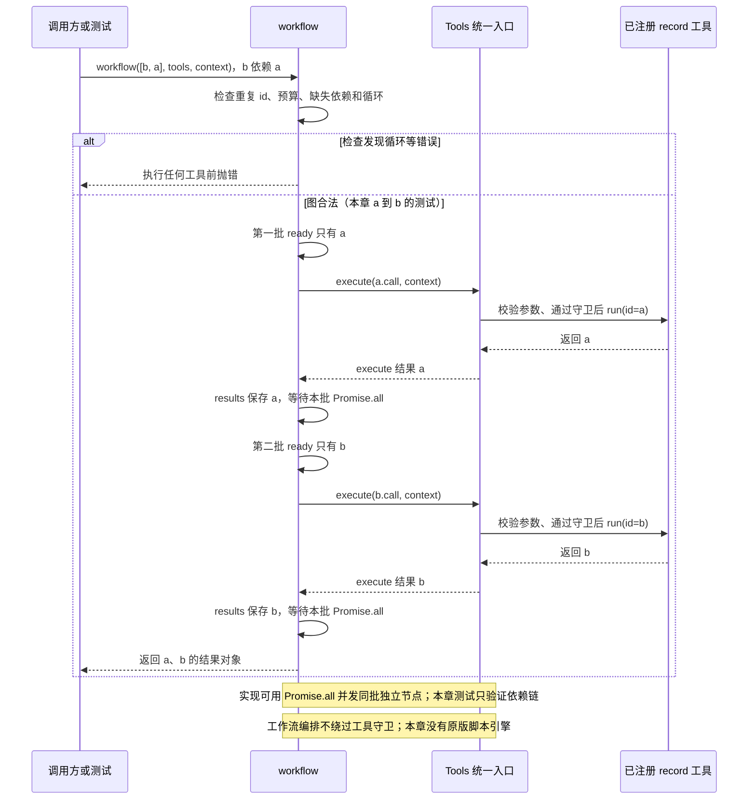

# 037 · 有依赖的工具工作流

阶段：R05。唯一前置：完成第 036 步，继续同一个工程。

<!-- harness-own-links:start -->
## 当前练习工程文件

以下链接指向 `harness-own` 的当前累计版本；本课下方的完整代码仍保留当步版本，二者可能不同。

[打开练习工程说明](../../../harness-own/README.md)

| 本课文件 | 当前练习工程文件 |
| --- | --- |
| `src/workflow.mjs` | [`harness-own/src/workflow.mjs`](../../../harness-own/src/workflow.mjs) |
| `tests/037-workflow.test.mjs` | [`harness-own/tests/037-workflow.test.mjs`](../../../harness-own/tests/037-workflow.test.mjs) |

<!-- harness-own-links:end -->

## 什么时候会用到这一页

先生成数据，再执行依赖数据的检查；如果依赖图有环，必须在任何工具副作用发生前拒绝，不能跑了一半才发现无法结束。

### 这次数据怎么走

```text
workflow(nodes,tools,context) → 检查id/预算 → DFS验证缺失依赖与环 → 找到ready节点 → Promise.all调用Tools.execute → 保存results → 下一批依赖满足后执行
```

### 对应时序图

从上往下读；实线箭头表示调用或发送，虚线箭头表示返回或事件通知。`opt`表示可选操作，`alt`表示不同结果，`loop`表示重复，`par`及其`and`分支表示并行；“未接入”及fixture说明按图中标注理解。



**当前接线位置：**037独立Tools测试，051把它注册为workflow工具，真实进入Agent统一工具入口；但是没有接原版workflow脚本引擎。

## 这一步具体做什么

写完src/workflow.mjs和本章测试后运行 bun test ./tests/037-workflow.test.mjs。测试故意把b放在a前面，但b.after=["a"]，观察实际order仍为a,b；第二次把a也依赖b，确认报循环且order没有新增条目。

需要本章新文件的操作，先按下面代码创建文件，再执行；不要在上一步尚不存在的接口上试错。

## 代码为什么放在这一层

本章是依赖图工具调度器，after只决定顺序，不自动把前一个结果填成后一个参数。每个节点仍走Tools.execute，避免绕开已有守卫；同一批ready用Promise.all并发，并不自动保证写工具之间安全。

## 在哪里写、写什么

操作地点：终端中的 `$PROJECT`，编辑器打开同一个目录。只创建或替换下列文件，其他文件保留上一步版本。文件目录不存在先创建。

```sh
mkdir -p src
```

### 创建 [`src/workflow.mjs`](../../../harness-own/src/workflow.mjs)

````javascript
/** DAG校验先于执行，避免跑一半才发现循环；每个节点仍使用统一工具入口。 */
export async function workflow(nodes, tools, context, budget = 100) {
  const byId = new Map(nodes.map(node => [node.id, node]))
  if (byId.size !== nodes.length || nodes.length > budget) throw Error('工作流重复身份或超预算')
  const visited = new Set(), visiting = new Set()
  const check = node => {
    if (visiting.has(node.id)) throw Error('工作流循环')
    if (visited.has(node.id)) return
    visiting.add(node.id)
    for (const dependency of node.after ?? []) { if (!byId.has(dependency)) throw Error('缺少依赖'); check(byId.get(dependency)) }
    visiting.delete(node.id); visited.add(node.id)
  }
  nodes.forEach(check)
  const results = new Map()
  while (results.size < nodes.length) {
    context.signal.throwIfAborted()
    const ready = nodes.filter(node => !results.has(node.id) && (node.after ?? []).every(id => results.has(id)))
    await Promise.all(ready.map(async node => { const value = await tools.execute(node.call, context); results.set(node.id, value) }))
  }
  return Object.fromEntries(results)
}
````

```sh
mkdir -p tests
```

### 创建 [`tests/037-workflow.test.mjs`](../../../harness-own/tests/037-workflow.test.mjs)

````javascript
import { test } from 'bun:test'
import assert from 'node:assert/strict'
import { workflow } from '../src/workflow.mjs'
import { Tools } from '../src/tools.mjs'
import { Scope } from '../src/scope.mjs'

test('有依赖的真实工具执行，循环在副作用前拒绝', async () => {
  const scope = new Scope(), tools = new Tools(), order = [], context = { signal: new AbortController().signal }
  tools.register(scope, { name: 'record', schema: { type: 'object' }, run: args => { order.push(args.id); return args.id } })
  const a = { id: 'a', call: { name: 'record', arguments: { id: 'a' } } }, b = { id: 'b', after: ['a'], call: { name: 'record', arguments: { id: 'b' } } }
  assert.deepEqual(await workflow([b, a], tools, context), { a: 'a', b: 'b' })
  await assert.rejects(workflow([{ ...a, after: ['b'] }, b], tools, context), /循环/)
  assert.deepEqual(order, ['a', 'b']); await scope.close()
})
````

## 运行命令与通过标准

```sh
cd "$PROJECT"
bun test ./tests/037-workflow.test.mjs
bun test
```

测试应1项通过，乱序输入仍按依赖执行、循环预检不产生新副作用。没有验证失败时取消同批兄弟、幂等恢复、安全并发分组或结果参数引用。

**本步证据的范围：**037-workflow.test.mjs使用真实Tools注册record，核验顺序与环前拒绝；没有模型、子Agent或沙箱进程。

## VS Code：断在哪里、看什么

在src/workflow.mjs的if (visiting.has(node.id))、const ready和tools.execute打断点。F10首次调度看ready只有a，results为空；完成a后下一批ready才是b。循环场景F11沿check递归，看visiting含a和b，在进入任何tools.execute前throw。所有节点在同一进程，无外部调度器。

操作位置：VS Code 打开的是自己的 `$PROJECT`，断点也设在这里的源码，不在教材的 `steps` 目录。

上面的说明若指定CLI、子进程、页面或Electron附加调试，就先按该流程操作；下面这组步骤只用于本章测试入口。“当前测试”不会自动附加子进程，也不会命中浏览器或Electron中的断点。

变量只在所属作用域可见：停在方法内部时看this和参数；要看测试里的局部变量，先在“调用堆栈”选择对应测试帧。正在等待的异步调用者不一定保留可求值的帧，此时在测试调用前后加断点再看，不把未定义误判成业务状态丢失。

沿用第 000 步安装的 Bun 扩展与 `.vscode/launch.json`；本章列出替换配置时，使用本章完整版本。

1. 打开本步测试文件 `tests/037-workflow.test.mjs`，保持它为当前编辑器文件。
2. 在上面指定的函数内单击行号左侧设置断点。
3. “运行和调试”选择 **Bun：当前测试**，按 F5；它执行当前测试，工作目录固定为 PROJECT。
4. 在“变量 / 监视 / 调用堆栈 / 调试控制台”检查状态；F10 逐行执行，F11 进入函数，Shift+F11 返回，F5 继续，Shift+F5 停止。

验收：断点实际命中，能说出当前输入、状态和下一步；只看到进程启动不算完成。长时间暂停会影响真实取消、审批和网络超时，先检查时序，不删超时断言。修正后在集成终端运行 `bun test ./tests/037-workflow.test.mjs`，再运行 `bun test`，保留全部断言。

## 不看答案，确认自己能解释

闭卷画出a→b依赖并解释输入数组[b,a]为何不影响顺序；指出after与“把a的输出作为b输入”不是同一个能力。

完成后在 LEARNING.md 写一句实际结果和一个卡点。明天只重做这个卡点；第 3 天、第 7 天再做一次，能独立完成就继续下一页，不另开学习路线。

**再改一个条件验证：**安全练习：只用无副作用record工具增加一个无依赖c，观察a与c都可ready；不要据此对真实文件并发写。原版脚本式subagent编排不是此DAG自动获得的能力。

## 与当前原版还差哪些

对照本仓库固定原版 `687f282e8625c6b8d11ff58211a90524be2e4317`；这里的“当前”指该本地基线，不是未经检查的上游最新版。

**这一页已经实现：**

- DAG重复id/预算/缺失依赖/环检查
- 依赖就绪批次执行
- 每个节点走Tools.execute
- 返回按节点id索引的结果

**原版仍有、或本步尚未对齐的部分：**

- 原版workflow运行模型编写的JavaScript编排脚本，提供agent/parallel/pipeline/phase/log；教程只有声明式工具DAG。
- 原版workflow-ptc接沙箱PTC进程并委派subagent、预算和取消清理；本章没有脚本运行时、子Agent编排与阶段事件。
- Promise.all某节点失败不会自动停止其他已发出节点，本章未实现完整失败排空语义。

**原版对照位置：**

- [packages/workflow/workflow/README.zh.md](../../../deepseek-harness/packages/workflow/workflow/README.zh.md)
- [packages/workflow/tool-workflow/README.zh.md](../../../deepseek-harness/packages/workflow/tool-workflow/README.zh.md)
- [packages/workflow/workflow-ptc/README.zh.md](../../../deepseek-harness/packages/workflow/workflow-ptc/README.zh.md)

本步测试通过只证明上面的具体行为；完整差距仍看 [COVERAGE.md](../COVERAGE.md)，不以文件数量、同名类或后面出现另一个模块代替接线证据。

下一步：[第 038 步](038.md)
