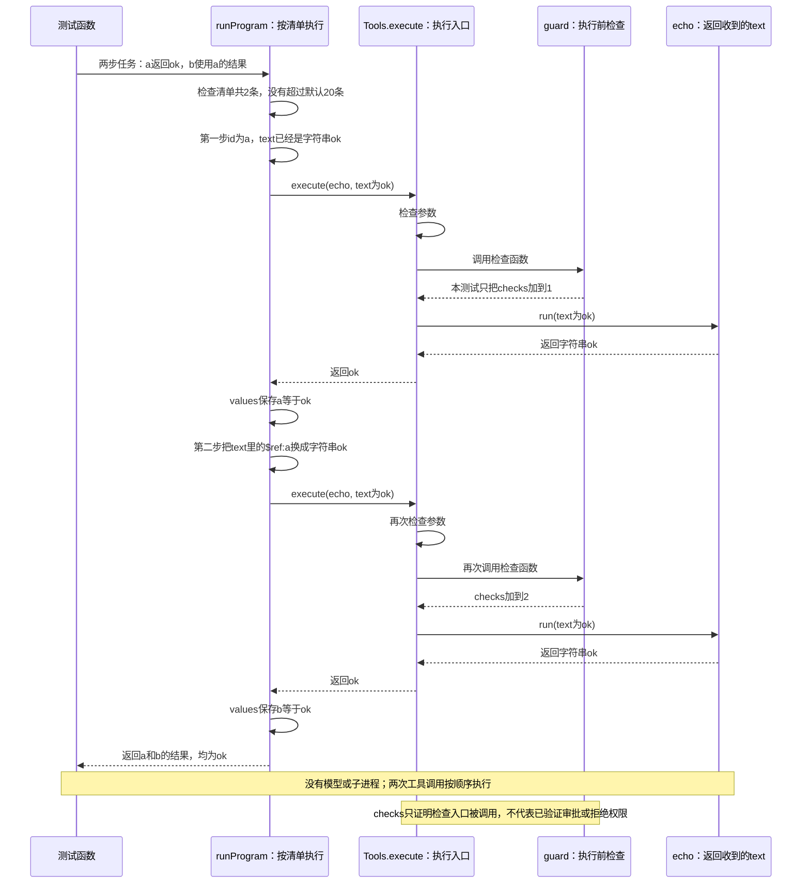

# 038 · 把上一个工具的结果，传给下一个工具

阶段：R05。唯一前置：完成第 037 步，继续同一个工程。

<!-- harness-own-links:start -->
## 当前练习工程文件

以下链接指向 `harness-own` 的当前累计版本；本课下方的完整代码仍保留当步版本，二者可能不同。

[打开练习工程说明](../../../harness-own/README.md)

| 本课文件 | 当前练习工程文件 |
| --- | --- |
| `src/ptc.mjs` | [`harness-own/src/ptc.mjs`](../../../harness-own/src/ptc.mjs) |
| `tests/038-ptc.test.mjs` | [`harness-own/tests/038-ptc.test.mjs`](../../../harness-own/tests/038-ptc.test.mjs) |

<!-- harness-own-links:end -->

## 什么时候会用到这一页

先调用一个工具取得结果，再把这个结果作为参数调用下一个工具。例如先读出文件正文，再交给写文件工具保存。本章用两次echo演示传值：第一次返回ok，第二次使用第一次的返回值；每次执行前仍做参数和权限检查。文件读写只是用途示意，本章不会实际读写文件。

### 这次数据怎么走

```text
runProgram(program) → 检查调用条数是否超过maxCalls → 按数组顺序取出每一步 → 把参数里的{$ref:"a"}替换为a已保存的结果 → Tools.execute检查并调用工具 → values保存这一步的返回值 → 返回全部结果
```

### 对应时序图

从上往下读；实线箭头表示调用或发送，虚线箭头表示返回或事件通知。`opt`表示可选操作，`alt`表示不同结果，`loop`表示重复，`par`及其`and`分支表示并行；“未接入”及fixture说明按图中标注理解。



**当前接线位置：**038由测试函数直接调用runProgram，没有父Agent或模型参与。051才把它包装为run_program工具供Agent调用。两种入口最后都经过Tools.execute；本章没有实现原版执行源码的脚本运行环境。

## 这一步具体做什么

在自己的工程创建本页给出的src/ptc.mjs和tests/038-ptc.test.mjs，再运行 bun test ./tests/038-ptc.test.mjs。先预测：第一个echo收到ok并返回ok；第二个echo的text会从{$ref:"a"}变成什么？执行前的检查会进入几次？运行后用result.b="ok"和checks=2核对。最后看maxCalls=0那次调用，确认任何工具都没有开始执行。

需要本章新文件的操作，先按下面代码创建文件，再执行；不要在上一步尚不存在的接口上试错。

## 代码为什么放在这一层

runProgram按数组顺序做事：调用工具，把返回值按id存进values，再把下一步参数里的$ref换成已经保存的值。每次都经过Tools.execute，保留原有参数校验和权限检查。这里只会替换参数第一层的引用，不会往嵌套对象里继续查找，也不会运行一段JavaScript源码。

## 问答：038是什么意思，什么场景下才会用到

### 问：把上一个工具的结果传给下一个工具，是什么意思？

答：前一个工具返回一份数据，后一个工具需要拿这份数据继续做事。038的runProgram负责保存前面的返回值，再填进后面的参数；清单里的`{ $ref: 'a' }`就是“这里使用a这一步保存的返回值”。

例如第一次echo返回字符串ok，第二次echo的text参数写成`{ $ref: 'a' }`，执行前就会替换成字符串ok。它相当于普通代码里先把返回值存进变量，再把变量作为下一个函数的参数。不是前一个工具自己知道要把结果发给谁，而是runProgram按清单完成传递。

### 问：具体什么场景下才需要？

答：**任务步骤已经确定，而后一步的参数来自前一步返回的数据时，就能用这种方式串起来。** 最直观的场景是“读取日志→筛选错误→保存错误报告”。

下面假设同一个Tools里已经注册read_log、filter_errors、write_report三个工具，并约定前两个工具都返回正文字符串。这三个工具是业务示意；本章尚未注册或执行它们。

```text
第一步 read_log({ path: "app.log" })
      → 返回 "INFO 启动成功\nERROR 数据库连接超时"
      → 保存为log

第二步 filter_errors({ text: { $ref: "log" } })
      → runProgram把text替换为上面的日志正文
      → 工具返回 "ERROR 数据库连接超时"
      → 保存为errors

第三步 write_report({ path: "errors.txt", content: { $ref: "errors" } })
      → runProgram把content替换为错误文本
      → 写出报告
```

如果直接写JavaScript，这个业务过程相当于：

```js
// 下面是业务伪代码，不是本章已经实现的函数，不要另建文件直接执行。
const text = await readLog('app.log') // 取得日志正文字符串。
const errors = await filterErrors(text) // 把前一步返回的正文交给筛选工具。
await writeReport('errors.txt', errors) // 把筛选结果交给保存工具。
```

038用清单和$ref描述同样的数据传递过程，并且每一步仍调用Tools.execute。实际工具的返回格式必须和下一步的参数类型匹配：如果读文件工具返回`{ text: '正文', version: 1 }`，$ref取出的是整个对象，不会自动变成其中的text。本章也不支持`$ref: 'log.text'`这种字段路径；要接上述字符串场景，需要先明确工具接口或增加适配。

类似用途还有：

| 场景 | 数据怎样接力 | 需要满足什么条件 |
| --- | --- | --- |
| 生成文档 | 读取资料→提取内容→保存文档 | 已注册对应工具，前后数据格式匹配。 |
| 检查代码 | 搜索文件→批量检查→汇总结果 | 检查工具能接收搜索结果，步骤已经确定。 |
| 处理订单 | 查询订单→计算统计→生成报表 | 统计工具能接收订单数据，报表工具能接收统计结果。 |

这里列的是后续可接入的业务用途，不代表本章已经实现了对应工具。

### 问：Agent自己一轮一轮调用工具，不也能做吗？

答：能。区别在于谁安排中间步骤。逐步调用时，模型拿到每个结果后再决定下一次调用；接入run_program后，模型可以一次提交已经确定的清单，让程序完成中间传值。

```text
逐步交给模型安排：
模型 → 读日志 → 模型 → 筛错误 → 模型 → 保存 → 模型

一次提交固定清单：
模型 → run_program【读日志 → 筛错误 → 保存】→ 模型
```

后者可以减少为了传递数据而发生的中间模型往返。这个对照表示接入Agent后的用途：**038当前由测试函数调用runProgram，没有模型参与；051才注册run_program工具。** 本章不会自动让模型生成清单，也没有证明真实日志任务已经跑通。如果看完日志后才知道下一步要如何调查，就仍需要Agent根据结果继续判断，不能只靠固定清单解决。

### 问：一次提交清单，是不是只检查一次权限？

答：每个工具执行前都分别检查。读取日志被允许，不代表保存报告也被允许；runProgram替换好参数后，仍逐次进入Tools.execute进行参数校验和guard检查。本章guard只计数，没有真正审批或拒绝权限的运行证据。

### 问：和037到底差在哪？

答：037的after表达“B必须等A完成”；038的$ref表达“把A返回的数据填进B的参数”。

| 对照 | 037 workflow | 038 runProgram |
| --- | --- | --- |
| 执行先后 | 按依赖关系分批，当前一批全部完成后再找下一批。 | 按数组顺序执行，一次只执行一个工具。 |
| 前一步结果怎么用 | after不自动填后一步参数。 | 用$ref取出前面已保存的整个返回值，填入当前第一层参数。 |
| 本章已验证什么 | 依赖顺序和循环依赖预检。 | 两次echo之间传值、逐次进入guard、调用条数超限拒绝。 |

## 先看懂：第二次调用的参数从哪里来

实际用途例如：先读取a.txt，得到正文，再把正文交给另一个工具保存为b.txt。假设这两个工具分别接收和返回正文字符串，第二步就需要用到第一步的返回值。这是用途示意；本章测试只注册echo，不读取或写入文件。

本章先用echo把这个传值过程看清楚。echo做的事很简单：收到什么text，就返回什么text。原测试里的任务清单展开后是：

```js
// program是一份按顺序执行的工具调用清单，不是JavaScript源码字符串。
const program = [
  // 第一步调用echo，把返回值保存为a。
  { id: 'a', tool: 'echo', arguments: { text: 'ok' } },
  // 第二步的text先留一个标记：执行时使用a保存的值。
  { id: 'b', tool: 'echo', arguments: { text: { $ref: 'a' } } },
]
```

这段是原测试输入的展开说明，不用另建文件。下面的完整测试已经包含相同内容。

```text
第一步：echo({ text: "ok" })
      → 工具返回字符串 "ok"
      → values保存 a = "ok"

第二步：先看到 { text: { $ref: "a" } }
      → 查找values里a保存的值
      → 参数变成 { text: "ok" }
      → echo({ text: "ok" })
      → 工具返回字符串 "ok"
      → values保存 b = "ok"

全部结束：runProgram返回 { a: "ok", b: "ok" }
```

`{ $ref: 'a' }`的意思就是“这里使用a的返回值”。它是本教程自己约定的标记，JavaScript不会自动识别；真正替换它的是src/ptc.mjs里的for循环。替换后的普通参数对象才交给Tools.execute。

## 把原来的几个术语换成具体操作

| 代码里的名字或旧说法 | 这里实际在做什么 |
| --- | --- |
| program／指令列表 | 一个数组，每一项写明调用哪个工具、传什么参数。 |
| id／结果寄存器 | 给这一步的结果起名字，例如a；它不是工具名，也不是进程编号。 |
| values | 一个Map，暂存已经完成的结果，例如values.get('a')得到字符串ok。 |
| $ref／引用 | 从values取出前一步的整个返回值，填入当前参数。这里还不能只取返回对象的某个字段。 |
| maxCalls／条数预算 | 这份清单最多允许多少次工具调用，默认20条；不是token数、花费或执行时间。 |
| guard／守卫 | 每次工具执行前的一道检查入口。应用可以在这里检查权限或请求审批。 |

本章测试把这道检查写成`tools.guard = async () => { checks++ }`。因此checks等于2，只说明两次工具调用都经过检查入口；测试没有真的拒绝权限，也没有向用户发起审批。

## 为什么打包成清单后，还要逐次检查

假设第一步读取文件被允许，第二步试图写到禁止修改的目录。第二步仍应在自己的执行前检查中被拒绝，不能因为第一步被允许就直接执行。这个例子说明保留检查入口的用途，并不是说当前echo测试已经验证了目录权限。

代码因此每次都调用`tools.execute(...)`：先检查参数，再进入guard，检查取消后才运行具体工具。直接调用`tool.run(...)`就会跳过这些步骤。

## 与037的区别，以及目前的边界

037根据任务之间的依赖安排执行；038固定按数组顺序执行，并增加“把前面的返回值填进后面的参数”这个动作。这里没有同时执行多个工具。

只有参数第一层的`$ref`会被替换。例如`{ text: { $ref: 'a' } }`会替换text；`{ options: { text: { $ref: 'a' } } }`不会继续往里查找。

超过maxCalls的检查在任何工具执行前完成；但是引用是否存在、id是否重复，是执行到该步才检查。假如第一步已写出文件，第二步引用了不存在的名字，第二步会报错，第一步写出的文件不会自动撤销。

## 在哪里写、写什么

操作地点：终端中的 `$PROJECT`，编辑器打开同一个目录。只创建或替换下列文件，其他文件保留上一步版本。文件目录不存在先创建。

```sh
mkdir -p src
```

### 创建 [`src/ptc.mjs`](../../../harness-own/src/ptc.mjs)

````javascript
/** 有界的程序式工具编排；每个嵌套调用仍穿过Tools.execute及审批。 */
export async function runProgram(program, tools, context, maxCalls = 20) {
  // 用声明式寄存器程序先做可审计执行，不用eval假装完成任意代码沙箱。
  if (!Array.isArray(program) || program.length > maxCalls) throw Error('程序超预算')
  const values = new Map()
  for (const instruction of program) {
    context.signal.throwIfAborted()
    if (!instruction.id || values.has(instruction.id)) throw Error('程序身份重复')
    const argumentsValue = structuredClone(instruction.arguments)
    for (const [key, value] of Object.entries(argumentsValue)) {
      if (value && typeof value === 'object' && '$ref' in value) {
        if (!values.has(value.$ref)) throw Error('程序引用尚未定义')
        argumentsValue[key] = structuredClone(values.get(value.$ref))
      }
    }
    const value = await tools.execute({ name: instruction.tool, arguments: argumentsValue }, context)
    values.set(instruction.id, value)
  }
  return Object.fromEntries(values)
}
````

```sh
mkdir -p tests
```

### 创建 [`tests/038-ptc.test.mjs`](../../../harness-own/tests/038-ptc.test.mjs)

````javascript
import { test } from 'bun:test'
import assert from 'node:assert/strict'
import { runProgram } from '../src/ptc.mjs'
import { Tools } from '../src/tools.mjs'
import { Scope } from '../src/scope.mjs'

test('内层工具也经过守卫，预算先检查', async () => {
  const scope = new Scope(), tools = new Tools(), context = { signal: new AbortController().signal }; let checks = 0
  tools.guard = async () => { checks++ }
  tools.register(scope, { name: 'echo', schema: { type: 'object' }, run: args => args.text })
  const result = await runProgram([{ id: 'a', tool: 'echo', arguments: { text: 'ok' } }, { id: 'b', tool: 'echo', arguments: { text: { $ref: 'a' } } }], tools, context)
  assert.equal(result.b, 'ok'); assert.equal(checks, 2)
  await assert.rejects(runProgram([{}], tools, context, 0), /预算/)
  await scope.close()
})
````

## 运行命令与通过标准

```sh
cd "$PROJECT"
bun test ./tests/038-ptc.test.mjs
bun test
```

本章测试应1项通过：result等于{a:"ok",b:"ok"}；原测试实际断言b为ok、检查次数为2，并确认maxCalls=0时拒绝执行。checks只记录进入检查入口的次数，不证明已经测试了权限拒绝或用户审批。没有调用模型、启动子进程或运行模型生成的源码。

**本步证据的范围：**038-ptc.test.mjs实际调用两次Tools.execute，验证前一步的结果能填进后一步参数、guard被调用两次，以及调用条数超限被拒绝。guard只做计数；没有验证真实审批、目录权限或隔离进程。

## VS Code：断在哪里、看什么

在VS Code打开tests/038-ptc.test.mjs，用“Bun：当前测试”启动。先在src/ptc.mjs的values.set打断点，F10执行第一步保存后，values.get("a")应为"ok"。再在argumentsValue[key] = structuredClone(...)打断点：第二步替换前argumentsValue.text是{$ref:"a"}，F10后变成字符串"ok"。在await tools.execute处F11进入src/tools.mjs，再进入this.guard，看测试里的checks由0变1、再变2。maxCalls=0那次停在program.length > maxCalls，观察它直接抛错，不进入任何tool.run。

操作位置：VS Code 打开的是自己的 `$PROJECT`，断点也设在这里的源码，不在教材的 `steps` 目录。

上面的说明若指定CLI、子进程、页面或Electron附加调试，就先按该流程操作；下面这组步骤只用于本章测试入口。“当前测试”不会自动附加子进程，也不会命中浏览器或Electron中的断点。

变量只在所属作用域可见：停在方法内部时看this和参数；要看测试里的局部变量，先在“调用堆栈”选择对应测试帧。正在等待的异步调用者不一定保留可求值的帧，此时在测试调用前后加断点再看，不把未定义误判成业务状态丢失。

沿用第 000 步安装的 Bun 扩展与 `.vscode/launch.json`；本章列出替换配置时，使用本章完整版本。

1. 打开本步测试文件 `tests/038-ptc.test.mjs`，保持它为当前编辑器文件。
2. 在上面指定的函数内单击行号左侧设置断点。
3. “运行和调试”选择 **Bun：当前测试**，按 F5；它执行当前测试，工作目录固定为 PROJECT。
4. 在“变量 / 监视 / 调用堆栈 / 调试控制台”检查状态；F10 逐行执行，F11 进入函数，Shift+F11 返回，F5 继续，Shift+F5 停止。

验收：断点实际命中，能说出当前输入、状态和下一步；只看到进程启动不算完成。长时间暂停会影响真实取消、审批和网络超时，先检查时序，不删超时断言。修正后在集成终端运行 `bun test ./tests/038-ptc.test.mjs`，再运行 `bun test`，保留全部断言。

## 不看答案，确认自己能解释

合上文档，自己写出两步echo调用，讲清a的值存在哪里、$ref由谁替换、第二次echo真正收到什么参数。再解释为什么checks=2只说明检查入口被调用两次，不能证明用户已经批准了操作。

完成后在 LEARNING.md 写一句实际结果和一个卡点。明天只重做这个卡点；第 3 天、第 7 天再做一次，能独立完成就继续下一页，不另开学习路线。

**再改一个条件验证：**把第二步的$ref改为missing，确认报“引用尚未定义”，第二个echo没有执行；第一步已经执行，不会自动回滚。再把引用放到options.text里，观察当前代码不会替换这个更深一层的值。恢复原测试，明天闭卷重写查值和替换这几行，第3天再用自己的话讲清结果传递和逐次检查。

## 与当前原版还差哪些

对照本仓库固定原版 `687f282e8625c6b8d11ff58211a90524be2e4317`；这里的“当前”指该本地基线，不是未经检查的上游最新版。

**这一页已经实现：**

- 先检查调用总条数，默认最多20条；执行每一步时检查id非空且未重复
- 把已完成工具的整个返回值复制到下一步的第一层参数里
- 每一步开始前检查是否已取消，Tools.execute执行前也会检查
- 每次工具调用都经过Tools.execute中的参数校验和guard检查入口

**原版仍有、或本步尚未对齐的部分：**

- 原版可以选择脚本运行环境、描述所用语言和程序格式，并把工具接给脚本调用，还会记录日志和返回结果。本章只支持固定格式的数组。
- 原版的Node运行环境在单独进程中执行源码，并管理这个进程归谁、何时关闭。本章没有启动脚本进程，也没有执行JavaScript或Python源码。
- 原版还规定模型怎样看到程序调用工具、脚本内部每次调用怎样编号和记录。本章的run_program没有实现这些完整约定，不能直接替换原版。

**原版对照位置：**

- [packages/ptc-runtime/ptc-runtime/README.zh.md](../../../deepseek-harness/packages/ptc-runtime/ptc-runtime/README.zh.md)
- [packages/ptc-runtime/ptc-runtime-node/README.zh.md](../../../deepseek-harness/packages/ptc-runtime/ptc-runtime-node/README.zh.md)
- [packages/core/tools/README.zh.md](../../../deepseek-harness/packages/core/tools/README.zh.md)

本步测试通过只证明上面的具体行为；完整差距仍看 [COVERAGE.md](../COVERAGE.md)，不以文件数量、同名类或后面出现另一个模块代替接线证据。

下一步：[第 039 步](039.md)
