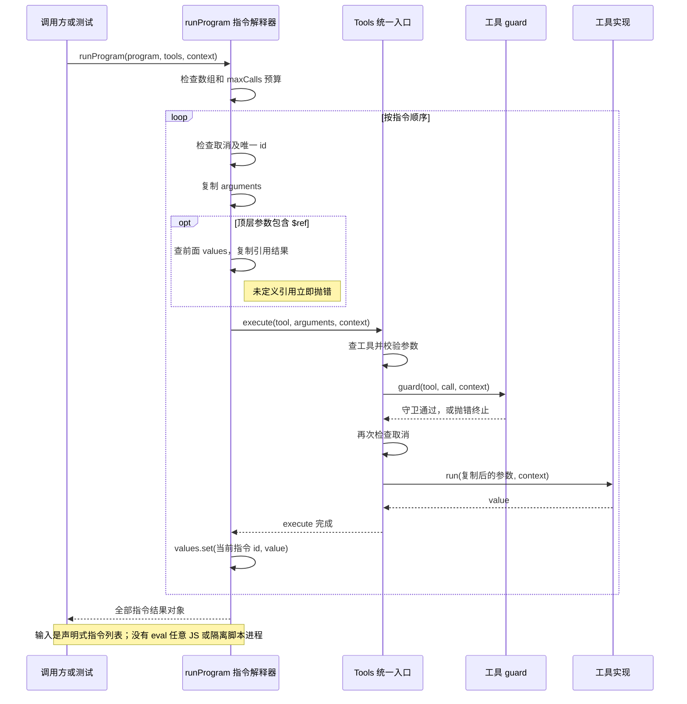

# 038 · 按指令列表调用工具，继续通过守卫

阶段：R05。唯一前置：完成第 037 步，继续同一个工程。

## 什么时候会用到这一页

一次工具任务需要串起两个操作：先拿到一个值，再把这个值传给下一个工具。希望只给模型一份编排输入，但每个内层工具仍经过权限守卫。

### 这次数据怎么走

```text
runProgram(program) → 先检查条数预算 → 逐条解析id/tool/arguments → 将顶层参数中的{$ref:id}换成之前结果 → Tools.execute → 存values → 返回所有结果
```

### 对应时序图

从上往下读；实线箭头表示调用或发送，虚线箭头表示返回或事件通知。`opt`表示可选操作，`alt`表示不同结果，`loop`表示重复，`par`及其`and`分支表示并行；“未接入”及fixture说明按图中标注理解。



**当前接线位置：**038独立解释器测试；051注册run_program，内层实际复用同一Tools。没有接原版ptcRuntime，也没有Node/Python隔离执行。

## 这一步具体做什么

先写完src/ptc.mjs和测试，再运行 bun test ./tests/038-ptc.test.mjs。程序第一条echo返回ok，第二条text引用a；观察result.b="ok"且checks=2，说明内层调用没有绕过guard。再看maxCalls=0的请求执行前就拒绝。

需要本章新文件的操作，先按下面代码创建文件，再执行；不要在上一步尚不存在的接口上试错。

## 代码为什么放在这一层

本章runProgram是一个可审计的声明式寄存器解释器，不执行JavaScript源码，也不是任意代码沙箱。id是结果寄存器，$ref引用先前值；只有参数第一层的引用会被替换。

## 在哪里写、写什么

操作地点：终端中的 `$PROJECT`，编辑器打开同一个目录。只创建或替换下列文件，其他文件保留上一步版本。文件目录不存在先创建。

```sh
mkdir -p src
```

### 创建 `src/ptc.mjs`

````javascript
/** 有界的程序式工具编排；每个嵌套调用仍穿过Tools.execute及审批。 */
export async function runProgram(program, tools, context, maxCalls = 20) {
  // 用声明式寄存器程序先做可审计执行，不用eval假装完成任意代码沙箱。
  if (!Array.isArray(program) || program.length > maxCalls) throw Error('程序超预算')
  const values = new Map()
  for (const instruction of program) {
    context.signal.throwIfAborted()
    if (!instruction.id || values.has(instruction.id)) throw Error('程序身份重复')
    const argumentsValue = structuredClone(instruction.arguments)
    for (const [key, value] of Object.entries(argumentsValue)) {
      if (value && typeof value === 'object' && '$ref' in value) {
        if (!values.has(value.$ref)) throw Error('程序引用尚未定义')
        argumentsValue[key] = structuredClone(values.get(value.$ref))
      }
    }
    const value = await tools.execute({ name: instruction.tool, arguments: argumentsValue }, context)
    values.set(instruction.id, value)
  }
  return Object.fromEntries(values)
}
````

```sh
mkdir -p tests
```

### 创建 `tests/038-ptc.test.mjs`

````javascript
import { test } from 'bun:test'
import assert from 'node:assert/strict'
import { runProgram } from '../src/ptc.mjs'
import { Tools } from '../src/tools.mjs'
import { Scope } from '../src/scope.mjs'

test('内层工具也经过守卫，预算先检查', async () => {
  const scope = new Scope(), tools = new Tools(), context = { signal: new AbortController().signal }; let checks = 0
  tools.guard = async () => { checks++ }
  tools.register(scope, { name: 'echo', schema: { type: 'object' }, run: args => args.text })
  const result = await runProgram([{ id: 'a', tool: 'echo', arguments: { text: 'ok' } }, { id: 'b', tool: 'echo', arguments: { text: { $ref: 'a' } } }], tools, context)
  assert.equal(result.b, 'ok'); assert.equal(checks, 2)
  await assert.rejects(runProgram([{}], tools, context, 0), /预算/)
  await scope.close()
})
````

## 运行命令与通过标准

```sh
cd "$PROJECT"
bun test ./tests/038-ptc.test.mjs
bun test
```

测试应1项通过：两次真实Tools.execute、引用传值、守卫计数2与预算拒绝。没有执行模型生成代码、循环、嵌套引用或隔离进程，不能称为原版完整PTC。

**本步证据的范围：**038-ptc.test.mjs验证声明式引用传值和guard调用次数，测试不包含eval、JS源码执行或OS沙箱。

## VS Code：断在哪里、看什么

在src/ptc.mjs的argumentsValue[key]=structuredClone(...)和await tools.execute打断点。第一条后values.get("a")应是ok；第二条替换前text是{$ref:"a"}，F10后变成字符串ok；F11进入Tools.execute看guard再次执行。预算场景停在program.length>maxCalls，任何tool.run均不应命中。

操作位置：VS Code 打开的是自己的 `$PROJECT`，断点也设在这里的源码，不在教材的 `steps` 目录。

上面的说明若指定CLI、子进程、页面或Electron附加调试，就先按该流程操作；下面这组步骤只用于本章测试入口。“当前测试”不会自动附加子进程，也不会命中浏览器或Electron中的断点。

变量只在所属作用域可见：停在方法内部时看this和参数；要看测试里的局部变量，先在“调用堆栈”选择对应测试帧。正在等待的异步调用者不一定保留可求值的帧，此时在测试调用前后加断点再看，不把未定义误判成业务状态丢失。

沿用第 000 步安装的 Bun 扩展与 `.vscode/launch.json`；本章列出替换配置时，使用本章完整版本。

1. 打开本步测试文件 `tests/038-ptc.test.mjs`，保持它为当前编辑器文件。
2. 在上面指定的函数内单击行号左侧设置断点。
3. “运行和调试”选择 **Bun：当前测试**，按 F5；它执行当前测试，工作目录固定为 PROJECT。
4. 在“变量 / 监视 / 调用堆栈 / 调试控制台”检查状态；F10 逐行执行，F11 进入函数，Shift+F11 返回，F5 继续，Shift+F5 停止。

验收：断点实际命中，能说出当前输入、状态和下一步；只看到进程启动不算完成。长时间暂停会影响真实取消、审批和网络超时，先检查时序，不删超时断言。修正后在集成终端运行 `bun test ./tests/038-ptc.test.mjs`，再运行 `bun test`，保留全部断言。

## 不看答案，确认自己能解释

闭卷手写两条指令，把第一条结果传第二条；解释为什么直接调用tool.run会绕过guard，而此解释器必须调用Tools.execute。

完成后在 LEARNING.md 写一句实际结果和一个卡点。明天只重做这个卡点；第 3 天、第 7 天再做一次，能独立完成就继续下一页，不另开学习路线。

**再改一个条件验证：**安全练习：把第二条引用改成不存在的missing，断言“尚未定义”且第二次工具不执行；再增加嵌套对象引用观察当前不会递归替换。任意JavaScript/Python程序执行需另建真实运行时，当前未实现。

## 与当前原版还差哪些

对照本仓库固定原版 `687f282e8625c6b8d11ff58211a90524be2e4317`；这里的“当前”指该本地基线，不是未经检查的上游最新版。

**这一页已经实现：**

- 条数预算、唯一指令id
- 先前结果引用与结构克隆
- 取消检查
- 所有内层调用过统一Tools守卫

**原版仍有、或本步尚未对齐的部分：**

- 原版ptc-runtime有resolve/run、语言/程序格式描述符、宿主异步函数绑定、日志与结构化结果。
- 原版Node运行时在受管隔离进程执行源码并支持明确owner状态；本章只解释数组。
- 原版Tools PTC模式还涉及模型工具展示、嵌套调用身份与执行边界；教程run_program不兼容这些约定。

**原版对照位置：**

- [packages/ptc-runtime/ptc-runtime/README.zh.md](../../../deepseek-harness/packages/ptc-runtime/ptc-runtime/README.zh.md)
- [packages/ptc-runtime/ptc-runtime-node/README.zh.md](../../../deepseek-harness/packages/ptc-runtime/ptc-runtime-node/README.zh.md)
- [packages/core/tools/README.zh.md](../../../deepseek-harness/packages/core/tools/README.zh.md)

本步测试通过只证明上面的具体行为；完整差距仍看 [COVERAGE.md](../COVERAGE.md)，不以文件数量、同名类或后面出现另一个模块代替接线证据。

下一步：[第 039 步](039.md)
