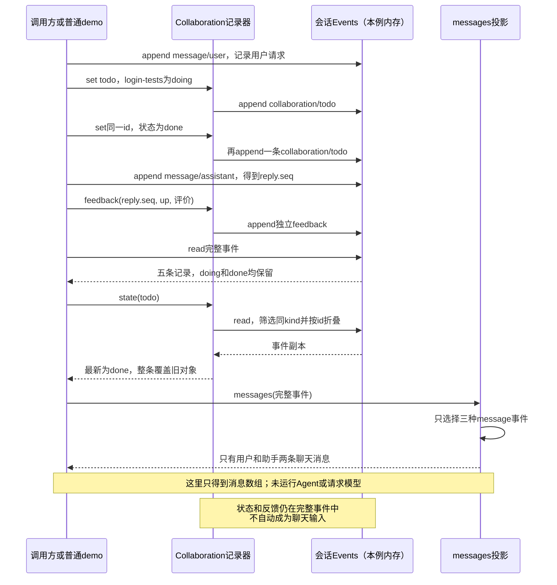

# 039 · 把协作状态和反馈记录成独立事件

阶段：R05。唯一前置：完成第 038 步，继续同一个工程。

## 什么时候会用到这一页

用户说“请修复登录问题”是聊天输入；应用记录“补登录测试：doing→done”是进度事实；用户给回答点赞是反馈事实。本页只学习把它们记录成不同事件、读取最新状态，并用messages选择模型消息；不实现完整Todo、Plan、Goal或提醒。

### 这次数据怎么走

```text
Collaboration.set(kind,value) → 校验教学状态词与id → append独立collaboration事件 → state按kind筛选并按id取最后一整份值；feedback追加独立评价事件；messages只选择message/user、message/assistant、message/tool，不自动选择状态和反馈
```

### 对应时序图

从上往下读；实线箭头表示调用或发送，虚线箭头表示返回或事件通知。`opt`表示可选操作，`alt`表示不同结果，`loop`表示重复，`par`及其`and`分支表示并行；“未接入”及fixture说明按图中标注理解。



**当前接线位置：**039普通demo只调用Events、Collaboration和messages，不创建Agent、不请求模型、不接UI；原测试的due由调用方手动触发。051虽然注册部分_update工具，也只是在原统一Tools入口显式读写这些记录，不会自动获得Plan评审、Goal驱动或后台提醒。

## 这一步具体做什么

按本页完整代码创建src/collaboration-demo.mjs、src/collaboration.mjs和原测试。先预测同一进度记录doing再记录done、给回复点赞后，完整事件、最新状态、模型消息分别是什么，再运行 bun src/collaboration-demo.mjs 对照。随后运行原039测试；提醒扫描仅是辅助例子。

需要本章新文件的操作，先按下面代码创建文件，再执行；不要在上一步尚不存在的接口上试错。

## 代码为什么放在这一层

完整事件保存过程，state从同一事件集合按kind和id重建最新对象，messages只选择真正聊天消息。独立事件按读取用途区分，不因名字叫todo或goal就获得业务能力。默认Events只在内存保存；接入Journal才有磁盘持久化。Collaboration是教学记录器，没有实现五个原版领域的完整服务。

## 本页只讲三件事：记录、读取、选择模型消息

用户说“请修复登录问题”，这是聊天输入；应用记录“补登录测试：doing→done”，这是进度事实；用户给某条回答点赞，这是反馈事实。它们可以保存在同一份会话事件中，但供不同的读取方使用。

| 写入什么 | 事件类型 | 怎样读取 | 会不会自动进入模型消息 |
| --- | --- | --- | --- |
| 用户或助手的聊天内容 | message/user、message/assistant | messages(session.read()) | 会被选入投影；是否请求模型由调用方决定。 |
| 一条进度状态 | collaboration/todo | collaboration.state('todo') | 不会自动选入。 |
| 用户对某条消息的评价 | feedback | 从session.read()筛选feedback | 不会自动选入。 |

本章沿用Collaboration这个类名，把它理解成“教程里的协作事件记录器”即可。它并不是原版Todo、Plan、Goal、Schedule和反馈的统一领域服务。核心区别在读写规则：**完整事件保留发生过的记录，state读取最新状态，messages只选择聊天消息。**

### 具体例子：同一份事件，得到三种读取结果

先按本页后面的完整代码创建src/collaboration-demo.mjs、src/collaboration.mjs与原测试，保留前面步骤的Events和projection。然后在自己的工程根目录运行bun src/collaboration-demo.mjs。

这个demo不运行Agent、不请求模型、不修复或测试真实登录功能。聊天文本和doing/done都是演示输入，用来观察记录的结构和读取结果；每条进度变化也需要调用方显式记录。

它按顺序写入五条事件：

| seq | 发生的操作 | 写入的事件 |
| --- | --- | --- |
| 0 | 记录用户说“请修复登录问题” | message/user |
| 1 | 记录login-tests正在进行，附一条note | collaboration/todo，status=doing |
| 2 | 再记录同一个login-tests已完成，这次不带note | collaboration/todo，status=done |
| 3 | 记录助手回复“已记录你的登录问题。” | message/assistant |
| 4 | 给seq=3的助手回复点赞 | feedback，messageSeq=3 |

第一次读取完整事件，仍能看到doing和done两次记录：

```js
// 完整记录保留过程；不会因为state后来变成done就删除doing事件。
const events = session.read()
```

```text
message/user
collaboration/todo：doing，带note
collaboration/todo：done，不带note
message/assistant
feedback：messageSeq=3，rating=up
```

第二次按todo类型与id折叠，取得当前最新状态：

```js
// state只选collaboration/todo，再按id保留最后一整份对象。
const latestTodo = collaboration.state('todo')
```

```json
{
  "login-tests": {
    "id": "login-tests",
    "text": "补登录测试",
    "status": "done"
  }
}
```

**这里是整条对象覆盖，不是字段合并。** 第二份对象没有note，因此最新状态中也没有note；旧note仍能从第一条状态事件里读到。同一id在不同kind下分别折叠，不会因为todo里出现过该id，就让plan里自动出现它。

第三次只选择模型对话消息：

```js
// 只有message/user、message/assistant、message/tool会被messages白名单选中。
const modelMessages = messages(session.read())
```

```json
[
  { "role": "user", "content": "请修复登录问题" },
  { "role": "assistant", "content": "已记录你的登录问题。" }
]
```

这份数组中没有“doing”“done”或“用户点赞”消息，但它们仍然保存在完整事件里。模型没有被调用：这里只得到以后构造模型请求时可用的消息投影，不等于已经向远端发请求。

### 为什么反馈不能直接写成一条用户消息

如果点击点赞时追加message/user，模型下一次就会把它当成用户参与对话的一条内容。这里的做法是feedback(reply.seq, 'up', '这个解释清楚')，让评价有自己的事件类型，也能指出评价的是哪条已记录回复。

“独立事件”指它在会话里有单独的类型和内容，不是一定要放到另一份文件。当前feedback方法只是追加messageSeq、rating和text，没有校验消息是否存在、评分是否合法，也没有实现原版的完整反馈协议；本例主动传入reply.seq，让示例关联到真实存在的事件。

“不自动进入模型”说的是messages的选择规则，不是访问权限或保密保证。如果应用之后把这些记录读出来，作为工具结果或普通用户消息重新追加，它们仍可以经那些消息进入模型上下文。

### state为什么能读取，新建对象以后会不会丢

set只检查kind对应的状态词是否合法，以及id是否非空，然后append一条事件。state每次都从session.read()重算；Collaboration没有另外保存一张权威Map。

```js
// 两个读取器读取同一Events；得到相同最新状态，不代表发生过进程重启。
const firstView = collaboration.state('todo')
const rebuiltView = new Collaboration(session).state('todo')
```

默认new Events()使用空的persist函数，本例记录只在内存中。需要跨进程重启保存，必须像第006步那样接入Journal并重新读取日志。本章的新建Collaboration演示和原测试都不证明磁盘恢复已经接通。

### VS Code：按“写入→最新状态→模型消息”看变量

操作位置是自己的PROJECT。向已有.vscode/launch.json的configurations追加下面配置对象，保留其他配置：

```json
{
  "name": "Bun：039独立事件记录",
  "type": "bun",
  "request": "launch",
  "program": "${workspaceFolder}/src/collaboration-demo.mjs",
  "cwd": "${workspaceFolder}",
  "runtime": "bun",
  "runtimeArgs": ["--preload", "${workspaceFolder}/scripts/vscode-debug.mjs"],
  "stopOnEntry": false
}
```

选择“Bun：039独立事件记录”，按F5。在demo的两次set、feedback和三个读取变量处设断点。F10执行完对应声明后，分别展开events、latestTodo、modelMessages；不要在const还没执行时求值。

接着在src/collaboration.mjs的append、state的filter/reduce和src/projection.mjs的messages白名单处打断点。注意：state的reduce回调参数state才是正在折叠的对象，Collaboration实例上没有this.stateMap；feedback也不由state('feedback')读取，它的事件类型就是feedback。再新建Collaboration时，确认仍使用同一个session，原有五条事件没有消失。

### 提醒扫描只作“执行后再记录结果”的辅助例子

现有due(now, deliver)代码保留，但它不承担本页主线。它需要调用方显式传入now并调用，不会安装闹钟：

```text
调用方手动due(now, deliver)
  → 从已有schedule事件重建最新记录
  → 找pending且到期的条目
  → await deliver(id, text)
  → 成功后追加一条delivered记录
```

原测试的deliver只是把id放进数组。之后在同一个Events上新建Collaboration，再扫描时读到delivered，正常路径不再执行这个回调。这只说明“执行后把结果记下来，下次读取能看见”。

若回调已经产生副作用、但delivered尚未记录时崩溃，仍可能重复执行；原版Schedule也不保证跨存储恰好一次。本章没有宿主定时器、恢复Agent、向Inbox投递或周期规则；set('schedule', ...)也不会自动让提醒开始运行。

### 为什么这里不是五个领域的完整实现

本页借用todo、plan、goal、schedule作为教学事件类别，状态词只是set允许写入的枚举；set没有验证旧状态到新状态的合法转换，也不检查谁有权更新。把class命名为Collaboration，不会自动产生原版的这些业务：

| 原版领域 | 真正需要的独立行为 | 本页实际只做什么 |
| --- | --- | --- |
| Todo | Agent归属、整表替换、条目校验、进行中数量策略和投影规则。 | 按kind/id记录、读取最后一份对象。 |
| Plan mode | 进入规划模式、模型提示词、用户评审、在步骤边界退出。 | 允许保存draft/review/accepted/rejected几个教学状态词。 |
| Goal | 独立操作、revision检查、续行许可，以及另一个轮次驱动器。 | 允许保存active/paused/completed，不会驱动Agent继续。 |
| Schedule | 宿主时钟、时间规则、恢复会话、消息投递和发送回执。 | 手动扫描加上回调后的delivered记录。 |
| Feedback | 与具体消息身份关联的反馈协议、校验和产品交互。 | 追加messageSeq、rating、text三个字段。 |

这些教学枚举也不等于原版协议：例如原版Todo用in_progress/completed，Plan投影含active/pending两个布尔字段，Goal持久phase包含blocked/complete并另有armed/disarmed续行许可，Schedule使用active/inactive。原版对照见页尾链接；本章没有把这些领域实现成同一个状态机。

051会把其中部分set入口包装为模型工具，但“工具能写状态”仍不等于完成领域行为。而且工具执行结果会作为message/tool进入模型历史，这是显式交回工具结果的路径，不违反本页“不自动把协作事件投影成模型消息”的规则。

### 不看代码，判断三份读取结果

先预测：把第二次set的status从done改回doing，events总数、latestTodo和modelMessages分别怎么变？答案是事件仍为五条，最新状态变成doing，两条模型消息不变；demo原有done断言应失败，观察后恢复代码。只改一处输入就能验证你是否理解了“保留事件、重建状态、选择消息”的区别。

第二天闭卷画这三条路径；第3天只给回复增加一条独立feedback，预测完整事件增加而模型消息不变。别把“本例记录done”解释成实际工具完成了登录测试，也别由一条goal.active记录推断Agent会自动继续工作。

## 在哪里写、写什么

操作地点：终端中的 `$PROJECT`，编辑器打开同一个目录。只创建或替换下列文件，其他文件保留上一步版本。文件目录不存在先创建。

```sh
mkdir -p src
```

### 创建 `src/collaboration-demo.mjs`

````javascript
import assert from 'node:assert/strict'
import { Collaboration } from './collaboration.mjs'
import { Events } from './events.mjs'
import { messages } from './projection.mjs'

// 只演示记录与读取；默认Events在内存保存，不写磁盘、不运行模型或登录测试。
const session = new Events()
const collaboration = new Collaboration(session) // 包装同一份事件集合，不另存一张永久状态表。

// 聊天消息是固定样本，供messages投影选择；这里没有调用Agent或模型。
session.append('message/user', { role: 'user', content: '请修复登录问题' })
collaboration.set('todo', { id: 'login-tests', text: '补登录测试', status: 'doing', note: '演示中的阶段说明' })
collaboration.set('todo', { id: 'login-tests', text: '补登录测试', status: 'done' })
const reply = session.append('message/assistant', { role: 'assistant', content: '已记录你的登录问题。' }) // 返回真实事件编号。
collaboration.feedback(reply.seq, 'up', '这个解释清楚') // 点赞关联这条消息，不另造用户聊天输入。

const events = session.read() // 完整事实：两条聊天、两条状态、一条反馈。
const latestTodo = collaboration.state('todo') // 同id后写的整份对象覆盖旧对象，不合并字段。
const rebuiltTodo = new Collaboration(session).state('todo') // 在同一事件集合上换一个读取对象。
const modelMessages = messages(events) // 只选message/user、message/assistant、message/tool。
const feedback = events.find(event => event.type === 'feedback').data // 反馈读完整事件，state不负责反馈投影。

assert.equal(events.length, 5)
assert.deepEqual(events.filter(event => event.type === 'collaboration/todo').map(event => event.data.status), ['doing', 'done'])
assert.deepEqual(latestTodo, { 'login-tests': { id: 'login-tests', text: '补登录测试', status: 'done' } })
assert.equal(Object.hasOwn(latestTodo['login-tests'], 'note'), false) // 后一份对象没写note，旧note不会留下。
assert.deepEqual(rebuiltTodo, latestTodo)
assert.deepEqual(modelMessages, [
  { role: 'user', content: '请修复登录问题' },
  { role: 'assistant', content: '已记录你的登录问题。' },
])
assert.equal(feedback.messageSeq, reply.seq)

// 这是本例实际计算出的报告；状态和反馈仍在events里，只是不自动进入模型消息投影。
console.log(JSON.stringify({ storage: 'memory', modelRequested: false, eventCount: events.length,
  events, eventTypes: events.map(event => event.type), latestTodo, sameStateAfterRebuild: true,
  feedback, modelMessages }, null, 2))
````

```sh
mkdir -p src
```

### 创建 `src/collaboration.mjs`

````javascript
/** 教学用事件记录器；保存样例状态，不实现Todo等领域的完整业务服务。 */
export class Collaboration {
  constructor(session) { this.session = session }
  /** 由完整事实重建，不把内存Map当永久状态。 */
  state(kind) {
    return this.session.read().filter(event => event.type === 'collaboration/' + kind).reduce((state, event) => ({ ...state, [event.data.id]: event.data }), {})
  }
  set(kind, value) {
    const states = { todo: ['pending', 'doing', 'done'], plan: ['draft', 'review', 'accepted', 'rejected'], goal: ['active', 'paused', 'completed'], schedule: ['pending', 'delivered'] }
    if (!states[kind]?.includes(value.status) || !value.id) throw Error('协作状态不合法')
    this.session.append('collaboration/' + kind, value)
  }
  /** 手动扫描提醒样例；回调后再记结果，副作用投递方仍需按id保持幂等。 */
  async due(now, deliver) {
    for (const value of Object.values(this.state('schedule'))) {
      if (value.status !== 'pending' || value.at > now) continue
      await deliver(value.id, value.text)
      this.set('schedule', { ...value, status: 'delivered' })
    }
  }
  /** UI反馈sidecar是自己的事件，不自动拼进模型对话。 */
  feedback(messageSeq, rating, text) { this.session.append('feedback', { messageSeq, rating, text }) }
}
````

```sh
mkdir -p tests
```

### 创建 `tests/039-collaboration.test.mjs`

````javascript
import { test } from 'bun:test'
import assert from 'node:assert/strict'
import { Collaboration } from '../src/collaboration.mjs'
import { Events } from '../src/events.mjs'
import { messages } from '../src/projection.mjs'

test('提醒重建后不重复投递，反馈不进入模型历史', async () => {
  const session = new Events(), first = new Collaboration(session), delivered = []
  first.set('schedule', { id: 's', at: 1, text: 'review', status: 'pending' })
  await first.due(2, async id => delivered.push(id))
  await new Collaboration(session).due(3, async id => delivered.push(id))
  assert.deepEqual(delivered, ['s'])
  first.feedback(0, 'up', 'good'); assert.equal(messages(session.read()).length, 0)
  assert.throws(() => first.set('plan', { id: 'p', status: 'completed' }), /不合法/)
})
````

## 运行命令与通过标准

```sh
cd "$PROJECT"
bun src/collaboration-demo.mjs
bun test ./tests/039-collaboration.test.mjs
bun test
```

普通demo退出0：完整事件5条，包含doing与done两次记录；latestTodo的login-tests为done且旧note不再保留；新建读取器得到相同状态；feedback关联真实回复seq；modelMessages只有用户和助手两条，storage为memory、modelRequested为false。原测试1项通过，仍只验证手动扫描正常重建不重复、反馈隔离、非法枚举拒绝。

**本步证据的范围：**新增普通collaboration-demo真实使用本章记录器和已有messages，断言5条事件、同id整份覆盖、同Events重建、真实reply.seq关联与两条模型消息；原039-collaboration.test.mjs仍为1项测试，验证手动扫描正常重建、反馈不进messages、非法plan枚举。没有模型、UI、定时器或磁盘恢复验收。

## VS Code：断在哪里、看什么

用本页“Bun：039独立事件记录”启动src/collaboration-demo.mjs。在两次set、feedback、events、latestTodo、modelMessages和rebuiltTodo处打断点，F10跨过声明后比较三种结果；进入src/collaboration.mjs的append与state的filter/reduce，再进入src/projection.mjs的messages白名单。辅助测试tests/039-collaboration.test.mjs中due的deliver只是收集id，观察后记delivered；不把同一Events重建说成进程恢复。

操作位置：VS Code 打开的是自己的 `$PROJECT`，断点也设在这里的源码，不在教材的 `steps` 目录。

上面的说明若指定CLI、子进程、页面或Electron附加调试，就先按该流程操作；下面这组步骤只用于本章测试入口。“当前测试”不会自动附加子进程，也不会命中浏览器或Electron中的断点。

变量只在所属作用域可见：停在方法内部时看this和参数；要看测试里的局部变量，先在“调用堆栈”选择对应测试帧。正在等待的异步调用者不一定保留可求值的帧，此时在测试调用前后加断点再看，不把未定义误判成业务状态丢失。

沿用第 000 步安装的 Bun 扩展与 `.vscode/launch.json`；本章列出替换配置时，使用本章完整版本。

1. 打开本步测试文件 `tests/039-collaboration.test.mjs`，保持它为当前编辑器文件。
2. 在上面指定的函数内单击行号左侧设置断点。
3. “运行和调试”选择 **Bun：当前测试**，按 F5；它执行当前测试，工作目录固定为 PROJECT。
4. 在“变量 / 监视 / 调用堆栈 / 调试控制台”检查状态；F10 逐行执行，F11 进入函数，Shift+F11 返回，F5 继续，Shift+F5 停止。

验收：断点实际命中，能说出当前输入、状态和下一步；只看到进程启动不算完成。长时间暂停会影响真实取消、审批和网络超时，先检查时序，不删超时断言。修正后在集成终端运行 `bun test ./tests/039-collaboration.test.mjs`，再运行 `bun test`，保留全部断言。

## 不看答案，确认自己能解释

闭卷画出“聊天→message事件→messages”“进度→collaboration事件→state”“点赞→feedback事件→应用读取”三条路径；解释同id整条覆盖、旧事件保留、评价不自动变用户消息。再说明为什么写goal.active不会启动Agent、写pending提醒不会安装定时器。

完成后在 LEARNING.md 写一句实际结果和一个卡点。明天只重做这个卡点；第 3 天、第 7 天再做一次，能独立完成就继续下一页，不另开学习路线。

**再改一个条件验证：**把demo第二次状态临时改成doing，先预测：事件仍5条，最新状态变化，两条模型消息不变；原done断言应失败，观察后恢复。第二天闭卷复述三个读取结果，第3天只追加一条feedback，预测完整事件增加而messages不变。

## 与当前原版还差哪些

对照本仓库固定原版 `687f282e8625c6b8d11ff58211a90524be2e4317`；这里的“当前”指该本地基线，不是未经检查的上游最新版。

**这一页已经实现：**

- 按教学kind/id追加状态事件，再从事件重建最新整份对象
- 独立记录feedback，并在示例中关联已存在回复的seq
- messages白名单不自动选择状态和反馈；普通demo展示完整事件、最新状态、模型消息三种结果
- 保留手动due辅助例子，回调成功后记录delivered；同一Events正常重建可读取该结果

**原版仍有、或本步尚未对齐的部分：**

- 本章不实现完整Todo清单协议、Plan模式和评审、Goal生命周期或自动轮次驱动；教学状态枚举不等于原版状态。
- 本章不实现宿主提醒时钟、周期/cron/时区、恢复原会话和持久投递确认；原版Schedule本身也不保证跨存储恰好一次。
- 默认内存示例不证明磁盘或进程重启恢复；完整持久化须接Journal与宿主恢复。
- feedback只追加messageSeq、rating和text，没有原版完整消息身份、校验和反馈产品交互。

**原版对照位置：**

- [packages/todo/tool-todo/README.zh.md](../../../deepseek-harness/packages/todo/tool-todo/README.zh.md)
- [packages/plan/plan-mode/README.zh.md](../../../deepseek-harness/packages/plan/plan-mode/README.zh.md)
- [packages/goal/goal-round-driver/README.zh.md](../../../deepseek-harness/packages/goal/goal-round-driver/README.zh.md)
- [packages/schedule/schedule/README.zh.md](../../../deepseek-harness/packages/schedule/schedule/README.zh.md)
- [packages/feedback/message-feedback/README.zh.md](../../../deepseek-harness/packages/feedback/message-feedback/README.zh.md)

本步测试通过只证明上面的具体行为；完整差距仍看 [COVERAGE.md](../COVERAGE.md)，不以文件数量、同名类或后面出现另一个模块代替接线证据。

下一步：[第 040 步](040.md)
