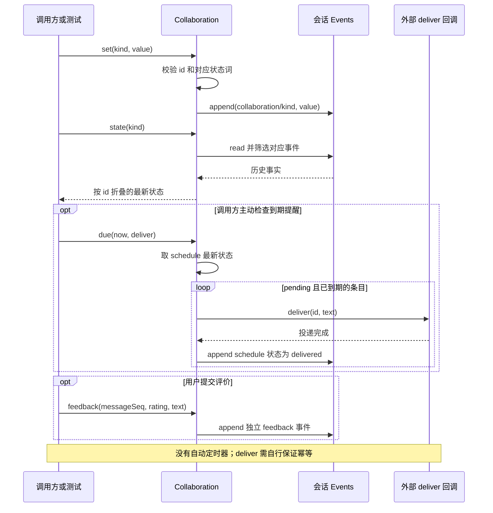

# 039 · Todo、Plan、Goal、提醒和反馈

阶段：R05。唯一前置：完成第 038 步，继续同一个工程。

## 什么时候会用到这一页

用户给一条消息点赞，不应把点赞文字伪装成下一次模型用户输入；另有一次到期提醒，正常处理后重建协作对象不应重复投递。

### 这次数据怎么走

```text
Collaboration.set(kind,value) → 校验状态词 → 追加collaboration事件 → state折叠最新值；due(now,deliver) → 找到pending且到期 → deliver → 记录delivered；feedback单独追加sidecar事件
```

### 对应时序图

从上往下读；实线箭头表示调用或发送，虚线箭头表示返回或事件通知。`opt`表示可选操作，`alt`表示不同结果，`loop`表示重复，`par`及其`and`分支表示并行；“未接入”及fixture说明按图中标注理解。



**当前接线位置：**039独立事件测试；051注册todo/plan/goal/schedule_update，只有状态更新。capabilities没有安排定时器调用due，也没有Goal轮次驱动，不能认为写入schedule就会在后台提醒。

## 这一步具体做什么

写完src/collaboration.mjs与测试后运行 bun test ./tests/039-collaboration.test.mjs。先写入at=1的提醒，在now=2投递，再new Collaboration(session)于now=3检查不再投递；添加feedback后messages投影仍为空；给plan传completed应拒绝。

需要本章新文件的操作，先按下面代码创建文件，再执行；不要在上一步尚不存在的接口上试错。

## 代码为什么放在这一层

本章把Todo/Plan/Goal/Schedule存成不同事件状态，避免都叫“任务”。due不是定时器，需要调用者传now并触发；正常路径标记delivered防重复，deliver与写事件之间不是事务，仍要求投递方按id幂等。

## 在哪里写、写什么

操作地点：终端中的 `$PROJECT`，编辑器打开同一个目录。只创建或替换下列文件，其他文件保留上一步版本。文件目录不存在先创建。

```sh
mkdir -p src
```

### 创建 `src/collaboration.mjs`

````javascript
/** Todo、Plan、Goal与Schedule保留不同状态，审批不冒充计划评审。 */
export class Collaboration {
  constructor(session) { this.session = session }
  /** 由完整事实重建，不把内存Map当永久状态。 */
  state(kind) {
    return this.session.read().filter(event => event.type === 'collaboration/' + kind).reduce((state, event) => ({ ...state, [event.data.id]: event.data }), {})
  }
  set(kind, value) {
    const states = { todo: ['pending', 'doing', 'done'], plan: ['draft', 'review', 'accepted', 'rejected'], goal: ['active', 'paused', 'completed'], schedule: ['pending', 'delivered'] }
    if (!states[kind]?.includes(value.status) || !value.id) throw Error('协作状态不合法')
    this.session.append('collaboration/' + kind, value)
  }
  /** 提醒投递通过持久身份去重；投递方必须以id实现幂等。 */
  async due(now, deliver) {
    for (const value of Object.values(this.state('schedule'))) {
      if (value.status !== 'pending' || value.at > now) continue
      await deliver(value.id, value.text)
      this.set('schedule', { ...value, status: 'delivered' })
    }
  }
  /** UI反馈sidecar是自己的事件，不自动拼进模型对话。 */
  feedback(messageSeq, rating, text) { this.session.append('feedback', { messageSeq, rating, text }) }
}
````

```sh
mkdir -p tests
```

### 创建 `tests/039-collaboration.test.mjs`

````javascript
import { test } from 'bun:test'
import assert from 'node:assert/strict'
import { Collaboration } from '../src/collaboration.mjs'
import { Events } from '../src/events.mjs'
import { messages } from '../src/projection.mjs'

test('提醒重建后不重复投递，反馈不进入模型历史', async () => {
  const session = new Events(), first = new Collaboration(session), delivered = []
  first.set('schedule', { id: 's', at: 1, text: 'review', status: 'pending' })
  await first.due(2, async id => delivered.push(id))
  await new Collaboration(session).due(3, async id => delivered.push(id))
  assert.deepEqual(delivered, ['s'])
  first.feedback(0, 'up', 'good'); assert.equal(messages(session.read()).length, 0)
  assert.throws(() => first.set('plan', { id: 'p', status: 'completed' }), /不合法/)
})
````

## 运行命令与通过标准

```sh
cd "$PROJECT"
bun test ./tests/039-collaboration.test.mjs
bun test
```

测试应1项通过，正常重建不重复、反馈不进入模型历史、错误状态拒绝。不能证明提醒后台自动到期、崩溃窗口恰好一次、周期任务或Goal自动继续运行。

**本步证据的范围：**039-collaboration.test.mjs验证同一Events上的重建和正常幂等、反馈投影排除、非法plan状态；没有重启Host或真实时钟调度。

## VS Code：断在哪里、看什么

在src/collaboration.mjs的this.session.append、await deliver及this.set("schedule"...)打断点。第一次due时看status=pending且at<=now；F10完成deliver后再写delivered。第二个实例state应折叠出delivered并跳过；在feedback后切到projection.mjs观察messages过滤结果仍为空。

操作位置：VS Code 打开的是自己的 `$PROJECT`，断点也设在这里的源码，不在教材的 `steps` 目录。

上面的说明若指定CLI、子进程、页面或Electron附加调试，就先按该流程操作；下面这组步骤只用于本章测试入口。“当前测试”不会自动附加子进程，也不会命中浏览器或Electron中的断点。

变量只在所属作用域可见：停在方法内部时看this和参数；要看测试里的局部变量，先在“调用堆栈”选择对应测试帧。正在等待的异步调用者不一定保留可求值的帧，此时在测试调用前后加断点再看，不把未定义误判成业务状态丢失。

沿用第 000 步安装的 Bun 扩展与 `.vscode/launch.json`；本章列出替换配置时，使用本章完整版本。

1. 打开本步测试文件 `tests/039-collaboration.test.mjs`，保持它为当前编辑器文件。
2. 在上面指定的函数内单击行号左侧设置断点。
3. “运行和调试”选择 **Bun：当前测试**，按 F5；它执行当前测试，工作目录固定为 PROJECT。
4. 在“变量 / 监视 / 调用堆栈 / 调试控制台”检查状态；F10 逐行执行，F11 进入函数，Shift+F11 返回，F5 继续，Shift+F5 停止。

验收：断点实际命中，能说出当前输入、状态和下一步；只看到进程启动不算完成。长时间暂停会影响真实取消、审批和网络超时，先检查时序，不删超时断言。修正后在集成终端运行 `bun test ./tests/039-collaboration.test.mjs`，再运行 `bun test`，保留全部断言。

## 不看答案，确认自己能解释

闭卷写出todo.done、plan.accepted、goal.completed为什么不是一个状态；画出deliver成功但delivered落盘前崩溃会导致什么。

完成后在 LEARNING.md 写一句实际结果和一个卡点。明天只重做这个卡点；第 3 天、第 7 天再做一次，能独立完成就继续下一页，不另开学习路线。

**再改一个条件验证：**安全练习：在纯内存测试让deliver按id记录到Set，再重复调用due验证消费方幂等；模拟deliver抛错应保持pending。重复周期、时区、Goal驱动尚未实现，不要仅增加一个状态名宣称完成。

## 与当前原版还差哪些

对照本仓库固定原版 `687f282e8625c6b8d11ff58211a90524be2e4317`；这里的“当前”指该本地基线，不是未经检查的上游最新版。

**这一页已经实现：**

- 按类别校验状态并由事件重建
- 一次性到期扫描
- 成功投递后记录delivered
- 反馈与模型消息分离

**原版仍有、或本步尚未对齐的部分：**

- 原版todo、plan-mode、goal和schedule各自有独立领域协议；教程一个通用状态表没有相应生命周期。
- 原版schedule宿主持久调度、恢复冷会话、周期/cron/时区及投递历史；教程没有后台调度和事务确认。
- 原版goal-round-driver管理持续目标的后续轮次；教程goal只存状态。
- 原版反馈产品与消息身份关联；本章只追加messageSeq和评分文本。

**原版对照位置：**

- [packages/todo/tool-todo/README.zh.md](../../../deepseek-harness/packages/todo/tool-todo/README.zh.md)
- [packages/plan/plan-mode/README.zh.md](../../../deepseek-harness/packages/plan/plan-mode/README.zh.md)
- [packages/goal/goal-round-driver/README.zh.md](../../../deepseek-harness/packages/goal/goal-round-driver/README.zh.md)
- [packages/schedule/schedule/README.zh.md](../../../deepseek-harness/packages/schedule/schedule/README.zh.md)
- [packages/feedback/message-feedback/README.zh.md](../../../deepseek-harness/packages/feedback/message-feedback/README.zh.md)

本步测试通过只证明上面的具体行为；完整差距仍看 [COVERAGE.md](../COVERAGE.md)，不以文件数量、同名类或后面出现另一个模块代替接线证据。

下一步：[第 040 步](040.md)
