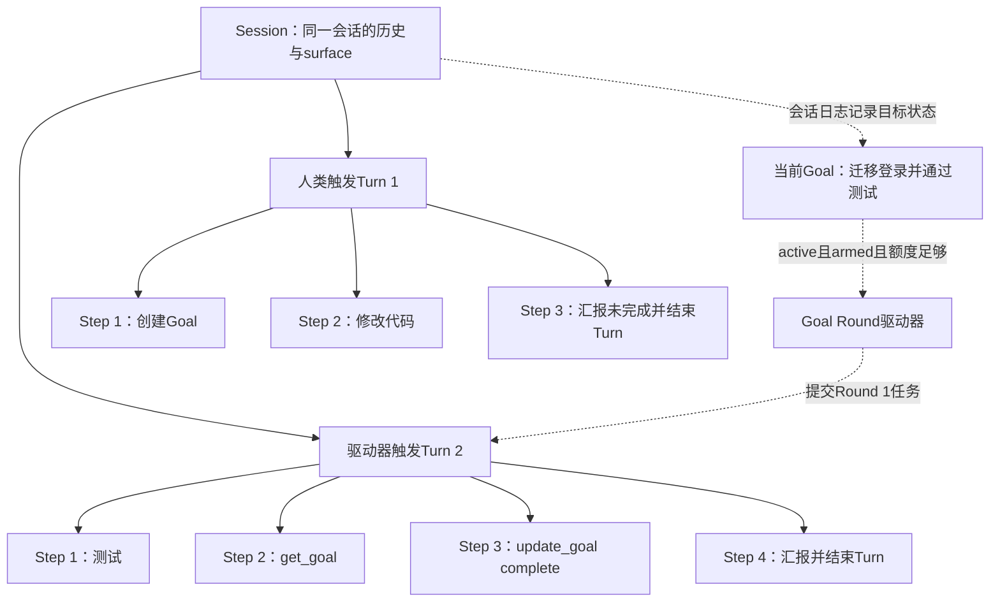
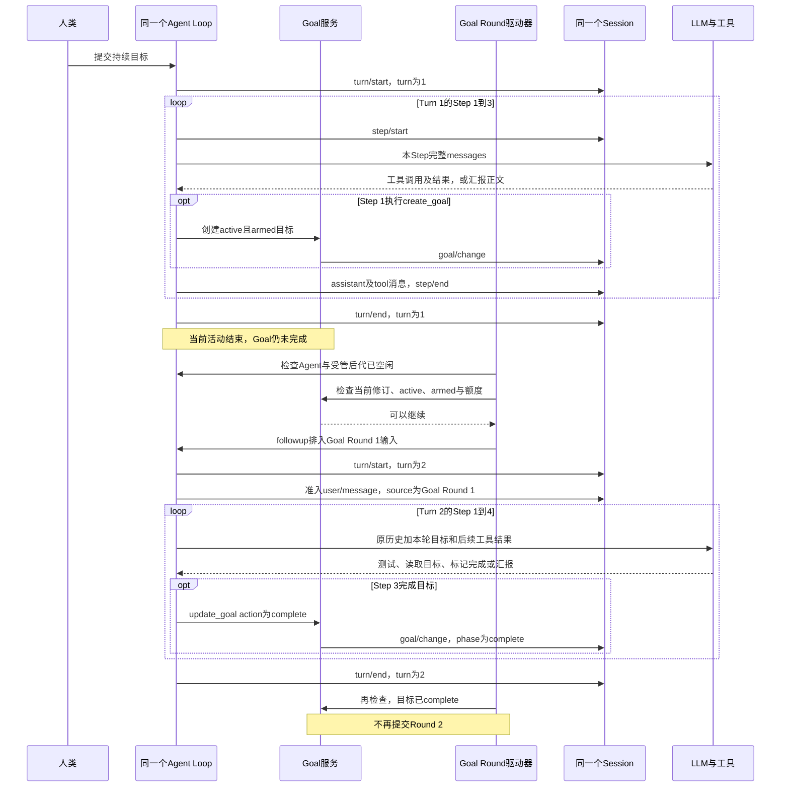
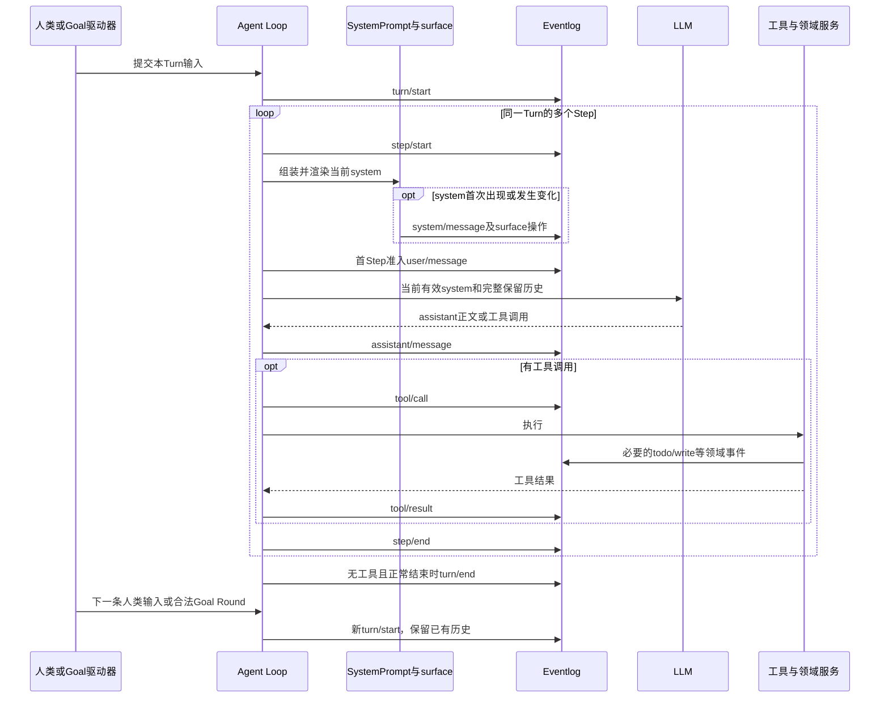
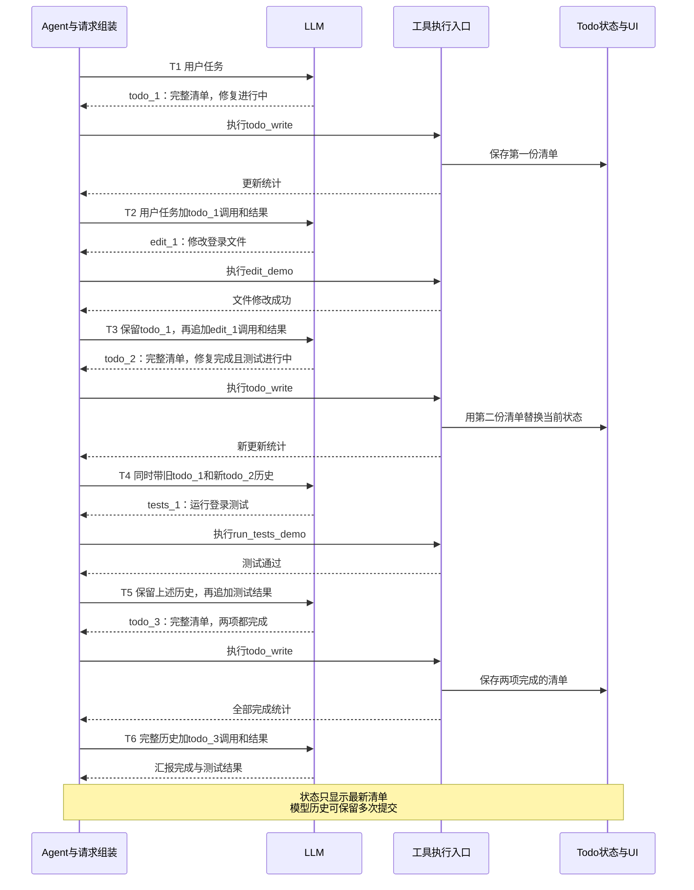
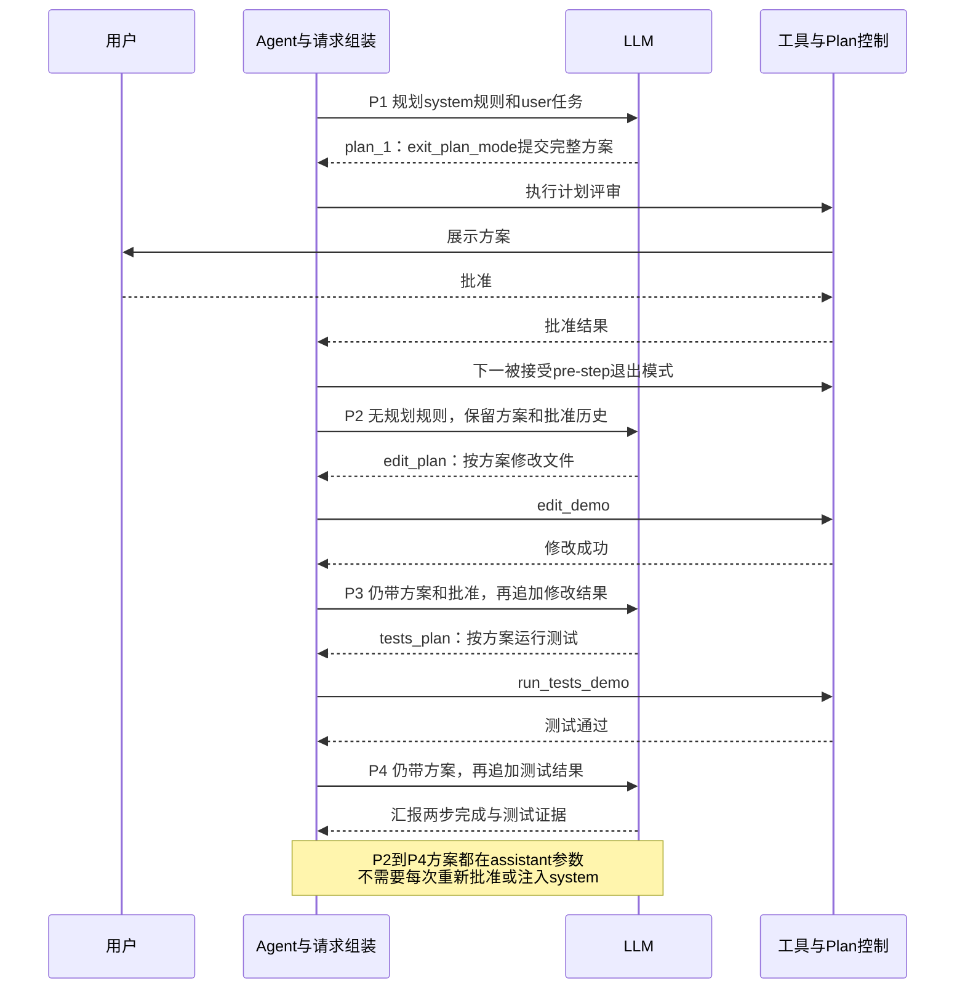
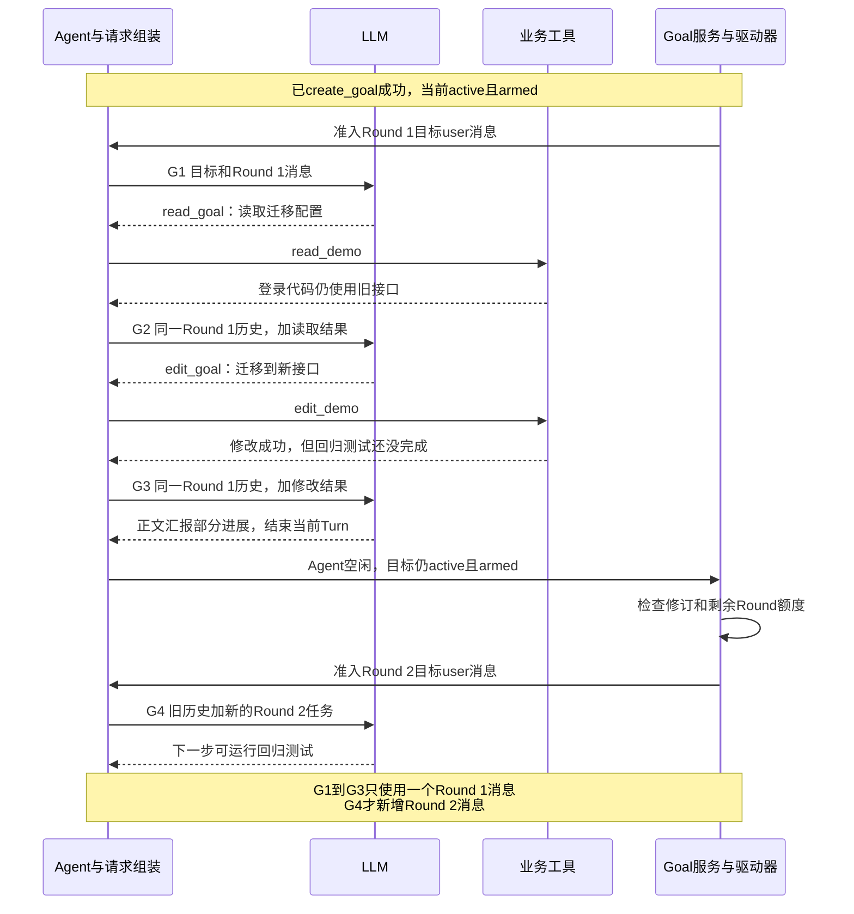
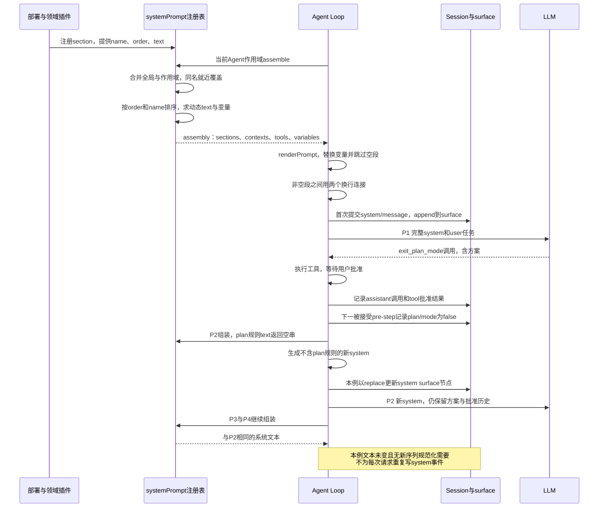
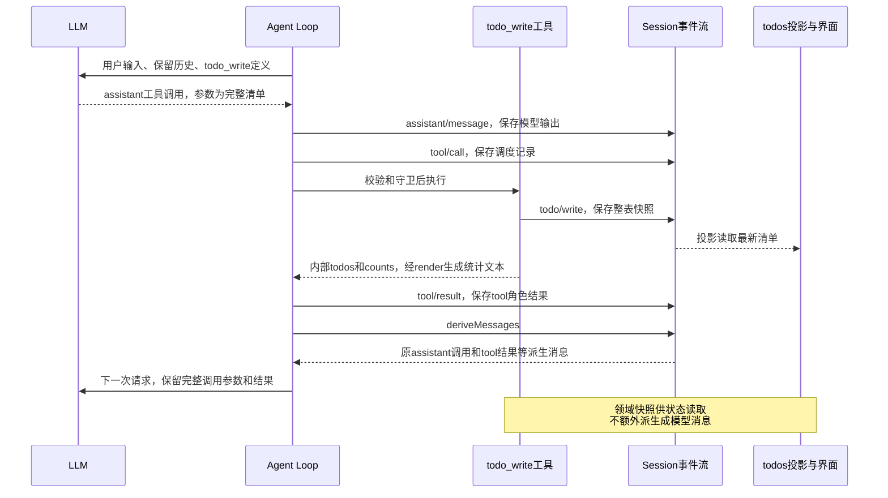
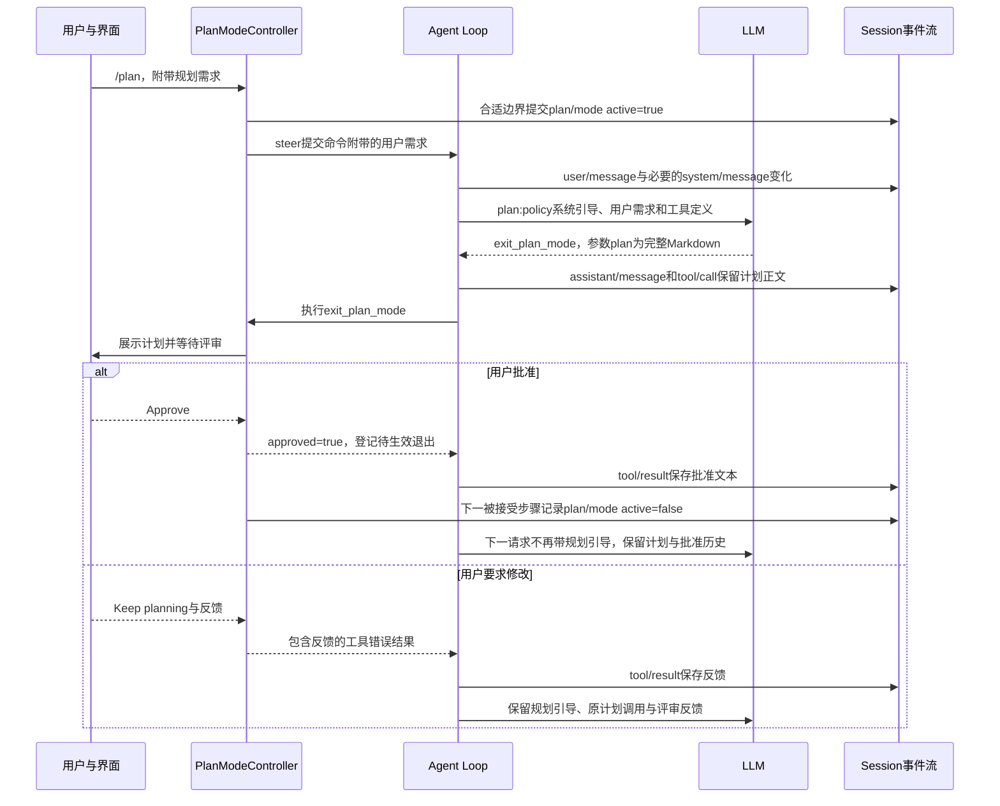
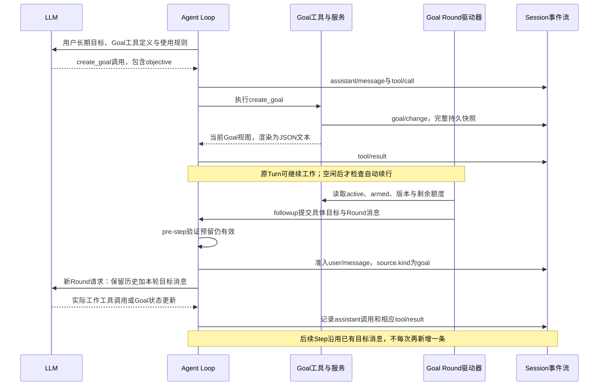

# 039 补充问答：Todo、Plan、Goal 怎样更新状态，又怎样进入模型上下文

返回主文：[039 · 把协作状态和反馈记录成独立事件](../039.md)。

## 先分清Session、Goal、Round、Turn、Step

**Session是同一份会话记录；Turn是一次活动执行；Step是Turn内部一次模型步骤及其工具执行。Goal是跨执行保存的目标，Goal Round是驱动器为了推进该目标提交的一次自动工作。** 它们不是五层逐级包含的容器。

### 关系图：哪些是包含，哪些是驱动



实线表示本例的记录归属与执行组成；虚线表示驱动关系。Goal可以覆盖多个Turn，但一个人类Turn不一定属于自动Goal Round。驱动器也不创建新Session或新Agent；本例继续使用原会话历史。

| 名字 | 在代码中是什么 | 对应边界或判断 |
| --- | --- | --- |
| Session | Session对象，拥有事件记录与消息surface。 | append记录事实，deriveMessages读取当前模型历史；一个Turn结束不清空它。 |
| Goal | 当前目标的持久状态及版本，GoalService提供操作。 | create/edit/pause/resume/complete/block/clear；每会话最多一个当前Goal。 |
| Goal Round | 驱动器提交并准入的一次自动目标推进输入，携带goalId、revision、round来源。 | 只有准入的Goal user/message才计数；人类Turn不消耗自动Round额度。 |
| Turn | Agent Loop的一次活动执行，可以含多个Step。 | turn/start开启，turn/end关闭；正常无工具回答、取消、错误等都可能结束。 |
| Step | Turn内进入的一次模型步骤，以及这次响应对应的工具执行。 | step/start和step/end；本页无重试，所以每Step对应一次LLM请求。 |

一个Step可以有多个工具调用，不能按tool/call数量计算Step。真实提供方重试可能在一个Step内多次尝试请求，本页固定成功示例不展开这条支路。也不是调用一次Agent.followup就立即算一个Round：先排队、后准入，陈旧或被拒绝的输入不应消耗额度。

### 对照已有例子：6个Turn怎么分

下面表格中的三个Session是三组彼此独立的说明会话，不是把Todo Turn1、Plan Turn1、Goal Turn1拼成同一Session。

| 本页完整轨迹 | Session | Turn触发者 | Goal Round编号 | 本Turn里的Step |
| --- | --- | --- | --- | --- |
| Todo Turn1 | Todo示例会话 | 人类：修复会话校验。 | 无；本组没有创建Goal。 | 1建Todo→2修改→3更新Todo→4汇报。 |
| Todo Turn2 | 同一个Todo示例会话 | 人类：补充回归测试。 | 无。 | 1新Todo→2测试→3更新Todo→4汇报。 |
| Plan Turn1 | Plan示例会话 | 宿主激活规划后，人类提交登录任务。 | 无；Plan不是Goal Round。 | 1方案与批准→2修改→3测试→4汇报。 |
| Plan Turn2 | 同一个Plan示例会话 | 再次激活规划后，人类提交新需求。 | 无。 | 1新方案与批准→2新测试→3汇报。 |
| Goal Turn1 | Goal示例会话 | 人类：持续迁移登录。 | 无；这一Turn创建Goal，但不是自动Round。 | 1create_goal→2修改→3汇报部分进展。 |
| Goal Turn2 | 同一个Goal示例会话 | Goal驱动器准入自动任务。 | **Round 1/2**，不是Round 2。 | 1测试→2get_goal→3标记complete→4汇报。 |

这里“Round 1/2”的2是允许的自动Round上限，不是Turn编号，也不是已经执行的Round数量。本例只执行一个自动Round就完成了目标，因此没有发生Round 2，更没有额外Turn3。

### UML：人类Turn结束后，Goal怎样开启另一个Turn



图只概括阶段；system和user准入与step/start的详细先后，以后面各Step的eventlog为准。驱动器实际还有持久化检查与竞争输入防护，不是看到turn/end就无条件继续。

### 两个“完成”一定分开看

<details>
<summary>展开JSON示例（JSON）</summary>

```json
{
  "turnFinishedButGoalNotFinished": {
    "event": { "type": "turn/end", "data": { "turn": 1, "reason": { "kind": "completed" } } },
    "currentGoalPhase": "active",
    "automaticRoundsStarted": 0,
    "meaning": "人类Turn正常结束，长期目标还需要自动推进。"
  },
  "goalFinishedDuringNextTurn": {
    "goalPhase": "complete",
    "automaticRoundsStarted": 1,
    "turn": 2,
    "step": 3,
    "meaning": "目标工具已标记完成，Turn还要到Step4汇报后才结束。"
  }
}
```

</details>

这份JSON是关系对照，不是实际事件协议：只有event字段摘自Turn事件形状，其余是阅读辅助字段。模型在正文说“本轮做完了”不会自动改变Goal phase；原版没有独立评估器，Goal工具的完成操作仍要由调用方按证据提出。

### 代码从哪里读：先找边界，再看数据

下列相对链接从本QA指向本地原版源码；行号是本次核对位置，用于快速查找，之后源码变动时应以函数名为准。

| 想确认什么 | 代码位置与阅读点 |
| --- | --- |
| Session保存与派生消息 | [core/session/src/index.ts](../../../../deepseek-harness/packages/core/session/src/index.ts)：Session类约522行，deriveMessages约984行。 |
| Turn和Step事件结构 | [core/session/src/types.ts](../../../../deepseek-harness/packages/core/session/src/types.ts)：约289～302行的turn/start、turn/end、step/start、step/end。 |
| 谁开启Turn、递增Step、决定继续 | [core/agent-loop/src/agent.ts](../../../../deepseek-harness/packages/core/agent-loop/src/agent.ts)：turn()约298行，step/start约331行，finally中的turn/end约387行。 |
| Step内组装请求、模型响应、执行工具 | [core/agent-loop/src/agent.ts](../../../../deepseek-harness/packages/core/agent-loop/src/agent.ts)：step()约400行，buildRequest约442行，assistant/message约539行，工具调用分支在它之后。 |
| 每次工具调用如何记录 | [core/agent-loop/src/tool-calls.ts](../../../../deepseek-harness/packages/core/agent-loop/src/tool-calls.ts)：appendToolCall约263行，appendToolResult约269行；它们在Step内，不自行开启Turn。 |
| Goal状态由谁拥有 | [goal/goal/src/index.ts](../../../../deepseek-harness/packages/goal/goal/src/index.ts)：GoalService约240行，create约303行，resume约364行。 |
| 谁提交下一Round | [goal/goal-round-driver/src/index.ts](../../../../deepseek-harness/packages/goal/goal-round-driver/src/index.ts)：约182行额度检查，190行计算roundsStarted+1，208行followup，后续pre-step/会话事件监听做准入验证。 |
| Round具体输入和来源长什么样 | [goal/goal-round-driver/src/prompt.ts](../../../../deepseek-harness/packages/goal/goal-round-driver/src/prompt.ts)：renderGoalRoundPrompt生成完整user正文；[goal/goal/src/domain.ts](../../../../deepseek-harness/packages/goal/goal/src/domain.ts)：GoalMessageSource包含goalId、revision、round。 |
| 新Turn为什么Todo清空但历史还在 | [todo/tool-todo/src/index.ts](../../../../deepseek-harness/packages/todo/tool-todo/src/index.ts)：约119～130行todos投影在turn/start返回null，旧todo/write和assistant历史不因此删除。 |

读本页Goal完整轨迹时，先看Goal Turn1 / Step3的turn/end，再跳到Goal Turn2 / Step1的turn/start与source.round=1；最后对照Turn2 / Step3的goal/change和Step4的turn/end。把这四处找出来，就能区分目标状态、自动轮次和活动执行边界。

---

## 从Turn开始到Turn结束：三组完整流转

**每组是独立会话，连续跨两个Turn；每个阶段按①system→②请求前新增日志→③完整messages→④响应和工具后的新增日志→⑤状态前后阅读。** 同一文本会重复出现，目的是让每次请求能独立核对，不再用消息池或编号代替内容。

以下是根据本地原版源码构造的说明轨迹，未运行模型或业务工具。消息数组是这份简化会话的完整数组；read_demo、edit_demo、run_tests_demo是虚构工具，响应固定成功，system中文规则是教学配置。Native工具schema与模型参数在messages之外，本例无压缩、无运行时context、无取消、无重试、无流式思考回放。

eventlog中的seq是**这份说明轨迹自己连续编号**，保留消息和领域、Turn/Step事件；为了不编造provider协议，省略request/header、request/context、inbox/command生命周期、消息id/source中与本题无关的字段、assistant.stream/usage等。因此它不是可直接导入的完整原版日志。seq和surface引用只在本例内有效，不能和下方旧例子的seq混用。Plan以宿主模式入口进入，不假设发生过/plan命令，因此不虚构command/run/done。Goal Round只在输入被准入时记录user/message，不因排队就虚增Round。

系统变化统一选择非in-history分支：首次append，后来用带sourceEventSeqs的replace更新当前system节点；相同文本不重复提交system事件。旧system事件保存在日志，完整messages只使用当前surface有效文本。Goal的armed/disarmed是进程内状态，不另写一条同名持久事件。

| 本节阶段 | Turn / Step | 会发生什么 |
| --- | --- | --- |
| Todo | Turn1的4个Step，Turn2的4个Step | 修复并记录完成→用户补充回归任务→新Todo→测试→再完成。 |
| Plan | Turn1的4个Step，Turn2的3个Step | 进入规划→批准→修改/测试→新Turn再次规划→批准→新增测试。 |
| Goal | 人类Turn1的3个Step，自动Round所在Turn2的4个Step | 创建目标→迁移修改→结束当前Turn但目标未完成→自动Round测试→读取目标→标记完成。 |

### 总时序：工具循环和Turn边界在哪里



图中的user/message仅在输入实际准入时追加，不是每个Step重复追加；step/start、system/message与准入的具体顺序以各阶段下面的事件数组为准。这里只画正常路径。

### A．Todo：两次人类输入，两个Turn，8次模型请求

Turn1先修复；用户在Turn1结束后追加“再跑回归测试”，进入Turn2。**新turn/start会让当前todos投影变null，但历史里的旧Todo调用仍保留。** 下面在Turn2第1步的状态beforeRequest能直接看到这个差别。

#### Todo · Turn 1 / Step 1：用户任务进入，模型创建第一份Todo

**① 本阶段当前system全文：**

<details>
<summary>展开① 本阶段当前system全文（JSON）</summary>

```json
{
  "role": "system",
  "content": "You are an AI agent powered by DeepSeek Harness.\n\n你是编码助手。\n\n用中文回答，并说明实际验证结果。"
}
```

</details>
**② 发请求前，eventlog新增：**

<details>
<summary>展开② 发请求前，eventlog新增（JSON）</summary>

```json
[
  {
    "seq": 0,
    "type": "turn/start",
    "data": {
      "turn": 1
    }
  },
  {
    "seq": 1,
    "type": "step/start",
    "data": {
      "turn": 1,
      "step": 1
    }
  },
  {
    "seq": 2,
    "type": "system/message",
    "data": {
      "turn": 1,
      "step": 1,
      "message": {
        "role": "system",
        "content": [
          {
            "type": "text",
            "text": "You are an AI agent powered by DeepSeek Harness.\n\n你是编码助手。\n\n用中文回答，并说明实际验证结果。"
          }
        ]
      }
    },
    "surfaceOp": "append"
  },
  {
    "seq": 3,
    "type": "user/message",
    "data": {
      "role": "user",
      "content": [
        {
          "type": "text",
          "text": "修复登录的会话校验。"
        }
      ]
    },
    "surfaceOp": "append"
  }
]
```

</details>
**③ 实际发给LLM的完整messages（本例）：**

<details>
<summary>展开③ 实际发给LLM的完整messages（本例）（JSON）</summary>

```json
{
  "messages": [
    {
      "role": "system",
      "content": "You are an AI agent powered by DeepSeek Harness.\n\n你是编码助手。\n\n用中文回答，并说明实际验证结果。"
    },
    {
      "role": "user",
      "content": "修复登录的会话校验。"
    }
  ]
}
```

</details>
**④ LLM返回、工具执行后，eventlog新增：**

<details>
<summary>展开④ LLM返回、工具执行后，eventlog新增（JSON）</summary>

```json
[
  {
    "seq": 4,
    "type": "assistant/message",
    "data": {
      "turn": 1,
      "step": 1,
      "message": {
        "role": "assistant",
        "content": [
          {
            "type": "tool-call",
            "id": "todo_mt_1",
            "name": "todo_write",
            "arguments": "{\"todos\":[{\"content\":\"修复登录\",\"status\":\"in_progress\"}]}"
          }
        ]
      }
    },
    "surfaceOp": "append"
  },
  {
    "seq": 5,
    "type": "tool/call",
    "data": {
      "turn": 1,
      "step": 1,
      "callId": "todo_mt_1",
      "name": "todo_write",
      "arguments": "{\"todos\":[{\"content\":\"修复登录\",\"status\":\"in_progress\"}]}"
    }
  },
  {
    "seq": 6,
    "type": "todo/write",
    "data": {
      "todos": [
        {
          "content": "修复登录",
          "status": "in_progress"
        }
      ]
    }
  },
  {
    "seq": 7,
    "type": "tool/result",
    "data": {
      "turn": 1,
      "step": 1,
      "message": {
        "role": "tool",
        "content": [
          {
            "type": "text",
            "text": "Updated todo list: 0 pending, 1 in progress, 0 completed."
          }
        ],
        "toolCallId": "todo_mt_1",
        "isError": false
      }
    },
    "surfaceOp": "append",
    "sourceEventSeqs": [
      5
    ]
  },
  {
    "seq": 8,
    "type": "step/end",
    "data": {
      "turn": 1,
      "step": 1
    }
  }
]
```

</details>
**⑤ 本阶段业务状态前后：**

<details>
<summary>展开⑤ 本阶段业务状态前后（JSON）</summary>

```json
{
  "beforeRequest": {
    "todosProjection": null
  },
  "afterResponseAndTools": {
    "todosProjection": [
      {
        "content": "修复登录",
        "status": "in_progress"
      }
    ]
  }
}
```

</details>
工具执行完成，但Turn尚未结束。下一Step会把本阶段assistant调用与tool结果追加到完整messages中；不会再次提交相同user任务。

#### Todo · Turn 1 / Step 2：保留Todo，调用编辑工具

**① 本阶段当前system全文：**

<details>
<summary>展开① 本阶段当前system全文（JSON）</summary>

```json
{
  "role": "system",
  "content": "You are an AI agent powered by DeepSeek Harness.\n\n你是编码助手。\n\n用中文回答，并说明实际验证结果。"
}
```

</details>
**② 发请求前，eventlog新增：**

<details>
<summary>展开② 发请求前，eventlog新增（JSON）</summary>

```json
[
  {
    "seq": 9,
    "type": "step/start",
    "data": {
      "turn": 1,
      "step": 2
    }
  }
]
```

</details>
**③ 实际发给LLM的完整messages（本例）：**

<details>
<summary>展开③ 实际发给LLM的完整messages（本例）（JSON）</summary>

```json
{
  "messages": [
    {
      "role": "system",
      "content": "You are an AI agent powered by DeepSeek Harness.\n\n你是编码助手。\n\n用中文回答，并说明实际验证结果。"
    },
    {
      "role": "user",
      "content": "修复登录的会话校验。"
    },
    {
      "role": "assistant",
      "content": null,
      "tool_calls": [
        {
          "id": "todo_mt_1",
          "type": "function",
          "function": {
            "name": "todo_write",
            "arguments": "{\"todos\":[{\"content\":\"修复登录\",\"status\":\"in_progress\"}]}"
          }
        }
      ]
    },
    {
      "role": "tool",
      "tool_call_id": "todo_mt_1",
      "content": "Updated todo list: 0 pending, 1 in progress, 0 completed."
    }
  ]
}
```

</details>
**④ LLM返回、工具执行后，eventlog新增：**

<details>
<summary>展开④ LLM返回、工具执行后，eventlog新增（JSON）</summary>

```json
[
  {
    "seq": 10,
    "type": "assistant/message",
    "data": {
      "turn": 1,
      "step": 2,
      "message": {
        "role": "assistant",
        "content": [
          {
            "type": "tool-call",
            "id": "edit_todo_mt",
            "name": "edit_demo",
            "arguments": "{\"path\":\"login.ts\",\"change\":\"修复会话校验\"}"
          }
        ]
      }
    },
    "surfaceOp": "append"
  },
  {
    "seq": 11,
    "type": "tool/call",
    "data": {
      "turn": 1,
      "step": 2,
      "callId": "edit_todo_mt",
      "name": "edit_demo",
      "arguments": "{\"path\":\"login.ts\",\"change\":\"修复会话校验\"}"
    }
  },
  {
    "seq": 12,
    "type": "tool/result",
    "data": {
      "turn": 1,
      "step": 2,
      "message": {
        "role": "tool",
        "content": [
          {
            "type": "text",
            "text": "login.ts会话校验修改成功"
          }
        ],
        "toolCallId": "edit_todo_mt",
        "isError": false
      }
    },
    "surfaceOp": "append",
    "sourceEventSeqs": [
      11
    ]
  },
  {
    "seq": 13,
    "type": "step/end",
    "data": {
      "turn": 1,
      "step": 2
    }
  }
]
```

</details>
**⑤ 本阶段业务状态前后：**

<details>
<summary>展开⑤ 本阶段业务状态前后（JSON）</summary>

```json
{
  "beforeRequest": {
    "todosProjection": [
      {
        "content": "修复登录",
        "status": "in_progress"
      }
    ]
  },
  "afterResponseAndTools": {
    "todosProjection": [
      {
        "content": "修复登录",
        "status": "in_progress"
      }
    ]
  }
}
```

</details>
工具执行完成，但Turn尚未结束。下一Step会把本阶段assistant调用与tool结果追加到完整messages中；不会再次提交相同user任务。

#### Todo · Turn 1 / Step 3：读取修改成功证据，更新完整Todo

**① 本阶段当前system全文：**

<details>
<summary>展开① 本阶段当前system全文（JSON）</summary>

```json
{
  "role": "system",
  "content": "You are an AI agent powered by DeepSeek Harness.\n\n你是编码助手。\n\n用中文回答，并说明实际验证结果。"
}
```

</details>
**② 发请求前，eventlog新增：**

<details>
<summary>展开② 发请求前，eventlog新增（JSON）</summary>

```json
[
  {
    "seq": 14,
    "type": "step/start",
    "data": {
      "turn": 1,
      "step": 3
    }
  }
]
```

</details>
**③ 实际发给LLM的完整messages（本例）：**

<details>
<summary>展开③ 实际发给LLM的完整messages（本例）（JSON）</summary>

```json
{
  "messages": [
    {
      "role": "system",
      "content": "You are an AI agent powered by DeepSeek Harness.\n\n你是编码助手。\n\n用中文回答，并说明实际验证结果。"
    },
    {
      "role": "user",
      "content": "修复登录的会话校验。"
    },
    {
      "role": "assistant",
      "content": null,
      "tool_calls": [
        {
          "id": "todo_mt_1",
          "type": "function",
          "function": {
            "name": "todo_write",
            "arguments": "{\"todos\":[{\"content\":\"修复登录\",\"status\":\"in_progress\"}]}"
          }
        }
      ]
    },
    {
      "role": "tool",
      "tool_call_id": "todo_mt_1",
      "content": "Updated todo list: 0 pending, 1 in progress, 0 completed."
    },
    {
      "role": "assistant",
      "content": null,
      "tool_calls": [
        {
          "id": "edit_todo_mt",
          "type": "function",
          "function": {
            "name": "edit_demo",
            "arguments": "{\"path\":\"login.ts\",\"change\":\"修复会话校验\"}"
          }
        }
      ]
    },
    {
      "role": "tool",
      "tool_call_id": "edit_todo_mt",
      "content": "login.ts会话校验修改成功"
    }
  ]
}
```

</details>
**④ LLM返回、工具执行后，eventlog新增：**

<details>
<summary>展开④ LLM返回、工具执行后，eventlog新增（JSON）</summary>

```json
[
  {
    "seq": 15,
    "type": "assistant/message",
    "data": {
      "turn": 1,
      "step": 3,
      "message": {
        "role": "assistant",
        "content": [
          {
            "type": "tool-call",
            "id": "todo_mt_2",
            "name": "todo_write",
            "arguments": "{\"todos\":[{\"content\":\"修复登录\",\"status\":\"completed\"}]}"
          }
        ]
      }
    },
    "surfaceOp": "append"
  },
  {
    "seq": 16,
    "type": "tool/call",
    "data": {
      "turn": 1,
      "step": 3,
      "callId": "todo_mt_2",
      "name": "todo_write",
      "arguments": "{\"todos\":[{\"content\":\"修复登录\",\"status\":\"completed\"}]}"
    }
  },
  {
    "seq": 17,
    "type": "todo/write",
    "data": {
      "todos": [
        {
          "content": "修复登录",
          "status": "completed"
        }
      ]
    }
  },
  {
    "seq": 18,
    "type": "tool/result",
    "data": {
      "turn": 1,
      "step": 3,
      "message": {
        "role": "tool",
        "content": [
          {
            "type": "text",
            "text": "Updated todo list: 0 pending, 0 in progress, 1 completed."
          }
        ],
        "toolCallId": "todo_mt_2",
        "isError": false
      }
    },
    "surfaceOp": "append",
    "sourceEventSeqs": [
      16
    ]
  },
  {
    "seq": 19,
    "type": "step/end",
    "data": {
      "turn": 1,
      "step": 3
    }
  }
]
```

</details>
**⑤ 本阶段业务状态前后：**

<details>
<summary>展开⑤ 本阶段业务状态前后（JSON）</summary>

```json
{
  "beforeRequest": {
    "todosProjection": [
      {
        "content": "修复登录",
        "status": "in_progress"
      }
    ]
  },
  "afterResponseAndTools": {
    "todosProjection": [
      {
        "content": "修复登录",
        "status": "completed"
      }
    ]
  }
}
```

</details>
工具执行完成，但Turn尚未结束。下一Step会把本阶段assistant调用与tool结果追加到完整messages中；不会再次提交相同user任务。

#### Todo · Turn 1 / Step 4：工具结果已回填，汇报并结束Turn1

**① 本阶段当前system全文：**

<details>
<summary>展开① 本阶段当前system全文（JSON）</summary>

```json
{
  "role": "system",
  "content": "You are an AI agent powered by DeepSeek Harness.\n\n你是编码助手。\n\n用中文回答，并说明实际验证结果。"
}
```

</details>
**② 发请求前，eventlog新增：**

<details>
<summary>展开② 发请求前，eventlog新增（JSON）</summary>

```json
[
  {
    "seq": 20,
    "type": "step/start",
    "data": {
      "turn": 1,
      "step": 4
    }
  }
]
```

</details>
**③ 实际发给LLM的完整messages（本例）：**

<details>
<summary>展开③ 实际发给LLM的完整messages（本例）（JSON）</summary>

```json
{
  "messages": [
    {
      "role": "system",
      "content": "You are an AI agent powered by DeepSeek Harness.\n\n你是编码助手。\n\n用中文回答，并说明实际验证结果。"
    },
    {
      "role": "user",
      "content": "修复登录的会话校验。"
    },
    {
      "role": "assistant",
      "content": null,
      "tool_calls": [
        {
          "id": "todo_mt_1",
          "type": "function",
          "function": {
            "name": "todo_write",
            "arguments": "{\"todos\":[{\"content\":\"修复登录\",\"status\":\"in_progress\"}]}"
          }
        }
      ]
    },
    {
      "role": "tool",
      "tool_call_id": "todo_mt_1",
      "content": "Updated todo list: 0 pending, 1 in progress, 0 completed."
    },
    {
      "role": "assistant",
      "content": null,
      "tool_calls": [
        {
          "id": "edit_todo_mt",
          "type": "function",
          "function": {
            "name": "edit_demo",
            "arguments": "{\"path\":\"login.ts\",\"change\":\"修复会话校验\"}"
          }
        }
      ]
    },
    {
      "role": "tool",
      "tool_call_id": "edit_todo_mt",
      "content": "login.ts会话校验修改成功"
    },
    {
      "role": "assistant",
      "content": null,
      "tool_calls": [
        {
          "id": "todo_mt_2",
          "type": "function",
          "function": {
            "name": "todo_write",
            "arguments": "{\"todos\":[{\"content\":\"修复登录\",\"status\":\"completed\"}]}"
          }
        }
      ]
    },
    {
      "role": "tool",
      "tool_call_id": "todo_mt_2",
      "content": "Updated todo list: 0 pending, 0 in progress, 1 completed."
    }
  ]
}
```

</details>
**④ LLM返回、工具执行后，eventlog新增：**

<details>
<summary>展开④ LLM返回、工具执行后，eventlog新增（JSON）</summary>

```json
[
  {
    "seq": 21,
    "type": "assistant/message",
    "data": {
      "turn": 1,
      "step": 4,
      "message": {
        "role": "assistant",
        "content": [
          {
            "type": "text",
            "text": "会话校验已修改。当前事项记录为完成，尚未执行回归测试。"
          }
        ]
      }
    },
    "surfaceOp": "append"
  },
  {
    "seq": 22,
    "type": "step/end",
    "data": {
      "turn": 1,
      "step": 4
    }
  },
  {
    "seq": 23,
    "type": "turn/end",
    "data": {
      "turn": 1,
      "reason": {
        "kind": "completed"
      }
    }
  }
]
```

</details>
**⑤ 本阶段业务状态前后：**

<details>
<summary>展开⑤ 本阶段业务状态前后（JSON）</summary>

```json
{
  "beforeRequest": {
    "todosProjection": [
      {
        "content": "修复登录",
        "status": "completed"
      }
    ]
  },
  "afterResponseAndTools": {
    "todosProjection": [
      {
        "content": "修复登录",
        "status": "completed"
      }
    ]
  }
}
```

</details>
本次assistant没有工具调用，Turn在这里结束；这不删除历史，也不自动代表Goal完成。下一阶段如果开始新Turn，会明确写出新的turn/start。

#### Todo · Turn 2 / Step 1：新Turn清空Todo投影，用户新增测试任务

**① 本阶段当前system全文：**

<details>
<summary>展开① 本阶段当前system全文（JSON）</summary>

```json
{
  "role": "system",
  "content": "You are an AI agent powered by DeepSeek Harness.\n\n你是编码助手。\n\n用中文回答，并说明实际验证结果。"
}
```

</details>
**② 发请求前，eventlog新增：**

<details>
<summary>展开② 发请求前，eventlog新增（JSON）</summary>

```json
[
  {
    "seq": 24,
    "type": "turn/start",
    "data": {
      "turn": 2
    }
  },
  {
    "seq": 25,
    "type": "step/start",
    "data": {
      "turn": 2,
      "step": 1
    }
  },
  {
    "seq": 26,
    "type": "user/message",
    "data": {
      "role": "user",
      "content": [
        {
          "type": "text",
          "text": "再运行登录回归测试。"
        }
      ]
    },
    "surfaceOp": "append"
  }
]
```

</details>
**③ 实际发给LLM的完整messages（本例）：**

<details>
<summary>展开③ 实际发给LLM的完整messages（本例）（JSON）</summary>

```json
{
  "messages": [
    {
      "role": "system",
      "content": "You are an AI agent powered by DeepSeek Harness.\n\n你是编码助手。\n\n用中文回答，并说明实际验证结果。"
    },
    {
      "role": "user",
      "content": "修复登录的会话校验。"
    },
    {
      "role": "assistant",
      "content": null,
      "tool_calls": [
        {
          "id": "todo_mt_1",
          "type": "function",
          "function": {
            "name": "todo_write",
            "arguments": "{\"todos\":[{\"content\":\"修复登录\",\"status\":\"in_progress\"}]}"
          }
        }
      ]
    },
    {
      "role": "tool",
      "tool_call_id": "todo_mt_1",
      "content": "Updated todo list: 0 pending, 1 in progress, 0 completed."
    },
    {
      "role": "assistant",
      "content": null,
      "tool_calls": [
        {
          "id": "edit_todo_mt",
          "type": "function",
          "function": {
            "name": "edit_demo",
            "arguments": "{\"path\":\"login.ts\",\"change\":\"修复会话校验\"}"
          }
        }
      ]
    },
    {
      "role": "tool",
      "tool_call_id": "edit_todo_mt",
      "content": "login.ts会话校验修改成功"
    },
    {
      "role": "assistant",
      "content": null,
      "tool_calls": [
        {
          "id": "todo_mt_2",
          "type": "function",
          "function": {
            "name": "todo_write",
            "arguments": "{\"todos\":[{\"content\":\"修复登录\",\"status\":\"completed\"}]}"
          }
        }
      ]
    },
    {
      "role": "tool",
      "tool_call_id": "todo_mt_2",
      "content": "Updated todo list: 0 pending, 0 in progress, 1 completed."
    },
    {
      "role": "assistant",
      "content": "会话校验已修改。当前事项记录为完成，尚未执行回归测试。"
    },
    {
      "role": "user",
      "content": "再运行登录回归测试。"
    }
  ]
}
```

</details>
**④ LLM返回、工具执行后，eventlog新增：**

<details>
<summary>展开④ LLM返回、工具执行后，eventlog新增（JSON）</summary>

```json
[
  {
    "seq": 27,
    "type": "assistant/message",
    "data": {
      "turn": 2,
      "step": 1,
      "message": {
        "role": "assistant",
        "content": [
          {
            "type": "tool-call",
            "id": "todo_mt_3",
            "name": "todo_write",
            "arguments": "{\"todos\":[{\"content\":\"运行登录回归测试\",\"status\":\"in_progress\"}]}"
          }
        ]
      }
    },
    "surfaceOp": "append"
  },
  {
    "seq": 28,
    "type": "tool/call",
    "data": {
      "turn": 2,
      "step": 1,
      "callId": "todo_mt_3",
      "name": "todo_write",
      "arguments": "{\"todos\":[{\"content\":\"运行登录回归测试\",\"status\":\"in_progress\"}]}"
    }
  },
  {
    "seq": 29,
    "type": "todo/write",
    "data": {
      "todos": [
        {
          "content": "运行登录回归测试",
          "status": "in_progress"
        }
      ]
    }
  },
  {
    "seq": 30,
    "type": "tool/result",
    "data": {
      "turn": 2,
      "step": 1,
      "message": {
        "role": "tool",
        "content": [
          {
            "type": "text",
            "text": "Updated todo list: 0 pending, 1 in progress, 0 completed."
          }
        ],
        "toolCallId": "todo_mt_3",
        "isError": false
      }
    },
    "surfaceOp": "append",
    "sourceEventSeqs": [
      28
    ]
  },
  {
    "seq": 31,
    "type": "step/end",
    "data": {
      "turn": 2,
      "step": 1
    }
  }
]
```

</details>
**⑤ 本阶段业务状态前后：**

<details>
<summary>展开⑤ 本阶段业务状态前后（JSON）</summary>

```json
{
  "beforeRequest": {
    "todosProjection": null
  },
  "afterResponseAndTools": {
    "todosProjection": [
      {
        "content": "运行登录回归测试",
        "status": "in_progress"
      }
    ]
  }
}
```

</details>
工具执行完成，但Turn尚未结束。下一Step会把本阶段assistant调用与tool结果追加到完整messages中；不会再次提交相同user任务。

#### Todo · Turn 2 / Step 2：根据新Todo调用测试

**① 本阶段当前system全文：**

<details>
<summary>展开① 本阶段当前system全文（JSON）</summary>

```json
{
  "role": "system",
  "content": "You are an AI agent powered by DeepSeek Harness.\n\n你是编码助手。\n\n用中文回答，并说明实际验证结果。"
}
```

</details>
**② 发请求前，eventlog新增：**

<details>
<summary>展开② 发请求前，eventlog新增（JSON）</summary>

```json
[
  {
    "seq": 32,
    "type": "step/start",
    "data": {
      "turn": 2,
      "step": 2
    }
  }
]
```

</details>
**③ 实际发给LLM的完整messages（本例）：**

<details>
<summary>展开③ 实际发给LLM的完整messages（本例）（JSON）</summary>

```json
{
  "messages": [
    {
      "role": "system",
      "content": "You are an AI agent powered by DeepSeek Harness.\n\n你是编码助手。\n\n用中文回答，并说明实际验证结果。"
    },
    {
      "role": "user",
      "content": "修复登录的会话校验。"
    },
    {
      "role": "assistant",
      "content": null,
      "tool_calls": [
        {
          "id": "todo_mt_1",
          "type": "function",
          "function": {
            "name": "todo_write",
            "arguments": "{\"todos\":[{\"content\":\"修复登录\",\"status\":\"in_progress\"}]}"
          }
        }
      ]
    },
    {
      "role": "tool",
      "tool_call_id": "todo_mt_1",
      "content": "Updated todo list: 0 pending, 1 in progress, 0 completed."
    },
    {
      "role": "assistant",
      "content": null,
      "tool_calls": [
        {
          "id": "edit_todo_mt",
          "type": "function",
          "function": {
            "name": "edit_demo",
            "arguments": "{\"path\":\"login.ts\",\"change\":\"修复会话校验\"}"
          }
        }
      ]
    },
    {
      "role": "tool",
      "tool_call_id": "edit_todo_mt",
      "content": "login.ts会话校验修改成功"
    },
    {
      "role": "assistant",
      "content": null,
      "tool_calls": [
        {
          "id": "todo_mt_2",
          "type": "function",
          "function": {
            "name": "todo_write",
            "arguments": "{\"todos\":[{\"content\":\"修复登录\",\"status\":\"completed\"}]}"
          }
        }
      ]
    },
    {
      "role": "tool",
      "tool_call_id": "todo_mt_2",
      "content": "Updated todo list: 0 pending, 0 in progress, 1 completed."
    },
    {
      "role": "assistant",
      "content": "会话校验已修改。当前事项记录为完成，尚未执行回归测试。"
    },
    {
      "role": "user",
      "content": "再运行登录回归测试。"
    },
    {
      "role": "assistant",
      "content": null,
      "tool_calls": [
        {
          "id": "todo_mt_3",
          "type": "function",
          "function": {
            "name": "todo_write",
            "arguments": "{\"todos\":[{\"content\":\"运行登录回归测试\",\"status\":\"in_progress\"}]}"
          }
        }
      ]
    },
    {
      "role": "tool",
      "tool_call_id": "todo_mt_3",
      "content": "Updated todo list: 0 pending, 1 in progress, 0 completed."
    }
  ]
}
```

</details>
**④ LLM返回、工具执行后，eventlog新增：**

<details>
<summary>展开④ LLM返回、工具执行后，eventlog新增（JSON）</summary>

```json
[
  {
    "seq": 33,
    "type": "assistant/message",
    "data": {
      "turn": 2,
      "step": 2,
      "message": {
        "role": "assistant",
        "content": [
          {
            "type": "tool-call",
            "id": "tests_todo_mt",
            "name": "run_tests_demo",
            "arguments": "{\"suite\":\"login-regression\"}"
          }
        ]
      }
    },
    "surfaceOp": "append"
  },
  {
    "seq": 34,
    "type": "tool/call",
    "data": {
      "turn": 2,
      "step": 2,
      "callId": "tests_todo_mt",
      "name": "run_tests_demo",
      "arguments": "{\"suite\":\"login-regression\"}"
    }
  },
  {
    "seq": 35,
    "type": "tool/result",
    "data": {
      "turn": 2,
      "step": 2,
      "message": {
        "role": "tool",
        "content": [
          {
            "type": "text",
            "text": "登录回归测试通过"
          }
        ],
        "toolCallId": "tests_todo_mt",
        "isError": false
      }
    },
    "surfaceOp": "append",
    "sourceEventSeqs": [
      34
    ]
  },
  {
    "seq": 36,
    "type": "step/end",
    "data": {
      "turn": 2,
      "step": 2
    }
  }
]
```

</details>
**⑤ 本阶段业务状态前后：**

<details>
<summary>展开⑤ 本阶段业务状态前后（JSON）</summary>

```json
{
  "beforeRequest": {
    "todosProjection": [
      {
        "content": "运行登录回归测试",
        "status": "in_progress"
      }
    ]
  },
  "afterResponseAndTools": {
    "todosProjection": [
      {
        "content": "运行登录回归测试",
        "status": "in_progress"
      }
    ]
  }
}
```

</details>
工具执行完成，但Turn尚未结束。下一Step会把本阶段assistant调用与tool结果追加到完整messages中；不会再次提交相同user任务。

#### Todo · Turn 2 / Step 3：拿到通过结果，更新第二份任务表

**① 本阶段当前system全文：**

<details>
<summary>展开① 本阶段当前system全文（JSON）</summary>

```json
{
  "role": "system",
  "content": "You are an AI agent powered by DeepSeek Harness.\n\n你是编码助手。\n\n用中文回答，并说明实际验证结果。"
}
```

</details>
**② 发请求前，eventlog新增：**

<details>
<summary>展开② 发请求前，eventlog新增（JSON）</summary>

```json
[
  {
    "seq": 37,
    "type": "step/start",
    "data": {
      "turn": 2,
      "step": 3
    }
  }
]
```

</details>
**③ 实际发给LLM的完整messages（本例）：**

<details>
<summary>展开③ 实际发给LLM的完整messages（本例）（JSON）</summary>

```json
{
  "messages": [
    {
      "role": "system",
      "content": "You are an AI agent powered by DeepSeek Harness.\n\n你是编码助手。\n\n用中文回答，并说明实际验证结果。"
    },
    {
      "role": "user",
      "content": "修复登录的会话校验。"
    },
    {
      "role": "assistant",
      "content": null,
      "tool_calls": [
        {
          "id": "todo_mt_1",
          "type": "function",
          "function": {
            "name": "todo_write",
            "arguments": "{\"todos\":[{\"content\":\"修复登录\",\"status\":\"in_progress\"}]}"
          }
        }
      ]
    },
    {
      "role": "tool",
      "tool_call_id": "todo_mt_1",
      "content": "Updated todo list: 0 pending, 1 in progress, 0 completed."
    },
    {
      "role": "assistant",
      "content": null,
      "tool_calls": [
        {
          "id": "edit_todo_mt",
          "type": "function",
          "function": {
            "name": "edit_demo",
            "arguments": "{\"path\":\"login.ts\",\"change\":\"修复会话校验\"}"
          }
        }
      ]
    },
    {
      "role": "tool",
      "tool_call_id": "edit_todo_mt",
      "content": "login.ts会话校验修改成功"
    },
    {
      "role": "assistant",
      "content": null,
      "tool_calls": [
        {
          "id": "todo_mt_2",
          "type": "function",
          "function": {
            "name": "todo_write",
            "arguments": "{\"todos\":[{\"content\":\"修复登录\",\"status\":\"completed\"}]}"
          }
        }
      ]
    },
    {
      "role": "tool",
      "tool_call_id": "todo_mt_2",
      "content": "Updated todo list: 0 pending, 0 in progress, 1 completed."
    },
    {
      "role": "assistant",
      "content": "会话校验已修改。当前事项记录为完成，尚未执行回归测试。"
    },
    {
      "role": "user",
      "content": "再运行登录回归测试。"
    },
    {
      "role": "assistant",
      "content": null,
      "tool_calls": [
        {
          "id": "todo_mt_3",
          "type": "function",
          "function": {
            "name": "todo_write",
            "arguments": "{\"todos\":[{\"content\":\"运行登录回归测试\",\"status\":\"in_progress\"}]}"
          }
        }
      ]
    },
    {
      "role": "tool",
      "tool_call_id": "todo_mt_3",
      "content": "Updated todo list: 0 pending, 1 in progress, 0 completed."
    },
    {
      "role": "assistant",
      "content": null,
      "tool_calls": [
        {
          "id": "tests_todo_mt",
          "type": "function",
          "function": {
            "name": "run_tests_demo",
            "arguments": "{\"suite\":\"login-regression\"}"
          }
        }
      ]
    },
    {
      "role": "tool",
      "tool_call_id": "tests_todo_mt",
      "content": "登录回归测试通过"
    }
  ]
}
```

</details>
**④ LLM返回、工具执行后，eventlog新增：**

<details>
<summary>展开④ LLM返回、工具执行后，eventlog新增（JSON）</summary>

```json
[
  {
    "seq": 38,
    "type": "assistant/message",
    "data": {
      "turn": 2,
      "step": 3,
      "message": {
        "role": "assistant",
        "content": [
          {
            "type": "tool-call",
            "id": "todo_mt_4",
            "name": "todo_write",
            "arguments": "{\"todos\":[{\"content\":\"运行登录回归测试\",\"status\":\"completed\"}]}"
          }
        ]
      }
    },
    "surfaceOp": "append"
  },
  {
    "seq": 39,
    "type": "tool/call",
    "data": {
      "turn": 2,
      "step": 3,
      "callId": "todo_mt_4",
      "name": "todo_write",
      "arguments": "{\"todos\":[{\"content\":\"运行登录回归测试\",\"status\":\"completed\"}]}"
    }
  },
  {
    "seq": 40,
    "type": "todo/write",
    "data": {
      "todos": [
        {
          "content": "运行登录回归测试",
          "status": "completed"
        }
      ]
    }
  },
  {
    "seq": 41,
    "type": "tool/result",
    "data": {
      "turn": 2,
      "step": 3,
      "message": {
        "role": "tool",
        "content": [
          {
            "type": "text",
            "text": "Updated todo list: 0 pending, 0 in progress, 1 completed."
          }
        ],
        "toolCallId": "todo_mt_4",
        "isError": false
      }
    },
    "surfaceOp": "append",
    "sourceEventSeqs": [
      39
    ]
  },
  {
    "seq": 42,
    "type": "step/end",
    "data": {
      "turn": 2,
      "step": 3
    }
  }
]
```

</details>
**⑤ 本阶段业务状态前后：**

<details>
<summary>展开⑤ 本阶段业务状态前后（JSON）</summary>

```json
{
  "beforeRequest": {
    "todosProjection": [
      {
        "content": "运行登录回归测试",
        "status": "in_progress"
      }
    ]
  },
  "afterResponseAndTools": {
    "todosProjection": [
      {
        "content": "运行登录回归测试",
        "status": "completed"
      }
    ]
  }
}
```

</details>
工具执行完成，但Turn尚未结束。下一Step会把本阶段assistant调用与tool结果追加到完整messages中；不会再次提交相同user任务。

#### Todo · Turn 2 / Step 4：汇报测试证据并结束Turn2

**① 本阶段当前system全文：**

<details>
<summary>展开① 本阶段当前system全文（JSON）</summary>

```json
{
  "role": "system",
  "content": "You are an AI agent powered by DeepSeek Harness.\n\n你是编码助手。\n\n用中文回答，并说明实际验证结果。"
}
```

</details>
**② 发请求前，eventlog新增：**

<details>
<summary>展开② 发请求前，eventlog新增（JSON）</summary>

```json
[
  {
    "seq": 43,
    "type": "step/start",
    "data": {
      "turn": 2,
      "step": 4
    }
  }
]
```

</details>
**③ 实际发给LLM的完整messages（本例）：**

<details>
<summary>展开③ 实际发给LLM的完整messages（本例）（JSON）</summary>

```json
{
  "messages": [
    {
      "role": "system",
      "content": "You are an AI agent powered by DeepSeek Harness.\n\n你是编码助手。\n\n用中文回答，并说明实际验证结果。"
    },
    {
      "role": "user",
      "content": "修复登录的会话校验。"
    },
    {
      "role": "assistant",
      "content": null,
      "tool_calls": [
        {
          "id": "todo_mt_1",
          "type": "function",
          "function": {
            "name": "todo_write",
            "arguments": "{\"todos\":[{\"content\":\"修复登录\",\"status\":\"in_progress\"}]}"
          }
        }
      ]
    },
    {
      "role": "tool",
      "tool_call_id": "todo_mt_1",
      "content": "Updated todo list: 0 pending, 1 in progress, 0 completed."
    },
    {
      "role": "assistant",
      "content": null,
      "tool_calls": [
        {
          "id": "edit_todo_mt",
          "type": "function",
          "function": {
            "name": "edit_demo",
            "arguments": "{\"path\":\"login.ts\",\"change\":\"修复会话校验\"}"
          }
        }
      ]
    },
    {
      "role": "tool",
      "tool_call_id": "edit_todo_mt",
      "content": "login.ts会话校验修改成功"
    },
    {
      "role": "assistant",
      "content": null,
      "tool_calls": [
        {
          "id": "todo_mt_2",
          "type": "function",
          "function": {
            "name": "todo_write",
            "arguments": "{\"todos\":[{\"content\":\"修复登录\",\"status\":\"completed\"}]}"
          }
        }
      ]
    },
    {
      "role": "tool",
      "tool_call_id": "todo_mt_2",
      "content": "Updated todo list: 0 pending, 0 in progress, 1 completed."
    },
    {
      "role": "assistant",
      "content": "会话校验已修改。当前事项记录为完成，尚未执行回归测试。"
    },
    {
      "role": "user",
      "content": "再运行登录回归测试。"
    },
    {
      "role": "assistant",
      "content": null,
      "tool_calls": [
        {
          "id": "todo_mt_3",
          "type": "function",
          "function": {
            "name": "todo_write",
            "arguments": "{\"todos\":[{\"content\":\"运行登录回归测试\",\"status\":\"in_progress\"}]}"
          }
        }
      ]
    },
    {
      "role": "tool",
      "tool_call_id": "todo_mt_3",
      "content": "Updated todo list: 0 pending, 1 in progress, 0 completed."
    },
    {
      "role": "assistant",
      "content": null,
      "tool_calls": [
        {
          "id": "tests_todo_mt",
          "type": "function",
          "function": {
            "name": "run_tests_demo",
            "arguments": "{\"suite\":\"login-regression\"}"
          }
        }
      ]
    },
    {
      "role": "tool",
      "tool_call_id": "tests_todo_mt",
      "content": "登录回归测试通过"
    },
    {
      "role": "assistant",
      "content": null,
      "tool_calls": [
        {
          "id": "todo_mt_4",
          "type": "function",
          "function": {
            "name": "todo_write",
            "arguments": "{\"todos\":[{\"content\":\"运行登录回归测试\",\"status\":\"completed\"}]}"
          }
        }
      ]
    },
    {
      "role": "tool",
      "tool_call_id": "todo_mt_4",
      "content": "Updated todo list: 0 pending, 0 in progress, 1 completed."
    }
  ]
}
```

</details>
**④ LLM返回、工具执行后，eventlog新增：**

<details>
<summary>展开④ LLM返回、工具执行后，eventlog新增（JSON）</summary>

```json
[
  {
    "seq": 44,
    "type": "assistant/message",
    "data": {
      "turn": 2,
      "step": 4,
      "message": {
        "role": "assistant",
        "content": [
          {
            "type": "text",
            "text": "登录回归测试通过，当前清单的测试事项已记录完成。"
          }
        ]
      }
    },
    "surfaceOp": "append"
  },
  {
    "seq": 45,
    "type": "step/end",
    "data": {
      "turn": 2,
      "step": 4
    }
  },
  {
    "seq": 46,
    "type": "turn/end",
    "data": {
      "turn": 2,
      "reason": {
        "kind": "completed"
      }
    }
  }
]
```

</details>
**⑤ 本阶段业务状态前后：**

<details>
<summary>展开⑤ 本阶段业务状态前后（JSON）</summary>

```json
{
  "beforeRequest": {
    "todosProjection": [
      {
        "content": "运行登录回归测试",
        "status": "completed"
      }
    ]
  },
  "afterResponseAndTools": {
    "todosProjection": [
      {
        "content": "运行登录回归测试",
        "status": "completed"
      }
    ]
  }
}
```

</details>
本次assistant没有工具调用，Turn在这里结束；这不删除历史，也不自动代表Goal完成。下一阶段如果开始新Turn，会明确写出新的turn/start。

### B．Plan：首次方案执行结束，再新建一个规划Turn

Turn1方案批准后，下一Step移除plan:policy，其后的工具调用仍保留方案。Turn2由宿主再次选择Plan模式并提交人类的新需求，system重新加入同一条规划引导；这不是旧方案自动重新启用规划模式。

#### Plan · Turn 1 / Step 1：宿主激活规划，模型提交方案

**① 本阶段当前system全文：**

<details>
<summary>展开① 本阶段当前system全文（JSON）</summary>

```json
{
  "role": "system",
  "content": "You are an AI agent powered by DeepSeek Harness.\n\n你是编码助手。\n\n当前处于规划模式：先探索和设计，通过exit_plan_mode提交完整方案给用户评审。\n\n用中文回答，并说明实际验证结果。"
}
```

</details>
**② 发请求前，eventlog新增：**

<details>
<summary>展开② 发请求前，eventlog新增（JSON）</summary>

```json
[
  {
    "seq": 0,
    "type": "turn/start",
    "data": {
      "turn": 1
    }
  },
  {
    "seq": 1,
    "type": "plan/mode",
    "data": {
      "active": true
    }
  },
  {
    "seq": 2,
    "type": "step/start",
    "data": {
      "turn": 1,
      "step": 1
    }
  },
  {
    "seq": 3,
    "type": "system/message",
    "data": {
      "turn": 1,
      "step": 1,
      "message": {
        "role": "system",
        "content": [
          {
            "type": "text",
            "text": "You are an AI agent powered by DeepSeek Harness.\n\n你是编码助手。\n\n当前处于规划模式：先探索和设计，通过exit_plan_mode提交完整方案给用户评审。\n\n用中文回答，并说明实际验证结果。"
          }
        ]
      }
    },
    "surfaceOp": "append"
  },
  {
    "seq": 4,
    "type": "user/message",
    "data": {
      "role": "user",
      "content": [
        {
          "type": "text",
          "text": "先规划登录修复，批准后执行。"
        }
      ]
    },
    "surfaceOp": "append"
  }
]
```

</details>
**③ 实际发给LLM的完整messages（本例）：**

<details>
<summary>展开③ 实际发给LLM的完整messages（本例）（JSON）</summary>

```json
{
  "messages": [
    {
      "role": "system",
      "content": "You are an AI agent powered by DeepSeek Harness.\n\n你是编码助手。\n\n当前处于规划模式：先探索和设计，通过exit_plan_mode提交完整方案给用户评审。\n\n用中文回答，并说明实际验证结果。"
    },
    {
      "role": "user",
      "content": "先规划登录修复，批准后执行。"
    }
  ]
}
```

</details>
**④ LLM返回、工具执行后，eventlog新增：**

<details>
<summary>展开④ LLM返回、工具执行后，eventlog新增（JSON）</summary>

```json
[
  {
    "seq": 5,
    "type": "assistant/message",
    "data": {
      "turn": 1,
      "step": 1,
      "message": {
        "role": "assistant",
        "content": [
          {
            "type": "tool-call",
            "id": "plan_mt_1",
            "name": "exit_plan_mode",
            "arguments": "{\"plan\":\"# 登录修复\\n\\n1. 修复会话校验。\\n2. 运行登录测试。\"}"
          }
        ]
      }
    },
    "surfaceOp": "append"
  },
  {
    "seq": 6,
    "type": "tool/call",
    "data": {
      "turn": 1,
      "step": 1,
      "callId": "plan_mt_1",
      "name": "exit_plan_mode",
      "arguments": "{\"plan\":\"# 登录修复\\n\\n1. 修复会话校验。\\n2. 运行登录测试。\"}"
    }
  },
  {
    "seq": 7,
    "type": "tool/result",
    "data": {
      "turn": 1,
      "step": 1,
      "message": {
        "role": "tool",
        "content": [
          {
            "type": "text",
            "text": "Plan approved — plan mode exited; carry out the plan starting with your next step."
          }
        ],
        "toolCallId": "plan_mt_1",
        "isError": false
      }
    },
    "surfaceOp": "append",
    "sourceEventSeqs": [
      6
    ]
  },
  {
    "seq": 8,
    "type": "step/end",
    "data": {
      "turn": 1,
      "step": 1
    }
  }
]
```

</details>
**⑤ 本阶段业务状态前后：**

<details>
<summary>展开⑤ 本阶段业务状态前后（JSON）</summary>

```json
{
  "beforeRequest": {
    "planProjection": {
      "active": true,
      "pending": false
    },
    "controllerPendingTarget": null
  },
  "afterResponseAndTools": {
    "planProjection": {
      "active": true,
      "pending": false
    },
    "controllerPendingTarget": false
  }
}
```

</details>
工具执行完成，但Turn尚未结束。下一Step会把本阶段assistant调用与tool结果追加到完整messages中；不会再次提交相同user任务。

#### Plan · Turn 1 / Step 2：批准后下一Step退出规划，执行方案第1步

**① 本阶段当前system全文：**

<details>
<summary>展开① 本阶段当前system全文（JSON）</summary>

```json
{
  "role": "system",
  "content": "You are an AI agent powered by DeepSeek Harness.\n\n你是编码助手。\n\n用中文回答，并说明实际验证结果。"
}
```

</details>
**② 发请求前，eventlog新增：**

<details>
<summary>展开② 发请求前，eventlog新增（JSON）</summary>

```json
[
  {
    "seq": 9,
    "type": "plan/mode",
    "data": {
      "active": false
    }
  },
  {
    "seq": 10,
    "type": "step/start",
    "data": {
      "turn": 1,
      "step": 2
    }
  },
  {
    "seq": 11,
    "type": "system/message",
    "data": {
      "turn": 1,
      "step": 2,
      "message": {
        "role": "system",
        "content": [
          {
            "type": "text",
            "text": "You are an AI agent powered by DeepSeek Harness.\n\n你是编码助手。\n\n用中文回答，并说明实际验证结果。"
          }
        ]
      }
    },
    "surfaceOp": {
      "op": "replace",
      "startSeq": 3,
      "endSeq": 3
    },
    "sourceEventSeqs": [
      3
    ]
  }
]
```

</details>
**③ 实际发给LLM的完整messages（本例）：**

<details>
<summary>展开③ 实际发给LLM的完整messages（本例）（JSON）</summary>

```json
{
  "messages": [
    {
      "role": "system",
      "content": "You are an AI agent powered by DeepSeek Harness.\n\n你是编码助手。\n\n用中文回答，并说明实际验证结果。"
    },
    {
      "role": "user",
      "content": "先规划登录修复，批准后执行。"
    },
    {
      "role": "assistant",
      "content": null,
      "tool_calls": [
        {
          "id": "plan_mt_1",
          "type": "function",
          "function": {
            "name": "exit_plan_mode",
            "arguments": "{\"plan\":\"# 登录修复\\n\\n1. 修复会话校验。\\n2. 运行登录测试。\"}"
          }
        }
      ]
    },
    {
      "role": "tool",
      "tool_call_id": "plan_mt_1",
      "content": "Plan approved — plan mode exited; carry out the plan starting with your next step."
    }
  ]
}
```

</details>
**④ LLM返回、工具执行后，eventlog新增：**

<details>
<summary>展开④ LLM返回、工具执行后，eventlog新增（JSON）</summary>

```json
[
  {
    "seq": 12,
    "type": "assistant/message",
    "data": {
      "turn": 1,
      "step": 2,
      "message": {
        "role": "assistant",
        "content": [
          {
            "type": "tool-call",
            "id": "edit_plan_mt",
            "name": "edit_demo",
            "arguments": "{\"path\":\"login.ts\",\"change\":\"修复会话校验\"}"
          }
        ]
      }
    },
    "surfaceOp": "append"
  },
  {
    "seq": 13,
    "type": "tool/call",
    "data": {
      "turn": 1,
      "step": 2,
      "callId": "edit_plan_mt",
      "name": "edit_demo",
      "arguments": "{\"path\":\"login.ts\",\"change\":\"修复会话校验\"}"
    }
  },
  {
    "seq": 14,
    "type": "tool/result",
    "data": {
      "turn": 1,
      "step": 2,
      "message": {
        "role": "tool",
        "content": [
          {
            "type": "text",
            "text": "login.ts修改成功"
          }
        ],
        "toolCallId": "edit_plan_mt",
        "isError": false
      }
    },
    "surfaceOp": "append",
    "sourceEventSeqs": [
      13
    ]
  },
  {
    "seq": 15,
    "type": "step/end",
    "data": {
      "turn": 1,
      "step": 2
    }
  }
]
```

</details>
**⑤ 本阶段业务状态前后：**

<details>
<summary>展开⑤ 本阶段业务状态前后（JSON）</summary>

```json
{
  "beforeRequest": {
    "planProjection": {
      "active": false,
      "pending": false
    },
    "controllerPendingTarget": null
  },
  "afterResponseAndTools": {
    "planProjection": {
      "active": false,
      "pending": false
    },
    "controllerPendingTarget": null
  }
}
```

</details>
工具执行完成，但Turn尚未结束。下一Step会把本阶段assistant调用与tool结果追加到完整messages中；不会再次提交相同user任务。

#### Plan · Turn 1 / Step 3：仍保留批准的方案，执行方案第2步

**① 本阶段当前system全文：**

<details>
<summary>展开① 本阶段当前system全文（JSON）</summary>

```json
{
  "role": "system",
  "content": "You are an AI agent powered by DeepSeek Harness.\n\n你是编码助手。\n\n用中文回答，并说明实际验证结果。"
}
```

</details>
**② 发请求前，eventlog新增：**

<details>
<summary>展开② 发请求前，eventlog新增（JSON）</summary>

```json
[
  {
    "seq": 16,
    "type": "step/start",
    "data": {
      "turn": 1,
      "step": 3
    }
  }
]
```

</details>
**③ 实际发给LLM的完整messages（本例）：**

<details>
<summary>展开③ 实际发给LLM的完整messages（本例）（JSON）</summary>

```json
{
  "messages": [
    {
      "role": "system",
      "content": "You are an AI agent powered by DeepSeek Harness.\n\n你是编码助手。\n\n用中文回答，并说明实际验证结果。"
    },
    {
      "role": "user",
      "content": "先规划登录修复，批准后执行。"
    },
    {
      "role": "assistant",
      "content": null,
      "tool_calls": [
        {
          "id": "plan_mt_1",
          "type": "function",
          "function": {
            "name": "exit_plan_mode",
            "arguments": "{\"plan\":\"# 登录修复\\n\\n1. 修复会话校验。\\n2. 运行登录测试。\"}"
          }
        }
      ]
    },
    {
      "role": "tool",
      "tool_call_id": "plan_mt_1",
      "content": "Plan approved — plan mode exited; carry out the plan starting with your next step."
    },
    {
      "role": "assistant",
      "content": null,
      "tool_calls": [
        {
          "id": "edit_plan_mt",
          "type": "function",
          "function": {
            "name": "edit_demo",
            "arguments": "{\"path\":\"login.ts\",\"change\":\"修复会话校验\"}"
          }
        }
      ]
    },
    {
      "role": "tool",
      "tool_call_id": "edit_plan_mt",
      "content": "login.ts修改成功"
    }
  ]
}
```

</details>
**④ LLM返回、工具执行后，eventlog新增：**

<details>
<summary>展开④ LLM返回、工具执行后，eventlog新增（JSON）</summary>

```json
[
  {
    "seq": 17,
    "type": "assistant/message",
    "data": {
      "turn": 1,
      "step": 3,
      "message": {
        "role": "assistant",
        "content": [
          {
            "type": "tool-call",
            "id": "tests_plan_mt",
            "name": "run_tests_demo",
            "arguments": "{\"suite\":\"login\"}"
          }
        ]
      }
    },
    "surfaceOp": "append"
  },
  {
    "seq": 18,
    "type": "tool/call",
    "data": {
      "turn": 1,
      "step": 3,
      "callId": "tests_plan_mt",
      "name": "run_tests_demo",
      "arguments": "{\"suite\":\"login\"}"
    }
  },
  {
    "seq": 19,
    "type": "tool/result",
    "data": {
      "turn": 1,
      "step": 3,
      "message": {
        "role": "tool",
        "content": [
          {
            "type": "text",
            "text": "登录测试通过"
          }
        ],
        "toolCallId": "tests_plan_mt",
        "isError": false
      }
    },
    "surfaceOp": "append",
    "sourceEventSeqs": [
      18
    ]
  },
  {
    "seq": 20,
    "type": "step/end",
    "data": {
      "turn": 1,
      "step": 3
    }
  }
]
```

</details>
**⑤ 本阶段业务状态前后：**

<details>
<summary>展开⑤ 本阶段业务状态前后（JSON）</summary>

```json
{
  "beforeRequest": {
    "planProjection": {
      "active": false,
      "pending": false
    },
    "controllerPendingTarget": null
  },
  "afterResponseAndTools": {
    "planProjection": {
      "active": false,
      "pending": false
    },
    "controllerPendingTarget": null
  }
}
```

</details>
工具执行完成，但Turn尚未结束。下一Step会把本阶段assistant调用与tool结果追加到完整messages中；不会再次提交相同user任务。

#### Plan · Turn 1 / Step 4：汇报方案执行结果，结束Turn1

**① 本阶段当前system全文：**

<details>
<summary>展开① 本阶段当前system全文（JSON）</summary>

```json
{
  "role": "system",
  "content": "You are an AI agent powered by DeepSeek Harness.\n\n你是编码助手。\n\n用中文回答，并说明实际验证结果。"
}
```

</details>
**② 发请求前，eventlog新增：**

<details>
<summary>展开② 发请求前，eventlog新增（JSON）</summary>

```json
[
  {
    "seq": 21,
    "type": "step/start",
    "data": {
      "turn": 1,
      "step": 4
    }
  }
]
```

</details>
**③ 实际发给LLM的完整messages（本例）：**

<details>
<summary>展开③ 实际发给LLM的完整messages（本例）（JSON）</summary>

```json
{
  "messages": [
    {
      "role": "system",
      "content": "You are an AI agent powered by DeepSeek Harness.\n\n你是编码助手。\n\n用中文回答，并说明实际验证结果。"
    },
    {
      "role": "user",
      "content": "先规划登录修复，批准后执行。"
    },
    {
      "role": "assistant",
      "content": null,
      "tool_calls": [
        {
          "id": "plan_mt_1",
          "type": "function",
          "function": {
            "name": "exit_plan_mode",
            "arguments": "{\"plan\":\"# 登录修复\\n\\n1. 修复会话校验。\\n2. 运行登录测试。\"}"
          }
        }
      ]
    },
    {
      "role": "tool",
      "tool_call_id": "plan_mt_1",
      "content": "Plan approved — plan mode exited; carry out the plan starting with your next step."
    },
    {
      "role": "assistant",
      "content": null,
      "tool_calls": [
        {
          "id": "edit_plan_mt",
          "type": "function",
          "function": {
            "name": "edit_demo",
            "arguments": "{\"path\":\"login.ts\",\"change\":\"修复会话校验\"}"
          }
        }
      ]
    },
    {
      "role": "tool",
      "tool_call_id": "edit_plan_mt",
      "content": "login.ts修改成功"
    },
    {
      "role": "assistant",
      "content": null,
      "tool_calls": [
        {
          "id": "tests_plan_mt",
          "type": "function",
          "function": {
            "name": "run_tests_demo",
            "arguments": "{\"suite\":\"login\"}"
          }
        }
      ]
    },
    {
      "role": "tool",
      "tool_call_id": "tests_plan_mt",
      "content": "登录测试通过"
    }
  ]
}
```

</details>
**④ LLM返回、工具执行后，eventlog新增：**

<details>
<summary>展开④ LLM返回、工具执行后，eventlog新增（JSON）</summary>

```json
[
  {
    "seq": 22,
    "type": "assistant/message",
    "data": {
      "turn": 1,
      "step": 4,
      "message": {
        "role": "assistant",
        "content": [
          {
            "type": "text",
            "text": "批准的方案两步已执行，登录测试通过。"
          }
        ]
      }
    },
    "surfaceOp": "append"
  },
  {
    "seq": 23,
    "type": "step/end",
    "data": {
      "turn": 1,
      "step": 4
    }
  },
  {
    "seq": 24,
    "type": "turn/end",
    "data": {
      "turn": 1,
      "reason": {
        "kind": "completed"
      }
    }
  }
]
```

</details>
**⑤ 本阶段业务状态前后：**

<details>
<summary>展开⑤ 本阶段业务状态前后（JSON）</summary>

```json
{
  "beforeRequest": {
    "planProjection": {
      "active": false,
      "pending": false
    },
    "controllerPendingTarget": null
  },
  "afterResponseAndTools": {
    "planProjection": {
      "active": false,
      "pending": false
    },
    "controllerPendingTarget": null
  }
}
```

</details>
本次assistant没有工具调用，Turn在这里结束；这不删除历史，也不自动代表Goal完成。下一阶段如果开始新Turn，会明确写出新的turn/start。

#### Plan · Turn 2 / Step 1：新需求再次进入Plan模式，提交新方案

**① 本阶段当前system全文：**

<details>
<summary>展开① 本阶段当前system全文（JSON）</summary>

```json
{
  "role": "system",
  "content": "You are an AI agent powered by DeepSeek Harness.\n\n你是编码助手。\n\n当前处于规划模式：先探索和设计，通过exit_plan_mode提交完整方案给用户评审。\n\n用中文回答，并说明实际验证结果。"
}
```

</details>
**② 发请求前，eventlog新增：**

<details>
<summary>展开② 发请求前，eventlog新增（JSON）</summary>

```json
[
  {
    "seq": 25,
    "type": "turn/start",
    "data": {
      "turn": 2
    }
  },
  {
    "seq": 26,
    "type": "plan/mode",
    "data": {
      "active": true
    }
  },
  {
    "seq": 27,
    "type": "step/start",
    "data": {
      "turn": 2,
      "step": 1
    }
  },
  {
    "seq": 28,
    "type": "system/message",
    "data": {
      "turn": 2,
      "step": 1,
      "message": {
        "role": "system",
        "content": [
          {
            "type": "text",
            "text": "You are an AI agent powered by DeepSeek Harness.\n\n你是编码助手。\n\n当前处于规划模式：先探索和设计，通过exit_plan_mode提交完整方案给用户评审。\n\n用中文回答，并说明实际验证结果。"
          }
        ]
      }
    },
    "surfaceOp": {
      "op": "replace",
      "startSeq": 11,
      "endSeq": 11
    },
    "sourceEventSeqs": [
      11
    ]
  },
  {
    "seq": 29,
    "type": "user/message",
    "data": {
      "role": "user",
      "content": [
        {
          "type": "text",
          "text": "再规划一次过期会话回归验证，先给我确认。"
        }
      ]
    },
    "surfaceOp": "append"
  }
]
```

</details>
**③ 实际发给LLM的完整messages（本例）：**

<details>
<summary>展开③ 实际发给LLM的完整messages（本例）（JSON）</summary>

```json
{
  "messages": [
    {
      "role": "system",
      "content": "You are an AI agent powered by DeepSeek Harness.\n\n你是编码助手。\n\n当前处于规划模式：先探索和设计，通过exit_plan_mode提交完整方案给用户评审。\n\n用中文回答，并说明实际验证结果。"
    },
    {
      "role": "user",
      "content": "先规划登录修复，批准后执行。"
    },
    {
      "role": "assistant",
      "content": null,
      "tool_calls": [
        {
          "id": "plan_mt_1",
          "type": "function",
          "function": {
            "name": "exit_plan_mode",
            "arguments": "{\"plan\":\"# 登录修复\\n\\n1. 修复会话校验。\\n2. 运行登录测试。\"}"
          }
        }
      ]
    },
    {
      "role": "tool",
      "tool_call_id": "plan_mt_1",
      "content": "Plan approved — plan mode exited; carry out the plan starting with your next step."
    },
    {
      "role": "assistant",
      "content": null,
      "tool_calls": [
        {
          "id": "edit_plan_mt",
          "type": "function",
          "function": {
            "name": "edit_demo",
            "arguments": "{\"path\":\"login.ts\",\"change\":\"修复会话校验\"}"
          }
        }
      ]
    },
    {
      "role": "tool",
      "tool_call_id": "edit_plan_mt",
      "content": "login.ts修改成功"
    },
    {
      "role": "assistant",
      "content": null,
      "tool_calls": [
        {
          "id": "tests_plan_mt",
          "type": "function",
          "function": {
            "name": "run_tests_demo",
            "arguments": "{\"suite\":\"login\"}"
          }
        }
      ]
    },
    {
      "role": "tool",
      "tool_call_id": "tests_plan_mt",
      "content": "登录测试通过"
    },
    {
      "role": "assistant",
      "content": "批准的方案两步已执行，登录测试通过。"
    },
    {
      "role": "user",
      "content": "再规划一次过期会话回归验证，先给我确认。"
    }
  ]
}
```

</details>
**④ LLM返回、工具执行后，eventlog新增：**

<details>
<summary>展开④ LLM返回、工具执行后，eventlog新增（JSON）</summary>

```json
[
  {
    "seq": 30,
    "type": "assistant/message",
    "data": {
      "turn": 2,
      "step": 1,
      "message": {
        "role": "assistant",
        "content": [
          {
            "type": "tool-call",
            "id": "plan_mt_2",
            "name": "exit_plan_mode",
            "arguments": "{\"plan\":\"# 补充过期会话回归\\n\\n1. 运行过期会话测试并检查结果。\"}"
          }
        ]
      }
    },
    "surfaceOp": "append"
  },
  {
    "seq": 31,
    "type": "tool/call",
    "data": {
      "turn": 2,
      "step": 1,
      "callId": "plan_mt_2",
      "name": "exit_plan_mode",
      "arguments": "{\"plan\":\"# 补充过期会话回归\\n\\n1. 运行过期会话测试并检查结果。\"}"
    }
  },
  {
    "seq": 32,
    "type": "tool/result",
    "data": {
      "turn": 2,
      "step": 1,
      "message": {
        "role": "tool",
        "content": [
          {
            "type": "text",
            "text": "Plan approved — plan mode exited; carry out the plan starting with your next step."
          }
        ],
        "toolCallId": "plan_mt_2",
        "isError": false
      }
    },
    "surfaceOp": "append",
    "sourceEventSeqs": [
      31
    ]
  },
  {
    "seq": 33,
    "type": "step/end",
    "data": {
      "turn": 2,
      "step": 1
    }
  }
]
```

</details>
**⑤ 本阶段业务状态前后：**

<details>
<summary>展开⑤ 本阶段业务状态前后（JSON）</summary>

```json
{
  "beforeRequest": {
    "planProjection": {
      "active": true,
      "pending": false
    },
    "controllerPendingTarget": null
  },
  "afterResponseAndTools": {
    "planProjection": {
      "active": true,
      "pending": false
    },
    "controllerPendingTarget": false
  }
}
```

</details>
工具执行完成，但Turn尚未结束。下一Step会把本阶段assistant调用与tool结果追加到完整messages中；不会再次提交相同user任务。

#### Plan · Turn 2 / Step 2：第二次批准后退出规划，执行新方案

**① 本阶段当前system全文：**

<details>
<summary>展开① 本阶段当前system全文（JSON）</summary>

```json
{
  "role": "system",
  "content": "You are an AI agent powered by DeepSeek Harness.\n\n你是编码助手。\n\n用中文回答，并说明实际验证结果。"
}
```

</details>
**② 发请求前，eventlog新增：**

<details>
<summary>展开② 发请求前，eventlog新增（JSON）</summary>

```json
[
  {
    "seq": 34,
    "type": "plan/mode",
    "data": {
      "active": false
    }
  },
  {
    "seq": 35,
    "type": "step/start",
    "data": {
      "turn": 2,
      "step": 2
    }
  },
  {
    "seq": 36,
    "type": "system/message",
    "data": {
      "turn": 2,
      "step": 2,
      "message": {
        "role": "system",
        "content": [
          {
            "type": "text",
            "text": "You are an AI agent powered by DeepSeek Harness.\n\n你是编码助手。\n\n用中文回答，并说明实际验证结果。"
          }
        ]
      }
    },
    "surfaceOp": {
      "op": "replace",
      "startSeq": 28,
      "endSeq": 28
    },
    "sourceEventSeqs": [
      28
    ]
  }
]
```

</details>
**③ 实际发给LLM的完整messages（本例）：**

<details>
<summary>展开③ 实际发给LLM的完整messages（本例）（JSON）</summary>

```json
{
  "messages": [
    {
      "role": "system",
      "content": "You are an AI agent powered by DeepSeek Harness.\n\n你是编码助手。\n\n用中文回答，并说明实际验证结果。"
    },
    {
      "role": "user",
      "content": "先规划登录修复，批准后执行。"
    },
    {
      "role": "assistant",
      "content": null,
      "tool_calls": [
        {
          "id": "plan_mt_1",
          "type": "function",
          "function": {
            "name": "exit_plan_mode",
            "arguments": "{\"plan\":\"# 登录修复\\n\\n1. 修复会话校验。\\n2. 运行登录测试。\"}"
          }
        }
      ]
    },
    {
      "role": "tool",
      "tool_call_id": "plan_mt_1",
      "content": "Plan approved — plan mode exited; carry out the plan starting with your next step."
    },
    {
      "role": "assistant",
      "content": null,
      "tool_calls": [
        {
          "id": "edit_plan_mt",
          "type": "function",
          "function": {
            "name": "edit_demo",
            "arguments": "{\"path\":\"login.ts\",\"change\":\"修复会话校验\"}"
          }
        }
      ]
    },
    {
      "role": "tool",
      "tool_call_id": "edit_plan_mt",
      "content": "login.ts修改成功"
    },
    {
      "role": "assistant",
      "content": null,
      "tool_calls": [
        {
          "id": "tests_plan_mt",
          "type": "function",
          "function": {
            "name": "run_tests_demo",
            "arguments": "{\"suite\":\"login\"}"
          }
        }
      ]
    },
    {
      "role": "tool",
      "tool_call_id": "tests_plan_mt",
      "content": "登录测试通过"
    },
    {
      "role": "assistant",
      "content": "批准的方案两步已执行，登录测试通过。"
    },
    {
      "role": "user",
      "content": "再规划一次过期会话回归验证，先给我确认。"
    },
    {
      "role": "assistant",
      "content": null,
      "tool_calls": [
        {
          "id": "plan_mt_2",
          "type": "function",
          "function": {
            "name": "exit_plan_mode",
            "arguments": "{\"plan\":\"# 补充过期会话回归\\n\\n1. 运行过期会话测试并检查结果。\"}"
          }
        }
      ]
    },
    {
      "role": "tool",
      "tool_call_id": "plan_mt_2",
      "content": "Plan approved — plan mode exited; carry out the plan starting with your next step."
    }
  ]
}
```

</details>
**④ LLM返回、工具执行后，eventlog新增：**

<details>
<summary>展开④ LLM返回、工具执行后，eventlog新增（JSON）</summary>

```json
[
  {
    "seq": 37,
    "type": "assistant/message",
    "data": {
      "turn": 2,
      "step": 2,
      "message": {
        "role": "assistant",
        "content": [
          {
            "type": "tool-call",
            "id": "tests_plan_mt_2",
            "name": "run_tests_demo",
            "arguments": "{\"suite\":\"expired-session\"}"
          }
        ]
      }
    },
    "surfaceOp": "append"
  },
  {
    "seq": 38,
    "type": "tool/call",
    "data": {
      "turn": 2,
      "step": 2,
      "callId": "tests_plan_mt_2",
      "name": "run_tests_demo",
      "arguments": "{\"suite\":\"expired-session\"}"
    }
  },
  {
    "seq": 39,
    "type": "tool/result",
    "data": {
      "turn": 2,
      "step": 2,
      "message": {
        "role": "tool",
        "content": [
          {
            "type": "text",
            "text": "过期会话回归测试通过"
          }
        ],
        "toolCallId": "tests_plan_mt_2",
        "isError": false
      }
    },
    "surfaceOp": "append",
    "sourceEventSeqs": [
      38
    ]
  },
  {
    "seq": 40,
    "type": "step/end",
    "data": {
      "turn": 2,
      "step": 2
    }
  }
]
```

</details>
**⑤ 本阶段业务状态前后：**

<details>
<summary>展开⑤ 本阶段业务状态前后（JSON）</summary>

```json
{
  "beforeRequest": {
    "planProjection": {
      "active": false,
      "pending": false
    },
    "controllerPendingTarget": null
  },
  "afterResponseAndTools": {
    "planProjection": {
      "active": false,
      "pending": false
    },
    "controllerPendingTarget": null
  }
}
```

</details>
工具执行完成，但Turn尚未结束。下一Step会把本阶段assistant调用与tool结果追加到完整messages中；不会再次提交相同user任务。

#### Plan · Turn 2 / Step 3：两个方案的历史都在，汇报新方案结果

**① 本阶段当前system全文：**

<details>
<summary>展开① 本阶段当前system全文（JSON）</summary>

```json
{
  "role": "system",
  "content": "You are an AI agent powered by DeepSeek Harness.\n\n你是编码助手。\n\n用中文回答，并说明实际验证结果。"
}
```

</details>
**② 发请求前，eventlog新增：**

<details>
<summary>展开② 发请求前，eventlog新增（JSON）</summary>

```json
[
  {
    "seq": 41,
    "type": "step/start",
    "data": {
      "turn": 2,
      "step": 3
    }
  }
]
```

</details>
**③ 实际发给LLM的完整messages（本例）：**

<details>
<summary>展开③ 实际发给LLM的完整messages（本例）（JSON）</summary>

```json
{
  "messages": [
    {
      "role": "system",
      "content": "You are an AI agent powered by DeepSeek Harness.\n\n你是编码助手。\n\n用中文回答，并说明实际验证结果。"
    },
    {
      "role": "user",
      "content": "先规划登录修复，批准后执行。"
    },
    {
      "role": "assistant",
      "content": null,
      "tool_calls": [
        {
          "id": "plan_mt_1",
          "type": "function",
          "function": {
            "name": "exit_plan_mode",
            "arguments": "{\"plan\":\"# 登录修复\\n\\n1. 修复会话校验。\\n2. 运行登录测试。\"}"
          }
        }
      ]
    },
    {
      "role": "tool",
      "tool_call_id": "plan_mt_1",
      "content": "Plan approved — plan mode exited; carry out the plan starting with your next step."
    },
    {
      "role": "assistant",
      "content": null,
      "tool_calls": [
        {
          "id": "edit_plan_mt",
          "type": "function",
          "function": {
            "name": "edit_demo",
            "arguments": "{\"path\":\"login.ts\",\"change\":\"修复会话校验\"}"
          }
        }
      ]
    },
    {
      "role": "tool",
      "tool_call_id": "edit_plan_mt",
      "content": "login.ts修改成功"
    },
    {
      "role": "assistant",
      "content": null,
      "tool_calls": [
        {
          "id": "tests_plan_mt",
          "type": "function",
          "function": {
            "name": "run_tests_demo",
            "arguments": "{\"suite\":\"login\"}"
          }
        }
      ]
    },
    {
      "role": "tool",
      "tool_call_id": "tests_plan_mt",
      "content": "登录测试通过"
    },
    {
      "role": "assistant",
      "content": "批准的方案两步已执行，登录测试通过。"
    },
    {
      "role": "user",
      "content": "再规划一次过期会话回归验证，先给我确认。"
    },
    {
      "role": "assistant",
      "content": null,
      "tool_calls": [
        {
          "id": "plan_mt_2",
          "type": "function",
          "function": {
            "name": "exit_plan_mode",
            "arguments": "{\"plan\":\"# 补充过期会话回归\\n\\n1. 运行过期会话测试并检查结果。\"}"
          }
        }
      ]
    },
    {
      "role": "tool",
      "tool_call_id": "plan_mt_2",
      "content": "Plan approved — plan mode exited; carry out the plan starting with your next step."
    },
    {
      "role": "assistant",
      "content": null,
      "tool_calls": [
        {
          "id": "tests_plan_mt_2",
          "type": "function",
          "function": {
            "name": "run_tests_demo",
            "arguments": "{\"suite\":\"expired-session\"}"
          }
        }
      ]
    },
    {
      "role": "tool",
      "tool_call_id": "tests_plan_mt_2",
      "content": "过期会话回归测试通过"
    }
  ]
}
```

</details>
**④ LLM返回、工具执行后，eventlog新增：**

<details>
<summary>展开④ LLM返回、工具执行后，eventlog新增（JSON）</summary>

```json
[
  {
    "seq": 42,
    "type": "assistant/message",
    "data": {
      "turn": 2,
      "step": 3,
      "message": {
        "role": "assistant",
        "content": [
          {
            "type": "text",
            "text": "新增方案的过期会话回归测试通过。"
          }
        ]
      }
    },
    "surfaceOp": "append"
  },
  {
    "seq": 43,
    "type": "step/end",
    "data": {
      "turn": 2,
      "step": 3
    }
  },
  {
    "seq": 44,
    "type": "turn/end",
    "data": {
      "turn": 2,
      "reason": {
        "kind": "completed"
      }
    }
  }
]
```

</details>
**⑤ 本阶段业务状态前后：**

<details>
<summary>展开⑤ 本阶段业务状态前后（JSON）</summary>

```json
{
  "beforeRequest": {
    "planProjection": {
      "active": false,
      "pending": false
    },
    "controllerPendingTarget": null
  },
  "afterResponseAndTools": {
    "planProjection": {
      "active": false,
      "pending": false
    },
    "controllerPendingTarget": null
  }
}
```

</details>
本次assistant没有工具调用，Turn在这里结束；这不删除历史，也不自动代表Goal完成。下一阶段如果开始新Turn，会明确写出新的turn/start。

Plan每次批准都由真实的人类评审答案决定；本例固定选择批准，所以第④部分只展开调用、成功tool结果和待退出的后续边界。它没有额外把批准伪装成人类聊天user消息；评审问答组件内部事件不在这个摘录范围。评审批准后，planProjection.active仍为true；controllerPendingTarget=false表示控制器已登记待退出。这里没有/plan命令，所以仅依日志派生的planProjection.pending仍可为false，不能用它代替控制器的进程内选择。下一Step才落plan/mode=false并清除待退出选择。

### C．Goal：人类Turn结束不等于目标完成，下一Turn由Round驱动器触发

目标允许2个自动Round；人类Turn1不消耗自动Round。Turn1结束后目标仍active、armed，驱动器在空闲且持久化/准入检查通过后发起Round1，这个Round在本例里就是Turn2。Turn2内部4个Step仍只计一个Round，直到工具成功标记complete才停止续行。

#### Goal · Turn 1 / Step 1：人类请求创建持久目标

**① 本阶段当前system全文：**

<details>
<summary>展开① 本阶段当前system全文（JSON）</summary>

```json
{
  "role": "system",
  "content": "You are an AI agent powered by DeepSeek Harness.\n\n你是编码助手。\n\n使用Goal工具读取和修改目标状态，根据实际证据决定完成或阻塞。\n\n用中文回答，并说明实际验证结果。"
}
```

</details>
**② 发请求前，eventlog新增：**

<details>
<summary>展开② 发请求前，eventlog新增（JSON）</summary>

```json
[
  {
    "seq": 0,
    "type": "turn/start",
    "data": {
      "turn": 1
    }
  },
  {
    "seq": 1,
    "type": "step/start",
    "data": {
      "turn": 1,
      "step": 1
    }
  },
  {
    "seq": 2,
    "type": "system/message",
    "data": {
      "turn": 1,
      "step": 1,
      "message": {
        "role": "system",
        "content": [
          {
            "type": "text",
            "text": "You are an AI agent powered by DeepSeek Harness.\n\n你是编码助手。\n\n使用Goal工具读取和修改目标状态，根据实际证据决定完成或阻塞。\n\n用中文回答，并说明实际验证结果。"
          }
        ]
      }
    },
    "surfaceOp": "append"
  },
  {
    "seq": 3,
    "type": "user/message",
    "data": {
      "role": "user",
      "content": [
        {
          "type": "text",
          "text": "请持续迁移登录模块并通过测试，最多自动推进2轮。"
        }
      ]
    },
    "surfaceOp": "append"
  }
]
```

</details>
**③ 实际发给LLM的完整messages（本例）：**

<details>
<summary>展开③ 实际发给LLM的完整messages（本例）（JSON）</summary>

```json
{
  "messages": [
    {
      "role": "system",
      "content": "You are an AI agent powered by DeepSeek Harness.\n\n你是编码助手。\n\n使用Goal工具读取和修改目标状态，根据实际证据决定完成或阻塞。\n\n用中文回答，并说明实际验证结果。"
    },
    {
      "role": "user",
      "content": "请持续迁移登录模块并通过测试，最多自动推进2轮。"
    }
  ]
}
```

</details>
**④ LLM返回、工具执行后，eventlog新增：**

<details>
<summary>展开④ LLM返回、工具执行后，eventlog新增（JSON）</summary>

```json
[
  {
    "seq": 4,
    "type": "assistant/message",
    "data": {
      "turn": 1,
      "step": 1,
      "message": {
        "role": "assistant",
        "content": [
          {
            "type": "tool-call",
            "id": "create_mt",
            "name": "create_goal",
            "arguments": "{\"objective\":\"迁移登录模块并通过测试\",\"max_goal_rounds\":2}"
          }
        ]
      }
    },
    "surfaceOp": "append"
  },
  {
    "seq": 5,
    "type": "tool/call",
    "data": {
      "turn": 1,
      "step": 1,
      "callId": "create_mt",
      "name": "create_goal",
      "arguments": "{\"objective\":\"迁移登录模块并通过测试\",\"max_goal_rounds\":2}"
    }
  },
  {
    "seq": 6,
    "type": "goal/change",
    "data": {
      "kind": "goal/change",
      "version": 1,
      "operation": "create",
      "goal": {
        "id": "goal_mt",
        "revision": 1,
        "objective": "迁移登录模块并通过测试",
        "phase": "active",
        "maxGoalRounds": 2
      },
      "roundsStarted": 0,
      "createdAt": 1000,
      "updatedAt": 1000
    }
  },
  {
    "seq": 7,
    "type": "tool/result",
    "data": {
      "turn": 1,
      "step": 1,
      "message": {
        "role": "tool",
        "content": [
          {
            "type": "text",
            "text": "{\"goal\":{\"id\":\"goal_mt\",\"revision\":1,\"objective\":\"迁移登录模块并通过测试\",\"phase\":\"active\",\"roundsStarted\":0,\"maxGoalRounds\":2},\"activation\":\"armed\"}"
          }
        ],
        "toolCallId": "create_mt",
        "isError": false
      }
    },
    "surfaceOp": "append",
    "sourceEventSeqs": [
      5
    ]
  },
  {
    "seq": 8,
    "type": "step/end",
    "data": {
      "turn": 1,
      "step": 1
    }
  }
]
```

</details>
**⑤ 本阶段业务状态前后：**

<details>
<summary>展开⑤ 本阶段业务状态前后（JSON）</summary>

```json
{
  "beforeRequest": {
    "goal": null,
    "activation": "disarmed"
  },
  "afterResponseAndTools": {
    "goal": {
      "id": "goal_mt",
      "revision": 1,
      "objective": "迁移登录模块并通过测试",
      "phase": "active",
      "roundsStarted": 0,
      "maxGoalRounds": 2
    },
    "activation": "armed"
  }
}
```

</details>
工具执行完成，但Turn尚未结束。下一Step会把本阶段assistant调用与tool结果追加到完整messages中；不会再次提交相同user任务。

#### Goal · Turn 1 / Step 2：原人类Turn内先推进迁移

**① 本阶段当前system全文：**

<details>
<summary>展开① 本阶段当前system全文（JSON）</summary>

```json
{
  "role": "system",
  "content": "You are an AI agent powered by DeepSeek Harness.\n\n你是编码助手。\n\n使用Goal工具读取和修改目标状态，根据实际证据决定完成或阻塞。\n\n用中文回答，并说明实际验证结果。"
}
```

</details>
**② 发请求前，eventlog新增：**

<details>
<summary>展开② 发请求前，eventlog新增（JSON）</summary>

```json
[
  {
    "seq": 9,
    "type": "step/start",
    "data": {
      "turn": 1,
      "step": 2
    }
  }
]
```

</details>
**③ 实际发给LLM的完整messages（本例）：**

<details>
<summary>展开③ 实际发给LLM的完整messages（本例）（JSON）</summary>

```json
{
  "messages": [
    {
      "role": "system",
      "content": "You are an AI agent powered by DeepSeek Harness.\n\n你是编码助手。\n\n使用Goal工具读取和修改目标状态，根据实际证据决定完成或阻塞。\n\n用中文回答，并说明实际验证结果。"
    },
    {
      "role": "user",
      "content": "请持续迁移登录模块并通过测试，最多自动推进2轮。"
    },
    {
      "role": "assistant",
      "content": null,
      "tool_calls": [
        {
          "id": "create_mt",
          "type": "function",
          "function": {
            "name": "create_goal",
            "arguments": "{\"objective\":\"迁移登录模块并通过测试\",\"max_goal_rounds\":2}"
          }
        }
      ]
    },
    {
      "role": "tool",
      "tool_call_id": "create_mt",
      "content": "{\"goal\":{\"id\":\"goal_mt\",\"revision\":1,\"objective\":\"迁移登录模块并通过测试\",\"phase\":\"active\",\"roundsStarted\":0,\"maxGoalRounds\":2},\"activation\":\"armed\"}"
    }
  ]
}
```

</details>
**④ LLM返回、工具执行后，eventlog新增：**

<details>
<summary>展开④ LLM返回、工具执行后，eventlog新增（JSON）</summary>

```json
[
  {
    "seq": 10,
    "type": "assistant/message",
    "data": {
      "turn": 1,
      "step": 2,
      "message": {
        "role": "assistant",
        "content": [
          {
            "type": "tool-call",
            "id": "edit_goal_mt",
            "name": "edit_demo",
            "arguments": "{\"path\":\"login.ts\",\"change\":\"迁移登录接口\"}"
          }
        ]
      }
    },
    "surfaceOp": "append"
  },
  {
    "seq": 11,
    "type": "tool/call",
    "data": {
      "turn": 1,
      "step": 2,
      "callId": "edit_goal_mt",
      "name": "edit_demo",
      "arguments": "{\"path\":\"login.ts\",\"change\":\"迁移登录接口\"}"
    }
  },
  {
    "seq": 12,
    "type": "tool/result",
    "data": {
      "turn": 1,
      "step": 2,
      "message": {
        "role": "tool",
        "content": [
          {
            "type": "text",
            "text": "迁移代码修改成功，测试未运行"
          }
        ],
        "toolCallId": "edit_goal_mt",
        "isError": false
      }
    },
    "surfaceOp": "append",
    "sourceEventSeqs": [
      11
    ]
  },
  {
    "seq": 13,
    "type": "step/end",
    "data": {
      "turn": 1,
      "step": 2
    }
  }
]
```

</details>
**⑤ 本阶段业务状态前后：**

<details>
<summary>展开⑤ 本阶段业务状态前后（JSON）</summary>

```json
{
  "beforeRequest": {
    "goal": {
      "id": "goal_mt",
      "revision": 1,
      "objective": "迁移登录模块并通过测试",
      "phase": "active",
      "roundsStarted": 0,
      "maxGoalRounds": 2
    },
    "activation": "armed"
  },
  "afterResponseAndTools": {
    "goal": {
      "id": "goal_mt",
      "revision": 1,
      "objective": "迁移登录模块并通过测试",
      "phase": "active",
      "roundsStarted": 0,
      "maxGoalRounds": 2
    },
    "activation": "armed"
  }
}
```

</details>
工具执行完成，但Turn尚未结束。下一Step会把本阶段assistant调用与tool结果追加到完整messages中；不会再次提交相同user任务。

#### Goal · Turn 1 / Step 3：结束人类Turn，但保留active目标

**① 本阶段当前system全文：**

<details>
<summary>展开① 本阶段当前system全文（JSON）</summary>

```json
{
  "role": "system",
  "content": "You are an AI agent powered by DeepSeek Harness.\n\n你是编码助手。\n\n使用Goal工具读取和修改目标状态，根据实际证据决定完成或阻塞。\n\n用中文回答，并说明实际验证结果。"
}
```

</details>
**② 发请求前，eventlog新增：**

<details>
<summary>展开② 发请求前，eventlog新增（JSON）</summary>

```json
[
  {
    "seq": 14,
    "type": "step/start",
    "data": {
      "turn": 1,
      "step": 3
    }
  }
]
```

</details>
**③ 实际发给LLM的完整messages（本例）：**

<details>
<summary>展开③ 实际发给LLM的完整messages（本例）（JSON）</summary>

```json
{
  "messages": [
    {
      "role": "system",
      "content": "You are an AI agent powered by DeepSeek Harness.\n\n你是编码助手。\n\n使用Goal工具读取和修改目标状态，根据实际证据决定完成或阻塞。\n\n用中文回答，并说明实际验证结果。"
    },
    {
      "role": "user",
      "content": "请持续迁移登录模块并通过测试，最多自动推进2轮。"
    },
    {
      "role": "assistant",
      "content": null,
      "tool_calls": [
        {
          "id": "create_mt",
          "type": "function",
          "function": {
            "name": "create_goal",
            "arguments": "{\"objective\":\"迁移登录模块并通过测试\",\"max_goal_rounds\":2}"
          }
        }
      ]
    },
    {
      "role": "tool",
      "tool_call_id": "create_mt",
      "content": "{\"goal\":{\"id\":\"goal_mt\",\"revision\":1,\"objective\":\"迁移登录模块并通过测试\",\"phase\":\"active\",\"roundsStarted\":0,\"maxGoalRounds\":2},\"activation\":\"armed\"}"
    },
    {
      "role": "assistant",
      "content": null,
      "tool_calls": [
        {
          "id": "edit_goal_mt",
          "type": "function",
          "function": {
            "name": "edit_demo",
            "arguments": "{\"path\":\"login.ts\",\"change\":\"迁移登录接口\"}"
          }
        }
      ]
    },
    {
      "role": "tool",
      "tool_call_id": "edit_goal_mt",
      "content": "迁移代码修改成功，测试未运行"
    }
  ]
}
```

</details>
**④ LLM返回、工具执行后，eventlog新增：**

<details>
<summary>展开④ LLM返回、工具执行后，eventlog新增（JSON）</summary>

```json
[
  {
    "seq": 15,
    "type": "assistant/message",
    "data": {
      "turn": 1,
      "step": 3,
      "message": {
        "role": "assistant",
        "content": [
          {
            "type": "text",
            "text": "迁移修改已完成，测试尚未运行，整个目标仍未完成。"
          }
        ]
      }
    },
    "surfaceOp": "append"
  },
  {
    "seq": 16,
    "type": "step/end",
    "data": {
      "turn": 1,
      "step": 3
    }
  },
  {
    "seq": 17,
    "type": "turn/end",
    "data": {
      "turn": 1,
      "reason": {
        "kind": "completed"
      }
    }
  }
]
```

</details>
**⑤ 本阶段业务状态前后：**

<details>
<summary>展开⑤ 本阶段业务状态前后（JSON）</summary>

```json
{
  "beforeRequest": {
    "goal": {
      "id": "goal_mt",
      "revision": 1,
      "objective": "迁移登录模块并通过测试",
      "phase": "active",
      "roundsStarted": 0,
      "maxGoalRounds": 2
    },
    "activation": "armed"
  },
  "afterResponseAndTools": {
    "goal": {
      "id": "goal_mt",
      "revision": 1,
      "objective": "迁移登录模块并通过测试",
      "phase": "active",
      "roundsStarted": 0,
      "maxGoalRounds": 2
    },
    "activation": "armed"
  }
}
```

</details>
本次assistant没有工具调用，Turn在这里结束；这不删除历史，也不自动代表Goal完成。下一阶段如果开始新Turn，会明确写出新的turn/start。

#### Goal · Turn 2 / Step 1：驱动器准入Round1任务，模型运行测试

**① 本阶段当前system全文：**

<details>
<summary>展开① 本阶段当前system全文（JSON）</summary>

```json
{
  "role": "system",
  "content": "You are an AI agent powered by DeepSeek Harness.\n\n你是编码助手。\n\n使用Goal工具读取和修改目标状态，根据实际证据决定完成或阻塞。\n\n用中文回答，并说明实际验证结果。"
}
```

</details>
**② 发请求前，eventlog新增：**

<details>
<summary>展开② 发请求前，eventlog新增（JSON）</summary>

```json
[
  {
    "seq": 18,
    "type": "turn/start",
    "data": {
      "turn": 2
    }
  },
  {
    "seq": 19,
    "type": "step/start",
    "data": {
      "turn": 2,
      "step": 1
    }
  },
  {
    "seq": 20,
    "type": "user/message",
    "data": {
      "role": "user",
      "content": [
        {
          "type": "text",
          "text": "<goal_round>\nObjective: \"迁移登录模块并通过测试\"\nRound: 1/2\n\nContinue working toward the objective in this same session. Treat the current workspace, tool results, and durable session state as authoritative; inspect them instead of assuming earlier narration is still current. Make concrete progress and verify the result. Before claiming completion, gather evidence that the whole objective is achieved, read the current goal, and mark it complete. If work remains, leave the goal active for the next round. Follow the configured goal-tool policy before reporting a blocker.\n</goal_round>"
        }
      ],
      "source": {
        "kind": "goal",
        "goalId": "goal_mt",
        "revision": 1,
        "round": 1
      }
    },
    "surfaceOp": "append"
  }
]
```

</details>
**③ 实际发给LLM的完整messages（本例）：**

<details>
<summary>展开③ 实际发给LLM的完整messages（本例）（JSON）</summary>

```json
{
  "messages": [
    {
      "role": "system",
      "content": "You are an AI agent powered by DeepSeek Harness.\n\n你是编码助手。\n\n使用Goal工具读取和修改目标状态，根据实际证据决定完成或阻塞。\n\n用中文回答，并说明实际验证结果。"
    },
    {
      "role": "user",
      "content": "请持续迁移登录模块并通过测试，最多自动推进2轮。"
    },
    {
      "role": "assistant",
      "content": null,
      "tool_calls": [
        {
          "id": "create_mt",
          "type": "function",
          "function": {
            "name": "create_goal",
            "arguments": "{\"objective\":\"迁移登录模块并通过测试\",\"max_goal_rounds\":2}"
          }
        }
      ]
    },
    {
      "role": "tool",
      "tool_call_id": "create_mt",
      "content": "{\"goal\":{\"id\":\"goal_mt\",\"revision\":1,\"objective\":\"迁移登录模块并通过测试\",\"phase\":\"active\",\"roundsStarted\":0,\"maxGoalRounds\":2},\"activation\":\"armed\"}"
    },
    {
      "role": "assistant",
      "content": null,
      "tool_calls": [
        {
          "id": "edit_goal_mt",
          "type": "function",
          "function": {
            "name": "edit_demo",
            "arguments": "{\"path\":\"login.ts\",\"change\":\"迁移登录接口\"}"
          }
        }
      ]
    },
    {
      "role": "tool",
      "tool_call_id": "edit_goal_mt",
      "content": "迁移代码修改成功，测试未运行"
    },
    {
      "role": "assistant",
      "content": "迁移修改已完成，测试尚未运行，整个目标仍未完成。"
    },
    {
      "role": "user",
      "content": "<goal_round>\nObjective: \"迁移登录模块并通过测试\"\nRound: 1/2\n\nContinue working toward the objective in this same session. Treat the current workspace, tool results, and durable session state as authoritative; inspect them instead of assuming earlier narration is still current. Make concrete progress and verify the result. Before claiming completion, gather evidence that the whole objective is achieved, read the current goal, and mark it complete. If work remains, leave the goal active for the next round. Follow the configured goal-tool policy before reporting a blocker.\n</goal_round>"
    }
  ]
}
```

</details>
**④ LLM返回、工具执行后，eventlog新增：**

<details>
<summary>展开④ LLM返回、工具执行后，eventlog新增（JSON）</summary>

```json
[
  {
    "seq": 21,
    "type": "assistant/message",
    "data": {
      "turn": 2,
      "step": 1,
      "message": {
        "role": "assistant",
        "content": [
          {
            "type": "tool-call",
            "id": "tests_goal_mt",
            "name": "run_tests_demo",
            "arguments": "{\"suite\":\"login-migration\"}"
          }
        ]
      }
    },
    "surfaceOp": "append"
  },
  {
    "seq": 22,
    "type": "tool/call",
    "data": {
      "turn": 2,
      "step": 1,
      "callId": "tests_goal_mt",
      "name": "run_tests_demo",
      "arguments": "{\"suite\":\"login-migration\"}"
    }
  },
  {
    "seq": 23,
    "type": "tool/result",
    "data": {
      "turn": 2,
      "step": 1,
      "message": {
        "role": "tool",
        "content": [
          {
            "type": "text",
            "text": "登录迁移测试通过"
          }
        ],
        "toolCallId": "tests_goal_mt",
        "isError": false
      }
    },
    "surfaceOp": "append",
    "sourceEventSeqs": [
      22
    ]
  },
  {
    "seq": 24,
    "type": "step/end",
    "data": {
      "turn": 2,
      "step": 1
    }
  }
]
```

</details>
**⑤ 本阶段业务状态前后：**

<details>
<summary>展开⑤ 本阶段业务状态前后（JSON）</summary>

```json
{
  "beforeRequest": {
    "goal": {
      "id": "goal_mt",
      "revision": 1,
      "objective": "迁移登录模块并通过测试",
      "phase": "active",
      "roundsStarted": 1,
      "maxGoalRounds": 2
    },
    "activation": "armed"
  },
  "afterResponseAndTools": {
    "goal": {
      "id": "goal_mt",
      "revision": 1,
      "objective": "迁移登录模块并通过测试",
      "phase": "active",
      "roundsStarted": 1,
      "maxGoalRounds": 2
    },
    "activation": "armed"
  }
}
```

</details>
工具执行完成，但Turn尚未结束。下一Step会把本阶段assistant调用与tool结果追加到完整messages中；不会再次提交相同user任务。

#### Goal · Turn 2 / Step 2：测试通过后读取当前Goal版本

**① 本阶段当前system全文：**

<details>
<summary>展开① 本阶段当前system全文（JSON）</summary>

```json
{
  "role": "system",
  "content": "You are an AI agent powered by DeepSeek Harness.\n\n你是编码助手。\n\n使用Goal工具读取和修改目标状态，根据实际证据决定完成或阻塞。\n\n用中文回答，并说明实际验证结果。"
}
```

</details>
**② 发请求前，eventlog新增：**

<details>
<summary>展开② 发请求前，eventlog新增（JSON）</summary>

```json
[
  {
    "seq": 25,
    "type": "step/start",
    "data": {
      "turn": 2,
      "step": 2
    }
  }
]
```

</details>
**③ 实际发给LLM的完整messages（本例）：**

<details>
<summary>展开③ 实际发给LLM的完整messages（本例）（JSON）</summary>

```json
{
  "messages": [
    {
      "role": "system",
      "content": "You are an AI agent powered by DeepSeek Harness.\n\n你是编码助手。\n\n使用Goal工具读取和修改目标状态，根据实际证据决定完成或阻塞。\n\n用中文回答，并说明实际验证结果。"
    },
    {
      "role": "user",
      "content": "请持续迁移登录模块并通过测试，最多自动推进2轮。"
    },
    {
      "role": "assistant",
      "content": null,
      "tool_calls": [
        {
          "id": "create_mt",
          "type": "function",
          "function": {
            "name": "create_goal",
            "arguments": "{\"objective\":\"迁移登录模块并通过测试\",\"max_goal_rounds\":2}"
          }
        }
      ]
    },
    {
      "role": "tool",
      "tool_call_id": "create_mt",
      "content": "{\"goal\":{\"id\":\"goal_mt\",\"revision\":1,\"objective\":\"迁移登录模块并通过测试\",\"phase\":\"active\",\"roundsStarted\":0,\"maxGoalRounds\":2},\"activation\":\"armed\"}"
    },
    {
      "role": "assistant",
      "content": null,
      "tool_calls": [
        {
          "id": "edit_goal_mt",
          "type": "function",
          "function": {
            "name": "edit_demo",
            "arguments": "{\"path\":\"login.ts\",\"change\":\"迁移登录接口\"}"
          }
        }
      ]
    },
    {
      "role": "tool",
      "tool_call_id": "edit_goal_mt",
      "content": "迁移代码修改成功，测试未运行"
    },
    {
      "role": "assistant",
      "content": "迁移修改已完成，测试尚未运行，整个目标仍未完成。"
    },
    {
      "role": "user",
      "content": "<goal_round>\nObjective: \"迁移登录模块并通过测试\"\nRound: 1/2\n\nContinue working toward the objective in this same session. Treat the current workspace, tool results, and durable session state as authoritative; inspect them instead of assuming earlier narration is still current. Make concrete progress and verify the result. Before claiming completion, gather evidence that the whole objective is achieved, read the current goal, and mark it complete. If work remains, leave the goal active for the next round. Follow the configured goal-tool policy before reporting a blocker.\n</goal_round>"
    },
    {
      "role": "assistant",
      "content": null,
      "tool_calls": [
        {
          "id": "tests_goal_mt",
          "type": "function",
          "function": {
            "name": "run_tests_demo",
            "arguments": "{\"suite\":\"login-migration\"}"
          }
        }
      ]
    },
    {
      "role": "tool",
      "tool_call_id": "tests_goal_mt",
      "content": "登录迁移测试通过"
    }
  ]
}
```

</details>
**④ LLM返回、工具执行后，eventlog新增：**

<details>
<summary>展开④ LLM返回、工具执行后，eventlog新增（JSON）</summary>

```json
[
  {
    "seq": 26,
    "type": "assistant/message",
    "data": {
      "turn": 2,
      "step": 2,
      "message": {
        "role": "assistant",
        "content": [
          {
            "type": "tool-call",
            "id": "get_goal_mt",
            "name": "get_goal",
            "arguments": "{}"
          }
        ]
      }
    },
    "surfaceOp": "append"
  },
  {
    "seq": 27,
    "type": "tool/call",
    "data": {
      "turn": 2,
      "step": 2,
      "callId": "get_goal_mt",
      "name": "get_goal",
      "arguments": "{}"
    }
  },
  {
    "seq": 28,
    "type": "tool/result",
    "data": {
      "turn": 2,
      "step": 2,
      "message": {
        "role": "tool",
        "content": [
          {
            "type": "text",
            "text": "{\"goal\":{\"id\":\"goal_mt\",\"revision\":1,\"objective\":\"迁移登录模块并通过测试\",\"phase\":\"active\",\"roundsStarted\":1,\"maxGoalRounds\":2},\"activation\":\"armed\"}"
          }
        ],
        "toolCallId": "get_goal_mt",
        "isError": false
      }
    },
    "surfaceOp": "append",
    "sourceEventSeqs": [
      27
    ]
  },
  {
    "seq": 29,
    "type": "step/end",
    "data": {
      "turn": 2,
      "step": 2
    }
  }
]
```

</details>
**⑤ 本阶段业务状态前后：**

<details>
<summary>展开⑤ 本阶段业务状态前后（JSON）</summary>

```json
{
  "beforeRequest": {
    "goal": {
      "id": "goal_mt",
      "revision": 1,
      "objective": "迁移登录模块并通过测试",
      "phase": "active",
      "roundsStarted": 1,
      "maxGoalRounds": 2
    },
    "activation": "armed"
  },
  "afterResponseAndTools": {
    "goal": {
      "id": "goal_mt",
      "revision": 1,
      "objective": "迁移登录模块并通过测试",
      "phase": "active",
      "roundsStarted": 1,
      "maxGoalRounds": 2
    },
    "activation": "armed"
  }
}
```

</details>
工具执行完成，但Turn尚未结束。下一Step会把本阶段assistant调用与tool结果追加到完整messages中；不会再次提交相同user任务。

#### Goal · Turn 2 / Step 3：带最新id和revision标记整个目标完成

**① 本阶段当前system全文：**

<details>
<summary>展开① 本阶段当前system全文（JSON）</summary>

```json
{
  "role": "system",
  "content": "You are an AI agent powered by DeepSeek Harness.\n\n你是编码助手。\n\n使用Goal工具读取和修改目标状态，根据实际证据决定完成或阻塞。\n\n用中文回答，并说明实际验证结果。"
}
```

</details>
**② 发请求前，eventlog新增：**

<details>
<summary>展开② 发请求前，eventlog新增（JSON）</summary>

```json
[
  {
    "seq": 30,
    "type": "step/start",
    "data": {
      "turn": 2,
      "step": 3
    }
  }
]
```

</details>
**③ 实际发给LLM的完整messages（本例）：**

<details>
<summary>展开③ 实际发给LLM的完整messages（本例）（JSON）</summary>

```json
{
  "messages": [
    {
      "role": "system",
      "content": "You are an AI agent powered by DeepSeek Harness.\n\n你是编码助手。\n\n使用Goal工具读取和修改目标状态，根据实际证据决定完成或阻塞。\n\n用中文回答，并说明实际验证结果。"
    },
    {
      "role": "user",
      "content": "请持续迁移登录模块并通过测试，最多自动推进2轮。"
    },
    {
      "role": "assistant",
      "content": null,
      "tool_calls": [
        {
          "id": "create_mt",
          "type": "function",
          "function": {
            "name": "create_goal",
            "arguments": "{\"objective\":\"迁移登录模块并通过测试\",\"max_goal_rounds\":2}"
          }
        }
      ]
    },
    {
      "role": "tool",
      "tool_call_id": "create_mt",
      "content": "{\"goal\":{\"id\":\"goal_mt\",\"revision\":1,\"objective\":\"迁移登录模块并通过测试\",\"phase\":\"active\",\"roundsStarted\":0,\"maxGoalRounds\":2},\"activation\":\"armed\"}"
    },
    {
      "role": "assistant",
      "content": null,
      "tool_calls": [
        {
          "id": "edit_goal_mt",
          "type": "function",
          "function": {
            "name": "edit_demo",
            "arguments": "{\"path\":\"login.ts\",\"change\":\"迁移登录接口\"}"
          }
        }
      ]
    },
    {
      "role": "tool",
      "tool_call_id": "edit_goal_mt",
      "content": "迁移代码修改成功，测试未运行"
    },
    {
      "role": "assistant",
      "content": "迁移修改已完成，测试尚未运行，整个目标仍未完成。"
    },
    {
      "role": "user",
      "content": "<goal_round>\nObjective: \"迁移登录模块并通过测试\"\nRound: 1/2\n\nContinue working toward the objective in this same session. Treat the current workspace, tool results, and durable session state as authoritative; inspect them instead of assuming earlier narration is still current. Make concrete progress and verify the result. Before claiming completion, gather evidence that the whole objective is achieved, read the current goal, and mark it complete. If work remains, leave the goal active for the next round. Follow the configured goal-tool policy before reporting a blocker.\n</goal_round>"
    },
    {
      "role": "assistant",
      "content": null,
      "tool_calls": [
        {
          "id": "tests_goal_mt",
          "type": "function",
          "function": {
            "name": "run_tests_demo",
            "arguments": "{\"suite\":\"login-migration\"}"
          }
        }
      ]
    },
    {
      "role": "tool",
      "tool_call_id": "tests_goal_mt",
      "content": "登录迁移测试通过"
    },
    {
      "role": "assistant",
      "content": null,
      "tool_calls": [
        {
          "id": "get_goal_mt",
          "type": "function",
          "function": {
            "name": "get_goal",
            "arguments": "{}"
          }
        }
      ]
    },
    {
      "role": "tool",
      "tool_call_id": "get_goal_mt",
      "content": "{\"goal\":{\"id\":\"goal_mt\",\"revision\":1,\"objective\":\"迁移登录模块并通过测试\",\"phase\":\"active\",\"roundsStarted\":1,\"maxGoalRounds\":2},\"activation\":\"armed\"}"
    }
  ]
}
```

</details>
**④ LLM返回、工具执行后，eventlog新增：**

<details>
<summary>展开④ LLM返回、工具执行后，eventlog新增（JSON）</summary>

```json
[
  {
    "seq": 31,
    "type": "assistant/message",
    "data": {
      "turn": 2,
      "step": 3,
      "message": {
        "role": "assistant",
        "content": [
          {
            "type": "tool-call",
            "id": "complete_goal_mt",
            "name": "update_goal",
            "arguments": "{\"goal_id\":\"goal_mt\",\"revision\":1,\"action\":\"complete\"}"
          }
        ]
      }
    },
    "surfaceOp": "append"
  },
  {
    "seq": 32,
    "type": "tool/call",
    "data": {
      "turn": 2,
      "step": 3,
      "callId": "complete_goal_mt",
      "name": "update_goal",
      "arguments": "{\"goal_id\":\"goal_mt\",\"revision\":1,\"action\":\"complete\"}"
    }
  },
  {
    "seq": 33,
    "type": "goal/change",
    "data": {
      "kind": "goal/change",
      "version": 1,
      "operation": "complete",
      "goal": {
        "id": "goal_mt",
        "revision": 2,
        "objective": "迁移登录模块并通过测试",
        "phase": "complete",
        "maxGoalRounds": 2
      },
      "roundsStarted": 1,
      "createdAt": 1000,
      "updatedAt": 2000
    }
  },
  {
    "seq": 34,
    "type": "tool/result",
    "data": {
      "turn": 2,
      "step": 3,
      "message": {
        "role": "tool",
        "content": [
          {
            "type": "text",
            "text": "{\"goal\":{\"id\":\"goal_mt\",\"revision\":2,\"objective\":\"迁移登录模块并通过测试\",\"phase\":\"complete\",\"roundsStarted\":1,\"maxGoalRounds\":2},\"activation\":\"disarmed\"}"
          }
        ],
        "toolCallId": "complete_goal_mt",
        "isError": false
      }
    },
    "surfaceOp": "append",
    "sourceEventSeqs": [
      32
    ]
  },
  {
    "seq": 35,
    "type": "step/end",
    "data": {
      "turn": 2,
      "step": 3
    }
  }
]
```

</details>
**⑤ 本阶段业务状态前后：**

<details>
<summary>展开⑤ 本阶段业务状态前后（JSON）</summary>

```json
{
  "beforeRequest": {
    "goal": {
      "id": "goal_mt",
      "revision": 1,
      "objective": "迁移登录模块并通过测试",
      "phase": "active",
      "roundsStarted": 1,
      "maxGoalRounds": 2
    },
    "activation": "armed"
  },
  "afterResponseAndTools": {
    "goal": {
      "id": "goal_mt",
      "revision": 2,
      "objective": "迁移登录模块并通过测试",
      "phase": "complete",
      "roundsStarted": 1,
      "maxGoalRounds": 2
    },
    "activation": "disarmed"
  }
}
```

</details>
工具执行完成，但Turn尚未结束。下一Step会把本阶段assistant调用与tool结果追加到完整messages中；不会再次提交相同user任务。

#### Goal · Turn 2 / Step 4：拿到complete视图，汇报并结束Turn2

**① 本阶段当前system全文：**

<details>
<summary>展开① 本阶段当前system全文（JSON）</summary>

```json
{
  "role": "system",
  "content": "You are an AI agent powered by DeepSeek Harness.\n\n你是编码助手。\n\n使用Goal工具读取和修改目标状态，根据实际证据决定完成或阻塞。\n\n用中文回答，并说明实际验证结果。"
}
```

</details>
**② 发请求前，eventlog新增：**

<details>
<summary>展开② 发请求前，eventlog新增（JSON）</summary>

```json
[
  {
    "seq": 36,
    "type": "step/start",
    "data": {
      "turn": 2,
      "step": 4
    }
  }
]
```

</details>
**③ 实际发给LLM的完整messages（本例）：**

<details>
<summary>展开③ 实际发给LLM的完整messages（本例）（JSON）</summary>

```json
{
  "messages": [
    {
      "role": "system",
      "content": "You are an AI agent powered by DeepSeek Harness.\n\n你是编码助手。\n\n使用Goal工具读取和修改目标状态，根据实际证据决定完成或阻塞。\n\n用中文回答，并说明实际验证结果。"
    },
    {
      "role": "user",
      "content": "请持续迁移登录模块并通过测试，最多自动推进2轮。"
    },
    {
      "role": "assistant",
      "content": null,
      "tool_calls": [
        {
          "id": "create_mt",
          "type": "function",
          "function": {
            "name": "create_goal",
            "arguments": "{\"objective\":\"迁移登录模块并通过测试\",\"max_goal_rounds\":2}"
          }
        }
      ]
    },
    {
      "role": "tool",
      "tool_call_id": "create_mt",
      "content": "{\"goal\":{\"id\":\"goal_mt\",\"revision\":1,\"objective\":\"迁移登录模块并通过测试\",\"phase\":\"active\",\"roundsStarted\":0,\"maxGoalRounds\":2},\"activation\":\"armed\"}"
    },
    {
      "role": "assistant",
      "content": null,
      "tool_calls": [
        {
          "id": "edit_goal_mt",
          "type": "function",
          "function": {
            "name": "edit_demo",
            "arguments": "{\"path\":\"login.ts\",\"change\":\"迁移登录接口\"}"
          }
        }
      ]
    },
    {
      "role": "tool",
      "tool_call_id": "edit_goal_mt",
      "content": "迁移代码修改成功，测试未运行"
    },
    {
      "role": "assistant",
      "content": "迁移修改已完成，测试尚未运行，整个目标仍未完成。"
    },
    {
      "role": "user",
      "content": "<goal_round>\nObjective: \"迁移登录模块并通过测试\"\nRound: 1/2\n\nContinue working toward the objective in this same session. Treat the current workspace, tool results, and durable session state as authoritative; inspect them instead of assuming earlier narration is still current. Make concrete progress and verify the result. Before claiming completion, gather evidence that the whole objective is achieved, read the current goal, and mark it complete. If work remains, leave the goal active for the next round. Follow the configured goal-tool policy before reporting a blocker.\n</goal_round>"
    },
    {
      "role": "assistant",
      "content": null,
      "tool_calls": [
        {
          "id": "tests_goal_mt",
          "type": "function",
          "function": {
            "name": "run_tests_demo",
            "arguments": "{\"suite\":\"login-migration\"}"
          }
        }
      ]
    },
    {
      "role": "tool",
      "tool_call_id": "tests_goal_mt",
      "content": "登录迁移测试通过"
    },
    {
      "role": "assistant",
      "content": null,
      "tool_calls": [
        {
          "id": "get_goal_mt",
          "type": "function",
          "function": {
            "name": "get_goal",
            "arguments": "{}"
          }
        }
      ]
    },
    {
      "role": "tool",
      "tool_call_id": "get_goal_mt",
      "content": "{\"goal\":{\"id\":\"goal_mt\",\"revision\":1,\"objective\":\"迁移登录模块并通过测试\",\"phase\":\"active\",\"roundsStarted\":1,\"maxGoalRounds\":2},\"activation\":\"armed\"}"
    },
    {
      "role": "assistant",
      "content": null,
      "tool_calls": [
        {
          "id": "complete_goal_mt",
          "type": "function",
          "function": {
            "name": "update_goal",
            "arguments": "{\"goal_id\":\"goal_mt\",\"revision\":1,\"action\":\"complete\"}"
          }
        }
      ]
    },
    {
      "role": "tool",
      "tool_call_id": "complete_goal_mt",
      "content": "{\"goal\":{\"id\":\"goal_mt\",\"revision\":2,\"objective\":\"迁移登录模块并通过测试\",\"phase\":\"complete\",\"roundsStarted\":1,\"maxGoalRounds\":2},\"activation\":\"disarmed\"}"
    }
  ]
}
```

</details>
**④ LLM返回、工具执行后，eventlog新增：**

<details>
<summary>展开④ LLM返回、工具执行后，eventlog新增（JSON）</summary>

```json
[
  {
    "seq": 37,
    "type": "assistant/message",
    "data": {
      "turn": 2,
      "step": 4,
      "message": {
        "role": "assistant",
        "content": [
          {
            "type": "text",
            "text": "迁移修改和测试均已验证，Goal已标记complete，不再安排自动续行。"
          }
        ]
      }
    },
    "surfaceOp": "append"
  },
  {
    "seq": 38,
    "type": "step/end",
    "data": {
      "turn": 2,
      "step": 4
    }
  },
  {
    "seq": 39,
    "type": "turn/end",
    "data": {
      "turn": 2,
      "reason": {
        "kind": "completed"
      }
    }
  }
]
```

</details>
**⑤ 本阶段业务状态前后：**

<details>
<summary>展开⑤ 本阶段业务状态前后（JSON）</summary>

```json
{
  "beforeRequest": {
    "goal": {
      "id": "goal_mt",
      "revision": 2,
      "objective": "迁移登录模块并通过测试",
      "phase": "complete",
      "roundsStarted": 1,
      "maxGoalRounds": 2
    },
    "activation": "disarmed"
  },
  "afterResponseAndTools": {
    "goal": {
      "id": "goal_mt",
      "revision": 2,
      "objective": "迁移登录模块并通过测试",
      "phase": "complete",
      "roundsStarted": 1,
      "maxGoalRounds": 2
    },
    "activation": "disarmed"
  }
}
```

</details>
本次assistant没有工具调用，Turn在这里结束；这不删除历史，也不自动代表Goal完成。下一阶段如果开始新Turn，会明确写出新的turn/start。

### 看完跨Turn轨迹，核对这四个区别

| 区别 | 本例直接观察的位置 |
| --- | --- |
| 事件历史保留，当前状态会变 | Todo Turn2 / Step1：beforeRequest.todosProjection为null，但完整messages仍有Turn1的旧清单。 |
| system可变，方案不随它消失 | Plan Turn1 / Step2及Turn2 / Step1：规则退出、重新激活；旧方案参数仍在messages。 |
| 同一Turn的多个Step不重复追加输入 | 各组Step2以后没有新user/message，只新增上一步assistant/tool历史。 |
| Turn结束和Goal完成是不同边界 | Goal Turn1 / Step3目标仍active；Turn2 / Step3工具标记complete，Step4才结束这个Turn。 |

本节每组eventlog按请求前与响应后两段顺序连接就是**本例所有展示事件**；seq只用来定位日志及surface，JSON中的messages从未用seq或外部消息池替代正文。system未变仍在每次请求里，但不每次重写同一system事件。真实生产日志还含前面明确省略的字段与事件，应以源码和实际运行输出为准。

---

<details>
<summary>展开此前的单Turn示例、系统组装详解与完整问答</summary>

## 连续请求：Todo、Plan、Goal每次的完整messages

**实线是调用，虚线是返回。每次请求都带当时选中的历史；下面假设没有压缩、遮蔽或截断。** 每个例子使用下方明确配置的system文案，所有messages按时间顺序完整展开；工具定义不在messages内。read_demo、edit_demo、run_tests_demo是为了看清链路而虚构的工具及结果，不是原版真实工具名称或返回格式，也没有实际修改文件、运行测试或请求模型。

本节每次请求都完整写出这个示例的messages数组，不使用消息池、引用编号或省略号。数组包含本例使用的system和截至当时的全部历史，旧消息会在后面的JSON重复出现。**这是简化示例的完整messages，不是生产会话的全量请求**：tools、模型参数和提供方推理回放等字段不属于此处展示范围。system文案是明确写出的教学配置，不是原版固定提示词逐字副本；原版部署可以配置其它内容。工具arguments仍是JSON字符串，tool_call_id必须和前面的调用id对应。

### eventlog怎么和下面的messages对照

每次请求的JSON后面新增一份“本次请求前新增的eventlog”。**messages是本次完整输入，eventlog块只展示从上一次请求到这一次新增的记录**；旧日志保留，不每请求重写一遍。事件内容按原版领域名称展示，和039教学的message/user命名不同。

事件JSON只摘type与data的相关字段，省略实际消息id、时间、provider source、assistant流/用量、surface操作与来源seq、request/header和turn/step边界等字段；不是可直接导入的完整Session事件格式。业务工具仍是虚构示例，它们是否另有文件审计事件不在这里编造。system/message实际含surface替换或规范化规则，下面只显示新系统文本，不能当成“向messages末尾再加一条system”。

| eventlog事件 | 下一次messages里的去向 |
| --- | --- |
| system/message | 按当前surface选择和系统更新规则形成system。 |
| user/message | user消息；Goal Round来源保存在事件source中。 |
| assistant/message | assistant正文或工具调用；内部content块由适配器转成tool_calls。 |
| tool/result | tool消息，与调用id配对。 |
| tool/call | 执行审计，不再多生成一条assistant消息。 |
| todo/write、plan/mode、goal/change | 状态记录，不直接各自产生一条模型消息。 |

### 1．Todo：建清单 → 修改文件 → 更新清单 → 运行测试



#### Todo请求 T1：完整messages

**本次新增：** messages[0]为本例system配置；messages[1]为用户任务。

<details>
<summary>展开本次新增（JSON）</summary>

```json
{
  "messages": [
    {
      "role": "system",
      "content": "你是编码助手。根据实际工具结果推进工作；使用todo_write维护完整清单，不提前宣称测试通过。"
    },
    {
      "role": "user",
      "content": "修复登录，再运行测试。"
    }
  ]
}
```

</details>

**本次请求前新增的eventlog（相关字段，按发生顺序）：**

<details>
<summary>展开本次请求前新增的eventlog（相关字段，按发生顺序）（JSON）</summary>

```json
[
  {
    "type": "system/message",
    "data": {
      "turn": 1,
      "step": 1,
      "message": {
        "role": "system",
        "content": [
          {
            "type": "text",
            "text": "你是编码助手。根据实际工具结果推进工作；使用todo_write维护完整清单，不提前宣称测试通过。"
          }
        ]
      }
    }
  },
  {
    "type": "user/message",
    "data": {
      "role": "user",
      "content": [
        {
          "type": "text",
          "text": "修复登录，再运行测试。"
        }
      ]
    }
  }
]
```

</details>

这批只追加上述新事实；此前事件仍保留。assistant/message和tool/result分别提供上方新增的assistant、tool消息；tool/call仅审计，不重复投影。

#### Todo请求 T2：完整messages

**本次新增：** messages[2]：assistant调用todo_write；messages[3]：tool返回todo_1的结果。此前messages[0]～messages[1]保持不变，下面逐条重复展开。

<details>
<summary>展开本次新增（JSON）</summary>

```json
{
  "messages": [
    {
      "role": "system",
      "content": "你是编码助手。根据实际工具结果推进工作；使用todo_write维护完整清单，不提前宣称测试通过。"
    },
    {
      "role": "user",
      "content": "修复登录，再运行测试。"
    },
    {
      "role": "assistant",
      "content": null,
      "tool_calls": [
        {
          "id": "todo_1",
          "type": "function",
          "function": {
            "name": "todo_write",
            "arguments": "{\"todos\":[{\"content\":\"修复登录\",\"status\":\"in_progress\"},{\"content\":\"运行测试\",\"status\":\"pending\"}]}"
          }
        }
      ]
    },
    {
      "role": "tool",
      "tool_call_id": "todo_1",
      "content": "Updated todo list: 1 pending, 1 in progress, 0 completed."
    }
  ]
}
```

</details>

**本次请求前新增的eventlog（相关字段，按发生顺序）：**

<details>
<summary>展开本次请求前新增的eventlog（相关字段，按发生顺序）（JSON）</summary>

```json
[
  {
    "type": "assistant/message",
    "data": {
      "turn": 1,
      "step": 1,
      "message": {
        "role": "assistant",
        "content": [
          {
            "type": "tool-call",
            "id": "todo_1",
            "name": "todo_write",
            "arguments": "{\"todos\":[{\"content\":\"修复登录\",\"status\":\"in_progress\"},{\"content\":\"运行测试\",\"status\":\"pending\"}]}"
          }
        ]
      }
    }
  },
  {
    "type": "tool/call",
    "data": {
      "turn": 1,
      "step": 1,
      "callId": "todo_1",
      "name": "todo_write",
      "arguments": "{\"todos\":[{\"content\":\"修复登录\",\"status\":\"in_progress\"},{\"content\":\"运行测试\",\"status\":\"pending\"}]}"
    }
  },
  {
    "type": "todo/write",
    "data": {
      "todos": [
        {
          "content": "修复登录",
          "status": "in_progress"
        },
        {
          "content": "运行测试",
          "status": "pending"
        }
      ]
    }
  },
  {
    "type": "tool/result",
    "data": {
      "turn": 1,
      "step": 1,
      "message": {
        "role": "tool",
        "content": [
          {
            "type": "text",
            "text": "Updated todo list: 1 pending, 1 in progress, 0 completed."
          }
        ],
        "toolCallId": "todo_1",
        "isError": false
      }
    }
  }
]
```

</details>

这批只追加上述新事实；此前事件仍保留。assistant/message和tool/result分别提供上方新增的assistant、tool消息；tool/call仅审计，不重复投影。 todo/write供状态/UI读取，完整清单进入模型靠assistant调用参数。

#### Todo请求 T3：完整messages

**本次新增：** messages[4]：assistant调用edit_demo；messages[5]：tool返回edit_1的结果。此前messages[0]～messages[3]保持不变，下面逐条重复展开。

<details>
<summary>展开本次新增（JSON）</summary>

```json
{
  "messages": [
    {
      "role": "system",
      "content": "你是编码助手。根据实际工具结果推进工作；使用todo_write维护完整清单，不提前宣称测试通过。"
    },
    {
      "role": "user",
      "content": "修复登录，再运行测试。"
    },
    {
      "role": "assistant",
      "content": null,
      "tool_calls": [
        {
          "id": "todo_1",
          "type": "function",
          "function": {
            "name": "todo_write",
            "arguments": "{\"todos\":[{\"content\":\"修复登录\",\"status\":\"in_progress\"},{\"content\":\"运行测试\",\"status\":\"pending\"}]}"
          }
        }
      ]
    },
    {
      "role": "tool",
      "tool_call_id": "todo_1",
      "content": "Updated todo list: 1 pending, 1 in progress, 0 completed."
    },
    {
      "role": "assistant",
      "content": null,
      "tool_calls": [
        {
          "id": "edit_1",
          "type": "function",
          "function": {
            "name": "edit_demo",
            "arguments": "{\"path\":\"login.ts\",\"change\":\"修正会话校验\"}"
          }
        }
      ]
    },
    {
      "role": "tool",
      "tool_call_id": "edit_1",
      "content": "login.ts修改成功"
    }
  ]
}
```

</details>

**本次请求前新增的eventlog（相关字段，按发生顺序）：**

<details>
<summary>展开本次请求前新增的eventlog（相关字段，按发生顺序）（JSON）</summary>

```json
[
  {
    "type": "assistant/message",
    "data": {
      "turn": 1,
      "step": 2,
      "message": {
        "role": "assistant",
        "content": [
          {
            "type": "tool-call",
            "id": "edit_1",
            "name": "edit_demo",
            "arguments": "{\"path\":\"login.ts\",\"change\":\"修正会话校验\"}"
          }
        ]
      }
    }
  },
  {
    "type": "tool/call",
    "data": {
      "turn": 1,
      "step": 2,
      "callId": "edit_1",
      "name": "edit_demo",
      "arguments": "{\"path\":\"login.ts\",\"change\":\"修正会话校验\"}"
    }
  },
  {
    "type": "tool/result",
    "data": {
      "turn": 1,
      "step": 2,
      "message": {
        "role": "tool",
        "content": [
          {
            "type": "text",
            "text": "login.ts修改成功"
          }
        ],
        "toolCallId": "edit_1",
        "isError": false
      }
    }
  }
]
```

</details>

这批只追加上述新事实；此前事件仍保留。assistant/message和tool/result分别提供上方新增的assistant、tool消息；tool/call仅审计，不重复投影。

#### Todo请求 T4：完整messages

**本次新增：** messages[6]：assistant调用todo_write；messages[7]：tool返回todo_2的结果。此前messages[0]～messages[5]保持不变，下面逐条重复展开。

<details>
<summary>展开本次新增（JSON）</summary>

```json
{
  "messages": [
    {
      "role": "system",
      "content": "你是编码助手。根据实际工具结果推进工作；使用todo_write维护完整清单，不提前宣称测试通过。"
    },
    {
      "role": "user",
      "content": "修复登录，再运行测试。"
    },
    {
      "role": "assistant",
      "content": null,
      "tool_calls": [
        {
          "id": "todo_1",
          "type": "function",
          "function": {
            "name": "todo_write",
            "arguments": "{\"todos\":[{\"content\":\"修复登录\",\"status\":\"in_progress\"},{\"content\":\"运行测试\",\"status\":\"pending\"}]}"
          }
        }
      ]
    },
    {
      "role": "tool",
      "tool_call_id": "todo_1",
      "content": "Updated todo list: 1 pending, 1 in progress, 0 completed."
    },
    {
      "role": "assistant",
      "content": null,
      "tool_calls": [
        {
          "id": "edit_1",
          "type": "function",
          "function": {
            "name": "edit_demo",
            "arguments": "{\"path\":\"login.ts\",\"change\":\"修正会话校验\"}"
          }
        }
      ]
    },
    {
      "role": "tool",
      "tool_call_id": "edit_1",
      "content": "login.ts修改成功"
    },
    {
      "role": "assistant",
      "content": null,
      "tool_calls": [
        {
          "id": "todo_2",
          "type": "function",
          "function": {
            "name": "todo_write",
            "arguments": "{\"todos\":[{\"content\":\"修复登录\",\"status\":\"completed\"},{\"content\":\"运行测试\",\"status\":\"in_progress\"}]}"
          }
        }
      ]
    },
    {
      "role": "tool",
      "tool_call_id": "todo_2",
      "content": "Updated todo list: 0 pending, 1 in progress, 1 completed."
    }
  ]
}
```

</details>

**本次请求前新增的eventlog（相关字段，按发生顺序）：**

<details>
<summary>展开本次请求前新增的eventlog（相关字段，按发生顺序）（JSON）</summary>

```json
[
  {
    "type": "assistant/message",
    "data": {
      "turn": 1,
      "step": 3,
      "message": {
        "role": "assistant",
        "content": [
          {
            "type": "tool-call",
            "id": "todo_2",
            "name": "todo_write",
            "arguments": "{\"todos\":[{\"content\":\"修复登录\",\"status\":\"completed\"},{\"content\":\"运行测试\",\"status\":\"in_progress\"}]}"
          }
        ]
      }
    }
  },
  {
    "type": "tool/call",
    "data": {
      "turn": 1,
      "step": 3,
      "callId": "todo_2",
      "name": "todo_write",
      "arguments": "{\"todos\":[{\"content\":\"修复登录\",\"status\":\"completed\"},{\"content\":\"运行测试\",\"status\":\"in_progress\"}]}"
    }
  },
  {
    "type": "todo/write",
    "data": {
      "todos": [
        {
          "content": "修复登录",
          "status": "completed"
        },
        {
          "content": "运行测试",
          "status": "in_progress"
        }
      ]
    }
  },
  {
    "type": "tool/result",
    "data": {
      "turn": 1,
      "step": 3,
      "message": {
        "role": "tool",
        "content": [
          {
            "type": "text",
            "text": "Updated todo list: 0 pending, 1 in progress, 1 completed."
          }
        ],
        "toolCallId": "todo_2",
        "isError": false
      }
    }
  }
]
```

</details>

这批只追加上述新事实；此前事件仍保留。assistant/message和tool/result分别提供上方新增的assistant、tool消息；tool/call仅审计，不重复投影。 todo/write供状态/UI读取，完整清单进入模型靠assistant调用参数。

#### Todo请求 T5：完整messages

**本次新增：** messages[8]：assistant调用run_tests_demo；messages[9]：tool返回tests_1的结果。此前messages[0]～messages[7]保持不变，下面逐条重复展开。

<details>
<summary>展开本次新增（JSON）</summary>

```json
{
  "messages": [
    {
      "role": "system",
      "content": "你是编码助手。根据实际工具结果推进工作；使用todo_write维护完整清单，不提前宣称测试通过。"
    },
    {
      "role": "user",
      "content": "修复登录，再运行测试。"
    },
    {
      "role": "assistant",
      "content": null,
      "tool_calls": [
        {
          "id": "todo_1",
          "type": "function",
          "function": {
            "name": "todo_write",
            "arguments": "{\"todos\":[{\"content\":\"修复登录\",\"status\":\"in_progress\"},{\"content\":\"运行测试\",\"status\":\"pending\"}]}"
          }
        }
      ]
    },
    {
      "role": "tool",
      "tool_call_id": "todo_1",
      "content": "Updated todo list: 1 pending, 1 in progress, 0 completed."
    },
    {
      "role": "assistant",
      "content": null,
      "tool_calls": [
        {
          "id": "edit_1",
          "type": "function",
          "function": {
            "name": "edit_demo",
            "arguments": "{\"path\":\"login.ts\",\"change\":\"修正会话校验\"}"
          }
        }
      ]
    },
    {
      "role": "tool",
      "tool_call_id": "edit_1",
      "content": "login.ts修改成功"
    },
    {
      "role": "assistant",
      "content": null,
      "tool_calls": [
        {
          "id": "todo_2",
          "type": "function",
          "function": {
            "name": "todo_write",
            "arguments": "{\"todos\":[{\"content\":\"修复登录\",\"status\":\"completed\"},{\"content\":\"运行测试\",\"status\":\"in_progress\"}]}"
          }
        }
      ]
    },
    {
      "role": "tool",
      "tool_call_id": "todo_2",
      "content": "Updated todo list: 0 pending, 1 in progress, 1 completed."
    },
    {
      "role": "assistant",
      "content": null,
      "tool_calls": [
        {
          "id": "tests_1",
          "type": "function",
          "function": {
            "name": "run_tests_demo",
            "arguments": "{\"suite\":\"login\"}"
          }
        }
      ]
    },
    {
      "role": "tool",
      "tool_call_id": "tests_1",
      "content": "登录测试通过"
    }
  ]
}
```

</details>

**本次请求前新增的eventlog（相关字段，按发生顺序）：**

<details>
<summary>展开本次请求前新增的eventlog（相关字段，按发生顺序）（JSON）</summary>

```json
[
  {
    "type": "assistant/message",
    "data": {
      "turn": 1,
      "step": 4,
      "message": {
        "role": "assistant",
        "content": [
          {
            "type": "tool-call",
            "id": "tests_1",
            "name": "run_tests_demo",
            "arguments": "{\"suite\":\"login\"}"
          }
        ]
      }
    }
  },
  {
    "type": "tool/call",
    "data": {
      "turn": 1,
      "step": 4,
      "callId": "tests_1",
      "name": "run_tests_demo",
      "arguments": "{\"suite\":\"login\"}"
    }
  },
  {
    "type": "tool/result",
    "data": {
      "turn": 1,
      "step": 4,
      "message": {
        "role": "tool",
        "content": [
          {
            "type": "text",
            "text": "登录测试通过"
          }
        ],
        "toolCallId": "tests_1",
        "isError": false
      }
    }
  }
]
```

</details>

这批只追加上述新事实；此前事件仍保留。assistant/message和tool/result分别提供上方新增的assistant、tool消息；tool/call仅审计，不重复投影。

#### Todo请求 T6：完整messages

**本次新增：** messages[10]：assistant调用todo_write；messages[11]：tool返回todo_3的结果。此前messages[0]～messages[9]保持不变，下面逐条重复展开。

<details>
<summary>展开本次新增（JSON）</summary>

```json
{
  "messages": [
    {
      "role": "system",
      "content": "你是编码助手。根据实际工具结果推进工作；使用todo_write维护完整清单，不提前宣称测试通过。"
    },
    {
      "role": "user",
      "content": "修复登录，再运行测试。"
    },
    {
      "role": "assistant",
      "content": null,
      "tool_calls": [
        {
          "id": "todo_1",
          "type": "function",
          "function": {
            "name": "todo_write",
            "arguments": "{\"todos\":[{\"content\":\"修复登录\",\"status\":\"in_progress\"},{\"content\":\"运行测试\",\"status\":\"pending\"}]}"
          }
        }
      ]
    },
    {
      "role": "tool",
      "tool_call_id": "todo_1",
      "content": "Updated todo list: 1 pending, 1 in progress, 0 completed."
    },
    {
      "role": "assistant",
      "content": null,
      "tool_calls": [
        {
          "id": "edit_1",
          "type": "function",
          "function": {
            "name": "edit_demo",
            "arguments": "{\"path\":\"login.ts\",\"change\":\"修正会话校验\"}"
          }
        }
      ]
    },
    {
      "role": "tool",
      "tool_call_id": "edit_1",
      "content": "login.ts修改成功"
    },
    {
      "role": "assistant",
      "content": null,
      "tool_calls": [
        {
          "id": "todo_2",
          "type": "function",
          "function": {
            "name": "todo_write",
            "arguments": "{\"todos\":[{\"content\":\"修复登录\",\"status\":\"completed\"},{\"content\":\"运行测试\",\"status\":\"in_progress\"}]}"
          }
        }
      ]
    },
    {
      "role": "tool",
      "tool_call_id": "todo_2",
      "content": "Updated todo list: 0 pending, 1 in progress, 1 completed."
    },
    {
      "role": "assistant",
      "content": null,
      "tool_calls": [
        {
          "id": "tests_1",
          "type": "function",
          "function": {
            "name": "run_tests_demo",
            "arguments": "{\"suite\":\"login\"}"
          }
        }
      ]
    },
    {
      "role": "tool",
      "tool_call_id": "tests_1",
      "content": "登录测试通过"
    },
    {
      "role": "assistant",
      "content": null,
      "tool_calls": [
        {
          "id": "todo_3",
          "type": "function",
          "function": {
            "name": "todo_write",
            "arguments": "{\"todos\":[{\"content\":\"修复登录\",\"status\":\"completed\"},{\"content\":\"运行测试\",\"status\":\"completed\"}]}"
          }
        }
      ]
    },
    {
      "role": "tool",
      "tool_call_id": "todo_3",
      "content": "Updated todo list: 0 pending, 0 in progress, 2 completed."
    }
  ]
}
```

</details>

**对照T3和T4：T3仍只有旧清单；模型看到修改成功后才产出新清单，T4才包含它。** 新清单不是宿主改写第一次todo_write调用，而是追加第二次完整调用。T5看到测试通过后再调用todo_write；T6已把第三次清单和成功统计都带回，列表才被记录为全完成。测试工具自己不会更新Todo。

**本次请求前新增的eventlog（相关字段，按发生顺序）：**

<details>
<summary>展开本次请求前新增的eventlog（相关字段，按发生顺序）（JSON）</summary>

```json
[
  {
    "type": "assistant/message",
    "data": {
      "turn": 1,
      "step": 5,
      "message": {
        "role": "assistant",
        "content": [
          {
            "type": "tool-call",
            "id": "todo_3",
            "name": "todo_write",
            "arguments": "{\"todos\":[{\"content\":\"修复登录\",\"status\":\"completed\"},{\"content\":\"运行测试\",\"status\":\"completed\"}]}"
          }
        ]
      }
    }
  },
  {
    "type": "tool/call",
    "data": {
      "turn": 1,
      "step": 5,
      "callId": "todo_3",
      "name": "todo_write",
      "arguments": "{\"todos\":[{\"content\":\"修复登录\",\"status\":\"completed\"},{\"content\":\"运行测试\",\"status\":\"completed\"}]}"
    }
  },
  {
    "type": "todo/write",
    "data": {
      "todos": [
        {
          "content": "修复登录",
          "status": "completed"
        },
        {
          "content": "运行测试",
          "status": "completed"
        }
      ]
    }
  },
  {
    "type": "tool/result",
    "data": {
      "turn": 1,
      "step": 5,
      "message": {
        "role": "tool",
        "content": [
          {
            "type": "text",
            "text": "Updated todo list: 0 pending, 0 in progress, 2 completed."
          }
        ],
        "toolCallId": "todo_3",
        "isError": false
      }
    }
  }
]
```

</details>

这批只追加上述新事实；此前事件仍保留。assistant/message和tool/result分别提供上方新增的assistant、tool消息；tool/call仅审计，不重复投影。 todo/write供状态/UI读取，完整清单进入模型靠assistant调用参数。

### 2．Plan：批准方案 → 按方案修改 → 按方案测试 → 汇报



#### Plan请求 P1：完整messages

**本次新增：** messages[0]为本例system配置；messages[1]为用户任务。

<details>
<summary>展开本次新增（JSON）</summary>

```json
{
  "messages": [
    {
      "role": "system",
      "content": "You are an AI agent powered by DeepSeek Harness.\n\n你是编码助手。\n\n当前处于规划模式：先探索和设计，通过exit_plan_mode提交完整方案给用户评审。\n\n使用Goal工具读取和修改目标状态，根据实际证据决定完成或阻塞。\n\n用中文回答，并说明实际验证结果。"
    },
    {
      "role": "user",
      "content": "先规划登录修复，交我确认。"
    }
  ]
}
```

</details>

**本次请求前新增的eventlog（相关字段，按发生顺序）：**

<details>
<summary>展开本次请求前新增的eventlog（相关字段，按发生顺序）（JSON）</summary>

```json
[
  {
    "type": "plan/mode",
    "data": {
      "active": true
    }
  },
  {
    "type": "system/message",
    "data": {
      "turn": 1,
      "step": 1,
      "message": {
        "role": "system",
        "content": [
          {
            "type": "text",
            "text": "You are an AI agent powered by DeepSeek Harness.\n\n你是编码助手。\n\n当前处于规划模式：先探索和设计，通过exit_plan_mode提交完整方案给用户评审。\n\n使用Goal工具读取和修改目标状态，根据实际证据决定完成或阻塞。\n\n用中文回答，并说明实际验证结果。"
          }
        ]
      }
    }
  },
  {
    "type": "user/message",
    "data": {
      "role": "user",
      "content": [
        {
          "type": "text",
          "text": "先规划登录修复，交我确认。"
        }
      ]
    }
  }
]
```

</details>

这批只追加上述新事实；此前事件仍保留。assistant/message和tool/result分别提供上方新增的assistant、tool消息；tool/call仅审计，不重复投影。

#### Plan请求 P2：完整messages

**本次变化：** messages[0]切换为退出规划后的system配置；messages[1]用户任务保留；新增messages[2]的完整方案调用、messages[3]的批准结果。方案仍在参数里。

<details>
<summary>展开本次变化（JSON）</summary>

```json
{
  "messages": [
    {
      "role": "system",
      "content": "You are an AI agent powered by DeepSeek Harness.\n\n你是编码助手。\n\n使用Goal工具读取和修改目标状态，根据实际证据决定完成或阻塞。\n\n用中文回答，并说明实际验证结果。"
    },
    {
      "role": "user",
      "content": "先规划登录修复，交我确认。"
    },
    {
      "role": "assistant",
      "content": null,
      "tool_calls": [
        {
          "id": "plan_1",
          "type": "function",
          "function": {
            "name": "exit_plan_mode",
            "arguments": "{\"plan\":\"# 登录修复\\n\\n1. 修复会话校验。\\n2. 运行登录测试。\"}"
          }
        }
      ]
    },
    {
      "role": "tool",
      "tool_call_id": "plan_1",
      "content": "Plan approved — plan mode exited; carry out the plan starting with your next step."
    }
  ]
}
```

</details>

**本次请求前新增的eventlog（相关字段，按发生顺序）：**

<details>
<summary>展开本次请求前新增的eventlog（相关字段，按发生顺序）（JSON）</summary>

```json
[
  {
    "type": "assistant/message",
    "data": {
      "turn": 1,
      "step": 1,
      "message": {
        "role": "assistant",
        "content": [
          {
            "type": "tool-call",
            "id": "plan_1",
            "name": "exit_plan_mode",
            "arguments": "{\"plan\":\"# 登录修复\\n\\n1. 修复会话校验。\\n2. 运行登录测试。\"}"
          }
        ]
      }
    }
  },
  {
    "type": "tool/call",
    "data": {
      "turn": 1,
      "step": 1,
      "callId": "plan_1",
      "name": "exit_plan_mode",
      "arguments": "{\"plan\":\"# 登录修复\\n\\n1. 修复会话校验。\\n2. 运行登录测试。\"}"
    }
  },
  {
    "type": "tool/result",
    "data": {
      "turn": 1,
      "step": 1,
      "message": {
        "role": "tool",
        "content": [
          {
            "type": "text",
            "text": "Plan approved — plan mode exited; carry out the plan starting with your next step."
          }
        ],
        "toolCallId": "plan_1",
        "isError": false
      }
    }
  },
  {
    "type": "plan/mode",
    "data": {
      "active": false
    }
  },
  {
    "type": "system/message",
    "data": {
      "turn": 1,
      "step": 2,
      "message": {
        "role": "system",
        "content": [
          {
            "type": "text",
            "text": "You are an AI agent powered by DeepSeek Harness.\n\n你是编码助手。\n\n使用Goal工具读取和修改目标状态，根据实际证据决定完成或阻塞。\n\n用中文回答，并说明实际验证结果。"
          }
        ]
      }
    }
  }
]
```

</details>

这批只追加上述新事实；此前事件仍保留。assistant/message和tool/result分别提供上方新增的assistant、tool消息；tool/call仅审计，不重复投影。 批准的tool/result先记录，下一被接受pre-step才记录plan/mode=false并应用system变化；旧方案历史不删除。

#### Plan请求 P3：完整messages

**本次新增：** messages[4]：assistant调用edit_demo；messages[5]：tool返回edit_plan的结果。此前messages[0]～messages[3]保持不变，下面逐条重复展开。

<details>
<summary>展开本次新增（JSON）</summary>

```json
{
  "messages": [
    {
      "role": "system",
      "content": "You are an AI agent powered by DeepSeek Harness.\n\n你是编码助手。\n\n使用Goal工具读取和修改目标状态，根据实际证据决定完成或阻塞。\n\n用中文回答，并说明实际验证结果。"
    },
    {
      "role": "user",
      "content": "先规划登录修复，交我确认。"
    },
    {
      "role": "assistant",
      "content": null,
      "tool_calls": [
        {
          "id": "plan_1",
          "type": "function",
          "function": {
            "name": "exit_plan_mode",
            "arguments": "{\"plan\":\"# 登录修复\\n\\n1. 修复会话校验。\\n2. 运行登录测试。\"}"
          }
        }
      ]
    },
    {
      "role": "tool",
      "tool_call_id": "plan_1",
      "content": "Plan approved — plan mode exited; carry out the plan starting with your next step."
    },
    {
      "role": "assistant",
      "content": null,
      "tool_calls": [
        {
          "id": "edit_plan",
          "type": "function",
          "function": {
            "name": "edit_demo",
            "arguments": "{\"path\":\"login.ts\",\"change\":\"执行方案第1步，修复会话校验\"}"
          }
        }
      ]
    },
    {
      "role": "tool",
      "tool_call_id": "edit_plan",
      "content": "login.ts修改成功"
    }
  ]
}
```

</details>

**本次请求前新增的eventlog（相关字段，按发生顺序）：**

<details>
<summary>展开本次请求前新增的eventlog（相关字段，按发生顺序）（JSON）</summary>

```json
[
  {
    "type": "assistant/message",
    "data": {
      "turn": 1,
      "step": 2,
      "message": {
        "role": "assistant",
        "content": [
          {
            "type": "tool-call",
            "id": "edit_plan",
            "name": "edit_demo",
            "arguments": "{\"path\":\"login.ts\",\"change\":\"执行方案第1步，修复会话校验\"}"
          }
        ]
      }
    }
  },
  {
    "type": "tool/call",
    "data": {
      "turn": 1,
      "step": 2,
      "callId": "edit_plan",
      "name": "edit_demo",
      "arguments": "{\"path\":\"login.ts\",\"change\":\"执行方案第1步，修复会话校验\"}"
    }
  },
  {
    "type": "tool/result",
    "data": {
      "turn": 1,
      "step": 2,
      "message": {
        "role": "tool",
        "content": [
          {
            "type": "text",
            "text": "login.ts修改成功"
          }
        ],
        "toolCallId": "edit_plan",
        "isError": false
      }
    }
  }
]
```

</details>

这批只追加上述新事实；此前事件仍保留。assistant/message和tool/result分别提供上方新增的assistant、tool消息；tool/call仅审计，不重复投影。

#### Plan请求 P4：完整messages

**本次新增：** messages[6]：assistant调用run_tests_demo；messages[7]：tool返回tests_plan的结果。此前messages[0]～messages[5]保持不变，下面逐条重复展开。

<details>
<summary>展开本次新增（JSON）</summary>

```json
{
  "messages": [
    {
      "role": "system",
      "content": "You are an AI agent powered by DeepSeek Harness.\n\n你是编码助手。\n\n使用Goal工具读取和修改目标状态，根据实际证据决定完成或阻塞。\n\n用中文回答，并说明实际验证结果。"
    },
    {
      "role": "user",
      "content": "先规划登录修复，交我确认。"
    },
    {
      "role": "assistant",
      "content": null,
      "tool_calls": [
        {
          "id": "plan_1",
          "type": "function",
          "function": {
            "name": "exit_plan_mode",
            "arguments": "{\"plan\":\"# 登录修复\\n\\n1. 修复会话校验。\\n2. 运行登录测试。\"}"
          }
        }
      ]
    },
    {
      "role": "tool",
      "tool_call_id": "plan_1",
      "content": "Plan approved — plan mode exited; carry out the plan starting with your next step."
    },
    {
      "role": "assistant",
      "content": null,
      "tool_calls": [
        {
          "id": "edit_plan",
          "type": "function",
          "function": {
            "name": "edit_demo",
            "arguments": "{\"path\":\"login.ts\",\"change\":\"执行方案第1步，修复会话校验\"}"
          }
        }
      ]
    },
    {
      "role": "tool",
      "tool_call_id": "edit_plan",
      "content": "login.ts修改成功"
    },
    {
      "role": "assistant",
      "content": null,
      "tool_calls": [
        {
          "id": "tests_plan",
          "type": "function",
          "function": {
            "name": "run_tests_demo",
            "arguments": "{\"suite\":\"login\"}"
          }
        }
      ]
    },
    {
      "role": "tool",
      "tool_call_id": "tests_plan",
      "content": "登录测试通过"
    }
  ]
}
```

</details>

P1有plan:policy；批准后的P2在边界退出，因此P2、P3、P4都不再贡献这段规划规则，但其它system规则仍按部署组装。**P3知道要测试，是因为它仍能读此前exit_plan_mode参数里的方案，不是因为Plan状态表自动生成了“方案第2步”用户消息。** 这是一种模型按历史推进的示例，不是运行时强制模型一定按这些步骤执行。

**本次请求前新增的eventlog（相关字段，按发生顺序）：**

<details>
<summary>展开本次请求前新增的eventlog（相关字段，按发生顺序）（JSON）</summary>

```json
[
  {
    "type": "assistant/message",
    "data": {
      "turn": 1,
      "step": 3,
      "message": {
        "role": "assistant",
        "content": [
          {
            "type": "tool-call",
            "id": "tests_plan",
            "name": "run_tests_demo",
            "arguments": "{\"suite\":\"login\"}"
          }
        ]
      }
    }
  },
  {
    "type": "tool/call",
    "data": {
      "turn": 1,
      "step": 3,
      "callId": "tests_plan",
      "name": "run_tests_demo",
      "arguments": "{\"suite\":\"login\"}"
    }
  },
  {
    "type": "tool/result",
    "data": {
      "turn": 1,
      "step": 3,
      "message": {
        "role": "tool",
        "content": [
          {
            "type": "text",
            "text": "登录测试通过"
          }
        ],
        "toolCallId": "tests_plan",
        "isError": false
      }
    }
  }
]
```

</details>

这批只追加上述新事实；此前事件仍保留。assistant/message和tool/result分别提供上方新增的assistant、tool消息；tool/call仅审计，不重复投影。

### 3．Goal：Round 1里再做两步，再进入Round 2



#### Goal请求 创建目标前：完整messages

**本次新增：** messages[0]为本例system配置；messages[1]为用户任务。

<details>
<summary>展开本次新增（JSON）</summary>

```json
{
  "messages": [
    {
      "role": "system",
      "content": "你是编码助手。通过Goal工具读取和修改目标状态；根据当前工作区和工具结果推进目标，取得证据后再标记完成。"
    },
    {
      "role": "user",
      "content": "请持续迁移登录模块并通过测试，最多10轮。"
    }
  ]
}
```

</details>

**本次请求前新增的eventlog（相关字段，按发生顺序）：**

<details>
<summary>展开本次请求前新增的eventlog（相关字段，按发生顺序）（JSON）</summary>

```json
[
  {
    "type": "system/message",
    "data": {
      "turn": 1,
      "step": 1,
      "message": {
        "role": "system",
        "content": [
          {
            "type": "text",
            "text": "你是编码助手。通过Goal工具读取和修改目标状态；根据当前工作区和工具结果推进目标，取得证据后再标记完成。"
          }
        ]
      }
    }
  },
  {
    "type": "user/message",
    "data": {
      "role": "user",
      "content": [
        {
          "type": "text",
          "text": "请持续迁移登录模块并通过测试，最多10轮。"
        }
      ]
    }
  }
]
```

</details>

这批只追加上述新事实；此前事件仍保留。assistant/message和tool/result分别提供上方新增的assistant、tool消息；tool/call仅审计，不重复投影。

#### Goal请求 创建目标后：完整messages

**本次新增：** messages[2]：assistant调用create_goal；messages[3]：tool返回create_goal_1的结果。此前messages[0]～messages[1]保持不变，下面逐条重复展开。

<details>
<summary>展开本次新增（JSON）</summary>

```json
{
  "messages": [
    {
      "role": "system",
      "content": "你是编码助手。通过Goal工具读取和修改目标状态；根据当前工作区和工具结果推进目标，取得证据后再标记完成。"
    },
    {
      "role": "user",
      "content": "请持续迁移登录模块并通过测试，最多10轮。"
    },
    {
      "role": "assistant",
      "content": null,
      "tool_calls": [
        {
          "id": "create_goal_1",
          "type": "function",
          "function": {
            "name": "create_goal",
            "arguments": "{\"objective\":\"迁移登录模块并通过测试\",\"max_goal_rounds\":10}"
          }
        }
      ]
    },
    {
      "role": "tool",
      "tool_call_id": "create_goal_1",
      "content": "{\"goal\":{\"id\":\"goal_1\",\"revision\":1,\"objective\":\"迁移登录模块并通过测试\",\"phase\":\"active\",\"roundsStarted\":0,\"maxGoalRounds\":10},\"activation\":\"armed\"}"
    }
  ]
}
```

</details>

**本次请求前新增的eventlog（相关字段，按发生顺序）：**

<details>
<summary>展开本次请求前新增的eventlog（相关字段，按发生顺序）（JSON）</summary>

```json
[
  {
    "type": "assistant/message",
    "data": {
      "turn": 1,
      "step": 1,
      "message": {
        "role": "assistant",
        "content": [
          {
            "type": "tool-call",
            "id": "create_goal_1",
            "name": "create_goal",
            "arguments": "{\"objective\":\"迁移登录模块并通过测试\",\"max_goal_rounds\":10}"
          }
        ]
      }
    }
  },
  {
    "type": "tool/call",
    "data": {
      "turn": 1,
      "step": 1,
      "callId": "create_goal_1",
      "name": "create_goal",
      "arguments": "{\"objective\":\"迁移登录模块并通过测试\",\"max_goal_rounds\":10}"
    }
  },
  {
    "type": "goal/change",
    "data": {
      "kind": "goal/change",
      "version": 1,
      "operation": "create",
      "goal": {
        "id": "goal_1",
        "revision": 1,
        "objective": "迁移登录模块并通过测试",
        "phase": "active",
        "maxGoalRounds": 10
      },
      "roundsStarted": 0,
      "createdAt": 1000,
      "updatedAt": 1000
    }
  },
  {
    "type": "tool/result",
    "data": {
      "turn": 1,
      "step": 1,
      "message": {
        "role": "tool",
        "content": [
          {
            "type": "text",
            "text": "{\"goal\":{\"id\":\"goal_1\",\"revision\":1,\"objective\":\"迁移登录模块并通过测试\",\"phase\":\"active\",\"roundsStarted\":0,\"maxGoalRounds\":10},\"activation\":\"armed\"}"
          }
        ],
        "toolCallId": "create_goal_1",
        "isError": false
      }
    }
  }
]
```

</details>

这批只追加上述新事实；此前事件仍保留。assistant/message和tool/result分别提供上方新增的assistant、tool消息；tool/call仅审计，不重复投影。

#### Goal请求 G1：完整messages

**本次新增：** messages[4]：user追加Round: 1/10目标任务。此前messages[0]～messages[3]保持不变，下面逐条重复展开。

<details>
<summary>展开本次新增（JSON）</summary>

```json
{
  "messages": [
    {
      "role": "system",
      "content": "你是编码助手。通过Goal工具读取和修改目标状态；根据当前工作区和工具结果推进目标，取得证据后再标记完成。"
    },
    {
      "role": "user",
      "content": "请持续迁移登录模块并通过测试，最多10轮。"
    },
    {
      "role": "assistant",
      "content": null,
      "tool_calls": [
        {
          "id": "create_goal_1",
          "type": "function",
          "function": {
            "name": "create_goal",
            "arguments": "{\"objective\":\"迁移登录模块并通过测试\",\"max_goal_rounds\":10}"
          }
        }
      ]
    },
    {
      "role": "tool",
      "tool_call_id": "create_goal_1",
      "content": "{\"goal\":{\"id\":\"goal_1\",\"revision\":1,\"objective\":\"迁移登录模块并通过测试\",\"phase\":\"active\",\"roundsStarted\":0,\"maxGoalRounds\":10},\"activation\":\"armed\"}"
    },
    {
      "role": "user",
      "content": "<goal_round>\nObjective: \"迁移登录模块并通过测试\"\nRound: 1/10\n\nContinue working toward the objective in this same session. Treat the current workspace, tool results, and durable session state as authoritative; inspect them instead of assuming earlier narration is still current. Make concrete progress and verify the result. Before claiming completion, gather evidence that the whole objective is achieved, read the current goal, and mark it complete. If work remains, leave the goal active for the next round. Follow the configured goal-tool policy before reporting a blocker.\n</goal_round>"
    }
  ]
}
```

</details>

**本次请求前新增的eventlog（相关字段，按发生顺序）：**

<details>
<summary>展开本次请求前新增的eventlog（相关字段，按发生顺序）（JSON）</summary>

```json
[
  {
    "type": "user/message",
    "data": {
      "role": "user",
      "content": [
        {
          "type": "text",
          "text": "<goal_round>\nObjective: \"迁移登录模块并通过测试\"\nRound: 1/10\n\nContinue working toward the objective in this same session. Treat the current workspace, tool results, and durable session state as authoritative; inspect them instead of assuming earlier narration is still current. Make concrete progress and verify the result. Before claiming completion, gather evidence that the whole objective is achieved, read the current goal, and mark it complete. If work remains, leave the goal active for the next round. Follow the configured goal-tool policy before reporting a blocker.\n</goal_round>"
        }
      ],
      "source": {
        "kind": "goal",
        "goalId": "goal_1",
        "revision": 1,
        "round": 1
      }
    }
  }
]
```

</details>

这批只追加上述新事实；此前事件仍保留。assistant/message和tool/result分别提供上方新增的assistant、tool消息；tool/call仅审计，不重复投影。 新Round的user/message准入推进轮次；不要另造一条round操作的goal/change。

#### Goal请求 G2：完整messages

**本次新增：** messages[5]：assistant调用read_demo；messages[6]：tool返回read_goal的结果。此前messages[0]～messages[4]保持不变，下面逐条重复展开。

<details>
<summary>展开本次新增（JSON）</summary>

```json
{
  "messages": [
    {
      "role": "system",
      "content": "你是编码助手。通过Goal工具读取和修改目标状态；根据当前工作区和工具结果推进目标，取得证据后再标记完成。"
    },
    {
      "role": "user",
      "content": "请持续迁移登录模块并通过测试，最多10轮。"
    },
    {
      "role": "assistant",
      "content": null,
      "tool_calls": [
        {
          "id": "create_goal_1",
          "type": "function",
          "function": {
            "name": "create_goal",
            "arguments": "{\"objective\":\"迁移登录模块并通过测试\",\"max_goal_rounds\":10}"
          }
        }
      ]
    },
    {
      "role": "tool",
      "tool_call_id": "create_goal_1",
      "content": "{\"goal\":{\"id\":\"goal_1\",\"revision\":1,\"objective\":\"迁移登录模块并通过测试\",\"phase\":\"active\",\"roundsStarted\":0,\"maxGoalRounds\":10},\"activation\":\"armed\"}"
    },
    {
      "role": "user",
      "content": "<goal_round>\nObjective: \"迁移登录模块并通过测试\"\nRound: 1/10\n\nContinue working toward the objective in this same session. Treat the current workspace, tool results, and durable session state as authoritative; inspect them instead of assuming earlier narration is still current. Make concrete progress and verify the result. Before claiming completion, gather evidence that the whole objective is achieved, read the current goal, and mark it complete. If work remains, leave the goal active for the next round. Follow the configured goal-tool policy before reporting a blocker.\n</goal_round>"
    },
    {
      "role": "assistant",
      "content": null,
      "tool_calls": [
        {
          "id": "read_goal",
          "type": "function",
          "function": {
            "name": "read_demo",
            "arguments": "{\"path\":\"login.ts\"}"
          }
        }
      ]
    },
    {
      "role": "tool",
      "tool_call_id": "read_goal",
      "content": "登录代码仍使用旧接口"
    }
  ]
}
```

</details>

**本次请求前新增的eventlog（相关字段，按发生顺序）：**

<details>
<summary>展开本次请求前新增的eventlog（相关字段，按发生顺序）（JSON）</summary>

```json
[
  {
    "type": "assistant/message",
    "data": {
      "turn": 2,
      "step": 1,
      "message": {
        "role": "assistant",
        "content": [
          {
            "type": "tool-call",
            "id": "read_goal",
            "name": "read_demo",
            "arguments": "{\"path\":\"login.ts\"}"
          }
        ]
      }
    }
  },
  {
    "type": "tool/call",
    "data": {
      "turn": 2,
      "step": 1,
      "callId": "read_goal",
      "name": "read_demo",
      "arguments": "{\"path\":\"login.ts\"}"
    }
  },
  {
    "type": "tool/result",
    "data": {
      "turn": 2,
      "step": 1,
      "message": {
        "role": "tool",
        "content": [
          {
            "type": "text",
            "text": "登录代码仍使用旧接口"
          }
        ],
        "toolCallId": "read_goal",
        "isError": false
      }
    }
  }
]
```

</details>

这批只追加上述新事实；此前事件仍保留。assistant/message和tool/result分别提供上方新增的assistant、tool消息；tool/call仅审计，不重复投影。

#### Goal请求 G3：完整messages

**本次新增：** messages[7]：assistant调用edit_demo；messages[8]：tool返回edit_goal的结果。此前messages[0]～messages[6]保持不变，下面逐条重复展开。

<details>
<summary>展开本次新增（JSON）</summary>

```json
{
  "messages": [
    {
      "role": "system",
      "content": "你是编码助手。通过Goal工具读取和修改目标状态；根据当前工作区和工具结果推进目标，取得证据后再标记完成。"
    },
    {
      "role": "user",
      "content": "请持续迁移登录模块并通过测试，最多10轮。"
    },
    {
      "role": "assistant",
      "content": null,
      "tool_calls": [
        {
          "id": "create_goal_1",
          "type": "function",
          "function": {
            "name": "create_goal",
            "arguments": "{\"objective\":\"迁移登录模块并通过测试\",\"max_goal_rounds\":10}"
          }
        }
      ]
    },
    {
      "role": "tool",
      "tool_call_id": "create_goal_1",
      "content": "{\"goal\":{\"id\":\"goal_1\",\"revision\":1,\"objective\":\"迁移登录模块并通过测试\",\"phase\":\"active\",\"roundsStarted\":0,\"maxGoalRounds\":10},\"activation\":\"armed\"}"
    },
    {
      "role": "user",
      "content": "<goal_round>\nObjective: \"迁移登录模块并通过测试\"\nRound: 1/10\n\nContinue working toward the objective in this same session. Treat the current workspace, tool results, and durable session state as authoritative; inspect them instead of assuming earlier narration is still current. Make concrete progress and verify the result. Before claiming completion, gather evidence that the whole objective is achieved, read the current goal, and mark it complete. If work remains, leave the goal active for the next round. Follow the configured goal-tool policy before reporting a blocker.\n</goal_round>"
    },
    {
      "role": "assistant",
      "content": null,
      "tool_calls": [
        {
          "id": "read_goal",
          "type": "function",
          "function": {
            "name": "read_demo",
            "arguments": "{\"path\":\"login.ts\"}"
          }
        }
      ]
    },
    {
      "role": "tool",
      "tool_call_id": "read_goal",
      "content": "登录代码仍使用旧接口"
    },
    {
      "role": "assistant",
      "content": null,
      "tool_calls": [
        {
          "id": "edit_goal",
          "type": "function",
          "function": {
            "name": "edit_demo",
            "arguments": "{\"path\":\"login.ts\",\"change\":\"迁移到新接口\"}"
          }
        }
      ]
    },
    {
      "role": "tool",
      "tool_call_id": "edit_goal",
      "content": "迁移代码已修改，回归测试未运行"
    }
  ]
}
```

</details>

**本次请求前新增的eventlog（相关字段，按发生顺序）：**

<details>
<summary>展开本次请求前新增的eventlog（相关字段，按发生顺序）（JSON）</summary>

```json
[
  {
    "type": "assistant/message",
    "data": {
      "turn": 2,
      "step": 2,
      "message": {
        "role": "assistant",
        "content": [
          {
            "type": "tool-call",
            "id": "edit_goal",
            "name": "edit_demo",
            "arguments": "{\"path\":\"login.ts\",\"change\":\"迁移到新接口\"}"
          }
        ]
      }
    }
  },
  {
    "type": "tool/call",
    "data": {
      "turn": 2,
      "step": 2,
      "callId": "edit_goal",
      "name": "edit_demo",
      "arguments": "{\"path\":\"login.ts\",\"change\":\"迁移到新接口\"}"
    }
  },
  {
    "type": "tool/result",
    "data": {
      "turn": 2,
      "step": 2,
      "message": {
        "role": "tool",
        "content": [
          {
            "type": "text",
            "text": "迁移代码已修改，回归测试未运行"
          }
        ],
        "toolCallId": "edit_goal",
        "isError": false
      }
    }
  }
]
```

</details>

这批只追加上述新事实；此前事件仍保留。assistant/message和tool/result分别提供上方新增的assistant、tool消息；tool/call仅审计，不重复投影。

#### Goal请求 G4：完整messages

**本次新增：** messages[9]：assistant正文“接口迁移已修改，回归测试还未完成。”；messages[10]：user追加Round: 2/10目标任务。此前messages[0]～messages[8]保持不变，下面逐条重复展开。

<details>
<summary>展开本次新增（JSON）</summary>

```json
{
  "messages": [
    {
      "role": "system",
      "content": "你是编码助手。通过Goal工具读取和修改目标状态；根据当前工作区和工具结果推进目标，取得证据后再标记完成。"
    },
    {
      "role": "user",
      "content": "请持续迁移登录模块并通过测试，最多10轮。"
    },
    {
      "role": "assistant",
      "content": null,
      "tool_calls": [
        {
          "id": "create_goal_1",
          "type": "function",
          "function": {
            "name": "create_goal",
            "arguments": "{\"objective\":\"迁移登录模块并通过测试\",\"max_goal_rounds\":10}"
          }
        }
      ]
    },
    {
      "role": "tool",
      "tool_call_id": "create_goal_1",
      "content": "{\"goal\":{\"id\":\"goal_1\",\"revision\":1,\"objective\":\"迁移登录模块并通过测试\",\"phase\":\"active\",\"roundsStarted\":0,\"maxGoalRounds\":10},\"activation\":\"armed\"}"
    },
    {
      "role": "user",
      "content": "<goal_round>\nObjective: \"迁移登录模块并通过测试\"\nRound: 1/10\n\nContinue working toward the objective in this same session. Treat the current workspace, tool results, and durable session state as authoritative; inspect them instead of assuming earlier narration is still current. Make concrete progress and verify the result. Before claiming completion, gather evidence that the whole objective is achieved, read the current goal, and mark it complete. If work remains, leave the goal active for the next round. Follow the configured goal-tool policy before reporting a blocker.\n</goal_round>"
    },
    {
      "role": "assistant",
      "content": null,
      "tool_calls": [
        {
          "id": "read_goal",
          "type": "function",
          "function": {
            "name": "read_demo",
            "arguments": "{\"path\":\"login.ts\"}"
          }
        }
      ]
    },
    {
      "role": "tool",
      "tool_call_id": "read_goal",
      "content": "登录代码仍使用旧接口"
    },
    {
      "role": "assistant",
      "content": null,
      "tool_calls": [
        {
          "id": "edit_goal",
          "type": "function",
          "function": {
            "name": "edit_demo",
            "arguments": "{\"path\":\"login.ts\",\"change\":\"迁移到新接口\"}"
          }
        }
      ]
    },
    {
      "role": "tool",
      "tool_call_id": "edit_goal",
      "content": "迁移代码已修改，回归测试未运行"
    },
    {
      "role": "assistant",
      "content": "接口迁移已修改，回归测试还未完成。"
    },
    {
      "role": "user",
      "content": "<goal_round>\nObjective: \"迁移登录模块并通过测试\"\nRound: 2/10\n\nContinue working toward the objective in this same session. Treat the current workspace, tool results, and durable session state as authoritative; inspect them instead of assuming earlier narration is still current. Make concrete progress and verify the result. Before claiming completion, gather evidence that the whole objective is achieved, read the current goal, and mark it complete. If work remains, leave the goal active for the next round. Follow the configured goal-tool policy before reporting a blocker.\n</goal_round>"
    }
  ]
}
```

</details>

**G2、G3不新增目标user消息，也不因多调一个工具就消耗新Round；G4才新增ROUND2。** G3用普通完成响应结束本Turn，但目标还未complete，因此驱动器在满足准入条件后可以继续下一Round；“一个Turn结束”和“整个Goal完成”是两件事。若目标被暂停、阻塞、完成、取消停用或额度耗尽，就不能照此继续G4。

创建结果tool消息里的roundsStarted=0是创建时的旧工具快照，不会随着准入自动改成1或2。两条goal_round用户消息分别携带本轮目标任务；想取得当前Goal的准确phase、revision和轮次，需另调用get_goal。上面沿用同一objective只是本例期间没有编辑目标，不代表新Round永远使用创建时的旧版本。

**本次请求前新增的eventlog（相关字段，按发生顺序）：**

<details>
<summary>展开本次请求前新增的eventlog（相关字段，按发生顺序）（JSON）</summary>

```json
[
  {
    "type": "assistant/message",
    "data": {
      "turn": 2,
      "step": 3,
      "message": {
        "role": "assistant",
        "content": [
          {
            "type": "text",
            "text": "接口迁移已修改，回归测试还未完成。"
          }
        ]
      }
    }
  },
  {
    "type": "user/message",
    "data": {
      "role": "user",
      "content": [
        {
          "type": "text",
          "text": "<goal_round>\nObjective: \"迁移登录模块并通过测试\"\nRound: 2/10\n\nContinue working toward the objective in this same session. Treat the current workspace, tool results, and durable session state as authoritative; inspect them instead of assuming earlier narration is still current. Make concrete progress and verify the result. Before claiming completion, gather evidence that the whole objective is achieved, read the current goal, and mark it complete. If work remains, leave the goal active for the next round. Follow the configured goal-tool policy before reporting a blocker.\n</goal_round>"
        }
      ],
      "source": {
        "kind": "goal",
        "goalId": "goal_1",
        "revision": 1,
        "round": 2
      }
    }
  }
]
```

</details>

这批只追加上述新事实；此前事件仍保留。assistant/message和tool/result分别提供上方新增的assistant、tool消息；tool/call仅审计，不重复投影。 新Round的user/message准入推进轮次；不要另造一条round操作的goal/change。

## 系统提示词：从注册段落到eventlog，再到上方Plan请求

下面继续用上方P1～P4，**本例system不是手写两份互不相关的文本，而是同一组段落在Plan批准前后重新求值的结果。** 身份文本和order取自原版；中文persona、规划/Goal规则与后缀是本例部署文案，不是原版完整默认配置。只选这五段展示，其它插件未在本例注册；Todo/Goal的具体数据和方案正文仍按前面的消息路径进入。

### 组装时序：注册一次，按请求状态求值



原版是在进入模型步骤时结合准入流程组装，Loop再调用renderPrompt和SystemPromptProjection；不是等请求已经发出后再修改system。注册的text既可以是静态字符串，也可以是接收当前Agent上下文的函数。

### 1．注册的是有名字的段，不是提前拼好的长字符串

以下JSON描述本例注册输入。textProvider表示文字说明，不是原版注册API的JSON字段；真实API的text可传函数。Goal段在本例已加载，Todo插件没有另注册“当前清单”system段。

<details>
<summary>展开JSON示例（JSON）</summary>

```json
{
  "registrationExample": [
    {
      "name": "deployment:persona-suffix",
      "order": 10200,
      "text": "用中文回答，并说明实际验证结果。"
    },
    {
      "name": "tool:goal",
      "order": 2400,
      "text": "使用Goal工具读取和修改目标状态，根据实际证据决定完成或阻塞。"
    },
    {
      "name": "harness:identity",
      "order": -1000,
      "text": "You are an AI agent powered by DeepSeek Harness."
    },
    {
      "name": "plan:policy",
      "order": 500,
      "textProvider": "当前Agent处于规划模式时返回部署规划文案，否则返回空字符串"
    },
    {
      "name": "deployment:persona-prefix",
      "order": 0,
      "text": "你是编码助手。"
    }
  ]
}
```

</details>
上面的注册顺序故意打乱。**最终顺序由order决定，不由插件谁先加载决定。** 默认先合并当前Agent作用域与全局贡献，同名按作用域链由更近的一层覆盖，再按order升序；order相同按name的代码单元顺序排序。这些order只是拼接顺序，不赋予更高指令权限。

### 2．P1：Plan激活，排序后的段落与拼接结果

<details>
<summary>展开最终顺序由order决定，不由插件谁先加载决定。（JSON）</summary>

```json
{
  "planActive": true,
  "sortedResolvedSections": [
    {
      "name": "harness:identity",
      "order": -1000,
      "text": "You are an AI agent powered by DeepSeek Harness."
    },
    {
      "name": "deployment:persona-prefix",
      "order": 0,
      "text": "你是编码助手。"
    },
    {
      "name": "plan:policy",
      "order": 500,
      "text": "当前处于规划模式：先探索和设计，通过exit_plan_mode提交完整方案给用户评审。"
    },
    {
      "name": "tool:goal",
      "order": 2400,
      "text": "使用Goal工具读取和修改目标状态，根据实际证据决定完成或阻塞。"
    },
    {
      "name": "deployment:persona-suffix",
      "order": 10200,
      "text": "用中文回答，并说明实际验证结果。"
    }
  ],
  "joinSeparator": "\n\n",
  "renderedSystem": "You are an AI agent powered by DeepSeek Harness.\n\n你是编码助手。\n\n当前处于规划模式：先探索和设计，通过exit_plan_mode提交完整方案给用户评审。\n\n使用Goal工具读取和修改目标状态，根据实际证据决定完成或阻塞。\n\n用中文回答，并说明实际验证结果。"
}
```

</details>
renderPrompt对允许插值的文本替换{{variable}}，跳过空段，再以两个换行连接。未知变量或缺少值会报错，不会悄悄发出残缺提示词；本例没有变量。插件也可以通过组装waterfall改写结果；本例未加监听器。若注册complete=true的有效段，会采用完整提示词模式，不是上述普通多段拼接；本例没有complete段。

### 3．首次写eventlog：完整system文本进入system/message

下面保留与本题有关的事件字段，假设本例第一条事件seq=0就是系统消息。实际事件还包含会话身份、时间与消息id等，本段不是可导入的完整落盘信封。段落注册表本身不会自动逐段写成五条system事件。

<details>
<summary>展开JSON示例（JSON）</summary>

```json
{
  "seq": 0,
  "type": "system/message",
  "data": {
    "turn": 1,
    "step": 1,
    "message": {
      "role": "system",
      "content": [
        {
          "type": "text",
          "text": "You are an AI agent powered by DeepSeek Harness.\n\n你是编码助手。\n\n当前处于规划模式：先探索和设计，通过exit_plan_mode提交完整方案给用户评审。\n\n使用Goal工具读取和修改目标状态，根据实际证据决定完成或阻塞。\n\n用中文回答，并说明实际验证结果。"
        }
      ]
    }
  },
  "surfaceOp": "append"
}
```

</details>
这条事件经当前surface派生为上方P1.messages[0]，其content就是renderedSystem全文。没有额外独立request.system字段：原版Loop的系统内容是派生messages中的system消息，再由模型适配器转换为所选协议。

### 4．批准后P2：同一组段落，只有plan段变空

<details>
<summary>展开JSON示例（JSON）</summary>

```json
{
  "planActive": false,
  "sortedResolvedSections": [
    {
      "name": "harness:identity",
      "order": -1000,
      "text": "You are an AI agent powered by DeepSeek Harness."
    },
    {
      "name": "deployment:persona-prefix",
      "order": 0,
      "text": "你是编码助手。"
    },
    {
      "name": "plan:policy",
      "order": 500,
      "text": ""
    },
    {
      "name": "tool:goal",
      "order": 2400,
      "text": "使用Goal工具读取和修改目标状态，根据实际证据决定完成或阻塞。"
    },
    {
      "name": "deployment:persona-suffix",
      "order": 10200,
      "text": "用中文回答，并说明实际验证结果。"
    }
  ],
  "emptySectionDropped": "plan:policy",
  "joinSeparator": "\n\n",
  "renderedSystem": "You are an AI agent powered by DeepSeek Harness.\n\n你是编码助手。\n\n使用Goal工具读取和修改目标状态，根据实际证据决定完成或阻塞。\n\n用中文回答，并说明实际验证结果。"
}
```

</details>
身份、persona、Goal规则与后缀都没改。**被移除的是plan:policy那段规则，不是assistant历史里plan参数的方案。** plan/mode只保存开关；方案正文来自exit_plan_mode调用历史。

### 5．P2的eventlog：批准结果之后，边界退出，再更新系统surface

本例明确选择不使用systemPromptUpdate=in-history的归并分支，而且此前只有一个system节点，因此以replace替换seq=0对应的surface节点。替换本身是新增事件，不是物理改写旧日志。用户批准的tool/result已在前面的P2事件中展示，这里摘出紧接其后的模式与系统变更：

<details>
<summary>展开被移除的是plan:policy那段规则，不是assistant历史里plan参数的方案。（JSON）</summary>

```json
[
  {
    "type": "plan/mode",
    "data": {
      "active": false
    }
  },
  {
    "type": "system/message",
    "data": {
      "turn": 1,
      "step": 2,
      "message": {
        "role": "system",
        "content": [
          {
            "type": "text",
            "text": "You are an AI agent powered by DeepSeek Harness.\n\n你是编码助手。\n\n使用Goal工具读取和修改目标状态，根据实际证据决定完成或阻塞。\n\n用中文回答，并说明实际验证结果。"
          }
        ]
      }
    },
    "surfaceOp": {
      "op": "replace",
      "startSeq": 0,
      "endSeq": 0
    },
    "sourceEventSeqs": [
      0
    ]
  }
]
```

</details>
startSeq/endSeq指向被替换的旧surface事件，不是上方messages数组的下标。完整日志仍保存批准前的system文本，当前surface选择的是更新后的文本；因此下一次请求不会继续把旧规划规则当有效system发送。

如果路由支持in-history且在同一请求序列允许历史内更新，原版也可能append新的系统消息，而不是上面的replace。其它分支可能清空较晚的旧system节点并归并首节点；完整系统渲染为空时也会清除旧的生效指令。**本节P1～P4明确使用replace示例，不把所有路由都画成同一种更新方式。**

### 6．与已有完整messages对照：P1～P4到底怎么变化

<details>
<summary>展开本节P1～P4明确使用replace示例，不把所有路由都画成同一种更新方式。（JSON）</summary>

```json
{
  "P1": {
    "system": "You are an AI agent powered by DeepSeek Harness.\n\n你是编码助手。\n\n当前处于规划模式：先探索和设计，通过exit_plan_mode提交完整方案给用户评审。\n\n使用Goal工具读取和修改目标状态，根据实际证据决定完成或阻塞。\n\n用中文回答，并说明实际验证结果。",
    "planPolicyPresent": true
  },
  "P2": {
    "system": "You are an AI agent powered by DeepSeek Harness.\n\n你是编码助手。\n\n使用Goal工具读取和修改目标状态，根据实际证据决定完成或阻塞。\n\n用中文回答，并说明实际验证结果。",
    "planPolicyPresent": false
  },
  "P3": {
    "system": "You are an AI agent powered by DeepSeek Harness.\n\n你是编码助手。\n\n使用Goal工具读取和修改目标状态，根据实际证据决定完成或阻塞。\n\n用中文回答，并说明实际验证结果。",
    "planPolicyPresent": false
  },
  "P4": {
    "system": "You are an AI agent powered by DeepSeek Harness.\n\n你是编码助手。\n\n使用Goal工具读取和修改目标状态，根据实际证据决定完成或阻塞。\n\n用中文回答，并说明实际验证结果。",
    "planPolicyPresent": false
  }
}
```

</details>
上方P1～P4每份完整messages[0]和相应system/message片段已同步为这里的全文，没有使用引用占位。P2已有完整方案调用与批准结果；P3在它们之后追加编辑结果；P4再追加测试结果。方案始终保留在assistant工具调用参数里，而不是复制进system。

| 项目 | 请求里有无 | 是否每次追加同样eventlog |
| --- | --- | --- |
| P2～P4相同的完整system | 本例每次都有messages[0] | 文本未变且无需规范化时，不必反复追加system/message。 |
| Todo当前清单 | 来自已有assistant调用参数 | todo/write不自动注入system。 |
| Plan方案 | 来自exit_plan_mode历史参数 | 批准后仍保留；不随plan规则消失。 |
| Goal规则 | 本例tool:goal系统段 | 规则不包含当前objective快照。 |
| Goal目标正文 | 来自工具结果和goal_round用户消息 | 不因有tool:goal规则就自动常驻system。 |

systemPrompt的assembly还含contexts与tools，但它们不是都拼入system：原版动态运行时context渲染为带来源的user快照，Native工具schema走请求tools；PTC生成SDK文档可能另有系统段。本例把运行时context关闭、不采用PTC，仅展示普通Native与这五个系统段，不能把systemPrompt这个服务名理解为“它返回的一切都是system角色”。

源码：[注册、顺序与renderPrompt](../../../../deepseek-harness/packages/core/system-prompt/src/index.ts)、[Plan动态段](../../../../deepseek-harness/packages/plan/plan-mode/src/index.ts)、[Goal规则段](../../../../deepseek-harness/packages/goal/tool-goal/src/index.ts)、[Loop提交系统消息](../../../../deepseek-harness/packages/core/agent-loop/src/agent.ts)、[system surface更新分支](../../../../deepseek-harness/packages/core/agent-loop/src/runtime-context.ts)。

### 只看新增量，区别就出来了

| 相邻请求 | 旧数据保留什么 | 新增什么 | 没发生什么 |
| --- | --- | --- | --- |
| Todo T2→T3 | 初始完整Todo调用 | 编辑调用和编辑结果 | 宿主没有改写旧Todo。 |
| Todo T3→T4 | 旧Todo和编辑结果 | 新完整Todo调用和统计 | 状态只显示新清单，但历史不自动删旧清单。 |
| Plan P2→P3→P4 | 方案参数和批准结果 | 修改、测试各自的调用和结果 | 没重新提交方案，也没把方案提升为system。 |
| Goal G1→G2→G3 | 同一条Round 1任务 | 本轮业务调用和结果 | 没有每Step新增一条Goal消息。 |
| Goal G3→G4 | Round 1及执行历史 | 新的Round 2 user任务 | 没改写历史Goal工具快照。 |

Plan评审分支、Goal更新/暂停以及源码对照仍在下方详细问答中。请求标题只用于阅读定位，JSON中的messages已经全部展开，虚构业务工具不代表已执行的轨迹。

---

<details>
<summary>展开此前的详细问答与源码对照（需要时再读）</summary>

这份补充保留本轮问答中的问题、具体例子、调用参数、返回结构和后续追问，供看完039主文后继续阅读。原版行为以本仓库deepseek-harness目录中的源码为准；这里解释原版，不表示039的Collaboration已经实现了这些功能。示例里的登录任务、调用编号和目标编号用于说明结构，没有实际执行登录开发或请求模型。

**先统一一个此前容易混淆的说法：todo_write内部execute返回的是包含完整todos与counts的对象；普通Native工具通道再经output.render，给模型提供数量统计文本。** 因此，“返回值是不是全量列表”必须说明问的是内部结构化值，还是已经渲染的模型工具结果。之前只说“工具不返回全量列表”不够准确，本页按源码把这两层分别写清楚。

## 先直接回答：下一次请求到底把哪些内容发给LLM

**Todo会带上先前调用里的完整清单；Plan批准后仍会带上方案正文；Goal通过工具结果和自动续行消息提供具体目标。** 这里“带上”均指相关消息仍在当前派生历史中，没有被压缩、遮蔽或截掉；不是承诺每条原始记录永久、完整地重复发送。

先分清三个位置：工具定义告诉模型“能调用什么”，system规则告诉模型“应该怎样工作”，messages历史才包含清单、方案、目标等实际数据。下面集中讲普通Native工具通道；JSON示例采用OpenAI兼容请求的形状，仅摘相关字段、使用虚构编号，省略模型名、其它工具与推理回放字段，不是完整可直接发送的请求。其它模型协议的字段形状可能不同，但内容来源要按同样方式区分。

| 你问的实际内容 | 模型具体读到什么 | 在请求什么位置 | 是否每次从领域表重新注入 |
| --- | --- | --- | --- |
| Todo有哪些事项、哪些已完成 | 先前todo_write的完整todos参数 | 历史assistant.tool_calls里的function.arguments | 否；读的是保留的调用历史，不是每次把最新todo/write再拼进system。 |
| Todo更新是否成功 | 数量统计文本，例如1项待办、1项进行中 | 对应role=tool的content | 是该次工具结果的历史；Native不重复返回完整清单。 |
| Plan的方案正文 | 先前exit_plan_mode参数里的完整Markdown | 历史assistant工具调用参数plan | 否；方案不会因为批准而自动提升成system。 |
| Plan批准或修改意见 | 批准确认，或带修改意见的失败工具结果 | 对应role=tool的content | 由评审工具结算后进入历史。 |
| 当前是否应先规划 | 部署提供的plan:policy引导 | system内容，激活时参与组装 | 是按模式动态组装的规则，但不是方案正文。 |
| Goal的具体目标与当前版本 | objective、phase、revision、轮次信息等 | create_goal/get_goal/update_goal返回的tool JSON文本 | 调用工具时读当时的当前视图；旧结果不会自动改写。 |
| Goal自动继续的本轮任务 | Objective与Round以及继续工作要求 | 新Goal Round的role=user消息，正文含goal_round | 每个新自动Round生成一次，不是每个Step都重复追加。 |
| Goal操作规则 | 如何使用Goal工具、何时完成或阻塞等 | system中的tool:goal规则 | 属于规则，不是“当前目标正文常驻system”。 |

### A．Todo：完整清单在哪里？就在模型之前发出的工具调用里

例如模型刚提交两条事项：检查登录代码已完成，运行测试正在进行。执行成功后，**下一次模型请求相关的messages**包含下面两条：

<details>
<summary>展开下一次模型请求相关的messages（JSON）</summary>

```json
[
  {
    "role": "assistant",
    "content": null,
    "tool_calls": [
      {
        "id": "call_todo_example",
        "type": "function",
        "function": {
          "name": "todo_write",
          "arguments": "{\"todos\":[{\"content\":\"检查登录代码\",\"status\":\"completed\"},{\"content\":\"运行测试\",\"status\":\"in_progress\"}]}"
        }
      }
    ]
  },
  {
    "role": "tool",
    "tool_call_id": "call_todo_example",
    "content": "Updated todo list: 0 pending, 1 in progress, 1 completed."
  }
]
```

</details>

模型既会读到自己先前提交的两条完整事项，也会读到工具执行成功的统计文本。所以即使tool.content只有统计，模型也不是只能看见两个数字。

这里有两份用途不同的记录：todo/write保存当前清单给投影与UI；assistant工具调用历史保存模型提交过什么。**原版Todo插件没有另加一段“当前Todo清单”的system注入。** 也没有用状态表重新覆盖历史assistant参数：若后来又调用todo_write，历史里可以同时保留旧清单和新清单，后一次完整提交代表这次更新。

内部execute确实返回{todos, counts}；Native通过output.render只把counts渲染成上述统计文本。PTC程序可以拿到完整结构化值，但它是否再交给外层模型，要看程序最后返回了什么，不能把两条通道混成同一种工具结果。

**状态投影清空不等于模型忘记。** 新turn/start清空的是Todo的当前可见投影；只要旧工具调用仍在模型派生历史中，里面的旧清单仍可能被发送。反过来，后端保有todo/write也不保证被压缩掉的原始清单还能从模型请求里看到。

源码对照：[Todo参数、execute与Native渲染](../../../../deepseek-harness/packages/todo/tool-todo/src/index.ts)。

### B．Plan：用户批准后，完整方案还会投喂吗？会，走历史参数

假设模型生成“先修会话校验，再运行登录测试”，通过exit_plan_mode提交评审。用户批准以后，下一次请求会保留：

<details>
<summary>展开状态投影清空不等于模型忘记。（JSON）</summary>

```json
[
  {
    "role": "assistant",
    "content": null,
    "tool_calls": [
      {
        "id": "call_plan_example",
        "type": "function",
        "function": {
          "name": "exit_plan_mode",
          "arguments": "{\"plan\":\"# 登录修复方案\\n\\n1. 修复会话校验。\\n2. 运行登录测试。\"}"
        }
      }
    ]
  },
  {
    "role": "tool",
    "tool_call_id": "call_plan_example",
    "content": "Plan approved — plan mode exited; carry out the plan starting with your next step."
  }
]
```

</details>

**方案还在第一条assistant调用的plan参数里，批准结果在第二条tool消息里。** 模型同时知道“要做哪两步”和“用户已经批准”。工具结果没有必要再复制一次整篇方案；用户审批界面拿到的args.plan与这条调用里的正文来自同一份提交。

批准后的下一次被接受pre-step应用退出，系统组装不再贡献plan:policy。因此必须区分：

```text
批准前：system有规划规则；历史里有探索结果，以及已产生的方案调用
批准后：system移除规划规则；历史仍有方案调用＋批准结果
                                  ↑
                          模型从这里继续读方案并执行
```

移除“先探索、提交评审”的规则，不等于删除方案。plan/mode只记录active开关，不保存方案正文；客户端plan投影的active/pending两个布尔字段也不是方案。

如果用户选择Keep planning并填写“先补回滚步骤”，工具用带该反馈的失败结果交回模型：下一次模型可以同时看到旧plan参数和修改意见，随后生成新的完整方案再次评审。若用户关闭评审准备自行说话，当前Turn会结束，不能把该分支画成必定立即再请求一次模型。

如果方案被另写为普通assistant正文，那段正文也可以随历史出现；但原版专门的计划提交入口是exit_plan_mode的plan参数，不能只在对话里说“这是方案”就认为已经完成评审。

源码对照：[plan:policy组装、plan参数、评审与返回](../../../../deepseek-harness/packages/plan/plan-mode/src/index.ts)。

### C．Goal：目标正文从两个入口进入，和系统使用规则分开

例如Goal是“迁移登录模块并通过测试”，create_goal或get_goal执行后，Native工具结果的content是当前视图的JSON文本。解码后实际能读到如下字段：

<details>
<summary>展开JSON示例（JSON）</summary>

```json
{
  "goal": {
    "id": "goal_example",
    "revision": 1,
    "objective": "迁移登录模块并通过测试",
    "phase": "active",
    "roundsStarted": 0,
    "maxGoalRounds": 10
  },
  "activation": "armed"
}
```

</details>

**这整份JSON会作为tool.content文本交给模型**，不只是返回“创建成功”。create_goal的assistant调用参数本身也带有objective；get_goal不用让模型先知道目标正文，也能从工具结果读到它。blocked时，视图还会带blockedReason；具体字段以工具当时返回的视图为准。

自动续行时是第二条路径：驱动器等待Agent空闲，并检查active、armed与轮次额度，然后根据有效Goal生成一条新user消息。下面是它进入请求后的内容示意，正文保留原版固定措辞，目标与编号为示例数据：

<details>
<summary>展开这整份JSON会作为tool.content文本交给模型（JSON）</summary>

```json
{
  "role": "user",
  "content": "<goal_round>\nObjective: \"迁移登录模块并通过测试\"\nRound: 2/10\n\nContinue working toward the objective in this same session. Treat the current workspace, tool results, and durable session state as authoritative; inspect them instead of assuming earlier narration is still current. Make concrete progress and verify the result. Before claiming completion, gather evidence that the whole objective is achieved, read the current goal, and mark it complete. If work remains, leave the goal active for the next round. Follow the configured goal-tool policy before reporting a blocker.\n</goal_round>"
}
```

</details>

模型因此不仅看到“有个目标”，还看到目标全文、本次Round编号、上限和实际推进要求。这是user角色的续行任务，不是system。领域日志里用source.kind=goal标记其来源；该来源元数据不应被误当成OpenAI请求必须原样带上的字段。

一次Goal Round可以包含多次模型Step。例如先读文件、再修改、再测试：后续Step继续携带此前已准入的goal_round消息，不是每调用一个工具就新增一条Round或扣一次Round额度。

```text
Goal Round 2的Step 1：保留历史＋本轮goal_round user消息
  → 模型调用读文件工具
Goal Round 2的Step 2：上述内容＋读文件调用及结果
  → 模型调用编辑或测试工具
Goal Round 2的Step 3：上述内容＋新增调用及结果
  → 模型判断继续、完成或阻塞
```

**tool:goal系统段落只规定如何使用目标工具；具体目标全文由上述工具结果或goal_round消息提供。** 把目标服务挂上但不挂轮次驱动器，不会仅凭一条goal/change自己开始下一轮。恢复会话后，持久目标即使active也会disarmed，必须明确resume，驱动器才允许再次自动安排工作。

旧get_goal返回值只是当时的快照。例如宿主把目标修订到revision=2，历史里那条revision=1工具结果不会被偷偷修改。要取得当前权威状态，应再次调用get_goal；新自动Round也按当前有效修订生成提示词。不能把“模型历史中有一份旧Goal”当成“每次请求都自动拥有最新Goal”。

源码对照：[工具返回视图与JSON渲染](../../../../deepseek-harness/packages/goal/tool-goal/src/index.ts)、[完整Round提示词](../../../../deepseek-harness/packages/goal/goal-round-driver/src/prompt.ts)、[轮次驱动与准入](../../../../deepseek-harness/packages/goal/goal-round-driver/src/index.ts)。

### D．最后用“模型现在能读到哪段文字”检查有没有接通

| 操作后 | 下一请求应能读到的业务文字 | 不能拿什么代替 |
| --- | --- | --- |
| todo_write成功 | 历史调用参数中的每项content/status，加更新统计结果。 | 只有UI任务面板、只有todo/write事件，不能证明模型收到了清单。 |
| exit_plan_mode被批准 | 历史plan参数里的完整方案，加批准结果；规划system规则已在边界退出。 | 只有active=false、只有approved=true，不能代替方案正文。 |
| get_goal成功 | 工具结果中的objective和当前phase/revision/轮次等。 | 只注册Goal工具schema，不能代替当前目标。 |
| 自动Goal Round准入 | 新user消息中的Objective全文、Round编号及续行要求。 | 后端active状态、UI目标卡片，不能代替这条任务消息。 |

上面说明的是本仓库原版各组件的具体接线，不是039教学Collaboration的新能力。039的messages只选择教学消息事件；本页也没有执行真实模型请求。真正排查时，应看送入模型适配器的最终tools、system与messages，不能只看状态是否已经落盘或界面是否有卡片。

## 再按输入来源举例：这些值以什么角色进入下一次请求

下面回答“LLM只接收组装后的入参，那模型自己产出的Todo、用户指定的Plan和Goal怎么再输入”的追问。**上一轮LLM的输出，下一轮可以作为assistant历史重新输入；用户指定的正文是user；宿主执行后的确认是tool；模式使用规则才是system。** 它们都需要由明确的上下文路径选入请求。

以下为普通Native路径的请求片段，使用OpenAI兼容messages形状。示例省略工具Schema、其它历史、推理回放、模型配置等字段，不是完整HTTP请求。相关历史未被压缩或遮蔽时才会原样出现；所有编号、任务内容和系统引导示例均用于解释，未实际调用LLM。

### 例1：LLM自己生成Todo后，下一次请求包含自己提交的清单

第一次请求中，用户说“修复登录并验证”，模型看到todo_write定义后提出工具调用。下面是工具执行结束后，下一次请求里的相关消息：

<details>
<summary>展开JSON示例（JSON）</summary>

```json
{
  "messages": [
    {
      "role": "user",
      "content": "修复登录并验证。"
    },
    {
      "role": "assistant",
      "content": null,
      "tool_calls": [
        {
          "id": "call_todo_roles",
          "type": "function",
          "function": {
            "name": "todo_write",
            "arguments": "{\"todos\":[{\"content\":\"修复登录\",\"status\":\"in_progress\"},{\"content\":\"运行测试\",\"status\":\"pending\"}]}"
          }
        }
      ]
    },
    {
      "role": "tool",
      "tool_call_id": "call_todo_roles",
      "content": "Updated todo list: 1 pending, 1 in progress, 0 completed."
    }
  ]
}
```

</details>
逐条看：user是人提出的任务；assistant是模型刚才产出的完整工具调用，todos仍在参数中；tool是宿主执行后的更新确认。下一轮LLM从自己的assistant历史读到具体事项，不需要把Todo再伪装成一条用户发言。

宿主还另写todo/write供UI读取，但这个状态事件没有在上面额外变成第四条消息。如果随后模型把第一项标为completed，它会再次提交完整todos：旧assistant调用不会被改写，新调用作为新的历史追加。

### 例2：用户直接给了方案，先以user正文进入；评审后的方案还会作为assistant调用保留

用户直接说“方案是先修会话校验，再补测试”，只要这句话被提交为聊天输入，它就是下面这条user消息：

<details>
<summary>展开JSON示例（JSON）</summary>

```json
{
  "messages": [
    {
      "role": "user",
      "content": "请按这个方案修复登录：1. 修复会话校验；2. 补充并运行测试。"
    }
  ]
}
```

</details>
这已经让模型读到了方案，但不会仅凭用户说了“方案”两个字就自动激活Plan mode，或凭空生成exit_plan_mode评审。若使用/plan命令，应区分命令开关与提交的任务正文：激活后的system会增加部署的规划引导，/plan附带的任务正文经steer作为user内容进入。

假设规划模式已激活，模型整理完整方案并调用exit_plan_mode，用户批准。批准后的下一次请求片段是：

<details>
<summary>展开JSON示例（JSON）</summary>

```json
{
  "messages": [
    {
      "role": "user",
      "content": "先给出登录修复方案，交我确认后再执行。"
    },
    {
      "role": "assistant",
      "content": null,
      "tool_calls": [
        {
          "id": "call_plan_roles",
          "type": "function",
          "function": {
            "name": "exit_plan_mode",
            "arguments": "{\"plan\":\"# 登录修复方案\\n\\n1. 修复会话校验。\\n2. 补充并运行登录测试。\"}"
          }
        }
      ]
    },
    {
      "role": "tool",
      "tool_call_id": "call_plan_roles",
      "content": "Plan approved — plan mode exited; carry out the plan starting with your next step."
    }
  ]
}
```

</details>
此时模型从assistant参数读取方案，从tool结果知道已批准。批准后的模式退出在下一次被接受的pre-step生效，因此这次组装不再贡献plan:policy；其它system段落仍按部署配置存在，上面只是省略它们。**退出规划模式删除的是规划规则的本次贡献，不会因此删除历史中的方案正文。**

规划模式激活时，system中可能有“先探索并设计，通过exit_plan_mode提交完整方案”的部署引导；这句话是工作规则，不能代替“修会话校验、补测试”这份具体方案。如果用户选择继续修改，意见通过这次工具的失败结果交回，模型根据原方案和反馈重新提交方案。

### 例3：用户直接指定Goal，用户原话与持久目标是两个阶段

用户说“目标是迁移登录模块并通过全部测试，最多自动推进10轮”，这段具体目标首先作为user进入。满足原版Goal工具的授权与使用规则后，模型可调用create_goal，把它登记为持久目标。执行后下一次请求的相关内容是：

<details>
<summary>展开退出规划模式删除的是规划规则的本次贡献，不会因此删除历史中的方案正文。（JSON）</summary>

```json
{
  "messages": [
    {
      "role": "user",
      "content": "目标是迁移登录模块并通过全部测试，最多自动推进10轮。"
    },
    {
      "role": "assistant",
      "content": null,
      "tool_calls": [
        {
          "id": "call_goal_roles",
          "type": "function",
          "function": {
            "name": "create_goal",
            "arguments": "{\"objective\":\"迁移登录模块并通过全部测试\",\"max_goal_rounds\":10}"
          }
        }
      ]
    },
    {
      "role": "tool",
      "tool_call_id": "call_goal_roles",
      "content": "{\"goal\":{\"id\":\"goal_roles\",\"revision\":1,\"objective\":\"迁移登录模块并通过全部测试\",\"phase\":\"active\",\"roundsStarted\":0,\"maxGoalRounds\":10},\"activation\":\"armed\"}"
    }
  ]
}
```

</details>
这次目标正文同时出现在user原话、assistant调用参数和tool返回的当前视图里；不是必须同时复制到system。工具结果还告诉模型id、revision、phase、轮次与activation，方便后续操作；没有Goal时get_goal会返回goal为null，而不是虚构一个目标。

需要自动继续时，由驱动器另提交goal_round用户消息，包含当前有效Objective、Round编号和完整推进要求。上面的“先直接回答”C节给出了完整消息示例。它有以下区别：

| 输入 | 谁生成 | 为什么是这个角色 |
| --- | --- | --- |
| 用户说“目标是迁移登录” | 人类 | user，真实任务要求。 |
| create_goal调用参数 | LLM | assistant，保留模型自己提出的操作。 |
| 创建或读取后返回目标JSON | 宿主工具 | tool，提供当前权威视图。 |
| 后续goal_round任务 | 宿主Goal驱动器 | user，由受控来源提交新的推进输入；不等于有人又手打了一句。 |
| tool:goal规则 | 插件与system组装器 | system，规定怎么使用Goal工具，不是目标正文快照。 |

### 例4：应用只改了后端值，既没提交消息也没取工具结果，会怎样

例如用户在外部界面把目标从“修登录”改成“修登录并补回滚测试”，应用只提交Goal服务变更。**修改事件本身不会直接变成一条模型输入，旧assistant/tool历史也不会自动改成新目标。** 模型需要随后调用get_goal读新视图，或者由已获续行授权的驱动器在下一Round采用有效新目标生成任务；其它明确实现的上下文注入入口也可以承担这个动作。

同样，应用只打开Plan模式开关，会让后续请求带规划规则，但不会从active=true凭空生成一份方案。如果用户还填写了方案正文，接入方需要把正文作为消息提交；不能以保存了开关来证明方案已经交给模型。具体入口是否还会发模式切换通知或steer输入，应看它自己的实现，不能概括为所有内部操作都绝不产生消息。

Todo也如此：UI能展示一份清单，不能单凭这一点断定下一次请求已有该清单。如果不是模型自己通过todo_write生成的历史，就要追踪应用是否另外把清单正文交给模型；原版Todo没有每请求把当前投影自动注入system的通用机制。

### 看请求时的检查顺序

1. 看最终system：是使用规则，还是确实包含目标/方案正文？不要只看段落名。
2. 看user：用户有没有真正提交正文？Goal驱动器有没有新增本轮目标任务？
3. 看assistant工具调用：上次LLM提交的todos、plan或objective是否还在当前历史中？
4. 看tool：上次操作的确认或get_goal当前视图是否已经返回？
5. 再看领域表：它用于状态校验和恢复；表里的值只有通过明确路径，才能进入上述请求内容。

本节只补充数据流解释，没有新增自动上下文注入、业务状态机或模型调用。039教学代码仍只演示事件记录与消息选择；不能把原版的system/user/assistant/tool机制直接等同于教学Collaboration已有能力。

## 问答目录

1. [为什么要把协作状态和反馈设计成独立事件？](#q1)
2. [Goal不也是需要投喂给模型吗？是系统提示词吗？](#q2)
3. [Plan和Todo也需要让模型知道吗？](#q3)
4. [模型更新Todo进度时，返回工具调用还是JSON状态？](#q4)
5. [模型返回的工具调用，具体结构是什么？](#q5)
6. [Todo状态是全量提交、全量替换吗？](#q6)
7. [支持Todo，就是提供工具让模型一点点更新进度吗？](#q7)
8. [每次todo_write的执行结果，究竟是不是全量Todo列表？](#q8)
9. [给一个连续更新进度的完整例子。](#q9)
10. [Plan模式是否也靠一个工具逐项更新进度？](#q10)
11. [下一次请求时，Todo清单具体怎样投喂给模型？](#q11)
12. [Todo清单要不要作为系统提示词？](#q12)
13. [DeepSeek Harness原版的Todo、Plan、Goal分别怎样组合？](#q13)
14. [这些机制与039主文的记录、读取、消息隔离有什么关系？](#q14)
15. [先统一Turn、Step、Goal Round、eventlog与模型历史的关系。](#q15)
16. [Todo完整交互：LLM怎样产出、记录哪些事件、怎样再次输入LLM？](#q16)
17. [Plan完整交互：进入模式、生成计划、用户评审、提示词切换怎样记录？](#q17)
18. [Goal完整交互：创建、状态日志、续行提示、再次请求和停止怎样配合？](#q18)
19. [把三者的事件、提示词与下一次模型输入放在一起核对。](#q19)

<a id="q1"></a>
## 1．为什么要把协作状态和反馈设计成独立事件？

因为“需要记下来”和“需要发给模型”，是两件事。

假设用户要求“帮我修复登录问题”，期间有三类信息：

| 发生的事 | 为什么记录 | 谁可能读取 |
| --- | --- | --- |
| 用户提出修复登录的要求 | 保留真实对话 | 模型、聊天界面。 |
| 应用记录检查中、测试完成等进度 | 展示当前状态、查看过程 | 进度界面，也可以由明确的上下文机制提供给模型。 |
| 用户给某条回答点赞 | 保留评价及其对应消息 | 反馈界面、统计或后续明确配置的消费方。 |

点赞不应该因为需要保存，就自动变成一条“用户说：点赞”的聊天输入。进度变化也不必每次都伪装成用户发言。保存时区分类型，读取时才能按用途选择，不用从一堆聊天文字中猜哪些是状态、哪些是真实要求。

```text
同一份会话记录
  ├─ 聊天事件 → 选择为对话历史
  ├─ 进度事件 → 重建最新进度
  └─ 反馈事件 → 找到对应消息的评价
```

例如先记录事项A为doing，再记录A为done：完整事件保留两次变化，当前状态读取最后一条得到done。保留过程和展示当前状态可以同时做到。

“独立”不要求放到不同文件。039复用了已有的会话事件与读取机制。也可以用独立的任务表、反馈表保存，但仍然需要明确怎样构造模型输入。

**这里的隔离是“不自动当聊天消息”，不是“这些数据永远不能给模型”。** 如果应用主动把状态渲染成提示词，或通过工具返回当前状态，模型同样可以使用它。它也不是访问权限或保密保证。

<a id="q2"></a>
## 2．Goal不也是需要投喂给模型吗？是系统提示词吗？

对，模型要推进目标，就需要在合适时机得到当前目标。但保存Goal和构造目标提示词是两步：

```text
保存目标
  → 记录目标内容、phase、revision与轮次信息

安排模型继续工作
  → 读取有效的当前目标
  → 生成本轮提示词
  → 提交给Agent，进入下一次模型请求
```

原版Goal有三个不同位置：

| 位置 | 保存或提供什么 |
| --- | --- |
| goal/change等领域记录 | 目标状态和修改历史，用于恢复、校验、判断能否继续。 |
| 系统提示词的tool:goal段落 | Goal工具的使用规则，例如何时可以标记完成、阻塞，以及恢复后怎样重新启用续行。 |
| 驱动器生成的goal-round用户消息 | 这次要继续推进的具体目标、Round编号和继续工作要求。 |

原版renderGoalRoundPrompt生成的内容以`<goal_round>`包裹，包含`Objective`与`Round`。下面是保留用途的中文示意，不是源码字符串的逐字翻译：

```text
<goal_round>
目标：完成登录模块迁移并通过测试
轮次：2/10

在同一会话继续推进目标。
以当前工作区、工具结果和持久状态为准，检查实际情况并验证结果。
确认整个目标已经完成后，再读取当前Goal并标记完成。
</goal_round>
```

这段由Goal来源的**user角色消息**进入历史，不是把每条原始goal/change事件直接拼进系统提示词。模型还可以调用get_goal，通过工具结果读取当前目标。

Goal工具内部返回值和Native渲染也有明确约定：内部是当前目标对象，Native的output.render使用JSON.stringify，把该对象变成模型工具结果的文本。下面展示JSON解码后的结构示意：

<details>
<summary>展开user角色消息（JSON）</summary>

```json
{
  "goal": {
    "id": "goal_example",
    "revision": 1,
    "objective": "完成登录模块迁移并通过测试",
    "phase": "active",
    "roundsStarted": 0,
    "maxGoalRounds": 10
  },
  "activation": "armed"
}
```

</details>

因此，不能把“系统里有Goal使用规则”误读成“当前目标正文一直作为系统提示词注入”。这两种内容由不同组件提供。

源码：[续行提示词](../../../../deepseek-harness/packages/goal/goal-round-driver/src/prompt.ts)、[Goal工具和系统规则](../../../../deepseek-harness/packages/goal/tool-goal/src/index.ts)。

<a id="q3"></a>
## 3．Plan和Todo也需要让模型知道吗？

需要，进入模型的方式各不相同。

Plan要区分规划模式与计划正文：激活规划模式后，系统提示词加入部署配置的plan:policy引导；模型用exit_plan_mode的参数提交完整Markdown计划，用户评审结果和反馈再交回模型。

Todo主要通过工具调用维护。模型调用todo_write时提交完整清单，调用参数保留在工具调用历史中；后续请求保留这些历史时，模型可以看到自己先前提交的清单。工具说明则告诉模型该工具怎样使用。

| 内容 | 原版主要的模型输入路径 |
| --- | --- |
| Plan规划规则 | 激活期间的系统提示词段落。 |
| Plan正文与评审 | 工具调用参数、工具结果和评审反馈。 |
| Todo清单 | 模型先前todo_write调用参数所保留的历史。 |
| Goal使用规则 | 系统提示词中的tool:goal段落。 |
| Goal当前状态 | get_goal等工具结果。 |
| Goal续行目标 | 驱动器生成的goal-round用户消息。 |

这些内容都可以影响模型，但不能只因为后端保存了一条记录，就认为模型已经看到了它。

<a id="q4"></a>
## 4．模型更新Todo进度时，返回工具调用还是JSON状态？

模型提出的是**工具调用，工具调用里携带JSON参数**。不是在普通回答正文里输出一段JSON，宿主就自动更新Todo。

为便于阅读，先看调用参数已经解析成对象后的简化表示；这不是完整HTTP响应：

<details>
<summary>展开工具调用，工具调用里携带JSON参数（JSON）</summary>

```json
{
  "name": "todo_write",
  "arguments": {
    "todos": [
      { "content": "检查登录代码", "status": "completed" },
      { "content": "修复登录问题", "status": "in_progress" },
      { "content": "运行测试", "status": "pending" }
    ]
  }
}
```

</details>

接下来是实际处理方向：

```text
模型提出todo_write调用
  → Harness解析并校验参数
  → 工具校验清单及所属Agent会话
  → 追加todo/write完整快照
  → 工具返回结构化值
  → Native通道渲染模型工具结果
  → 后续模型请求读取已保留的调用和结果历史
```

界面通过事件与投影读取最新清单。模型也可以在收到实际编辑、测试工具的结果后，再提出一次todo_write调用更新进度。

Todo本身不会监控代码文件或测试进程，也不会独立证明completed是否属实；完成状态仍是模型根据证据提出的声明。

<a id="q5"></a>
## 5．模型返回的工具调用，具体结构是什么？

以OpenAI兼容接口的非流式响应为例，下面保留与本次工具调用相关的响应字段。协议外层不等于前一节解析后的{name, arguments}简化结构：

<details>
<summary>展开JSON示例（JSON）</summary>

```json
{
  "choices": [
    {
      "index": 0,
      "message": {
        "role": "assistant",
        "content": null,
        "tool_calls": [
          {
            "id": "call_todo_1",
            "type": "function",
            "function": {
              "name": "todo_write",
              "arguments": "{\"todos\":[{\"content\":\"检查登录代码\",\"status\":\"completed\"},{\"content\":\"修复登录问题\",\"status\":\"in_progress\"},{\"content\":\"运行测试\",\"status\":\"pending\"}]}"
            }
          }
        ]
      },
      "finish_reason": "tool_calls"
    }
  ]
}
```

</details>

要看清三个编号和字段：

- name是工具名todo_write，不是某条任务的名称。
- id是本次工具调用编号call_todo_1，用来关联工具结果，不是Todo条目编号。
- function.arguments在这个接口里是JSON字符串，解析后才得到包含todos数组的对象。

原版Todo条目只有content和status，没有本章教学记录里的逐项id。

执行后，下一次请求可以包含下面这条Native工具结果消息示意：

<details>
<summary>展开JSON示例（JSON）</summary>

```json
{
  "role": "tool",
  "tool_call_id": "call_todo_1",
  "content": "Updated todo list: 1 pending, 1 in progress, 1 completed."
}
```

</details>

tool_call_id必须关联前面的调用id。这里的content是渲染后的模型内容，不能据此断言内部execute只返回这一句话。

<a id="q6"></a>
## 6．Todo状态是全量提交、全量替换吗？

是。原版todo_write的todos参数表示完整任务清单，新清单整体替换旧清单。

即使只修改“修复登录问题”的状态，也要提交希望继续保留的全部条目：

<details>
<summary>展开JSON示例（JSON）</summary>

```json
{
  "todos": [
    { "content": "检查登录代码", "status": "completed" },
    { "content": "修复登录问题", "status": "in_progress" },
    { "content": "运行测试", "status": "pending" }
  ]
}
```

</details>

如果只提交下面这一项：

<details>
<summary>展开JSON示例（JSON）</summary>

```json
{
  "todos": [
    { "content": "修复登录问题", "status": "in_progress" }
  ]
}
```

</details>

那么当前清单只剩这一项。它不是“按名称找到第二项并局部更新”，另外两项会从当前清单中消失。之前的todo/write事件仍保留在历史中，整表替换不等于物理删除旧事件。

原版还会校验非空描述、重复描述、条目字段、状态，以及部署是否允许多个in_progress。allowParallelInProgress只是清单状态规则，不会负责调度真实任务并发。

<a id="q7"></a>
## 7．支持Todo，就是提供工具让模型一点点更新进度吗？

核心理解是对的：提供Todo工具，让模型随着任务推进，主动多次提交最新清单。

```text
模型调用todo_write列出任务
  → 调用文件工具检查代码
  → 收到检查结果
  → 调用todo_write，记录检查完成、修复进行中
  → 调用编辑工具修改代码
  → 收到修改结果
  → 再调用todo_write，记录修复完成、测试进行中
```

分工如下：

| 组件 | 负责什么 |
| --- | --- |
| 模型 | 根据实际工作与工具结果，判断何时更新、更新成什么状态。 |
| Todo工具 | 校验并记录完整清单，返回更新结果。 |
| 会话与投影 | 保留快照并给读取方提供当前清单。 |
| 界面 | 展示进度，不负责替模型判断任务真的完成。 |

这里“一点点更新”是指随着工作进展多次更新，每次提交的数据形态仍是全量清单。普通回答里说“第二项完成了”，不等于已经调用工具更新过清单。

<a id="q8"></a>
## 8．每次todo_write的执行结果，究竟是不是全量Todo列表？

这正是需要分层回答的地方。源码里既有全量列表，也有统计文本，分别位于不同位置：

| 位置 | 具体内容 | 是否包含完整列表 |
| --- | --- | --- |
| 模型提交的todos参数 | 完整任务清单。 | 是。 |
| 工具追加的todo/write事件data | {todos: 完整清单}。 | 是。 |
| execute返回的内部结构化值 | {todos: 完整清单, counts: 数量统计}。 | 是。 |
| Native的output.render输出 | Updated todo list: …数量统计文本。 | 不重复列出清单。 |
| PTC程序化调用取得的值 | 工具的结构化值，仍可读取todos和counts。 | 是。 |

以上面三项清单为例，**内部execute返回值**是：

<details>
<summary>展开内部execute返回值（JSON）</summary>

```json
{
  "todos": [
    { "content": "检查登录代码", "status": "completed" },
    { "content": "修复登录问题", "status": "in_progress" },
    { "content": "运行测试", "status": "pending" }
  ],
  "counts": {
    "pending": 1,
    "inProgress": 1,
    "completed": 1
  }
}
```

</details>

output.render把它渲染为内容块：

<details>
<summary>展开内部execute返回值（JSON）</summary>

```json
[
  {
    "type": "text",
    "text": "Updated todo list: 1 pending, 1 in progress, 1 completed."
  }
]
```

</details>

普通Native模型工具结果使用后面这份内容。在程序化调用路径，程序可以取得前面那个结构化对象；外层模型最终看到哪些数据，还取决于run_code程序返回或输出了什么。

因此，不能把“Native文本不重复显示列表”写成“工具内部不返回全量列表”，也不能反过来因为execute返回了todos，就说Native工具结果一定重复包含整个列表。

对应源码：[Todo的output与execute](../../../../deepseek-harness/packages/todo/tool-todo/src/index.ts)、[工具规范值与内容渲染](../../../../deepseek-harness/packages/core/tools/README.zh.md)、[PTC绑定返回结构化值](../../../../deepseek-harness/packages/core/tools/src/ptc.ts)。

<a id="q9"></a>
## 9．给一个连续更新进度的完整例子

用户要求：“检查登录代码、修复问题、运行测试。”以下展示每次更新的完整参数，以及Native返回给模型的统计文本。

### 第一次：开始检查代码

模型调用todo_write，参数为：

<details>
<summary>展开JSON示例（JSON）</summary>

```json
{
  "todos": [
    { "content": "检查登录代码", "status": "in_progress" },
    { "content": "修复登录问题", "status": "pending" },
    { "content": "运行测试", "status": "pending" }
  ]
}
```

</details>

工具保存整个清单，内部返回同一份todos加上counts；Native渲染结果是：

```text
Updated todo list: 2 pending, 1 in progress, 0 completed.
```

### 第二次：检查完成，开始修复

模型先调用实际的读取或搜索工具，收到结果并确认检查完成，然后再次调用todo_write：

<details>
<summary>展开JSON示例（JSON）</summary>

```json
{
  "todos": [
    { "content": "检查登录代码", "status": "completed" },
    { "content": "修复登录问题", "status": "in_progress" },
    { "content": "运行测试", "status": "pending" }
  ]
}
```

</details>

Native结果：

```text
Updated todo list: 1 pending, 1 in progress, 1 completed.
```

### 第三次：修复完成，开始测试

模型收到实际编辑工具的结果后，再提交完整清单：

<details>
<summary>展开JSON示例（JSON）</summary>

```json
{
  "todos": [
    { "content": "检查登录代码", "status": "completed" },
    { "content": "修复登录问题", "status": "completed" },
    { "content": "运行测试", "status": "in_progress" }
  ]
}
```

</details>

Native结果：

```text
Updated todo list: 0 pending, 1 in progress, 2 completed.
```

### 第四次：测试通过，记录全部完成

这里必须先获得实际测试结果，不能仅因准备运行测试就提前标记completed。确认后再调用todo_write：

<details>
<summary>展开JSON示例（JSON）</summary>

```json
{
  "todos": [
    { "content": "检查登录代码", "status": "completed" },
    { "content": "修复登录问题", "status": "completed" },
    { "content": "运行测试", "status": "completed" }
  ]
}
```

</details>

Native结果：

```text
Updated todo list: 0 pending, 0 in progress, 3 completed.
```

这四次更新各自保存完整快照。界面根据最新快照显示进度，历史记录仍能说明清单如何变化。Todo工具没有独立检查代码、运行测试或认证完成证据；这些工作仍由实际工具和调用方承担。

<a id="q10"></a>
## 10．Plan模式是否也靠一个工具逐项更新进度？

不是同一个用途。原版Todo是任务清单；Plan mode控制“先规划、提交用户评审、批准后退出规划模式”的交互。

```text
用户输入 /plan
  → 激活或安排激活规划模式
  → 后续模型请求加入plan:policy系统引导
  → 模型探索并形成完整计划
  → 调用exit_plan_mode，提交Markdown计划
  → 用户批准，或要求继续修改
  → 根据评审结果继续执行或继续规划
```

工具调用的参数解析后类似：

<details>
<summary>展开JSON示例（JSON）</summary>

```json
{
  "name": "exit_plan_mode",
  "arguments": {
    "plan": "# 登录修复方案\n\n1. 检查当前认证流程。\n2. 修复失效会话处理。\n3. 补充并运行登录测试。"
  }
}
```

</details>

用户批准时，工具内部返回`{ "approved": true }`；Native渲染为：

```text
Plan approved — plan mode exited; carry out the plan starting with your next step.
```

实际退出在下一个被接受的轮内pre-step生效，当前工具批次剩余调用仍保留规划引导。用户选择继续规划时，反馈交回模型，保持规划模式；关闭评审准备自行发言时会结束当前轮次。用户也可用/plan off直接离开。

Plan mode没有一个用来逐项打勾的通用plan_update进度表。规划或执行期间如果还需要展示步骤进度，可以同时使用Todo。规划引导是软约束，强制限制写入仍由权限与沙箱负责。

源码：[系统引导与exit_plan_mode](../../../../deepseek-harness/packages/plan/plan-mode/src/index.ts)。

<a id="q11"></a>
## 11．下一次请求时，Todo清单具体怎样投喂给模型？

Native路径主要通过已保留的工具调用历史。完整清单已经在模型上一次todo_write的参数中，宿主构造后续请求时带上这些历史。

下面是下一次OpenAI兼容请求的messages部分示意。完整工具参数仍是JSON字符串，tool_call_id与前面调用id配对：

<details>
<summary>展开JSON示例（JSON）</summary>

```json
[
  {
    "role": "user",
    "content": "检查登录代码、修复问题、运行测试"
  },
  {
    "role": "assistant",
    "content": null,
    "tool_calls": [
      {
        "id": "call_todo_1",
        "type": "function",
        "function": {
          "name": "todo_write",
          "arguments": "{\"todos\":[{\"content\":\"检查登录代码\",\"status\":\"completed\"},{\"content\":\"修复登录问题\",\"status\":\"in_progress\"},{\"content\":\"运行测试\",\"status\":\"pending\"}]}"
        }
      }
    ]
  },
  {
    "role": "tool",
    "tool_call_id": "call_todo_1",
    "content": "Updated todo list: 1 pending, 1 in progress, 1 completed."
  }
]
```

</details>

模型从assistant工具调用的function.arguments中看到清单，从tool消息中看到更新成功的统计。界面即使把工具调用显示成卡片，它在模型上下文中仍可以是一条带工具调用的assistant消息。

| 请求中的位置 | 内容 |
| --- | --- |
| tools | todo_write工具说明与参数Schema，不是当前清单快照。 |
| messages里的assistant工具调用 | 之前实际提交的完整清单。 |
| messages里的tool结果 | Native渲染后的统计文本。 |

这并不是每次从UI的todos投影重新取清单并拼进system。后端的todo/write状态与模型可见历史是不同读取路径。

还要区分原版的assistant/message和tool/call：前者包含模型产出的工具调用内容块，参与派生模型历史；后者是工具调度的日志记录，不再额外派生成第二条assistant消息。完整事件顺序和再次输入模型的路径见[Todo逐步交互](#q16)。

如果有关调用已经被压缩或移除，不能保证模型仍能看到原始清单，需要由压缩机制保留必要信息，或另加当前快照注入。只更新后端状态，不会自动产生一条新的模型输入。

<a id="q12"></a>
## 12．Todo清单要不要作为系统提示词？

我们正在看的原版todo_write实现，没有自动把当前清单正文注入系统提示词。普通Native模式下，工具定义告诉模型如何调用，先前的工具调用历史携带具体清单。

```text
system：通用规则，以及当前组合额外提供的策略
user：用户的任务要求
assistant.tool_calls：todo_write参数，包含当时提交的完整清单
tool：更新后的统计结果
```

**模型输入不只有system。** user、assistant和tool历史同样是上下文，清单存在工具调用参数里也能被模型读取。

你自己实现Harness时可以选择额外注入“当前最新Todo快照”，但那是单独的上下文构造策略，需要明确何时读取、怎样处理变化和旧历史，不是todo_write调用后自动获得的功能。

在PTC模式下，系统提示词可以出现生成的工具SDK声明；那是调用方式和参数/返回类型说明，也不能误认为其中自动包含当前Todo状态。程序化调用取得的完整结构化返回值，与外层模型最终看到的run_code输出仍是两层。

<a id="q13"></a>
## 13．DeepSeek Harness原版的Todo、Plan、Goal分别怎样组合？

这三者不是同一种模式：Todo管理清单，Plan mode管理规划引导和用户评审，Goal管理长期目标并由驱动器调度后续轮次。

| 能力 | 解决什么问题 | 影响模型的主要位置 | 会不会自动推进下一轮 |
| --- | --- | --- | --- |
| Todo | 有哪些任务、做到哪一步。 | 工具定义、先前完整清单的工具调用历史；Native结果是统计文本。 | 不会。 |
| Plan mode | 先形成方案，再交用户评审。 | plan:policy系统引导、exit_plan_mode参数和评审结果。 | 不负责持续Goal式续行。 |
| Goal | 跨多轮持续推进一个目标。 | tool:goal系统使用规则、目标工具结果、驱动器生成的user消息。 | active、armed、Agent空闲且额度尚有剩余时，驱动器可安排下一轮。 |

### Todo的组件和状态路径

```text
模型 → todo_write(完整todos)
     → 校验与所属Agent会话检查
     → todo/write事件 → todos界面投影
     → execute返回{todos, counts}
     → Native经render生成统计文本
     → 下一次请求保留调用与结果历史
```

当前源码的todos投影在turn/start清空当前可见清单，turn/end保留刚完成的清单；旧调用和todo/write事件并没有因此从会话历史删除。不要把界面当前值、保留历史和模型上下文当成同一个对象。

### Plan mode的组件和状态路径

```text
/plan或宿主模式选择
  → PlanModeController记录或暂存模式选择
  → plan:policy决定后续请求是否带规划引导
  → exit_plan_mode提交完整计划
  → 用户评审
  → 批准后在步骤边界退出，或带反馈继续规划
```

Plan客户端投影的active与pending是两个布尔字段：分别表示已记录模式是否激活、选择是否仍待生效，不是draft/review/accepted这种文档流程状态。模式切换不改变exit_plan_mode是否注册，工具目录保持稳定。

### Goal的组件和状态路径

```text
Goal服务：保存目标、phase、revision、Round数量与续行许可
  ↑
get_goal / create_goal / update_goal：模型控制入口
  ↓
goal-round-driver：等待Agent空闲，判断是否可以继续
  ↓
生成goal-round user消息 → Agent → 模型与工具
  ↓
完成 / 暂停 / 阻塞 / 额度耗尽等条件阻止后续续行
```

原版目标的持久phase是active、paused、blocked、complete；armed/disarmed是额外的进程内续行许可。会话恢复或fork后，active不代表立即自动工作，必须明确resume重新启用。

模型可用的主要工具是get_goal、create_goal、update_goal。更新携带goal_id和revision，陈旧更新会被拒绝。create、edit、pause、resume等操作还受调用来源规则约束，不能因为存在工具就认为任意后台调用都能改变用户目标。

Goal服务本身不调度工作，也没有独立评估器替调用方证明目标已完成；驱动器与工具策略共同决定何时续行、何时停止。Round上限是轮次数量，不是token、费用或挂钟时间预算。

<a id="q14"></a>
## 14．这些机制与039主文的记录、读取、消息隔离有什么关系？

039的messages白名单不自动选择collaboration/*和feedback，只说明原始状态事件不是默认聊天消息。原版功能要让模型使用这些信息，还会有显式的工具调用、工具结果、系统引导或续行消息。

```text
保存事实：状态事件或领域存储
  → 程序读取有效当前状态
  → 按业务需要构造模型可见内容
  → 工具调用历史 / 工具结果 / system引导 / user续行消息
```

所以“分开记录”与“需要时提供给模型”完全可以同时成立：

- 保存Goal不自动发模型请求；Goal驱动器可以读取目标并提交下一轮消息。
- 保存Plan模式不等于完整计划正文；请求组装时可以据此增加规划引导。
- Todo的todo/write用于清单状态，先前工具调用参数用于模型历史，二者都有明确用途。
- feedback可以独立记录；若未来有明确消费方把它作为上下文使用，那是另一条显式路径。

039没有注册原版todo_write、exit_plan_mode或Goal工具，也没有原版Goal驱动器。不要把本页例子中的教学doing/done或goal.active记录，当成上述领域已经完成的证据；主文仍只教记录、读取和模型消息选择。

<a id="q15"></a>
## 15．先统一Turn、Step、Goal Round、eventlog与模型历史的关系

下面三条交互链都按本仓库原版的Native工具调用路径解释。PTC中的程序化调用仍服从同一套领域规则，但子调用用tool/ptc-dispatch-start、tool/ptc-dispatch等记录，并由外层run_code输出决定哪些中间结构化值交回模型；不能把Native的tool/call清单原样套成PTC日志。

### Turn、Step和Round不能混着数

| 名词 | 这里具体表示什么 | 例子 |
| --- | --- | --- |
| Turn | Agent处理一次被接纳输入的完整回合，可包含多次模型请求。 | 用户要求修复登录，Agent检查、修改、测试后回答。 |
| Step | 本轮的一次模型调用及它所请求的工具执行。 | 模型先请求todo_write，工具执行完成，这是一个Step。 |
| 自动Goal Round | Goal驱动器安排的一次目标续行机会，进入会话后开启对应工作回合。 | 第2/10轮继续迁移；这一轮内仍可能有多个Step。 |

因此，“每次模型运行都看到目标”要说明是每个Step保留已有目标消息，还是每个Turn重新插入一份最新目标。两者不是同一件事。第18问会分别展开。

### 一条信息有三个位置，不能看到一个就推断另外两个

```text
业务状态或模型输出
  → Session.append写入逻辑事件流
  → 一路：领域投影重建状态，供服务与界面读取
  → 另一路：Session.deriveMessages选择模型消息
  → Agent.buildRequest放入messages和tools
  → 适配器转换成实际模型协议，再请求LLM
```

eventlog是逻辑事件序列，不等于把每条事件JSON直接作为一条模型消息。原版的模型历史来自已记录的消息surface：system/message、developer/message、user/message、assistant/message、tool/result。surface是记录哪些消息当前参与派生历史的有序视图，也包含覆盖、替换和压缩后的选择。

todo/write、plan/mode、goal/change、tool/call、command/run、command/done、request/header等事件有自己的状态或审计用途，不会仅因写入eventlog就各自产生一条模型消息。request/header用于保存请求配置和工具定义快照，buildRequest还会据此提供tools；它也不是聊天正文。

特别注意：assistant/message中的工具调用和tool/call日志可以描述同一次调用，但派生历史不会把它们当成两次模型发起的调用。tool/result通过调用编号与其结果关联，作为真正的tool角色消息进入历史。

原版内部命名是user/message、assistant/message和tool/result；039教学代码中的message/user、message/assistant、message/tool是另一套简化命名。本文后续eventlog说明使用原版名字，不交叉替换。

### 保存事件与确认落盘也是两步

不能把Session.append理解成“这一行已经无条件fsync到磁盘”。原版Session先维护逻辑事件流；挂载持久化后端、取得会话写句柄并发布会话后，session/event被路由进后端的写入批次。flush才是服务约定中的持久性确认屏障。

随产品交付的JSONL后端可将每会话事件写为压缩的.jsonl.zstd日志；禁用压缩时使用原始JSONL行。下面的事件示例只摘出type和data中的相关字段，**不是完整文件格式或可以直接导入的完整事件信封**；实际还有seq、会话身份以及消息surface元数据等约定。

挂载session-checkpoint-policy时，有三处关键确认：

1. 请求适配器开始构造模型流之前，刷新已经记录的请求输入。
2. 顶层工具正文执行之前，刷新已记录的工具调用，避免副作用先发生而调用记录未保存。
3. 下一次agent/pre-step，在派生下一次请求前刷新上一批响应和工具结果。

未接后端或没有会话写所有权的组合，不能因为有Session和事件就声称已持久化；039的默认Events示例更只是内存记录。这三条领域链在恢复时依赖持久事件重建状态，但不应把“重新读日志”说成“无条件自动重跑旧工具”。

源码：[原版会话事件定义](../../../../deepseek-harness/packages/core/session/src/types.ts)、[派生消息](../../../../deepseek-harness/packages/core/session/src/index.ts)、[请求组装](../../../../deepseek-harness/packages/core/agent-loop/src/agent.ts)、[持久化服务](../../../../deepseek-harness/packages/session/session-persistence/README.zh.md)、[检查点策略](../../../../deepseek-harness/packages/session/session-checkpoint-policy/README.zh.md)。

<a id="q16"></a>
## 16．Todo完整交互：LLM怎样产出、记录哪些事件、怎样再次输入LLM？

### A．谁触发，第一次请求给LLM什么

用户提交“修复登录并运行测试”，Agent接纳这条输入后记录user/message。在Native模式下，请求的tools包含todo_write的工具定义：名称、说明，以及要求完整todos数组的参数Schema。清单状态不会因为该工具已注册就自动出现，也不会由注册器自动生成。

模型可以先规划两项任务，再在响应中发出todo_write工具调用。它也可能直接执行工作；工具注册不等于强制每次请求都必须更新清单，调用时机由模型依提示与执行情况决定。

### B．LLM实际产出什么

以下是适配器统一后的原版ToolCallBlock示意，不是普通聊天文字，也不是OpenAI的完整HTTP响应：

<details>
<summary>展开JSON示例（JSON）</summary>

```json
{
  "type": "tool-call",
  "id": "call_todo_1",
  "name": "todo_write",
  "arguments": "{\"todos\":[{\"content\":\"修复登录\",\"status\":\"in_progress\"},{\"content\":\"运行测试\",\"status\":\"pending\"}]}"
}
```

</details>

arguments保留模型生成的原始JSON字符串。Loop在收到并整理模型响应后，将这类内容块连同本次assistant消息写入assistant/message；该事件还可保存原始流记录与用量信息。模型输出还没有修改清单，真正修改在后面的工具执行发生。

### C．宿主执行时，eventlog增加什么

对一条正常成功的Native todo_write调用，主要顺序如下；首次或提示词变化时还会有system/message，请求和轮次边界也有各自记录：

```text
user/message：用户要求修复登录
  → assistant/message：模型提出todo_write，包含完整参数
  → tool/call：调度器登记本次调用及原始参数
  → todo/write：工具校验后追加完整清单快照
  → tool/result：Loop追加渲染后的工具结果
  → 下一Step构造请求，继续调用LLM
```

tool/call的type/data相关字段示意：

<details>
<summary>展开JSON示例（JSON）</summary>

```json
{
  "type": "tool/call",
  "data": {
    "turn": 1,
    "step": 1,
    "callId": "call_todo_1",
    "name": "todo_write",
    "arguments": "{\"todos\":[{\"content\":\"修复登录\",\"status\":\"in_progress\"},{\"content\":\"运行测试\",\"status\":\"pending\"}]}"
  }
}
```

</details>

工具自己追加的领域事件是：

<details>
<summary>展开JSON示例（JSON）</summary>

```json
{
  "type": "todo/write",
  "data": {
    "todos": [
      { "content": "修复登录", "status": "in_progress" },
      { "content": "运行测试", "status": "pending" }
    ]
  }
}
```

</details>

execute内部返回完整todos与counts，但这个规范值不会作为tool/result的value字段自动持久化。Native的output.render先生成“Updated todo list: 1 pending, 1 in progress, 0 completed.”内容块，再由Loop封装成data.message.role为tool的tool/result，携带toolCallId、content与isError。用于保留完整清单的领域快照是上面的todo/write；用于模型对话的完整清单还存在assistant/message的工具调用参数中。

### D．下一次LLM输入从哪里来

```text
Session.deriveMessages
  → 从assistant/message取出刚才的工具调用
  → 从tool/result取出Native统计文本
  → 加上保留的system、user及其他对话消息
  → buildRequest.messages
  → 模型适配器转换协议并发送
```

因此，模型重新看到的是“自己提出过的完整清单＋工具执行结果”。**todo/write不另行派生成一个重复的用户或系统提示词，tool/call也不再额外生成一个重复assistant调用。** 如果历史被压缩或遮蔽，要按实际保留的派生历史判断，不能保证模型永久看得到原始清单。

### E．后续进度怎样更新，哪些数据只是展示

模型收到实际编辑工具的成功结果后，可以再发todo_write，提交“修复登录completed，运行测试in_progress”的完整列表。重复的是整条工具调用链，不是宿主读取某个completed字符串后自动替模型判断。

todos投影从最新todo/write获取整表，供界面展示；下一次turn/start会清空该投影的当前可见值，turn/end保留刚结束回合的清单。投影清空不会物理删除旧日志，也不等于模型历史中的旧工具调用一并删除。



对应源码：[工具执行与领域快照](../../../../deepseek-harness/packages/todo/tool-todo/src/index.ts)、[Loop记录调用与结果](../../../../deepseek-harness/packages/core/agent-loop/src/tool-calls.ts)、[完整Loop集成测试](../../../../deepseek-harness/packages/todo/tool-todo/tests/integration.spec.ts)。

<a id="q17"></a>
## 17．Plan完整交互：进入模式、生成计划、用户评审、提示词切换怎样记录？

### A．进入Plan不是模型生成一条plan.active

用户在支持命令的界面输入/plan，命令框架会记录command/run和配对的command/done。它们是命令日志，不直接作为普通聊天文本提供给模型。PlanModeController负责设置模式：没有开放Turn时可立即append plan/mode；有开放Turn时先暂存选择，等下一个被接受的轮内pre-step再记录。

真正持久的模式事件type/data是：

<details>
<summary>展开JSON示例（JSON）</summary>

```json
{
  "type": "plan/mode",
  "data": { "active": true }
}
```

</details>

它只保存模式开关，没有完整方案正文。pending选择主要在进程内等待生效，不能假定尚未提交的选择也一定跨重启保留。

如果输入的是“/plan 先分析登录修复方案”，命令控制器把去掉命令部分的需求通过agent.steer提交为用户内容；它进入模型步骤后记录user/message。单独/plan不带任务内容时，切换模式本身不等于一定发起一次模型调用。

### B．模式如何参与下一次模型提示词

Plan插件注册systemPrompt.section，名字是plan:policy。激活时返回部署配置的规划引导，未激活时返回空内容。这段是系统行为引导，不是模型自己生成的方案，也不是直接把plan/mode事件JSON拼进上下文。

```text
plan/mode状态或待生效模式选择
  → PlanModeController判断当前请求是否带plan:policy
  → systemPrompt组装完整系统提示词
  → Loop记录需要提交的system/message变化
  → 派生历史包含当前生效的系统提示
  → 适配器发送本次模型请求
```

系统文本是否新增为历史节点、替换当前系统节点，取决于模型路由的systemPromptUpdate能力与请求序列规则。不能把它描述成每个Step都无条件在eventlog追加一份相同系统提示词，但激活期间的请求会使用该规划引导。

### C．计划正文怎样由LLM产出，存在哪里

模型先用工具探索代码，然后生成方案。提交评审时，模型发出exit_plan_mode调用，plan参数是以Markdown标题开头的完整正文。Loop先记录包含该调用的assistant/message，再记录tool/call；完整计划正文因此保存在这次工具调用参数中。

```text
LLM生成计划正文
  → exit_plan_mode参数plan
  → assistant/message中保留调用
  → tool/call中保留原始参数JSON字符串
  → 工具把相同plan正文交给userQuestions交互通道展示
```

这一过程没有把计划正文覆盖成新的系统提示词，也没有额外虚构一个独立的plan/document事件。本条路径持久的plan/mode与计划正文在日志里各有位置，不能混为一条accepted记录。

### D．用户评审后，哪些信息再次进入LLM

| 用户动作 | 宿主实际处理 | 记录和下一次输入 |
| --- | --- | --- |
| Approve | 工具返回内部approved=true，并登记待生效退出。 | tool/result保存批准的Native文本；下一次被接受的pre-step记录plan/mode active=false，后续请求不再贡献plan:policy。 |
| Keep planning，附修改意见 | 保持模式，工具以包含用户反馈的错误结果结算。 | tool/result带失败标记和反馈文本；下一Step模型既看到先前计划调用，也看到要求修改的结果，继续规划。 |
| 关闭评审，准备自行发言 | 工具内部返回approved=false并请求结束当前Turn。 | tool/result记录放弃评审的说明；不会立刻再请求模型等一句“继续等用户”，之后由用户新输入开启下一轮。 |
| /plan off | 命令控制器请求退出模式。 | command/run、command/done与在适当边界提交的plan/mode；已有请求若曾看到激活状态，还可能记录专用的用户切换通知。 |

用户的批准选择不是LLM产出的。Plan工具通过userQuestions服务拿到结构化人类答案，转换为工具结算结果。这个具体路径也不意味着模型另外调用过ask_user_question工具；原模型调用仍是exit_plan_mode。

批准后的当前工具批次剩余调用仍使用该Step原本的规划引导，下一次请求才按退出选择切换；/plan off也不会改写正在传输的请求。Plan引导本身不禁用文件写入，硬限制仍取决于工具守卫、审批策略和沙箱。



对应源码：[Plan命令、系统引导、评审及边界提交](../../../../deepseek-harness/packages/plan/plan-mode/src/index.ts)、[Plan投影字段](../../../../deepseek-harness/packages/plan/plan-mode/src/types.ts)、[命令日志协议](../../../../deepseek-harness/packages/interaction/commands/src/types.ts)。

<a id="q18"></a>
## 18．Goal完整交互：创建、状态日志、续行提示、再次请求和停止怎样配合？

### A．Goal创建：目标来自谁，LLM产出什么

假设用户直接要求“持续完成登录迁移，直到测试通过”。加载Goal工具插件后，请求可以包含create_goal、get_goal、update_goal定义，以及系统段落tool:goal。该段落规定何时允许创建、恢复、标记完成或阻塞；它不自动包含当前具体目标正文。

模型依据用户目标提出create_goal调用，参数解析后的例子是：

<details>
<summary>展开JSON示例（JSON）</summary>

```json
{
  "name": "create_goal",
  "arguments": {
    "objective": "完成登录迁移并通过测试",
    "max_goal_rounds": 10
  }
}
```

</details>

Loop记录assistant/message与tool/call，再执行Goal工具。工具检查调用来源等规则后，调用Goal服务。目标id、revision、创建时间和续行许可由宿主管理，不是相信模型随意填一份完整Goal快照。

### B．创建、编辑和完成，eventlog具体存什么

创建成功时，Goal服务写goal/change，以下为type/data示意，编号与时间仅是示例值：

<details>
<summary>展开JSON示例（JSON）</summary>

```json
{
  "type": "goal/change",
  "data": {
    "kind": "goal/change",
    "version": 1,
    "operation": "create",
    "goal": {
      "id": "goal_example",
      "revision": 1,
      "objective": "完成登录迁移并通过测试",
      "phase": "active",
      "maxGoalRounds": 10
    },
    "roundsStarted": 0,
    "createdAt": 1000,
    "updatedAt": 1000
  }
}
```

</details>

非clear变更保存变更后的完整目标快照，operation说明create、edit、pause、resume、complete或block；clear则写带cleared引用与clearedAt的墓碑结构。严格回放会验证版本、revision连续性、状态转换和轮次等信息。

修改目标先读取get_goal返回的id与revision，再调用update_goal。宿主拒绝陈旧revision，不用一次通用set覆盖掉新目标。成功操作仍会记录goal/change，模型调用这条路径时也配有相应tool/result。

**armed/disarmed不写进goal/change作为持久状态。** 它是进程内续行许可。goal/changed是持久变更提交后的实时服务通知，goal/activation-changed是进程内许可变化通知；都不能仅看名字就假定另有一条同名Session事件落盘。

### C．创建工具结果怎样再次提供给LLM

Goal工具返回当前目标视图，包括goal及activation；Native渲染器使用JSON.stringify生成文本。Loop将它写入tool/result，下一Step派生为tool角色消息，模型因此知道创建的目标id、revision、phase和轮次上限。

```text
create_goal调用
  → goal/change保存领域事实
  → 工具返回当前Goal视图
  → output.render转成JSON文本
  → tool/result记录模型结果
  → 下一Step的messages保留创建调用与该结果
```

这已经是一条向模型提供目标的路径，但尚不等于自动开启下一Turn。创建所在的普通Turn仍可以继续检查或编辑，之后空闲时是否续行由驱动器判断。

### D．自动Goal Round怎样真正开始，谁生成下一条输入

当Agent空闲、目标active、许可armed、还有Round额度且相关后代工作收敛时，goal-round-driver读取有效当前目标，生成下一轮输入。**这条续行文本是宿主驱动器生成的，不是LLM在空闲时自行输出的。**

驱动器调用renderGoalRoundPrompt构造具体目标及Round要求，再用createUserMessage包装，source标记为goal，并调用agent.followup。入队本身不等于已正式消费额度；Agent在pre-step验证该预留仍属于当前id/revision、未取消且内容匹配，准入后才把消息写入user/message。

这条消息相关字段示意：

<details>
<summary>展开这条续行文本是宿主驱动器生成的，不是LLM在空闲时自行输出的。（JSON）</summary>

```json
{
  "role": "user",
  "source": {
    "kind": "goal",
    "goalId": "goal_example",
    "revision": 1,
    "round": 1
  },
  "content": [
    {
      "type": "text",
      "text": "<goal_round>\nObjective: \"完成登录迁移并通过测试\"\nRound: 1/10\n\nContinue working toward the objective in this same session. Treat the current workspace, tool results, and durable session state as authoritative; inspect them instead of assuming earlier narration is still current. Make concrete progress and verify the result. Before claiming completion, gather evidence that the whole objective is achieved, read the current goal, and mark it complete. If work remains, leave the goal active for the next round. Follow the configured goal-tool policy before reporting a blocker.\n</goal_round>"
    }
  ]
}
```

</details>

上面的content由直接调用本仓库renderGoalRoundPrompt生成，保留完整英文正文，未缩写其中的指令。这里省略了运行时生成的消息id。source.kind=goal说明这是驱动器生成的用户角色输入，不是假装真人刚打了这段文字；适配器可以将其content作为user消息发给模型，源信息则供宿主归属与校验。

**准入的user/message本身会推进roundsStarted。** 不需要为了每一Round计数再虚构一条operation为round的goal/change，也不是排队失败或陈旧预留都消耗一次Round。

### E．Goal是否每个Turn或每次模型请求都要重新塞入

| 场景 | 原版是否额外插入一份当前目标 | 模型可能怎样知道目标 |
| --- | --- | --- |
| 用户普通Turn中创建Goal | 不因为Goal存在就额外复制一条goal-round。 | 用户原始要求、create_goal调用参数、创建工具结果。 |
| 后续普通用户Turn | 不保证自动读取并插入最新目标快照。 | 已保留历史，或显式get_goal结果；不能将历史中的旧目标当作无条件最新值。 |
| 驱动器发起自动Goal Round | 会在本轮新增目标和Round要求。 | 新的goal来源user/message。 |
| 同一个Goal Round内工具结束后的下一Step | 不必每个Step再追加相同目标消息。 | 本轮已经准入的目标消息随派生历史继续发送，外加新工具结果。 |
| 会话恢复或fork之后 | 不因回放出active就立刻续行。 | 持久目标仍在，但续行许可disarmed；需明确resume后才可能由驱动器再调度。 |

同一条消息随每次请求重发，与每次重新从Goal服务生成一条消息，是两回事。前者复用已有历史；后者能够反映最新目标，但必须有明确的读取、准入和来源设计。

若你自己的产品要求“每个普通Turn都必须看到最新目标”，可以额外实现Turn入口快照注入策略；不能把这个要求说成当前原版驱动器默认覆盖全部Turn。tool:goal系统段落始终只是使用规则，也不能代替具体目标快照。

### F．模型产出完成或阻塞以后，谁让续行停止

模型应先读取当前目标与实际证据，再调用update_goal，携带id、revision和相应action。服务成功提交complete或blocked等goal/change后，驱动器据此不再安排后续Round。用户暂停、取消、额度耗尽或持久化失败也有对应的停止/停用规则，而不是单凭模型正文里说一句“完成了”就结束长期目标。

原版没有独立评估器自动证明登录迁移完成，最终完成声明仍由调用方依据实际结果提出。Round上限也不等于token、费用或时间预算。



对应源码：[Goal持久载荷](../../../../deepseek-harness/packages/goal/goal/src/domain.ts)、[状态提交与实时通知](../../../../deepseek-harness/packages/goal/goal/src/index.ts)、[模型工具](../../../../deepseek-harness/packages/goal/tool-goal/src/index.ts)、[驱动器与预留准入](../../../../deepseek-harness/packages/goal/goal-round-driver/src/index.ts)、[实际提示词正文](../../../../deepseek-harness/packages/goal/goal-round-driver/src/prompt.ts)。

<a id="q19"></a>
## 19．把三者的事件、提示词与下一次模型输入放在一起核对

### 谁写什么，是否直接进入LLM

| 记录或内容 | 由谁产出/写入 | eventlog里的位置 | 怎样影响下一次模型输入 |
| --- | --- | --- | --- |
| Todo工具调用及全量参数 | LLM产出，Loop记录。 | assistant/message；调度时另有tool/call。 | assistant消息中的工具调用进入派生历史；tool/call不再重复生成模型消息。 |
| Todo当前清单 | todo_write校验后写入。 | todo/write。 | 主要供状态投影；不会自动单独注入system。 |
| Todo Native工具结果 | 工具render产出，Loop封装。 | tool/result。 | 作为tool角色消息，通常为数量统计文本。 |
| Plan开关 | 用户命令或宿主模式操作，经控制器提交。 | plan/mode；命令另有command/run/done。 | 控制plan:policy是否参与系统提示词组装，事件本身不当聊天正文。 |
| Plan完整方案 | LLM生成并放进exit_plan_mode参数。 | assistant/message与tool/call。 | 作为先前工具调用参数进入后续历史。 |
| Plan评审结果 | 人类回答，工具转换为结果，Loop记录。 | tool/result。 | 批准、继续规划反馈或放弃评审文本作为工具结果；边界模式变化另记plan/mode。 |
| Goal持久状态 | Goal服务在合法操作后写入。 | goal/change。 | 不直接把每条变更当提示词；由工具读取或驱动器渲染目标。 |
| Goal工具返回值 | 工具读取当前视图并渲染JSON。 | tool/result。 | 作为tool角色结果，让模型知道当前目标与版本。 |
| Goal系统使用规则 | 部署配置与Goal工具插件提供，系统提示词组件组装。 | 生效的完整系统提示词由system/message记录。 | 作为系统行为引导，不等于当前目标正文。 |
| Goal下一轮具体目标 | 驱动器根据当前有效目标生成。 | 准入后的user/message，source.kind=goal。 | 作为新Round的user内容；后续Step带着已有历史继续。 |

### 不要混淆这四种“提示词/内容”

1. **工具定义**：告诉模型可调用todo_write、exit_plan_mode或Goal工具，参数是什么。Native走请求tools；PTC可能以生成SDK声明出现在系统组装中，不代表当前业务状态自动写入。
2. **系统行为规则**：Plan激活时的规划引导、Goal工具使用约束。它们属于系统提示词内容。
3. **当前任务数据**：Todo清单、计划正文、Goal具体目标。它们可以通过调用参数、工具结果或目标用户消息进入上下文，不必都做成系统指令。
4. **领域状态事件**：todo/write、plan/mode、goal/change。它们保存事实与规则所需状态，只有明确的读取/渲染路径才会转为模型可用信息。

判断一项模式是否真的接通，逐项问：谁触发？LLM看到了什么定义和输入？LLM产出的调用记录在哪里？宿主成功后写了什么领域事件？内部返回值怎样渲染？下一请求从哪些消息事件派生？系统提示词是否变化？变化在哪个边界生效？暂停、恢复与压缩以后还有哪些信息可见？

039主文只验证其中的记录、读取与消息选择，不因为这份补充把原版流程讲完整，就自动获得上述完整能力。

## 源码对照入口

| 要核对什么 | 本仓库源码 |
| --- | --- |
| Todo整表参数、内部{todos, counts}返回、Native统计文本 | [todo/tool-todo/src/index.ts](../../../../deepseek-harness/packages/todo/tool-todo/src/index.ts) |
| Todo模型体验与清单归属 | [todo/tool-todo/README.zh.md](../../../../deepseek-harness/packages/todo/tool-todo/README.zh.md) |
| 工具结构化值、模型内容、Native/PTC呈现的区别 | [core/tools/README.zh.md](../../../../deepseek-harness/packages/core/tools/README.zh.md) |
| PTC程序绑定如何取得value | [core/tools/src/ptc.ts](../../../../deepseek-harness/packages/core/tools/src/ptc.ts) |
| Plan系统引导、模式边界、计划评审工具 | [plan/plan-mode/src/index.ts](../../../../deepseek-harness/packages/plan/plan-mode/src/index.ts) |
| Goal工具、使用规则、目标返回值 | [goal/tool-goal/src/index.ts](../../../../deepseek-harness/packages/goal/tool-goal/src/index.ts) |
| Goal持久状态与续行许可 | [goal/goal/README.zh.md](../../../../deepseek-harness/packages/goal/goal/README.zh.md) |
| 自动Goal Round的准入与停止 | [goal/goal-round-driver/README.zh.md](../../../../deepseek-harness/packages/goal/goal-round-driver/README.zh.md) |
| 具体目标提示词生成 | [goal/goal-round-driver/src/prompt.ts](../../../../deepseek-harness/packages/goal/goal-round-driver/src/prompt.ts) |

返回：[039主文](../039.md)。

</details>

</details>
