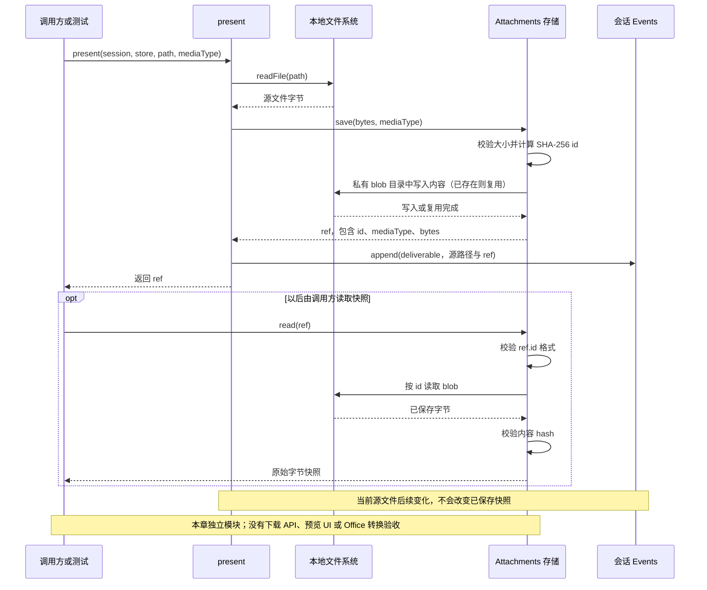

# 040 · 附件先落盘，交付保留当时快照

阶段：R05。唯一前置：完成第 039 步，继续同一个工程。

## 什么时候会用到这一页

Agent交付result.txt后，用户继续修改原文件，仍希望复现当时交付的内容。教程将文件字节按hash保存成快照；附件存储同时拒绝越界id和损坏内容。

### 这次数据怎么走

```text
present(session,store,path,mediaType) → readFile源内容 → Attachments.save按SHA256存私有blob → 追加deliverable引用 → 以后Attachments.read校验id和内容hash
```

### 对应时序图

从上往下读；实线箭头表示调用或发送，虚线箭头表示返回或事件通知。`opt`表示可选操作，`alt`表示不同结果，`loop`表示重复，`par`及其`and`分支表示并行；“未接入”及fixture说明按图中标注理解。



**当前接线位置：**040独立文件测试。051把present注册成工具，先用LocalFS.path检查源路径，再保存到host.home/attachments并追加deliverable。核对048～069实现，尚未提供附件上传/下载API、用户交付预览或blob读取界面；officeToPDF也未接成转换工具。050产品接线不包含这些能力。

## 这一步具体做什么

先写完src/attachments.mjs和测试，再运行 bun test ./tests/040-attachments.test.mjs。测试写first并present，随后把源文件改second；读取ref仍得到first，读取../secret非法id应拒绝。Office转换函数本章没有运行，不需要为了此测试安装LibreOffice。

需要本章新文件的操作，先按下面代码创建文件，再执行；不要在上一步尚不存在的接口上试错。

## 代码为什么放在这一层

Attachments是内容寻址blob存储，present是本教程的快照发布辅助。Office转换必须真正启动转换器，不能只改后缀。特别注意：本教程快照语义与原版present“声明一个可打开的源文件”不同，不能当作原版的简化等价版。

## 在哪里写、写什么

操作地点：终端中的 `$PROJECT`，编辑器打开同一个目录。只创建或替换下列文件，其他文件保留上一步版本。文件目录不存在先创建。

```sh
mkdir -p src
```

### 创建 `src/attachments.mjs`

````javascript
import { mkdir, writeFile, readFile, stat } from 'node:fs/promises'
import { createHash } from 'node:crypto'
import { join } from 'node:path'
import { execute } from './process.mjs'

/** 附件先持久化再把引用写入用户消息；下载还需要Host授权。 */
export class Attachments {
  constructor(root, maxBytes = 20 * 1024 * 1024) { this.root = root; this.maxBytes = maxBytes }
  async save(bytes, mediaType) {
    if (bytes.length > this.maxBytes || bytes.length === 0) throw Error('附件大小不合法')
    const id = createHash('sha256').update(bytes).digest('hex')
    await mkdir(this.root, { recursive: true })
    try { await writeFile(join(this.root, id), bytes, { flag: 'wx', mode: 0o600 }) } catch (error) { if (error.code !== 'EEXIST') throw error }
    return { id, mediaType, bytes: bytes.length }
  }
  async read(ref) {
    if (!/^[a-f0-9]{64}$/.test(ref.id)) throw Error('附件身份不合法')
    const bytes = await readFile(join(this.root, ref.id))
    if (createHash('sha256').update(bytes).digest('hex') !== ref.id) throw Error('附件完整性错误')
    return bytes
  }
}

/** 外部Office转换器的真实进程适配；没有软件就失败，不能用改后缀伪造PDF。 */
export async function officeToPDF(input, outputDirectory, signal, command = 'libreoffice') {
  const result = await execute({ command, args: ['--headless', '--convert-to', 'pdf', '--outdir', outputDirectory, input], timeout: 60_000 }, signal)
  if (result.code !== 0) throw Error('文档转换失败：' + result.output)
  return result
}

/** 交付保存内容快照与hash，后续文件变化不改变这个turn的交付事实。 */
export async function present(session, store, path, mediaType) {
  const ref = await store.save(await readFile(path), mediaType)
  session.append('deliverable', { path, ref })
  return ref
}
````

```sh
mkdir -p tests
```

### 创建 `tests/040-attachments.test.mjs`

````javascript
import { test } from 'bun:test'
import assert from 'node:assert/strict'
import { mkdtemp, writeFile, rm } from 'node:fs/promises'
import { tmpdir } from 'node:os'
import { join } from 'node:path'
import { Attachments, present } from '../src/attachments.mjs'
import { Events } from '../src/events.mjs'

test('真实内容寻址与交付快照不随原文件改变', async () => {
  const root = await mkdtemp(join(tmpdir(), 'own-attachment-'))
  try {
    const path = join(root, 'result.txt'), store = new Attachments(join(root, 'data')), session = new Events()
    await writeFile(path, 'first'); const ref = await present(session, store, path, 'text/plain')
    await writeFile(path, 'second')
    assert.equal((await store.read(ref)).toString(), 'first')
    await assert.rejects(store.read({ id: '../secret' }), /不合法/)
  } finally { await rm(root, { recursive: true, force: true }) }
})
````

## 运行命令与通过标准

```sh
cd "$PROJECT"
bun test ./tests/040-attachments.test.mjs
bun test
```

测试应1项通过，快照不随源变且非法id拒绝。没有验证图片类型/尺寸、上传授权、Office输出文件、网页下载或交付展示。officeToPDF仅检查进程返回码，不验证实际生成PDF。

**本步证据的范围：**040-attachments.test.mjs验证真实磁盘快照和非法id，未调用officeToPDF；因此不得把这一项测试报告为Office转换验收。

## VS Code：断在哪里、看什么

在src/attachments.mjs的const id=createHash(...)、writeFile(flag:"wx")和session.append("deliverable"...)打断点。F10看id为64位hex；保存结果返回present后，ref.bytes应为5；源改second后F11进read，磁盘blob内容应仍first且hash一致。不要在调试控制台读取真实凭据目录；本测试只用临时路径。

操作位置：VS Code 打开的是自己的 `$PROJECT`，断点也设在这里的源码，不在教材的 `steps` 目录。

上面的说明若指定CLI、子进程、页面或Electron附加调试，就先按该流程操作；下面这组步骤只用于本章测试入口。“当前测试”不会自动附加子进程，也不会命中浏览器或Electron中的断点。

变量只在所属作用域可见：停在方法内部时看this和参数；要看测试里的局部变量，先在“调用堆栈”选择对应测试帧。正在等待的异步调用者不一定保留可求值的帧，此时在测试调用前后加断点再看，不把未定义误判成业务状态丢失。

沿用第 000 步安装的 Bun 扩展与 `.vscode/launch.json`；本章列出替换配置时，使用本章完整版本。

1. 打开本步测试文件 `tests/040-attachments.test.mjs`，保持它为当前编辑器文件。
2. 在上面指定的函数内单击行号左侧设置断点。
3. “运行和调试”选择 **Bun：当前测试**，按 F5；它执行当前测试，工作目录固定为 PROJECT。
4. 在“变量 / 监视 / 调用堆栈 / 调试控制台”检查状态；F10 逐行执行，F11 进入函数，Shift+F11 返回，F5 继续，Shift+F5 停止。

验收：断点实际命中，能说出当前输入、状态和下一步；只看到进程启动不算完成。长时间暂停会影响真实取消、审批和网络超时，先检查时序，不删超时断言。修正后在集成终端运行 `bun test ./tests/040-attachments.test.mjs`，再运行 `bun test`，保留全部断言。

## 不看答案，确认自己能解释

闭卷说明内容hash、源path、mediaType三者分别标识什么；对比“保存交付快照”和“声明源文件供用户打开”在源文件修改后的结果。

完成后在 LEARNING.md 写一句实际结果和一个卡点。明天只重做这个卡点；第 3 天、第 7 天再做一次，能独立完成就继续下一页，不另开学习路线。

**再改一个条件验证：**安全练习：临时测试保存同样字节两次应得到相同id，再手动损坏本测试blob验证完整性错误。真实Office转换需明确安装并核验PDF输出，当前测试未覆盖，勿把退出码0当PDF正确。

## 与当前原版还差哪些

对照本仓库固定原版 `687f282e8625c6b8d11ff58211a90524be2e4317`；这里的“当前”指该本地基线，不是未经检查的上游最新版。

**这一页已经实现：**

- 20MiB非空大小限制
- SHA256内容寻址和已有blob复用
- 读回完整性检查
- 交付快照事件
- 真实Office进程适配函数

**原版仍有、或本步尚未对齐的部分：**

- 原版attachment/attachment-local有内容引用与媒体管理约定，Host负责授权和传输；本章只有简化blob。
- 原版tool-present是源路径交付声明，源修改后打开新内容，文档明确未做交付版本持久化；教程快照行为与原版不同。
- 原版office-to-pdf提供专门转换领域及消费流程；本章辅助函数未验证输出或接入Agent。
- 没有媒体解码、预览、文件引用与完整上传下载错误矩阵。

**原版对照位置：**

- [packages/attachment/attachment/README.zh.md](../../../deepseek-harness/packages/attachment/attachment/README.zh.md)
- [packages/attachment/attachment-local/README.zh.md](../../../deepseek-harness/packages/attachment/attachment-local/README.zh.md)
- [packages/deliverables/tool-present/README.zh.md](../../../deepseek-harness/packages/deliverables/tool-present/README.zh.md)
- [packages/document/office-to-pdf/README.zh.md](../../../deepseek-harness/packages/document/office-to-pdf/README.zh.md)

本步测试通过只证明上面的具体行为；完整差距仍看 [COVERAGE.md](../COVERAGE.md)，不以文件数量、同名类或后面出现另一个模块代替接线证据。

下一步：[第 041 步](041.md)
