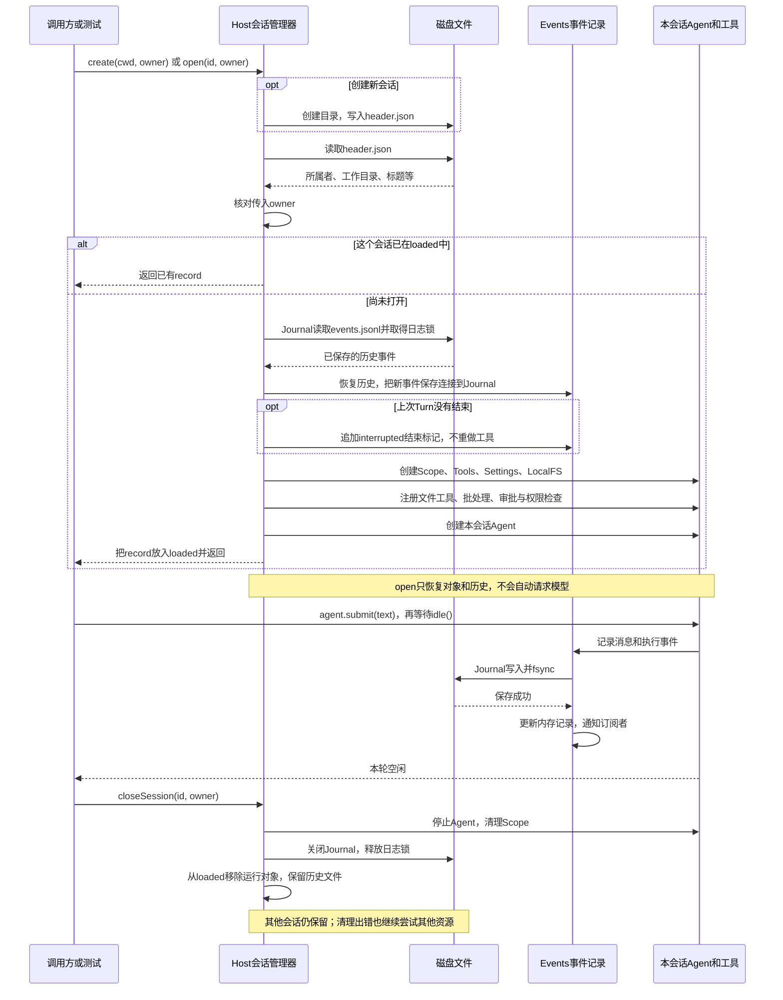

# 041 · 统一管理多个Agent会话，保存历史，并在重新打开时恢复

阶段：R05。唯一前置：完成第 040 步，继续同一个工程。

<!-- harness-own-links:start -->
## 当前练习工程文件

以下链接指向 `harness-own` 的当前累计版本；本课下方的完整代码仍保留当步版本，二者可能不同。

[打开练习工程说明](../../../harness-own/README.md)

| 本课文件 | 当前练习工程文件 |
| --- | --- |
| `src/host.mjs` | 尚未合入 harness-own |
| `tests/041-host.test.mjs` | 尚未合入 harness-own |

<!-- harness-own-links:end -->

## 什么时候会用到这一页

你同时打开Alice和Bob两个会话。给Alice发消息后关闭她的会话，Bob的会话仍留在管理器中；重新打开Alice的会话，还能看到保存过的回复。Host就是统一负责这些创建、列出、打开和关闭操作的会话管理器。

### 这次数据怎么走

```text
Host.create创建会话目录并写header.json → Host.open核对owner，已打开就复用 → Journal读取events.jsonl恢复历史 → 为这份会话创建Agent、工具、审批和资源清理对象 → agent.submit提交任务并持续写日志 → closeSession关闭运行对象但保留文件 → 下次open从文件重新创建会话对象
```

### 对应时序图

从上往下读；实线箭头表示调用或发送，虚线箭头表示返回或事件通知。`opt`表示可选操作，`alt`表示不同结果，`loop`表示重复，`par`及其`and`分支表示并行；“未接入”及fixture说明按图中标注理解。



**当前接线位置：**本章把文件工具、批处理、权限审批、Agent和Journal接进同一个会话管理器。open返回record，其中agent负责执行、session提供事件、scope清理资源、journal管理日志。后续043～049的控制接口、SDK、ACP和Web使用这个入口，051再增加部分工具；前面写过但未在open中注册的能力不会自动启用。

## 这一步具体做什么

先按本章完整代码创建src/host.mjs和tests/041-host.test.mjs，再运行bun test ./tests/041-host.test.mjs。测试使用a/b表示两个会话所属者：关闭a后检查只剩b，重开a后检查旧回复仍在；第二项模拟写盘失败，检查两个会话仍尝试清理资源。随后执行下方的小演示，亲眼看关闭、重新打开和新建管理器后的输出。默认OfflineModel只生成离线回复，不请求DeepSeek。

需要本章新文件的操作，先按下面代码创建文件，再执行；不要在上一步尚不存在的接口上试错。

## 代码为什么放在这一层

Host把前面实现的Agent、事件记录、日志文件、工具、权限和资源清理接成统一的会话入口。header.json保存所属者、标题、工作目录等信息；events.jsonl保存对话和执行事件。持久保存的是这些文件，Host、Agent、Scope等对象在关闭后释放，重新打开时再创建；open不会自动请求模型，也不会自动继续上次的工具。

## 先把Host看成“会话管理器”

前面的步骤已经分别写过Agent、工具、权限审批、日志和资源清理。本章把它们接成一个入口：调用方给出会话id或创建参数，就能拿到一份可执行任务的会话对象，不必每次自己重复new所有模块。

“持久Host”容易让人误以为Host对象能一直活着。准确说法是：**对话和会话信息保存到文件；Host、Agent、Tools、Scope等对象在进程内存里，关闭后释放，重新打开时再创建。** Host在本章是同一个Bun进程里的JavaScript对象，不会自己启动服务器或给每个会话创建子进程。

### 内存里有什么，磁盘上有什么

```text
Bun进程里的Host
└─ loaded：sessionId → record
   ├─ Alice的record
   │  ├─ header：所属者、工作目录、标题
   │  ├─ agent：接收并执行Alice的任务
   │  ├─ session：Events事件历史与订阅
   │  ├─ journal：Alice日志的文件句柄与锁
   │  └─ tools / fs / settings / approvals / scope
   └─ Bob的record
      └─ 另外一套运行对象；关闭Alice时不遍历关闭Bob

传给new Host(home)的数据目录
└─ sessions/
   ├─ Alice的会话id/
   │  ├─ header.json
   │  └─ events.jsonl
   └─ Bob的会话id/
      ├─ header.json
      └─ events.jsonl
```

表中的Alice、Bob是教学用的所属者标记。本章传入的owner只是与header.owner比较，不是登录认证。两个会话也可以使用同一个cwd，所以“不同会话对象和日志”不代表它们访问的工作区文件彼此隔离。

| 调用 | 具体做什么 | 返回或保留什么 |
| --- | --- | --- |
| new Host(home) | 准备数据目录和当前已打开会话的Map。 | 一个会话管理器；此时没有自动打开历史会话。 |
| host.create({cwd, owner}) | 生成会话id，写header.json，再调用open组装会话。 | record；用record.agent提交任务。 |
| host.open(id, owner) | 核对所属者；已打开就复用，未打开就读取日志并重新创建运行对象。 | 当前可用的record；不会因open自动请求模型。 |
| host.list(owner) | 扫描会话信息，按所属者和归档条件过滤、排序、分页。 | header列表；不需要启动Agent。 |
| host.metadata(id, owner, patch) | 修改标题或归档标记并保存header.json。 | 更新的header；这些信息不作为聊天消息。 |
| host.closeSession(id, owner) | 停止Agent、清理Scope、关闭Journal并从loaded移除。 | 历史文件保留；之后仍可open。 |
| host.close() | 尝试关闭全部已打开会话。 | 释放运行资源；某项失败也继续尝试其他清理。 |

### 一次提交究竟走哪条路

```text
record.agent.submit("你好")
→ Agent调用已有Loop执行任务
→ Loop追加用户消息、模型回答、工具等事件
→ Events.persist调用Journal.append
→ 写入events.jsonl并fsync
→ 更新内存事件并通知订阅者
→ await record.agent.idle()等这次执行结束
```

header.json只负责会话信息；events.jsonl才记录对话和执行过程。Host不再实现第二套模型循环，而是创建并连接前面已有的Agent、Events和Journal。

open时会重新创建Settings等对象，本章权限默认重新变成ask；它恢复的是已保存事件，不是原样还原所有临时内存。若发现旧Turn没有结束，本章只追加interrupted结束标记，不补齐全部缺失工具结果、不重试工具，也不能据此判断文件等外部操作是否已经完成。

### 写完本章源码后，按顺序跑一次

先完成下方“在哪里写、写什么”的两个文件，再回到这里操作。编辑和命令都在你从000开始创建的同一个PROJECT里，教材仓库只用于阅读。下面的命令不创建额外源码文件，也不需要API Key；数据保存在PROJECT/tmp下本次随机生成的目录，命令末尾会打印位置。

```sh
cd "$PROJECT"
mkdir -p tmp
bun --eval '
import assert from "node:assert/strict"
import { mkdtempSync } from "node:fs"
import { resolve, join } from "node:path"
import { Host } from "./src/host.mjs"

// 每次生成独立数据目录，保留文件供本次演示后查看。
const home = mkdtempSync(join(resolve("tmp"), "host-041-"))
let host = new Host(home)

try {
  // 同一个管理器打开两个会话；owner只是本教程的所属者标记。
  const alice = host.create({ cwd: process.cwd(), owner: "alice" })
  const bob = host.create({ cwd: process.cwd(), owner: "bob" })
  const sessionId = alice.header.id
  console.log("同时打开的会话数：", host.loaded.size)
  assert.equal(host.loaded.size, 2)

  // Agent负责执行，Events和Journal负责保存消息。
  alice.agent.submit("Alice的第一条消息")
  await alice.agent.idle()

  // 关闭Alice的运行对象，保留她的历史文件。
  await host.closeSession(sessionId, "alice")
  console.log("关闭Alice后会话数：", host.loaded.size)
  assert.equal(host.loaded.size, 1)

  // 给Bob继续提交任务，确认他的Agent仍能工作。
  bob.agent.submit("Bob继续工作")
  await bob.agent.idle()
  const bobReply = bob.session.read().findLast(event => event.type === "message/assistant")
  console.log("Bob的回复：", bobReply.data.content)
  assert.equal(bobReply.data.content, "[离线演示] Bob继续工作")

  // open创建新的Alice会话对象，从磁盘找回旧消息。
  const reopened = host.open(sessionId, "alice")
  const oldReply = reopened.session.read().findLast(event => event.type === "message/assistant")
  console.log("重新打开Alice后的旧回复：", oldReply.data.content)
  assert.equal(oldReply.data.content, "[离线演示] Alice的第一条消息")
  assert.notEqual(reopened.agent, alice.agent)

  // 先正常关闭旧管理器，再新建管理器；仍使用同一个数据目录。
  await host.close()
  host = new Host(home)
  assert.equal(host.loaded.size, 0)
  assert.equal(host.list("alice").length, 1)
  console.log("只列出会话，尚未打开：", host.loaded.size)
  assert.equal(host.loaded.size, 0)

  // 新管理器不能使用旧Map，只能重新读取磁盘文件。
  const restored = host.open(sessionId, "alice")
  const restoredReply = restored.session.read().findLast(event => event.type === "message/assistant")
  console.log("新建管理器后的旧回复：", restoredReply.data.content)
  assert.equal(restoredReply.data.content, oldReply.data.content)
  console.log("本次数据目录：", home)
  console.log("Alice的会话id：", sessionId)
} finally {
  // 正常退出会释放日志句柄和锁，历史文件继续保留。
  await host.close()
}
'
```

应看到下面这些固定输出，最后另有本次动态生成的数据目录和会话id：

```text
同时打开的会话数： 2
关闭Alice后会话数： 1
Bob的回复： [离线演示] Bob继续工作
重新打开Alice后的旧回复： [离线演示] Alice的第一条消息
只列出会话，尚未打开： 0
新建管理器后的旧回复： [离线演示] Alice的第一条消息
```

最后调用host.close释放锁，但保留演示文件。可以在编辑器里按打印出的目录找到header.json和events.jsonl；不要再使用已经关闭的record.agent，重新打开后应使用新返回的record。

本演示在**同一个Bun进程**里，先正常关闭旧Host，再new Host读取同一目录；它能展示恢复不依赖旧loaded Map，但不是新进程重启、强杀崩溃恢复或跨进程并发写入的验收。现有两个测试的范围也在本章“本步证据的范围”中单独说明。

### 后续界面为什么要经过这个入口

后面的SDK、ACP和Web负责把各自收到的请求转换成这些操作：

```text
创建会话 → Host.create
发送任务 → record.agent.submit
等待完成 → record.agent.idle
取消活动 → record.agent.cancel
回答审批 → record.approvals.answer(record.session.id, requestId, allowed)
关闭会话 → Host.closeSession
```

本章open明确注册了文件工具、批处理和权限审批。前面写过的终端、MCP、LSP、子Agent等能力，没有在这里注册就不会自动出现；后续步骤需要继续接入。看这一页时，先能说清“谁创建对象、谁执行任务、谁写文件、谁关闭资源”，再对照代码。

## 在哪里写、写什么

操作地点：终端中的 `$PROJECT`，编辑器打开同一个目录。只创建或替换下列文件，其他文件保留上一步版本。文件目录不存在先创建。

```sh
mkdir -p src
```

### 创建 `src/host.mjs`

````javascript
import { mkdirSync, writeFileSync, readFileSync, readdirSync } from 'node:fs'
import { resolve, join } from 'node:path'
import { setTimeout as delay } from 'node:timers/promises'
import { Events, id } from './events.mjs'
import { Journal } from './journal.mjs'
import { Agent } from './agent.mjs'
import { Scope } from './scope.mjs'
import { Settings } from './config.mjs'
import { Tools } from './tools.mjs'
import { LocalFS } from './filesystem.mjs'
import { fileTools } from './file-tools.mjs'
import { Approvals } from './approval.mjs'
import { permissionGuard } from './permissions.mjs'
import { installBatch } from './batch.mjs'
import { messages } from './projection.mjs'

/** 离线演示提供方明确标注用途；它只替换外部模型，所有宿主执行走真实实现。 */
export class OfflineModel {
  async *stream(request) {
    const last = request.messages.at(-1)
    if (last?.content === '/slow') { yield { kind: 'text', text: 'partial' }; await delay(60_000, undefined, { signal: request.signal }); return }
    if (last?.role === 'tool') yield { kind: 'text', text: JSON.stringify(last.content) }
    else {
      const match = String(last?.content ?? '').match(/^\/tool ([a-zA-Z0-9_]+) (.+)$/s)
      if (match) { yield { kind: 'tool', id: id('call'), name: match[1], arguments: JSON.parse(match[2]) }; yield { kind: 'finish', reason: 'tools' }; return }
      yield { kind: 'text', text: '[离线演示] ' + (last?.content ?? '') }
    }
    yield { kind: 'finish', reason: 'stop' }
  }
}

/** Host组合现有领域；UI、ACP与SDK都不能在外层另写一套Loop。 */
export class Host {
  loaded = new Map()
  constructor(home, modelFactory = () => new OfflineModel()) {
    this.home = resolve(home); this.modelFactory = modelFactory
    mkdirSync(join(this.home, 'sessions'), { recursive: true })
  }
  /** 用户授权后的cwd成为工作区边界，不从模型文本猜。 */
  create({ cwd, owner = 'local', title = '新会话' }) {
    const sessionId = id('session'), root = join(this.home, 'sessions', sessionId)
    mkdirSync(root)
    const header = { id: sessionId, owner, title, cwd: resolve(cwd), createdAt: Date.now(), archived: false }
    writeFileSync(join(root, 'header.json'), JSON.stringify(header), { flag: 'wx' })
    return this.open(sessionId, owner)
  }
  /** 每次读取/控制都校验owner，不能只在UI隐藏按钮。 */
  header(sessionId, owner) {
    if (!/^session_[a-f0-9-]+$/.test(sessionId)) throw Error('会话身份不合法')
    const header = JSON.parse(readFileSync(join(this.home, 'sessions', sessionId, 'header.json'), 'utf8'))
    if (header.owner !== owner) throw Error('没有会话权限')
    return header
  }
  /** 冷列表只读metadata，不恢复Agent或请求模型。 */
  list(owner, { offset = 0, limit = 50, archived = false } = {}) {
    return readdirSync(join(this.home, 'sessions')).map(name => {
      try { return this.header(name, owner) } catch { return undefined }
    }).filter(row => row && row.archived === archived).sort((a, b) => b.createdAt - a.createdAt || a.id.localeCompare(b.id)).slice(offset, offset + Math.min(limit, 100))
  }
  /** 恢复时中断的工具结果不能假定未执行，也不自动重做。 */
  open(sessionId, owner = 'local') {
    const header = this.header(sessionId, owner)
    if (this.loaded.has(sessionId)) return this.loaded.get(sessionId)
    const journal = new Journal(join(this.home, 'sessions', sessionId, 'events.jsonl'))
    const session = new Events(sessionId, event => journal.append(event)); session.records = structuredClone(journal.records)
    const lastStart = session.records.findLastIndex(event => event.type === 'turn/start'), lastEnd = session.records.findLastIndex(event => event.type === 'turn/end')
    if (lastStart > lastEnd) session.append('turn/end', { turnId: session.records[lastStart].data.turnId, reason: 'interrupted', toolOutcome: 'UNKNOWN_DO_NOT_REPLAY' })
    const scope = new Scope(), tools = new Tools(), settings = new Settings({ permission: 'ask' }), fs = new LocalFS(header.cwd)
    fileTools(scope, tools, fs); installBatch(tools)
    const approvals = new Approvals(event => session.append(event.type, event))
    tools.guard = permissionGuard(settings, approvals)
    const agent = new Agent(session, this.modelFactory(header), tools, settings)
    const record = { header, session, journal, agent, tools, scope, settings, approvals, fs }
    this.loaded.set(sessionId, record)
    return record
  }
  /** 产品metadata变更不会混入模型对话。 */
  metadata(sessionId, owner, patch) {
    const header = this.header(sessionId, owner)
    if (patch.title !== undefined) header.title = String(patch.title)
    if (patch.archived !== undefined) header.archived = !!patch.archived
    writeFileSync(join(this.home, 'sessions', sessionId, 'header.json'), JSON.stringify(header))
    if (this.loaded.has(sessionId)) this.loaded.get(sessionId).header = header
    return header
  }
  /** 一个会话关闭不影响别的会话，日志保留可恢复。 */
  async closeSession(sessionId, owner) {
    this.header(sessionId, owner)
    const record = this.loaded.get(sessionId)
    if (!record) return
    const errors = []
    try { await record.agent.close() } catch (error) { errors.push(error) }
    try { await record.scope.close() } catch (error) { errors.push(error) }
    try { record.journal.close() } catch (error) { errors.push(error) }
    this.loaded.delete(sessionId)
    if (errors.length) throw new AggregateError(errors, '会话退出失败，其他资源已继续清理')
  }
  async close() {
    const results = await Promise.allSettled([...this.loaded.values()].map(record => this.closeSession(record.header.id, record.header.owner)))
    const errors = results.filter(result => result.status === 'rejected').map(result => result.reason)
    if (errors.length) throw new AggregateError(errors, 'Host退出有错误，已尝试关闭全部会话')
  }
}
````

```sh
mkdir -p tests
```

### 创建 `tests/041-host.test.mjs`

````javascript
import { test } from 'bun:test'
import assert from 'node:assert/strict'
import { mkdtempSync, rmSync } from 'node:fs'
import { tmpdir } from 'node:os'
import { join } from 'node:path'
import { Host } from '../src/host.mjs'

test('现有模块组合成真实持久Host，双会话隔离、关闭与恢复', async () => {
  const root = mkdtempSync(join(tmpdir(), 'own-host-')), host = new Host(root)
  try {
    const a = host.create({ cwd: root, owner: 'a' }), b = host.create({ cwd: root, owner: 'b' })
    a.agent.submit('hi'); await a.agent.idle()
    assert.throws(() => host.open(a.header.id, 'b'), /权限/)
    await host.closeSession(a.header.id, 'a')
    assert.equal(host.loaded.size, 1)
    const restored = host.open(a.header.id, 'a')
    assert.ok(restored.session.read().some(event => event.type === 'message/assistant'))
    assert.equal(host.list('a').length, 1)
  } finally { await host.close(); rmSync(root, { recursive: true, force: true }) }
})

test('真实持久化失败后，退出仍清理所有会话与资源', async () => {
  const root = mkdtempSync(join(tmpdir(), 'own-host-failure-'))
  let broken
  const host = new Host(root, () => ({ async *stream() {
    yield { kind: 'text', text: 'partial' }
    broken.session.persist = () => { throw Error('disk full') }
    yield { kind: 'finish', reason: 'stop' }
  } }))
  let disposed = 0
  try {
    broken = host.create({ cwd: root }); broken.scope.own(() => disposed++)
    const other = host.create({ cwd: root }); other.scope.own(() => disposed++)
    broken.agent.submit('fail')
    await assert.rejects(broken.agent.idle(), /disk full/)
    await assert.rejects(host.close(), AggregateError)
    assert.equal(disposed, 2); assert.equal(host.loaded.size, 0)
  } finally { await host.close(); rmSync(root, { recursive: true, force: true }) }
})
````

## 运行命令与通过标准

```sh
cd "$PROJECT"
bun test ./tests/041-host.test.mjs
bun test
```

现有两项测试通过：不匹配的owner被拒绝；在同一个Host里关闭再打开会话，仍能读取旧助手消息；模拟persist抛出disk full后，仍尝试清理两个会话的Scope，清空loaded并汇总错误。下方额外演示还应打印关闭前2、关闭Alice后1、Bob继续工作后的回复、重新打开和新建管理器后相同的Alice旧回复。它不代表强杀进程恢复、完整工具结果补齐或原版日志兼容已经实现。

**本步证据的范围：**041-host.test.mjs使用临时目录真实写入日志和运行离线Agent。第一项在同一个Host对象中关闭后重开，检查助手消息和owner拒绝；第二项把persist替换成抛出disk full的函数，检查失败后仍清理两个Scope。没有实际写满磁盘，也没有启动新进程或强杀进程。下方演示补充展示Bob继续提交任务及正常关闭后新建Host读取旧日志。

## VS Code：断在哪里、看什么

VS Code打开自己的PROJECT，使用Bun：当前测试运行tests/041-host.test.mjs。在src/host.mjs的this.header、new Journal、if (this.loaded.has(sessionId))、this.loaded.set和closeSession里的各个try处设断点。停在测试帧时看host.loaded.size由2变1；停在open方法里看sessionId、owner、journal.records和新建的agent。原测试用a/b，演示命令用alice/bob。恢复历史后不会自动进入OfflineModel.stream，下一次submit才会触发。故障测试F10经过每个catch，观察errors积累后仍执行Scope与Journal清理，最后loaded.size为0。

操作位置：VS Code 打开的是自己的 `$PROJECT`，断点也设在这里的源码，不在教材的 `steps` 目录。

上面的说明若指定CLI、子进程、页面或Electron附加调试，就先按该流程操作；下面这组步骤只用于本章测试入口。“当前测试”不会自动附加子进程，也不会命中浏览器或Electron中的断点。

变量只在所属作用域可见：停在方法内部时看this和参数；要看测试里的局部变量，先在“调用堆栈”选择对应测试帧。正在等待的异步调用者不一定保留可求值的帧，此时在测试调用前后加断点再看，不把未定义误判成业务状态丢失。

沿用第 000 步安装的 Bun 扩展与 `.vscode/launch.json`；本章列出替换配置时，使用本章完整版本。

1. 打开本步测试文件 `tests/041-host.test.mjs`，保持它为当前编辑器文件。
2. 在上面指定的函数内单击行号左侧设置断点。
3. “运行和调试”选择 **Bun：当前测试**，按 F5；它执行当前测试，工作目录固定为 PROJECT。
4. 在“变量 / 监视 / 调用堆栈 / 调试控制台”检查状态；F10 逐行执行，F11 进入函数，Shift+F11 返回，F5 继续，Shift+F5 停止。

验收：断点实际命中，能说出当前输入、状态和下一步；只看到进程启动不算完成。长时间暂停会影响真实取消、审批和网络超时，先检查时序，不删超时断言。修正后在集成终端运行 `bun test ./tests/041-host.test.mjs`，再运行 `bun test`，保留全部断言。

## 不看答案，确认自己能解释

合上资料，讲出Host的create、open、list、closeSession各负责什么；画出内存对象和磁盘文件两部分；解释为什么删除loaded条目不等于清理资源，以及为什么恢复历史不等于自动继续任务。

完成后在 LEARNING.md 写一句实际结果和一个卡点。明天只重做这个卡点；第 3 天、第 7 天再做一次，能独立完成就继续下一页，不另开学习路线。

**再改一个条件验证：**在测试临时home里修改会话title，再调用list查看，确认只改变header.json而不请求模型。把程序正常关闭后重新创建Host并传入同一个home，按保存的sessionId打开旧会话；只使用自己的演示目录，不直接处理真实历史的崩溃锁。

## 与当前原版还差哪些

对照本仓库固定原版 `687f282e8625c6b8d11ff58211a90524be2e4317`；这里的“当前”指该本地基线，不是未经检查的上游最新版。

**这一页已经实现：**

- 每个会话保存header.json和events.jsonl
- 通过Host方法核对owner，按所属者列出会话并分页
- 为每个打开的会话组装Agent、文件工具、权限审批和批处理
- 发现上次Turn未结束时，补一个interrupted结束标记
- 关闭单个或全部会话；某项清理失败后仍尝试其他清理

**原版仍有、或本步尚未对齐的部分：**

- 本章使用自己的header.json与format=1事件，不兼容原版当前V4日志及历史迁移；原版Agent、Session、Loader、持久化和投影控制器也不是本章这一个Host类。
- 本章列表扫描header文件；Journal已有wx独占锁文件，但没有完整处理崩溃遗留锁、并发激活和跨进程协调。关闭再打开测试不是强杀崩溃恢复测试。
- owner是Host调用参数与header字段的匹配检查，不是登录认证、文件系统沙箱或进程隔离。两个会话可以使用相同cwd；本章默认只注册文件工具等明确列出的能力，未接入完整插件、模型目录和媒体能力。
- open仅恢复事件并重建运行对象，Settings重新从默认permission=ask开始；不会恢复所有临时内存状态，也没有实现原版缺失tool/result的补齐和副作用核查。

**原版对照位置：**

- [packages/core/agent/README.zh.md](../../../deepseek-harness/packages/core/agent/README.zh.md)
- [packages/core/session/README.zh.md](../../../deepseek-harness/packages/core/session/README.zh.md)
- [packages/api/session-controller/README.zh.md](../../../deepseek-harness/packages/api/session-controller/README.zh.md)
- [packages/session/session-persistence-jsonl/README.zh.md](../../../deepseek-harness/packages/session/session-persistence-jsonl/README.zh.md)
- [packages/session/session-projection-cache/README.zh.md](../../../deepseek-harness/packages/session/session-projection-cache/README.zh.md)

本步测试通过只证明上面的具体行为；完整差距仍看 [COVERAGE.md](../COVERAGE.md)，不以文件数量、同名类或后面出现另一个模块代替接线证据。

下一步：[第 042 步](042.md)
