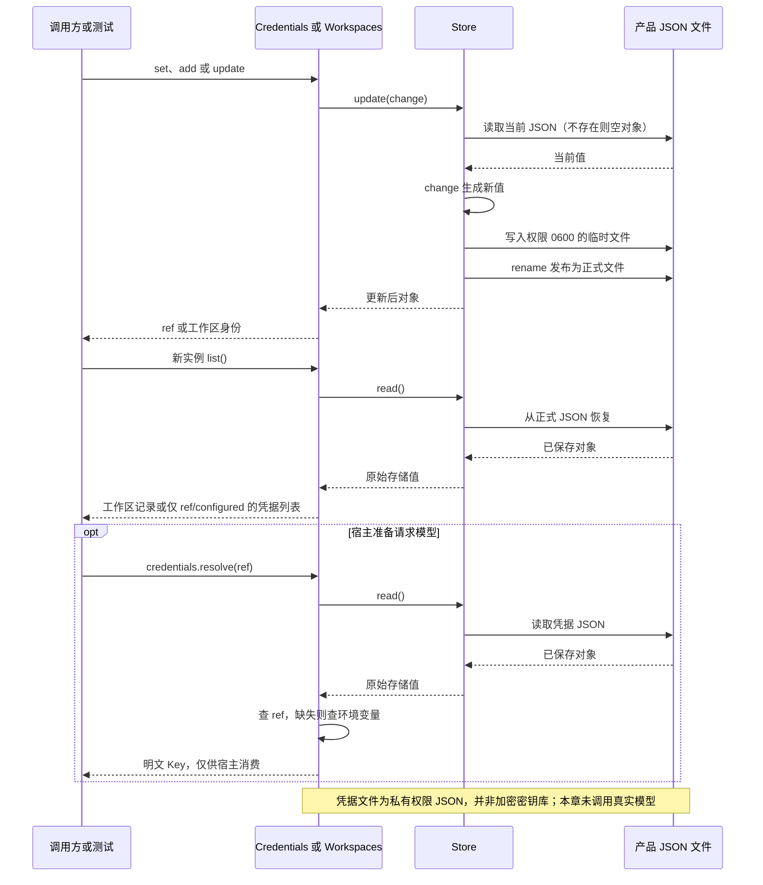

# 042 · 产品数据和秘密不混进对话

阶段：R06。唯一前置：完成第 041 步，继续同一个工程。

<!-- harness-own-links:start -->
## 当前练习工程文件

以下链接指向 `harness-own` 的当前累计版本；本课下方的完整代码仍保留当步版本，二者可能不同。

[打开练习工程说明](../../../harness-own/README.md)

| 本课文件 | 当前练习工程文件 |
| --- | --- |
| `src/storage.mjs` | 尚未合入 harness-own |
| `tests/042-storage.test.mjs` | 尚未合入 harness-own |

<!-- harness-own-links:end -->

## 什么时候会用到这一页

用户保存API Key后，设置页只应看到“已配置”，不能拿到明文；工作区列表重启后仍保留名称和归档状态，且这些产品设置不应混进模型对话。

### 这次数据怎么走

```text
Credentials/Workspaces → Store.update读现值 → 修改对象 → 私有临时JSON文件 → rename发布 → 新实例Store.read恢复；凭据list只给ref/configured，resolve由宿主消费
```

### 对应时序图

从上往下读；实线箭头表示调用或发送，虚线箭头表示返回或事件通知。`opt`表示可选操作，`alt`表示不同结果，`loop`表示重复，`par`及其`and`分支表示并行；“未接入”及fixture说明按图中标注理解。



**当前接线位置：**042是独立存储测试；050 product(host)真实创建Credentials/Workspaces并注册设置API，deepseek路由在模型请求时调用credentials.resolve(keyRef)。工作区列表也接入产品API；但Workspaces记录仍没有原版的会话成员关系和目录有效性语义。

## 这一步具体做什么

写完src/storage.mjs及本章测试，再运行 bun test ./tests/042-storage.test.mjs。测试用虚构secret-never-send保存凭据，检查list序列化不含它；新Credentials实例resolve可取回；再归档临时工作区，新Workspaces实例看到archived=true。不要把真实Key填进测试。

需要本章新文件的操作，先按下面代码创建文件，再执行；不要在上一步尚不存在的接口上试错。

## 代码为什么放在这一层

Store是产品数据文件，不是模型会话日志。CredentialRef用于引用秘密，resolve仍能读取明文，说明“列表不泄露”不等于“同一OS用户无法读文件”。Workspaces目前只是一张带路径的记录表。

## 在哪里写、写什么

操作地点：终端中的 `$PROJECT`，编辑器打开同一个目录。只创建或替换下列文件，其他文件保留上一步版本。文件目录不存在先创建。

```sh
mkdir -p src
```

### 创建 `src/storage.mjs`

````javascript
import { mkdirSync, readFileSync, writeFileSync, renameSync } from 'node:fs'
import { join, dirname, resolve } from 'node:path'
import { randomUUID } from 'node:crypto'

/** 持久产品数据与Session事实分开存；写入使用临时文件+原子替换。 */
export class Store {
  constructor(path) { this.path = path; mkdirSync(dirname(path), { recursive: true }) }
  read() { try { return JSON.parse(readFileSync(this.path, 'utf8')) } catch (error) { if (error.code === 'ENOENT') return {}; throw error } }
  update(change) { const value = change(this.read()), temporary = this.path + '.' + randomUUID(); writeFileSync(temporary, JSON.stringify(value), { mode: 0o600 }); renameSync(temporary, this.path); return value }
}

/** CredentialRef对UI可见，明文Key只在宿主提供方调用前解析。 */
export class Credentials {
  constructor(path) { this.store = new Store(path) }
  set(name, secret) { if (typeof secret !== 'string' || !secret) throw Error('凭据为空'); this.store.update(value => ({ ...value, [name]: secret })); return { ref: name, configured: true } }
  list() { return Object.keys(this.store.read()).map(ref => ({ ref, configured: true })) }
  resolve(ref) { const value = this.store.read()[ref] ?? process.env[ref]; if (!value) throw Error('缺少凭据：' + ref); return value }
  remove(ref) { this.store.update(value => { delete value[ref]; return value }) }
}

/** 工作区是持久实体；有效cwd不再是一个全局常量。 */
export class Workspaces {
  constructor(path) { this.store = new Store(path) }
  add(path, title) { const id = randomUUID(); this.store.update(value => ({ ...value, [id]: { id, path: resolve(path), title, archived: false } })); return id }
  list() { return Object.values(this.store.read()) }
  update(id, patch) { this.store.update(value => { if (!value[id]) throw Error('未知工作区'); value[id] = { ...value[id], title: patch.title ?? value[id].title, archived: patch.archived ?? value[id].archived }; return value }) }
}
````

```sh
mkdir -p tests
```

### 创建 `tests/042-storage.test.mjs`

````javascript
import { test } from 'bun:test'
import assert from 'node:assert/strict'
import { mkdtempSync, rmSync } from 'node:fs'
import { join } from 'node:path'
import { tmpdir } from 'node:os'
import { Credentials, Workspaces } from '../src/storage.mjs'

test('凭据描述不泄露明文，产品数据真实重启恢复', () => {
  const root = mkdtempSync(join(tmpdir(), 'own-storage-'))
  try {
    const credentials = new Credentials(join(root, 'credentials.json'))
    credentials.set('MODEL_KEY', 'secret-never-send')
    assert.ok(!JSON.stringify(credentials.list()).includes('secret-never-send'))
    assert.equal(new Credentials(join(root, 'credentials.json')).resolve('MODEL_KEY'), 'secret-never-send')
    const workspaces = new Workspaces(join(root, 'workspaces.json')), id = workspaces.add(root, 'demo')
    workspaces.update(id, { archived: true })
    assert.equal(new Workspaces(join(root, 'workspaces.json')).list()[0].archived, true)
  } finally { rmSync(root, { recursive: true, force: true }) }
})
````

## 运行命令与通过标准

```sh
cd "$PROJECT"
bun test ./tests/042-storage.test.mjs
bun test
```

测试应1项通过，描述中无明文、重建实例能恢复凭据与工作区归档。没有验证并发更新不丢失、系统钥匙串、原版领域schema、目录存在性、跨进程锁或工作区会话成员。

**本步证据的范围：**042-storage.test.mjs使用真实临时JSON文件和虚构secret，验证脱敏列表及新实例恢复；不验证真实Key请求、并发或数据库事务。

## VS Code：断在哪里、看什么

在src/storage.mjs的Store.update与Credentials.list/resolve打断点。只使用测试假secret；F10到rename看temporary与目标路径不同，list返回对象只有ref/configured；新实例resolve应读磁盘。Workspaces.add后检查id与resolve后的绝对path，update后archived=true。不在调试日志打印真实凭据值。

操作位置：VS Code 打开的是自己的 `$PROJECT`，断点也设在这里的源码，不在教材的 `steps` 目录。

上面的说明若指定CLI、子进程、页面或Electron附加调试，就先按该流程操作；下面这组步骤只用于本章测试入口。“当前测试”不会自动附加子进程，也不会命中浏览器或Electron中的断点。

变量只在所属作用域可见：停在方法内部时看this和参数；要看测试里的局部变量，先在“调用堆栈”选择对应测试帧。正在等待的异步调用者不一定保留可求值的帧，此时在测试调用前后加断点再看，不把未定义误判成业务状态丢失。

沿用第 000 步安装的 Bun 扩展与 `.vscode/launch.json`；本章列出替换配置时，使用本章完整版本。

1. 打开本步测试文件 `tests/042-storage.test.mjs`，保持它为当前编辑器文件。
2. 在上面指定的函数内单击行号左侧设置断点。
3. “运行和调试”选择 **Bun：当前测试**，按 F5；它执行当前测试，工作目录固定为 PROJECT。
4. 在“变量 / 监视 / 调用堆栈 / 调试控制台”检查状态；F10 逐行执行，F11 进入函数，Shift+F11 返回，F5 继续，Shift+F5 停止。

验收：断点实际命中，能说出当前输入、状态和下一步；只看到进程启动不算完成。长时间暂停会影响真实取消、审批和网络超时，先检查时序，不删超时断言。修正后在集成终端运行 `bun test ./tests/042-storage.test.mjs`，再运行 `bun test`，保留全部断言。

## 不看答案，确认自己能解释

闭卷说明ref/configured与secret分别允许谁读取；画出临时文件→rename为何避免半份JSON，但不能保证两个进程读改写不互相覆盖。

完成后在 LEARNING.md 写一句实际结果和一个卡点。明天只重做这个卡点；第 3 天、第 7 天再做一次，能独立完成就继续下一页，不另开学习路线。

**再改一个条件验证：**安全练习：在测试临时目录执行credentials.remove，确认list不再含该引用；给工作区加title再恢复。多写者事务、OS钥匙串与真实工作区成员关系目前未实现。

## 与当前原版还差哪些

对照本仓库固定原版 `687f282e8625c6b8d11ff58211a90524be2e4317`；这里的“当前”指该本地基线，不是未经检查的上游最新版。

**这一页已经实现：**

- 临时文件加rename发布JSON
- 凭据列表脱敏引用、删除与resolve
- 工作区路径规范化/标题/归档记录
- 重新实例化恢复

**原版仍有、或本步尚未对齐的部分：**

- 原版storage有领域描述符、版本/迁移、single/per-record、JSON/SQLite后端；本章裸对象读改写没有这些约定。
- 原版credentials-local有固定环境分层、watch重载、异步写锁与describe来源；教程只有文件优先再process.env。
- 原版workspace维护有序项目、目录有效性、会话成员与移除语义；教程记录表没有绑定Session。
- 原版本地凭据同UID可读且未提供OS钥匙串，不能把这项共同限制错误描述为原版已经解决。

**原版对照位置：**

- [packages/storage/storage/README.zh.md](../../../deepseek-harness/packages/storage/storage/README.zh.md)
- [packages/storage/storage-domain/README.zh.md](../../../deepseek-harness/packages/storage/storage-domain/README.zh.md)
- [packages/storage/storage-json/README.zh.md](../../../deepseek-harness/packages/storage/storage-json/README.zh.md)
- [packages/credentials/credentials-local/README.zh.md](../../../deepseek-harness/packages/credentials/credentials-local/README.zh.md)
- [packages/workspace/workspace/README.zh.md](../../../deepseek-harness/packages/workspace/workspace/README.zh.md)

本步测试通过只证明上面的具体行为；完整差距仍看 [COVERAGE.md](../COVERAGE.md)，不以文件数量、同名类或后面出现另一个模块代替接线证据。

下一步：[第 043 步](043.md)
