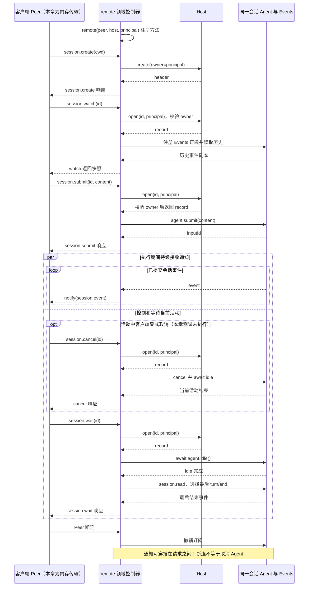

# 043 · 外层共用领域控制器

阶段：R06。唯一前置：完成第 042 步，继续同一个工程。

## 什么时候会用到这一页

网页、SDK或其他客户端都要创建会话、提交输入、订阅输出和取消。把这些操作集中在服务端领域控制器，避免每一种传输各写一套Agent Loop或只在UI隐藏越权按钮。

### 这次数据怎么走

```text
remote(peer,host,principal)注册方法 → 客户端session.create/watch/submit/wait → Host验证owner并操作同一个Agent → Events回调peer.notify(session.event) → 客户端接收；断连dispose撤销订阅
```

### 对应时序图

从上往下读；实线箭头表示调用或发送，虚线箭头表示返回或事件通知。`opt`表示可选操作，`alt`表示不同结果，`loop`表示重复，`par`及其`and`分支表示并行；“未接入”及fixture说明按图中标注理解。



**当前接线位置：**043测试内存传输＋真实Host；044真实stdio SDK与后续Web服务器复用remote，不另建Loop。这里的自定义点号方法名与原版SDK斜杠协议不同。

## 这一步具体做什么

写完src/remote.mjs和本章测试再运行 bun test ./tests/043-remote.test.mjs。测试用两个内存Peer连接，但调用真实Host：创建Alice会话，watch后submit hi并wait，检查助手通知；再尝试读Bob会话，应该由服务端拒绝。当前不需要启动HTTP服务器。

需要本章新文件的操作，先按下面代码创建文件，再执行；不要在上一步尚不存在的接口上试错。

## 代码为什么放在这一层

Remote是领域方法到Host的映射，Peer是消息调用机制，两者不应混淆。principal由可信外层提供，不取客户端params里的自报owner；watch返回历史并订阅新事实，wait等待空闲，不等同于提交回执。

## 在哪里写、写什么

操作地点：终端中的 `$PROJECT`，编辑器打开同一个目录。只创建或替换下列文件，其他文件保留上一步版本。文件目录不存在先创建。

```sh
mkdir -p src
```

### 创建 `src/remote.mjs`

````javascript
/** 一个领域控制器映射所有原生接入；外层只做传输/身份，不重写执行。 */
export function remote(peer, host, principal) {
  const subscriptions = new Map(), disposers = []
  const bind = (name, handler) => disposers.push(peer.handle(name, handler))
  const session = id => host.open(id, principal)
  bind('session.create', params => host.create({ cwd: params.cwd, owner: principal, title: params.title }).header)
  bind('session.list', params => host.list(principal, params ?? {}))
  bind('session.metadata', params => host.metadata(params.id, principal, params.patch))
  bind('session.read', params => session(params.id).session.read(params.after ?? -1))
  bind('session.submit', params => ({ inputId: session(params.id).agent.submit(params.content, params.destination ?? 'turn') }))
  bind('session.wait', async params => { const record = session(params.id); await record.agent.idle(); return record.session.read().filter(event => event.type === 'turn/end').at(-1)?.data })
  bind('session.cancel', async params => { const record = session(params.id); record.agent.cancel(); await record.agent.idle(); return {} })
  bind('session.edit', params => { session(params.id).agent.inbox.update(params.inputId, params.content); return {} })
  bind('session.removeInput', params => { session(params.id).agent.inbox.remove(params.inputId); return {} })
  bind('session.close', async params => { subscriptions.get(params.id)?.(); subscriptions.delete(params.id); await host.closeSession(params.id, principal); return {} })
  bind('approval.answer', params => { session(params.id).approvals.answer(params.id, params.approvalId, params.allow); return {} })
  bind('settings.set', params => { session(params.id).settings.set(params.patch); return session(params.id).settings.snapshot() })
  bind('tools.list', params => session(params.id).tools.catalog())
  bind('session.watch', params => {
    const record = session(params.id)
    subscriptions.get(params.id)?.()
    subscriptions.set(params.id, record.session.on(event => peer.notify('session.event', event)))
    return record.session.read(params.after ?? -1)
  })
  /** 断线取消订阅，不暗中取消仍在运行的会话；显式关闭Host才结束活动。 */
  const dispose = () => { for (const cancel of subscriptions.values()) cancel(); subscriptions.clear(); disposers.splice(0).forEach(remove => remove()) }
  peer.once('closed', dispose)
  return dispose
}
````

```sh
mkdir -p tests
```

### 创建 `tests/043-remote.test.mjs`

````javascript
import { test } from 'bun:test'
import assert from 'node:assert/strict'
import { Peer } from '../src/rpc.mjs'
import { remote } from '../src/remote.mjs'
import { Host } from '../src/host.mjs'
import { mkdtempSync, rmSync } from 'node:fs'
import { join } from 'node:path'
import { tmpdir } from 'node:os'

test('原生控制器统一prompt/流/取消入口，资源权限在服务端验证', async () => {
  const root = mkdtempSync(join(tmpdir(), 'own-remote-')), host = new Host(root)
  const client = new Peer(message => void server.receive(message)), server = new Peer(message => void client.receive(message))
  remote(server, host, 'alice')
  try {
    const header = await client.request('session.create', { cwd: root }), events = []
    client.on('notification', message => events.push(message.params))
    await client.request('session.watch', { id: header.id })
    await client.request('session.submit', { id: header.id, content: 'hi' })
    assert.equal((await client.request('session.wait', { id: header.id })).reason, 'completed')
    assert.ok(events.some(event => event.type === 'message/assistant'))
    const foreign = host.create({ cwd: root, owner: 'bob' })
    await assert.rejects(client.request('session.read', { id: foreign.header.id }), /权限/)
  } finally { client.close(); server.close(); await host.close(); rmSync(root, { recursive: true, force: true }) }
})
````

## 运行命令与通过标准

```sh
cd "$PROJECT"
bun test ./tests/043-remote.test.mjs
bun test
```

测试应1项通过，完成理由completed、通知含message/assistant、跨owner拒绝。方法虽包含cancel/edit/settings等，测试没有逐一覆盖；通知也不自动证明无缝重连或慢消费者处理。

**本步证据的范围：**043-remote.test.mjs以内存Peer驱动真实Host，验证prompt/通知/等待和跨owner拒绝；名称含取消但测试未实际执行cancel，应按断言范围理解。

## VS Code：断在哪里、看什么

在src/remote.mjs的session helper、bind("session.submit"...)与session.watch回调打断点。F11由请求进入host.open看principal="alice"；提交后F10返回inputId而Agent尚可运行；通知回调看event.sessionId。访问Bob时Host.header抛错，不能进入读取正文。所有Peer在本测试同一进程，没有worker断点。

操作位置：VS Code 打开的是自己的 `$PROJECT`，断点也设在这里的源码，不在教材的 `steps` 目录。

上面的说明若指定CLI、子进程、页面或Electron附加调试，就先按该流程操作；下面这组步骤只用于本章测试入口。“当前测试”不会自动附加子进程，也不会命中浏览器或Electron中的断点。

变量只在所属作用域可见：停在方法内部时看this和参数；要看测试里的局部变量，先在“调用堆栈”选择对应测试帧。正在等待的异步调用者不一定保留可求值的帧，此时在测试调用前后加断点再看，不把未定义误判成业务状态丢失。

沿用第 000 步安装的 Bun 扩展与 `.vscode/launch.json`；本章列出替换配置时，使用本章完整版本。

1. 打开本步测试文件 `tests/043-remote.test.mjs`，保持它为当前编辑器文件。
2. 在上面指定的函数内单击行号左侧设置断点。
3. “运行和调试”选择 **Bun：当前测试**，按 F5；它执行当前测试，工作目录固定为 PROJECT。
4. 在“变量 / 监视 / 调用堆栈 / 调试控制台”检查状态；F10 逐行执行，F11 进入函数，Shift+F11 返回，F5 继续，Shift+F5 停止。

验收：断点实际命中，能说出当前输入、状态和下一步；只看到进程启动不算完成。长时间暂停会影响真实取消、审批和网络超时，先检查时序，不删超时断言。修正后在集成终端运行 `bun test ./tests/043-remote.test.mjs`，再运行 `bun test`，保留全部断言。

## 不看答案，确认自己能解释

闭卷分清session.submit回执、session.event实时事实、session.wait空闲结果三种消息；说明为什么principal必须从连接身份取得。

完成后在 LEARNING.md 写一句实际结果和一个卡点。明天只重做这个卡点；第 3 天、第 7 天再做一次，能独立完成就继续下一页，不另开学习路线。

**再改一个条件验证：**安全练习：给测试加客户端关闭后session.listeners清理断言，并确认关闭连接不自动取消Agent。真正的HTTP/WebSocket认证和重连协议需后续传输层，不能把内存Peer当远程网络已验证。

## 与当前原版还差哪些

对照本仓库固定原版 `687f282e8625c6b8d11ff58211a90524be2e4317`；这里的“当前”指该本地基线，不是未经检查的上游最新版。

**这一页已经实现：**

- 会话创建/列表/读写控制映射
- 提示提交、等待、取消、队列操作入口
- 审批/设置/工具目录映射
- 实时订阅与断连撤销
- 可信principal交给Host授权

**原版仍有、或本步尚未对齐的部分：**

- 原版API Gateway及各controller提供具名Remote namespace、结构验证与激活策略；教程一组手写Peer handler。
- 原版历史/follow有严格事件envelope验证、恢复与缓存策略；本章直接推Events。
- 本章未做每方法参数schema、协议版本、流量控制或网络身份认证；principal参数本身不是认证实现。
- 教程session.cancel/close是自定义API，原版SDK协议当前没有这些方法；不能称为兼容官方SDK。

**原版对照位置：**

- [packages/api/session-controller/README.zh.md](../../../deepseek-harness/packages/api/session-controller/README.zh.md)
- [packages/sdk/protocol/README.zh.md](../../../deepseek-harness/packages/sdk/protocol/README.zh.md)
- [packages/sdk/server/README.zh.md](../../../deepseek-harness/packages/sdk/server/README.zh.md)

本步测试通过只证明上面的具体行为；完整差距仍看 [COVERAGE.md](../COVERAGE.md)，不以文件数量、同名类或后面出现另一个模块代替接线证据。

下一步：[第 044 步](044.md)
