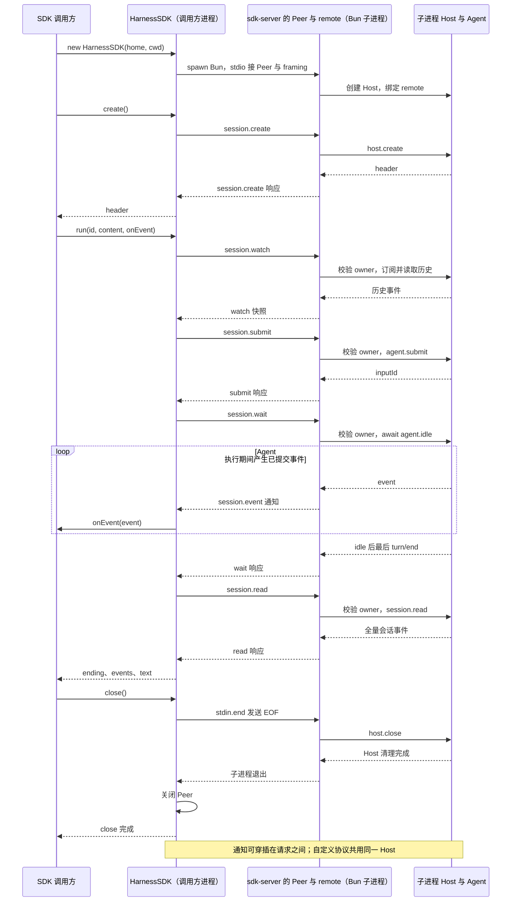

# 044 · Bun原生SDK驱动同一个Host进程

阶段：R06。唯一前置：完成第 043 步，继续同一个工程。

<!-- harness-own-links:start -->
## 当前练习工程文件

以下链接指向 `harness-own` 的当前累计版本；本课下方的完整代码仍保留当步版本，二者可能不同。

[打开练习工程说明](../../../harness-own/README.md)

| 本课文件 | 当前练习工程文件 |
| --- | --- |
| `.vscode/launch.json` | [`harness-own/.vscode/launch.json`](../../../harness-own/.vscode/launch.json) |
| `src/sdk-demo.mjs` | [`harness-own/src/sdk-demo.mjs`](../../../harness-own/src/sdk-demo.mjs) |
| `src/sdk-server.mjs` | [`harness-own/src/sdk-server.mjs`](../../../harness-own/src/sdk-server.mjs) |
| `src/sdk.mjs` | [`harness-own/src/sdk.mjs`](../../../harness-own/src/sdk.mjs) |
| `tests/044-sdk.test.mjs` | [`harness-own/tests/044-sdk.test.mjs`](../../../harness-own/tests/044-sdk.test.mjs) |

<!-- harness-own-links:end -->

## 什么时候会用到这一页

别的Bun程序想使用自己的Harness，不需要导入整个Agent内部。SDK负责启动隔离运行时，通过协议创建会话、接收通知、等待完成和回收进程。

### 这次数据怎么走

```text
HarnessSDK spawn sdk-server → stdio Peer/framing → remote绑定Host → create → run中watch/submit/wait/read → 返回ending/events/text → stdin.end使服务端清理并退出
```

### 对应时序图

从上往下读；实线箭头表示调用或发送，虚线箭头表示返回或事件通知。`opt`表示可选操作，`alt`表示不同结果，`loop`表示重复，`par`及其`and`分支表示并行；“未接入”及fixture说明按图中标注理解。



**当前接线位置：**044确实通过真实Bun子进程复用043领域控制器和041 Host。它与033 MCP/047 ACP SDK不是同一个协议；其cancel只是教程自定义方法。

## 这一步具体做什么

先写完本章文件，再在PROJECT运行 bun src/sdk-demo.mjs。演示打印父子进程PID、会话ID、事件通知、离线回复、退出码和数据目录；然后运行 bun test ./tests/044-sdk.test.mjs 做自动验收。SDK会自己启动服务子进程，不需要手动启动sdk-server。

需要本章新文件的操作，先按下面代码创建文件，再执行；不要在上一步尚不存在的接口上试错。

## 代码为什么放在这一层

SDK是对领域协议的高层包装，不应该再实现工具或Loop。HARNESS_HOME必须显式给定，避免测试写真实家目录；stdout只传NDJSON，诊断必须stderr。create拿会话身份，run只是组合几个已有领域请求。

## 先把 SDK 跑起来

本章新增 `src/sdk-demo.mjs`，它是调用 SDK 的普通 Bun 程序。先按下方代码创建本章文件，再执行下面的命令。已有仓库练习工程在 `harness-own/`；从第 000 步独立重做的人继续使用自己的 `$PROJECT`，不要切换或覆盖现有进度。

在课程仓库根目录打开终端：

```sh
export REPO="$(git rev-parse --show-toplevel)"
export PROJECT="$REPO/harness-own"
cd "$PROJECT"
bun --version
bun src/sdk-demo.mjs
```

独立练习时，上面设置 PROJECT 的那一行改为你已有的练习目录。前置是已经完成 043：当前目录应有 `src/host.mjs`、`src/remote.mjs`、`src/rpc.mjs` 以及它们依赖的前序源码。只复制本章三个 SDK 文件到空目录不能运行。

运行后会看到以下关键信息，PID、会话 ID、事件条数和目录每次可能不同：

```text
SDK 调用方 PID： <父进程编号>
Host 子进程 PID： <另一个进程编号>
会话 ID： session_...
收到通知： ...
收到通知： turn/end
最终回复： [离线演示] 你好，044 SDK
结束原因： completed
收到通知数： <大于 0>
读回事件数： <大于 0>
Host 子进程退出码： 0
本次数据目录： .../tmp/sdk-044-...
```

演示会主动删除传给子进程的 `DEEPSEEK_API_KEY`，使用第 041 课的 `OfflineModel`，不需要配置密钥。回复文字是离线示例；Bun 子进程、stdio 请求、会话日志和退出清理都真实执行。程序会自动结束，不需要再开一个终端启动服务。

SDK 的 spawn 带有 `--no-env-file`，防止子进程又从工作目录的 `.env` 读回密钥。SDK 子进程使用的是构造函数传入的 `env`；如果自己的其他调用方明确传入真实密钥，服务端仍会选择真实模型。本演示不传入真实密钥。

### 到底谁启动了谁

```text
你执行 bun src/sdk-demo.mjs                    ← 父进程，打印上面的演示结果
  → new HarnessSDK(...)
    → spawn Bun src/sdk-server.mjs              ← SDK 自动启动子进程
      → new Host(home, modelFactory)             ← 子进程持有 Host
      → remote(peer, host, 'local')              ← 复用 043 的领域控制器
  → create() → run(...) → close()
    → stdin.end() → 子进程关闭 Host 并退出
```

标题中的“同一个 Host”是 SDK、其他接入方式复用同一套 Host 与 Agent 实现。本章 SDK 每次构造时新启动一个 Host 子进程，不会自动连接第 041 课另一次运行的 Host。一次 SDK 存活期间，多个 `create()` 共用它的这个子进程。

不要把 `bun src/sdk-server.mjs` 当作本章演示命令：它是 SDK 管理的服务端入口，需要 `HARNESS_HOME` 和 stdin 上的协议请求，stdout 只输出协议数据。也不要用 `bun src/main.mjs` 验收本章，那是原来的 CLI。

### 在磁盘上核对结果

把输出的“本次数据目录”和“会话 ID”填到下面，再查看文件：

```sh
cat "<本次数据目录>/sessions/<会话 ID>/header.json"
cat "<本次数据目录>/sessions/<会话 ID>/events.jsonl"
```

应能在事件文件中找到提交的中文任务、`message/assistant` 和 `turn/end`。演示关闭后保留这些文件；本章自动测试使用系统临时目录，结束时会删除测试数据。

### 再跑自动验收

仍在同一个 PROJECT 目录执行：

```sh
bun test ./tests/044-sdk.test.mjs
```

应为 1 项通过，验证真实子进程的结果、通知和退出。若报 `Cannot find module './sdk.mjs'`，先核对本章文件是否创建在 PROJECT 的 `src/`；若缺 `remote.mjs` 或其依赖，先补齐 043 及前序增量。调试入口仍指向 `main.mjs` 时，改用本章的“044：SDK运行演示”。

## 在哪里写、写什么

操作地点：终端中的 `$PROJECT`，编辑器打开同一个目录。只创建或替换下列文件，其他文件保留上一步版本。文件目录不存在先创建。

```sh
mkdir -p .vscode
```

### 替换 [`.vscode/launch.json`](../../../harness-own/.vscode/launch.json)

````json
{
  "version": "0.2.0",
  "configurations": [
    {
      "name": "Bun：CLI 入口",
      "type": "bun",
      "request": "launch",
      "program": "${workspaceFolder}/src/main.mjs",
      "cwd": "${workspaceFolder}",
      "runtime": "bun",
      "runtimeArgs": [
        "--preload",
        "${workspaceFolder}/scripts/vscode-debug.mjs"
      ],
      "args": [
        "读取 README"
      ],
      "stopOnEntry": false
    },
    {
      "name": "Bun：当前测试",
      "type": "bun",
      "request": "launch",
      "program": "${file}",
      "cwd": "${workspaceFolder}",
      "runtime": "bun",
      "runtimeArgs": [
        "test",
        "--preload",
        "${workspaceFolder}/scripts/vscode-debug.mjs",
        "--timeout",
        "3600000"
      ],
      "stopOnEntry": false
    },
    {
      "name": "Bun：附加子进程",
      "type": "bun",
      "request": "attach",
      "url": "${input:bunInspectorUrl}"
    },
    {
      "name": "044：SDK运行演示",
      "type": "bun",
      "request": "launch",
      "program": "${workspaceFolder}/src/sdk-demo.mjs",
      "cwd": "${workspaceFolder}",
      "runtime": "bun",
      "runtimeArgs": [
        "--preload",
        "${workspaceFolder}/scripts/vscode-debug.mjs"
      ],
      "stopOnEntry": false
    }
  ],
  "inputs": [
    {
      "id": "bunInspectorUrl",
      "type": "promptString",
      "description": "粘贴子进程 Bun Inspector 打印的完整 ws:// 地址"
    }
  ]
}
````

```sh
mkdir -p src
```

### 创建 [`src/sdk-demo.mjs`](../../../harness-own/src/sdk-demo.mjs)

````javascript
import assert from 'node:assert/strict'
import { mkdirSync, mkdtempSync } from 'node:fs'
import { resolve, join } from 'node:path'
import { HarnessSDK } from './sdk.mjs'

// 每次演示使用独立目录；退出后保留日志，方便查看 Host 实际保存的事件。
const temporaryRoot = resolve('tmp')
mkdirSync(temporaryRoot, { recursive: true })
const home = mkdtempSync(join(temporaryRoot, 'sdk-044-'))

// 演示固定走离线模型，避免当前终端的真实密钥触发外部请求；不修改父进程环境。
const env = { ...process.env }
delete env.DEEPSEEK_API_KEY
const sdk = new HarnessSDK({ home, cwd: process.cwd(), env })
let notificationCount = 0

try {
  console.log('SDK 调用方 PID：', process.pid)
  console.log('Host 子进程 PID：', sdk.child.pid)
  assert.notEqual(sdk.child.pid, process.pid)

  // create 通过 stdio 请求子进程创建会话；调用方没有直接 new Host。
  const header = await sdk.create()
  console.log('会话 ID：', header.id)

  // run 组合订阅、提交、等待和读取；通知回调发生在本进程。
  const result = await sdk.run(header.id, '你好，044 SDK', event => {
    notificationCount++
    console.log('收到通知：', event.type)
  })
  console.log('最终回复：', result.text)
  console.log('结束原因：', result.ending.reason)
  console.log('收到通知数：', notificationCount)
  console.log('读回事件数：', result.events.length)
  assert.equal(result.text, '[离线演示] 你好，044 SDK')
  assert.equal(result.ending.reason, 'completed')
  assert.ok(notificationCount > 0)
} finally {
  // 关闭 stdin 发送 EOF，等待子进程释放 Host，再核对真实退出码。
  await sdk.close()
}

console.log('Host 子进程退出码：', sdk.child.exitCode)
assert.equal(sdk.child.exitCode, 0)
console.log('本次数据目录：', home)
````

```sh
mkdir -p src
```

### 创建 [`src/sdk-server.mjs`](../../../harness-own/src/sdk-server.mjs)

````javascript
import { Host } from './host.mjs'
import { DeepSeekModel } from './deepseek.mjs'
import { Peer, framing } from './rpc.mjs'
import { remote } from './remote.mjs'
import { resolve } from 'node:path'

// stdio只承担协议；日志必须走stderr。所有数据路径显式隔离。
const home = process.env.HARNESS_HOME
if (!home) throw Error('SDK服务必须显式设置HARNESS_HOME')
const modelFactory = process.env.DEEPSEEK_API_KEY ? () => new DeepSeekModel({ key: process.env.DEEPSEEK_API_KEY, model: process.env.DSH_MODEL ?? 'deepseek-flash' }) : undefined
const host = new Host(home, modelFactory), peer = framing(new Peer(), process.stdin, process.stdout)
remote(peer, host, 'local')
peer.once('closed', () => { void host.close().catch(error => { console.error(error); process.exitCode = 1 }) })
````

```sh
mkdir -p src
```

### 创建 [`src/sdk.mjs`](../../../harness-own/src/sdk.mjs)

````javascript
import { spawn } from 'node:child_process'
import { Peer, framing } from './rpc.mjs'
import { fileURLToPath } from 'node:url'

/** 自己的高层SDK只组合领域协议；不另起工具/历史/模型实现。 */
export class HarnessSDK {
  constructor({ home, cwd, env = process.env }) {
    if (!home) throw Error('SDK需要显式home')
    this.cwd = cwd
    // 禁止子进程自动加载.env；模型密钥等配置以显式传入的env为准。
    this.child = spawn(process.execPath, ['--no-env-file', fileURLToPath(new URL('./sdk-server.mjs', import.meta.url))], { cwd, env: { ...env, HARNESS_HOME: home }, stdio: ['pipe', 'pipe', 'pipe'] })
    this.child.stderr.resume()
    this.peer = framing(new Peer(), this.child.stdout, this.child.stdin)
    this.child.on('error', () => this.peer.close())
    this.closed = new Promise(resolve => this.child.once('close', resolve))
  }
  async create() { return await this.peer.request('session.create', { cwd: this.cwd }) }
  async run(id, content, onEvent = () => {}) {
    const notify = message => { if (message.method === 'session.event' && message.params.sessionId === id) onEvent(message.params) }
    this.peer.on('notification', notify)
    try {
      await this.peer.request('session.watch', { id })
      await this.peer.request('session.submit', { id, content })
      const ending = await this.peer.request('session.wait', { id }, 120_000)
      const events = await this.peer.request('session.read', { id })
      return { ending, events, text: events.filter(event => event.type === 'message/assistant').at(-1)?.data.content ?? '' }
    } finally { this.peer.off('notification', notify) }
  }
  cancel(id) { return this.peer.request('session.cancel', { id }) }
  async close() { this.child.stdin.end(); await this.closed; this.peer.close() }
}
````

```sh
mkdir -p tests
```

### 创建 [`tests/044-sdk.test.mjs`](../../../harness-own/tests/044-sdk.test.mjs)

````javascript
import { test } from 'bun:test'
import assert from 'node:assert/strict'
import { HarnessSDK } from '../src/sdk.mjs'
import { mkdtempSync, rmSync, writeFileSync } from 'node:fs'
import { tmpdir } from 'node:os'
import { join } from 'node:path'

test('SDK真实启动子进程，通知、结果与持久事实一致，退出回收', async () => {
  const root = mkdtempSync(join(tmpdir(), 'own-sdk-')), env = { ...process.env }; delete env.DEEPSEEK_API_KEY
  // 即使工作目录存在模型配置，也不能覆盖调用方删除密钥后的离线选择。
  writeFileSync(join(root, '.env'), 'DEEPSEEK_API_KEY=fixture-not-a-real-key\n')
  const sdk = new HarnessSDK({ home: root, cwd: root, env })
  try {
    const header = await sdk.create(), events = []
    const result = await sdk.run(header.id, 'hello', event => events.push(event))
    assert.equal(result.ending.reason, 'completed'); assert.match(result.text, /hello/)
    assert.ok(events.some(event => event.type === 'turn/end'))
  } finally { await sdk.close(); rmSync(root, { recursive: true, force: true }) }
  assert.equal(sdk.child.exitCode, 0)
})
````

## 运行命令与通过标准

```sh
cd "$PROJECT"
bun src/sdk-demo.mjs
bun test ./tests/044-sdk.test.mjs
bun test
```

演示输出“[离线演示] 你好，044 SDK”、completed、通知和Host退出码0；磁盘日志包含这次任务。测试应1项通过。没有验证真实DeepSeek、审批交互、初始化协商、恢复历史或多会话并发通知过滤。

**本步证据的范围：**044-sdk.test.mjs以process.execPath启动真实服务，明确删除模型Key，验证OfflineModel结果、会话通知和close；不是官方SDK兼容测试。

## VS Code：断在哪里、看什么

打开src/sdk-demo.mjs，选择“044：SDK运行演示”按F5，先在sdk.create()、sdk.run(...)和sdk.close()处断点；再到src/sdk.mjs的spawn、peer.request("session.submit"...)和run返回处，查看child.pid、id、ending与events。F10跨await等待子进程回复，父进程不能自动F11进入sdk-server。若看Host内部，按文末临时Inspector步骤附加子进程；032的rpc-worker开关不适用于SDK。

操作位置：VS Code 打开的是自己的 `$PROJECT`，断点也设在这里的源码，不在教材的 `steps` 目录。

上面的说明若指定CLI、子进程、页面或Electron附加调试，就先按该流程操作；下面这组步骤只用于本章测试入口。“当前测试”不会自动附加子进程，也不会命中浏览器或Electron中的断点。

变量只在所属作用域可见：停在方法内部时看this和参数；要看测试里的局部变量，先在“调用堆栈”选择对应测试帧。正在等待的异步调用者不一定保留可求值的帧，此时在测试调用前后加断点再看，不把未定义误判成业务状态丢失。

沿用第 000 步安装的 Bun 扩展与 `.vscode/launch.json`；本章列出替换配置时，使用本章完整版本。

1. 打开本步测试文件 `tests/044-sdk.test.mjs`，保持它为当前编辑器文件。
2. 在上面指定的函数内单击行号左侧设置断点。
3. “运行和调试”选择 **Bun：当前测试**，按 F5；它执行当前测试，工作目录固定为 PROJECT。
4. 在“变量 / 监视 / 调用堆栈 / 调试控制台”检查状态；F10 逐行执行，F11 进入函数，Shift+F11 返回，F5 继续，Shift+F5 停止。

验收：断点实际命中，能说出当前输入、状态和下一步；只看到进程启动不算完成。长时间暂停会影响真实取消、审批和网络超时，先检查时序，不删超时断言。修正后在集成终端运行 `bun test ./tests/044-sdk.test.mjs`，再运行 `bun test`，保留全部断言。

## 不看答案，确认自己能解释

闭卷画出SDK→stdio→remote→Host→Agent，不看源码列出run内部watch、submit、wait、read的先后顺序。

完成后在 LEARNING.md 写一句实际结果和一个卡点。明天只重做这个卡点；第 3 天、第 7 天再做一次，能独立完成就继续下一页，不另开学习路线。

**再改一个条件验证：**安全练习：同一个SDK创建两个临时会话顺序run，验证各自text与sessionId；保持测试中删除真实Key，避免无意收费。原版initialize/resume/shutdown需要显式实现，不能改个方法名就兼容。

## 与当前原版还差哪些

对照本仓库固定原版 `687f282e8625c6b8d11ff58211a90524be2e4317`；这里的“当前”指该本地基线，不是未经检查的上游最新版。

**这一页已经实现：**

- 高层create/run/cancel/close包装
- 真实stdio子进程与通知监听
- 显式home隔离
- 服务端复用Host/remote
- EOF关闭并等待退出

**原版仍有、或本步尚未对齐的部分：**

- 原版SDK客户端有initialize路由校验、session/prompt入队回执、resume、wait后代、工作目录与shutdown，协议词汇不同。
- 原版SDK运行时由Loader/profile组合，等待异步插件就绪，关闭排空根Agent及后代；本章直接new Host。
- 本章没有原版SDK协议类型/图片输入/状态与子Agent通知，也没有可执行运行时分发。
- 原版SDK无逐会话取消/关闭，本章cancel不是原版额外已补齐，而是自定义扩展。

**原版对照位置：**

- [packages/sdk/client/README.zh.md](../../../deepseek-harness/packages/sdk/client/README.zh.md)
- [packages/sdk/server/README.zh.md](../../../deepseek-harness/packages/sdk/server/README.zh.md)
- [packages/sdk/protocol/README.zh.md](../../../deepseek-harness/packages/sdk/protocol/README.zh.md)
- [packages/bundle/sdk-app/README.zh.md](../../../deepseek-harness/packages/bundle/sdk-app/README.zh.md)

本步测试通过只证明上面的具体行为；完整差距仍看 [COVERAGE.md](../COVERAGE.md)，不以文件数量、同名类或后面出现另一个模块代替接线证据。

下一步：[第 045 步](045.md)

## 在 VS Code 追 SDK 启动的 Host

先用 **Bun：当前测试**在 `src/sdk.mjs` 的 spawn、session.wait 对应调用处调试父进程。

若这次要看 `src/sdk-server.mjs` 或 `src/host.mjs`，才做下面的临时调试改动：

1. 在 `src/sdk.mjs` 的 spawn 参数数组开头加入 `'--inspect-wait=127.0.0.1:0'`，例如 `['--inspect-wait=127.0.0.1:0', '--no-env-file', fileURLToPath(...)]`。0让系统分配可用端口，避免多个 Host 争抢固定端口。
2. 将该 spawn 的 `stdio` 临时改为 `['pipe', 'pipe', 'inherit']`，同时删除下面的 `this.child.stderr.resume()`。这样 Inspector 地址直接显示在 VS Code 输出里，协议 stdout 保持干净。
3. 打开本章测试，选择 **Bun：当前测试**，按 F5。子 Host 等待连接时，立即再选择 **Bun：附加子进程**，按 F5，粘贴它输出的完整 `ws://` 地址。握手有真实超时，不要长时间停在连接前。
4. 在 Host 内设断点并驱动一次任务；从“调用堆栈”切换父、子调试会话，确认两边各自命中。
5. 结束后先停止附加，再停止父测试，恢复这两处临时改动，运行本章测试与 `bun test`。

本章正常验收不依赖 Inspector，也不应永久等待调试器。
