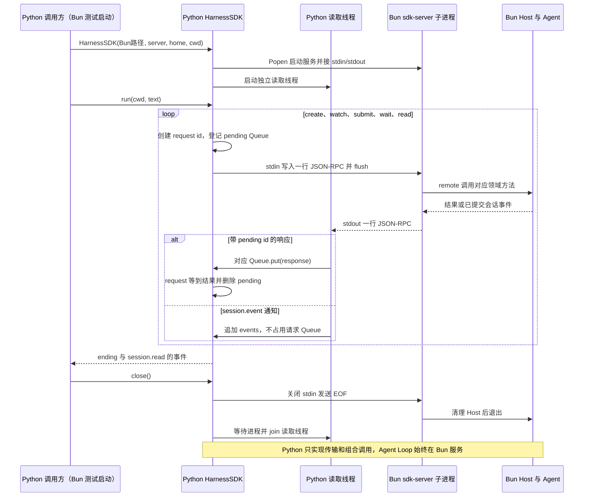
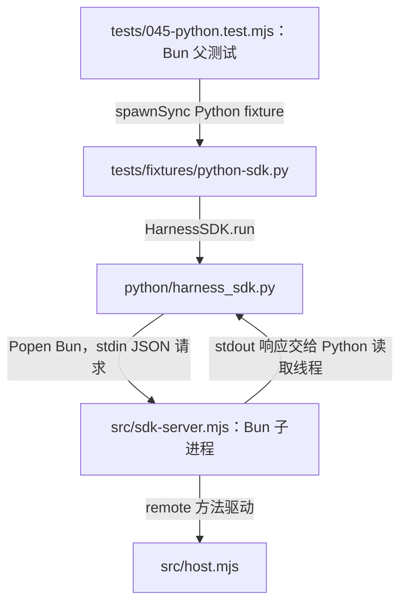
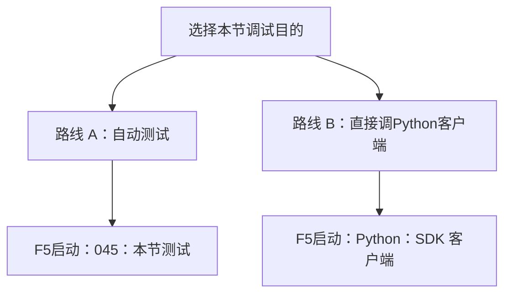
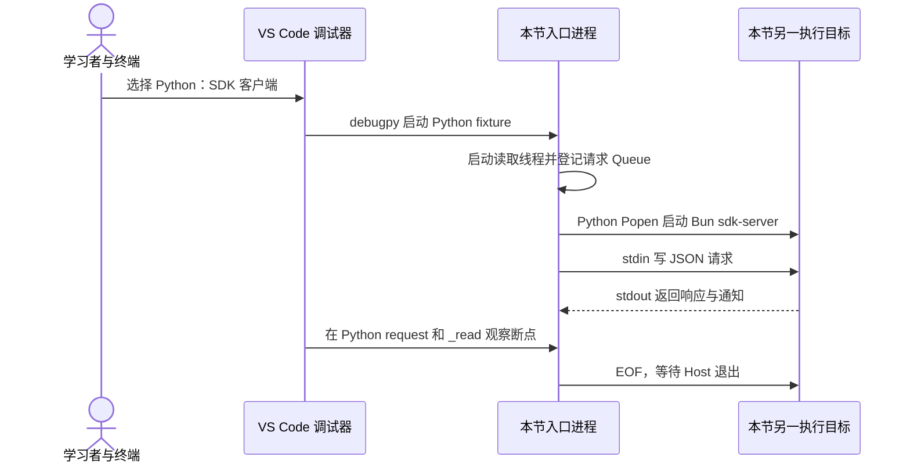

# 045 · Python SDK也走同一条协议

阶段：R06。唯一前置：完成第 044 步，继续同一个工程。

<!-- harness-own-links:start -->
## 当前练习工程文件

以下链接指向 `harness-own` 的当前累计版本；本课下方的完整代码仍保留当步版本，二者可能不同。

[打开练习工程说明](../../../harness-own/README.md)

| 本课文件 | 当前练习工程文件 |
| --- | --- |
| `.vscode/extensions.json` | [`harness-own/.vscode/extensions.json`](../../../harness-own/.vscode/extensions.json) |
| `.vscode/launch.json` | 使用本页下方的本节专用配置，不复制累计版本 |
| `python/harness_sdk.py` | [`harness-own/python/harness_sdk.py`](../../../harness-own/python/harness_sdk.py) |
| `tests/045-python.test.mjs` | [`harness-own/tests/045-python.test.mjs`](../../../harness-own/tests/045-python.test.mjs) |
| `tests/fixtures/python-sdk.py` | [`harness-own/tests/fixtures/python-sdk.py`](../../../harness-own/tests/fixtures/python-sdk.py) |

<!-- harness-own-links:end -->

## 什么时候会用到这一页

Python脚本也想提交Harness任务，但不能另写一套Python Agent。它启动同一个Bun sdk-server，用NDJSON请求驱动Host，专用读取线程同时分发回复和会话通知。

### 这次数据怎么走

```text
Bun测试spawn Python fixture → Python HarnessSDK.Popen(Bun,sdk-server) → request登记queue并写JSON行 → 读取线程按id入队或收通知 → run组合create/watch/submit/wait/read → close发EOF并等待Bun退出
```

### 对应时序图

从上往下读；实线箭头表示调用或发送，虚线箭头表示返回或事件通知。`opt`表示可选操作，`alt`表示不同结果，`loop`表示重复，`par`及其`and`分支表示并行；“未接入”及fixture说明按图中标注理解。



**当前接线位置：** 045真实复用044的Bun sdk-server与043 remote；Python不包含第二套Loop。后续没有把它换成原版Python SDK或补齐官方共享方法词汇。

## 先看目录与调用关系

目录只列本节文件及图中直接用到的前置实现；不是累计工程的完整文件清单。

```text
PROJECT/
├── .vscode/
│   ├── extensions.json  # 本节创建或替换
│   └── launch.json  # 本节创建或替换
├── python/
│   └── harness_sdk.py  # 本节创建或替换
├── src/
│   ├── host.mjs  # 沿用前置实现
│   └── sdk-server.mjs  # 沿用前置实现
└── tests/
    ├── 045-python.test.mjs  # 本节创建或替换
    └── fixtures/
        └── python-sdk.py  # 本节创建或替换
```

### 本节入口怎样调用这些文件

箭头写明实际调用或进程启动；标为“未接入”的文件不是本节测试能命中的目标。




## 这一步具体做什么

先写完python/harness_sdk.py、tests/fixtures/python-sdk.py和本章测试；确认python3 --version，再在练习工程运行 bun test ./tests/045-python.test.mjs。测试设置PYTHONPATH并传入当前Bun路径，Python发送“来自Python的任务”，应打印completed；不需要安装Node.js，也不需要真实模型Key。

需要本章新文件的操作，先按下面代码创建文件，再执行；不要在上一步尚不存在的接口上试错。

## 代码为什么放在这一层

Python SDK只是另一种语言的协议客户端。主线程等待queue时读取线程仍可接收消息，所以通知不会被误认成当前请求结果；pending锁保证先登记等待者再把请求发出去。参数名node是代码沿用名，测试实际传process.execPath即Bun，不是启动Node.js。

## 本节调试：选什么、为什么、怎么启动

**建议先选：Python：SDK 客户端。** 每节的测试入口都固定到本节文件，不依赖编辑器当前打开的 `${file}`。

| 配置名称 | 什么时候选 | 实际入口或目标 | 能观察什么 |
| --- | --- | --- | --- |
| 045：本节测试 | 本节验收 | tests/045-python.test.mjs | 本节 Bun 测试进程；入口固定，不依赖当前编辑器文件。 |
| Python：SDK 客户端 | 本节 Python 实现 | tests/fixtures/python-sdk.py | Python 主线程与读取线程；它的 Bun 子 Host 是另一目标。 |

### 调试路线：先启动谁，再启动谁

本节有 **2 个调试配置、2 条调试路线**。配置是启动或附加按钮；一条路线可能连续使用多个配置。请选择一条路线，不必把所有入口都启动。

| 路线 | 用哪些配置，按顺序 | 谁创建进程 | 结果在哪里看 |
| --- | --- | --- | --- |
| A 自动测试 | “045：本节测试” | F5的launch配置创建；子目标按下方步骤自动创建 | `tests/045-python.test.mjs`与下方列出的本章实现断点 |
| B 直接调Python客户端 | “Python：SDK 客户端” | F5的launch配置创建；子目标按下方步骤自动创建 | tests/fixtures/python-sdk.py与python/harness_sdk.py |

先完成本节源码并安装[本节专用调试配置](#lesson-debug-config)。下面的路线只对应本节，不沿用前章端口或旧会话。



<details class="debug-route">
<summary>路线 A：自动测试——启动、断点和退出</summary>

1. 先打开`tests/045-python.test.mjs`及下方“具体断点和预期”列出的实现文件，设置本章断点。
2. 选择“045：本节测试”按F5，配置固定到本章测试；不需要先运行前章服务或CLI。
3. Bun测试启动Python，Python再启动Bun Host；这里只调外层Bun测试。
4. 按下方本章观察点检查变量和断言；断点停顿可能触发实现自己的计时，必要时先继续完成当前调用。

**断点与观察位置：** `tests/045-python.test.mjs`与下方列出的本章实现断点

**结束方式：** 断言结束后测试退出；测试清理自己创建的资源。异常中止后检查本章临时进程，不把尚在等待当作测试通过。

</details>

<details class="debug-route">
<summary>路线 B：直接调Python客户端——启动、断点和退出</summary>

1. 安装debugpy扩展，创建.data-python-debug；按本机情况核对Python路径与参数中的Bun路径。
2. 在python/harness_sdk.py的request、_read和run设断点，选择“Python：SDK 客户端”按F5。
3. debugpy启动fixture，fixture通过Popen创建Bun Host；不先启动外层Bun测试。
4. 在Python主线程发送处和读取线程waiting.put处切换调用帧；协议响应由子Host返回。

**断点与观察位置：** tests/fixtures/python-sdk.py与python/harness_sdk.py

**结束方式：** 继续Python到SDK关闭、EOF与子进程回收；结束debugpy会话，调试数据目录保留。

**进程边界与前置条件：** 此路线有Python客户端与Bun Host两个执行进程，仅Python被debugpy附加；当前配置不调子Host内部。

</details>


**为什么这样启动：** Bun 测试只用 spawnSync 启动 Python 并等结果；要进入 Python 的 request/_read，必须直接用 debugpy 启动 fixture，不能从 Bun 按 F11 跨过去。 Bun 测试、Python 客户端和 Bun Host 是三个进程；Python 断点要用 debugpy 单独启动。

使用下方的[本节专用调试配置](#lesson-debug-config)。它只列本节可用目标；要保留个人配置，请先备份并按名称合并。页面上 `harness-own` 的累计文件链接供看当前工程，不是本节调试配置的答案。

1. VS Code 打开自己的 PROJECT；按本节创建源码与配置，断点设在 PROJECT 文件中。
2. 先用终端运行 `bun test ./tests/045-python.test.mjs` 确认普通验收，再选表中的配置按 F5。
3. 在下方具体观察点停住；F10 跨过当前语句，F11 只进入当前调试目标。异步等待涉及另一进程时，切换调试会话并继续对端。
4. 变量要在所属调用帧查看；看测试局部变量时选测试帧，看 this 和参数时选实现方法帧。

<details class="debug-details">
<summary>展开本节具体断点和预期</summary>

1. 外层Bun断点可放tests/045-python.test.mjs的spawnSync，F10等待完整Python结束，查看status=0和stdout。

2. Python断点需用VS Code Python调试器，以tests/fixtures/python-sdk.py为程序，参数依次是Bun绝对路径、src/sdk-server.mjs绝对路径、专用临时home，并设置PYTHONPATH为项目python目录。

3. 在harness_sdk.py的self.pending[identity]=waiting、_read里的waiting.put、run的session/wait处观察id与消息。

4. Bun调试器不能直接F11进入Python线程，当前本章没有自动配置这条跨语言附加。

</details>

### 本节启动前置

- 安装 ms-python.debugpy，先执行 mkdir -p .data-python-debug；python 字段使用本机 Python 路径，Bun 路径也必须可解析。普通测试使用临时目录；调试目录保留会话。

### 本节调试启动时序

这张图解释如何创建并连接调试目标；上面的业务时序图解释任务本身怎样执行。



暂停断点会影响应用自身的 RPC、取消、进程和网络计时。Bun 测试超时放宽不等于这些计时也被关闭；按本节说明分别设置，普通验收恢复原有时限。

观察完成后退出本节启动的调试会话和进程，再运行 `bun test ./tests/045-python.test.mjs`。测试通过只证明本节断言，不代表所有 GUI、外部服务或发布过程均已验证。

## 在哪里写、写什么

操作地点：终端中的 `$PROJECT`，编辑器打开同一个目录。只创建或替换下列文件，其他文件保留上一步版本。文件目录不存在先创建。

```sh
mkdir -p .vscode
```

### 替换 [`.vscode/extensions.json`](../../../harness-own/.vscode/extensions.json)

````json
{
  "recommendations": [
    "oven.bun-vscode",
    "ms-python.debugpy"
  ]
}
````

```sh
mkdir -p .vscode
```

<a id="lesson-debug-config"></a>

下面是本节专用调试配置，只包含本节入口。program 已固定到本节文件；不是 harness-own 的累计配置。

### 替换 `.vscode/launch.json`

````json
{
  "version": "0.2.0",
  "configurations": [
    {
      "name": "045：本节测试",
      "type": "bun",
      "request": "launch",
      "program": "${workspaceFolder}/tests/045-python.test.mjs",
      "cwd": "${workspaceFolder}",
      "runtime": "bun",
      "runtimeArgs": [
        "test",
        "--preload",
        "${workspaceFolder}/scripts/vscode-debug.mjs",
        "--timeout",
        "3600000"
      ],
      "stopOnEntry": false
    },
    {
      "name": "Python：SDK 客户端",
      "type": "debugpy",
      "request": "launch",
      "program": "${workspaceFolder}/tests/fixtures/python-sdk.py",
      "cwd": "${workspaceFolder}",
      "python": "/usr/bin/python3",
      "console": "integratedTerminal",
      "justMyCode": true,
      "env": {
        "PYTHONPATH": "${workspaceFolder}/python"
      },
      "args": [
        "bun",
        "${workspaceFolder}/src/sdk-server.mjs",
        "${workspaceFolder}/.data-python-debug"
      ]
    }
  ]
}
````

```sh
mkdir -p python
```

### 创建 [`python/harness_sdk.py`](../../../harness-own/python/harness_sdk.py)

````python
"""与自己实现的Node SDK服务共用NDJSON协议，不启动另一套Agent。"""
import json
import os
import queue
import subprocess
import threading
import uuid


class HarnessSDK:
    """独立读取线程派发响应/通知，关闭时拒绝仍在等待的请求。"""
    def __init__(self, node, server, home, cwd):
        self.process = subprocess.Popen([node, server], cwd=cwd, env=dict(os.environ, HARNESS_HOME=home), stdin=subprocess.PIPE, stdout=subprocess.PIPE, stderr=subprocess.DEVNULL, text=True, encoding='utf-8')
        self.pending = {}
        self.events = []
        self.lock = threading.Lock()
        self.thread = threading.Thread(target=self._read, daemon=True)
        self.thread.start()

    def _read(self):
        """只做线消息分派；通知不被误认为当前request的返回值。"""
        try:
            for line in self.process.stdout:
                message = json.loads(line)
                with self.lock:
                    if 'id' in message and message['id'] in self.pending:
                        self.pending[message['id']].put(message)
                    elif message.get('method') == 'session.event':
                        self.events.append(message['params'])
        finally:
            with self.lock:
                for waiting in self.pending.values():
                    waiting.put({'error': {'message': 'SDK连接断开'}})

    def request(self, method, params, timeout=30):
        """写入和pending登记在同一把锁内，避免快速响应先于登记。"""
        identity = str(uuid.uuid4())
        waiting = queue.Queue()
        with self.lock:
            self.pending[identity] = waiting
            self.process.stdin.write(json.dumps({'jsonrpc': '2.0', 'id': identity, 'method': method, 'params': params}, ensure_ascii=False) + '\n')
            self.process.stdin.flush()
        try:
            message = waiting.get(timeout=timeout)
            if 'error' in message:
                raise RuntimeError(message['error']['message'])
            return message['result']
        finally:
            with self.lock:
                self.pending.pop(identity, None)

    def run(self, cwd, text):
        """明确接收、订阅、等待与读取事实四个动作。"""
        session = self.request('session.create', {'cwd': cwd})
        identity = session['id']
        self.request('session.watch', {'id': identity})
        self.request('session.submit', {'id': identity, 'content': text})
        ending = self.request('session.wait', {'id': identity})
        return {'ending': ending, 'events': self.request('session.read', {'id': identity})}

    def close(self):
        """先发EOF等正常清理，超时再终止并回收。"""
        self.process.stdin.close()
        try:
            self.process.wait(timeout=5)
        except subprocess.TimeoutExpired:
            self.process.kill()
            self.process.wait()
        self.thread.join(timeout=1)

    def __enter__(self):
        return self

    def __exit__(self, *unused):
        self.close()
````

```sh
mkdir -p tests
```

### 创建 [`tests/045-python.test.mjs`](../../../harness-own/tests/045-python.test.mjs)

````javascript
import { test } from 'bun:test'
import assert from 'node:assert/strict'
import { spawnSync } from 'node:child_process'
import { mkdtempSync, rmSync } from 'node:fs'
import { join, resolve } from 'node:path'
import { tmpdir } from 'node:os'

test('真正PythonSDK驱动同一Bun Host并正常退出', () => {
  const root = mkdtempSync(join(tmpdir(), 'own-python-')), env = { ...process.env, PYTHONPATH: resolve('python') }; delete env.DEEPSEEK_API_KEY
  try {
    const result = spawnSync(process.env.PYTHON ?? 'python3', ['tests/fixtures/python-sdk.py', process.execPath, resolve('src/sdk-server.mjs'), root], { env, encoding: 'utf8', timeout: 10_000 })
    assert.equal(result.status, 0, result.stderr)
    assert.match(result.stdout, /completed/)
  } finally { rmSync(root, { recursive: true, force: true }) }
})
````

```sh
mkdir -p tests/fixtures
```

### 创建 [`tests/fixtures/python-sdk.py`](../../../harness-own/tests/fixtures/python-sdk.py)

````python
"""真实Python→Node子进程的keyless场景。"""
import json
import sys
from harness_sdk import HarnessSDK

with HarnessSDK(sys.argv[1], sys.argv[2], sys.argv[3], sys.argv[3]) as sdk:
    result = sdk.run(sys.argv[3], '来自Python的任务')
    assert result['ending']['reason'] == 'completed'
    assert any(event['type'] == 'message/assistant' for event in result['events'])
    print(json.dumps({'reason': result['ending']['reason']}, ensure_ascii=False))
````

## 运行命令与通过标准

```sh
cd "$PROJECT"
bun test ./tests/045-python.test.mjs
bun test
```

测试应1项通过，证明真实Python→Bun Host链路和退出。没有覆盖Python并发写、未知通知、请求超时后远端取消、审批回调、官方协议兼容或wheel分发。

**本步证据的范围：** 045-python.test.mjs真实启动python3与Bun服务，显式去掉模型Key；fixture断言completed及assistant事件，测试确认Python退出0，不依赖真实LLM。

## 不看答案，确认自己能解释

闭卷画出Python主线程、读取线程、Bun服务三方；解释queue为什么必须按请求id分开，以及Bun服务为什么仍然是唯一Agent执行方。

完成后在 LEARNING.md 写一句实际结果和一个卡点。明天只重做这个卡点；第 3 天、第 7 天再做一次，能独立完成就继续下一页，不另开学习路线。

**再改一个条件验证：** 安全练习：Python fixture连续run两个任务，确认两组事件各自sessionId不同且close后Bun退出。仅在专用临时home实验；官方SDK初始化、恢复和打包尚未实现，不要直接把此文件发布成官方Python SDK。

## 与当前原版还差哪些

对照本仓库固定原版 `687f282e8625c6b8d11ff58211a90524be2e4317`；这里的“当前”指该本地基线，不是未经检查的上游最新版。

**这一页已经实现：**

- Python subprocess真实启动Bun
- 独立读取线程分发回复/通知
- 锁保护pending登记和发送
- queue等待、超时与断线拒绝
- 上下文管理器关闭并回收

**原版仍有、或本步尚未对齐的部分：**

- 原版Python SDK镜像官方SDK协议、管理运行时与正式类型/事件；本章镜像的是教程自定义点号方法。
- 缺少initialize、resume、工作目录、正式shutdown、图片内容与Agent状态/子Agent通知等原版接口。
- 缺少官方Python包与runtime发行、异步/高级API及完整多请求错误清理矩阵；单个脚本测试不能证明这些。

**原版对照位置：**

- [python/README.zh.md](../../../deepseek-harness/python/README.zh.md)
- [packages/sdk/protocol/README.zh.md](../../../deepseek-harness/packages/sdk/protocol/README.zh.md)
- [packages/sdk/server/README.zh.md](../../../deepseek-harness/packages/sdk/server/README.zh.md)
- [packages/sdk/client/README.zh.md](../../../deepseek-harness/packages/sdk/client/README.zh.md)

本步测试通过只证明上面的具体行为；完整差距仍看 [COVERAGE.md](../COVERAGE.md)，不以文件数量、同名类或后面出现另一个模块代替接线证据。

下一步：[第 046 步](046.md)

## 补充知识：Python为什么也能走同一套stdio协议

<details>
<summary>展开：通信方式深度说明与相关阅读</summary>

阅读[stdio、HTTP与WebSocket：Host通信方式为什么不同](../supplements/transport-boundaries.md)。本文按背景、权衡、场景、组成、底层原理和实现对比展开；本章重点看读取线程、按行解析、请求id与Bun Host的进程边界。包含正常收包、零碎收包、调用顺序图和可运行的内存管道实验。

说明区分教程实现、固定原版ACP与OpenHands远程会话；不把工程分析写成原作者动机，也不把传输选择误当成模型接口限制。

</details>

## 在 VS Code 调试 Python 客户端

Python 的读取线程属于 Python 进程，使用本章新增的 **Python：SDK 客户端**，不是 Bun 的当前测试配置。

1. 扩展面板安装 **Python Debugger**（`ms-python.debugpy`）。本章以 macOS 自带 `/usr/bin/python3` 为解释器；若前面使用了其他 Python，将该配置的 `python` 字段改成集成终端 `which python3` 的实际结果。
2. 在集成终端执行 `mkdir -p .data-python-debug`，创建隔离的工作区和数据目录。
3. 打开 `python/harness_sdk.py`，在 `request` 和 `_read` 内设断点。
4. “运行和调试”选择 **Python：SDK 客户端**，按 F5；从“调用堆栈”切换主线程与读取线程，观察同一个请求 ID 如何关联响应。Bun Host 在子进程运行，Python 断点不会自动进入它。
5. 继续后终端应输出包含 `completed` 的 JSON；结束后用正常的本章测试与 `bun test` 验收。

暂停读取线程可能触发真实的30秒请求超时，应关注发生顺序，不删除超时检查。
