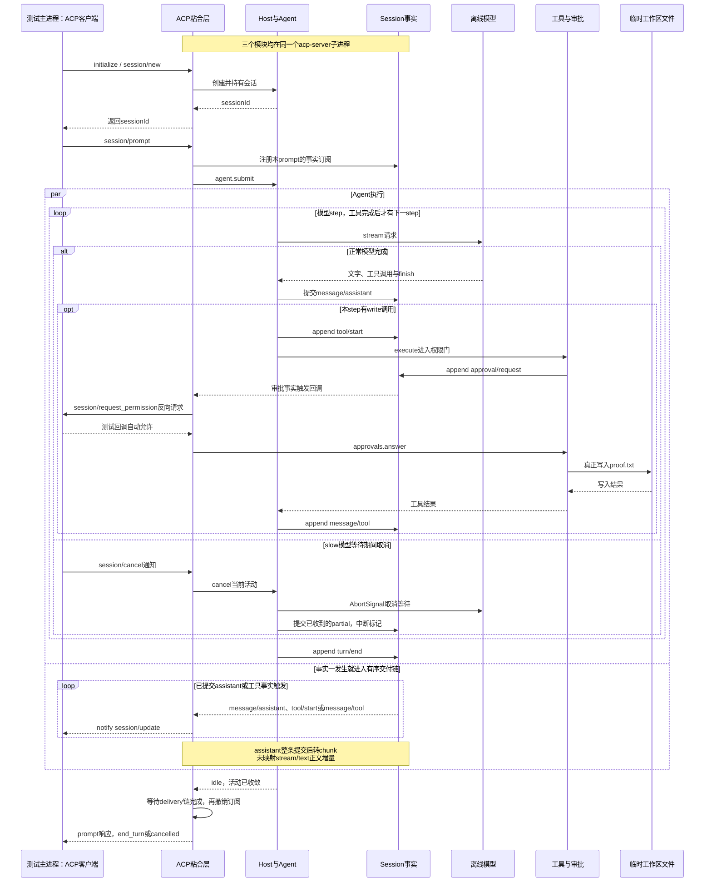
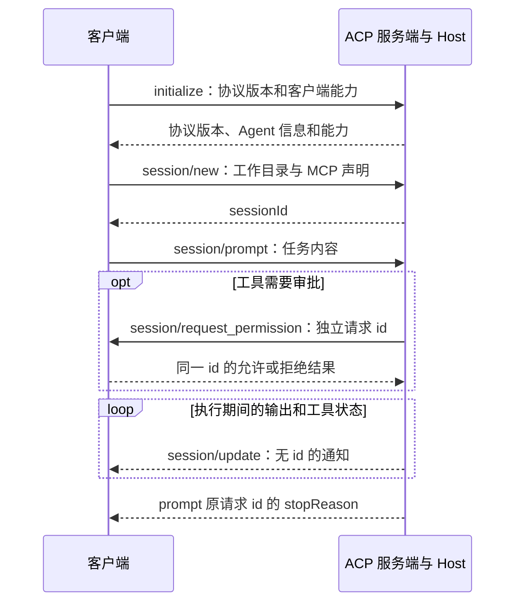

# 046 · 自己的ACP粘合层驱动同一个Host

阶段：R06。唯一前置：完成第 045 步，继续同一个工程。

<!-- harness-own-links:start -->
## 当前练习工程文件

以下链接指向 `harness-own` 的当前累计版本；本课下方的完整代码仍保留当步版本，二者可能不同。

[打开练习工程说明](../../../harness-own/README.md)

| 本课文件 | 当前练习工程文件 |
| --- | --- |
| `package.json` | [`harness-own/package.json`](../../../harness-own/package.json) |
| `src/acp-server.mjs` | [`harness-own/src/acp-server.mjs`](../../../harness-own/src/acp-server.mjs) |
| `src/acp.mjs` | [`harness-own/src/acp.mjs`](../../../harness-own/src/acp.mjs) |
| `tests/046-acp.test.mjs` | [`harness-own/tests/046-acp.test.mjs`](../../../harness-own/tests/046-acp.test.mjs) |

<!-- harness-own-links:end -->

## 什么时候会用到这一页

一个自动化客户端想让Harness修改临时工作区里的proof.txt：先建立ACP连接，创建会话，发送/tool write，回答一次权限请求，最后收到工具结果和end_turn。客户端只翻译协议，真正写文件的仍然是已有Host里的工具。

### 这次数据怎么走

```text
测试主进程ACP客户端 → stdio管道 → acp-server子进程 → acpApp的session/prompt → Host.open → Agent.submit/runTurn → Tools/审批/LocalFS → Session已提交事件 → ACP session/update；审批另走服务端 → 客户端request_permission → 服务端的Approvals.answer。
```

### 对应时序图

从上往下读；实线箭头表示调用或发送，虚线箭头表示返回或事件通知。`opt`表示可选操作，`alt`表示不同结果，`loop`表示重复，`par`及其`and`分支表示并行；“未接入”及fixture说明按图中标注理解。



**当前接线位置：**本章创建了可运行的ACP stdio服务，真正使用041的Host与既有Agent、工具和持久日志；不是内存echo。后续067复用acpApp做三个差分样本，但没有把以下缺口自动补齐。ACP入口也没有像051的Web入口那样装配capabilities。

## 这一步具体做什么

先写完本章的acp.mjs、acp-server.mjs和测试，并安装本章依赖，再在练习工程根目录运行env -u DEEPSEEK_API_KEY bun test ./tests/046-acp.test.mjs。对照测试找到三次prompt：hello、写proof.txt、/slow。记录每次的sessionId和stopReason；写入用自动允许回调完成，不会连接收费模型。

需要本章新文件的操作，先按下面代码创建文件，再执行；不要在上一步尚不存在的接口上试错。

## 代码为什么放在这一层

acpApp负责把标准ACP方法翻译成已有Host操作，再把会话事实翻译回标准更新。它不重新实现模型循环、权限或文件系统。pending表示某会话已有尚未结算的prompt；delivery链让本会话输出按顺序发送完后再返回结果。

## ACP 补充问答：管道、SDK、协议和 Host 到底怎么接

这一节整理学习本章时容易混在一起的几个问题。以教程固定的 `@agentclientprotocol/sdk@1.4.0` 和本章代码为依据；该 SDK 的稳定 ACP 协议版本为 `1`，SDK 包版本与协议版本分别编号。

### 1. SDK 走 stdio，ACP 是走 HTTP 吗？

本章的两种入口都走 stdio，但使用的业务方法不同：

| 入口 | 本章传输方式 | 方法示例 |
| --- | --- | --- |
| 第 044、045 课自己写的 Bun / Python SDK | stdio，JSON-RPC 消息按行发送 | `session.create`、`session.submit`、`session.wait` |
| 第 046 课 ACP | stdio，JSON-RPC 消息按行发送 | `initialize`、`session/new`、`session/prompt` |
| 后面的 Web 入口 | HTTP / WebSocket | 由 Web 接入层定义 |

stdio 回答“消息怎么运过去”；JSON-RPC 约定请求、响应、通知的信封；ACP 再约定 Agent 操作的方法名、参数、结果和能力协商。共用 stdio 不代表两种接口可以互换。

本章能力声明中的 `mcpCapabilities: { http: true }` 表示 Agent 可以接入 HTTP 类型的 MCP 工具服务，不表示客户端通过 HTTP 连接这个 ACP 服务。原版随附 ACP 应用也使用 stdio；这里不把其他版本或其他传输实现一概归为本章实现。

### 2. `child.stdin` 和 `child.stdout` 分别往哪边走？

站在测试客户端这一侧，向 `child.stdin` 写数据，就是给子进程的 `process.stdin` 发消息；从 `child.stdout` 读数据，就是接收子进程写到 `process.stdout` 的消息。

```mermaid
flowchart LR
    subgraph Client["客户端进程：046-acp.test.mjs"]
        direction TB
        Call["client.request / client.notify"]
        Encode["ACP SDK：JSON 转字节并加换行"]
        Write["Writable.toWeb(child.stdin)"]
        Read["Readable.toWeb(child.stdout)"]
        Decode["ACP SDK：按行拆分并 JSON.parse"]
        Dispatch["匹配响应、分发通知、处理审批请求"]
        Call --> Encode --> Write
        Read --> Decode --> Dispatch
    end
    subgraph Server["Host 子进程：acp-server.mjs"]
        direction TB
        Stdin["process.stdin"]
        Parse["ACP SDK：解析消息，按 method 分发"]
        Adapter["acp.mjs：协议参数转为业务调用"]
        Host["Host / Agent / 工具"]
        Send["ACP SDK：结果或通知转为 JSON 行"]
        Stdout["process.stdout"]
        Stdin --> Parse --> Adapter --> Host
        Host --> Send --> Stdout
    end
    Write ==>|"stdin 管道：客户端到 Host"| Stdin
    Stdout ==>|"stdout 管道：Host 到客户端"| Read
```



对应代码如下，参数顺序先写后读：

```javascript
// 写端用于发送给Host；读端用于接收Host发来的消息。
const stream = acp.ndJsonStream(
  Writable.toWeb(child.stdin),
  Readable.toWeb(child.stdout),
)
```

`Writable.toWeb`、`Readable.toWeb` 只是把 Node 风格的流转换成 Web Streams 接口，不负责解释 ACP。`ndJsonStream` 才负责 JSON 与换行字节流之间的转换；具体业务发送由 `request`、`notify`、处理函数返回结果等操作触发。

这里存在两条方向相反的单向管道，合起来支持双向通信。Host 的 stdout 不只有“对请求的回复”，也会出现主动通知和向客户端发起的审批请求。stderr 是单独的诊断通道，不混入 ACP 消息。

### 3. ACP 的消息具体长什么样？

以下会话 ID 简化为 `s1`。为便于阅读，JSON 展开显示；线上发送时每条消息压成一行，并在结尾添加换行。

客户端发送请求：有 `id`、`method` 和 `params`。

```json
{
  "jsonrpc": "2.0",
  "id": 2,
  "method": "session/prompt",
  "params": {
    "sessionId": "s1",
    "prompt": [{ "type": "text", "text": "hello" }]
  }
}
```

Agent 通过通知发送执行过程：有 `method`，没有 `id`，无需逐条回复。

```json
{
  "jsonrpc": "2.0",
  "method": "session/update",
  "params": {
    "sessionId": "s1",
    "update": {
      "sessionUpdate": "agent_message_chunk",
      "content": { "type": "text", "text": "[离线演示] hello" }
    }
  }
}
```

任务结束后，Agent 使用与请求相同的 `id` 返回结果：

```json
{
  "jsonrpc": "2.0",
  "id": 2,
  "result": { "stopReason": "end_turn" }
}
```

失败时返回 `error`，不返回成功的 `result`。例如非法参数错误的信封可以是：

```json
{
  "jsonrpc": "2.0",
  "id": 2,
  "error": { "code": -32602, "message": "Invalid params" }
}
```

`id` 是某次请求的编号；`sessionId` 是业务会话身份。一段会话会有很多请求，不能拿 sessionId 代替请求匹配。客户端和 Agent 各自生成自己的请求 id，所以两个方向出现相同数字也不表示同一个请求。

`await client.request(session/prompt, ...)` 最后得到结束原因。过程中生成的文字、工具状态由 `session/update` 通知传给回调；不能只看最终的 result 寻找完整回复。

### 4. 为什么 Host 也会向客户端发请求？

ACP 是双向通信。Host 执行写文件工具时，可以通过 `session/request_permission` 询问客户端“是否允许”；客户端负责展示选择或按自己的策略回答。本章测试的客户端自动选 `allow`，不是由模型决定授权。



假设 Agent 的审批请求 id 为 `0`，客户端选中允许一次，回复内容如下：

```json
{
  "jsonrpc": "2.0",
  "id": 0,
  "result": {
    "outcome": { "outcome": "selected", "optionId": "allow" }
  }
}
```

取消任务则是客户端发送 `session/cancel` 通知，不等待这条通知的响应。原来尚未完成的 `session/prompt` 会在取消结算后返回结果；本章测试检查其 `stopReason` 为 `cancelled`。

### 5. 为什么 ACP 直接用了 SDK，看不到底层实现？

这里有两个名字都带 SDK 的组件：第 044 课的 `src/sdk.mjs` 是自己写的 Harness SDK；本章导入的 `@agentclientprotocol/sdk` 是第三方 ACP SDK。本章没有通过前者转发请求。

当前课练习“接入标准 ACP SDK，并实现自己的 Agent 侧适配”。JSON 编解码、请求编号、等待表和方法分发使用库实现，没有要求学习者在本章重新实现整套标准协议。这部分与第 032 课手写的 Peer、pending 请求表、消息分发属于同类机制；实际兼容规则以 ACP SDK 为准。

| 观察点 | 当前固定 SDK 中的阅读位置 | 观察什么 |
| --- | --- | --- |
| 创建请求 | `node_modules/@agentclientprotocol/sdk/dist/jsonrpc.js` 的 `prepareRequest` | 生成 id，登记 pendingResponses，构造消息信封 |
| 发出消息 | 同文件的 `sendWireMessage` | 按写入队列送给 stream.writable |
| 字节编码 | `node_modules/@agentclientprotocol/sdk/dist/stream.js` 的 `writeJson` | JSON.stringify、加换行、TextEncoder、写管道 |
| 接收拆包 | 同文件的 `ndJsonStream` | 累积字节、按行拆分、JSON.parse；一次读取不保证只有一条 JSON |
| 方法分发 | `jsonrpc.js` 的 `processIncomingMessage`，以及 `ConnectionBuilder.onReceiveRequest` | 找到与 method 匹配的处理函数 |
| 回到业务 | 自己的 `src/acp.mjs` 的 `session/prompt` 处理函数 | host.open、agent.submit、agent.idle |
| 响应匹配 | `jsonrpc.js` 的 `handleResponse` | 按 id 找等待者，resolve(result) 或 reject(error) |

这些依赖文件的行号可能随版本变化，按函数名定位即可。可以在本地打开依赖源码阅读、设断点；不要直接修改 node_modules 作为自己的正式实现。客户端进程的断点观察发送与接收，服务端处理函数需要在子进程调试会话里观察，具体操作见本课末尾。

### 6. `acpApp(host)` 为什么要传 Host？Host 是按 ACP 接口实现的吗？

Host 有自己的业务接口：`create`、`open`、`list`、`closeSession`。ACP 适配层负责把标准方法和参数翻译成这些调用，Host 本身无需认识 `session/prompt` 这个协议方法名。

| ACP 方法 | `acpApp` 中对应的业务动作 |
| --- | --- |
| `session/new` | `host.create(...)`，返回 ACP sessionId 与配置选项 |
| `session/prompt` | `host.open(...)`、订阅事件、`agent.submit(...)`、等待执行与通知发送，再转换 stopReason |
| `session/list` | `host.list(...)`，转换成 ACP 会话列表 |
| `session/close` | `host.closeSession(...)`，返回 ACP 结果 |

服务端代码可以拆成三步看：

```javascript
// Host持有会话、Agent和执行资源，留在当前服务端进程。
const host = new Host(process.env.HARNESS_HOME)

// 适配层注册ACP方法的处理函数；函数通过闭包访问这份Host。
const app = acpApp(host)

// 接上当前进程的stdio，让消息进入已注册的处理函数。
const stream = ndJsonStream(
  Writable.toWeb(process.stdout),
  Readable.toWeb(process.stdin),
)
const connection = app.connect(stream)
```

这里是普通的本地函数调用，没有把 host 对象传过管道。跨进程传递的是 JSON；服务端按 JSON 中的 method 调用适配函数，再访问自己进程里的 Host。

也要区分 `acpApp(host)` 与 `app.connect(stream)`：前者建立“ACP 方法对应什么业务动作”的关系，后者把已有消息流接到这组处理函数上。Host 子进程由测试中的 spawn 启动，connect 不会替你另起一个进程。

因此 Bun/Python SDK 的 remote、ACP 的 acpApp、Web 接入层都可以调用同一套 Host 实现。这不表示所有入口自动连接同一个正在运行的 Host 进程，也不表示各自的权限、能力声明和会话可见性自动相同；要看入口实际装配。

### 7. 怎样打印管道里的消息，又不破坏协议？

本章测试已提供 `traceACPStream`，开启方式是：

```sh
env -u DEEPSEEK_API_KEY ACP_TRACE=1 bun test ./tests/046-acp.test.mjs
```

它在 `ndJsonStream` 与 `app.connect` 之间包装消息流：读取方向使用 `pipeThrough(new TransformStream(...))`，打印后继续 enqueue；写入方向包装 writable.write，打印后交给原 writer。这样看到的是完整 JSON 消息，而不是可能只包含半个 JSON、半个中文字符的字节块。

日志前缀区分 `[ACP Client → Host]` 和 `[ACP Host → Client]`，使用 console.error 输出到 stderr。打印请求和响应时对照 id，打印通知时对照 method 与 sessionId。消息日志能显示“传了什么”；上一张源码表帮助继续看“内部怎么实现”。

## 在哪里写、写什么

操作地点：终端中的 `$PROJECT`，编辑器打开同一个目录。只创建或替换下列文件，其他文件保留上一步版本。文件目录不存在先创建。

### 替换 [`package.json`](../../../harness-own/package.json)

````json
{
  "name": "harness-own",
  "version": "0.1.0",
  "type": "module",
  "private": true,
  "engines": {
    "bun": "1.3.14"
  },
  "scripts": {
    "start": "bun src/main.mjs",
    "test": "bun test ./tests"
  },
  "dependencies": {
    "@earendil-works/pi-ai": "1.1.0",
    "@modelcontextprotocol/sdk": "1.31.0",
    "@agentclientprotocol/sdk": "1.4.0",
    "zod": "4.4.3"
  },
  "packageManager": "bun@1.3.14"
}
````

```sh
mkdir -p src
```

### 创建 [`src/acp-server.mjs`](../../../harness-own/src/acp-server.mjs)

````javascript
import { Readable, Writable } from 'node:stream'
import { ndJsonStream } from '@agentclientprotocol/sdk'
import { Host } from './host.mjs'
import { acpApp } from './acp.mjs'

// 显式home，stdout只放ACP，服务退出清理自己拥有的所有会话。
if (!process.env.HARNESS_HOME) throw Error('ACP需要显式HARNESS_HOME')
const host = new Host(process.env.HARNESS_HOME)
const connection = acpApp(host).connect(ndJsonStream(Writable.toWeb(process.stdout), Readable.toWeb(process.stdin)))
try { await connection.closed } finally { await host.close() }
````

```sh
mkdir -p src
```

### 创建 [`src/acp.mjs`](../../../harness-own/src/acp.mjs)

````javascript
import * as acp from '@agentclientprotocol/sdk'
import { mountMCP } from './mcp.mjs'

/** ACP只做协议粘合，执行/持久化/权限仍用同一个Host。 */
export function acpApp(host, owner = 'acp') {
  const app = acp.agent({ name: 'harness-own' })
  const owned = new Set(), pending = new Set()
  const options = record => [{ id: 'model', category: 'model', name: '模型', type: 'select', currentValue: record.settings.snapshot().model ?? 'offline', options: [{ value: 'offline', name: '离线演示' }, { value: 'deepseek-flash', name: 'DeepSeek Flash' }] }]
  app.onRequest('initialize', () => ({ protocolVersion: acp.PROTOCOL_VERSION, agentInfo: { name: 'harness-own', version: '0.1.0' }, agentCapabilities: { mcpCapabilities: { http: true }, promptCapabilities: { image: false, audio: false, embeddedContext: false }, sessionCapabilities: { list: {}, resume: {}, close: {} } }, authMethods: [] }))
  app.onRequest('authenticate', () => ({}))
  app.onRequest('session/new', async ctx => {
    const record = host.create({ cwd: ctx.params.cwd, owner })
    try {
      for (const [index, server] of ctx.params.mcpServers.entries()) await mountMCP(record.scope, record.tools, 'acp' + index, server.type === 'http' ? { url: server.url, headers: Object.fromEntries((server.headers ?? []).map(item => [item.name, item.value])) } : { command: server.command, args: server.args, env: Object.fromEntries((server.env ?? []).map(item => [item.name, item.value])) })
      owned.add(record.header.id)
      return { sessionId: record.header.id, configOptions: options(record) }
    } catch (error) { await host.closeSession(record.header.id, owner); throw error }
  })
  app.onRequest('session/list', () => ({ sessions: host.list(owner).map(header => ({ sessionId: header.id, cwd: header.cwd, title: header.title, updatedAt: new Date(header.createdAt).toISOString() })) }))
  app.onRequest('session/resume', ctx => {
    const record = host.open(ctx.params.sessionId, owner)
    if (record.header.cwd !== ctx.params.cwd) throw acp.RequestError.invalidParams(undefined, '工作区不一致')
    owned.add(record.header.id); return { configOptions: options(record) }
  })
  app.onRequest('session/close', async ctx => { await host.closeSession(ctx.params.sessionId, owner); owned.delete(ctx.params.sessionId); return {} })
  app.onRequest('session/set_config_option', ctx => {
    const record = host.open(ctx.params.sessionId, owner)
    if (ctx.params.configId !== 'model' || !['offline', 'deepseek-flash'].includes(ctx.params.value)) throw acp.RequestError.invalidParams(undefined, '未知模型配置')
    record.settings.set({ model: ctx.params.value }); return { configOptions: options(record) }
  })
  app.onNotification('session/cancel', async ctx => { if (!owned.has(ctx.params.sessionId)) return; const record = host.open(ctx.params.sessionId, owner); record.agent.cancel(); await record.agent.idle() })
  app.onRequest('session/prompt', async ctx => {
    const sessionId = ctx.params.sessionId, record = host.open(sessionId, owner)
    if (pending.has(sessionId)) throw acp.RequestError.invalidParams(undefined, '会话已有prompt')
    if (ctx.params.prompt.some(part => part.type !== 'text')) throw acp.RequestError.invalidParams(undefined, '当前路由仅支持文本')
    pending.add(sessionId)
    let delivery = Promise.resolve(), deliveryError
    const unsubscribe = record.session.on(event => {
      let update
      if (event.type === 'message/assistant') update = { sessionUpdate: 'agent_message_chunk', content: { type: 'text', text: event.data.content }, messageId: 'message-' + event.seq }
      if (event.type === 'tool/start') update = { sessionUpdate: 'tool_call', toolCallId: event.data.call.id, title: event.data.call.name, kind: 'other', status: 'in_progress', rawInput: event.data.call.arguments }
      if (event.type === 'message/tool') update = { sessionUpdate: 'tool_call_update', toolCallId: event.data.callId, status: event.data.content.ok ? 'completed' : 'failed', rawOutput: event.data.content }
      if (update) delivery = delivery.then(() => ctx.client.notify(acp.methods.client.session.update, { sessionId, update })).catch(error => { deliveryError = error; record.agent.cancel() })
      if (event.type === 'approval/request') void ctx.client.request(acp.methods.client.session.requestPermission, { sessionId,
        toolCall: { toolCallId: event.data.question.call.id, title: event.data.question.call.name, status: 'pending', kind: 'other' },
        options: [{ optionId: 'allow', kind: 'allow_once', name: '允许一次' }, { optionId: 'deny', kind: 'reject_once', name: '拒绝' }],
      }).then(answer => { record.approvals.answer(sessionId, event.data.id, answer.outcome.outcome === 'selected' && answer.outcome.optionId === 'allow') }).catch(() => { try { record.approvals.answer(sessionId, event.data.id, false) } catch {} })
    })
    try {
      record.agent.submit(ctx.params.prompt.map(part => part.text).join('\n'))
      await record.agent.idle(); await delivery
      if (deliveryError) throw deliveryError
      const reason = record.session.read().filter(event => event.type === 'turn/end').at(-1)?.data.reason
      if (reason === 'error') throw acp.RequestError.internalError(undefined, 'Agent失败')
      return { stopReason: reason === 'cancelled' ? 'cancelled' : reason === 'length' ? 'max_tokens' : 'end_turn' }
    } finally { unsubscribe(); pending.delete(sessionId) }
  })
  return app
}
````

```sh
mkdir -p tests
```

### 创建 [`tests/046-acp.test.mjs`](../../../harness-own/tests/046-acp.test.mjs)

````javascript
import { test } from 'bun:test'
import assert from 'node:assert/strict'
import { spawn } from 'node:child_process'
import { Readable, Writable } from 'node:stream'
import { once } from 'node:events'
import * as acp from '@agentclientprotocol/sdk'
import { mkdtempSync, rmSync, readFileSync } from 'node:fs'
import { setTimeout as delay } from 'node:timers/promises'
import { join } from 'node:path'
import { tmpdir } from 'node:os'

/** 开关控制双向协议日志；原消息继续转发，日志只写stderr。 */
function traceACPStream(stream) {
  if (process.env.ACP_TRACE !== '1') return stream
  // 持有原写端，把ACP发出的每条消息打印后再原样交给SDK序列化。
  const writer = stream.writable.getWriter()
  return {
    readable: stream.readable.pipeThrough(new TransformStream({
      transform(message, controller) {
        console.error('[ACP Host → Client]', JSON.stringify(message))
        controller.enqueue(message)
      },
    })),
    writable: new WritableStream({
      write(message) {
        console.error('[ACP Client → Host]', JSON.stringify(message))
        return writer.write(message)
      },
      async close() { try { await writer.close() } finally { writer.releaseLock() } },
      async abort(reason) { try { await writer.abort(reason) } finally { writer.releaseLock() } },
    }),
  }
}

test('真实ACP SDK跨进程握手、prompt、语义输出、列表、关闭和恢复', async () => {
  const root = mkdtempSync(join(tmpdir(), 'own-acp-')), child = spawn(process.execPath, ['src/acp-server.mjs'], { env: { ...process.env, HARNESS_HOME: root }, stdio: ['pipe', 'pipe', 'pipe'] })
  child.stderr.resume()
  const exited = once(child, 'close')
  const updates = []
  const app = acp.client({ name: 'course' }).onNotification('session/update', ctx => { updates.push(ctx.params) }).onRequest('session/request_permission', () => ({ outcome: { outcome: 'selected', optionId: 'allow' } }))
  const stream = acp.ndJsonStream(Writable.toWeb(child.stdin), Readable.toWeb(child.stdout))
  const connection = app.connect(traceACPStream(stream))
  try {
    const client = connection.agent
    await client.request(acp.methods.agent.initialize, { protocolVersion: acp.PROTOCOL_VERSION, clientCapabilities: {} })
    const created = await client.request(acp.methods.agent.session.new, { cwd: root, mcpServers: [] })
    const result = await client.request(acp.methods.agent.session.prompt, { sessionId: created.sessionId, prompt: [{ type: 'text', text: 'hello' }] })
    assert.equal(result.stopReason, 'end_turn'); assert.ok(updates.some(event => event.update.sessionUpdate === 'agent_message_chunk'))
    await client.request(acp.methods.agent.session.prompt, { sessionId: created.sessionId, prompt: [{ type: 'text', text: '/tool write {\"path\":\"proof.txt\",\"text\":\"ok\"}' }] })
    assert.equal(readFileSync(join(root, 'proof.txt'), 'utf8'), 'ok')
    const slow = client.request(acp.methods.agent.session.prompt, { sessionId: created.sessionId, prompt: [{ type: 'text', text: '/slow' }] })
    await delay(20); await client.notify(acp.methods.agent.session.cancel, { sessionId: created.sessionId })
    assert.equal((await slow).stopReason, 'cancelled')
    assert.equal((await client.request(acp.methods.agent.session.list, {})).sessions.length, 1)
    await client.request(acp.methods.agent.session.close, { sessionId: created.sessionId })
    await client.request(acp.methods.agent.session.resume, { sessionId: created.sessionId, cwd: root, mcpServers: [] })
  } finally { child.stdin.end(); await exited; rmSync(root, { recursive: true, force: true }) }
})
````

## 运行命令与通过标准

```sh
cd "$PROJECT"
cp "$COURSE/locks/046.bun.lock" bun.lock
bun install --frozen-lockfile --ignore-scripts
bun test ./tests/046-acp.test.mjs
bun test
```

当前测试确实启动另一个Bun进程，用真实ACP SDK完成initialize/new、文字prompt、自动允许后的真实文件写入、取消、list、close和resume。它没有验证所有ACP方法、并发双会话、图片、资源链接、推理更新或请求级取消；取消测试里的20ms等待也不是首片到达的确定性屏障。

**本步证据的范围：**tests/046-acp.test.mjs是一项真实跨进程集成测试，磁盘和Host是真实的，外部模型使用OfflineModel，审批由测试自动回答。现有用例未断言未知会话、多会话隔离、错误回复、配置实际影响模型请求或连接故障。这里说明代码可执行的验收范围，不声称本次文档改写重新跑过测试。

## VS Code：断在哪里、看什么

在VS Code打开练习工程的tests/046-acp.test.mjs，选“Bun：当前测试”按F5。在const result = await client.request(...)、写文件prompt和assert.equal((await slow).stopReason, 'cancelled')处停下，监视created.sessionId、updates和result.stopReason；hello结束应为end_turn，取消应为cancelled。F10看SDK调用前后，F11只会进入主进程中的SDK。acp.mjs运行在子进程，本配置不会自动命中它；不要把主进程断点当成已调试服务端，也不要向服务端stdout打印日志。

操作位置：VS Code 打开的是自己的 `$PROJECT`，断点也设在这里的源码，不在教材的 `steps` 目录。

上面的说明若指定CLI、子进程、页面或Electron附加调试，就先按该流程操作；下面这组步骤只用于本章测试入口。“当前测试”不会自动附加子进程，也不会命中浏览器或Electron中的断点。

变量只在所属作用域可见：停在方法内部时看this和参数；要看测试里的局部变量，先在“调用堆栈”选择对应测试帧。正在等待的异步调用者不一定保留可求值的帧，此时在测试调用前后加断点再看，不把未定义误判成业务状态丢失。

沿用第 000 步安装的 Bun 扩展与 `.vscode/launch.json`；本章列出替换配置时，使用本章完整版本。

1. 打开本步测试文件 `tests/046-acp.test.mjs`，保持它为当前编辑器文件。
2. 在上面指定的函数内单击行号左侧设置断点。
3. “运行和调试”选择 **Bun：当前测试**，按 F5；它执行当前测试，工作目录固定为 PROJECT。
4. 在“变量 / 监视 / 调用堆栈 / 调试控制台”检查状态；F10 逐行执行，F11 进入函数，Shift+F11 返回，F5 继续，Shift+F5 停止。

验收：断点实际命中，能说出当前输入、状态和下一步；只看到进程启动不算完成。长时间暂停会影响真实取消、审批和网络超时，先检查时序，不删超时断言。修正后在集成终端运行 `bun test ./tests/046-acp.test.mjs`，再运行 `bun test`，保留全部断言。

## 不看答案，确认自己能解释

合上本章，画出一次write调用的五个节点：ACP客户端、ACP粘合层、Host/Agent、Tools、磁盘；在另一条反向箭头写request_permission，并写明真正决定允许的是谁。

完成后在 LEARNING.md 写一句实际结果和一个卡点。明天只重做这个卡点；第 3 天、第 7 天再做一次，能独立完成就继续下一页，不另开学习路线。

**再改一个条件验证：**练习：只在这份临时目录测试里，把客户端权限回调的optionId从allow改成deny，再补断言proof.txt不存在。完成后恢复示例。这个拒绝变体目前没有自动测试，不算已有验收，也不需要连接外部模型。

## 与当前原版还差哪些

对照本仓库固定原版 `687f282e8625c6b8d11ff58211a90524be2e4317`；这里的“当前”指该本地基线，不是未经检查的上游最新版。

**这一页已经实现：**

- 真实ACP SDK与Bun子进程stdio连接，stdout只承载协议。
- 一个连接内按会话保存prompt占位和有序更新链，文本prompt驱动已有Host。
- 基础会话列表、恢复、关闭、取消、写死的模型选项以及一次性允许/拒绝桥接。
- 发送已提交assistant文字和基础tool_call/tool_call_update。

**原版仍有、或本步尚未对齐的部分：**

- 原版从实时LLM目录生成provider/model/reasoning选项；这里仅写死offline与deepseek-flash，并只修改settings.model，不代表完成提供方切换。
- 原版支持resource_link以及满足路由和附件条件的图片；这里拒绝所有非text输入。
- 原版有thought、配置、上下文用量等标准更新；这里仅处理少量会话事件。
- 原版有分页cursor、规范工作区检查、提示词准入期间取消、$/cancel_request及更完整的后代/更新drain/关闭语义；本章没有等价覆盖。

**原版对照位置：**

- [packages/acp/acp/src/index.ts](../../../deepseek-harness/packages/acp/acp/src/index.ts)
- [packages/acp/acp/src/session.ts](../../../deepseek-harness/packages/acp/acp/src/session.ts)
- [packages/acp/acp/src/content.ts](../../../deepseek-harness/packages/acp/acp/src/content.ts)
- [packages/acp/acp/src/model-control.ts](../../../deepseek-harness/packages/acp/acp/src/model-control.ts)
- [packages/acp/acp/src/updates.ts](../../../deepseek-harness/packages/acp/acp/src/updates.ts)

本步测试通过只证明上面的具体行为；完整差距仍看 [COVERAGE.md](../COVERAGE.md)，不以文件数量、同名类或后面出现另一个模块代替接线证据。

下一步：[第 047 步](047.md)

## 在 VS Code 追 ACP 服务端

### 先打印双向协议消息

在自己的 PROJECT 中运行：

```sh
env -u DEEPSEEK_API_KEY ACP_TRACE=1 bun test ./tests/046-acp.test.mjs
```

测试中的 `traceACPStream(stream)` 会在 `app.connect(...)` 前包装流：收到的消息通过 `readable.pipeThrough(new TransformStream(...))` 打印；发出的消息通过包装后的 `writable` 打印并继续转发。打印的是 SDK 已拆好的完整 JSON 消息，不是可能被切成半行或多行的字节块。

`[ACP Client → Host]` 包含 initialize、session/new、session/prompt 等请求，也包含客户端对审批的回复；`[ACP Host → Client]` 包含请求结果、session/update 通知，以及服务端发起的 session/request_permission。沿着 JSON-RPC 的 id 找请求与响应，通知没有 id。

日志用 `console.error` 写到 stderr，不混入服务端的协议 stdout。默认不打印；VS Code 中要开启，在当前测试配置的 env 中增加 `"ACP_TRACE": "1"`，保留原有其他环境变量。

### 需要命中服务端断点时

本章测试是 ACP 客户端，`src/acp-server.mjs` 才是服务端进程。要命中服务端 prompt 和审批的断点，临时做以下调整：

1. 测试中的 spawn 参数改为 `['--inspect-wait=127.0.0.1:0', 'src/acp-server.mjs']`。
2. 同一个 spawn 的 stdio 改为 `['pipe', 'pipe', 'inherit']`，删除紧接着的 `child.stderr.resume()`，让调试地址直接显示，协议 stdout 保持不变。
3. 先选 **Bun：当前测试**，F5；立即再选 **Bun：附加子进程**，F5，粘贴完整 `ws://` 地址。在服务端 prompt 处理函数设断点，然后从调用堆栈切换客户端与服务端会话。
4. 记录一次 prompt → Host → Agent → update 的参数流。调试结束恢复临时改动，再正常运行本章测试与 `bun test`；取消时序的自动验收按原断言运行。

VS Code 只调试父进程时，服务端断点没有命中是进程边界问题，不代表这段代码没有执行。
