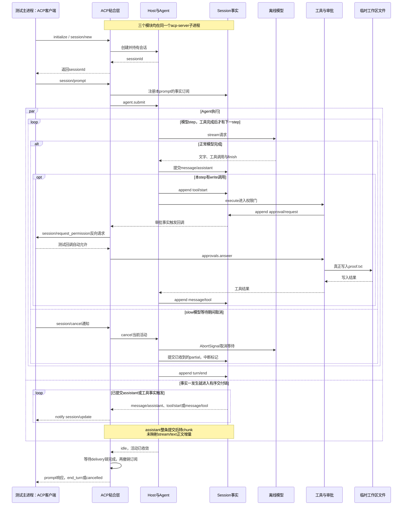

# 046 · 自己的ACP粘合层驱动同一个Host

阶段：R06。唯一前置：完成第 045 步，继续同一个工程。

## 什么时候会用到这一页

一个自动化客户端想让Harness修改临时工作区里的proof.txt：先建立ACP连接，创建会话，发送/tool write，回答一次权限请求，最后收到工具结果和end_turn。客户端只翻译协议，真正写文件的仍然是已有Host里的工具。

### 这次数据怎么走

```text
测试主进程ACP客户端 → stdio管道 → acp-server子进程 → acpApp的session/prompt → Host.open → Agent.submit/runTurn → Tools/审批/LocalFS → Session已提交事件 → ACP session/update；审批另走服务端 → 客户端request_permission → 服务端的Approvals.answer。
```

### 对应时序图

从上往下读；实线箭头表示调用或发送，虚线箭头表示返回或事件通知。`opt`表示可选操作，`alt`表示不同结果，`loop`表示重复，`par`及其`and`分支表示并行；“未接入”及fixture说明按图中标注理解。



**当前接线位置：**本章创建了可运行的ACP stdio服务，真正使用041的Host与既有Agent、工具和持久日志；不是内存echo。后续067复用acpApp做三个差分样本，但没有把以下缺口自动补齐。ACP入口也没有像051的Web入口那样装配capabilities。

## 这一步具体做什么

先写完本章的acp.mjs、acp-server.mjs和测试，并安装本章依赖，再在练习工程根目录运行env -u DEEPSEEK_API_KEY bun test ./tests/046-acp.test.mjs。对照测试找到三次prompt：hello、写proof.txt、/slow。记录每次的sessionId和stopReason；写入用自动允许回调完成，不会连接收费模型。

需要本章新文件的操作，先按下面代码创建文件，再执行；不要在上一步尚不存在的接口上试错。

## 代码为什么放在这一层

acpApp负责把标准ACP方法翻译成已有Host操作，再把会话事实翻译回标准更新。它不重新实现模型循环、权限或文件系统。pending表示某会话已有尚未结算的prompt；delivery链让本会话输出按顺序发送完后再返回结果。

## 在哪里写、写什么

操作地点：终端中的 `$PROJECT`，编辑器打开同一个目录。只创建或替换下列文件，其他文件保留上一步版本。文件目录不存在先创建。

### 替换 `package.json`

````json
{
  "name": "harness-own",
  "version": "0.1.0",
  "type": "module",
  "private": true,
  "engines": {
    "bun": "1.3.14"
  },
  "scripts": {
    "start": "bun src/main.mjs",
    "test": "bun test ./tests"
  },
  "dependencies": {
    "@earendil-works/pi-ai": "1.1.0",
    "@modelcontextprotocol/sdk": "1.31.0",
    "@agentclientprotocol/sdk": "1.4.0",
    "zod": "4.4.3"
  },
  "packageManager": "bun@1.3.14"
}
````

```sh
mkdir -p src
```

### 创建 `src/acp-server.mjs`

````javascript
import { Readable, Writable } from 'node:stream'
import { ndJsonStream } from '@agentclientprotocol/sdk'
import { Host } from './host.mjs'
import { acpApp } from './acp.mjs'

// 显式home，stdout只放ACP，服务退出清理自己拥有的所有会话。
if (!process.env.HARNESS_HOME) throw Error('ACP需要显式HARNESS_HOME')
const host = new Host(process.env.HARNESS_HOME)
const connection = acpApp(host).connect(ndJsonStream(Writable.toWeb(process.stdout), Readable.toWeb(process.stdin)))
try { await connection.closed } finally { await host.close() }
````

```sh
mkdir -p src
```

### 创建 `src/acp.mjs`

````javascript
import * as acp from '@agentclientprotocol/sdk'
import { mountMCP } from './mcp.mjs'

/** ACP只做协议粘合，执行/持久化/权限仍用同一个Host。 */
export function acpApp(host, owner = 'acp') {
  const app = acp.agent({ name: 'harness-own' })
  const owned = new Set(), pending = new Set()
  const options = record => [{ id: 'model', category: 'model', name: '模型', type: 'select', currentValue: record.settings.snapshot().model ?? 'offline', options: [{ value: 'offline', name: '离线演示' }, { value: 'deepseek-flash', name: 'DeepSeek Flash' }] }]
  app.onRequest('initialize', () => ({ protocolVersion: acp.PROTOCOL_VERSION, agentInfo: { name: 'harness-own', version: '0.1.0' }, agentCapabilities: { mcpCapabilities: { http: true }, promptCapabilities: { image: false, audio: false, embeddedContext: false }, sessionCapabilities: { list: {}, resume: {}, close: {} } }, authMethods: [] }))
  app.onRequest('authenticate', () => ({}))
  app.onRequest('session/new', async ctx => {
    const record = host.create({ cwd: ctx.params.cwd, owner })
    try {
      for (const [index, server] of ctx.params.mcpServers.entries()) await mountMCP(record.scope, record.tools, 'acp' + index, server.type === 'http' ? { url: server.url, headers: Object.fromEntries((server.headers ?? []).map(item => [item.name, item.value])) } : { command: server.command, args: server.args, env: Object.fromEntries((server.env ?? []).map(item => [item.name, item.value])) })
      owned.add(record.header.id)
      return { sessionId: record.header.id, configOptions: options(record) }
    } catch (error) { await host.closeSession(record.header.id, owner); throw error }
  })
  app.onRequest('session/list', () => ({ sessions: host.list(owner).map(header => ({ sessionId: header.id, cwd: header.cwd, title: header.title, updatedAt: new Date(header.createdAt).toISOString() })) }))
  app.onRequest('session/resume', ctx => {
    const record = host.open(ctx.params.sessionId, owner)
    if (record.header.cwd !== ctx.params.cwd) throw acp.RequestError.invalidParams(undefined, '工作区不一致')
    owned.add(record.header.id); return { configOptions: options(record) }
  })
  app.onRequest('session/close', async ctx => { await host.closeSession(ctx.params.sessionId, owner); owned.delete(ctx.params.sessionId); return {} })
  app.onRequest('session/set_config_option', ctx => {
    const record = host.open(ctx.params.sessionId, owner)
    if (ctx.params.configId !== 'model' || !['offline', 'deepseek-flash'].includes(ctx.params.value)) throw acp.RequestError.invalidParams(undefined, '未知模型配置')
    record.settings.set({ model: ctx.params.value }); return { configOptions: options(record) }
  })
  app.onNotification('session/cancel', async ctx => { if (!owned.has(ctx.params.sessionId)) return; const record = host.open(ctx.params.sessionId, owner); record.agent.cancel(); await record.agent.idle() })
  app.onRequest('session/prompt', async ctx => {
    const sessionId = ctx.params.sessionId, record = host.open(sessionId, owner)
    if (pending.has(sessionId)) throw acp.RequestError.invalidParams(undefined, '会话已有prompt')
    if (ctx.params.prompt.some(part => part.type !== 'text')) throw acp.RequestError.invalidParams(undefined, '当前路由仅支持文本')
    pending.add(sessionId)
    let delivery = Promise.resolve(), deliveryError
    const unsubscribe = record.session.on(event => {
      let update
      if (event.type === 'message/assistant') update = { sessionUpdate: 'agent_message_chunk', content: { type: 'text', text: event.data.content }, messageId: 'message-' + event.seq }
      if (event.type === 'tool/start') update = { sessionUpdate: 'tool_call', toolCallId: event.data.call.id, title: event.data.call.name, kind: 'other', status: 'in_progress', rawInput: event.data.call.arguments }
      if (event.type === 'message/tool') update = { sessionUpdate: 'tool_call_update', toolCallId: event.data.callId, status: event.data.content.ok ? 'completed' : 'failed', rawOutput: event.data.content }
      if (update) delivery = delivery.then(() => ctx.client.notify(acp.methods.client.session.update, { sessionId, update })).catch(error => { deliveryError = error; record.agent.cancel() })
      if (event.type === 'approval/request') void ctx.client.request(acp.methods.client.session.requestPermission, { sessionId,
        toolCall: { toolCallId: event.data.question.call.id, title: event.data.question.call.name, status: 'pending', kind: 'other' },
        options: [{ optionId: 'allow', kind: 'allow_once', name: '允许一次' }, { optionId: 'deny', kind: 'reject_once', name: '拒绝' }],
      }).then(answer => { record.approvals.answer(sessionId, event.data.id, answer.outcome.outcome === 'selected' && answer.outcome.optionId === 'allow') }).catch(() => { try { record.approvals.answer(sessionId, event.data.id, false) } catch {} })
    })
    try {
      record.agent.submit(ctx.params.prompt.map(part => part.text).join('\n'))
      await record.agent.idle(); await delivery
      if (deliveryError) throw deliveryError
      const reason = record.session.read().filter(event => event.type === 'turn/end').at(-1)?.data.reason
      if (reason === 'error') throw acp.RequestError.internalError(undefined, 'Agent失败')
      return { stopReason: reason === 'cancelled' ? 'cancelled' : reason === 'length' ? 'max_tokens' : 'end_turn' }
    } finally { unsubscribe(); pending.delete(sessionId) }
  })
  return app
}
````

```sh
mkdir -p tests
```

### 创建 `tests/046-acp.test.mjs`

````javascript
import { test } from 'bun:test'
import assert from 'node:assert/strict'
import { spawn } from 'node:child_process'
import { Readable, Writable } from 'node:stream'
import { once } from 'node:events'
import * as acp from '@agentclientprotocol/sdk'
import { mkdtempSync, rmSync, readFileSync } from 'node:fs'
import { setTimeout as delay } from 'node:timers/promises'
import { join } from 'node:path'
import { tmpdir } from 'node:os'

test('真实ACP SDK跨进程握手、prompt、语义输出、列表、关闭和恢复', async () => {
  const root = mkdtempSync(join(tmpdir(), 'own-acp-')), child = spawn(process.execPath, ['src/acp-server.mjs'], { env: { ...process.env, HARNESS_HOME: root }, stdio: ['pipe', 'pipe', 'pipe'] })
  child.stderr.resume()
  const exited = once(child, 'close')
  const updates = []
  const app = acp.client({ name: 'course' }).onNotification('session/update', ctx => { updates.push(ctx.params) }).onRequest('session/request_permission', () => ({ outcome: { outcome: 'selected', optionId: 'allow' } }))
  const connection = app.connect(acp.ndJsonStream(Writable.toWeb(child.stdin), Readable.toWeb(child.stdout)))
  try {
    const client = connection.agent
    await client.request(acp.methods.agent.initialize, { protocolVersion: acp.PROTOCOL_VERSION, clientCapabilities: {} })
    const created = await client.request(acp.methods.agent.session.new, { cwd: root, mcpServers: [] })
    const result = await client.request(acp.methods.agent.session.prompt, { sessionId: created.sessionId, prompt: [{ type: 'text', text: 'hello' }] })
    assert.equal(result.stopReason, 'end_turn'); assert.ok(updates.some(event => event.update.sessionUpdate === 'agent_message_chunk'))
    await client.request(acp.methods.agent.session.prompt, { sessionId: created.sessionId, prompt: [{ type: 'text', text: '/tool write {\"path\":\"proof.txt\",\"text\":\"ok\"}' }] })
    assert.equal(readFileSync(join(root, 'proof.txt'), 'utf8'), 'ok')
    const slow = client.request(acp.methods.agent.session.prompt, { sessionId: created.sessionId, prompt: [{ type: 'text', text: '/slow' }] })
    await delay(20); await client.notify(acp.methods.agent.session.cancel, { sessionId: created.sessionId })
    assert.equal((await slow).stopReason, 'cancelled')
    assert.equal((await client.request(acp.methods.agent.session.list, {})).sessions.length, 1)
    await client.request(acp.methods.agent.session.close, { sessionId: created.sessionId })
    await client.request(acp.methods.agent.session.resume, { sessionId: created.sessionId, cwd: root, mcpServers: [] })
  } finally { child.stdin.end(); await exited; rmSync(root, { recursive: true, force: true }) }
})
````

## 运行命令与通过标准

```sh
cd "$PROJECT"
cp "$COURSE/locks/046.bun.lock" bun.lock
bun install --frozen-lockfile --ignore-scripts
bun test ./tests/046-acp.test.mjs
bun test
```

当前测试确实启动另一个Bun进程，用真实ACP SDK完成initialize/new、文字prompt、自动允许后的真实文件写入、取消、list、close和resume。它没有验证所有ACP方法、并发双会话、图片、资源链接、推理更新或请求级取消；取消测试里的20ms等待也不是首片到达的确定性屏障。

**本步证据的范围：**tests/046-acp.test.mjs是一项真实跨进程集成测试，磁盘和Host是真实的，外部模型使用OfflineModel，审批由测试自动回答。现有用例未断言未知会话、多会话隔离、错误回复、配置实际影响模型请求或连接故障。这里说明代码可执行的验收范围，不声称本次文档改写重新跑过测试。

## VS Code：断在哪里、看什么

在VS Code打开练习工程的tests/046-acp.test.mjs，选“Bun：当前测试”按F5。在const result = await client.request(...)、写文件prompt和assert.equal((await slow).stopReason, 'cancelled')处停下，监视created.sessionId、updates和result.stopReason；hello结束应为end_turn，取消应为cancelled。F10看SDK调用前后，F11只会进入主进程中的SDK。acp.mjs运行在子进程，本配置不会自动命中它；不要把主进程断点当成已调试服务端，也不要向服务端stdout打印日志。

操作位置：VS Code 打开的是自己的 `$PROJECT`，断点也设在这里的源码，不在教材的 `steps` 目录。

上面的说明若指定CLI、子进程、页面或Electron附加调试，就先按该流程操作；下面这组步骤只用于本章测试入口。“当前测试”不会自动附加子进程，也不会命中浏览器或Electron中的断点。

变量只在所属作用域可见：停在方法内部时看this和参数；要看测试里的局部变量，先在“调用堆栈”选择对应测试帧。正在等待的异步调用者不一定保留可求值的帧，此时在测试调用前后加断点再看，不把未定义误判成业务状态丢失。

沿用第 000 步安装的 Bun 扩展与 `.vscode/launch.json`；本章列出替换配置时，使用本章完整版本。

1. 打开本步测试文件 `tests/046-acp.test.mjs`，保持它为当前编辑器文件。
2. 在上面指定的函数内单击行号左侧设置断点。
3. “运行和调试”选择 **Bun：当前测试**，按 F5；它执行当前测试，工作目录固定为 PROJECT。
4. 在“变量 / 监视 / 调用堆栈 / 调试控制台”检查状态；F10 逐行执行，F11 进入函数，Shift+F11 返回，F5 继续，Shift+F5 停止。

验收：断点实际命中，能说出当前输入、状态和下一步；只看到进程启动不算完成。长时间暂停会影响真实取消、审批和网络超时，先检查时序，不删超时断言。修正后在集成终端运行 `bun test ./tests/046-acp.test.mjs`，再运行 `bun test`，保留全部断言。

## 不看答案，确认自己能解释

合上本章，画出一次write调用的五个节点：ACP客户端、ACP粘合层、Host/Agent、Tools、磁盘；在另一条反向箭头写request_permission，并写明真正决定允许的是谁。

完成后在 LEARNING.md 写一句实际结果和一个卡点。明天只重做这个卡点；第 3 天、第 7 天再做一次，能独立完成就继续下一页，不另开学习路线。

**再改一个条件验证：**练习：只在这份临时目录测试里，把客户端权限回调的optionId从allow改成deny，再补断言proof.txt不存在。完成后恢复示例。这个拒绝变体目前没有自动测试，不算已有验收，也不需要连接外部模型。

## 与当前原版还差哪些

对照本仓库固定原版 `687f282e8625c6b8d11ff58211a90524be2e4317`；这里的“当前”指该本地基线，不是未经检查的上游最新版。

**这一页已经实现：**

- 真实ACP SDK与Bun子进程stdio连接，stdout只承载协议。
- 一个连接内按会话保存prompt占位和有序更新链，文本prompt驱动已有Host。
- 基础会话列表、恢复、关闭、取消、写死的模型选项以及一次性允许/拒绝桥接。
- 发送已提交assistant文字和基础tool_call/tool_call_update。

**原版仍有、或本步尚未对齐的部分：**

- 原版从实时LLM目录生成provider/model/reasoning选项；这里仅写死offline与deepseek-flash，并只修改settings.model，不代表完成提供方切换。
- 原版支持resource_link以及满足路由和附件条件的图片；这里拒绝所有非text输入。
- 原版有thought、配置、上下文用量等标准更新；这里仅处理少量会话事件。
- 原版有分页cursor、规范工作区检查、提示词准入期间取消、$/cancel_request及更完整的后代/更新drain/关闭语义；本章没有等价覆盖。

**原版对照位置：**

- [packages/acp/acp/src/index.ts](../../../deepseek-harness/packages/acp/acp/src/index.ts)
- [packages/acp/acp/src/session.ts](../../../deepseek-harness/packages/acp/acp/src/session.ts)
- [packages/acp/acp/src/content.ts](../../../deepseek-harness/packages/acp/acp/src/content.ts)
- [packages/acp/acp/src/model-control.ts](../../../deepseek-harness/packages/acp/acp/src/model-control.ts)
- [packages/acp/acp/src/updates.ts](../../../deepseek-harness/packages/acp/acp/src/updates.ts)

本步测试通过只证明上面的具体行为；完整差距仍看 [COVERAGE.md](../COVERAGE.md)，不以文件数量、同名类或后面出现另一个模块代替接线证据。

下一步：[第 047 步](047.md)

## 在 VS Code 追 ACP 服务端

本章测试是 ACP 客户端，`src/acp-server.mjs` 才是服务端进程。要命中服务端 prompt 和审批的断点，临时做以下调整：

1. 测试中的 spawn 参数改为 `['--inspect-wait=127.0.0.1:0', 'src/acp-server.mjs']`。
2. 同一个 spawn 的 stdio 改为 `['pipe', 'pipe', 'inherit']`，删除紧接着的 `child.stderr.resume()`，让调试地址直接显示，协议 stdout 保持不变。
3. 先选 **Bun：当前测试**，F5；立即再选 **Bun：附加子进程**，F5，粘贴完整 `ws://` 地址。在服务端 prompt 处理函数设断点，然后从调用堆栈切换客户端与服务端会话。
4. 记录一次 prompt → Host → Agent → update 的参数流。调试结束恢复临时改动，再正常运行本章测试与 `bun test`；取消时序的自动验收按原断言运行。

VS Code 只调试父进程时，服务端断点没有命中是进程边界问题，不代表这段代码没有执行。
