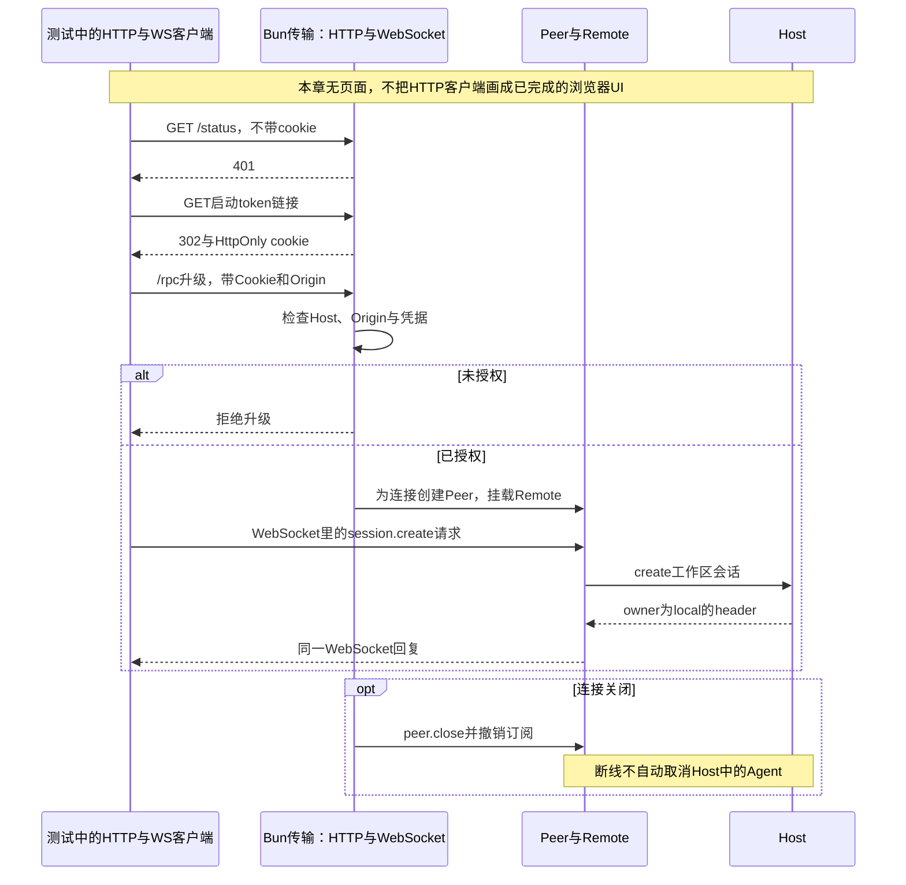

# 047 · 认证后的WebSocket复用领域Remote

阶段：R06。唯一前置：完成第 046 步，继续同一个工程。

<!-- harness-own-links:start -->
## 当前练习工程文件

以下链接指向 `harness-own` 的当前累计版本；本课下方的完整代码仍保留当步版本，二者可能不同。

[打开练习工程说明](../../../harness-own/README.md)

| 本课文件 | 当前练习工程文件 |
| --- | --- |
| `package.json` | [`harness-own/package.json`](../../../harness-own/package.json) |
| `src/http.mjs` | 尚未合入 harness-own |
| `src/web-server.mjs` | 尚未合入 harness-own |
| `tests/047-http.test.mjs` | 尚未合入 harness-own |

<!-- harness-own-links:end -->

## 什么时候会用到这一页

用户在浏览器打开本机Harness。未持有启动凭据时，不能创建会话；打开本次启动打印的链接后，服务换发HttpOnly cookie，再允许浏览器通过WebSocket调用同一个Host。

### 这次数据怎么走

```text
浏览器HTTP请求 → startHTTP检查Host和启动token → 302换cookie → WebSocket /rpc升级与认证 → Peer → Remote领域控制器 → Host；Session通知沿同一WebSocket返回。
```

### 对应时序图

从上往下读；实线箭头表示调用或发送，虚线箭头表示返回或事件通知。`opt`表示可选操作，`alt`表示不同结果，`loop`表示重复，`par`及其`and`分支表示并行；“未接入”及fixture说明按图中标注理解。



**当前接线位置：**startHTTP真正连接现有Peer、Remote和Host，049会给它提供页面，050/051会扩展同一个Host。它的自有JSON-RPC消息格式不会在后续自动变成原版Typert wire。

## 这一步具体做什么

先写完本章文件并安装依赖，再运行env -u DEEPSEEK_API_KEY bun test ./tests/047-http.test.mjs。按顺序查看测试中的/status响应401、bootstrap响应302和set-cookie，再查看WebSocket上的session.create结果owner=local。本章还没有创建web/index.html，认证后访问首页得到404是预期，不要把它当成Host启动失败。

需要本章新文件的操作，先按下面代码创建文件，再执行；不要在上一步尚不存在的接口上试错。

## 代码为什么放在这一层

HTTP/WS层只决定谁能接入、怎么传输和断线时如何清理连接。Remote负责session.create等业务；连接断开只撤销订阅，不自动取消Host里已接受的任务，这样刷新页面不会把工作杀掉。

## 在哪里写、写什么

操作地点：终端中的 `$PROJECT`，编辑器打开同一个目录。只创建或替换下列文件，其他文件保留上一步版本。文件目录不存在先创建。

### 替换 [`package.json`](../../../harness-own/package.json)

````json
{
  "name": "harness-own",
  "version": "0.1.0",
  "type": "module",
  "private": true,
  "engines": {
    "bun": "1.3.14"
  },
  "scripts": {
    "start": "bun src/main.mjs",
    "test": "bun test ./tests"
  },
  "dependencies": {
    "@earendil-works/pi-ai": "1.1.0",
    "@modelcontextprotocol/sdk": "1.31.0",
    "@agentclientprotocol/sdk": "1.4.0",
    "zod": "4.4.3",
    "ws": "8.18.3"
  },
  "packageManager": "bun@1.3.14"
}
````

```sh
mkdir -p src
```

### 创建 `src/http.mjs`

````javascript
import { createServer } from 'node:http'
import { randomBytes, timingSafeEqual } from 'node:crypto'
import { readFile } from 'node:fs/promises'
import { fileURLToPath } from 'node:url'
import { WebSocketServer } from 'ws'
import { Peer } from './rpc.mjs'
import { remote } from './remote.mjs'

/** Web传输只装配认证和Peer；业务仍是已有Remote控制器。 */
export async function startHTTP(host, { port = 0 } = {}) {
  const token = randomBytes(32).toString('base64url'), connections = new Set()
  const equal = value => typeof value === 'string' && Buffer.byteLength(value) === Buffer.byteLength(token) && timingSafeEqual(Buffer.from(value), Buffer.from(token))
  let authority
  const authorized = request => request.headers.host === authority && equal(/(?:^|;\s*)harness=([^;]+)/.exec(request.headers.cookie ?? '')?.[1]) && (!request.headers.origin || request.headers.origin === 'http://' + authority)
  const server = createServer(async (request, response) => {
    const url = new URL(request.url, 'http://' + authority)
    if (request.headers.host !== authority) { response.writeHead(403); response.end(); return }
    if (url.pathname === '/' && equal(url.searchParams.get('token'))) {
      response.writeHead(302, { location: '/', 'set-cookie': 'harness=' + token + '; HttpOnly; SameSite=Strict; Path=/', 'referrer-policy': 'no-referrer' }); response.end(); return
    }
    if (!authorized(request)) { response.writeHead(401); response.end('Unauthorized'); return }
    const assets = { '/': ['../web/index.html', 'text/html; charset=utf-8'], '/app.mjs': ['../web/app.mjs', 'text/javascript; charset=utf-8'], '/view.mjs': ['./view.mjs', 'text/javascript; charset=utf-8'] }
    if (assets[url.pathname]) {
      try { response.setHeader('content-type', assets[url.pathname][1]); response.end(await readFile(fileURLToPath(new URL(assets[url.pathname][0], import.meta.url)))) }
      catch { response.writeHead(404); response.end('Web文件将在第049步创建') }
    } else { response.setHeader('content-type', 'application/json'); response.end(JSON.stringify({ service: 'harness-own', transport: 'websocket', model: 'explicitly-configured' })) }
  })
  const sockets = new WebSocketServer({ noServer: true, maxPayload: 2 * 1024 * 1024 })
  server.on('upgrade', (request, socket, head) => {
    if (!authorized(request) || request.url !== '/rpc') { socket.end('HTTP/1.1 401 Unauthorized\r\n\r\n'); return }
    sockets.handleUpgrade(request, socket, head, ws => {
      connections.add(ws)
      const peer = new Peer(message => {
        if (ws.bufferedAmount > 1024 * 1024) { ws.close(1008, 'slow consumer'); throw Error('消费者过慢') }
        ws.send(JSON.stringify(message))
      })
      remote(peer, host, 'local')
      ws.on('message', bytes => { try { void peer.receive(JSON.parse(bytes.toString())).catch(() => ws.close(1008)) } catch { ws.close(1008) } })
      ws.on('close', () => { connections.delete(ws); peer.close() }); ws.on('error', () => peer.close())
    })
  })
  await new Promise((resolve, reject) => { server.once('error', reject); server.listen(port, '127.0.0.1', resolve) })
  authority = '127.0.0.1:' + server.address().port
  return { url: 'http://' + authority, bootstrap: 'http://' + authority + '/?token=' + token,
    async close() { for (const ws of connections) ws.terminate(); sockets.close(); server.closeAllConnections(); await new Promise(resolve => server.close(resolve)) },
  }
}
````

```sh
mkdir -p src
```

### 创建 `src/web-server.mjs`

````javascript
import { Host } from './host.mjs'
import { DeepSeekModel } from './deepseek.mjs'
import { startHTTP } from './http.mjs'

if (!process.env.HARNESS_HOME) throw Error('请显式设置HARNESS_HOME，避免与日常数据混用')
const host = new Host(process.env.HARNESS_HOME, process.env.DEEPSEEK_API_KEY ? () => new DeepSeekModel({ key: process.env.DEEPSEEK_API_KEY, model: process.env.DSH_MODEL ?? 'deepseek-flash' }) : undefined)
const web = await startHTTP(host, { port: Number(process.env.HARNESS_PORT ?? 0) })
console.log('打开：' + web.bootstrap)
let closing = false
const close = async () => { if (closing) return; closing = true; await web.close(); await host.close() }
process.on('SIGINT', close); process.on('SIGTERM', close)
````

```sh
mkdir -p tests
```

### 创建 `tests/047-http.test.mjs`

````javascript
import { test } from 'bun:test'
import assert from 'node:assert/strict'
import { once } from 'node:events'
import { WebSocket } from 'ws'
import { Host } from '../src/host.mjs'
import { startHTTP } from '../src/http.mjs'
import { Peer } from '../src/rpc.mjs'
import { mkdtempSync, rmSync } from 'node:fs'
import { join } from 'node:path'
import { tmpdir } from 'node:os'

test('真实HTTP认证交换和WebSocket领域调用', async () => {
  const root = mkdtempSync(join(tmpdir(), 'own-http-')), host = new Host(root), web = await startHTTP(host)
  let ws
  try {
    assert.equal((await fetch(web.url + '/status')).status, 401)
    const bootstrap = await fetch(web.bootstrap, { redirect: 'manual' }), cookie = bootstrap.headers.get('set-cookie').split(';')[0]
    assert.equal(bootstrap.status, 302)
    ws = new WebSocket(web.url.replace('http:', 'ws:') + '/rpc', { headers: { Cookie: cookie, Origin: web.url } })
    await once(ws, 'open')
    const client = new Peer(message => ws.send(JSON.stringify(message)))
    ws.on('message', bytes => void client.receive(JSON.parse(bytes.toString())))
    const header = await client.request('session.create', { cwd: root })
    assert.equal(header.owner, 'local')
    client.close()
  } finally { ws?.terminate(); await web.close(); await host.close(); rmSync(root, { recursive: true, force: true }) }
})
````

## 运行命令与通过标准

```sh
cd "$PROJECT"
cp "$COURSE/locks/047.bun.lock" bun.lock
bun install --frozen-lockfile --ignore-scripts
bun test ./tests/047-http.test.mjs
bun test
```

测试会真实监听本机HTTP端口，完成401/302认证交换并通过真实WebSocket创建会话。它没有验证页面、伪Host/跨域Origin、慢消费者、重连或断线后的Agent存活；这些不能仅凭源码里有判断就算测试通过。

**本步证据的范围：**tests/047-http.test.mjs实际启动本机HTTP和WebSocket，创建临时Host并清理。外部模型不被调用，认证凭据只属于该临时服务。单项测试仅断言401、302和session.create的owner；本次文档修改未新增或重跑其他网络安全测试。

## VS Code：断在哪里、看什么

在tests/047-http.test.mjs选择“Bun：当前测试”按F5，给src/http.mjs的authorized、server.on('upgrade')和remote(peer, host, 'local')设断点。监视request.headers.host、request.headers.origin、authority、cookie是否存在，F10比较认证前后；不要复制真实token到日志。F11进入src/remote.mjs的session.create处理，再进入Host.create，返回header.owner应为local。这些Host代码和测试在同一进程，可直接命中。

操作位置：VS Code 打开的是自己的 `$PROJECT`，断点也设在这里的源码，不在教材的 `steps` 目录。

上面的说明若指定CLI、子进程、页面或Electron附加调试，就先按该流程操作；下面这组步骤只用于本章测试入口。“当前测试”不会自动附加子进程，也不会命中浏览器或Electron中的断点。

变量只在所属作用域可见：停在方法内部时看this和参数；要看测试里的局部变量，先在“调用堆栈”选择对应测试帧。正在等待的异步调用者不一定保留可求值的帧，此时在测试调用前后加断点再看，不把未定义误判成业务状态丢失。

沿用第 000 步安装的 Bun 扩展与 `.vscode/launch.json`；本章列出替换配置时，使用本章完整版本。

1. 打开本步测试文件 `tests/047-http.test.mjs`，保持它为当前编辑器文件。
2. 在上面指定的函数内单击行号左侧设置断点。
3. “运行和调试”选择 **Bun：当前测试**，按 F5；它执行当前测试，工作目录固定为 PROJECT。
4. 在“变量 / 监视 / 调用堆栈 / 调试控制台”检查状态；F10 逐行执行，F11 进入函数，Shift+F11 返回，F5 继续，Shift+F5 停止。

验收：断点实际命中，能说出当前输入、状态和下一步；只看到进程启动不算完成。长时间暂停会影响真实取消、审批和网络超时，先检查时序，不删超时断言。修正后在集成终端运行 `bun test ./tests/047-http.test.mjs`，再运行 `bun test`，保留全部断言。

## 不看答案，确认自己能解释

合上代码，写出401、302、WebSocket升级、session.create四步各是谁处理；再用一句话说明“浏览器断线”和“取消Agent”为什么不是同一个操作。

完成后在 LEARNING.md 写一句实际结果和一个卡点。明天只重做这个卡点；第 3 天、第 7 天再做一次，能独立完成就继续下一页，不另开学习路线。

**再改一个条件验证：**练习：在本机临时测试里保持cookie不变，把WebSocket Origin改为https://example.invalid，补上升级被拒绝的断言。此拒绝用例当前尚未写入测试；不要开放公网监听，也不用真实模型。

## 与当前原版还差哪些

对照本仓库固定原版 `687f282e8625c6b8d11ff58211a90524be2e4317`；这里的“当前”指该本地基线，不是未经检查的上游最新版。

**这一页已经实现：**

- 回环HTTP服务器、启动token换HttpOnly/SameSite cookie、基础Host与Origin检查。
- 认证后的WebSocket双向消息、最大消息和发送缓冲检查。
- 连接关闭撤销Peer和订阅；业务继续由Remote/Host处理。

**原版仍有、或本步尚未对齐的部分：**

- 原版Connection使用Typert Remote和具备Peer身份/作用域的连接协议；这里是自有JSON-RPC，协议不兼容。
- 原版有签名cookie、有效期/身份策略、精确Fetch桥和更完整的浏览器信任栅栏；这里仅用本次启动的随机token做cookie值。
- 原版有ready握手、generation、错误恢复和重试状态；本章没有。
- 原版WebServer提供插件路由注册、TLS和静态入口分层；这里硬编码少量资源路径。

**原版对照位置：**

- [packages/client/connection/src/browser-auth.ts](../../../deepseek-harness/packages/client/connection/src/browser-auth.ts)
- [packages/client/connection/src/api-request-trust.ts](../../../deepseek-harness/packages/client/connection/src/api-request-trust.ts)
- [packages/client/connection/src/rpc.ts](../../../deepseek-harness/packages/client/connection/src/rpc.ts)
- [packages/client/connection/src/rpc-host.ts](../../../deepseek-harness/packages/client/connection/src/rpc-host.ts)
- [packages/host/webserver/src/index.ts](../../../deepseek-harness/packages/host/webserver/src/index.ts)

本步测试通过只证明上面的具体行为；完整差距仍看 [COVERAGE.md](../COVERAGE.md)，不以文件数量、同名类或后面出现另一个模块代替接线证据。

下一步：[第 048 步](048.md)
