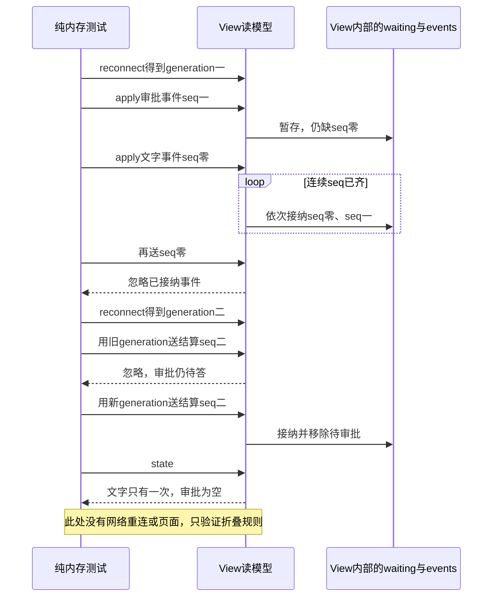

# 048 · 先写重连读模型，再画页面

阶段：R07。唯一前置：完成第 047 步，继续同一个工程。

<!-- harness-own-links:start -->
## 当前练习工程文件

以下链接指向 `harness-own` 的当前累计版本；本课下方的完整代码仍保留当步版本，二者可能不同。

[打开练习工程说明](../../../harness-own/README.md)

| 本课文件 | 当前练习工程文件 |
| --- | --- |
| `src/view.mjs` | 尚未合入 harness-own |
| `tests/048-view.test.mjs` | 尚未合入 harness-own |

<!-- harness-own-links:end -->

## 什么时候会用到这一页

浏览器重连时，实时通知可能先于历史快照到达：先收到seq=1的审批，再收到seq=0的文字；同一条通知还可能重送。页面需要按顺序展示一次，并且不让旧连接的回复改变新连接状态。

### 这次数据怎么走

```text
快照事件或实时通知 → View.apply(event, generation) → 拒绝旧连接和已接纳seq → waiting暂存缺口 → 按seq连续接纳到events → View.state折叠消息、流文字、工具和待审批 → 后续页面render。
```

### 对应时序图

从上往下读；实线箭头表示调用或发送，虚线箭头表示返回或事件通知。`opt`表示可选操作，`alt`表示不同结果，`loop`表示重复，`par`及其`and`分支表示并行；“未接入”及fixture说明按图中标注理解。



**当前接线位置：**本章仅完成View类及单测；049的真实页面会调用它。View本身既不建立连接也不请求快照；后续页面重连仍不是原版ConnectionController的完整实现。

## 这一步具体做什么

先写完src/view.mjs和本章测试，再运行bun test ./tests/048-view.test.mjs。按测试顺序记录每次apply后的seq和waiting.size：先seq1会等待，补seq0后连续接纳到1，重复seq0不追加；reconnect后旧generation的seq2被忽略，新generation的seq2才移除审批。这里没有浏览器或网络请求。

需要本章新文件的操作，先按下面代码创建文件，再执行；不要在上一步尚不存在的接口上试错。

## 代码为什么放在这一层

View是页面的读模型：只整理已经发生的事实，不负责执行工具。seq解决同一会话事件的顺序与重复，generation解决消息属于哪一次连接；这两个数字不能相互替代。

## 在哪里写、写什么

操作地点：终端中的 `$PROJECT`，编辑器打开同一个目录。只创建或替换下列文件，其他文件保留上一步版本。文件目录不存在先创建。

```sh
mkdir -p src
```

### 创建 `src/view.mjs`

````javascript
/** Client读模型按seq去重，连接generation只用来拒绝旧连接。 */
export class View {
  generation = 0
  seq = -1
  events = []
  waiting = new Map()
  /** 重连重新订阅快照，保留已经接纳的位置，不重复拼接文字。 */
  reconnect() { return ++this.generation }
  apply(event, generation = this.generation) {
    if (generation !== this.generation || event.seq <= this.seq) return
    if (event.seq - this.seq > 10_000) throw Error('视图事件缺口过大，需要重载')
    this.waiting.set(event.seq, event)
    while (this.waiting.has(this.seq + 1)) {
      this.seq++; this.events.push(this.waiting.get(this.seq)); this.waiting.delete(this.seq)
    }
  }
  /** 待审批与已提交消息从同一事实派生，刷新不会复活旧按钮。 */
  state() {
    const approvals = new Map(), stream = new Map(), messages = [], tools = new Map()
    for (const event of this.events) {
      const value = event.data
      if (event.type === 'approval/request') approvals.set(value.id, value)
      if (event.type === 'approval/settled') approvals.delete(value.id)
      if (event.type === 'stream/text') stream.set(value.requestId, (stream.get(value.requestId) ?? '') + value.text)
      if (event.type === 'message/assistant' || event.type === 'message/user') { messages.push(value); if (event.type === 'message/assistant') stream.clear() }
      if (event.type === 'tool/start') tools.set(value.call.id, { name: value.call.name, status: 'running', input: value.call.arguments })
      if (event.type === 'message/tool') tools.set(value.callId, { ...tools.get(value.callId), status: value.content.ok ? 'completed' : 'failed', result: value.content })
    }
    return { approvals: [...approvals.values()], messages, text: [...stream.values()].join(''), tools: [...tools.values()] }
  }
}
````

```sh
mkdir -p tests
```

### 创建 `tests/048-view.test.mjs`

````javascript
import { test } from 'bun:test'
import assert from 'node:assert/strict'
import { View } from '../src/view.mjs'

test('快照与通知交错不重复，旧连接不污染新视图，审批迟答不复活', () => {
  const view = new View(), first = view.reconnect()
  const events = [{ seq: 0, type: 'stream/text', data: { requestId: 'r', text: 'a' } }, { seq: 1, type: 'approval/request', data: { id: 'p' } }, { seq: 2, type: 'approval/settled', data: { id: 'p' } }]
  view.apply(events[1], first); view.apply(events[0], first); view.apply(events[0], first)
  assert.equal(view.state().text, 'a')
  const second = view.reconnect(); view.apply(events[2], first)
  assert.equal(view.state().approvals.length, 1)
  view.apply(events[2], second); assert.equal(view.state().approvals.length, 0)
})
````

## 运行命令与通过标准

```sh
cd "$PROJECT"
bun test ./tests/048-view.test.mjs
bun test
```

纯内存测试验证乱序暂存、重复文字不追加、旧generation不结算新视图审批以及新generation结算审批。它不证明真正断网重连、快照下载、流控、有界历史或完整原版会话投影。

**本步证据的范围：**tests/048-view.test.mjs是一项同步内存单测，没有Host、浏览器、WebSocket、磁盘或模型。它覆盖测试里列出的三个事件和两个generation；文档不把它扩大成完整客户端恢复验收。

## VS Code：断在哪里、看什么

在VS Code打开tests/048-view.test.mjs，选“Bun：当前测试”按F5。给src/view.mjs的this.waiting.set、while (this.waiting.has(this.seq + 1))及generation比较设断点；监视event.seq、generation、this.generation、this.seq和this.waiting.size。用F10逐次apply，第一条seq1后this.seq应为-1，补seq0后应为1。F11进入state观察approval/settled怎样删除id=p。

操作位置：VS Code 打开的是自己的 `$PROJECT`，断点也设在这里的源码，不在教材的 `steps` 目录。

上面的说明若指定CLI、子进程、页面或Electron附加调试，就先按该流程操作；下面这组步骤只用于本章测试入口。“当前测试”不会自动附加子进程，也不会命中浏览器或Electron中的断点。

变量只在所属作用域可见：停在方法内部时看this和参数；要看测试里的局部变量，先在“调用堆栈”选择对应测试帧。正在等待的异步调用者不一定保留可求值的帧，此时在测试调用前后加断点再看，不把未定义误判成业务状态丢失。

沿用第 000 步安装的 Bun 扩展与 `.vscode/launch.json`；本章列出替换配置时，使用本章完整版本。

1. 打开本步测试文件 `tests/048-view.test.mjs`，保持它为当前编辑器文件。
2. 在上面指定的函数内单击行号左侧设置断点。
3. “运行和调试”选择 **Bun：当前测试**，按 F5；它执行当前测试，工作目录固定为 PROJECT。
4. 在“变量 / 监视 / 调用堆栈 / 调试控制台”检查状态；F10 逐行执行，F11 进入函数，Shift+F11 返回，F5 继续，Shift+F5 停止。

验收：断点实际命中，能说出当前输入、状态和下一步；只看到进程启动不算完成。长时间暂停会影响真实取消、审批和网络超时，先检查时序，不删超时断言。修正后在集成终端运行 `bun test ./tests/048-view.test.mjs`，再运行 `bun test`，保留全部断言。

## 不看答案，确认自己能解释

闭卷写一个四行事件表：seq1、seq0、重复seq0、seq2，并在旁边标出哪些等待、哪些接纳、哪些忽略；再写出generation不匹配时为什么不能修改状态。

完成后在 LEARNING.md 写一句实际结果和一个卡点。明天只重做这个卡点；第 3 天、第 7 天再做一次，能独立完成就继续下一页，不另开学习路线。

**再改一个条件验证：**练习：在这份纯内存测试里把seq2安排在快照seq0/seq1之前，预测waiting的变化，再补断言最终三条各出现一次。它是新增练习，当前测试没有这个排列；不需要添加另一套网络实现。

## 与当前原版还差哪些

对照本仓库固定原版 `687f282e8625c6b8d11ff58211a90524be2e4317`；这里的“当前”指该本地基线，不是未经检查的上游最新版。

**这一页已经实现：**

- 通过seq暂存乱序、去重并连续接纳事件。
- 通过generation忽略旧连接事件，对过大seq缺口报错。
- 从少量事件类型派生消息、流文字、工具状态和待审批列表。

**原版仍有、或本步尚未对齐的部分：**

- 原版有独立的会话投影、conversation节点和chunkrow处理；本章仅识别少量字符串事件。
- 本章events一直增长，state每次扫描全部历史，没有原版的增量节点折叠和窗口管理。
- reconnect只增加generation，不清理waiting或完成网络ready握手；不等价于原版连接恢复。
- 未处理所有终态、媒体、子Agent、上下文位置及原版持久日志格式。

**原版对照位置：**

- [packages/session/session-projection/src/index.ts](../../../deepseek-harness/packages/session/session-projection/src/index.ts)
- [packages/client/ui-conversation/src/client/conversation/assembler.ts](../../../deepseek-harness/packages/client/ui-conversation/src/client/conversation/assembler.ts)
- [packages/client/ui-conversation/src/client/conversation/event-registry.ts](../../../deepseek-harness/packages/client/ui-conversation/src/client/conversation/event-registry.ts)
- [packages/client/connection/README.zh.md](../../../deepseek-harness/packages/client/connection/README.zh.md)

本步测试通过只证明上面的具体行为；完整差距仍看 [COVERAGE.md](../COVERAGE.md)，不以文件数量、同名类或后面出现另一个模块代替接线证据。

下一步：[第 049 步](049.md)
