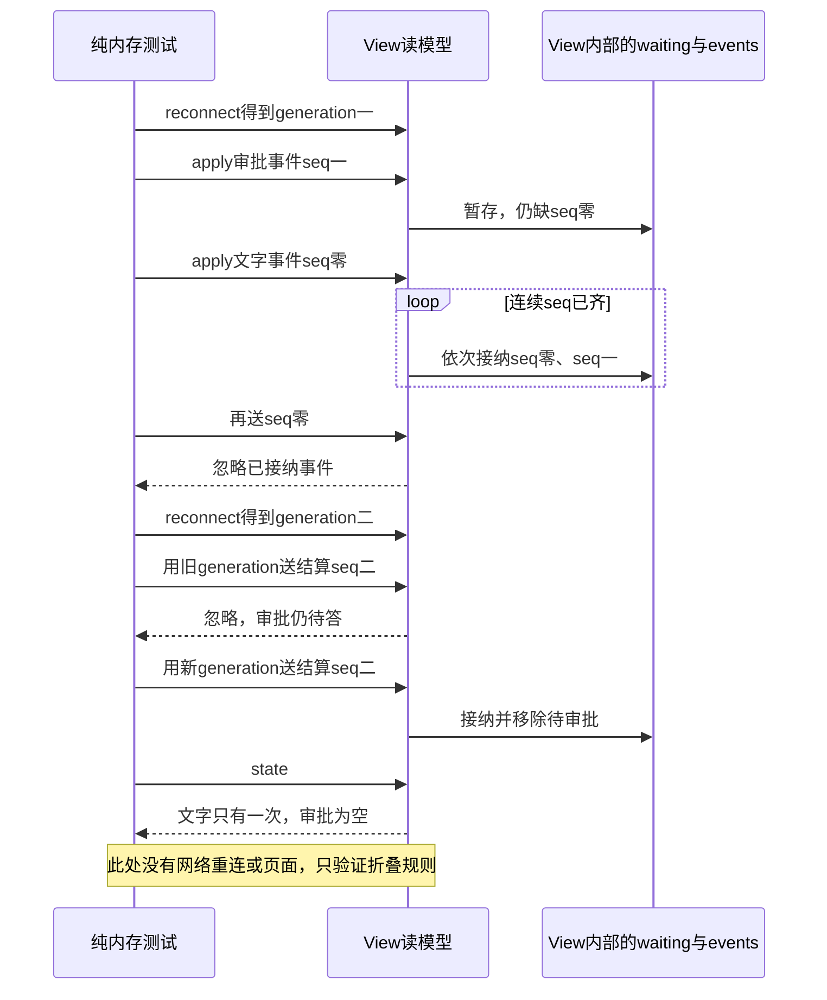

# 048 · 先写重连读模型，再画页面

阶段：R07。唯一前置：完成第 047 步，继续同一个工程。

<!-- harness-own-links:start -->
## 当前练习工程文件

以下链接指向 `harness-own` 的当前累计版本；本课下方的完整代码仍保留当步版本，二者可能不同。

[打开练习工程说明](../../../harness-own/README.md)

| 本课文件 | 当前练习工程文件 |
| --- | --- |
| `.vscode/launch.json` | 使用本页下方的本节专用配置，不复制累计版本 |
| `src/view.mjs` | [`harness-own/src/view.mjs`](../../../harness-own/src/view.mjs) |
| `tests/048-view.test.mjs` | [`harness-own/tests/048-view.test.mjs`](../../../harness-own/tests/048-view.test.mjs) |

<!-- harness-own-links:end -->

## 什么时候会用到这一页

浏览器重连时，实时通知可能先于历史快照到达：先收到seq=1的审批，再收到seq=0的文字；同一条通知还可能重送。页面需要按顺序展示一次，并且不让旧连接的回复改变新连接状态。

### 这次数据怎么走

```text
快照事件或实时通知 → View.apply(event, generation) → 拒绝旧连接和已接纳seq → waiting暂存缺口 → 按seq连续接纳到events → View.state折叠消息、流文字、工具和待审批 → 后续页面render。
```

### 对应时序图

从上往下读；实线箭头表示调用或发送，虚线箭头表示返回或事件通知。`opt`表示可选操作，`alt`表示不同结果，`loop`表示重复，`par`及其`and`分支表示并行；“未接入”及fixture说明按图中标注理解。



**当前接线位置：** 本章仅完成View类及单测；049的真实页面会调用它。View本身既不建立连接也不请求快照；后续页面重连仍不是原版ConnectionController的完整实现。

## 这一步具体做什么

先写完src/view.mjs和本章测试，再运行bun test ./tests/048-view.test.mjs。按测试顺序记录每次apply后的seq和waiting.size：先seq1会等待，补seq0后连续接纳到1，重复seq0不追加；reconnect后旧generation的seq2被忽略，新generation的seq2才移除审批。这里没有浏览器或网络请求。

需要本章新文件的操作，先按下面代码创建文件，再执行；不要在上一步尚不存在的接口上试错。

## 代码为什么放在这一层

View是页面的读模型：只整理已经发生的事实，不负责执行工具。seq解决同一会话事件的顺序与重复，generation解决消息属于哪一次连接；这两个数字不能相互替代。

## 本节调试：选什么、为什么、怎么启动

**建议先选：048：本节测试。** 每节的测试入口都固定到本节文件，不依赖编辑器当前打开的 `${file}`。

| 配置名称 | 什么时候选 | 实际入口或目标 | 能观察什么 |
| --- | --- | --- | --- |
| 048：本节测试 | 本节验收 | tests/048-view.test.mjs | 本节 Bun 测试进程；入口固定，不依赖当前编辑器文件。 |

### 调试路线：先启动谁，再启动谁

本节有 **1 个调试配置、1 条调试路线**。配置是启动或附加按钮；一条路线可能连续使用多个配置。请选择一条路线，不必把所有入口都启动。

| 路线 | 用哪些配置，按顺序 | 谁创建进程 | 结果在哪里看 |
| --- | --- | --- | --- |
| A 自动测试 | “048：本节测试” | F5的launch配置创建；子目标按下方步骤自动创建 | `tests/048-view.test.mjs`与下方列出的本章实现断点 |

先完成本节源码并安装[本节专用调试配置](#lesson-debug-config)。下面的路线只对应本节，不沿用前章端口或旧会话。

本章目前只有这一条已配置路线；源码中未接入测试或没有独立调试入口的能力，不因为后面存在同名模块就自动可调。

<details class="debug-route">
<summary>路线 A：自动测试——启动、断点和退出</summary>

1. 先打开`tests/048-view.test.mjs`及下方“具体断点和预期”列出的实现文件，设置本章断点。
2. 选择“048：本节测试”按F5，配置固定到本章测试；不需要先运行前章服务或CLI。
3. 测试直接驱动本章实现；在同一Bun调试会话内按F10/F11观察，不必另建服务会话。
4. 按下方本章观察点检查变量和断言；断点停顿可能触发实现自己的计时，必要时先继续完成当前调用。

**断点与观察位置：** `tests/048-view.test.mjs`与下方列出的本章实现断点

**结束方式：** 断言结束后测试退出；测试清理自己创建的资源。异常中止后检查本章临时进程，不把尚在等待当作测试通过。

</details>


**为什么这样启动：** 本节测试直接调用被测模块，选择这一项即可沿测试进入实现；前序 CLI 或其他语言入口不参与这次调试。

使用下方的[本节专用调试配置](#lesson-debug-config)。它只列本节可用目标；要保留个人配置，请先备份并按名称合并。页面上 `harness-own` 的累计文件链接供看当前工程，不是本节调试配置的答案。

1. VS Code 打开自己的 PROJECT；按本节创建源码与配置，断点设在 PROJECT 文件中。
2. 先用终端运行 `bun test ./tests/048-view.test.mjs` 确认普通验收，再选表中的配置按 F5。
3. 在下方具体观察点停住；F10 跨过当前语句，F11 只进入当前调试目标。异步等待涉及另一进程时，切换调试会话并继续对端。
4. 变量要在所属调用帧查看；看测试局部变量时选测试帧，看 this 和参数时选实现方法帧。

<details class="debug-details">
<summary>展开本节具体断点和预期</summary>

1. 在VS Code打开tests/048-view.test.mjs，选“048：本节测试”按F5。

2. 给src/view.mjs的this.waiting.set、while (this.waiting.has(this.seq + 1))及generation比较设断点。

3. 监视event.seq、generation、this.generation、this.seq和this.waiting.size。

4. 用F10逐次apply，第一条seq1后this.seq应为-1，补seq0后应为1。

5. F11进入state观察approval/settled怎样删除id=p。

</details>

暂停断点会影响应用自身的 RPC、取消、进程和网络计时。Bun 测试超时放宽不等于这些计时也被关闭；按本节说明分别设置，普通验收恢复原有时限。

观察完成后退出本节启动的调试会话和进程，再运行 `bun test ./tests/048-view.test.mjs`。测试通过只证明本节断言，不代表所有 GUI、外部服务或发布过程均已验证。

## 在哪里写、写什么

操作地点：终端中的 `$PROJECT`，编辑器打开同一个目录。只创建或替换下列文件，其他文件保留上一步版本。文件目录不存在先创建。

```sh
mkdir -p .vscode
```

<a id="lesson-debug-config"></a>

下面是本节专用调试配置，只包含本节入口。program 已固定到本节文件；不是 harness-own 的累计配置。

### 替换 `.vscode/launch.json`

````json
{
  "version": "0.2.0",
  "configurations": [
    {
      "name": "048：本节测试",
      "type": "bun",
      "request": "launch",
      "program": "${workspaceFolder}/tests/048-view.test.mjs",
      "cwd": "${workspaceFolder}",
      "runtime": "bun",
      "runtimeArgs": [
        "test",
        "--preload",
        "${workspaceFolder}/scripts/vscode-debug.mjs",
        "--timeout",
        "3600000"
      ],
      "stopOnEntry": false
    }
  ]
}
````

```sh
mkdir -p src
```

### 创建 [`src/view.mjs`](../../../harness-own/src/view.mjs)

````javascript
/** Client读模型按seq去重，连接generation只用来拒绝旧连接。 */
export class View {
  generation = 0
  seq = -1
  events = []
  waiting = new Map()
  /** 重连重新订阅快照，保留已经接纳的位置，不重复拼接文字。 */
  reconnect() { return ++this.generation }
  apply(event, generation = this.generation) {
    if (generation !== this.generation || event.seq <= this.seq) return
    if (event.seq - this.seq > 10_000) throw Error('视图事件缺口过大，需要重载')
    this.waiting.set(event.seq, event)
    while (this.waiting.has(this.seq + 1)) {
      this.seq++; this.events.push(this.waiting.get(this.seq)); this.waiting.delete(this.seq)
    }
  }
  /** 待审批与已提交消息从同一事实派生，刷新不会复活旧按钮。 */
  state() {
    const approvals = new Map(), stream = new Map(), messages = [], tools = new Map()
    for (const event of this.events) {
      const value = event.data
      if (event.type === 'approval/request') approvals.set(value.id, value)
      if (event.type === 'approval/settled') approvals.delete(value.id)
      if (event.type === 'stream/text') stream.set(value.requestId, (stream.get(value.requestId) ?? '') + value.text)
      if (event.type === 'message/assistant' || event.type === 'message/user') { messages.push(value); if (event.type === 'message/assistant') stream.clear() }
      if (event.type === 'tool/start') tools.set(value.call.id, { name: value.call.name, status: 'running', input: value.call.arguments })
      if (event.type === 'message/tool') tools.set(value.callId, { ...tools.get(value.callId), status: value.content.ok ? 'completed' : 'failed', result: value.content })
    }
    return { approvals: [...approvals.values()], messages, text: [...stream.values()].join(''), tools: [...tools.values()] }
  }
}
````

```sh
mkdir -p tests
```

### 创建 [`tests/048-view.test.mjs`](../../../harness-own/tests/048-view.test.mjs)

````javascript
import { test } from 'bun:test'
import assert from 'node:assert/strict'
import { View } from '../src/view.mjs'

test('快照与通知交错不重复，旧连接不污染新视图，审批迟答不复活', () => {
  const view = new View(), first = view.reconnect()
  const events = [{ seq: 0, type: 'stream/text', data: { requestId: 'r', text: 'a' } }, { seq: 1, type: 'approval/request', data: { id: 'p' } }, { seq: 2, type: 'approval/settled', data: { id: 'p' } }]
  view.apply(events[1], first); view.apply(events[0], first); view.apply(events[0], first)
  assert.equal(view.state().text, 'a')
  const second = view.reconnect(); view.apply(events[2], first)
  assert.equal(view.state().approvals.length, 1)
  view.apply(events[2], second); assert.equal(view.state().approvals.length, 0)
})
````

## 运行命令与通过标准

```sh
cd "$PROJECT"
bun test ./tests/048-view.test.mjs
bun test
```

纯内存测试验证乱序暂存、重复文字不追加、旧generation不结算新视图审批以及新generation结算审批。它不证明真正断网重连、快照下载、流控、有界历史或完整原版会话投影。

**本步证据的范围：** tests/048-view.test.mjs是一项同步内存单测，没有Host、浏览器、WebSocket、磁盘或模型。它覆盖测试里列出的三个事件和两个generation；文档不把它扩大成完整客户端恢复验收。

## 不看答案，确认自己能解释

闭卷写一个四行事件表：seq1、seq0、重复seq0、seq2，并在旁边标出哪些等待、哪些接纳、哪些忽略；再写出generation不匹配时为什么不能修改状态。

完成后在 LEARNING.md 写一句实际结果和一个卡点。明天只重做这个卡点；第 3 天、第 7 天再做一次，能独立完成就继续下一页，不另开学习路线。

**再改一个条件验证：** 练习：在这份纯内存测试里把seq2安排在快照seq0/seq1之前，预测waiting的变化，再补断言最终三条各出现一次。它是新增练习，当前测试没有这个排列；不需要添加另一套网络实现。

## 与当前原版还差哪些

对照本仓库固定原版 `687f282e8625c6b8d11ff58211a90524be2e4317`；这里的“当前”指该本地基线，不是未经检查的上游最新版。

**这一页已经实现：**

- 通过seq暂存乱序、去重并连续接纳事件。
- 通过generation忽略旧连接事件，对过大seq缺口报错。
- 从少量事件类型派生消息、流文字、工具状态和待审批列表。

**原版仍有、或本步尚未对齐的部分：**

- 原版有独立的会话投影、conversation节点和chunkrow处理；本章仅识别少量字符串事件。
- 本章events一直增长，state每次扫描全部历史，没有原版的增量节点折叠和窗口管理。
- reconnect只增加generation，不清理waiting或完成网络ready握手；不等价于原版连接恢复。
- 未处理所有终态、媒体、子Agent、上下文位置及原版持久日志格式。

**原版对照位置：**

- [packages/session/session-projection/src/index.ts](../../../deepseek-harness/packages/session/session-projection/src/index.ts)
- [packages/client/ui-conversation/src/client/conversation/assembler.ts](../../../deepseek-harness/packages/client/ui-conversation/src/client/conversation/assembler.ts)
- [packages/client/ui-conversation/src/client/conversation/event-registry.ts](../../../deepseek-harness/packages/client/ui-conversation/src/client/conversation/event-registry.ts)
- [packages/client/connection/README.zh.md](../../../deepseek-harness/packages/client/connection/README.zh.md)

本步测试通过只证明上面的具体行为；完整差距仍看 [COVERAGE.md](../COVERAGE.md)，不以文件数量、同名类或后面出现另一个模块代替接线证据。

下一步：[第 049 步](049.md)
