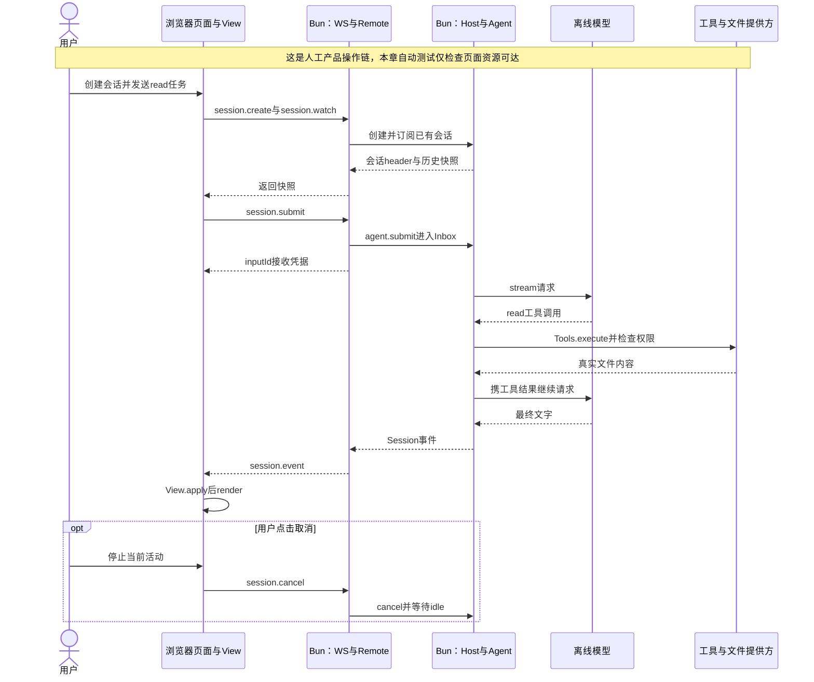

# 049 · 把真实Web操作接到同一个Agent

阶段：R07。唯一前置：完成第 048 步，继续同一个工程。

## 什么时候会用到这一页

用户第一次用自己的网页操作Harness：填工作目录、创建会话、发送/tool read读取package.json，在页面看到工具状态和真实内容；之后才能使用排队、取消和审批按钮。

### 这次数据怎么走

```text
页面按钮 → web/app.mjs的rpc → WebSocket /rpc → Remote.session.submit → Host中的Agent和Tools → Session事件 → session.event通知 → View.apply/state → render。浏览器只显示和发送控制请求，不保存模型Key或执行Agent Loop。
```

### 对应时序图

从上往下读；实线箭头表示调用或发送，虚线箭头表示返回或事件通知。`opt`表示可选操作，`alt`表示不同结果，`loop`表示重复，`par`及其`and`分支表示并行；“未接入”及fixture说明按图中标注理解。



**当前接线位置：**这是已接HTTP/WS、Remote、Host、Agent、Tools和View的真实最小页面。050继续加设置/文件面板，051继续装工具，068做有限浏览器端到端验收；它们都不会自动把该页面变成原版完整GUI。

## 这一步具体做什么

先写完本章HTML、app.mjs和调试配置，再运行env -u DEEPSEEK_API_KEY bun test ./tests/049-web-assets.test.mjs。随后在练习工程根目录执行HARNESS_HOME="$PWD/.data-web" env -u DEEPSEEK_API_KEY bun src/web-server.mjs，打开终端打印的完整启动链接；工作目录填当前练习工程的绝对路径，创建会话，发送/tool read {"path":"package.json"}。在浏览器Network里找到session.submit和返回的session.event。

需要本章新文件的操作，先按下面代码创建文件，再执行；不要在上一步尚不存在的接口上试错。

## 代码为什么放在这一层

页面把发送、steer、取消、改标题和权限等动作翻译成Remote调用；View整理事实，render负责画出来。用textContent显示工具内容，避免文件或网页里的HTML被当作脚本运行。界面收到提交凭据只表示任务被接收，不等于模型已经完成。

## 在哪里写、写什么

操作地点：终端中的 `$PROJECT`，编辑器打开同一个目录。只创建或替换下列文件，其他文件保留上一步版本。文件目录不存在先创建。

```sh
mkdir -p .vscode
```

### 替换 `.vscode/launch.json`

````json
{
  "version": "0.2.0",
  "configurations": [
    {
      "name": "Bun：CLI 入口",
      "type": "bun",
      "request": "launch",
      "program": "${workspaceFolder}/src/main.mjs",
      "cwd": "${workspaceFolder}",
      "runtime": "bun",
      "runtimeArgs": [
        "--preload",
        "${workspaceFolder}/scripts/vscode-debug.mjs"
      ],
      "args": [
        "读取 README"
      ],
      "stopOnEntry": false
    },
    {
      "name": "Bun：当前测试",
      "type": "bun",
      "request": "launch",
      "program": "${file}",
      "cwd": "${workspaceFolder}",
      "runtime": "bun",
      "runtimeArgs": [
        "test",
        "--preload",
        "${workspaceFolder}/scripts/vscode-debug.mjs",
        "--timeout",
        "3600000"
      ],
      "stopOnEntry": false
    },
    {
      "name": "Bun：附加子进程",
      "type": "bun",
      "request": "attach",
      "url": "${input:bunInspectorUrl}"
    },
    {
      "name": "Python：SDK 客户端",
      "type": "debugpy",
      "request": "launch",
      "program": "${workspaceFolder}/tests/fixtures/python-sdk.py",
      "cwd": "${workspaceFolder}",
      "python": "/usr/bin/python3",
      "console": "integratedTerminal",
      "env": {
        "PYTHONPATH": "${workspaceFolder}/python"
      },
      "args": [
        "bun",
        "${workspaceFolder}/src/sdk-server.mjs",
        "${workspaceFolder}/.data-python-debug"
      ],
      "justMyCode": true
    },
    {
      "name": "Web：Bun Host",
      "type": "bun",
      "request": "launch",
      "program": "${workspaceFolder}/src/web-server.mjs",
      "cwd": "${workspaceFolder}",
      "runtime": "bun",
      "runtimeArgs": [
        "--preload",
        "${workspaceFolder}/scripts/vscode-debug.mjs"
      ],
      "env": {
        "HARNESS_HOME": "${workspaceFolder}/.data-web",
        "HARNESS_PORT": "0"
      },
      "stopOnEntry": false
    },
    {
      "name": "Web：页面",
      "type": "chrome",
      "request": "launch",
      "url": "${input:webBootstrapUrl}",
      "webRoot": "${workspaceFolder}/web",
      "pathMapping": {
        "/view.mjs": "${workspaceFolder}/src/view.mjs"
      }
    }
  ],
  "inputs": [
    {
      "id": "bunInspectorUrl",
      "type": "promptString",
      "description": "粘贴子进程 Bun Inspector 打印的完整 ws:// 地址"
    },
    {
      "id": "webBootstrapUrl",
      "type": "promptString",
      "description": "粘贴本次 Host 输出的完整 http://127.0.0.1:端口/?token=... 地址"
    }
  ]
}
````

```sh
mkdir -p tests
```

### 创建 `tests/049-web-assets.test.mjs`

````javascript
import { test } from 'bun:test'
import assert from 'node:assert/strict'
import { Host } from '../src/host.mjs'
import { startHTTP } from '../src/http.mjs'
import { mkdtempSync, rmSync } from 'node:fs'
import { tmpdir } from 'node:os'
import { join } from 'node:path'

test('真正Host服务当前Web产物，认证后才能取得页面和模块', async () => {
  const root = mkdtempSync(join(tmpdir(), 'own-page-')), host = new Host(root), web = await startHTTP(host)
  try {
    const entry = await fetch(web.bootstrap, { redirect: 'manual' }), headers = { cookie: entry.headers.get('set-cookie').split(';')[0] }
    const response = await fetch(web.url, { headers })
    assert.equal(response.status, 200); assert.match(await response.text(), /我自己的 Harness/)
    assert.match(await (await fetch(web.url + '/app.mjs', { headers })).text(), /session.submit/)
    assert.equal((await fetch(web.url + '/app.mjs')).status, 401)
  } finally { await web.close(); await host.close(); rmSync(root, { recursive: true, force: true }) }
})
````

```sh
mkdir -p web
```

### 创建 `web/app.mjs`

````javascript
import { View } from '/view.mjs'

// UI只管理连接和视图，不在浏览器里运行Agent Loop或保存模型Key。
const element = id => document.getElementById(id)
let socket, generation = 0, identity = localStorage.getItem('harness.session'), view = new View(), serial = 0
const pending = new Map()
/** 所有按钮调用同一RPC入口；断线不自动重发prompt。 */
export function rpc(method, params = {}) {
  if (socket?.readyState !== WebSocket.OPEN) return Promise.reject(Error('尚未连接'))
  const id = ++serial
  return new Promise((resolve, reject) => { const timer = setTimeout(() => { pending.delete(id); reject(Error('请求超时')) }, 120_000); pending.set(id, { resolve, reject, timer }); socket.send(JSON.stringify({ jsonrpc: '2.0', id, method, params })) })
}
/** 显示任何文本都用textContent，工具/网页内容不能执行HTML。 */
function text(tag, value) { const node = document.createElement(tag); node.textContent = typeof value === 'string' ? value : JSON.stringify(value, null, 2); return node }
function button(label, action) { const node = text('button', label); node.onclick = () => action().catch(showError); return node }
function showError(error) { element('error').textContent = error.message }
function render() {
  const state = view.state()
  element('messages').replaceChildren(...state.messages.map(message => {
    const article = document.createElement('article'); article.append(text('strong', message.role), text('div', message.content))
    for (const block of message.thinking ?? []) { const details = document.createElement('details'); details.append(text('summary', '推理'), text('pre', block.text)); article.append(details) }
    return article
  }))
  element('stream').textContent = state.text
  element('tools').replaceChildren(...state.tools.map(tool => text('pre', tool)))
  element('approvals').replaceChildren(...state.approvals.map(approval => {
    const box = document.createElement('article'); box.append(text('pre', approval.question), button('允许一次', () => rpc('approval.answer', { id: identity, approvalId: approval.id, allow: true })), button('拒绝', () => rpc('approval.answer', { id: identity, approvalId: approval.id, allow: false }))); return box
  }))
}
async function choose(id) {
  identity = id; localStorage.setItem('harness.session', id); view = new View(); const current = view.reconnect()
  const records = await rpc('session.watch', { id, after: -1 }); records.forEach(event => view.apply(event, current)); render(); element('title').textContent = id
}
async function list() {
  const rows = await rpc('session.list')
  element('sessions').replaceChildren(...rows.map(row => { const li = document.createElement('li'); li.append(button(row.title, () => choose(row.id))); return li }))
}
function connect() {
  const connection = ++generation; element('connection').textContent = '连接中'
  socket = new WebSocket(location.origin.replace(/^http/, 'ws') + '/rpc')
  socket.onopen = async () => { if (connection !== generation) return; element('connection').textContent = '已连接'; try { await list(); if (identity) await choose(identity) } catch (error) { showError(error) } }
  socket.onmessage = event => {
    if (connection !== generation) return
    const message = JSON.parse(event.data)
    if (message.method === 'session.event' && message.params.sessionId === identity) { view.apply(message.params); render() }
    else if (pending.has(message.id)) { const waiting = pending.get(message.id); pending.delete(message.id); clearTimeout(waiting.timer); if (message.error) waiting.reject(Error(message.error.message)); else waiting.resolve(message.result) }
  }
  socket.onclose = () => { if (connection !== generation) return; for (const waiting of pending.values()) { clearTimeout(waiting.timer); waiting.reject(Error('连接断开，任务不自动重发')) }; pending.clear(); element('connection').textContent = '断开，正在重连'; setTimeout(connect, 700) }
}
/** 接收成功后清空草稿；离线或失败保留输入方便重试。 */
async function send(destination = 'turn') {
  if (!identity) throw Error('请先创建会话')
  const content = element('prompt').value.trim(); if (!content) return
  await rpc('session.submit', { id: identity, content, destination }); element('prompt').value = ''
}
element('create').onclick = async () => { try { const header = await rpc('session.create', { cwd: element('cwd').value }); await list(); await choose(header.id) } catch (error) { showError(error) } }
element('send').onclick = () => send().catch(showError)
element('steer').onclick = () => send('step').catch(showError)
element('cancel').onclick = () => rpc('session.cancel', { id: identity }).catch(showError)
element('permission').onchange = () => rpc('settings.set', { id: identity, patch: { permission: element('permission').value } }).catch(showError)
element('rename').onclick = async () => { const title = prompt('新标题'); if (title) { await rpc('session.metadata', { id: identity, patch: { title } }); await list() } }
element('archive').onclick = async () => { await rpc('session.metadata', { id: identity, patch: { archived: true } }); await list() }
document.addEventListener('keydown', event => { if ((event.ctrlKey || event.metaKey) && event.key === 'Enter') { event.preventDefault(); void send().catch(showError) } })
connect()
````

```sh
mkdir -p web
```

### 创建 `web/index.html`

````html
<!doctype html>
<html lang="zh-CN"><meta charset="utf-8"><meta name="viewport" content="width=device-width,initial-scale=1">
<title>我自己的 Harness</title>
<style>
:root{color-scheme:light dark;font:15px/1.6 system-ui}body{margin:0;background:#15181d;color:#e7edf6}button,input,textarea,select{font:inherit;border:1px solid #4a5567;border-radius:6px;padding:8px;background:#222934;color:inherit}button{cursor:pointer}main{display:grid;grid-template-columns:250px 1fr 320px;gap:20px;padding:20px}nav,section,aside{min-width:0}textarea{box-sizing:border-box;width:100%;min-height:100px}article{white-space:pre-wrap;overflow-wrap:anywhere;padding:12px;border-bottom:1px solid #364050}pre{white-space:pre-wrap}#error{color:#ffacaa}#messages{min-height:250px;max-height:60vh;overflow:auto}small{color:#a8b7cb}label{display:block;margin:10px 0}li{margin:8px 0}button:focus-visible{outline:3px solid #8ac0ff}@media(max-width:900px){main{grid-template-columns:1fr}}
</style>
<main><nav><h1>我的 Harness</h1><small id="connection">连接中</small><label>工作区绝对路径<input id="cwd" placeholder="/Users/你的账号/ws/练习目录"></label><button id="create">新建会话</button><ul id="sessions"></ul></nav>
<section><h2 id="title">选择或创建会话</h2><p id="error" role="alert"></p><div id="messages" aria-live="polite"></div><article id="stream"></article><div id="approvals"></div><label>任务<textarea id="prompt" placeholder="离线验收：/tool read {&quot;path&quot;:&quot;package.json&quot;}"></textarea></label><button id="send">发送/排队</button> <button id="steer">下个Step注入</button> <button id="cancel">停止当前轮</button><h3>待执行输入</h3><ul id="queue"></ul></section>
<aside><h2>工具轨迹</h2><div id="tools"></div><h3>会话</h3><button id="rename">重命名</button> <button id="archive">归档</button><h3>权限预设</h3><select id="permission"><option value="ask">副作用前询问</option><option value="read-only">只读</option><option value="allow">明确允许副作用</option></select><div id="extra"></div></aside></main>
<script type="module" src="/app.mjs"></script></html>
````

## 运行命令与通过标准

```sh
cd "$PROJECT"
bun test ./tests/049-web-assets.test.mjs
# 人工验收时另开终端运行：HARNESS_HOME="$PROJECT/.data-web" bun src/web-server.mjs
bun test
```

本章自动测试只验证认证后HTML和app模块可达、未认证访问被拒绝，不点击浏览器按钮。上述人工read操作才会走页面到真实磁盘；068另有固定场景浏览器验收，但不代表本章全部按钮已覆盖。

**本步证据的范围：**tests/049-web-assets.test.mjs启动真实本机HTTP服务，但只fetch资源，不启动浏览器、不执行app.mjs、不调用模型。人工运行默认用OfflineModel，/tool read仍通过真实工具读取文件。后续068仅覆盖其列出的固定按钮流程。

## VS Code：断在哪里、看什么

在VS Code先启动“Web：Bun Host”，再启动“Web：页面”并粘贴本次启动链接。浏览器会话断在web/app.mjs的rpc、socket.onmessage和render，监视method、identity、message.method；Bun Host会话断在src/remote.mjs的session.submit和src/agent.mjs的submit，监视params.id、content。发送read后先F10看页面发消息，再切Host会话F11进入Agent；不能从页面F11直接跨进程跳进Host。

操作位置：VS Code 打开的是自己的 `$PROJECT`，断点也设在这里的源码，不在教材的 `steps` 目录。

上面的说明若指定CLI、子进程、页面或Electron附加调试，就先按该流程操作；下面这组步骤只用于本章测试入口。“当前测试”不会自动附加子进程，也不会命中浏览器或Electron中的断点。

变量只在所属作用域可见：停在方法内部时看this和参数；要看测试里的局部变量，先在“调用堆栈”选择对应测试帧。正在等待的异步调用者不一定保留可求值的帧，此时在测试调用前后加断点再看，不把未定义误判成业务状态丢失。

沿用第 000 步安装的 Bun 扩展与 `.vscode/launch.json`；本章列出替换配置时，使用本章完整版本。

1. 打开本步测试文件 `tests/049-web-assets.test.mjs`，保持它为当前编辑器文件。
2. 在上面指定的函数内单击行号左侧设置断点。
3. “运行和调试”选择 **Bun：当前测试**，按 F5；它执行当前测试，工作目录固定为 PROJECT。
4. 在“变量 / 监视 / 调用堆栈 / 调试控制台”检查状态；F10 逐行执行，F11 进入函数，Shift+F11 返回，F5 继续，Shift+F5 停止。

验收：断点实际命中，能说出当前输入、状态和下一步；只看到进程启动不算完成。长时间暂停会影响真实取消、审批和网络超时，先检查时序，不删超时断言。修正后在集成终端运行 `bun test ./tests/049-web-assets.test.mjs`，再运行 `bun test`，保留全部断言。

## 不看答案，确认自己能解释

关闭资料，写下点击发送到展示回复的七个节点，并给每个节点标“浏览器”或“Bun Host”。再指出同一次sessionId在哪里传递，模型Key应该留在哪个进程。

完成后在 LEARNING.md 写一句实际结果和一个卡点。明天只重做这个卡点；第 3 天、第 7 天再做一次，能独立完成就继续下一页，不另开学习路线。

**再改一个条件验证：**练习：把read目标改成不存在的missing-049.txt，在工具面板找到失败结果，确认页面仍可发送下一条hello。这个具体错误变体未被本章自动测试覆盖，只操作练习工程，不接收费模型。

## 与当前原版还差哪些

对照本仓库固定原版 `687f282e8625c6b8d11ff58211a90524be2e4317`；这里的“当前”指该本地基线，不是未经检查的上游最新版。

**这一页已经实现：**

- 真实页面创建/选择会话、发送turn或step输入、取消、改权限、改标题及归档。
- 显示基础消息、推理详情、工具状态、审批按钮和流文字。
- 本地保存所选会话id、断线后重订阅，断线不自动重发prompt。

**原版仍有、或本步尚未对齐的部分：**

- 原版基于插件slots、React和独立conversation节点；本章是集中式DOM渲染，不具备同样扩展契约。
- Markdown、工具diff、附件、全量领域面板、可访问性/本地化和原版设置面未补齐。
- 页面的700ms重连循环缺原版ready准入、generation恢复状态、退避与握手期限。
- 自有Remote与事件协议不是原版Typert或V4日志兼容实现。

**原版对照位置：**

- [packages/client/ui-conversation/src/client/service.ts](../../../deepseek-harness/packages/client/ui-conversation/src/client/service.ts)
- [packages/client/ui-conversation/src/client/conversation/assembler.ts](../../../deepseek-harness/packages/client/ui-conversation/src/client/conversation/assembler.ts)
- [packages/client/ui-chat](../../../deepseek-harness/packages/client/ui-chat)
- [packages/api/session-controller/src/index.ts](../../../deepseek-harness/packages/api/session-controller/src/index.ts)

本步测试通过只证明上面的具体行为；完整差距仍看 [COVERAGE.md](../COVERAGE.md)，不以文件数量、同名类或后面出现另一个模块代替接线证据。

下一步：[第 050 步](050.md)

## 实际页面按这个顺序验收

在 PROJECT 的第一个终端执行，保持进程运行：

```sh
HARNESS_HOME="$PROJECT/.data-web" bun src/web-server.mjs
```

浏览器打开这次终端打印的完整 URL。另一个终端 `cd "$PROJECT"` 后执行 `pwd`，把输出填入页面的工作区绝对路径，点击新建会话。此时还未接模型设置面板，默认输出明确标为离线演示。

1. 发送 `/tool read {"path":"package.json"}`，检查工具轨迹与文件真实内容。
2. 发送 `/tool write {"path":"web-proof.txt","text":"hello harness"}`，先拒绝；第二个终端确认文件没有出现。
3. 重发同一任务，这次允许一次。执行 `cat web-proof.txt`，必须为 `hello harness`。重复练习已有文件时先 read，再携带实际 version 条件写入，不能绕过版本保护。
4. 发送 `/slow`，看到 partial 后点停止，再发“继续下一轮”。必须能继续。
5. 刷新页面。已提交历史恢复，旧审批按钮不复活，也没有重新提交旧 prompt。
6. 在另一个浏览器窗口打开同一启动地址，选择同一会话，观察状态传播。

最后回到第一个终端 Ctrl+C。重启后使用新打印的启动地址完成认证。通过标准是实际事件、文件和状态；不是页面打开了就算全部 UI 完成。

## 本章在 VS Code 调试页面和 Host

1. 使用本章完整 `.vscode/launch.json`。在 `src/remote.mjs` 的 session.submit 处理函数和 `web/app.mjs` 的 rpc 函数里设断点。
2. “运行和调试”选择 **Web：Bun Host**，按 F5；复制输出里的完整 `http://127.0.0.1:端口/?token=...`。
3. 保持 Host 调试运行，再选择 **Web：页面**，按 F5，将刚才的完整 URL 粘入提示框，VS Code 会启动受调试的 Chrome。
4. 创建会话并发送任务，先在页面的 rpc 停住，继续后在 Host 的处理函数停住；分别观察参数。输入任务时不要把模板中的示例端口/token 当作实际值。
5. 从“调用堆栈”切换两个调试会话。修正后停止两者，运行本章测试与 `bun test`，再按前文手工验收。

本章页面通过认证 WebSocket 访问 Host，不能直接双击 HTML。
