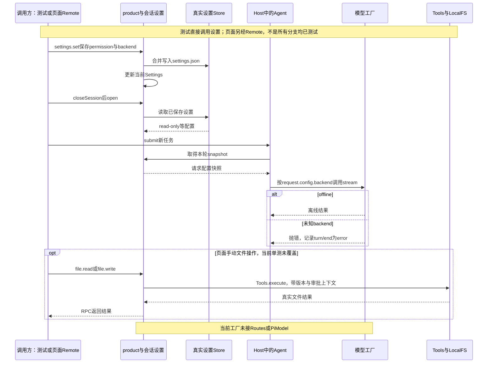

# 050 · 模型设置、队列编辑和真实文件面板

阶段：R07。唯一前置：完成第 049 步，继续同一个工程。

## 什么时候会用到这一页

用户把会话设为只读，关闭再打开仍应只读；文件面板保存时必须带刚读取的version，不能因为来自UI就绕开审批和版本检查。模型设置也应真正影响后续请求，而不是只改下拉框文字。

### 这次数据怎么走

```text
页面设置/文件动作 → Remote及product挂载的settings、credentials、file方法 → 会话Store或Tools.execute → Agent下一轮请求配置/LocalFS → 结果返回页面；product包裹Host.open和modelFactory，使恢复与模型选择使用同一份持久设置。
```

### 对应时序图

从上往下读；实线箭头表示调用或发送，虚线箭头表示返回或事件通知。`opt`表示可选操作，`alt`表示不同结果，`loop`表示重复，`par`及其`and`分支表示并行；“未接入”及fixture说明按图中标注理解。



**当前接线位置：**product已接Web入口，069也会接CLI入口；它增加Remote方法并替换Host模型factory。当前factory只支持offline和直接DeepSeekModel，没有把018 Routes或020 PiModel自动装成最终产品路由。ACP和SDK入口也没有因此获得同一套product装配。

## 这一步具体做什么

先写完本章文件和更新后的页面，再运行env -u DEEPSEEK_API_KEY bun test ./tests/050-product.test.mjs。查看测试中permission=read-only被保存后closeSession/open的结果；再看backend=missing产生turn/end.reason=error。人工Web验收保持backend=offline，读取练习文件后修改并保存，观察它仍请求审批；不要为了本章验证而填写真实Key。

需要本章新文件的操作，先按下面代码创建文件，再执行；不要在上一步尚不存在的接口上试错。

## 代码为什么放在这一层

product把已有领域装到产品接口上：设置通过Store落盘，凭据由Host解析，文件操作仍调用同一Tools守卫。请求拿到的是本轮配置快照，保存设置不是直接修改正在进行中的HTTP请求。

## 在哪里写、写什么

操作地点：终端中的 `$PROJECT`，编辑器打开同一个目录。只创建或替换下列文件，其他文件保留上一步版本。文件目录不存在先创建。

```sh
mkdir -p src
```

### 创建 `src/product.mjs`

````javascript
import { join } from 'node:path'
import { Credentials, Store, Workspaces } from './storage.mjs'
import { DeepSeekModel } from './deepseek.mjs'
import { OfflineModel } from './host.mjs'

/** 让产品设置真正落到请求边界，模型目录不是一个不生效的下拉框。 */
export function product(host) {
  const credentials = new Credentials(join(host.home, 'credentials.json')), workspaces = new Workspaces(join(host.home, 'workspaces.json'))
  const previousOpen = host.open.bind(host), originalFactory = host.modelFactory
  host.modelFactory = header => ({ async *stream(request) {
    const route = request.config.backend ?? 'offline'
    if (route === 'offline') yield* new OfflineModel().stream(request)
    else if (route === 'deepseek') yield* new DeepSeekModel({ key: credentials.resolve(request.config.keyRef ?? 'DEEPSEEK_API_KEY'), model: request.config.model ?? 'deepseek-flash', baseURL: request.config.baseURL }).stream(request)
    else throw Error('未知backend：' + route)
  } })
  host.open = (id, principal = 'local') => {
    const record = previousOpen(id, principal)
    if (!record.product) {
      const store = new Store(join(host.home, 'sessions', id, 'settings.json')), set = record.settings.set.bind(record.settings)
      set(store.read())
      record.settings.set = patch => { store.update(value => ({ ...value, ...structuredClone(patch) })); set(patch) }
      record.product = true
    }
    return record
  }
  const previousAttach = host.attachPeer
  host.attachPeer = (peer, principal) => {
    const disposers = [], bind = (method, handler) => disposers.push(peer.handle(method, handler)), record = id => host.open(id, principal)
    const earlier = previousAttach?.(peer, principal); if (earlier) disposers.push(earlier)
    bind('credentials.list', () => credentials.list())
    bind('credentials.set', params => credentials.set(params.ref, params.secret))
    bind('credentials.remove', params => { credentials.remove(params.ref); return {} })
    bind('workspace.list', () => workspaces.list())
    bind('workspace.add', params => ({ id: workspaces.add(params.path, params.title) }))
    bind('workspace.update', params => { workspaces.update(params.id, params.patch); return {} })
    bind('session.queue', params => record(params.id).agent.inbox.pending())
    for (const name of ['read', 'write', 'edit']) bind('file.' + name, params => {
      const current = record(params.id)
      return current.tools.execute({ id: 'manual-' + Date.now(), name, arguments: params.arguments }, { signal: new AbortController().signal, session: current.session })
    })
    return () => disposers.forEach(dispose => dispose())
  }
  return { credentials, workspaces }
}
````

```sh
mkdir -p src
```

### 替换 `src/remote.mjs`

````javascript
/** 一个领域控制器映射所有原生接入；外层只做传输/身份，不重写执行。 */
export function remote(peer, host, principal) {
  const subscriptions = new Map(), disposers = []
  const bind = (name, handler) => disposers.push(peer.handle(name, handler))
  const session = id => host.open(id, principal)
  bind('session.create', params => host.create({ cwd: params.cwd, owner: principal, title: params.title }).header)
  bind('session.list', params => host.list(principal, params ?? {}))
  bind('session.metadata', params => host.metadata(params.id, principal, params.patch))
  bind('session.read', params => session(params.id).session.read(params.after ?? -1))
  bind('session.submit', params => ({ inputId: session(params.id).agent.submit(params.content, params.destination ?? 'turn') }))
  bind('session.wait', async params => { const record = session(params.id); await record.agent.idle(); return record.session.read().filter(event => event.type === 'turn/end').at(-1)?.data })
  bind('session.cancel', async params => { const record = session(params.id); record.agent.cancel(); await record.agent.idle(); return {} })
  bind('session.edit', params => { session(params.id).agent.inbox.update(params.inputId, params.content); return {} })
  bind('session.removeInput', params => { session(params.id).agent.inbox.remove(params.inputId); return {} })
  bind('session.close', async params => { subscriptions.get(params.id)?.(); subscriptions.delete(params.id); await host.closeSession(params.id, principal); return {} })
  bind('approval.answer', params => { session(params.id).approvals.answer(params.id, params.approvalId, params.allow); return {} })
  bind('settings.set', params => { session(params.id).settings.set(params.patch); return session(params.id).settings.snapshot() })
  bind('tools.list', params => session(params.id).tools.catalog())
  bind('session.watch', params => {
    const record = session(params.id)
    subscriptions.get(params.id)?.()
    subscriptions.set(params.id, record.session.on(event => peer.notify('session.event', event)))
    return record.session.read(params.after ?? -1)
  })
  /** 断线取消订阅，不暗中取消仍在运行的会话；显式关闭Host才结束活动。 */
  const dispose = () => { for (const cancel of subscriptions.values()) cancel(); subscriptions.clear(); disposers.splice(0).forEach(remove => remove()) }
  const extra = host.attachPeer?.(peer, principal); if (extra) disposers.push(extra)
  peer.once('closed', dispose)
  return dispose
}
````

```sh
mkdir -p src
```

### 替换 `src/web-server.mjs`

````javascript
import { Host } from './host.mjs'
import { product } from './product.mjs'
import { DeepSeekModel } from './deepseek.mjs'
import { startHTTP } from './http.mjs'

if (!process.env.HARNESS_HOME) throw Error('请显式设置HARNESS_HOME，避免与日常数据混用')
const host = new Host(process.env.HARNESS_HOME, process.env.DEEPSEEK_API_KEY ? () => new DeepSeekModel({ key: process.env.DEEPSEEK_API_KEY, model: process.env.DSH_MODEL ?? 'deepseek-flash' }) : undefined)
product(host)
const web = await startHTTP(host, { port: Number(process.env.HARNESS_PORT ?? 0) })
console.log('打开：' + web.bootstrap)
let closing = false
const close = async () => { if (closing) return; closing = true; await web.close(); await host.close() }
process.on('SIGINT', close); process.on('SIGTERM', close)
````

```sh
mkdir -p tests
```

### 创建 `tests/050-product.test.mjs`

````javascript
import { test } from 'bun:test'
import assert from 'node:assert/strict'
import { Host } from '../src/host.mjs'
import { product } from '../src/product.mjs'
import { mkdtempSync, rmSync } from 'node:fs'
import { join } from 'node:path'
import { tmpdir } from 'node:os'

test('产品设置持久化、凭据只返回描述、请求路由真实生效', async () => {
  const root = mkdtempSync(join(tmpdir(), 'own-product-')), host = new Host(root)
  product(host)
  try {
    const record = host.create({ cwd: root })
    record.settings.set({ backend: 'offline', permission: 'read-only' })
    record.agent.submit('product'); await record.agent.idle()
    await host.closeSession(record.header.id, 'local')
    assert.equal(host.open(record.header.id).settings.snapshot().permission, 'read-only')
    const next = host.open(record.header.id); next.settings.set({ backend: 'missing' }); next.agent.submit('fail'); await next.agent.idle()
    assert.equal(next.session.read().at(-1).data.reason, 'error')
  } finally { await host.close(); rmSync(root, { recursive: true, force: true }) }
})
````

```sh
mkdir -p web
```

### 替换 `web/app.mjs`

````javascript
import { View } from '/view.mjs'

// UI只管理连接和视图，不在浏览器里运行Agent Loop或保存模型Key。
const element = id => document.getElementById(id)
let socket, generation = 0, identity = localStorage.getItem('harness.session'), view = new View(), serial = 0
const pending = new Map()
/** 所有按钮调用同一RPC入口；断线不自动重发prompt。 */
export function rpc(method, params = {}) {
  if (socket?.readyState !== WebSocket.OPEN) return Promise.reject(Error('尚未连接'))
  const id = ++serial
  return new Promise((resolve, reject) => { const timer = setTimeout(() => { pending.delete(id); reject(Error('请求超时')) }, 120_000); pending.set(id, { resolve, reject, timer }); socket.send(JSON.stringify({ jsonrpc: '2.0', id, method, params })) })
}
/** 显示任何文本都用textContent，工具/网页内容不能执行HTML。 */
function text(tag, value) { const node = document.createElement(tag); node.textContent = typeof value === 'string' ? value : JSON.stringify(value, null, 2); return node }
function button(label, action) { const node = text('button', label); node.onclick = () => action().catch(showError); return node }
function showError(error) { element('error').textContent = error.message }
function render() {
  const state = view.state()
  element('messages').replaceChildren(...state.messages.map(message => {
    const article = document.createElement('article'); article.append(text('strong', message.role), text('div', message.content))
    for (const block of message.thinking ?? []) { const details = document.createElement('details'); details.append(text('summary', '推理'), text('pre', block.text)); article.append(details) }
    return article
  }))
  element('stream').textContent = state.text
  element('tools').replaceChildren(...state.tools.map(tool => text('pre', tool)))
  element('approvals').replaceChildren(...state.approvals.map(approval => {
    const box = document.createElement('article'); box.append(text('pre', approval.question), button('允许一次', () => rpc('approval.answer', { id: identity, approvalId: approval.id, allow: true })), button('拒绝', () => rpc('approval.answer', { id: identity, approvalId: approval.id, allow: false }))); return box
  }))
}
async function choose(id) {
  identity = id; localStorage.setItem('harness.session', id); view = new View(); const current = view.reconnect()
  const records = await rpc('session.watch', { id, after: -1 }); records.forEach(event => view.apply(event, current)); render(); element('title').textContent = id
}
async function list() {
  const rows = await rpc('session.list')
  element('sessions').replaceChildren(...rows.map(row => { const li = document.createElement('li'); li.append(button(row.title, () => choose(row.id))); return li }))
}
function connect() {
  const connection = ++generation; element('connection').textContent = '连接中'
  socket = new WebSocket(location.origin.replace(/^http/, 'ws') + '/rpc')
  socket.onopen = async () => { if (connection !== generation) return; element('connection').textContent = '已连接'; try { await list(); if (identity) await choose(identity) } catch (error) { showError(error) } }
  socket.onmessage = event => {
    if (connection !== generation) return
    const message = JSON.parse(event.data)
    if (message.method === 'session.event' && message.params.sessionId === identity) { view.apply(message.params); render(); void queue().catch(showError) }
    else if (pending.has(message.id)) { const waiting = pending.get(message.id); pending.delete(message.id); clearTimeout(waiting.timer); if (message.error) waiting.reject(Error(message.error.message)); else waiting.resolve(message.result) }
  }
  socket.onclose = () => { if (connection !== generation) return; for (const waiting of pending.values()) { clearTimeout(waiting.timer); waiting.reject(Error('连接断开，任务不自动重发')) }; pending.clear(); element('connection').textContent = '断开，正在重连'; setTimeout(connect, 700) }
}
/** 接收成功后清空草稿；离线或失败保留输入方便重试。 */
async function send(destination = 'turn') {
  if (!identity) throw Error('请先创建会话')
  const content = element('prompt').value.trim(); if (!content) return
  await rpc('session.submit', { id: identity, content, destination }); element('prompt').value = ''
}
element('create').onclick = async () => { try { const header = await rpc('session.create', { cwd: element('cwd').value }); await list(); await choose(header.id) } catch (error) { showError(error) } }
element('send').onclick = () => send().catch(showError)
element('steer').onclick = () => send('step').catch(showError)
element('cancel').onclick = () => rpc('session.cancel', { id: identity }).catch(showError)
element('permission').onchange = () => rpc('settings.set', { id: identity, patch: { permission: element('permission').value } }).catch(showError)
element('rename').onclick = async () => { const title = prompt('新标题'); if (title) { await rpc('session.metadata', { id: identity, patch: { title } }); await list() } }
element('archive').onclick = async () => { await rpc('session.metadata', { id: identity, patch: { archived: true } }); await list() }
document.addEventListener('keydown', event => { if ((event.ctrlKey || event.metaKey) && event.key === 'Enter') { event.preventDefault(); void send().catch(showError) } })
// 队列编辑针对尚未认领的inputId，不能修改正在执行的请求。
async function queue() {
  if (!identity) return
  const rows = await rpc('session.queue', { id: identity })
  element('queue').replaceChildren(...rows.map(row => {
    const li = document.createElement('li'); li.append(text('span', row.destination + ': ' + row.content), button('删除', () => rpc('session.removeInput', { id: identity, inputId: row.id })), button('编辑', async () => { const content = prompt('新内容', row.content); if (content !== null) await rpc('session.edit', { id: identity, inputId: row.id, content }) })); return li
  }))
}
let observedVersion
// 先读取得version，条件保存不绕过Host工具入口和审批。
element('file-read').onclick = async () => { try { const result = await rpc('file.read', { id: identity, arguments: { path: element('file-path').value } }); element('file-text').value = result.text; observedVersion = result.version } catch (error) { showError(error) } }
element('file-write').onclick = () => rpc('file.write', { id: identity, arguments: { path: element('file-path').value, text: element('file-text').value, ...(observedVersion ? { version: observedVersion } : {}) } }).then(() => { observedVersion = undefined }).catch(showError)
element('save-model').onclick = async () => {
  try {
    if (element('key').value) { await rpc('credentials.set', { ref: 'DEEPSEEK_API_KEY', secret: element('key').value }); element('key').value = '' }
    await rpc('settings.set', { id: identity, patch: { backend: element('backend').value, model: element('model').value, keyRef: 'DEEPSEEK_API_KEY' } })
  } catch (error) { showError(error) }
}
connect()
````

```sh
mkdir -p web
```

### 替换 `web/index.html`

````html
<!doctype html>
<html lang="zh-CN"><meta charset="utf-8"><meta name="viewport" content="width=device-width,initial-scale=1">
<title>我自己的 Harness</title>
<style>
:root{color-scheme:light dark;font:15px/1.6 system-ui}body{margin:0;background:#15181d;color:#e7edf6}button,input,textarea,select{font:inherit;border:1px solid #4a5567;border-radius:6px;padding:8px;background:#222934;color:inherit}button{cursor:pointer}main{display:grid;grid-template-columns:250px 1fr 320px;gap:20px;padding:20px}nav,section,aside{min-width:0}textarea{box-sizing:border-box;width:100%;min-height:100px}article{white-space:pre-wrap;overflow-wrap:anywhere;padding:12px;border-bottom:1px solid #364050}pre{white-space:pre-wrap}#error{color:#ffacaa}#messages{min-height:250px;max-height:60vh;overflow:auto}small{color:#a8b7cb}label{display:block;margin:10px 0}li{margin:8px 0}button:focus-visible{outline:3px solid #8ac0ff}@media(max-width:900px){main{grid-template-columns:1fr}}
</style>
<main><nav><h1>我的 Harness</h1><small id="connection">连接中</small><label>工作区绝对路径<input id="cwd" placeholder="/Users/你的账号/ws/练习目录"></label><button id="create">新建会话</button><ul id="sessions"></ul></nav>
<section><h2 id="title">选择或创建会话</h2><p id="error" role="alert"></p><div id="messages" aria-live="polite"></div><article id="stream"></article><div id="approvals"></div><label>任务<textarea id="prompt" placeholder="离线验收：/tool read {&quot;path&quot;:&quot;package.json&quot;}"></textarea></label><button id="send">发送/排队</button> <button id="steer">下个Step注入</button> <button id="cancel">停止当前轮</button><h3>待执行输入</h3><ul id="queue"></ul></section>
<aside><h2>工具轨迹</h2><div id="tools"></div><h3>会话</h3><button id="rename">重命名</button> <button id="archive">归档</button><h3>权限预设</h3><select id="permission"><option value="ask">副作用前询问</option><option value="read-only">只读</option><option value="allow">明确允许副作用</option></select><div id="extra"><h3>模型设置</h3><label>Backend<select id="backend"><option value="offline">离线演示</option><option value="deepseek">原生DeepSeek Messages</option></select></label><label>模型ID<input id="model" value="deepseek-flash"></label><label>Key（只写）<input id="key" type="password" autocomplete="new-password"></label><button id="save-model">保存模型设置</button><h3>文件面板</h3><input id="file-path" placeholder="相对工作区路径"><button id="file-read">读取</button><textarea id="file-text"></textarea><button id="file-write">条件保存</button></div></aside></main>
<script type="module" src="/app.mjs"></script></html>
````

## 运行命令与通过标准

```sh
cd "$PROJECT"
bun test ./tests/050-product.test.mjs
bun test
```

现有单测证明设置在同一个Host关闭/重新打开会话后保留，以及未知backend确实导致Agent错误结束。测试没有重启整个进程，没有验证真实DeepSeek请求、凭据隐藏、文件面板保存或两个窗口的版本冲突。

**本步证据的范围：**tests/050-product.test.mjs使用真实临时文件Store和Host，模型使用offline或故意无效的backend。测试不通过页面、WebSocket或真实凭据调用；名称中的凭据描述比实际断言范围宽，本章不能据此勾选凭据安全或文件面板自动验收。

## VS Code：断在哪里、看什么

在tests/050-product.test.mjs用“Bun：当前测试”启动。断在src/product.mjs的set(store.read())、record.settings.set及if (route === 'offline')；监视store.read()、request.config.backend和request.config.permission。F10执行closeSession后，F11进入host.open，恢复的permission应为read-only。最后backend=missing时确认throw发生在模型factory，最终turn/end.reason应为error。UI文件调试另用Web两个会话，在file.write到Tools.execute处观察version。

操作位置：VS Code 打开的是自己的 `$PROJECT`，断点也设在这里的源码，不在教材的 `steps` 目录。

上面的说明若指定CLI、子进程、页面或Electron附加调试，就先按该流程操作；下面这组步骤只用于本章测试入口。“当前测试”不会自动附加子进程，也不会命中浏览器或Electron中的断点。

变量只在所属作用域可见：停在方法内部时看this和参数；要看测试里的局部变量，先在“调用堆栈”选择对应测试帧。正在等待的异步调用者不一定保留可求值的帧，此时在测试调用前后加断点再看，不把未定义误判成业务状态丢失。

沿用第 000 步安装的 Bun 扩展与 `.vscode/launch.json`；本章列出替换配置时，使用本章完整版本。

1. 打开本步测试文件 `tests/050-product.test.mjs`，保持它为当前编辑器文件。
2. 在上面指定的函数内单击行号左侧设置断点。
3. “运行和调试”选择 **Bun：当前测试**，按 F5；它执行当前测试，工作目录固定为 PROJECT。
4. 在“变量 / 监视 / 调用堆栈 / 调试控制台”检查状态；F10 逐行执行，F11 进入函数，Shift+F11 返回，F5 继续，Shift+F5 停止。

验收：断点实际命中，能说出当前输入、状态和下一步；只看到进程启动不算完成。长时间暂停会影响真实取消、审批和网络超时，先检查时序，不删超时断言。修正后在集成终端运行 `bun test ./tests/050-product.test.mjs`，再运行 `bun test`，保留全部断言。

## 不看答案，确认自己能解释

闭卷写出“保存设置→写Store→新轮次取snapshot→选择模型”的四步；再写一个例子说明文件面板为什么不能直接调用fs.write绕过Tools。

完成后在 LEARNING.md 写一句实际结果和一个卡点。明天只重做这个卡点；第 3 天、第 7 天再做一次，能独立完成就继续下一页，不另开学习路线。

**再改一个条件验证：**练习：在本章临时测试里将permission先设ask，再close/open并断言ask；随后保留现有missing-backend错误用例。这个变体只验证设置持久化，不需要真实模型或额外路线。

## 与当前原版还差哪些

对照本仓库固定原版 `687f282e8625c6b8d11ff58211a90524be2e4317`；这里的“当前”指该本地基线，不是未经检查的上游最新版。

**这一页已经实现：**

- 每会话JSON设置存储，恢复时载入并应用设置。
- 挂载凭据引用、工作区、待输入队列和手动文件read/write/edit RPC。
- 文件面板操作复用Tools权限门与LocalFS已读版本保护。
- backend为offline或deepseek时选择相应模型，未知值明确失败。

**原版仍有、或本步尚未对齐的部分：**

- 原版有配置层级、模型/provider能力目录、账号授权和独立凭据接口；本章只有简化Store与两个backend分支。
- 018重试/Token刷新和020 PiModel没有在此factory中装配，不能按前文章节存在就认定产品已使用。
- 原版workspaceFiles有目录、文本窗口、字节读取、watch和变化接口；本章只全量read/write/edit。
- 没有证明多窗口/多LocalFS实例的写入原子版本比较，当前LocalFS保护范围仍有边界。

**原版对照位置：**

- [packages/api/settings-controller/src/index.ts](../../../deepseek-harness/packages/api/settings-controller/src/index.ts)
- [packages/api/workspace-files/src/index.ts](../../../deepseek-harness/packages/api/workspace-files/src/index.ts)
- [packages/api/workspace-files/src/types.ts](../../../deepseek-harness/packages/api/workspace-files/src/types.ts)
- [packages/settings/settings](../../../deepseek-harness/packages/settings/settings)
- [packages/credentials/credentials](../../../deepseek-harness/packages/credentials/credentials)

本步测试通过只证明上面的具体行为；完整差距仍看 [COVERAGE.md](../COVERAGE.md)，不以文件数量、同名类或后面出现另一个模块代替接线证据。

下一步：[第 051 步](051.md)
