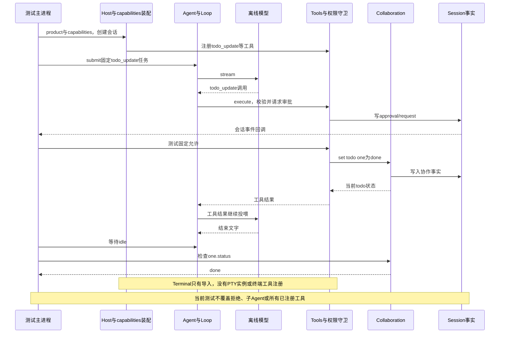

# 051 · 把已经写出的能力纵向接入工具

阶段：R07。唯一前置：完成第 050 步，继续同一个工程。

<!-- harness-own-links:start -->
## 当前练习工程文件

以下链接指向 `harness-own` 的当前累计版本；本课下方的完整代码仍保留当步版本，二者可能不同。

[打开练习工程说明](../../../harness-own/README.md)

| 本课文件 | 当前练习工程文件 |
| --- | --- |
| `src/agent.mjs` | [`harness-own/src/agent.mjs`](../../../harness-own/src/agent.mjs) |
| `src/capabilities.mjs` | 尚未合入 harness-own |
| `src/web-server.mjs` | 尚未合入 harness-own |
| `tests/051-capabilities.test.mjs` | 尚未合入 harness-own |

<!-- harness-own-links:end -->

## 什么时候会用到这一页

前面已经写了Todo、Job和Skill等独立能力；这一章让Agent真的调用todo_update，把one任务改为done，而不是仅在测试里直接调用Collaboration.set。输入/tool todo_update后，应在会话日志和真实状态中看到变化。

### 这次数据怎么走

```text
Web或后续CLI输入 → Agent/runTurn → 同一Tools.execute → guard审批 → capabilities注册的todo_update.run → Collaboration.set → Session事实；run/job转交025 execute，skill_load转交031 Skills，子任务转交Subagents与新的Host会话。
```

### 对应时序图

从上往下读；实线箭头表示调用或发送，虚线箭头表示返回或事件通知。`opt`表示可选操作，`alt`表示不同结果，`loop`表示重复，`par`及其`and`分支表示并行；“未接入”及fixture说明按图中标注理解。



**当前接线位置：**Web入口实际装了product与capabilities，069 CLI也会装。PTY没有接入：Terminal仅导入，run/job仍用025 execute。SSH、LSP、Teams、Hook、Browser、Telemetry等独立模块也没有因本章标题而全部进入Agent工具链；后续各章仍须分别核实。

## 这一步具体做什么

先写完capabilities.mjs、更新后的agent.mjs和Web入口，再运行env -u DEEPSEEK_API_KEY bun test ./tests/051-capabilities.test.mjs。人工操作仍用offline：启动Web、创建会话，发送/tool todo_update {"value":{"id":"one","status":"done","text":"写完了"}}并允许审批。检查工具结果one.status=done，而不是只看按钮消失。

需要本章新文件的操作，先按下面代码创建文件，再执行；不要在上一步尚不存在的接口上试错。

## 代码为什么放在这一层

capabilities是装配函数，不是第二个Agent循环：它在Host打开会话时创建服务、注册工具并把它们交给已有Tools。Agent.children记录受管子Agent，用来在父活动取消/关闭时把取消继续传下去。

## 在哪里写、写什么

操作地点：终端中的 `$PROJECT`，编辑器打开同一个目录。只创建或替换下列文件，其他文件保留上一步版本。文件目录不存在先创建。

```sh
mkdir -p src
```

### 替换 [`src/agent.mjs`](../../../harness-own/src/agent.mjs)

````javascript
import { Inbox } from './inbox.mjs'
import { runTurn } from './loop.mjs'

/** Agent 是活动的所有者；收到输入不等于开始执行。 */
export class Agent {
  active = undefined
  controller = undefined
  closed = false
  failure = undefined
  children = new Set()
  constructor(session, model, tools, settings) {
    this.session = session; this.model = model; this.tools = tools; this.settings = settings
    this.inbox = new Inbox(session)
  }
  /** 返回接收凭据，正在运行时也可以排队或 steer。 */
  submit(content, destination = 'turn') {
    if (this.closed) throw Error('Agent 已关闭')
    const receipt = this.inbox.enqueue(content, destination)
    this.pump()
    return receipt
  }
  /** 同一会话单个 pump，配置只在新 turn 请求时固定。 */
  pump() {
    if (this.active || this.closed) return
    this.active = Promise.resolve().then(async () => {
      let input
      while (!this.closed && (input = this.inbox.claim('turn'))) {
        this.controller = new AbortController()
        const config = this.settings.snapshot()
        await runTurn({ session: this.session, tools: this.tools, model: this.model, config, inbox: this.inbox, signal: this.controller.signal }, input.content)
      }
    }).finally(() => { this.controller = undefined; this.active = undefined })
    // 即使接入方只取接收凭据，也不能产生未处理的Promise拒绝。
    this.active.catch(error => { this.failure = error; this.closed = true })
  }
  /** 取消当前活动，不取消未来排队的独立任务。 */
  cancel() { this.controller?.abort(new Error('用户取消')); for (const child of this.children) child.cancel() }
  /** 等待事实与活动都收敛后再报告空闲。 */
  async idle() { do { if (this.active) await this.active; await Promise.all([...this.children].map(child => child.idle())) } while (this.active); if (this.failure) throw this.failure }
  /** 禁止新输入，取消当前活动并等待清理。 */
  async close() { this.closed = true; this.cancel(); await this.idle() }
}
````

```sh
mkdir -p src
```

### 创建 `src/capabilities.mjs`

````javascript
import { readFileSync } from 'node:fs'
import { join } from 'node:path'
import { Scope } from './scope.mjs'
import { Jobs } from './jobs.mjs'
import { Skills } from './skills.mjs'
import { Collaboration } from './collaboration.mjs'
import { Subagents } from './subagents.mjs'
import { workflow } from './workflow.mjs'
import { runProgram } from './ptc.mjs'
import { execute } from './process.mjs'
import { Sandbox } from './sandbox.mjs'
import { Web } from './web-tools.mjs'
import { Attachments, present } from './attachments.mjs'
import { Terminal } from './terminal.mjs'

/** 接线这一步只组合前面已运行的领域，不再引入第二套工具表。 */
export function capabilities(host) {
  const previousOpen = host.open.bind(host)
  host.open = (id, owner = 'local') => {
    const record = previousOpen(id, owner)
    if (record.capabilities) return record
    record.capabilities = true
    const { scope, tools, session, header, settings, agent } = record
    const jobs = new Jobs(), collaboration = new Collaboration(session), skills = new Skills([join(host.home, 'skills'), join(header.cwd, '.skills')]), web = new Web(), attachments = new Attachments(join(host.home, 'attachments'))
    const sandbox = new Sandbox(), signalOf = context => context.signal
    const string = { type: 'string' }, number = { type: 'number' }, object = { type: 'object' }, array = { type: 'array', items: {} }
    const add = (name, effect, properties, run) => tools.register(scope, { name, description: name + '：参数见Schema', effect, exclusive: effect !== 'read', schema: { type: 'object', properties, required: Object.keys(properties), additionalProperties: false }, run })
    // 项目规则成为可回放输入事实；不存在时只忽略ENOENT。
    let rules = ''
    try { rules = readFileSync(join(header.cwd, 'AGENTS.md'), 'utf8') } catch (error) { if (error.code !== 'ENOENT') throw error }
    session.append('context/instructions', { path: join(header.cwd, 'AGENTS.md'), content: rules })
    if (rules) settings.set({ system: rules })
    add('run', 'execute', { command: string, args: array }, (args, context) => execute(sandbox.wrap({ command: args.command, args: args.args, cwd: header.cwd }, { workspace: header.cwd, mode: settings.snapshot().sandbox ?? 'workspace-write' }), context.signal))
    add('job_start', 'execute', { command: string, args: array }, (args, context) => ({ id: jobs.start(scope, session.id, (signal, emit) => execute(sandbox.wrap({ command: args.command, args: args.args, cwd: header.cwd }, { workspace: header.cwd }), signal, emit)) }))
    add('job_wait', 'read', { id: string, timeout: number }, args => jobs.wait(session.id, args.id, args.timeout))
    add('job_read', 'read', { id: string, cursor: number }, args => jobs.read(session.id, args.id, args.cursor))
    add('job_kill', 'execute', { id: string }, args => jobs.kill(session.id, args.id))
    add('skill_load', 'read', { name: string }, async args => { await skills.discover(); return skills.load(args.name, session) })
    add('web_fetch', 'network', { url: string }, (args, context) => web.fetchText(args.url, context.signal))
    add('web_search', 'network', { query: string }, (args, context) => web.search(args.query, context.signal))
    add('workflow', 'execute', { nodes: array }, (args, context) => workflow(args.nodes, tools, context))
    add('run_program', 'execute', { program: array }, (args, context) => runProgram(args.program, tools, context))
    for (const kind of ['todo', 'plan', 'goal', 'schedule']) add(kind + '_update', 'write', { value: object }, args => { collaboration.set(kind, args.value); return collaboration.state(kind) })
    add('present', 'read', { path: string, mediaType: string }, async args => present(session, attachments, await record.fs.path(args.path), args.mediaType))
    const children = new Subagents(async () => {
      const child = host.create({ cwd: header.cwd, owner, title: '子任务' })
      agent.children.add(child.agent)
      scope.own(async () => { agent.children.delete(child.agent); await host.closeSession(child.header.id, owner) })
      return child.agent
    })
    add('subagent_create', 'execute', { task: string }, async args => { const id = await children.create(scope, session.id); children.send(session.id, id, args.task); return { id } })
    add('subagent_send', 'execute', { id: string, text: string }, args => ({ receipt: children.send(session.id, args.id, args.text) }))
    add('subagent_wait', 'read', { id: string }, args => children.wait(session.id, args.id))
    add('subagent_interrupt', 'execute', { id: string }, args => { children.interrupt(session.id, args.id); return {} })
    record.domains = { jobs, skills, collaboration, children, attachments }
    return record
  }
}
````

```sh
mkdir -p src
```

### 替换 `src/web-server.mjs`

````javascript
import { Host } from './host.mjs'
import { product } from './product.mjs'
import { capabilities } from './capabilities.mjs'
import { DeepSeekModel } from './deepseek.mjs'
import { startHTTP } from './http.mjs'

if (!process.env.HARNESS_HOME) throw Error('请显式设置HARNESS_HOME，避免与日常数据混用')
const host = new Host(process.env.HARNESS_HOME, process.env.DEEPSEEK_API_KEY ? () => new DeepSeekModel({ key: process.env.DEEPSEEK_API_KEY, model: process.env.DSH_MODEL ?? 'deepseek-flash' }) : undefined)
product(host)
capabilities(host)
const web = await startHTTP(host, { port: Number(process.env.HARNESS_PORT ?? 0) })
console.log('打开：' + web.bootstrap)
let closing = false
const close = async () => { if (closing) return; closing = true; await web.close(); await host.close() }
process.on('SIGINT', close); process.on('SIGTERM', close)
````

```sh
mkdir -p tests
```

### 创建 `tests/051-capabilities.test.mjs`

````javascript
import { test } from 'bun:test'
import assert from 'node:assert/strict'
import { Host } from '../src/host.mjs'
import { capabilities } from '../src/capabilities.mjs'
import { product } from '../src/product.mjs'
import { mkdtempSync, rmSync } from 'node:fs'
import { join } from 'node:path'
import { tmpdir } from 'node:os'

test('从同一Agent真正调用接线后的协作工具，拒绝后不绕过审批', async () => {
  const root = mkdtempSync(join(tmpdir(), 'own-capabilities-')), host = new Host(root)
  product(host); capabilities(host)
  try {
    const record = host.create({ cwd: root })
    record.session.on(event => { if (event.type === 'approval/request') record.approvals.answer(record.header.id, event.data.id, true) })
    record.agent.submit('/tool todo_update {"value":{"id":"one","status":"done","text":"写完了"}}')
    await record.agent.idle()
    assert.equal(record.domains.collaboration.state('todo').one.status, 'done')
    assert.ok(record.tools.catalog().some(tool => tool.name === 'subagent_create'))
  } finally { await host.close(); rmSync(root, { recursive: true, force: true }) }
})
````

## 运行命令与通过标准

```sh
cd "$PROJECT"
bun test ./tests/051-capabilities.test.mjs
bun test
```

测试真正通过Agent的/tool输入调用todo_update，自动允许审批后断言协作状态为done，并确认subagent_create出现在目录。它没有验证拒绝分支、真实子任务执行、Job退出、Web搜索或所有能力清理；测试名里的“拒绝后”没有对应拒绝操作。

**本步证据的范围：**tests/051-capabilities.test.mjs的Host、Agent、Tools和Session是真实的，外部模型是OfflineModel，审批回调固定允许。它检查todo和工具目录，不运行真实命令、子Agent、搜索或PTY。本次文档改写没有补功能或扩大测试。

## VS Code：断在哪里、看什么

用“Bun：当前测试”启动tests/051-capabilities.test.mjs。断在src/capabilities.mjs的add、todo/plan/goal/schedule注册循环，以及src/tools.mjs的await this.guard；监视call.name、call.arguments、record.domains.collaboration.state('todo')。F11从工具run进入Collaboration.set，再F10到测试断言，one.status应为done。Terminal只被import，不能给terminal构造函数设断点后期待本章会命中。

操作位置：VS Code 打开的是自己的 `$PROJECT`，断点也设在这里的源码，不在教材的 `steps` 目录。

上面的说明若指定CLI、子进程、页面或Electron附加调试，就先按该流程操作；下面这组步骤只用于本章测试入口。“当前测试”不会自动附加子进程，也不会命中浏览器或Electron中的断点。

变量只在所属作用域可见：停在方法内部时看this和参数；要看测试里的局部变量，先在“调用堆栈”选择对应测试帧。正在等待的异步调用者不一定保留可求值的帧，此时在测试调用前后加断点再看，不把未定义误判成业务状态丢失。

沿用第 000 步安装的 Bun 扩展与 `.vscode/launch.json`；本章列出替换配置时，使用本章完整版本。

1. 打开本步测试文件 `tests/051-capabilities.test.mjs`，保持它为当前编辑器文件。
2. 在上面指定的函数内单击行号左侧设置断点。
3. “运行和调试”选择 **Bun：当前测试**，按 F5；它执行当前测试，工作目录固定为 PROJECT。
4. 在“变量 / 监视 / 调用堆栈 / 调试控制台”检查状态；F10 逐行执行，F11 进入函数，Shift+F11 返回，F5 继续，Shift+F5 停止。

验收：断点实际命中，能说出当前输入、状态和下一步；只看到进程启动不算完成。长时间暂停会影响真实取消、审批和网络超时，先检查时序，不删超时断言。修正后在集成终端运行 `bun test ./tests/051-capabilities.test.mjs`，再运行 `bun test`，保留全部断言。

## 不看答案，确认自己能解释

闭卷写出todo_update、run、skill_load三个工具各调用哪个服务，再画一条Agent→Tools→guard→服务的共同主线。最后写出Terminal为何尚未出现在这条链里。

完成后在 LEARNING.md 写一句实际结果和一个卡点。明天只重做这个卡点；第 3 天、第 7 天再做一次，能独立完成就继续下一页，不另开学习路线。

**再改一个条件验证：**练习：只在这份临时测试里把approval回答改为false，再补断言todo状态没有one。该拒绝用例当前尚未实现；只改本次测试的临时数据，不授权真实Shell或外网动作。

## 与当前原版还差哪些

对照本仓库固定原版 `687f282e8625c6b8d11ff58211a90524be2e4317`；这里的“当前”指该本地基线，不是未经检查的上游最新版。

**这一页已经实现：**

- 将Job、基础Skill加载、Web、Workflow、自有Program、协作状态、附件呈现和子Agent入口注册到同一Tools。
- 读取工作区AGENTS.md，记录上下文并放入系统配置。
- Agent维护children集合，取消传递给受管子Agent；scope关闭负责释放其会话。
- 外部搜索未配置时明确失败，不伪造搜索结果。

**原版仍有、或本步尚未对齐的部分：**

- 未将026持久Shell迁到027 PTY，也未注册终端输入/resize/读取工具；导入Terminal不是完成接线。
- 原版子Agent作用域权限、工具restrict/guard继承、完整后端生命周期与本章简化Host.create不同。
- Skill附属资源、完整PTC、多种文件/模型/外部提供方仍保留前章缺口。
- 现有测试只纵向证明一个todo操作，不证明所有注册工具的参数、拒绝、取消和清理均等价原版。

**原版对照位置：**

- [packages/preset/agent-preset](../../../deepseek-harness/packages/preset/agent-preset)
- [packages/core/tools/src/index.ts](../../../deepseek-harness/packages/core/tools/src/index.ts)
- [packages/shell/tool-bash-persistent/src/index.ts](../../../deepseek-harness/packages/shell/tool-bash-persistent/src/index.ts)
- [packages/subagent/subagent-dsh-sdk/src/run.ts](../../../deepseek-harness/packages/subagent/subagent-dsh-sdk/src/run.ts)
- [packages/bundle](../../../deepseek-harness/packages/bundle)

本步测试通过只证明上面的具体行为；完整差距仍看 [COVERAGE.md](../COVERAGE.md)，不以文件数量、同名类或后面出现另一个模块代替接线证据。

下一步：[第 052 步](052.md)
