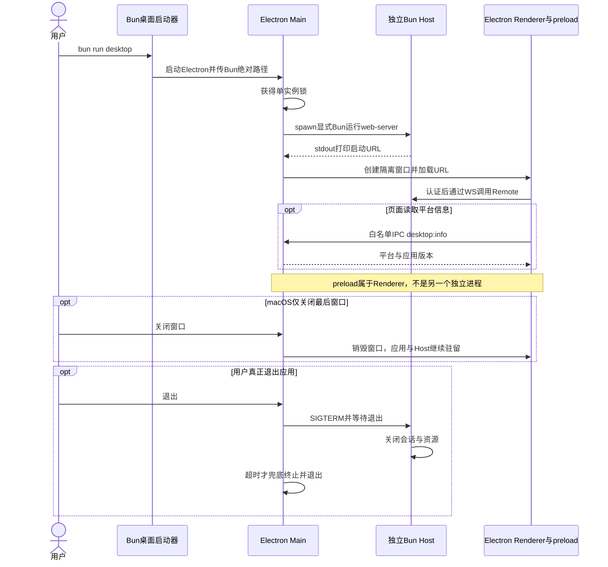
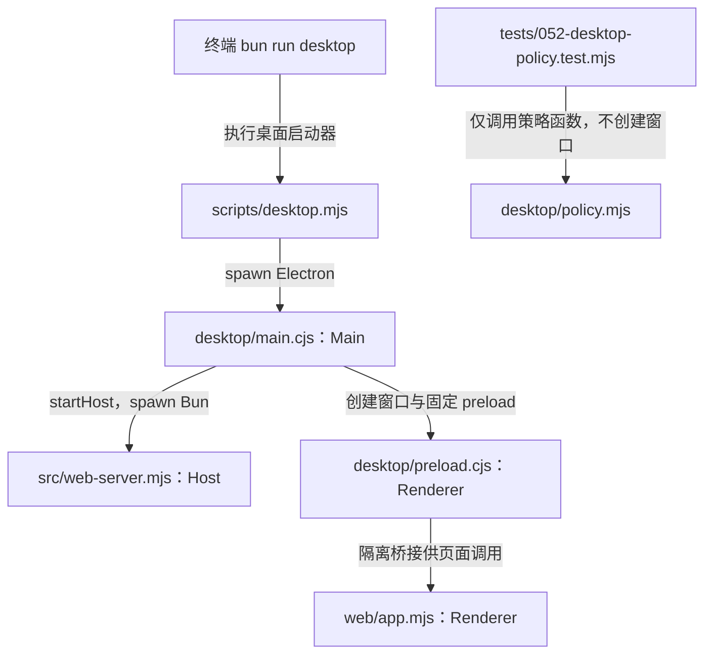
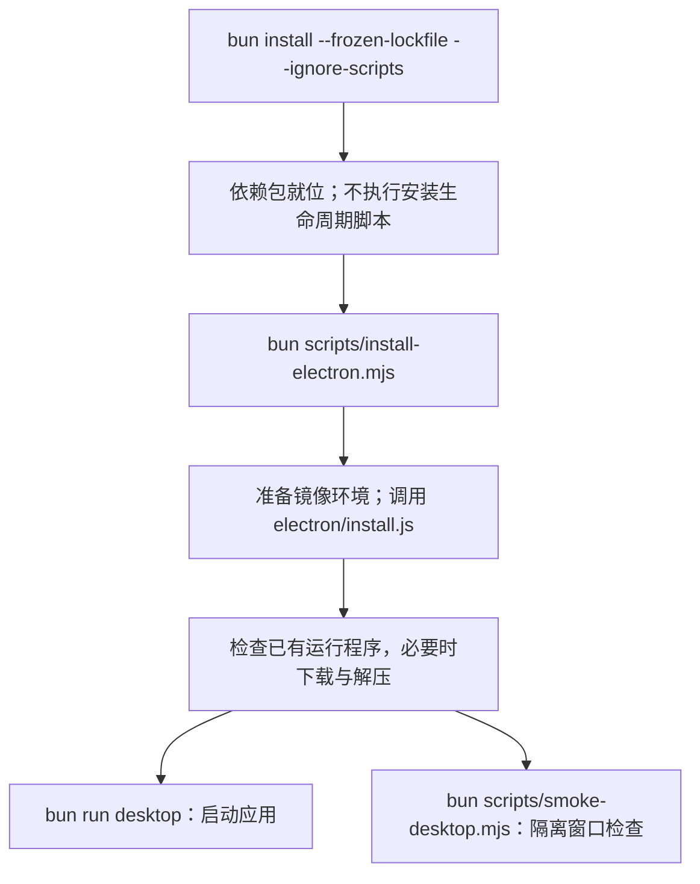
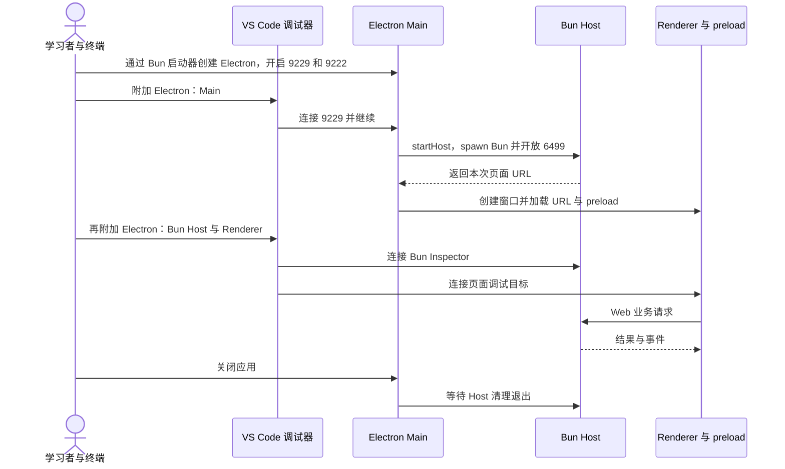

# 052 · Electron只做桌面边界，不再复制Loop

阶段：R08。唯一前置：完成第 051 步，继续同一个工程。

<!-- harness-own-links:start -->
## 当前练习工程文件

以下链接指向 `harness-own` 的当前累计版本；本课下方的完整代码仍保留当步版本，二者可能不同。

[打开练习工程说明](../../../harness-own/README.md)

| 本课文件 | 当前练习工程文件 |
| --- | --- |
| `.vscode/launch.json` | 使用本页下方的本节专用配置，不复制累计版本 |
| `desktop/main.cjs` | [`harness-own/desktop/main.cjs`](../../../harness-own/desktop/main.cjs) |
| `desktop/policy.mjs` | [`harness-own/desktop/policy.mjs`](../../../harness-own/desktop/policy.mjs) |
| `desktop/preload.cjs` | [`harness-own/desktop/preload.cjs`](../../../harness-own/desktop/preload.cjs) |
| `package.json` | [`harness-own/package.json`](../../../harness-own/package.json) |
| `scripts/desktop.mjs` | [`harness-own/scripts/desktop.mjs`](../../../harness-own/scripts/desktop.mjs) |
| `scripts/install-electron.mjs` | [`harness-own/scripts/install-electron.mjs`](../../../harness-own/scripts/install-electron.mjs) |
| `scripts/smoke-desktop.mjs` | [`harness-own/scripts/smoke-desktop.mjs`](../../../harness-own/scripts/smoke-desktop.mjs) |
| `tests/052-desktop-policy.test.mjs` | [`harness-own/tests/052-desktop-policy.test.mjs`](../../../harness-own/tests/052-desktop-policy.test.mjs) |

<!-- harness-own-links:end -->

## 什么时候会用到这一页

用户希望把已有Web Harness作为桌面应用打开。Electron只拥有窗口和受限桥，领域任务仍由独立Bun Host执行；关掉窗口和退出整个应用要按平台处理，不能复制另一套Loop。

### 这次数据怎么走

```text
bun scripts/desktop.mjs → Electron Main → 显式Bun路径启动web-server子进程 → Host打印本机启动URL → BrowserWindow加载同一Web页面 → 受限preload提供desktop.info；应用退出 → Main发SIGTERM → Host关闭会话与资源。
```

### 对应时序图

从上往下读；实线箭头表示调用或发送，虚线箭头表示返回或事件通知。`opt`表示可选操作，`alt`表示不同结果，`loop`表示重复，`par`及其`and`分支表示并行；“未接入”及fixture说明按图中标注理解。



**当前接线位置：**本章实际启动已有Web Host并加载同一页面，未另写Loop。053登录/快捷键、054运行时和055更新目前仍是独立模块，后文不会自动把它们接到这份Main；它也不是原版desktop profile启动图。

## 先看目录与调用关系

目录只列本节文件及图中直接用到的前置实现；不是累计工程的完整文件清单。

```text
PROJECT/
├── .vscode/
│   └── launch.json  # 本节创建或替换
├── desktop/
│   ├── main.cjs  # 本节创建或替换
│   ├── policy.mjs  # 本节创建或替换
│   └── preload.cjs  # 本节创建或替换
├── package.json  # 本节创建或替换
├── scripts/
│   ├── desktop.mjs  # 本节创建或替换
│   ├── install-electron.mjs  # 本节创建或替换
│   └── smoke-desktop.mjs  # 本节创建或替换
├── src/
│   └── web-server.mjs  # 沿用前置实现
├── tests/
│   └── 052-desktop-policy.test.mjs  # 本节创建或替换
└── web/
    └── app.mjs  # 沿用前置实现
```

### 本节入口怎样调用这些文件

箭头写明实际调用或进程启动；标为“未接入”的文件不是本节测试能命中的目标。




## 这一步具体做什么

先写完desktop、scripts和package.json，再执行bun scripts/install-electron.mjs、bun test ./tests/052-desktop-policy.test.mjs；安装器会下载Electron二进制，不调用模型。随后env -u DEEPSEEK_API_KEY bun scripts/smoke-desktop.mjs会启动隔离窗口检查桥和退出。人工窗口用env -u DEEPSEEK_API_KEY bun run desktop，创建会话并读取package.json。

需要本章新文件的操作，先按下面代码创建文件，再执行；不要在上一步尚不存在的接口上试错。

## 代码为什么放在这一层

Main是桌面窗口与子Host的所有者，preload是Renderer内的受限桥，不是第三个独立进程。Renderer关闭Node集成，页面不能任意fs/spawn；模型、工具和日志留在Bun Host。

## Electron 看不懂时先读这里

先读 [Electron 入门：窗口、进程和本项目](../ELECTRON-BEGINNER.md)，从目录图、启动顺序以及页面调用的两条路径开始，再回到本节代码。

## 为什么还要运行 install-electron.mjs？

`scripts/install-electron.mjs` 是下载准备脚本；真正负责下载、缓存检查和解压的是 `node_modules/electron/install.js`。它不会安装本项目的桌面成品，也不会创建窗口。



### Electron 不是本来就有 postinstall 吗？

不能只凭包名判断。带有 `scripts.postinstall` 的 Electron 包，在包管理器允许执行安装脚本时，可以由该钩子调用安装器；使用 Bun 还要符合其依赖脚本信任配置。本教程的 `--ignore-scripts` 明确跳过生命周期脚本，因此不能依赖自动执行。

另外，本次核对项目本地 `node_modules/electron/package.json`：版本为 `44.7.0`，有 `install.js`，但没有 `scripts.postinstall` 声明。所以不能把本项目需要显式安装的原因只归结为 `--ignore-scripts`，也不能承诺删掉该参数就会自动下载。其他安装版本请以各自实际包元数据为准。

本教程显式执行安装器，把“安装 JS 依赖”和“下载平台运行程序”分开；下载失败时能单独定位和重试，不需要重装所有依赖。

### 包装脚本每一段在做什么？

| 代码位置 | 实际作用 | 为什么这样做 |
| --- | --- | --- |
| `const environment = { ...process.env }` | 复制当前环境给安装子进程 | 保留 PATH、代理和已有镜像；不修改当前进程的原始环境表 |
| `homedir()` 与 `process.cwd()` | 依次定位用户级、当前项目的 `.npmrc` | 项目配置后读，同名镜像值可覆盖用户配置；必须在 PROJECT 根目录执行 |
| `readFileSync`、逐行正则匹配 | 只提取 `electron_mirror` 或 `electron-mirror`，去掉值两端引号 | 不把整份配置或 registry token 输出到日志 |
| 捕获 `ENOENT` | 配置文件不存在就跳过 | 没有 `.npmrc` 很正常；权限等其他读取错误仍报错 |
| 两个环境变量的判断 | 已有 `ELECTRON_MIRROR` 或 `npm_config_electron_mirror` 时不覆盖；否则使用文件中提取的镜像 | 显式环境设置优先；直接运行安装器时不假定包管理器已注入 `.npmrc` 字段 |
| `spawnSync(process.execPath, ...)` | 用当前 Bun 执行 `node_modules/electron/install.js`，同步等待 | `process.execPath` 是启动本脚本的运行程序，不是固定的 Node 路径 |
| `stdio: 'inherit'` | 安装器直接使用当前终端输入、输出和错误通道 | 能直接看到下载进度和错误 |
| `timeout: 180_000` | 包装器最多等待三分钟 | 下载或安装卡住时明确失败；不是成功保证 |
| `result.error` 与 `result.status ?? 1` | 启动失败、超时则抛错；否则返回安装器退出码，缺失退出码按失败处理 | 外层命令能区分下载成功与失败 |

没有任何镜像设置时，下载地址由官方安装器决定。平台、架构、包版本、下载和解压逻辑也都由它负责，包装脚本没有重新实现这些功能。

### 普通项目一定要自己写这个包装吗？

不一定。如果实际安装的包声明了 postinstall、包管理器允许它执行、镜像设置又能正确传进去，就可以使用自动安装。本项目包装额外提供的是镜像读取、显式下载时机和三分钟等待上限。

在自己的 PROJECT 根目录，先安装依赖，再执行本课安装脚本，最后运行桌面入口。不要把 `bun test ./tests/052-desktop-policy.test.mjs` 通过当作 Electron 已下载或窗口已打开：那项测试只检查策略函数。窗口启动与烟测是另外两步。

## 本节调试：选什么、为什么、怎么启动

**建议先选：052：本节测试。** 每节的测试入口都固定到本节文件，不依赖编辑器当前打开的 `${file}`。

| 配置名称 | 什么时候选 | 实际入口或目标 | 能观察什么 |
| --- | --- | --- | --- |
| 052：本节测试 | 本节验收 | tests/052-desktop-policy.test.mjs | 本节 Bun 测试进程；入口固定，不依赖当前编辑器文件。 |
| Electron：Main | 桌面主进程 | desktop/main.cjs | Electron 内置运行时；不是领域 Host。 |
| Electron：Bun Host | 桌面领域进程 | src/web-server.mjs | 主进程继续并创建 Host 后才能附加。 |
| Electron：Renderer | 桌面页面 | web/app.mjs 与 desktop/preload.cjs | 窗口加载后附加；preload 并非独立 Bun 进程。 |

**为什么这样启动：**Main、Bun Host、Renderer 是三个执行目标，分别使用 Node Inspector、Bun Inspector 和浏览器协议；先连接 Main 并继续，后两个目标才会出现。

使用下方的[本节专用调试配置](#lesson-debug-config)。它只列本节可用目标；要保留个人配置，请先备份并按名称合并。页面上 `harness-own` 的累计文件链接供看当前工程，不是本节调试配置的答案。

1. VS Code 打开自己的 PROJECT；按本节创建源码与配置，断点设在 PROJECT 文件中。
2. 先用终端运行 `bun test ./tests/052-desktop-policy.test.mjs` 确认普通验收，再选表中的配置按 F5。
3. 在下方具体观察点停住；F10 跨过当前语句，F11 只进入当前调试目标。异步等待涉及另一进程时，切换调试会话并继续对端。
4. 变量要在所属调用帧查看；看测试局部变量时选测试帧，看 this 和参数时选实现方法帧。

**本节具体断点和预期：**终端执行HARNESS_VSCODE_DEBUG=1 env -u DEEPSEEK_API_KEY bun run desktop。VS Code先附加“Electron：Main”(9229)，在desktop/main.cjs的spawn(runtime, hostArgs, ...)和new BrowserWindow断点，监视runtime、hostArgs、address，继续后再附加“Electron：Bun Host”(6499)与“Electron：Renderer”(9222)。Renderer断web/app.mjs的rpc，Host断src/remote.mjs的session.submit；F11只在当前调试进程前进，跨边界要切会话。Main的type=node是Electron自身运行时，领域Host仍是Bun。

### 本节启动前置

- 需要本机可启动的 Electron。策略单测通过不等于 GUI 已启动；本次修改不下载 Electron、不构建安装包。

### 本节终端启动命令

先在 PROJECT 执行。Attach 配置不会替你启动进程；不同章节使用相同端口时不能同时启动。

```sh
cd "$PROJECT"
HARNESS_VSCODE_DEBUG=1 env -u DEEPSEEK_API_KEY bun run desktop
```

### 本节调试启动时序

这张图解释如何创建并连接调试目标；上面的业务时序图解释任务本身怎样执行。



暂停断点会影响应用自身的 RPC、取消、进程和网络计时。Bun 测试超时放宽不等于这些计时也被关闭；按本节说明分别设置，普通验收恢复原有时限。

观察完成后退出本节启动的调试会话和进程，再运行 `bun test ./tests/052-desktop-policy.test.mjs`。测试通过只证明本节断言，不代表所有 GUI、外部服务或发布过程均已验证。

## 在哪里写、写什么

操作地点：终端中的 `$PROJECT`，编辑器打开同一个目录。只创建或替换下列文件，其他文件保留上一步版本。文件目录不存在先创建。

```sh
mkdir -p .vscode
```

<a id="lesson-debug-config"></a>

下面是本节专用调试配置，只包含本节入口。program 已固定到本节文件；不是 harness-own 的累计配置。

### 替换 `.vscode/launch.json`

````json
{
  "version": "0.2.0",
  "configurations": [
    {
      "name": "052：本节测试",
      "type": "bun",
      "request": "launch",
      "program": "${workspaceFolder}/tests/052-desktop-policy.test.mjs",
      "cwd": "${workspaceFolder}",
      "runtime": "bun",
      "runtimeArgs": [
        "test",
        "--preload",
        "${workspaceFolder}/scripts/vscode-debug.mjs",
        "--timeout",
        "3600000"
      ],
      "stopOnEntry": false
    },
    {
      "name": "Electron：Main",
      "type": "node",
      "request": "attach",
      "address": "127.0.0.1",
      "port": 9229,
      "skipFiles": [
        "<node_internals>/**"
      ]
    },
    {
      "name": "Electron：Bun Host",
      "type": "bun",
      "request": "attach",
      "url": "ws://127.0.0.1:6499/harness-host"
    },
    {
      "name": "Electron：Renderer",
      "type": "chrome",
      "request": "attach",
      "address": "127.0.0.1",
      "port": 9222,
      "webRoot": "${workspaceFolder}/web",
      "pathMapping": {
        "/view.mjs": "${workspaceFolder}/src/view.mjs"
      }
    }
  ]
}
````

```sh
mkdir -p desktop
```

### 创建 [`desktop/main.cjs`](../../../harness-own/desktop/main.cjs)

````text
// 本文件由Electron程序执行：它启动时已注册electron内置模块并设置特殊模块加载规则。
// 因此同样的require('electron')在这里取得app、BrowserWindow等API，不走npm包的路径导出入口。
// 与Bun启动器中的区别来自运行时的模块加载机制，不是createRequire或本文件判断后切换返回值。
const { app, BrowserWindow, ipcMain, dialog, Menu } = require('electron')
const { spawn } = require('node:child_process')
const path = require('node:path')
const applicationRoot = path.resolve(__dirname, '..')
app.setName('Harness Own')
if (process.env.HARNESS_DESKTOP_USER_DATA) app.setPath('userData', path.resolve(process.env.HARNESS_DESKTOP_USER_DATA))

// 单实例锁先于profile/数据访问，避免两个Host争用同一个桌面运行图。
if (!app.requestSingleInstanceLock()) app.quit()
else {
  let window, host, address, exiting = false, stopped = false
  /** Electron 只拥有窗口；领域 Host 始终交给显式指定的 Bun。 */
  async function startHost() {
    const { desktopPaths, hostRuntime } = await import('./policy.mjs')
    const paths = desktopPaths(applicationRoot, app.getPath('userData'))
    const runtime = hostRuntime({ packaged: app.isPackaged, resourcesPath: process.resourcesPath, developmentPath: process.env.HARNESS_BUN })
    const environment = { ...process.env, HARNESS_HOME: paths.home }
    delete environment.NODE_OPTIONS; delete environment.NODE_PATH; delete environment.ELECTRON_RUN_AS_NODE
    // Bun 与 Electron Main 使用不同调试协议，必须连接不同端口。
    const hostArgs = environment.HARNESS_VSCODE_DEBUG === '1' ? ['--inspect=127.0.0.1:6499/harness-host', paths.host] : [paths.host]
    host = spawn(runtime, hostArgs, { cwd: applicationRoot, env: environment, stdio: ['ignore', 'pipe', 'pipe'] })
    let output = '', errors = ''
    address = await new Promise((resolve, reject) => {
      const timer = setTimeout(() => reject(Error('Host启动超时')), 20_000)
      host.stdout.on('data', bytes => { output += bytes.toString(); const match = /http:\/\/127\.0\.0\.1:\d+\/\?token=[A-Za-z0-9_-]+/.exec(output); if (match) { clearTimeout(timer); resolve(match[0]) } })
      host.stderr.on('data', bytes => { errors = (errors + bytes.toString()).slice(-2000); if (environment.HARNESS_VSCODE_DEBUG === '1') process.stderr.write(bytes) })
      host.once('error', error => { clearTimeout(timer); reject(error) })
      host.once('exit', code => { clearTimeout(timer); if (!exiting) { if (address) dialog.showErrorBox('Host已退出', '退出码：' + code + '\n请保留诊断后重启应用。'); else reject(Error('Host启动失败：' + errors)) } })
    })
  }
  /** Renderer隔离、沙箱与固定preload共同限制桥接面。 */
  async function openWindow() {
    if (window) { window.show(); window.focus(); return }
    window = new BrowserWindow({ width: 1280, height: 850, webPreferences: { contextIsolation: true, sandbox: true, nodeIntegration: false, preload: path.join(applicationRoot, 'desktop/preload.cjs') } })
    window.webContents.setWindowOpenHandler(() => ({ action: 'deny' }))
    window.webContents.on('will-navigate', (event, url) => { if (new URL(url).origin !== new URL(address).origin) event.preventDefault() })
    window.on('closed', () => { window = undefined })
    // address来自Host本次输出：先请求/?token=...，服务端设置Cookie并302跳转到/。
    // /对应web/index.html，Chromium继续请求/app.mjs；不是Main直接读取HTML文件。
    // 上面的preload选项让Electron在页面脚本执行前加载桥接代码，暴露window.desktop。
    await window.loadURL(address)
    if (process.env.HARNESS_DESKTOP_DEBUG === '1') window.webContents.openDevTools()
  }
  ipcMain.handle('desktop:info', () => ({ platform: process.platform, version: app.getVersion() }))
  process.on('SIGTERM', () => app.quit())
  // 已持有单实例锁，用户再次启动应用时由当前实例接到通知；复用窗口而不另起Host。
  // openWindow已有窗口时会show/focus；void仅忽略返回的Promise，不表示等待执行完成。
  app.on('second-instance', () => { void openWindow() })
  // macOS点击Dock等操作会激活应用；address存在说明Host已就绪，才能加载窗口。
  app.on('activate', () => { if (address) void openWindow() })
  // 所有窗口关闭后：Windows/Linux退出应用，macOS保留应用，允许之后从Dock重新打开。
  // darwin是process.platform给macOS使用的内部名称；关窗口与退出应用不是一回事。
  app.on('window-all-closed', () => { if (process.platform !== 'darwin') app.quit() })
  // 准备退出时先收回本应用启动的Bun Host，避免窗口消失后留下后台业务进程。
  app.on('before-quit', event => {
    // 清理后再次app.quit会重入这里；stopped允许第二次退出继续完成。
    if (stopped) return
    // 本次退出先暂停；重复退出请求仍被拦住，但exiting保证清理逻辑只启动一次。
    event.preventDefault(); if (exiting) return; exiting = true
    // 最多等5秒；超时强制结束Host再退出，不无限等待。强制结束不保证业务已完成落盘。
    const timer = setTimeout(() => { host?.kill('SIGKILL'); stopped = true; app.quit() }, 5000)
    // 未启动Host或它已经正常报告退出时，无需继续等待。
    if (!host || host.exitCode !== null) { clearTimeout(timer); stopped = true; app.quit(); return }
    // 先登记退出回调，再发SIGTERM；Host退出后解除保护计时并让Electron真正退出。
    host.once('exit', () => { clearTimeout(timer); stopped = true; app.quit() }); host.kill('SIGTERM')
  })
  app.whenReady().then(async () => { await startHost(); Menu.setApplicationMenu(Menu.buildFromTemplate([{ label: '应用', submenu: [{ role: 'quit' }] }, { label: '调试', submenu: [{ role: 'reload' }, { role: 'toggleDevTools' }] }])); await openWindow() }).catch(error => { dialog.showErrorBox('启动失败', error.message); app.quit() })
}
````

```sh
mkdir -p desktop
```

### 创建 [`desktop/policy.mjs`](../../../harness-own/desktop/policy.mjs)

````javascript
import { resolve, join, isAbsolute } from 'node:path'

/** Desktop执行图和自己的运行数据分开，禁止从开发目录偷找缺失文件。 */
export function desktopPaths(appPath, userData) {
  if (!appPath || !userData) throw Error('桌面路径缺失')
  return { host: resolve(appPath, 'src/web-server.mjs'), preload: resolve(appPath, 'desktop/preload.cjs'), home: join(userData, 'harness-home'), browser: join(userData, 'browser-data') }
}

/** 深链接只允许打开已知会话，不把任意URL变成可执行命令。 */
export function deepLink(value) {
  const url = new URL(value)
  if (url.protocol !== 'harness-own:' || url.hostname !== 'session' || !/^\/session_[a-f0-9-]+$/.test(url.pathname)) throw Error('深链接不合法')
  return url.pathname.slice(1)
}

/** 开发模式显式传 Bun；安装后只用产物携带的 Bun，不退回系统 PATH。 */
export function hostRuntime({ packaged, resourcesPath, developmentPath, platform = process.platform }) {
  if (packaged) {
    if (!resourcesPath || !isAbsolute(resourcesPath)) throw Error('产物资源目录缺失')
    return join(resourcesPath, platform === 'win32' ? 'bun.exe' : 'bun')
  }
  if (!developmentPath || !isAbsolute(developmentPath)) throw Error('请用 bun run desktop 启动，缺少 Bun 绝对路径')
  return developmentPath
}
````

```sh
mkdir -p desktop
```

### 创建 [`desktop/preload.cjs`](../../../harness-own/desktop/preload.cjs)

````text
const { contextBridge, ipcRenderer } = require('electron')

// Renderer只得到明确允许的能力，没有require、文件系统或任意IPC通道。
// Main创建窗口时指定本文件；Electron在页面脚本前执行它，而不是由index.html导入。
// contextBridge把desktop接口暴露到页面上下文；普通浏览器打开同一HTML不会获得该接口。
contextBridge.exposeInMainWorld('desktop', Object.freeze({ info: () => ipcRenderer.invoke('desktop:info') }))
````

### 替换 [`package.json`](../../../harness-own/package.json)

````json
{
  "name": "harness-own",
  "version": "0.1.0",
  "type": "module",
  "private": true,
  "engines": {
    "bun": "1.3.14"
  },
  "scripts": {
    "start": "bun src/main.mjs",
    "test": "bun test ./tests",
    "desktop": "bun scripts/desktop.mjs"
  },
  "dependencies": {
    "@earendil-works/pi-ai": "1.1.0",
    "@modelcontextprotocol/sdk": "1.31.0",
    "@agentclientprotocol/sdk": "1.4.0",
    "zod": "4.4.3",
    "ws": "8.18.3"
  },
  "devDependencies": {
    "electron": "44.7.0"
  },
  "packageManager": "bun@1.3.14"
}
````

```sh
mkdir -p scripts
```

### 创建 [`scripts/desktop.mjs`](../../../harness-own/scripts/desktop.mjs)

````javascript
import { spawn } from 'node:child_process'
import { createRequire } from 'node:module'
import { resolve } from 'node:path'

// 开发入口由 Bun 启动，再将其绝对路径传给 Electron，Host 不从 PATH 猜运行时。
const require = createRequire(import.meta.url) // 这里只加载 Electron 包提供的二进制路径。
// 当前是Bun启动器：按普通依赖查找加载node_modules/electron/index.js。
// 该入口导出getElectronPath()的结果，因此这里得到可执行程序路径字符串，不是app等API。
// createRequire只提供模块加载接口；后面的spawn才启动真正的Electron运行时。
const executable = require('electron')
const environment = { ...process.env, HARNESS_BUN: process.execPath }
delete environment.ELECTRON_RUN_AS_NODE
// 只在显式调试时开放本机端口；先连接 Main，再继续启动 Host 和窗口。
const debugArgs = environment.HARNESS_VSCODE_DEBUG === '1'
  ? ['--inspect-brk=127.0.0.1:9229', '--remote-debugging-address=127.0.0.1', '--remote-debugging-port=9222']
  : []
const child = spawn(executable, [...debugArgs, resolve('desktop/main.cjs')], { env: environment, stdio: 'inherit' })
child.once('error', error => { console.error(error.message); process.exitCode = 1 })
child.once('exit', code => { process.exitCode = code ?? 1 })
````

```sh
mkdir -p scripts
```

### 创建 [`scripts/install-electron.mjs`](../../../harness-own/scripts/install-electron.mjs)

````javascript
import { readFileSync } from 'node:fs'
import { homedir } from 'node:os'
import { join } from 'node:path'
import { spawnSync } from 'node:child_process'

// Bun 直接执行安装器时不会像 npm run 那样注入 npmrc 字段，显式继承已有 Electron 镜像。
const environment = { ...process.env } // 显式环境变量优先于配置文件。
let mirror // 只读取下载镜像，不读取或输出 registry token。
for (const path of [join(homedir(), '.npmrc'), join(process.cwd(), '.npmrc')]) {
  try {
    for (const line of readFileSync(path, 'utf8').split(/\r?\n/)) {
      const match = /^\s*electron[_-]mirror\s*=\s*(.*?)\s*$/.exec(line)
      if (match) mirror = match[1].replace(/^['"]|['"]$/g, '')
    }
  } catch (error) { if (error.code !== 'ENOENT') throw error }
}
if (!environment.ELECTRON_MIRROR && !environment.npm_config_electron_mirror && mirror) environment.ELECTRON_MIRROR = mirror
const result = spawnSync(process.execPath, ['node_modules/electron/install.js'], { env: environment, stdio: 'inherit', timeout: 180_000 })
if (result.error) throw result.error
process.exitCode = result.status ?? 1
````

```sh
mkdir -p scripts
```

### 创建 [`scripts/smoke-desktop.mjs`](../../../harness-own/scripts/smoke-desktop.mjs)

````javascript
import { spawn } from 'node:child_process'
import { createRequire } from 'node:module'
import { once } from 'node:events'
import { mkdtempSync, readFileSync, mkdirSync, writeFileSync, rmSync } from 'node:fs'
import { dirname, join, resolve } from 'node:path'
import { tmpdir } from 'node:os'
import { setTimeout as delay } from 'node:timers/promises'

// 单独运行真实GUI烟测；它不藏在每一步bun test里反复弹出窗口。
const require = createRequire(import.meta.url), packageRoot = dirname(require.resolve('electron/package.json'))
let relative
try { relative = readFileSync(join(packageRoot, 'path.txt'), 'utf8') }
catch { throw Error('先执行 bun scripts/install-electron.mjs，不能把没下载二进制当应用启动成功') }
const executable = join(packageRoot, 'dist', relative), data = mkdtempSync(join(tmpdir(), 'harness-desktop-smoke-'))
const environment = { ...process.env, HARNESS_DESKTOP_USER_DATA: data, HARNESS_BUN: process.execPath }
delete environment.ELECTRON_RUN_AS_NODE; delete environment.DEEPSEEK_API_KEY
const child = spawn(executable, [resolve('desktop/main.cjs'), '--remote-debugging-port=0'], { env: environment, stdio: ['ignore', 'pipe', 'pipe'] }), exited = once(child, 'close')
let logs = '', ws, serial = 0
const waiting = new Map()
child.stdout.resume(); child.stderr.on('data', bytes => { logs = (logs + bytes.toString()).slice(-8000) })
/** CDP只用于测试，不给Renderer开放任意宿主执行。 */
function request(method, params = {}, sessionId = undefined) {
  const id = ++serial
  return new Promise((resolve, reject) => {
    const timer = setTimeout(() => { waiting.delete(id); reject(Error('CDP超时：' + method)) }, 5000)
    waiting.set(id, { resolve, reject, timer }); ws.send(JSON.stringify({ id, method, params, ...(sessionId ? { sessionId } : {}) }))
  })
}
try {
  const deadline = Date.now() + 25_000
  let endpoint
  while (Date.now() < deadline && !endpoint && child.exitCode === null) { endpoint = /DevTools listening on (ws:\/\/127\.0\.0\.1:\d+\/devtools\/browser\/[^\s]+)/.exec(logs)?.[1]; await delay(100) }
  if (!endpoint) throw Error('Electron调试入口未就绪')
  ws = new WebSocket(endpoint); await once(ws, 'open')
  ws.addEventListener('message', event => {
    const value = JSON.parse(event.data), pending = waiting.get(value.id)
    if (!pending) return
    clearTimeout(pending.timer); waiting.delete(value.id)
    if (value.error) pending.reject(Error(value.error.message)); else pending.resolve(value.result)
  })
  let target
  while (Date.now() < deadline) { const result = await request('Target.getTargets'); target = result.targetInfos.find(item => item.type === 'page' && item.url.startsWith('http://127.0.0.1:')); if (target) break; await delay(100) }
  if (!target) throw Error('Host页面未就绪')
  const { sessionId } = await request('Target.attachToTarget', { targetId: target.targetId, flatten: true })
  let value
  while (Date.now() < deadline) {
    try {
      const result = await request('Runtime.evaluate', { expression: '(async()=>({title:document.title,info:window.desktop?await window.desktop.info():null,requireType:typeof window.require,ready:!!document.querySelector("#create")}))()', awaitPromise: true, returnByValue: true }, sessionId)
      value = result.result.value
      if (value?.ready && value.info) break
    } catch {}
    await delay(100)
  }
  if (!value?.ready || value.requireType !== 'undefined' || !value.info.platform) throw Error('桌面桥或Renderer隔离验收失败')
  mkdirSync('.evidence', { recursive: true }); writeFileSync('.evidence/desktop-smoke.json', JSON.stringify(value, null, 2) + '\n')
  console.log(JSON.stringify(value, null, 2))
} finally {
  ws?.close(); for (const item of waiting.values()) { clearTimeout(item.timer); item.reject(Error('测试结束')) }
  child.kill('SIGTERM'); const force = setTimeout(() => child.kill('SIGKILL'), 7000); await exited; clearTimeout(force)
  rmSync(data, { recursive: true, force: true })
}
````

```sh
mkdir -p tests
```

### 创建 [`tests/052-desktop-policy.test.mjs`](../../../harness-own/tests/052-desktop-policy.test.mjs)

````javascript
import { test } from 'bun:test'
import assert from 'node:assert/strict'
import { desktopPaths, deepLink, hostRuntime } from '../desktop/policy.mjs'

test('桌面路径来自产物根，深链接不承载任意命令', () => {
  const paths = desktopPaths('/app/resources/app', '/user/application')
  assert.equal(paths.host, '/app/resources/app/src/web-server.mjs')
  assert.ok(paths.home.startsWith('/user/application/'))
  assert.throws(() => deepLink('https://evil/'), /不合法/)
  assert.equal(deepLink('harness-own://session/session_abc-123'), 'session_abc-123')
})

test('桌面 Host 始终使用明确的 Bun 路径，缺少时直接失败', () => {
  assert.equal(hostRuntime({ packaged: false, developmentPath: '/tools/bun' }), '/tools/bun')
  assert.throws(() => hostRuntime({ packaged: false }), /Bun绝对路径|Bun 绝对路径/)
  assert.equal(hostRuntime({ packaged: true, resourcesPath: '/app/resources', platform: 'darwin' }), '/app/resources/bun')
  assert.equal(hostRuntime({ packaged: true, resourcesPath: '/app/resources', platform: 'win32' }), '/app/resources/bun.exe')
})
````

## 运行命令与通过标准

```sh
cd "$PROJECT"
cp "$COURSE/locks/052.bun.lock" bun.lock
bun install --frozen-lockfile --ignore-scripts
bun scripts/install-electron.mjs
bun test ./tests/052-desktop-policy.test.mjs
bun scripts/smoke-desktop.mjs
# 人工操作窗口：bun run desktop
bun test
```

普通单测只证明路径、深链接解析和Bun运行时选择，不启动GUI。独立smoke脚本才会启动Electron窗口，检查页面就绪、desktop.info、window.require为undefined和退出；它没有完成真实登录、所有菜单、平台矩阵或安装包验收。

**本步证据的范围：**tests/052-desktop-policy.test.mjs是无GUI函数测试；scripts/smoke-desktop.mjs才是独立真实窗口烟测。课程历史证据记录过该smoke，不等于每次bun test都弹窗，也不等于完整桌面功能验收。本次仅改说明，不重跑Electron或下载。

## 不看答案，确认自己能解释

闭卷画出Electron Main、Renderer/preload、独立Bun Host三块，标明各自谁创建谁、谁发消息、谁在退出时清理谁。

完成后在 LEARNING.md 写一句实际结果和一个卡点。明天只重做这个卡点；第 3 天、第 7 天再做一次，能独立完成就继续下一页，不另开学习路线。

**再改一个条件验证：**练习：在隔离用户数据目录启动应用，macOS关闭最后一个窗口后重新打开窗口，再真正退出应用；记录窗口生命周期和Host生命周期的区别。该人工行为不是普通policy单测的已有断言，不操作日常用户数据。

## 与当前原版还差哪些

对照本仓库固定原版 `687f282e8625c6b8d11ff58211a90524be2e4317`；这里的“当前”指该本地基线，不是未经检查的上游最新版。

**这一页已经实现：**

- Electron Main、隔离Renderer和固定IPC白名单的preload。
- 单实例锁、独立Bun Host路径、基础窗口导航限制和退出等待/兜底终止。
- 分开的Main/Bun Host/Renderer调试端口及独立GUI smoke。

**原版仍有、或本步尚未对齐的部分：**

- 原版使用profile runner、runtime-tree和应用协议/认证桥等桌面启动机制；本章用HTTP直接加载教学Web。
- 欢迎页、真实账号、托盘、任务中断退出确认、完整原生菜单、嵌入文档和深链接系统事件没有接齐。
- 本章deepLink只是解析函数，不能据此声称操作系统深链接已注册并贯通。
- 打包安装后运行、签名/公证、升级和所有平台生命周期仍需独立证据。

**原版对照位置：**

- [apps/desktop/src/main.ts](../../../deepseek-harness/apps/desktop/src/main.ts)
- [apps/desktop/src/host-process.ts](../../../deepseek-harness/apps/desktop/src/host-process.ts)
- [apps/desktop/src/runtime-tree.ts](../../../deepseek-harness/apps/desktop/src/runtime-tree.ts)
- [apps/desktop/src/web-document.ts](../../../deepseek-harness/apps/desktop/src/web-document.ts)
- [apps/desktop/src/quit-confirmation.ts](../../../deepseek-harness/apps/desktop/src/quit-confirmation.ts)

本步测试通过只证明上面的具体行为；完整差距仍看 [COVERAGE.md](../COVERAGE.md)，不以文件数量、同名类或后面出现另一个模块代替接线证据。

下一步：[第 053 步](053.md)

## 在 VS Code 调试 Electron Main、Bun Host 和页面

先完成本章的 Electron 安装及普通窗口烟测。下面全部在自己的 PROJECT 内操作：

1. VS Code 打开 `desktop/main.cjs`，在 `startHost` 内设断点；打开 `src/host.mjs` 与 `web/app.mjs`，分别在提交处理与 rpc 内设断点。
2. 在集成终端执行：

```sh
HARNESS_VSCODE_DEBUG=1 bun run desktop
```

3. 进程在 Main 入口等待，这是预期。选择 **Electron：Main**，按 F5 连接；命中 startHost 后继续运行，让 Host 和窗口就绪。
4. 再选择 **Electron：Bun Host**，按 F5。它连接本机6499端口上的 Bun，不是 Main 的9229端口。
5. 窗口就绪后选择 **Electron：Renderer**，按 F5，连接本机9222端口的页面。点击发送，观察页面和 Host 的断点分别命中。
6. 从“调用堆栈”切换会话。若调 preload，在 `desktop/preload.cjs` 设置断点，附加 Renderer 后重新加载测试窗口；preload 与页面隔离，变量不能当成同一个上下文。
7. 调试完成后停止三个附加会话，并退出桌面窗口；确认启动终端回到提示符。重新正常启动、跑测试和烟测，不携带调试开关。

三个端口只绑定本机。若端口占用，先退出上一次自己启动的调试进程；不要随意杀掉其他程序。
