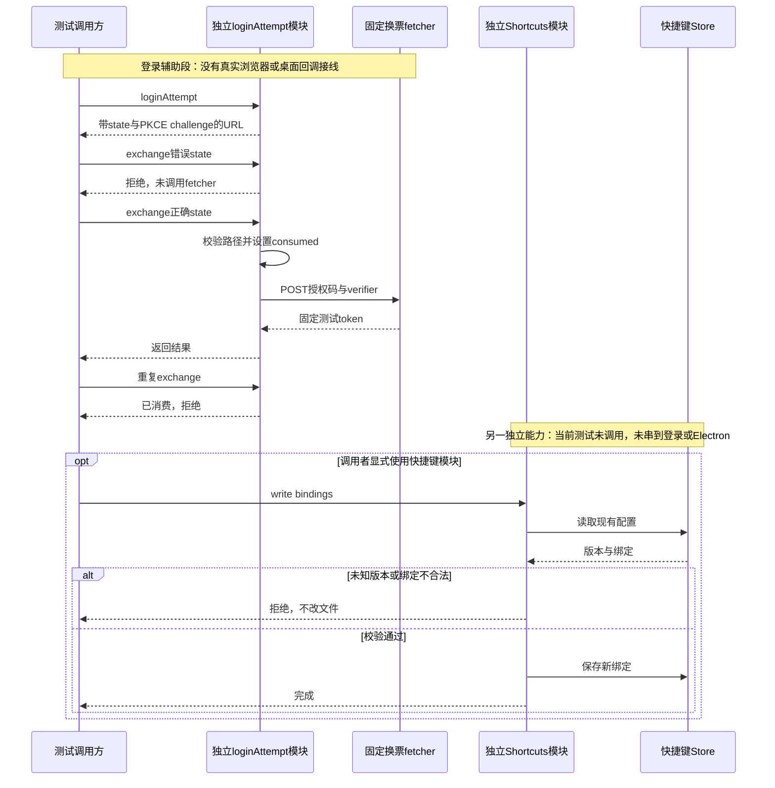

# 053 · 账号PKCE与快捷键数据边界

阶段：R08。唯一前置：完成第 052 步，继续同一个工程。

## 什么时候会用到这一页

桌面程序用外部浏览器登录时，攻击者替换state或重复提交回调，程序应在换票前拒绝；快捷键配置文件损坏时，也不能悄悄用默认值覆盖用户文件。这是两个独立的数据边界，本章尚未把它们放进桌面UI。

### 这次数据怎么走

```text
loginAttempt生成state/verifier/challenge → 拼授权URL → exchange校验回调路径和state → 单次标记consumed → fixed token请求；Shortcuts另走Store.read/write，读取已有版本后才接受修改。
```

### 对应时序图

从上往下读；实线箭头表示调用或发送，虚线箭头表示返回或事件通知。`opt`表示可选操作，`alt`表示不同结果，`loop`表示重复，`par`及其`and`分支表示并行；“未接入”及fixture说明按图中标注理解。



**当前接线位置：**loginAttempt与Shortcuts都是独立模块；截至069，没有把它们接到052欢迎页、系统回调或键盘分发。它们不是已经可登录的桌面产品。

## 这一步具体做什么

先写完src/login.mjs和desktop/shortcuts.mjs，再运行bun test ./tests/053-login.test.mjs。该测试不访问accounts.example：先传错state，随后用正确state和固定fetcher换票，最后重放同一回调。分别记录是否触发fetcher、consumed何时变成true。

需要本章新文件的操作，先按下面代码创建文件，再执行；不要在上一步尚不存在的接口上试错。

## 代码为什么放在这一层

state把回调绑定到本次登录尝试；PKCE的verifier让拿到授权码的人也不能脱离本次尝试换票；consumed阻止重复消费。同一章的Shortcuts保护配置文件版本，不是OAuth逻辑，也不会自行在Electron中注册按键。

## 在哪里写、写什么

操作地点：终端中的 `$PROJECT`，编辑器打开同一个目录。只创建或替换下列文件，其他文件保留上一步版本。文件目录不存在先创建。

```sh
mkdir -p desktop
```

### 创建 `desktop/shortcuts.mjs`

````javascript
import { Store } from '../src/storage.mjs'

/** 快捷键配置保持最后接受版本；坏文件不自动覆盖成默认值。 */
export class Shortcuts {
  constructor(path) { this.store = new Store(path) }
  read() {
    const value = this.store.read()
    if (value.version !== undefined && value.version !== 1) throw Error('未知快捷键版本，拒绝改写')
    return value.bindings ?? { send: 'CommandOrControl+Enter', cancel: 'Escape' }
  }
  write(bindings) {
    this.read()
    if (Object.values(bindings).some(value => typeof value !== 'string') || new Set(Object.values(bindings)).size !== Object.values(bindings).length) throw Error('快捷键重复或不合法')
    this.store.update(() => ({ version: 1, bindings }))
  }
}
````

```sh
mkdir -p src
```

### 创建 `src/login.mjs`

````javascript
import { randomBytes, createHash, timingSafeEqual } from 'node:crypto'

/** PKCE不把client secret放在桌面包里；账户后端必须明确配置。 */
export function loginAttempt({ authorizeURL, clientId, redirectURI }) {
  const verifier = randomBytes(32).toString('base64url'), state = randomBytes(24).toString('base64url')
  const url = new URL(authorizeURL)
  url.searchParams.set('response_type', 'code'); url.searchParams.set('client_id', clientId); url.searchParams.set('redirect_uri', redirectURI)
  url.searchParams.set('state', state); url.searchParams.set('code_challenge_method', 'S256'); url.searchParams.set('code_challenge', createHash('sha256').update(verifier).digest('base64url'))
  let consumed = false
  return { url: url.href,
    /** 回调只能消费一次，state和redirect路径都必须匹配。 */
    async exchange(callback, tokenURL, fetcher = fetch) {
      const result = new URL(callback), expected = new URL(redirectURI), actualState = result.searchParams.get('state') ?? ''
      if (consumed || result.origin !== expected.origin || result.pathname !== expected.pathname || actualState.length !== state.length || !timingSafeEqual(Buffer.from(actualState), Buffer.from(state))) throw Error('登录回调不合法或已消费')
      const code = result.searchParams.get('code'); if (!code) throw Error('回调缺少code')
      consumed = true
      const response = await fetcher(tokenURL, { method: 'POST', headers: { 'content-type': 'application/x-www-form-urlencoded' }, body: new URLSearchParams({ grant_type: 'authorization_code', client_id: clientId, redirect_uri: redirectURI, code, code_verifier: verifier }) })
      if (!response.ok) throw Error('登录换票失败：' + response.status)
      return await response.json()
    },
  }
}
````

```sh
mkdir -p tests
```

### 创建 `tests/053-login.test.mjs`

````javascript
import { test } from 'bun:test'
import assert from 'node:assert/strict'
import { loginAttempt } from '../src/login.mjs'

test('真实PKCE编码、state校验和单次消费', async () => {
  const attempt = loginAttempt({ authorizeURL: 'https://accounts.example/authorize', clientId: 'desktop', redirectURI: 'http://127.0.0.1:1234/callback' })
  const state = new URL(attempt.url).searchParams.get('state')
  await assert.rejects(attempt.exchange('http://127.0.0.1:1234/callback?code=a&state=wrong', 'https://accounts.example/token'), /不合法/)
  let verifier
  const token = await attempt.exchange('http://127.0.0.1:1234/callback?code=a&state=' + state, 'https://accounts.example/token', async (url, request) => { verifier = request.body.get('code_verifier'); return Response.json({ access_token: 'test-token' }) })
  assert.equal(token.access_token, 'test-token'); assert.ok(verifier.length > 30)
  await assert.rejects(attempt.exchange('http://127.0.0.1:1234/callback?code=a&state=' + state, 'https://accounts.example/token'), /已消费/)
})
````

## 运行命令与通过标准

```sh
cd "$PROJECT"
bun test ./tests/053-login.test.mjs
bun test
```

测试证明错state被拒绝、有效state走一次固定换票、verifier存在且长度足够、同一回调不可再用。它没有验证真正OAuth服务器、浏览器回调、凭据落盘、challenge是否等于verifier的SHA256，也完全没有导入或测试Shortcuts。

**本步证据的范围：**tests/053-login.test.mjs只有一项固定网络替身测试，实际使用密码学随机和hash，但网络、账号和token是测试值。desktop/shortcuts.mjs没有本章测试；没有启动外部浏览器或Electron。

## VS Code：断在哪里、看什么

打开tests/053-login.test.mjs用“Bun：当前测试”启动，给src/login.mjs的if (consumed || ...)、consumed = true及fetcher(tokenURL, ...)断点。监视consumed、actualState.length、expected.pathname，以及fetcher是否到达；错state时应在fetch前抛错，正确回调后consumed=true，第三次仍在校验处拒绝。F10检查这些状态，不在日志或截图中输出真实code/verifier/token。Shortcuts当前无测试驱动，不能期待它的断点命中。

操作位置：VS Code 打开的是自己的 `$PROJECT`，断点也设在这里的源码，不在教材的 `steps` 目录。

上面的说明若指定CLI、子进程、页面或Electron附加调试，就先按该流程操作；下面这组步骤只用于本章测试入口。“当前测试”不会自动附加子进程，也不会命中浏览器或Electron中的断点。

变量只在所属作用域可见：停在方法内部时看this和参数；要看测试里的局部变量，先在“调用堆栈”选择对应测试帧。正在等待的异步调用者不一定保留可求值的帧，此时在测试调用前后加断点再看，不把未定义误判成业务状态丢失。

沿用第 000 步安装的 Bun 扩展与 `.vscode/launch.json`；本章列出替换配置时，使用本章完整版本。

1. 打开本步测试文件 `tests/053-login.test.mjs`，保持它为当前编辑器文件。
2. 在上面指定的函数内单击行号左侧设置断点。
3. “运行和调试”选择 **Bun：当前测试**，按 F5；它执行当前测试，工作目录固定为 PROJECT。
4. 在“变量 / 监视 / 调用堆栈 / 调试控制台”检查状态；F10 逐行执行，F11 进入函数，Shift+F11 返回，F5 继续，Shift+F5 停止。

验收：断点实际命中，能说出当前输入、状态和下一步；只看到进程启动不算完成。长时间暂停会影响真实取消、审批和网络超时，先检查时序，不删超时断言。修正后在集成终端运行 `bun test ./tests/053-login.test.mjs`，再运行 `bun test`，保留全部断言。

## 不看答案，确认自己能解释

闭卷写出state、verifier、授权码和access_token四个词各负责什么；再写“为什么改快捷键必须先读文件版本”，不要把两类token混为一谈。

完成后在 LEARNING.md 写一句实际结果和一个卡点。明天只重做这个卡点；第 3 天、第 7 天再做一次，能独立完成就继续下一页，不另开学习路线。

**再改一个条件验证：**练习：给本章固定换票测试增加HTTP 500情形，再断言同一attempt不能重用，必须重新loginAttempt。只用Response对象，不连接真实账号；这是新增练习，当前没有该测试。

## 与当前原版还差哪些

对照本仓库固定原版 `687f282e8625c6b8d11ff58211a90524be2e4317`；这里的“当前”指该本地基线，不是未经检查的上游最新版。

**这一页已经实现：**

- 随机state/verifier、S256 challenge、授权URL和单次回调换票。
- 校验回调origin/path/state，错误或重复回调拒绝。
- 独立快捷键Store的版本拒绝和基本重复绑定检查。

**原版仍有、或本步尚未对齐的部分：**

- 原版账号生命周期包括实际授权提供方、凭据存储、刷新/撤销和UI；本章没有真实登录接线。
- 快捷键没有原版命令注册、平台规则、组合键、输入法保护、原生分发和已接受状态发布。
- Shortcuts无测试；当前测试也未密码学比对challenge与verifier，不应把名称里的“真实PKCE”理解为全流程验收。

**原版对照位置：**

- [packages/credentials/deepseek-account/src/index.ts](../../../deepseek-harness/packages/credentials/deepseek-account/src/index.ts)
- [packages/credentials/deepseek-account-platform](../../../deepseek-harness/packages/credentials/deepseek-account-platform)
- [apps/desktop/src/account-backend.ts](../../../deepseek-harness/apps/desktop/src/account-backend.ts)
- [apps/desktop/src/keybindings.ts](../../../deepseek-harness/apps/desktop/src/keybindings.ts)
- [packages/client/shortcuts/src/configuration.ts](../../../deepseek-harness/packages/client/shortcuts/src/configuration.ts)
- [packages/client/shortcuts/src/binding.ts](../../../deepseek-harness/packages/client/shortcuts/src/binding.ts)

本步测试通过只证明上面的具体行为；完整差距仍看 [COVERAGE.md](../COVERAGE.md)，不以文件数量、同名类或后面出现另一个模块代替接线证据。

下一步：[第 054 步](054.md)
