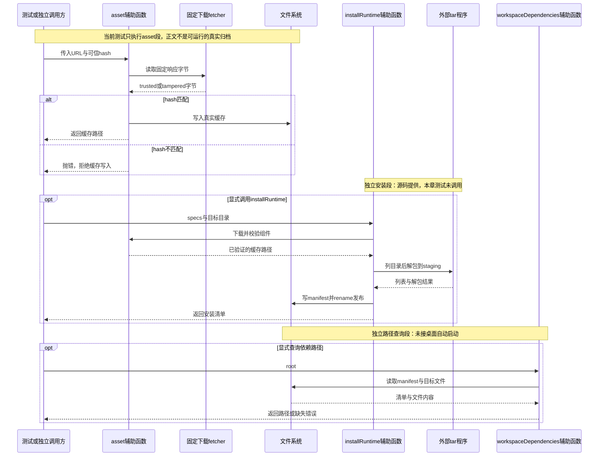

# 054 · 运行时下载必须验证后发布

阶段：R08。唯一前置：完成第 053 步，继续同一个工程。

<!-- harness-own-links:start -->
## 当前练习工程文件

以下链接指向 `harness-own` 的当前累计版本；本课下方的完整代码仍保留当步版本，二者可能不同。

[打开练习工程说明](../../../harness-own/README.md)

| 本课文件 | 当前练习工程文件 |
| --- | --- |
| `.vscode/launch.json` | 使用本页下方的本节专用配置，不复制累计版本 |
| `src/runtime-assets.mjs` | 尚未合入 harness-own |
| `tests/054-runtime-assets.test.mjs` | 尚未合入 harness-own |

<!-- harness-own-links:end -->

## 什么时候会用到这一页

应用需要下载运行时归档。如果下载途中被改了一个字节，损坏内容不能被标记为已安装，也不能让模型误以为依赖已经能用。

### 这次数据怎么走

```text
asset读取下载字节 → 与可信spec.sha256比较 → 写入缓存；installRuntime依次调用asset → tar列目录/解包到staging → 写manifest → rename发布；workspaceDependencies读取manifest并返回载荷内路径。三段目前不是桌面自动启动链。
```

### 对应时序图

从上往下读；实线箭头表示调用或发送，虚线箭头表示返回或事件通知。`opt`表示可选操作，`alt`表示不同结果，`loop`表示重复，`par`及其`and`分支表示并行；“未接入”及fixture说明按图中标注理解。



**当前接线位置：** 本章提供独立下载/安装/依赖路径辅助函数；052 Main没有调用它们，051也没有注册workspace_dependencies工具。056只携带当前Bun二进制，不等于复用了本章并完成原版全部primary-runtime。

## 这一步具体做什么

先写完runtime-assets.mjs，再运行bun test ./tests/054-runtime-assets.test.mjs。测试先用固定字节trusted-archive生成hash并写真实缓存，再将下载响应改为tampered，预期校验失败。这里的响应不是可解包tar，也没有真实运行时，不要直接调用installRuntime期待得到Python或Bun。

需要本章新文件的操作，先按下面代码创建文件，再执行；不要在上一步尚不存在的接口上试错。

## 代码为什么放在这一层

下载URL说明去哪里取，可信hash说明预期取到什么；staging避免把半成品直接暴露为安装目录。workspaceDependencies应该指向随载荷带来的明确路径，不能缺文件后偷偷退回PATH找到另一版本。

## 本节调试：选什么、为什么、怎么启动

**建议先选：054：本节测试。** 每节的测试入口都固定到本节文件，不依赖编辑器当前打开的 `${file}`。

| 配置名称 | 什么时候选 | 实际入口或目标 | 能观察什么 |
| --- | --- | --- | --- |
| 054：本节测试 | 本节验收 | tests/054-runtime-assets.test.mjs | 本节 Bun 测试进程；入口固定，不依赖当前编辑器文件。 |

**为什么这样启动：** 本节测试直接调用被测模块，选择这一项即可沿测试进入实现；前序 CLI 或其他语言入口不参与这次调试。

使用下方的[本节专用调试配置](#lesson-debug-config)。它只列本节可用目标；要保留个人配置，请先备份并按名称合并。页面上 `harness-own` 的累计文件链接供看当前工程，不是本节调试配置的答案。

1. VS Code 打开自己的 PROJECT；按本节创建源码与配置，断点设在 PROJECT 文件中。
2. 先用终端运行 `bun test ./tests/054-runtime-assets.test.mjs` 确认普通验收，再选表中的配置按 F5。
3. 在下方具体观察点停住；F10 跨过当前语句，F11 只进入当前调试目标。异步等待涉及另一进程时，切换调试会话并继续对端。
4. 变量要在所属调用帧查看；看测试局部变量时选测试帧，看 this 和参数时选实现方法帧。

**本节具体断点和预期：** 用“054：本节测试”启动tests/054-runtime-assets.test.mjs，在src/runtime-assets.mjs的hash比较和await writeFile(path, bytes, ...)设断点。监视spec.sha256、bytes.toString()和path：第一次是trusted-archive并到达写入，第二次是tampered且在writeFile之前抛错。F10到测试readFile断言缓存内容；installRuntime/rename断点不会命中，因为当前测试没调用安装函数。

暂停断点会影响应用自身的 RPC、取消、进程和网络计时。Bun 测试超时放宽不等于这些计时也被关闭；按本节说明分别设置，普通验收恢复原有时限。

观察完成后退出本节启动的调试会话和进程，再运行 `bun test ./tests/054-runtime-assets.test.mjs`。测试通过只证明本节断言，不代表所有 GUI、外部服务或发布过程均已验证。

## 在哪里写、写什么

操作地点：终端中的 `$PROJECT`，编辑器打开同一个目录。只创建或替换下列文件，其他文件保留上一步版本。文件目录不存在先创建。

```sh
mkdir -p .vscode
```

<a id="lesson-debug-config"></a>

下面是本节专用调试配置，只包含本节入口。program 已固定到本节文件；不是 harness-own 的累计配置。

### 替换 `.vscode/launch.json`

````json
{
  "version": "0.2.0",
  "configurations": [
    {
      "name": "054：本节测试",
      "type": "bun",
      "request": "launch",
      "program": "${workspaceFolder}/tests/054-runtime-assets.test.mjs",
      "cwd": "${workspaceFolder}",
      "runtime": "bun",
      "runtimeArgs": [
        "test",
        "--preload",
        "${workspaceFolder}/scripts/vscode-debug.mjs",
        "--timeout",
        "3600000"
      ],
      "stopOnEntry": false
    }
  ]
}
````

```sh
mkdir -p src
```

### 创建 `src/runtime-assets.mjs`

````javascript
import { mkdir, writeFile, readFile, rename, rm } from 'node:fs/promises'
import { createHash, randomUUID } from 'node:crypto'
import { join, resolve } from 'node:path'
import { execute } from './process.mjs'

/** 下载缓存按可信锁hash接纳；坏文件永远不能成为已安装运行时。 */
export async function asset(spec, directory, fetcher = fetch) {
  if (!/^[a-f0-9]{64}$/.test(spec.sha256)) throw Error('运行时锁缺少SHA256')
  await mkdir(directory, { recursive: true })
  const response = await fetcher(spec.url)
  if (!response.ok) throw Error('运行时下载HTTP ' + response.status)
  const bytes = Buffer.from(await response.arrayBuffer())
  if (createHash('sha256').update(bytes).digest('hex') !== spec.sha256) throw Error('运行时校验失败')
  const path = join(directory, spec.sha256)
  await writeFile(path, bytes, { mode: 0o600 }); return path
}

/** 每个target单独暂存，完整验证后原子发布；已安装目录不静默覆盖。 */
export async function installRuntime(specs, destination, signal) {
  const target = resolve(destination), staging = target + '.staging-' + randomUUID()
  await mkdir(staging, { recursive: true })
  try {
    const manifest = []
    for (const spec of specs) {
      if (!/^[a-z][a-z0-9-]*$/.test(spec.name)) throw Error('运行时组件名不合法')
      const archive = await asset(spec, join(staging, '.cache'))
      const directory = join(staging, spec.name); await mkdir(directory)
      const listing = await execute({ command: 'tar', args: ['-tf', archive] }, signal)
      if (listing.code || listing.output.split('\n').some(name => name.startsWith('/') || name.split('/').includes('..'))) throw Error('运行时归档越界')
      const extraction = await execute({ command: 'tar', args: ['-xf', archive, '-C', directory], timeout: 60_000 }, signal)
      if (extraction.code) throw Error('运行时解包失败')
      manifest.push({ name: spec.name, sha256: spec.sha256, executable: spec.executable })
    }
    await writeFile(join(staging, 'manifest.json'), JSON.stringify(manifest))
    await rename(staging, target)
    return manifest
  } catch (error) { await rm(staging, { recursive: true, force: true }); throw error }
}

/** 只返回载荷里的显式路径，缺少时不退回系统PATH。 */
export async function workspaceDependencies(root) {
  const manifest = JSON.parse(await readFile(join(root, 'manifest.json'), 'utf8')), result = {}
  for (const item of manifest) {
    const path = resolve(root, item.name, item.executable)
    if (!path.startsWith(resolve(root) + '/')) throw Error('运行时路径越界')
    await readFile(path); result[item.name] = path
  }
  return result
}
````

```sh
mkdir -p tests
```

### 创建 `tests/054-runtime-assets.test.mjs`

````javascript
import { test } from 'bun:test'
import assert from 'node:assert/strict'
import { asset } from '../src/runtime-assets.mjs'
import { createHash } from 'node:crypto'
import { mkdtemp, readFile, rm } from 'node:fs/promises'
import { join } from 'node:path'
import { tmpdir } from 'node:os'

test('真实写入运行时缓存，hash错误的载荷不能发布', async () => {
  const root = await mkdtemp(join(tmpdir(), 'own-runtime-')), bytes = Buffer.from('trusted-archive'), sha256 = createHash('sha256').update(bytes).digest('hex')
  try {
    const path = await asset({ url: 'https://runtime.example/archive', sha256 }, root, async () => new Response(bytes))
    assert.equal((await readFile(path)).toString(), 'trusted-archive')
    await assert.rejects(asset({ url: 'https://runtime.example/archive', sha256 }, root, async () => new Response('tampered')), /校验/)
  } finally { await rm(root, { recursive: true, force: true }) }
})
````

## 运行命令与通过标准

```sh
cd "$PROJECT"
bun test ./tests/054-runtime-assets.test.mjs
bun test
```

当前测试只调用asset，证明固定响应内容能写入真实缓存、错误hash被拒绝。它没有调用installRuntime或workspaceDependencies，没有验证tar解包、发布原子性、清理、可执行性、真实运行时冒烟或没有PATH的机器。

**本步证据的范围：** tests/054-runtime-assets.test.mjs使用固定fetcher和真实临时缓存，归档正文只是trusted-archive文本。它不会下载、解包或执行外部二进制。名称中的“不能发布”仅由asset拒绝体现，未验证installRuntime的发布行为。

## 不看答案，确认自己能解释

闭卷画“下载→hash校验→暂存解包→冒烟→发布”五个格子，圈出当前测试真正经过哪两个，再写出冒烟为什么不能被“文件存在”代替。

完成后在 LEARNING.md 写一句实际结果和一个卡点。明天只重做这个卡点；第 3 天、第 7 天再做一次，能独立完成就继续下一页，不另开学习路线。

**再改一个条件验证：** 练习：固定fetcher返回HTTP 500，补断言asset在写缓存前失败。仍使用临时目录与内存Response，不下载真实运行时；本变体未在现有测试实现。

## 与当前原版还差哪些

对照本仓库固定原版 `687f282e8625c6b8d11ff58211a90524be2e4317`；这里的“当前”指该本地基线，不是未经检查的上游最新版。

**这一页已经实现：**

- 下载响应状态检查、SHA256接纳和真实缓存写入。
- 独立staging解包及rename发布流程，出错清理staging。
- 从自有manifest返回载荷里的依赖路径，缺文件报错。

**原版仍有、或本步尚未对齐的部分：**

- 原版固定Node/Python/pnpm、wheels/库和Office资源锁及平台清单；本章没有完整可信载荷。
- installRuntime和workspaceDependencies未测试，tar清单字符串检查不能证明链接/特殊条目安全。
- 本章未运行依赖版本与可执行smoke，单纯readFile成功不代表工具链可用。
- 未接桌面启动、依赖工具、升级/复用和原版primary-runtime复制/别名规则。

**原版对照位置：**

- [scripts/primary-runtime/lock.json](../../../deepseek-harness/scripts/primary-runtime/lock.json)
- [scripts/primary-runtime/prepare.ts](../../../deepseek-harness/scripts/primary-runtime/prepare.ts)
- [scripts/primary-runtime/smoke.py](../../../deepseek-harness/scripts/primary-runtime/smoke.py)
- [packages/skill/tool-workspace-dependencies/src/index.ts](../../../deepseek-harness/packages/skill/tool-workspace-dependencies/src/index.ts)
- [apps/desktop/scripts/prepare-primary-runtime.ts](../../../deepseek-harness/apps/desktop/scripts/prepare-primary-runtime.ts)

本步测试通过只证明上面的具体行为；完整差距仍看 [COVERAGE.md](../COVERAGE.md)，不以文件数量、同名类或后面出现另一个模块代替接线证据。

下一步：[第 055 步](055.md)
