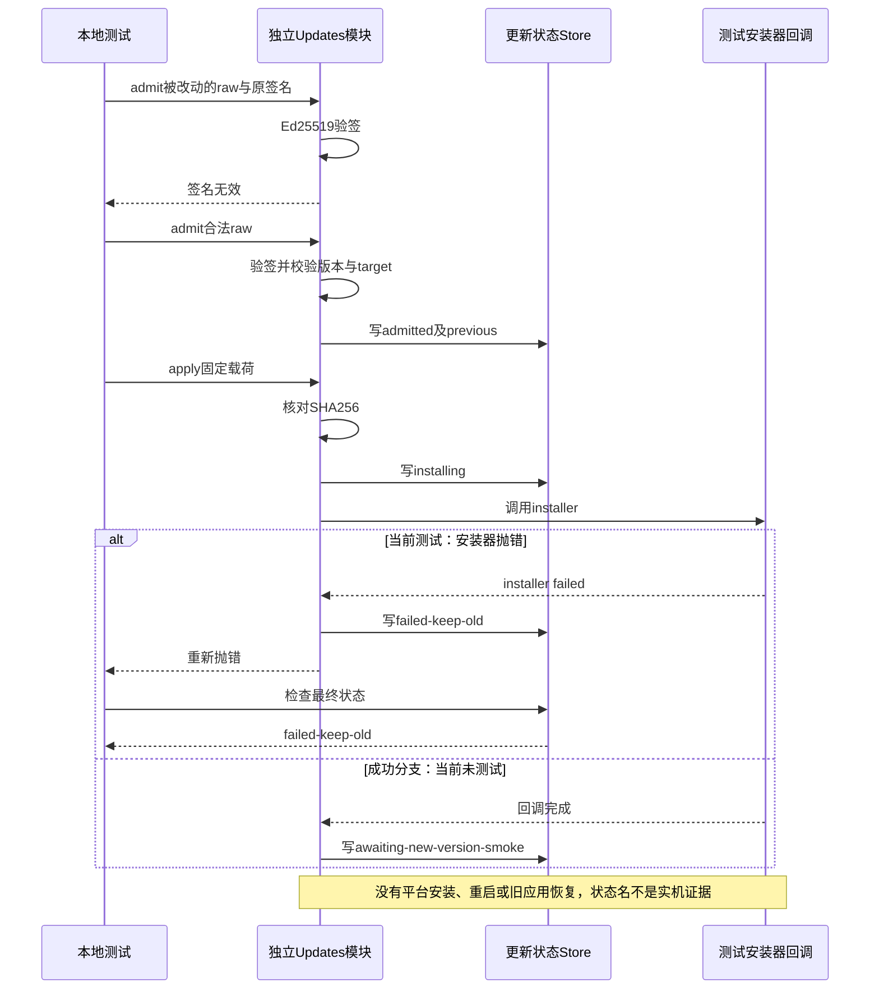

# 055 · 更新签名、降级拒绝和失败保留旧版

阶段：R08。唯一前置：完成第 054 步，继续同一个工程。

<!-- harness-own-links:start -->
## 当前练习工程文件

以下链接指向 `harness-own` 的当前累计版本；本课下方的完整代码仍保留当步版本，二者可能不同。

[打开练习工程说明](../../../harness-own/README.md)

| 本课文件 | 当前练习工程文件 |
| --- | --- |
| `.vscode/launch.json` | 使用本页下方的本节专用配置，不复制累计版本 |
| `src/update.mjs` | 尚未合入 harness-own |
| `tests/055-update.test.mjs` | 尚未合入 harness-own |

<!-- harness-own-links:end -->

## 什么时候会用到这一页

下载站给出一个新版本清单：程序应先证明清单没有被篡改、目标平台和版本正确，再校验载荷。安装器失败时，要记录失败并保留旧版资格，而不是把“下载完成”显示成“更新成功”。

### 这次数据怎么走

```text
Updates.admit验证原始清单签名 → 校验版本/target/hash → Store记admitted → apply验证载荷hash → Store记installing → 调用平台installer → awaiting-new-version-smoke或failed-keep-old。
```

### 对应时序图

从上往下读；实线箭头表示调用或发送，虚线箭头表示返回或事件通知。`opt`表示可选操作，`alt`表示不同结果，`loop`表示重复，`par`及其`and`分支表示并行；“未接入”及fixture说明按图中标注理解。



**当前接线位置：**Updates仍是独立类，052 Main没有调用它，056打包也没有因此获得真实自动升级。后续没有平台installer和新版smoke确认接线，不能把本章状态机当作已完成桌面更新。

## 这一步具体做什么

先写完src/update.mjs和测试，再运行bun test ./tests/055-update.test.mjs。观察本地临时密钥签名的raw清单：末尾加空格后必须验签失败；原raw准入后，固定installer抛错，最终状态必须为failed-keep-old。本章不连接更新服务器，也不安装或重启应用。

需要本章新文件的操作，先按下面代码创建文件，再执行；不要在上一步尚不存在的接口上试错。

## 代码为什么放在这一层

签名证明清单来自信任的签发方，hash证明载荷符合清单，版本和平台判断决定它是否适合当前安装。awaiting-new-version-smoke只是等待新版启动验证，不能把它当更新完成。

## 本节调试：选什么、为什么、怎么启动

**建议先选：055：本节测试。** 每节的测试入口都固定到本节文件，不依赖编辑器当前打开的 `${file}`。

| 配置名称 | 什么时候选 | 实际入口或目标 | 能观察什么 |
| --- | --- | --- | --- |
| 055：本节测试 | 本节验收 | tests/055-update.test.mjs | 本节 Bun 测试进程；入口固定，不依赖当前编辑器文件。 |

**为什么这样启动：**本节测试直接调用被测模块，选择这一项即可沿测试进入实现；前序 CLI 或其他语言入口不参与这次调试。

使用下方的[本节专用调试配置](#lesson-debug-config)。它只列本节可用目标；要保留个人配置，请先备份并按名称合并。页面上 `harness-own` 的累计文件链接供看当前工程，不是本节调试配置的答案。

1. VS Code 打开自己的 PROJECT；按本节创建源码与配置，断点设在 PROJECT 文件中。
2. 先用终端运行 `bun test ./tests/055-update.test.mjs` 确认普通验收，再选表中的配置按 F5。
3. 在下方具体观察点停住；F10 跨过当前语句，F11 只进入当前调试目标。异步等待涉及另一进程时，切换调试会话并继续对端。
4. 变量要在所属调用帧查看；看测试局部变量时选测试帧，看 this 和参数时选实现方法帧。

**本节具体断点和预期：**打开tests/055-update.test.mjs，用“055：本节测试”启动。断在src/update.mjs的verify(...)、state.status !== 'admitted'条件和catch里的store.update。入口看state.manifest.target、state.previous；state是入口快照，后续监视this.store.read().status才会依次看到admitted、installing、failed-keep-old。F10查看篡改raw被拒绝，再F11进入apply，installer抛错后进入catch。installer是测试回调，不是系统安装程序。

暂停断点会影响应用自身的 RPC、取消、进程和网络计时。Bun 测试超时放宽不等于这些计时也被关闭；按本节说明分别设置，普通验收恢复原有时限。

观察完成后退出本节启动的调试会话和进程，再运行 `bun test ./tests/055-update.test.mjs`。测试通过只证明本节断言，不代表所有 GUI、外部服务或发布过程均已验证。

## 在哪里写、写什么

操作地点：终端中的 `$PROJECT`，编辑器打开同一个目录。只创建或替换下列文件，其他文件保留上一步版本。文件目录不存在先创建。

```sh
mkdir -p .vscode
```

<a id="lesson-debug-config"></a>

下面是本节专用调试配置，只包含本节入口。program 已固定到本节文件；不是 harness-own 的累计配置。

### 替换 `.vscode/launch.json`

````json
{
  "version": "0.2.0",
  "configurations": [
    {
      "name": "055：本节测试",
      "type": "bun",
      "request": "launch",
      "program": "${workspaceFolder}/tests/055-update.test.mjs",
      "cwd": "${workspaceFolder}",
      "runtime": "bun",
      "runtimeArgs": [
        "test",
        "--preload",
        "${workspaceFolder}/scripts/vscode-debug.mjs",
        "--timeout",
        "3600000"
      ],
      "stopOnEntry": false
    }
  ]
}
````

```sh
mkdir -p src
```

### 创建 `src/update.mjs`

````javascript
import { verify, createHash } from 'node:crypto'
import { Store } from './storage.mjs'

/** 更新只信任固定公钥签名的原始manifest字节，不能信任下载URL自己声称的hash。 */
export class Updates {
  constructor(path, publicKey, target) { this.store = new Store(path); this.key = publicKey; this.target = target }
  /** 拒绝跨平台、降级与被篡改的元数据。 */
  admit(raw, signature, currentVersion) {
    if (!verify(null, Buffer.from(raw), this.key, Buffer.from(signature, 'base64'))) throw Error('更新签名无效')
    const manifest = JSON.parse(raw)
    const numbers = value => { if (!/^\d+\.\d+\.\d+$/.test(value)) throw Error('更新版本不合法'); return value.split('.').map(Number) }
    const next = numbers(manifest.version), current = numbers(currentVersion)
    let newer = false
    for (let index = 0; index < 3; index++) { if (next[index] !== current[index]) { newer = next[index] > current[index]; break } }
    if (!newer || manifest.target !== this.target || !/^[a-f0-9]{64}$/.test(manifest.sha256)) throw Error('更新目标或版本不合法')
    this.store.update(() => ({ status: 'admitted', manifest, previous: currentVersion }))
    return manifest
  }
  /** 安装器由平台提供；失败保留旧版本资格，不把准备完成当安装成功。 */
  async apply(bytes, installer) {
    const state = this.store.read()
    if (state.status !== 'admitted' || createHash('sha256').update(bytes).digest('hex') !== state.manifest.sha256) throw Error('更新载荷不合法')
    this.store.update(() => ({ ...state, status: 'installing' }))
    try { await installer(bytes); this.store.update(() => ({ ...state, status: 'awaiting-new-version-smoke' })) }
    catch (error) { this.store.update(() => ({ ...state, status: 'failed-keep-old', error: error.message })); throw error }
  }
}
````

```sh
mkdir -p tests
```

### 创建 `tests/055-update.test.mjs`

````javascript
import { test } from 'bun:test'
import assert from 'node:assert/strict'
import { generateKeyPairSync, sign, createHash } from 'node:crypto'
import { mkdtempSync, rmSync } from 'node:fs'
import { tmpdir } from 'node:os'
import { join } from 'node:path'
import { Updates } from '../src/update.mjs'

test('真实Ed25519签名、hash与失败保留旧版状态', async () => {
  const root = mkdtempSync(join(tmpdir(), 'own-update-')), keys = generateKeyPairSync('ed25519'), bytes = Buffer.from('new-app')
  try {
    const update = new Updates(join(root, 'state.json'), keys.publicKey, 'mac-arm64')
    const raw = JSON.stringify({ version: '1.1.0', target: 'mac-arm64', sha256: createHash('sha256').update(bytes).digest('hex') }), signature = sign(null, Buffer.from(raw), keys.privateKey).toString('base64')
    assert.throws(() => update.admit(raw + ' ', signature, '1.0.0'), /签名/)
    update.admit(raw, signature, '1.0.0')
    await assert.rejects(update.apply(bytes, async () => { throw Error('installer failed') }), /installer/)
    assert.equal(update.store.read().status, 'failed-keep-old')
  } finally { rmSync(root, { recursive: true, force: true }) }
})
````

## 运行命令与通过标准

```sh
cd "$PROJECT"
bun test ./tests/055-update.test.mjs
bun test
```

单测验证真实Ed25519签名的篡改拒绝、载荷hash校验通过后固定安装器失败，以及失败状态落盘。它没有测试成功安装、降级/跨平台分支、真实平台安装器、旧应用保留或新版启动；failed-keep-old是状态名，不是磁盘恢复证据。

**本步证据的范围：**tests/055-update.test.mjs使用真实crypto与临时Store，但载荷只是new-app文本，installer只抛Error。没有网络、签名证书、应用包或系统更新动作。本次文档修改不新增升级资格。

## 不看答案，确认自己能解释

闭卷分别写一句“签名通过”“hash通过”“installer返回”“新版smoke通过”各能证明什么，再指出哪一步才有资格宣告新版可运行。

完成后在 LEARNING.md 写一句实际结果和一个卡点。明天只重做这个卡点；第 3 天、第 7 天再做一次，能独立完成就继续下一页，不另开学习路线。

**再改一个条件验证：**练习：用本地临时密钥给版本0.9.0的清单重新签名，调用admit时currentVersion=1.0.0，断言即使签名有效也被拒绝。不用真实证书或发布服务；该降级变体目前没有测试。

## 与当前原版还差哪些

对照本仓库固定原版 `687f282e8625c6b8d11ff58211a90524be2e4317`；这里的“当前”指该本地基线，不是未经检查的上游最新版。

**这一页已经实现：**

- 对原始清单字节做公钥验签，检查简单三段版本、target与SHA256字段。
- apply校验载荷，记录安装中、等待新版验证或失败保留旧版状态。
- 安装动作通过显式installer回调注入，不在通用逻辑里猜平台命令。

**原版仍有、或本步尚未对齐的部分：**

- 原版有更新下载、资格/强更策略、进度、原生安装接管、准入锁定与任务中断确认；这里未接。
- 没有真实旧产物保留/恢复或新版启动smoke实现，状态文字不能代替行为。
- 没有完整版本语义、成功确认方法、多平台升级和故障恢复验收。

**原版对照位置：**

- [apps/desktop/src/update-coordinator.ts](../../../deepseek-harness/apps/desktop/src/update-coordinator.ts)
- [apps/desktop/src/update-http-executor.ts](../../../deepseek-harness/apps/desktop/src/update-http-executor.ts)
- [apps/desktop/src/update-journal.ts](../../../deepseek-harness/apps/desktop/src/update-journal.ts)
- [apps/desktop/src/mandatory-update-policy.ts](../../../deepseek-harness/apps/desktop/src/mandatory-update-policy.ts)
- [apps/desktop/src/update-presentation.ts](../../../deepseek-harness/apps/desktop/src/update-presentation.ts)

本步测试通过只证明上面的具体行为；完整差距仍看 [COVERAGE.md](../COVERAGE.md)，不以文件数量、同名类或后面出现另一个模块代替接线证据。

下一步：[第 056 步](056.md)
