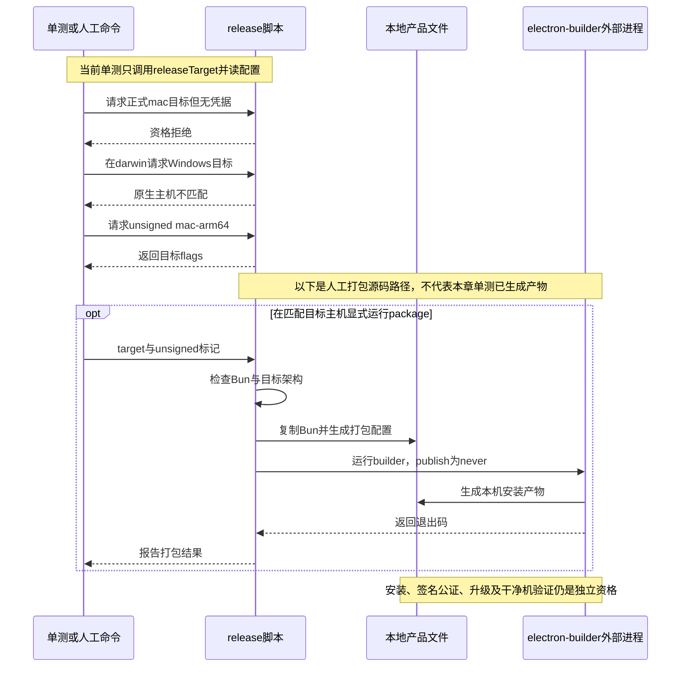

# 056 · 准备本机打包脚本，发布资格另验收

阶段：R08。唯一前置：完成第 055 步，继续同一个工程。

<!-- harness-own-links:start -->
## 当前练习工程文件

以下链接指向 `harness-own` 的当前累计版本；本课下方的完整代码仍保留当步版本，二者可能不同。

[打开练习工程说明](../../../harness-own/README.md)

| 本课文件 | 当前练习工程文件 |
| --- | --- |
| `.vscode/launch.json` | 使用本页下方的本节专用配置，不复制累计版本 |
| `electron-builder.json` | 尚未合入 harness-own |
| `package.json` | [`harness-own/package.json`](../../../harness-own/package.json) |
| `scripts/release.mjs` | 尚未合入 harness-own |
| `tests/056-release.test.mjs` | 尚未合入 harness-own |

<!-- harness-own-links:end -->

## 什么时候会用到这一页

开发者准备把桌面程序交给另一台机器安装。先区分“本机未签名安装包能生成”和“具备正式分发资格”，并确认包里带了Bun，而不是依赖开发机PATH或夹带credentials。

### 这次数据怎么走

```text
release脚本解析目标 → releaseTarget检查原生平台与正式签名凭据 → 复制当前架构Bun到.runtime → 生成electron-builder配置 → electron-builder --publish never → 本机产物；安装后验证、签名公证和升级仍是后续独立资格。
```

### 对应时序图

从上往下读；实线箭头表示调用或发送，虚线箭头表示返回或事件通知。`opt`表示可选操作，`alt`表示不同结果，`loop`表示重复，`par`及其`and`分支表示并行；“未接入”及fixture说明按图中标注理解。



**当前接线位置：**本章提供实际electron-builder入口，携带当前Bun以运行052 Host。它没有装配054完整runtime安装、055更新器，也不是原版完整桌面发布流水线。

## 这一步具体做什么

先写完本章package.json、electron-builder.json和release脚本并安装依赖，再运行bun test ./tests/056-release.test.mjs。该测试不打包；按测试检查无证书的正式mac目标被拒绝、跨平台目标被拒绝、配置files不包含用户数据。人工打包只能在匹配目标的原生主机上按本章命令执行，保留unsigned标记，不要上传或发布。

需要本章新文件的操作，先按下面代码创建文件，再执行；不要在上一步尚不存在的接口上试错。

## 代码为什么放在这一层

打包清单决定交付哪些产品文件；目标检查避免把交叉构建命令结束误当目标平台已经可用。Bun绝对路径在开发时来自启动器，安装后来自随包载荷；签名、公证、安装与启动是不同的验收项。

## 本节调试：选什么、为什么、怎么启动

**建议先选：056：本节测试。** 每节的测试入口都固定到本节文件，不依赖编辑器当前打开的 `${file}`。

| 配置名称 | 什么时候选 | 实际入口或目标 | 能观察什么 |
| --- | --- | --- | --- |
| 056：本节测试 | 本节验收 | tests/056-release.test.mjs | 本节 Bun 测试进程；入口固定，不依赖当前编辑器文件。 |

**为什么这样启动：**本节测试直接调用被测模块，选择这一项即可沿测试进入实现；前序 CLI 或其他语言入口不参与这次调试。

使用下方的[本节专用调试配置](#lesson-debug-config)。它只列本节可用目标；要保留个人配置，请先备份并按名称合并。页面上 `harness-own` 的累计文件链接供看当前工程，不是本节调试配置的答案。

1. VS Code 打开自己的 PROJECT；按本节创建源码与配置，断点设在 PROJECT 文件中。
2. 先用终端运行 `bun test ./tests/056-release.test.mjs` 确认普通验收，再选表中的配置按 F5。
3. 在下方具体观察点停住；F10 跨过当前语句，F11 只进入当前调试目标。异步等待涉及另一进程时，切换调试会话并继续对端。
4. 变量要在所属调用帧查看；看测试局部变量时选测试帧，看 this 和参数时选实现方法帧。

**本节具体断点和预期：**用“056：本节测试”启动tests/056-release.test.mjs，断在scripts/release.mjs的if (!result || result[0] !== platform)和正式凭据条件。监视target、unsigned、platform、result：mac-arm64/unsigned在darwin应返回--mac/--arm64；win-x64在darwin应先抛错。F10观察返回，勿在监视窗口展开真实签名秘密。该测试不会走文件复制或spawnSync，相关断点不命中是正常的。

暂停断点会影响应用自身的 RPC、取消、进程和网络计时。Bun 测试超时放宽不等于这些计时也被关闭；按本节说明分别设置，普通验收恢复原有时限。

观察完成后退出本节启动的调试会话和进程，再运行 `bun test ./tests/056-release.test.mjs`。测试通过只证明本节断言，不代表所有 GUI、外部服务或发布过程均已验证。

## 在哪里写、写什么

操作地点：终端中的 `$PROJECT`，编辑器打开同一个目录。只创建或替换下列文件，其他文件保留上一步版本。文件目录不存在先创建。

```sh
mkdir -p .vscode
```

<a id="lesson-debug-config"></a>

下面是本节专用调试配置，只包含本节入口。program 已固定到本节文件；不是 harness-own 的累计配置。

### 替换 `.vscode/launch.json`

````json
{
  "version": "0.2.0",
  "configurations": [
    {
      "name": "056：本节测试",
      "type": "bun",
      "request": "launch",
      "program": "${workspaceFolder}/tests/056-release.test.mjs",
      "cwd": "${workspaceFolder}",
      "runtime": "bun",
      "runtimeArgs": [
        "test",
        "--preload",
        "${workspaceFolder}/scripts/vscode-debug.mjs",
        "--timeout",
        "3600000"
      ],
      "stopOnEntry": false
    }
  ]
}
````

### 创建 `electron-builder.json`

````json
{
  "appId": "dev.harness.own",
  "productName": "Harness Own",
  "asar": false,
  "directories": {
    "output": "release"
  },
  "files": [
    "desktop/**",
    "src/**",
    "web/**",
    "package.json",
    "node_modules/**"
  ],
  "mac": {
    "target": [
      "dmg",
      "zip"
    ],
    "category": "public.app-category.developer-tools",
    "hardenedRuntime": true,
    "notarize": true
  },
  "win": {
    "target": [
      "nsis"
    ]
  },
  "linux": {
    "target": [
      "AppImage"
    ],
    "category": "Development"
  },
  "extraResources": [
    {
      "from": ".runtime/bun",
      "to": "bun"
    }
  ]
}
````

### 替换 [`package.json`](../../../harness-own/package.json)

````json
{
  "name": "harness-own",
  "version": "0.1.0",
  "type": "module",
  "private": true,
  "engines": {
    "bun": "1.3.14"
  },
  "scripts": {
    "start": "bun src/main.mjs",
    "test": "bun test ./tests",
    "desktop": "bun scripts/desktop.mjs",
    "package": "bun scripts/release.mjs mac-arm64 --unsigned"
  },
  "dependencies": {
    "@earendil-works/pi-ai": "1.1.0",
    "@modelcontextprotocol/sdk": "1.31.0",
    "@agentclientprotocol/sdk": "1.4.0",
    "zod": "4.4.3",
    "ws": "8.18.3"
  },
  "devDependencies": {
    "electron": "44.7.0",
    "electron-builder": "26.17.0"
  },
  "main": "desktop/main.cjs",
  "description": "从空工程逐步实现的Harness",
  "author": "Harness learner",
  "packageManager": "bun@1.3.14"
}
````

```sh
mkdir -p scripts
```

### 创建 `scripts/release.mjs`

````javascript
import { readFileSync, mkdirSync, writeFileSync, copyFileSync, chmodSync } from 'node:fs'
import { spawnSync } from 'node:child_process'
import { pathToFileURL } from 'node:url'

/** 每个目标只允许在对应系统构建，不能把交叉构建成功当原生资格。 */
export function releaseTarget(target, unsigned, environment = process.env, platform = process.platform) {
  const targets = { 'mac-arm64': ['darwin', '--mac', '--arm64'], 'mac-x64': ['darwin', '--mac', '--x64'], 'win-x64': ['win32', '--win', '--x64'], 'linux-x64': ['linux', '--linux', '--x64'], 'linux-arm64': ['linux', '--linux', '--arm64'] }
  const result = targets[target]
  if (!result || result[0] !== platform) throw Error('需要对应原生目标主机')
  if (!unsigned && result[0] === 'darwin' && ['CSC_LINK', 'APPLE_ID', 'APPLE_APP_SPECIFIC_PASSWORD', 'APPLE_TEAM_ID'].some(key => !environment[key])) throw Error('正式签名/公证凭据未配置')
  if (!unsigned && result[0] === 'win32' && !environment.CSC_LINK) throw Error('Windows正式签名凭据未配置')
  return result.slice(1)
}

if (process.argv[1] && import.meta.url === pathToFileURL(process.argv[1]).href) {
  const target = process.argv[2], unsigned = process.argv.includes('--unsigned'), flags = releaseTarget(target, unsigned)
  const config = JSON.parse(readFileSync('electron-builder.json', 'utf8'))
  if (unsigned) { config.mac.identity = null; config.mac.notarize = false }
  mkdirSync('.release-config', { recursive: true }); const file = '.release-config/' + target + '.json'; writeFileSync(file, JSON.stringify(config))
  // 本机 Bun 与目标架构必须一致；只复制当前验证过的二进制，跨架构载荷另行验收。
  if (!process.versions.bun || !target.endsWith(process.arch)) throw Error('需要对应目标架构的 Bun')
  mkdirSync('.runtime', { recursive: true }); copyFileSync(process.execPath, '.runtime/bun'); chmodSync('.runtime/bun', 0o755)
  if (process.platform === 'win32') config.extraResources[0].to = 'bun.exe'
  writeFileSync(file, JSON.stringify(config))
  const result = spawnSync(process.execPath, ['node_modules/electron-builder/cli.js', '--config', file, ...flags, '--publish', 'never'], { stdio: 'inherit', env: { ...process.env, ...(unsigned ? { CSC_IDENTITY_AUTO_DISCOVERY: 'false' } : {}) } })
  if (result.error) throw result.error
  process.exitCode = result.status ?? 1
}
````

```sh
mkdir -p tests
```

### 创建 `tests/056-release.test.mjs`

````javascript
import { test } from 'bun:test'
import assert from 'node:assert/strict'
import { releaseTarget } from '../scripts/release.mjs'
import { readFileSync } from 'node:fs'

test('正式资格缺凭据失败，打包清单不包含用户数据', () => {
  assert.throws(() => releaseTarget('mac-arm64', false, {}, 'darwin'), /凭据/)
  assert.throws(() => releaseTarget('win-x64', true, {}, 'darwin'), /主机/)
  assert.deepEqual(releaseTarget('mac-arm64', true, {}, 'darwin'), ['--mac', '--arm64'])
  const config = JSON.parse(readFileSync('electron-builder.json'))
  assert.ok(!config.files.some(value => value.includes('.data') || value.includes('.harness') || value.includes('credentials')))
})
````

## 运行命令与通过标准

```sh
cd "$PROJECT"
cp "$COURSE/locks/056.bun.lock" bun.lock
bun install --frozen-lockfile --ignore-scripts
bun test ./tests/056-release.test.mjs
# 人工本机包：bun run package
bun test
```

自动测试只调用releaseTarget并读配置，证明少数资格判断与files字段检查。课程历史记录未生成安装包，不能声称已经安装、签名、公证、升级或验证干净机器可用；electron-builder --version通过也不证明这些。

**本步证据的范围：**tests/056-release.test.mjs只做函数和配置断言，不启动electron-builder。脚本有真实打包分支，但存在分支不等于该分支已运行。本次文档改写未执行打包、读取签名秘密或发布。

## 不看答案，确认自己能解释

闭卷把源码构建、复制运行时、生成安装包、签名、公证、干净机安装、升级七件事排成顺序，并在每项旁写需要什么独立证据。

完成后在 LEARNING.md 写一句实际结果和一个卡点。明天只重做这个卡点；第 3 天、第 7 天再做一次，能独立完成就继续下一页，不另开学习路线。

**再改一个条件验证：**练习：只改测试输入，以platform=linux和target=linux-x64验证目标映射，不能据此宣称Linux产物通过。真实跨平台构建需要对应主机；本章不要求立刻购买证书或发布产品。

## 与当前原版还差哪些

对照本仓库固定原版 `687f282e8625c6b8d11ff58211a90524be2e4317`；这里的“当前”指该本地基线，不是未经检查的上游最新版。

**这一页已经实现：**

- 明确支持目标表，限制在对应原生系统构建。
- 正式mac/Windows构建检查签名凭据，unsigned显式关闭相关签名设置。
- 复制本机目标架构Bun并在产品包中声明extraResources，发布参数固定never。

**原版仍有、或本步尚未对齐的部分：**

- 原版完整runtime graph、生产依赖/工具运行时、平台载荷和签名清单尚未复刻。
- Windows安装/卸载安全路径、原生辅助程序、PE签名和mac公证流程未等价实现。
- 未获得真实安装、启动、升级、恢复、全平台和干净机器验收证据。
- files字段不含明显credentials字样只是静态检查，不是对最终包内容的完整审计。

**原版对照位置：**

- [apps/desktop/scripts/package-target.ts](../../../deepseek-harness/apps/desktop/scripts/package-target.ts)
- [apps/desktop/scripts/desktop-publish.ts](../../../deepseek-harness/apps/desktop/scripts/desktop-publish.ts)
- [apps/desktop/scripts/prepare-primary-runtime.ts](../../../deepseek-harness/apps/desktop/scripts/prepare-primary-runtime.ts)
- [apps/desktop/installer](../../../deepseek-harness/apps/desktop/installer)
- [apps/desktop/windows-signing/README.md](../../../deepseek-harness/apps/desktop/windows-signing/README.md)

本步测试通过只证明上面的具体行为；完整差距仍看 [COVERAGE.md](../COVERAGE.md)，不以文件数量、同名类或后面出现另一个模块代替接线证据。

下一步：[第 057 步](057.md)
