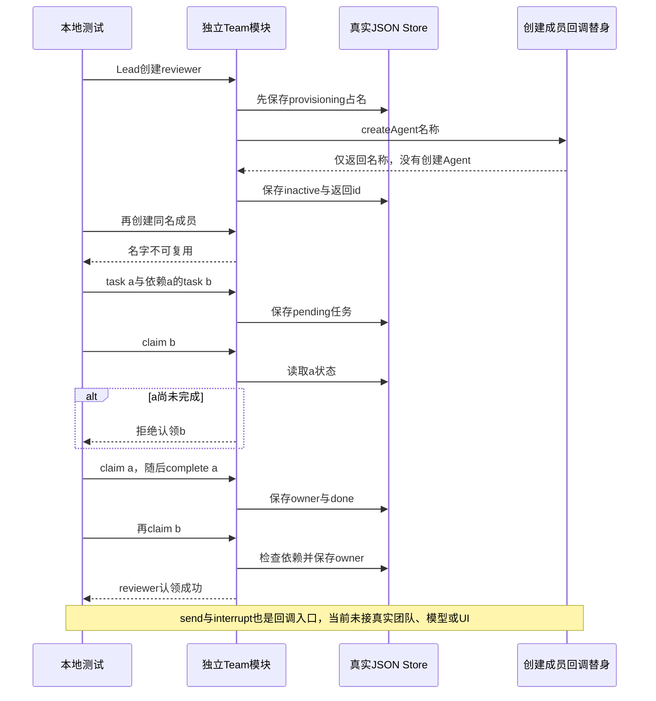

# 057 · 用JSON保存团队名册和任务依赖

阶段：R09。唯一前置：完成第 056 步，继续同一个工程。

<!-- harness-own-links:start -->
## 当前练习工程文件

以下链接指向 `harness-own` 的当前累计版本；本课下方的完整代码仍保留当步版本，二者可能不同。

[打开练习工程说明](../../../harness-own/README.md)

| 本课文件 | 当前练习工程文件 |
| --- | --- |
| `src/teams.mjs` | 尚未合入 harness-own |
| `tests/057-teams.test.mjs` | 尚未合入 harness-own |

<!-- harness-own-links:end -->

## 什么时候会用到这一页

Lead安排reviewer先完成任务a，再认领依赖a的任务b；同一个成员名即使创建失败也不能随意复用，否则消息和任务容易指向另一个人。当前示例只管理名册和任务状态，还没有真的启动一队模型Agent。

### 这次数据怎么走

```text
Team.create/task/claim/complete → Store更新成员与任务JSON；成员create/send/interrupt通过传入回调委托调用者。当前测试回调只返回名字或receipt，不进入Host/Agent。
```

### 对应时序图

从上往下读；实线箭头表示调用或发送，虚线箭头表示返回或事件通知。`opt`表示可选操作，`alt`表示不同结果，`loop`表示重复，`par`及其`and`分支表示并行；“未接入”及fixture说明按图中标注理解。



**当前接线位置：**Team目前只在057测试使用，没有注册到051工具表、Web或CLI，后续也没有真实模型Teams驱动。它不是051 Subagents的自动升级版。

## 这一步具体做什么

先写完teams.mjs，再运行bun test ./tests/057-teams.test.mjs。按测试观察create reviewer成功后再次create被拒绝；b依赖a，第一次claim b报错，claim a并complete后，第二次claim b成功且owner=reviewer。这里不发送消息给真实Agent或他人。

需要本章新文件的操作，先按下面代码创建文件，再执行；不要在上一步尚不存在的接口上试错。

## 代码为什么放在这一层

Team把“成员叫什么”和“任务做到哪一步”持久保存，不能仅靠一个运行中对象的记忆。provisioning先占名字，再调用创建回调，失败记录failed；任务依赖检查决定现在是否可以认领，不等于自动调度。

## 在哪里写、写什么

操作地点：终端中的 `$PROJECT`，编辑器打开同一个目录。只创建或替换下列文件，其他文件保留上一步版本。文件目录不存在先创建。

```sh
mkdir -p src
```

### 创建 `src/teams.mjs`

````javascript
/** 实验团队保留成员名与任务状态；失败成员名也不复用。 */
export class Team {
  constructor(store, lead, create, send, interrupt) { this.store = store; this.lead = lead; this.createAgent = create; this.sendAgent = send; this.interruptAgent = interrupt }
  state() { return { members: {}, tasks: {}, ...this.store.read() } }
  async create(actor, name) {
    if (actor !== this.lead || !/^[a-z][a-z0-9-]*$/.test(name)) throw Error('仅Lead可创建合法成员')
    if (this.state().members[name]) throw Error('成员名不可复用')
    this.store.update(value => { value.members ??= {}; value.members[name] = { status: 'provisioning' }; return value })
    try {
      const id = await this.createAgent(name)
      this.store.update(value => { value.members[name] = { id, status: 'inactive' }; return value }); return id
    } catch (error) { this.store.update(value => { value.members[name].status = 'failed'; return value }); throw error }
  }
  /** 直接使用目标Inbox；Team不悄悄重发失败消息。 */
  send(actor, name, text) { if (actor !== this.lead && !this.state().members[actor]) throw Error('未知团队发送者'); const member = this.state().members[name]; if (!member?.id) throw Error('成员不可用'); return this.sendAgent(member.id, text) }
  interrupt(actor, name) { if (actor !== this.lead) throw Error('仅Lead可中断'); return this.interruptAgent(this.state().members[name].id) }
  task(id, after = []) {
    const state = this.state()
    if (state.tasks[id] || after.includes(id) || after.some(parent => !state.tasks[parent])) throw Error('任务依赖不合法')
    this.store.update(value => { value.tasks ??= {}; value.tasks[id] = { id, after, status: 'pending' }; return value })
  }
  claim(id, actor) {
    const state = this.state(), task = state.tasks[id]
    if (!task || task.status !== 'pending' || !task.after.every(parent => state.tasks[parent].status === 'done')) throw Error('任务尚不可认领')
    this.store.update(value => { value.tasks[id] = { ...task, owner: actor, status: 'doing' }; return value })
  }
  complete(id, actor) { this.store.update(value => { if (value.tasks[id]?.owner !== actor) throw Error('不是任务owner'); value.tasks[id].status = 'done'; return value }) }
}
````

```sh
mkdir -p tests
```

### 创建 `tests/057-teams.test.mjs`

````javascript
import { test } from 'bun:test'
import assert from 'node:assert/strict'
import { Team } from '../src/teams.mjs'
import { Store } from '../src/storage.mjs'
import { mkdtempSync, rmSync } from 'node:fs'
import { tmpdir } from 'node:os'
import { join } from 'node:path'

test('团队名保留、Lead限制和真实持久任务依赖', async () => {
  const root = mkdtempSync(join(tmpdir(), 'own-team-'))
  try {
    const team = new Team(new Store(join(root, 'team.json')), 'lead', async name => name, () => 'receipt', () => {})
    await team.create('lead', 'reviewer')
    await assert.rejects(team.create('lead', 'reviewer'), /不可复用/)
    team.task('a'); team.task('b', ['a'])
    assert.throws(() => team.claim('b', 'reviewer'), /不可认领/)
    team.claim('a', 'reviewer'); team.complete('a', 'reviewer'); team.claim('b', 'reviewer')
    assert.equal(team.state().tasks.b.owner, 'reviewer')
  } finally { rmSync(root, { recursive: true, force: true }) }
})
````

## 运行命令与通过标准

```sh
cd "$PROJECT"
bun test ./tests/057-teams.test.mjs
bun test
```

测试用真实临时JSON Store验证同名拒绝、依赖未完成拒绝和完成后可认领。它没有创建失败成员、重建Team读取、真实Inbox消息、Lead之外权限、取消或模型团队；测试中的create/send/interrupt都是替身。

**本步证据的范围：**tests/057-teams.test.mjs实际读写临时team.json，但没有真实Agent进程或模型。create返回name、send返回receipt、interrupt空函数；断言只覆盖名冲突和两任务依赖链。本次仅改文档。

## VS Code：断在哪里、看什么

打开tests/057-teams.test.mjs，用“Bun：当前测试”启动。断在src/teams.mjs的成员写入provisioning、if (!task || task.status !== 'pending' || ...)和complete更新。监视this.state().members.reviewer、task.after、state.tasks.a.status；F10看第一次claim b时a=pending，完成a后F11再进入claim，owner应写为reviewer。不要把回调async name => name当成真实Agent创建。

操作位置：VS Code 打开的是自己的 `$PROJECT`，断点也设在这里的源码，不在教材的 `steps` 目录。

上面的说明若指定CLI、子进程、页面或Electron附加调试，就先按该流程操作；下面这组步骤只用于本章测试入口。“当前测试”不会自动附加子进程，也不会命中浏览器或Electron中的断点。

变量只在所属作用域可见：停在方法内部时看this和参数；要看测试里的局部变量，先在“调用堆栈”选择对应测试帧。正在等待的异步调用者不一定保留可求值的帧，此时在测试调用前后加断点再看，不把未定义误判成业务状态丢失。

沿用第 000 步安装的 Bun 扩展与 `.vscode/launch.json`；本章列出替换配置时，使用本章完整版本。

1. 打开本步测试文件 `tests/057-teams.test.mjs`，保持它为当前编辑器文件。
2. 在上面指定的函数内单击行号左侧设置断点。
3. “运行和调试”选择 **Bun：当前测试**，按 F5；它执行当前测试，工作目录固定为 PROJECT。
4. 在“变量 / 监视 / 调用堆栈 / 调试控制台”检查状态；F10 逐行执行，F11 进入函数，Shift+F11 返回，F5 继续，Shift+F5 停止。

验收：断点实际命中，能说出当前输入、状态和下一步；只看到进程启动不算完成。长时间暂停会影响真实取消、审批和网络超时，先检查时序，不删超时断言。修正后在集成终端运行 `bun test ./tests/057-teams.test.mjs`，再运行 `bun test`，保留全部断言。

## 不看答案，确认自己能解释

闭卷画两张小状态表：成员provisioning/inactive/failed与任务pending/doing/done。再给a→b依赖画箭头，说明完成a为什么允许认领b但不会自动执行b。

完成后在 LEARNING.md 写一句实际结果和一个卡点。明天只重做这个卡点；第 3 天、第 7 天再做一次，能独立完成就继续下一页，不另开学习路线。

**再改一个条件验证：**练习：把临时测试的create回调改成抛错，补断言成员状态failed且同名不能再创建；只用隔离Store。该失败名字用例当前尚未实现，不代表已具备团队冷恢复。

## 与当前原版还差哪些

对照本仓库固定原版 `687f282e8625c6b8d11ff58211a90524be2e4317`；这里的“当前”指该本地基线，不是未经检查的上游最新版。

**这一页已经实现：**

- Lead创建成员时先保留名字，保存provisioning/失败状态。
- 持久任务依赖、认领owner及完成状态。
- 创建/发消息/中断通过显式回调留出接线位置。

**原版仍有、或本步尚未对齐的部分：**

- 原版通过真实Agent身份、名册日志、角色工具、收件箱和生命周期管理团队；这里仅Store加回调。
- 未接成员活动、冷恢复、消息/任务投影、UI和模型团队执行。
- 当前task/claim没有完整角色/成员权限验证，claim可传任意actor；不能泛称原版Lead权限已补齐。
- 失败创建与重启恢复没有当前测试证据。

**原版对照位置：**

- [packages/experimental/agent-team/src/index.ts](../../../deepseek-harness/packages/experimental/agent-team/src/index.ts)
- [packages/experimental/agent-team/src/roster.ts](../../../deepseek-harness/packages/experimental/agent-team/src/roster.ts)
- [packages/experimental/agent-team/src/task-board.ts](../../../deepseek-harness/packages/experimental/agent-team/src/task-board.ts)
- [packages/experimental/agent-team/src/projection.ts](../../../deepseek-harness/packages/experimental/agent-team/src/projection.ts)
- [packages/experimental/tool-agent-team](../../../deepseek-harness/packages/experimental/tool-agent-team)

本步测试通过只证明上面的具体行为；完整差距仍看 [COVERAGE.md](../COVERAGE.md)，不以文件数量、同名类或后面出现另一个模块代替接线证据。

下一步：[第 058 步](058.md)
