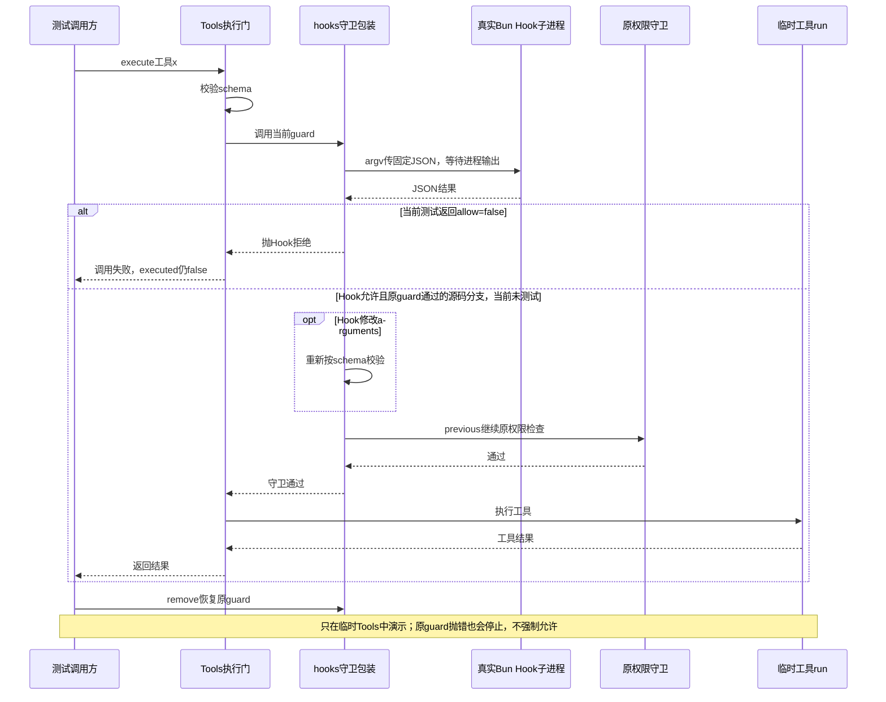
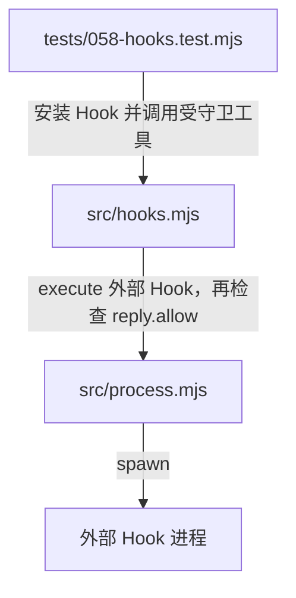
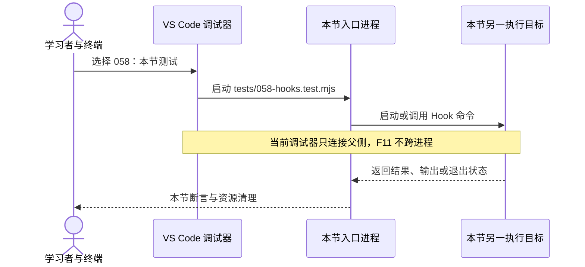

# 058 · 可信Hook仍要走执行和权限边界

阶段：R09。唯一前置：完成第 057 步，继续同一个工程。

<!-- harness-own-links:start -->
## 当前练习工程文件

以下链接指向 `harness-own` 的当前累计版本；本课下方的完整代码仍保留当步版本，二者可能不同。

[打开练习工程说明](../../../harness-own/README.md)

| 本课文件 | 当前练习工程文件 |
| --- | --- |
| `.vscode/launch.json` | 使用本页下方的本节专用配置，不复制累计版本 |
| `src/hooks.mjs` | 尚未合入 harness-own |
| `tests/058-hooks.test.mjs` | 尚未合入 harness-own |

<!-- harness-own-links:end -->

## 什么时候会用到这一页

用户安装了一段可信Hook脚本，要求工具执行前检查调用；脚本返回allow=false时，这次工具必须停止，不能只是打印拒绝却仍然产生副作用。Hook与Skill不同：这里确实会启动外部程序。

### 这次数据怎么走

```text
Tools.execute → hooks临时装上的guard → execute启动本机Bun Hook子进程 → 读取JSON结果 → 拒绝或改参数后重新校验 → 原guard → 工具run。当前只演示before-tool，不是完整Hook生命周期。
```

### 对应时序图

从上往下读；实线箭头表示调用或发送，虚线箭头表示返回或事件通知。`opt`表示可选操作，`alt`表示不同结果，`loop`表示重复，`par`及其`and`分支表示并行；“未接入”及fixture说明按图中标注理解。



**当前接线位置：** hooks目前只在058测试临时包裹一份Tools，未接051 Host、Web设置或CLI。后续没有自动启用Hook；当前只是一个before-tool扩展位置。

## 先看目录与调用关系

目录只列本节文件及图中直接用到的前置实现；不是累计工程的完整文件清单。

```text
PROJECT/
├── .vscode/
│   └── launch.json  # 本节创建或替换
├── src/
│   ├── hooks.mjs  # 本节创建或替换
│   └── process.mjs  # 沿用前置实现
└── tests/
    └── 058-hooks.test.mjs  # 本节创建或替换
```

### 本节入口怎样调用这些文件

箭头写明实际调用或进程启动；标为“未接入”的文件不是本节测试能命中的目标。




## 这一步具体做什么

先写完hooks.mjs，再运行bun test ./tests/058-hooks.test.mjs。测试用本机Bun执行固定脚本，返回allow=false；找到executed变量，确认它仍为false。不要把任意远端脚本填进spec.command，也不用模型或外网服务。

需要本章新文件的操作，先按下面代码创建文件，再执行；不要在上一步尚不存在的接口上试错。

## 代码为什么放在这一层

Hook给可信扩展一个在工具前介入的位置，但不能取代原权限门。脚本若修改arguments，必须重新按工具schema校验；最后仍要调用previous，让已有权限策略继续生效。注册和卸载只是替换/恢复guard，不是自动安全隔离。

## 本节调试：选什么、为什么、怎么启动

**建议先选：058：本节测试。** 每节的测试入口都固定到本节文件，不依赖编辑器当前打开的 `${file}`。

| 配置名称 | 什么时候选 | 实际入口或目标 | 能观察什么 |
| --- | --- | --- | --- |
| 058：本节测试 | 本节验收 | tests/058-hooks.test.mjs | 本节 Bun 测试进程；入口固定，不依赖当前编辑器文件。 |

**为什么这样启动：** 本节测试直接调用被测模块，选择这一项即可沿测试进入实现；前序 CLI 或其他语言入口不参与这次调试。 测试观察 Hook 的执行与拒绝，F11 不能进入外部 Hook 脚本；不会启动 Electron。

使用下方的[本节专用调试配置](#lesson-debug-config)。它只列本节可用目标；要保留个人配置，请先备份并按名称合并。页面上 `harness-own` 的累计文件链接供看当前工程，不是本节调试配置的答案。

1. VS Code 打开自己的 PROJECT；按本节创建源码与配置，断点设在 PROJECT 文件中。
2. 先用终端运行 `bun test ./tests/058-hooks.test.mjs` 确认普通验收，再选表中的配置按 F5。
3. 在下方具体观察点停住；F10 跨过当前语句，F11 只进入当前调试目标。异步等待涉及另一进程时，切换调试会话并继续对端。
4. 变量要在所属调用帧查看；看测试局部变量时选测试帧，看 this 和参数时选实现方法帧。

**本节具体断点和预期：** 打开tests/058-hooks.test.mjs，选“058：本节测试”按F5。在src/hooks.mjs的const result = await execute(...)、const reply = JSON.parse(...)和if (reply.allow === false)设断点；监视result.code应为0、reply.allow应为false、测试的executed应为false。F10跨过execute等待外部Bun结束，再F11看错误回到Tools调用方。这个调试会话不会进入外部Hook脚本；previous和工具run的断点本用例不应命中。

### 本节调试启动时序

这张图解释如何创建并连接调试目标；上面的业务时序图解释任务本身怎样执行。



暂停断点会影响应用自身的 RPC、取消、进程和网络计时。Bun 测试超时放宽不等于这些计时也被关闭；按本节说明分别设置，普通验收恢复原有时限。

观察完成后退出本节启动的调试会话和进程，再运行 `bun test ./tests/058-hooks.test.mjs`。测试通过只证明本节断言，不代表所有 GUI、外部服务或发布过程均已验证。

## 在哪里写、写什么

操作地点：终端中的 `$PROJECT`，编辑器打开同一个目录。只创建或替换下列文件，其他文件保留上一步版本。文件目录不存在先创建。

```sh
mkdir -p .vscode
```

<a id="lesson-debug-config"></a>

下面是本节专用调试配置，只包含本节入口。program 已固定到本节文件；不是 harness-own 的累计配置。

### 替换 `.vscode/launch.json`

````json
{
  "version": "0.2.0",
  "configurations": [
    {
      "name": "058：本节测试",
      "type": "bun",
      "request": "launch",
      "program": "${workspaceFolder}/tests/058-hooks.test.mjs",
      "cwd": "${workspaceFolder}",
      "runtime": "bun",
      "runtimeArgs": [
        "test",
        "--preload",
        "${workspaceFolder}/scripts/vscode-debug.mjs",
        "--timeout",
        "3600000"
      ],
      "stopOnEntry": false
    }
  ]
}
````

```sh
mkdir -p src
```

### 创建 `src/hooks.mjs`

````javascript
import { execute } from './process.mjs'
import { validate } from './tools.mjs'

/** Hooks默认不开；显式配置的可信脚本也不能改完参数后绕过校验。 */
export function hooks(tools, spec, publish = () => {}) {
  const previous = tools.guard
  tools.guard = async (tool, call, context) => {
    if (spec.enabled) {
      // 输入使用argv中的独立JSON，不拼到shell字符串；脚本是用户安装的可信执行扩展。
      const result = await execute({ command: spec.command, args: [...(spec.args ?? []), JSON.stringify({ event: 'before-tool', name: call.name, arguments: call.arguments })], timeout: 5000 }, context.signal)
      if (result.code) throw Error('Hook执行失败')
      const reply = JSON.parse(result.output || '{}')
      publish({ input: call.arguments, output: reply })
      if (reply.allow === false) throw Error('Hook拒绝')
      if (reply.arguments) { validate(tool.schema, reply.arguments); call.arguments = reply.arguments }
    }
    await previous(tool, call, context)
  }
  return () => { tools.guard = previous }
}
````

```sh
mkdir -p tests
```

### 创建 `tests/058-hooks.test.mjs`

````javascript
import { test } from 'bun:test'
import assert from 'node:assert/strict'
import { hooks } from '../src/hooks.mjs'
import { Tools } from '../src/tools.mjs'
import { Scope } from '../src/scope.mjs'

test('真实Hook子进程拒绝执行，修改后参数仍重新校验', async () => {
  const scope = new Scope(), tools = new Tools(); let executed = false
  tools.register(scope, { name: 'x', schema: { type: 'object' }, run: () => { executed = true } })
  const remove = hooks(tools, { enabled: true, command: process.execPath, args: ['-e', 'console.log(JSON.stringify({allow:false}))'] })
  await assert.rejects(tools.execute({ name: 'x', arguments: {} }, { signal: new AbortController().signal }), /Hook拒绝/)
  assert.equal(executed, false); remove(); await scope.close()
})
````

## 运行命令与通过标准

```sh
cd "$PROJECT"
bun test ./tests/058-hooks.test.mjs
bun test
```

测试实际启动Bun子进程并验证Hook拒绝后工具run没有执行。虽然测试名提到修改参数重新校验，当前脚本只返回allow=false，没有覆盖参数改写、previous拒绝、脚本超时、坏JSON或卸载后的再次调用。

**本步证据的范围：** tests/058-hooks.test.mjs运行真实本机Bun子进程，工具是临时x，副作用以executed布尔值检测；未修改用户文件、不调用模型。现有单测不覆盖其名称中所有承诺，本次只将边界说明清楚。

## 不看答案，确认自己能解释

合上代码，写出Hook返回allow=false、改arguments、返回空对象三种情况分别还需要经过什么检查。再解释为什么“可信脚本”不等于“可以绕过previous”。

完成后在 LEARNING.md 写一句实际结果和一个卡点。明天只重做这个卡点；第 3 天、第 7 天再做一次，能独立完成就继续下一页，不另开学习路线。

**再改一个条件验证：** 练习：给临时工具schema加一个必填数字字段，让固定Hook把它改成字符串，补断言工具执行前校验失败。仍只运行本机固定Bun脚本；当前测试没有实现这个变体。

## 与当前原版还差哪些

对照本仓库固定原版 `687f282e8625c6b8d11ff58211a90524be2e4317`；这里的“当前”指该本地基线，不是未经检查的上游最新版。

**这一页已经实现：**

- 显式enabled后启动可信命令，独立argv传JSON，不将调用参数拼入Shell源码。
- 解析Hook结果、拒绝调用，改参数后调用schema验证，再进入原guard。
- 提供恢复previous的卸载函数。

**原版仍有、或本步尚未对齐的部分：**

- 原版支持Claude Code/Codex方言、多事件、matcher、结果合并、stdin framing和持久Hook记录；本章只有自定义before-tool。
- 未接profile配置、真实会话Hook事实、后台Hook和完整取消/清理语义。
- 只有拒绝测试，参数改写与原权限守卫组合尚无证据；直接替换/恢复一个guard也不是完整多守卫注册机制。

**原版对照位置：**

- [packages/experimental/hook-protocol/src/runner.ts](../../../deepseek-harness/packages/experimental/hook-protocol/src/runner.ts)
- [packages/experimental/hook-protocol/src/types.ts](../../../deepseek-harness/packages/experimental/hook-protocol/src/types.ts)
- [packages/experimental/hook-protocol/src/events.ts](../../../deepseek-harness/packages/experimental/hook-protocol/src/events.ts)
- [packages/experimental/hook-protocol/src/merge.ts](../../../deepseek-harness/packages/experimental/hook-protocol/src/merge.ts)
- [packages/experimental/hooks-claude-code/src/index.ts](../../../deepseek-harness/packages/experimental/hooks-claude-code/src/index.ts)
- [packages/experimental/hooks-codex](../../../deepseek-harness/packages/experimental/hooks-codex)

本步测试通过只证明上面的具体行为；完整差距仍看 [COVERAGE.md](../COVERAGE.md)，不以文件数量、同名类或后面出现另一个模块代替接线证据。

下一步：[第 059 步](059.md)
