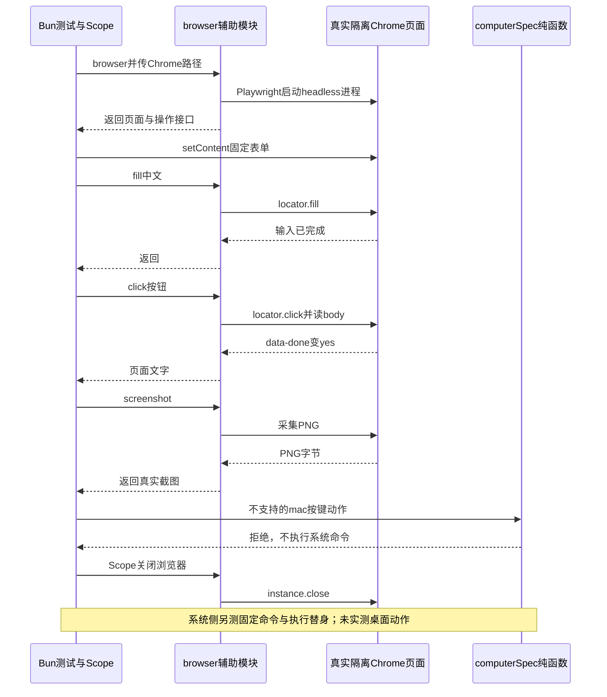
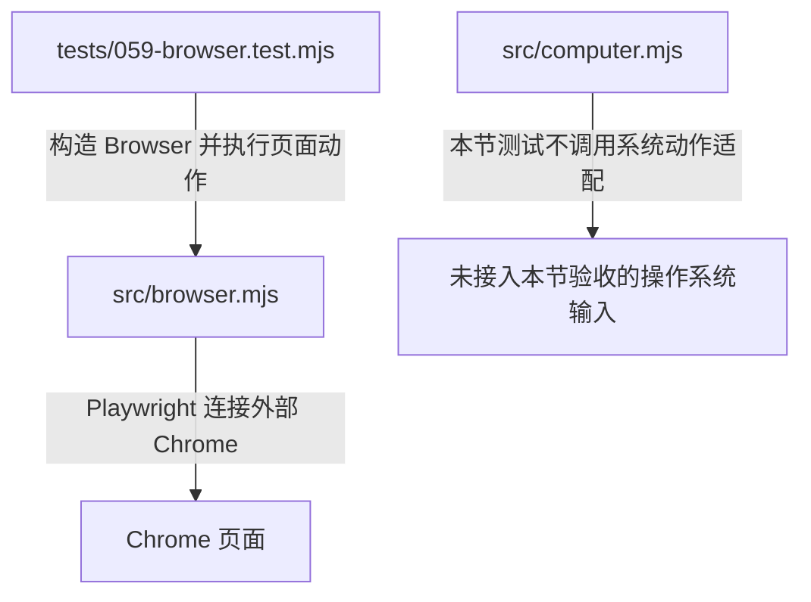
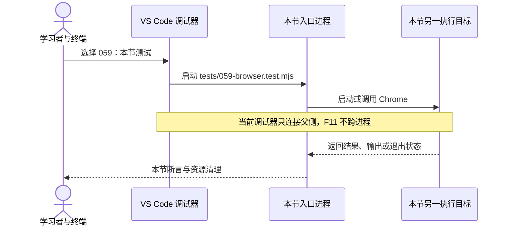
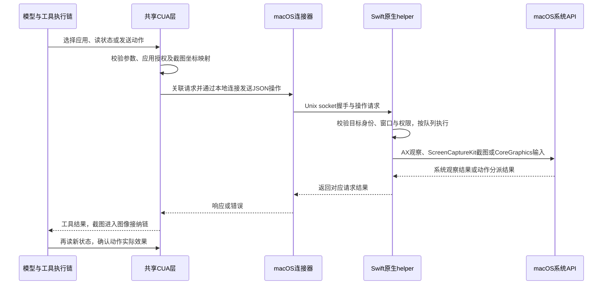
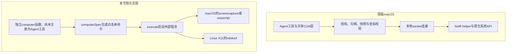

# 059 · 浏览器动作和系统动作分开

阶段：R09。唯一前置：完成第 058 步，继续同一个工程。

<!-- harness-own-links:start -->
## 当前练习工程文件

以下链接指向 `harness-own` 的当前累计版本；本课下方的完整代码仍保留当步版本，二者可能不同。

[打开练习工程说明](../../../harness-own/README.md)

| 本课文件 | 当前练习工程文件 |
| --- | --- |
| `.vscode/launch.json` | 使用本页下方的本节专用配置，不复制累计版本 |
| `package.json` | [`harness-own/package.json`](../../../harness-own/package.json) |
| `scripts/computer-smoke.mjs` | 尚未合入 harness-own |
| `src/browser.mjs` | 尚未合入 harness-own |
| `src/computer.mjs` | 尚未合入 harness-own |
| `tests/059-browser.test.mjs` | 尚未合入 harness-own |

<!-- harness-own-links:end -->

## 什么时候会用到这一页

Agent需要在网页表单填入中文并点击提交，再看真实页面是否改变。浏览器DOM操作与操作系统屏幕点击是两个领域：网页里能定位button，不代表已经能控制其他应用窗口。

### 这次数据怎么走

```text
browser → Playwright隔离Chrome → DOM与PNG；computerSpec → 固定系统命令参数；computer → runner执行 → 检查退出码。自动测试使用系统执行替身；独立smoke脚本才执行macOS真实截屏。
```

### 对应时序图

从上往下读；实线箭头表示调用或发送，虚线箭头表示返回或事件通知。`opt`表示可选操作，`alt`表示不同结果，`loop`表示重复，`par`及其`and`分支表示并行；“未接入”及fixture说明按图中标注理解。



**当前接线位置：** browser/computer是独立辅助模块，未注册进051 Agent工具表。068会复用browser来验收自己的Web页面，但不会因此获得完整Browser/CUA模型工具或OS控制产品。

## 先看目录与调用关系

目录只列本节文件及图中直接用到的前置实现；不是累计工程的完整文件清单。

```text
PROJECT/
├── .vscode/
│   └── launch.json  # 本节创建或替换
├── package.json  # 本节创建或替换
├── scripts/
│   └── computer-smoke.mjs  # 本节创建或替换
├── src/
│   ├── browser.mjs  # 本节创建或替换
│   └── computer.mjs  # 本节创建或替换
└── tests/
    └── 059-browser.test.mjs  # 本节创建或替换
```

### 本节入口怎样调用这些文件

箭头写明实际调用或进程启动；标为“未接入”的文件不是本节测试能命中的目标。




## 这一步具体做什么

先写完browser.mjs、computer.mjs并安装本章依赖，确认本机有Chrome；再运行bun test ./tests/059-browser.test.mjs。测试在隔离页面创建input和button，填中文、点击后检查data-done=yes，并验证PNG签名；它不访问公网、不接管个人登录浏览器。缺Chrome时应明确修复路径，不能把测试skip当通过。

需要本章新文件的操作，先按下面代码创建文件，再执行；不要在上一步尚不存在的接口上试错。

## 代码为什么放在这一层

Playwright管理浏览器和DOM，Scope保证关闭测试创建的浏览器。computerSpec只接受明确动作和参数，避免把模型提供的任意系统脚本当命令执行。两类动作的权限、取消和画面来源都不同。

## 本节调试：选什么、为什么、怎么启动

**建议先选：059：本节测试。** 每节的测试入口都固定到本节文件，不依赖编辑器当前打开的 `${file}`。

| 配置名称 | 什么时候选 | 实际入口或目标 | 能观察什么 |
| --- | --- | --- | --- |
| 059：本节测试 | 本节验收 | tests/059-browser.test.mjs | 本节 Bun 测试进程；入口固定，不依赖当前编辑器文件。 |

**为什么这样启动：** 本节测试直接调用被测模块，选择这一项即可沿测试进入实现；前序 CLI 或其他语言入口不参与这次调试。 本节是 Playwright 客户端的 Bun 断点，Chrome 中的页面 JS 需要自己的浏览器调试会话。

使用下方的[本节专用调试配置](#lesson-debug-config)。它只列本节可用目标；要保留个人配置，请先备份并按名称合并。页面上 `harness-own` 的累计文件链接供看当前工程，不是本节调试配置的答案。

1. VS Code 打开自己的 PROJECT；按本节创建源码与配置，断点设在 PROJECT 文件中。
2. 先用终端运行 `bun test ./tests/059-browser.test.mjs` 确认普通验收，再选表中的配置按 F5。
3. 在下方具体观察点停住；F10 跨过当前语句，F11 只进入当前调试目标。异步等待涉及另一进程时，切换调试会话并继续对端。
4. 变量要在所属调用帧查看；看测试局部变量时选测试帧，看 this 和参数时选实现方法帧。

<details class="debug-details">
<summary>展开本节具体断点和预期</summary>

1. 在tests/059-browser.test.mjs用“059：本节测试”按F5，断在src/browser.mjs的chromium.launch、fill、click和screenshot。

2. 监视executablePath、await page.locator('#name').inputValue()及await page.locator('body').getAttribute('data-done')，后两者应为中文和yes。

3. F10会等待外部Chrome动作，F11只能进入当前Bun的Playwright客户端，不能直接跳进Chrome页面JS。

4. context.route断点本用例可能不命中，因为它使用setContent而非网络navigate。

5. 系统侧在src/computer.mjs的computerSpec、signal.throwIfAborted和runner调用处断点，查看固定argv与测试传入的platform。

6. 失败替身返回code=1时应抛出系统动作失败。

7. 非法参数和预取消时calls保持0。

</details>

### 本节调试启动时序

这张图解释如何创建并连接调试目标；上面的业务时序图解释任务本身怎样执行。



暂停断点会影响应用自身的 RPC、取消、进程和网络计时。Bun 测试超时放宽不等于这些计时也被关闭；按本节说明分别设置，普通验收恢复原有时限。

观察完成后退出本节启动的调试会话和进程，再运行 `bun test ./tests/059-browser.test.mjs`。测试通过只证明本节断言，不代表所有 GUI、外部服务或发布过程均已验证。

## 在哪里写、写什么

操作地点：终端中的 `$PROJECT`，编辑器打开同一个目录。只创建或替换下列文件，其他文件保留上一步版本。文件目录不存在先创建。

```sh
mkdir -p .vscode
```

<a id="lesson-debug-config"></a>

下面是本节专用调试配置，只包含本节入口。program 已固定到本节文件；不是 harness-own 的累计配置。

### 替换 `.vscode/launch.json`

````json
{
  "version": "0.2.0",
  "configurations": [
    {
      "name": "059：本节测试",
      "type": "bun",
      "request": "launch",
      "program": "${workspaceFolder}/tests/059-browser.test.mjs",
      "cwd": "${workspaceFolder}",
      "runtime": "bun",
      "runtimeArgs": [
        "test",
        "--preload",
        "${workspaceFolder}/scripts/vscode-debug.mjs",
        "--timeout",
        "3600000"
      ],
      "stopOnEntry": false
    }
  ]
}
````

### 替换 [`package.json`](../../../harness-own/package.json)

````json
{
  "name": "harness-own",
  "version": "0.1.0",
  "type": "module",
  "private": true,
  "engines": {
    "bun": "1.3.14"
  },
  "scripts": {
    "start": "bun src/main.mjs",
    "test": "bun test ./tests",
    "desktop": "bun scripts/desktop.mjs",
    "package": "bun scripts/release.mjs mac-arm64 --unsigned"
  },
  "dependencies": {
    "@earendil-works/pi-ai": "1.1.0",
    "@modelcontextprotocol/sdk": "1.31.0",
    "@agentclientprotocol/sdk": "1.4.0",
    "zod": "4.4.3",
    "ws": "8.18.3",
    "playwright-core": "1.61.1"
  },
  "devDependencies": {
    "electron": "44.7.0",
    "electron-builder": "26.17.0"
  },
  "main": "desktop/main.cjs",
  "description": "从空工程逐步实现的Harness",
  "author": "Harness learner",
  "packageManager": "bun@1.3.14"
}
````

```sh
mkdir -p scripts
```

### 创建 `scripts/computer-smoke.mjs`

````javascript
import assert from 'node:assert/strict'
import { mkdtemp, readFile, rm } from 'node:fs/promises'
import { tmpdir } from 'node:os'
import { join } from 'node:path'
import { computer } from '../src/computer.mjs'

// 只有显式选择macOS截屏验收才执行，普通测试不会触发桌面操作。
if (process.argv[2] !== '--screenshot' || process.platform !== 'darwin') {
  throw Error('本入口仅支持macOS真实截屏验收：bun scripts/computer-smoke.mjs --screenshot')
}

// 临时图片可能包含当前桌面内容；仅检查PNG签名，结束后删除，不上传。
const root = await mkdtemp(join(tmpdir(), 'computer-smoke-'))
try {
  const path = join(root, 'screen.png')
  await computer({ kind: 'screenshot', path })
  const bytes = await readFile(path)
  assert.deepEqual(bytes.subarray(0, 8), Buffer.from([137, 80, 78, 71, 13, 10, 26, 10]))
  console.log('真实系统截屏验收通过：PNG签名正确，临时图片将删除。')
} finally {
  await rm(root, { recursive: true, force: true })
}
````

```sh
mkdir -p src
```

### 创建 `src/browser.mjs`

````javascript
import { chromium } from 'playwright-core'
import { Web } from './web-tools.mjs'

/** 浏览器使用独立临时profile，不接管用户已登录的个人浏览器。 */
export async function browser(scope, executablePath, { allowLocal = false } = {}) {
  const instance = await chromium.launch({ executablePath, headless: true })
  scope.own(() => instance.close())
  const context = await instance.newContext(), page = await context.newPage(), policy = new Web({ allowLocal })
  await context.route('**/*', async route => { try { await policy.check(route.request().url()); await route.continue() } catch { await route.abort() } })
  return { page,
    async navigate(url) { await policy.check(url); await page.goto(url); return { title: await page.title(), text: await page.locator('body').innerText() } },
    async click(selector) { await page.locator(selector).click(); return await page.locator('body').innerText() },
    async fill(selector, text) { await page.locator(selector).fill(text) },
    screenshot: () => page.screenshot({ type: 'png' }),
  }
}
````

```sh
mkdir -p src
```

### 创建 `src/computer.mjs`

````javascript
import { posix } from 'node:path'
import { execute } from './process.mjs'

/** 先把动作编译为固定OS提供方命令；不接受模型传任意osascript。 */
export function computerSpec(action, platform = process.platform) {
  if (action.kind === 'screenshot' && platform === 'darwin') {
    // 要求绝对输出路径，避免空路径或以短横线开头的内容被当成截屏选项。
    if (typeof action.path !== 'string' || !posix.isAbsolute(action.path) || action.path.includes('\0')) throw Error('截图路径必须是无空字符的绝对路径')
    return { command: '/usr/sbin/screencapture', args: ['-x', action.path] }
  }
  if (action.kind === 'click' && platform === 'linux') {
    if (![action.x, action.y].every(value => Number.isSafeInteger(value) && value >= 0)) throw Error('坐标不合法')
    return { command: 'xdotool', args: ['mousemove', String(action.x), String(action.y), 'click', '1'] }
  }
  if (action.kind === 'key' && platform === 'darwin' && ['Return', 'Escape', 'Tab'].includes(action.key)) {
    // macOS的固定键码；不把外部输入拼成任意AppleScript。
    const codes = { Return: 36, Escape: 53, Tab: 48 }
    return { command: '/usr/bin/osascript', args: ['-e', 'tell application "System Events" to key code ' + codes[action.key]] }
  }
  throw Error('此平台/动作尚无真实提供方')
}

/** 系统授权失败原样返回，不能声称已经点击或截屏。 */
export async function computer(action, signal = new AbortController().signal, { runner = execute, platform = process.platform } = {}) {
  // runner允许测试检查执行契约而不控制桌面；正常调用仍执行真实系统命令。
  signal.throwIfAborted()
  const result = await runner(computerSpec(action, platform), signal)
  if (result.code) throw Error('系统动作失败：' + result.output)
  return result
}
````

```sh
mkdir -p tests
```

### 创建 `tests/059-browser.test.mjs`

````javascript
import { test } from 'bun:test'
import assert from 'node:assert/strict'
import { browser } from '../src/browser.mjs'
import { computer, computerSpec } from '../src/computer.mjs'
import { Scope } from '../src/scope.mjs'

test('真实隔离Chrome执行页面动作，截图为PNG；系统动作不接受任意脚本', async () => {
  const scope = new Scope(), executable = process.env.HARNESS_CHROME ?? (process.platform === 'darwin' ? '/Applications/Google Chrome.app/Contents/MacOS/Google Chrome' : process.platform === 'win32' ? 'C:\\Program Files\\Google\\Chrome\\Application\\chrome.exe' : '/usr/bin/google-chrome')
  try {
    const app = await browser(scope, executable)
    await app.page.setContent(`<input id="name"><button onclick="document.body.dataset.done='yes'">go</button>`)
    await app.fill('#name', '中文')
    await app.click('button')
    assert.equal(await app.page.locator('#name').inputValue(), '中文')
    assert.equal(await app.page.locator('body').getAttribute('data-done'), 'yes')
    assert.equal((await app.screenshot()).subarray(1, 4).toString(), 'PNG')
    assert.throws(() => computerSpec({ kind: 'key', key: 'arbitrary script' }, 'darwin'), /尚无/)
  } finally { await scope.close() }
})


// 以下系统侧测试不需要桌面权限，不实际截屏或向前台窗口发送输入。
test('系统截图生成固定命令，空格路径保留为一个参数', () => {
  assert.deepEqual(computerSpec({ kind: 'screenshot', path: '/tmp/系统 截图.png' }, 'darwin'), {
    command: '/usr/sbin/screencapture', args: ['-x', '/tmp/系统 截图.png'],
  })
  for (const path of ['', '-i', 'relative.png', '/tmp/bad\0.png', undefined]) {
    assert.throws(() => computerSpec({ kind: 'screenshot', path }, 'darwin'), /截图路径/)
  }
})

test('macOS按键只编译允许的固定键码', () => {
  // 同时检查三个允许的按键，以及脚本注入和未知按键被拒绝。
  for (const [key, code] of [['Return', 36], ['Escape', 53], ['Tab', 48]]) {
    assert.deepEqual(computerSpec({ kind: 'key', key }, 'darwin'), {
      command: '/usr/bin/osascript', args: ['-e', 'tell application "System Events" to key code ' + code],
    })
  }
  for (const key of ['Space', 'Return; do shell script "anything"', '']) {
    assert.throws(() => computerSpec({ kind: 'key', key }, 'darwin'), /尚无/)
  }
})

test('Linux点击保留坐标参数，拒绝非法坐标', () => {
  assert.deepEqual(computerSpec({ kind: 'click', x: 0, y: 240 }, 'linux'), {
    command: 'xdotool', args: ['mousemove', '0', '240', 'click', '1'],
  })
  for (const value of [-1, 1.5, NaN, Infinity, '10', Number.MAX_SAFE_INTEGER + 1]) {
    assert.throws(() => computerSpec({ kind: 'click', x: value, y: 0 }, 'linux'), /坐标/)
    assert.throws(() => computerSpec({ kind: 'click', x: 0, y: value }, 'linux'), /坐标/)
  }
})

test('没有提供方的平台动作组合明确拒绝', () => {
  for (const [platform, action] of [
    ['win32', { kind: 'screenshot', path: '/tmp/test.png' }],
    ['darwin', { kind: 'click', x: 0, y: 0 }],
    ['linux', { kind: 'key', key: 'Return' }],
  ]) assert.throws(() => computerSpec(action, platform), /尚无/)
})

test('系统执行转交固定命令和取消信号，并返回执行结果', async () => {
  const controller = new AbortController(), expected = { code: 0, output: '', bytes: 0 }
  // 固定执行替身只检查参数，不启动系统程序。
  const runner = async (spec, signal) => {
    assert.equal(signal, controller.signal)
    assert.deepEqual(spec, { command: 'xdotool', args: ['mousemove', '12', '34', 'click', '1'] })
    return expected
  }
  assert.equal(await computer({ kind: 'click', x: 12, y: 34 }, controller.signal, { runner, platform: 'linux' }), expected)
})

test('系统命令非零退出和启动失败不能返回成功', async () => {
  const action = { kind: 'key', key: 'Return' }
  await assert.rejects(computer(action, undefined, {
    platform: 'darwin', runner: async () => ({ code: 1, output: '辅助功能权限不足' }),
  }), /系统动作失败：辅助功能权限不足/)
  // 命令缺失等底层错误保持原对象，便于调用方判断原因。
  const failure = Object.assign(Error('找不到命令'), { code: 'ENOENT' })
  await assert.rejects(computer(action, undefined, {
    platform: 'darwin', runner: async () => { throw failure },
  }), error => error === failure)
})

test('已取消或参数非法时不进入执行器', async () => {
  let calls = 0
  const runner = async () => { calls++; return { code: 0 } }
  const controller = new AbortController(); controller.abort()
  await assert.rejects(computer({ kind: 'click', x: 0, y: 0 }, controller.signal, { runner, platform: 'linux' }))
  await assert.rejects(computer({ kind: 'click', x: -1, y: 0 }, undefined, { runner, platform: 'linux' }), /坐标/)
  assert.equal(calls, 0)
})
````

## 运行命令与通过标准

```sh
cd "$PROJECT"
cp "$COURSE/locks/059.bun.lock" bun.lock
bun install --frozen-lockfile --ignore-scripts
bun test ./tests/059-browser.test.mjs
bun test
```

本章8项测试覆盖真实Chrome输入、点击与网页PNG，以及系统命令生成、截图路径与坐标校验、按键白名单、不支持组合、执行结果、失败和预取消。系统执行测试使用固定runner，不证明真实系统权限或桌面动作生效；独立macOS截屏验收需要另行运行。

**本步证据的范围：** tests/059-browser.test.mjs包含1项真实Chrome测试与7项系统侧测试。系统侧验证computerSpec和注入runner的computer，不执行桌面输入。scripts/computer-smoke.mjs提供可单独运行的macOS真实截屏验收，本轮未执行，不把命令替身通过说成桌面动作已实测。

## 不看答案，确认自己能解释

闭卷画Bun测试、Playwright协议、Chrome页面、操作系统桌面四块；给fill输入框、截图网页、点击另一个应用各放到正确领域。

完成后在 LEARNING.md 写一句实际结果和一个卡点。明天只重做这个卡点；第 3 天、第 7 天再做一次，能独立完成就继续下一页，不另开学习路线。

**再改一个条件验证：** 练习：只在隔离测试页面把button选择器改为不存在的#missing，观察明确定位失败而不是返回模拟成功，随后恢复。该失败变体不在现有断言中；不要为了练习操作个人浏览器或系统桌面。

## 与当前原版还差哪些

对照本仓库固定原版 `687f282e8625c6b8d11ff58211a90524be2e4317`；这里的“当前”指该本地基线，不是未经检查的上游最新版。

**这一页已经实现：**

- 真实隔离headless Chrome，支持基本navigate、fill、click和PNG screenshot。
- 浏览器网络请求可进入已有URL政策，scope关闭拥有的浏览器。
- 有限OS动作到固定命令的编译函数，不支持的组合明确报错。
- 系统侧自动测试与可注入执行器；macOS截屏独立验收脚本。

**原版仍有、或本步尚未对齐的部分：**

- 原版有Browser提供方注册、Agent身份独占资源、激活/发现、操作队列和释放约定；这里直接创建Playwright页面。
- 缺完整MCP/native浏览器提供方、模型schema、会话图像接纳及产品界面。
- OS动作平台矩阵极小，真实桌面截图/点击/按键及权限仍未实测；Windows与Wayland提供方未实现，网络政策也未由本章测试验证。

**原版对照位置：**

- [packages/experimental/browser-use-runtime/src/index.ts](../../../deepseek-harness/packages/experimental/browser-use-runtime/src/index.ts)
- [packages/experimental/browser-use-runtime/src/mcp.ts](../../../deepseek-harness/packages/experimental/browser-use-runtime/src/mcp.ts)
- [packages/experimental/browser-use-playwright-mcp](../../../deepseek-harness/packages/experimental/browser-use-playwright-mcp)
- [packages/experimental/cua](../../../deepseek-harness/packages/experimental/cua)
- [packages/experimental/cua-macos](../../../deepseek-harness/packages/experimental/cua-macos)

本步测试通过只证明上面的具体行为；完整差距仍看 [COVERAGE.md](../COVERAGE.md)，不以文件数量、同名类或后面出现另一个模块代替接线证据。

下一步：[第 060 步](060.md)

## 系统动作怎么验收

| 系统 | 截图 | 点击 | 按键 |
| --- | --- | --- | --- |
| macOS | screencapture | 未实现 | osascript：Return、Escape、Tab |
| Linux | 未实现 | xdotool，依赖X11环境 | 未实现 |
| Windows | 未实现 | 未实现 | 未实现 |

osascript是macOS自带的AppleScript执行程序，`-e`后面是脚本；本章只把允许的按键映射成固定键码，不接受任意脚本。按键发送给当前焦点窗口，通常需要辅助功能权限。xdotool也不是通用Wayland提供方；没有对应实现的动作明确报错。

### 1. 默认自动测试：不控制你的桌面

执行 `bun test ./tests/059-browser.test.mjs`。其中1项启动隔离Chrome，另外7项验证系统命令参数与执行契约。测试传入platform，因此即使在macOS上，也能检查Linux的命令生成；这不等于实际运行了Linux命令。

computer的第三个参数允许注入runner与platform。普通调用默认使用真实execute；测试的runner只记录参数或返回错误，不截屏、不点击、不向窗口输入。

### 2. macOS真实截屏：单独执行

先创建本章的scripts/computer-smoke.mjs，然后在自己的PROJECT执行：

```sh
bun scripts/computer-smoke.mjs --screenshot
```

需要本机macOS图形会话，以及终端或宿主应用相应的屏幕录制权限。脚本实际调用computer、运行screencapture，检查生成文件的完整PNG签名，最后删除临时图片。桌面可能含私人内容，请先整理屏幕；脚本不上传图片。命令失败或文件无效会报错，不会skip后算通过。本轮没有执行真实截屏验收。

### 3. 真实点击与按键：仍未验收

当前没有为真实输入准备专用测试窗口，也没有验证Linux图形环境与系统权限。自动测试通过只证明固定命令与错误处理，不能证明目标窗口收到按键或点击。此处保留缺口，不提供会盲目操作日常窗口的自动测试。

## 补充知识：原版的跨平台边界与 macOS 原生链路

<details>
<summary>展开：原版怎么控制桌面，与本节的osascript、xdotool有什么区别？</summary>

### 平台支持要以本仓库固定版本为准

以下结论对应本教材固定原版基线687f282e8625c6b8d11ff58211a90524be2e4317，不代表上游未来版本。依据是[共享CUA文档的已知限制](../../../deepseek-harness/packages/experimental/cua/README.zh.md#known-limitations-and-deferred-work)、[macOS提供方](../../../deepseek-harness/packages/experimental/cua-macos/README.zh.md)及本仓库实现。

| 平台或入口 | 原版固定版本的支持情况 | 能得出的结论 |
| --- | --- | --- |
| macOS内置原生提供方 | 已有cua-macos包及Swift helper源码 | 有真实原生执行路径；本次没有重新进行桌面验收 |
| Windows内置原生提供方 | 文档计划独立提供方包与C# helper | 规划不能当作已实现或已验证 |
| Linux内置原生提供方 | 当前基线未发现相应提供方实现 | 不能由共享CUA接口推断Linux桌面已支持 |
| 外部Cua Driver MCP | 已有连接已安装驱动的适配包 | 具体系统能力由外部驱动及权限决定，不能据此承诺跨平台可用 |

浏览器自动化和桌面控制分别判断：浏览器提供方能工作，不等于能够控制该系统的其他应用窗口。教程里的Linux xdotool分支，也不是从原版Linux原生提供方移植来的。

### 原版macOS：共享工具层加原生辅助程序



[macOS入口](../../../deepseek-harness/packages/experimental/cua-macos/src/index.ts)准备helper并调用installCua；[连接器](../../../deepseek-harness/packages/experimental/cua-macos/src/shared-native.ts)负责共享原生程序与本地socket连接；[NativeClient](../../../deepseek-harness/packages/experimental/cua/src/native-client.ts)负责请求关联、取消等通信约束。共享helper可被多个Agent或Host连接使用，每条连接分别保存句柄与快照，桌面操作通过全局队列执行。

| 原生职责 | 对应源码 | 做什么 |
| --- | --- | --- |
| 读取辅助功能状态 | [AXAccess.swift](../../../deepseek-harness/packages/experimental/cua-macos/native/Sources/CuaNative/AXAccess.swift) | 通过AX接口读取应用、窗口和元素 |
| 获取窗口截图 | [WindowCapture.swift](../../../deepseek-harness/packages/experimental/cua-macos/native/Sources/CuaNative/WindowCapture.swift) | 使用ScreenCaptureKit捕获窗口 |
| 发送键盘事件 | [KeyboardInput.swift](../../../deepseek-harness/packages/experimental/cua-macos/native/Sources/CuaNative/KeyboardInput.swift) | 构造CoreGraphics键盘事件，处理按下与释放 |
| 发送窗口指针事件 | [WindowPointerInput.swift](../../../deepseek-harness/packages/experimental/cua-macos/native/Sources/CuaNative/WindowPointerInput.swift) | 处理窗口内的鼠标输入 |

动作返回dispatched:true、verified:false，表示已分派而不是业务目标已成功。比如“点击提交”仍需要重新读取窗口状态，确认出现了提交结果。

### 与教程简化实现的区别



| 方面 | 原版macOS | 本节简化实现 |
| --- | --- | --- |
| 调用入口 | 已挂载共享CUA工具链 | 独立辅助函数，未接Agent工具表 |
| 执行方式 | Swift程序调用原生API | 启动系统命令行程序 |
| 目标定位 | 应用句柄、窗口、AX快照和截图坐标 | 截图路径、屏幕坐标或有限按键 |
| 授权与状态 | 应用授权、系统权限、快照有效性等分层检查 | 命令白名单和参数检查，依赖系统权限，失败抛错 |
| 测试证据 | 原版有自身测试，本节没有重新执行原版桌面验证 | 1项真实浏览器测试、7项系统侧自动测试；真实系统截屏另行验收 |

本节的价值是先理解“页面动作”和“系统动作”具有不同执行边界；它不等于复刻了原版CUA提供方。外部[MCP适配包](../../../deepseek-harness/packages/experimental/computer-use-cua-driver-mcp/README.zh.md)是另一种接入路径：驱动自行承担桌面能力，Harness通过MCP发现和调用其工具。

</details>
