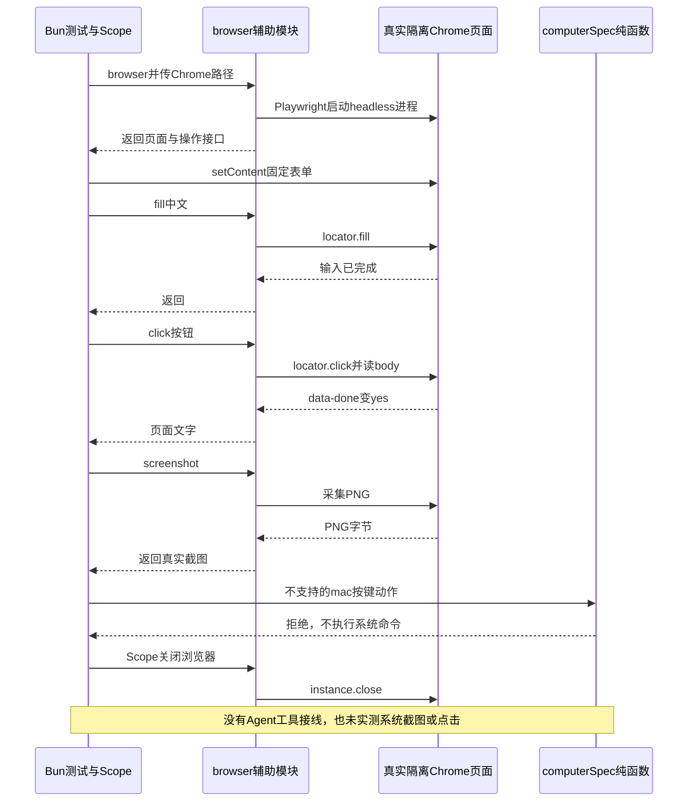

# 059 · 浏览器动作和系统动作分开

阶段：R09。唯一前置：完成第 058 步，继续同一个工程。

## 什么时候会用到这一页

Agent需要在网页表单填入中文并点击提交，再看真实页面是否改变。浏览器DOM操作与操作系统屏幕点击是两个领域：网页里能定位button，不代表已经能控制其他应用窗口。

### 这次数据怎么走

```text
browser(scope, Chrome路径) → Playwright启动隔离headless Chrome → page.fill/click/screenshot → DOM状态或真实PNG；network route复用Web.check。另一个computer(action)只把有限OS动作编译成固定命令，当前测试没有执行这些系统动作。
```

### 对应时序图

从上往下读；实线箭头表示调用或发送，虚线箭头表示返回或事件通知。`opt`表示可选操作，`alt`表示不同结果，`loop`表示重复，`par`及其`and`分支表示并行；“未接入”及fixture说明按图中标注理解。



**当前接线位置：**browser/computer是独立辅助模块，未注册进051 Agent工具表。068会复用browser来验收自己的Web页面，但不会因此获得完整Browser/CUA模型工具或OS控制产品。

## 这一步具体做什么

先写完browser.mjs、computer.mjs并安装本章依赖，确认本机有Chrome；再运行bun test ./tests/059-browser.test.mjs。测试在隔离页面创建input和button，填中文、点击后检查data-done=yes，并验证PNG签名；它不访问公网、不接管个人登录浏览器。缺Chrome时应明确修复路径，不能把测试skip当通过。

需要本章新文件的操作，先按下面代码创建文件，再执行；不要在上一步尚不存在的接口上试错。

## 代码为什么放在这一层

Playwright管理浏览器和DOM，Scope保证关闭测试创建的浏览器。computerSpec只接受明确动作和参数，避免把模型提供的任意系统脚本当命令执行。两类动作的权限、取消和画面来源都不同。

## 在哪里写、写什么

操作地点：终端中的 `$PROJECT`，编辑器打开同一个目录。只创建或替换下列文件，其他文件保留上一步版本。文件目录不存在先创建。

### 替换 `package.json`

````json
{
  "name": "harness-own",
  "version": "0.1.0",
  "type": "module",
  "private": true,
  "engines": {
    "bun": "1.3.14"
  },
  "scripts": {
    "start": "bun src/main.mjs",
    "test": "bun test ./tests",
    "desktop": "bun scripts/desktop.mjs",
    "package": "bun scripts/release.mjs mac-arm64 --unsigned"
  },
  "dependencies": {
    "@earendil-works/pi-ai": "1.1.0",
    "@modelcontextprotocol/sdk": "1.31.0",
    "@agentclientprotocol/sdk": "1.4.0",
    "zod": "4.4.3",
    "ws": "8.18.3",
    "playwright-core": "1.61.1"
  },
  "devDependencies": {
    "electron": "44.7.0",
    "electron-builder": "26.17.0"
  },
  "main": "desktop/main.cjs",
  "description": "从空工程逐步实现的Harness",
  "author": "Harness learner",
  "packageManager": "bun@1.3.14"
}
````

```sh
mkdir -p src
```

### 创建 `src/browser.mjs`

````javascript
import { chromium } from 'playwright-core'
import { Web } from './web-tools.mjs'

/** 浏览器使用独立临时profile，不接管用户已登录的个人浏览器。 */
export async function browser(scope, executablePath, { allowLocal = false } = {}) {
  const instance = await chromium.launch({ executablePath, headless: true })
  scope.own(() => instance.close())
  const context = await instance.newContext(), page = await context.newPage(), policy = new Web({ allowLocal })
  await context.route('**/*', async route => { try { await policy.check(route.request().url()); await route.continue() } catch { await route.abort() } })
  return { page,
    async navigate(url) { await policy.check(url); await page.goto(url); return { title: await page.title(), text: await page.locator('body').innerText() } },
    async click(selector) { await page.locator(selector).click(); return await page.locator('body').innerText() },
    async fill(selector, text) { await page.locator(selector).fill(text) },
    screenshot: () => page.screenshot({ type: 'png' }),
  }
}
````

```sh
mkdir -p src
```

### 创建 `src/computer.mjs`

````javascript
import { execute } from './process.mjs'

/** 先把动作编译为固定OS提供方命令；不接受模型传任意osascript。 */
export function computerSpec(action, platform = process.platform) {
  if (action.kind === 'screenshot' && platform === 'darwin') return { command: '/usr/sbin/screencapture', args: ['-x', action.path] }
  if (action.kind === 'click' && platform === 'linux') {
    if (![action.x, action.y].every(value => Number.isSafeInteger(value) && value >= 0)) throw Error('坐标不合法')
    return { command: 'xdotool', args: ['mousemove', String(action.x), String(action.y), 'click', '1'] }
  }
  if (action.kind === 'key' && platform === 'darwin' && ['Return', 'Escape', 'Tab'].includes(action.key)) {
    const codes = { Return: 36, Escape: 53, Tab: 48 }
    return { command: '/usr/bin/osascript', args: ['-e', 'tell application "System Events" to key code ' + codes[action.key]] }
  }
  throw Error('此平台/动作尚无真实提供方')
}

/** 系统授权失败原样返回，不能声称已经点击或截屏。 */
export async function computer(action, signal) {
  const result = await execute(computerSpec(action), signal)
  if (result.code) throw Error('系统动作失败：' + result.output)
  return result
}
````

```sh
mkdir -p tests
```

### 创建 `tests/059-browser.test.mjs`

````javascript
import { test } from 'bun:test'
import assert from 'node:assert/strict'
import { browser } from '../src/browser.mjs'
import { computerSpec } from '../src/computer.mjs'
import { Scope } from '../src/scope.mjs'

test('真实隔离Chrome执行页面动作，截图为PNG；系统动作不接受任意脚本', async () => {
  const scope = new Scope(), executable = process.env.HARNESS_CHROME ?? (process.platform === 'darwin' ? '/Applications/Google Chrome.app/Contents/MacOS/Google Chrome' : process.platform === 'win32' ? 'C:\\Program Files\\Google\\Chrome\\Application\\chrome.exe' : '/usr/bin/google-chrome')
  try {
    const app = await browser(scope, executable)
    await app.page.setContent(`<input id="name"><button onclick="document.body.dataset.done='yes'">go</button>`)
    await app.fill('#name', '中文')
    await app.click('button')
    assert.equal(await app.page.locator('#name').inputValue(), '中文')
    assert.equal(await app.page.locator('body').getAttribute('data-done'), 'yes')
    assert.equal((await app.screenshot()).subarray(1, 4).toString(), 'PNG')
    assert.throws(() => computerSpec({ kind: 'key', key: 'arbitrary script' }, 'darwin'), /尚无/)
  } finally { await scope.close() }
})
````

## 运行命令与通过标准

```sh
cd "$PROJECT"
cp "$COURSE/locks/059.bun.lock" bun.lock
bun install --frozen-lockfile --ignore-scripts
bun test ./tests/059-browser.test.mjs
bun test
```

测试确实启动Chrome并验证中文输入、按钮改变DOM、截图PNG及一个不支持的OS按键被拒绝。它没有测试navigate、外网/私网路由、真实系统截图/点击、OS授权或Agent工具接线。

**本步证据的范围：**tests/059-browser.test.mjs是实际Chrome测试，外部模型不参与，页面内容由测试内联固定。系统动作只测computerSpec拒绝任意脚本，没有调用computer执行系统命令。未完成的真实动作和平台资格仍保留缺口。

## VS Code：断在哪里、看什么

在tests/059-browser.test.mjs用“Bun：当前测试”按F5，断在src/browser.mjs的chromium.launch、fill、click和screenshot；监视executablePath、await page.locator('#name').inputValue()及await page.locator('body').getAttribute('data-done')，后两者应为中文和yes。F10会等待外部Chrome动作，F11只能进入当前Bun的Playwright客户端，不能直接跳进Chrome页面JS。context.route断点本用例可能不命中，因为它使用setContent而非网络navigate。

操作位置：VS Code 打开的是自己的 `$PROJECT`，断点也设在这里的源码，不在教材的 `steps` 目录。

上面的说明若指定CLI、子进程、页面或Electron附加调试，就先按该流程操作；下面这组步骤只用于本章测试入口。“当前测试”不会自动附加子进程，也不会命中浏览器或Electron中的断点。

变量只在所属作用域可见：停在方法内部时看this和参数；要看测试里的局部变量，先在“调用堆栈”选择对应测试帧。正在等待的异步调用者不一定保留可求值的帧，此时在测试调用前后加断点再看，不把未定义误判成业务状态丢失。

沿用第 000 步安装的 Bun 扩展与 `.vscode/launch.json`；本章列出替换配置时，使用本章完整版本。

1. 打开本步测试文件 `tests/059-browser.test.mjs`，保持它为当前编辑器文件。
2. 在上面指定的函数内单击行号左侧设置断点。
3. “运行和调试”选择 **Bun：当前测试**，按 F5；它执行当前测试，工作目录固定为 PROJECT。
4. 在“变量 / 监视 / 调用堆栈 / 调试控制台”检查状态；F10 逐行执行，F11 进入函数，Shift+F11 返回，F5 继续，Shift+F5 停止。

验收：断点实际命中，能说出当前输入、状态和下一步；只看到进程启动不算完成。长时间暂停会影响真实取消、审批和网络超时，先检查时序，不删超时断言。修正后在集成终端运行 `bun test ./tests/059-browser.test.mjs`，再运行 `bun test`，保留全部断言。

## 不看答案，确认自己能解释

闭卷画Bun测试、Playwright协议、Chrome页面、操作系统桌面四块；给fill输入框、截图网页、点击另一个应用各放到正确领域。

完成后在 LEARNING.md 写一句实际结果和一个卡点。明天只重做这个卡点；第 3 天、第 7 天再做一次，能独立完成就继续下一页，不另开学习路线。

**再改一个条件验证：**练习：只在隔离测试页面把button选择器改为不存在的#missing，观察明确定位失败而不是返回模拟成功，随后恢复。该失败变体不在现有断言中；不要为了练习操作个人浏览器或系统桌面。

## 与当前原版还差哪些

对照本仓库固定原版 `687f282e8625c6b8d11ff58211a90524be2e4317`；这里的“当前”指该本地基线，不是未经检查的上游最新版。

**这一页已经实现：**

- 真实隔离headless Chrome，支持基本navigate、fill、click和PNG screenshot。
- 浏览器网络请求可进入已有URL政策，scope关闭拥有的浏览器。
- 有限OS动作到固定命令的编译函数，不支持的组合明确报错。

**原版仍有、或本步尚未对齐的部分：**

- 原版有Browser提供方注册、Agent身份独占资源、激活/发现、操作队列和释放约定；这里直接创建Playwright页面。
- 缺完整MCP/native浏览器提供方、模型schema、会话图像接纳及产品界面。
- 本章OS动作平台矩阵极小且未实测，不代表完整CUA；网络政策也未由本章测试验证。

**原版对照位置：**

- [packages/experimental/browser-use-runtime/src/index.ts](../../../deepseek-harness/packages/experimental/browser-use-runtime/src/index.ts)
- [packages/experimental/browser-use-runtime/src/mcp.ts](../../../deepseek-harness/packages/experimental/browser-use-runtime/src/mcp.ts)
- [packages/experimental/browser-use-playwright-mcp](../../../deepseek-harness/packages/experimental/browser-use-playwright-mcp)
- [packages/experimental/cua](../../../deepseek-harness/packages/experimental/cua)
- [packages/experimental/cua-macos](../../../deepseek-harness/packages/experimental/cua-macos)

本步测试通过只证明上面的具体行为；完整差距仍看 [COVERAGE.md](../COVERAGE.md)，不以文件数量、同名类或后面出现另一个模块代替接线证据。

下一步：[第 060 步](060.md)
