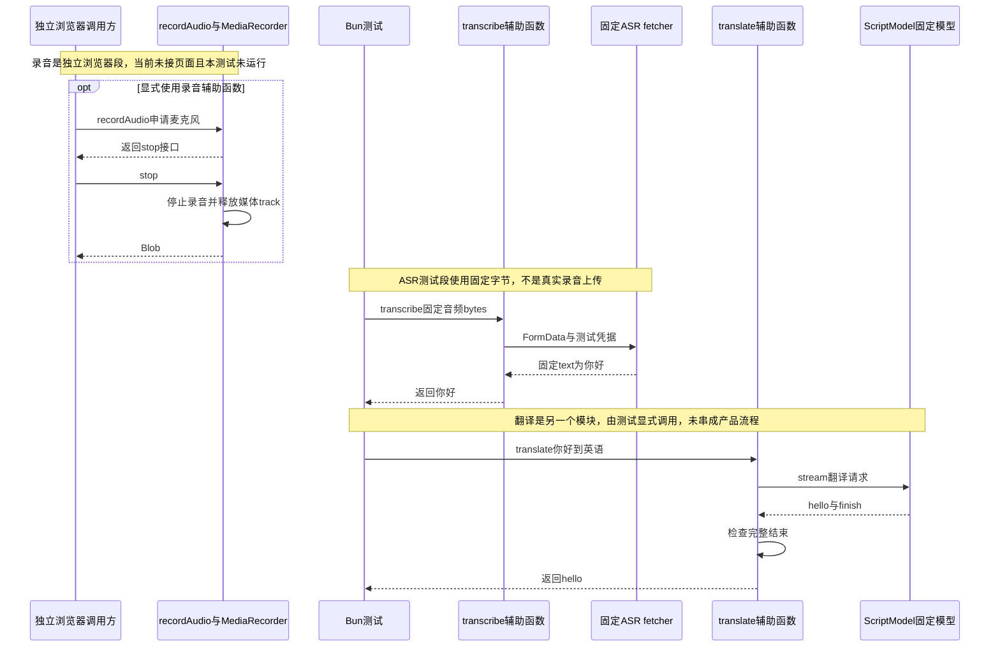

# 060 · 语音和翻译复用外部提供方边界

阶段：R09。唯一前置：完成第 059 步，继续同一个工程。

<!-- harness-own-links:start -->
## 当前练习工程文件

以下链接指向 `harness-own` 的当前累计版本；本课下方的完整代码仍保留当步版本，二者可能不同。

[打开练习工程说明](../../../harness-own/README.md)

| 本课文件 | 当前练习工程文件 |
| --- | --- |
| `src/audio.mjs` | 尚未合入 harness-own |
| `tests/060-audio.test.mjs` | 尚未合入 harness-own |
| `web/audio.mjs` | 尚未合入 harness-own |

<!-- harness-own-links:end -->

## 什么时候会用到这一页

用户说一段话，应用应先录音并把音频交给ASR得到文字，再决定是否把文字送入聊天或翻译；不能把录音base64当普通文本塞给模型。当前章节只写出这些辅助模块，还没有可点击的录音产品。

### 这次数据怎么走

```text
未来页面按钮 → recordAudio申请麦克风/MediaRecorder → Blob；transcribe音频 → FormData与ASR提供方 → text；translate文字 → 已有model.stream → 收集text并检查finish。当前这三段没有串进页面/Remote/Host。
```

### 对应时序图

从上往下读；实线箭头表示调用或发送，虚线箭头表示返回或事件通知。`opt`表示可选操作，`alt`表示不同结果，`loop`表示重复，`par`及其`and`分支表示并行；“未接入”及fixture说明按图中标注理解。



**当前接线位置：**这些函数尚未装配进Host或Agent工具。web/audio.mjs既没有被现有HTTP assets路由提供，也没有被web/app.mjs导入；到069仍未接录音/ASR界面。

## 这一步具体做什么

先写完audio.mjs与web/audio.mjs，再运行bun test ./tests/060-audio.test.mjs。测试只用固定音频bytes和固定fetcher，检查请求体是FormData且带测试凭据，返回你好；随后ScriptModel输出hello作为译文。不要在现有网页找录音按钮：本章尚未提供，也不需要填写真实ASR Key。

需要本章新文件的操作，先按下面代码创建文件，再执行；不要在上一步尚不存在的接口上试错。

## 代码为什么放在这一层

录音属于浏览器媒体资源，停止时必须释放track；ASR属于外部音频提供方，不能和聊天协议混同；translate只是复用模型流做一次翻译请求，完整finish才可当成完整结果。

## 在哪里写、写什么

操作地点：终端中的 `$PROJECT`，编辑器打开同一个目录。只创建或替换下列文件，其他文件保留上一步版本。文件目录不存在先创建。

```sh
mkdir -p src
```

### 创建 `src/audio.mjs`

````javascript
/** ASR是外部模型提供方，不把录音base64混入普通文本prompt。 */
export async function transcribe(bytes, { url, key, model }, signal, fetcher = fetch) {
  if (!url || !key || !model) throw Error('语音提供方尚未配置')
  const form = new FormData(); form.set('file', new Blob([bytes], { type: 'audio/wav' }), 'recording.wav'); form.set('model', model)
  const response = await fetcher(url, { method: 'POST', signal, headers: { authorization: 'Bearer ' + key }, body: form })
  if (!response.ok) throw Error('语音HTTP ' + response.status)
  const value = await response.json(); if (typeof value.text !== 'string') throw Error('语音结果缺少text')
  return value.text
}

/** 翻译仍走现有模型接口，可以复用路由、取消和凭据政策。 */
export async function translate(text, language, model, signal) {
  let output = '', ended = false
  for await (const part of model.stream({ messages: [{ role: 'user', content: text }], tools: [], config: { system: '把用户文本翻译为' + language + '，只输出译文。' }, signal })) {
    if (part.kind === 'text') output += part.text
    if (part.kind === 'finish') ended = part.reason === 'stop'
  }
  if (!ended) throw Error('翻译未完整结束')
  return output
}
````

```sh
mkdir -p tests
```

### 创建 `tests/060-audio.test.mjs`

````javascript
import { test } from 'bun:test'
import assert from 'node:assert/strict'
import { transcribe, translate } from '../src/audio.mjs'
import { ScriptModel, answer } from '../src/model.mjs'

test('语音走FormData与凭据，翻译复用已有模型流', async () => {
  const signal = new AbortController().signal
  const text = await transcribe(Buffer.from('fixed-audio'), { url: 'https://asr.example', key: 'test', model: 'asr' }, signal, async (url, request) => {
    assert.ok(request.body instanceof FormData); assert.equal(request.headers.authorization, 'Bearer test'); return Response.json({ text: '你好' })
  })
  assert.equal(text, '你好')
  assert.equal(await translate(text, '英语', new ScriptModel([answer('hello')]), signal), 'hello')
})
````

```sh
mkdir -p web
```

### 创建 `web/audio.mjs`

````javascript
/** 麦克风只在用户点击后申请；停止时关闭媒体轨道，不留后台录音。 */
export async function recordAudio() {
  const stream = await navigator.mediaDevices.getUserMedia({ audio: true }), recorder = new MediaRecorder(stream), chunks = []
  recorder.ondataavailable = event => chunks.push(event.data)
  recorder.start()
  return { stop: () => new Promise((resolve, reject) => {
    recorder.onerror = event => { stream.getTracks().forEach(track => track.stop()); reject(event.error) }
    recorder.onstop = () => { stream.getTracks().forEach(track => track.stop()); resolve(new Blob(chunks, { type: recorder.mimeType })) }
    recorder.stop()
  }) }
}
````

## 运行命令与通过标准

```sh
cd "$PROJECT"
bun test ./tests/060-audio.test.mjs
bun test
```

测试证明FormData和测试Authorization构造，以及固定模型流的翻译结果。它不录音，不验证音频编码，不访问真实ASR，不检查UI权限拒绝/取消恢复，也没有验证recordAudio释放track。

**本步证据的范围：**tests/060-audio.test.mjs完全不联网：ASR是固定fetcher，输入bytes只是fixed-audio字符串，翻译用ScriptModel。没有浏览器、真实音频和麦克风；本次仅文档说明，没有补UI。

## VS Code：断在哪里、看什么

打开tests/060-audio.test.mjs用“Bun：当前测试”启动，断在src/audio.mjs的form.set、fetcher与if (!ended)。监视form.get('model')应为asr、bytes长度和output/ended；F10越过固定fetcher得到你好，F11进入translate循环，收到finish后ended=true且output=hello。这里调试的是Bun测试；web/audio.mjs属于未来浏览器入口，当前测试不会命中，不要据此声称麦克风已调通。

操作位置：VS Code 打开的是自己的 `$PROJECT`，断点也设在这里的源码，不在教材的 `steps` 目录。

上面的说明若指定CLI、子进程、页面或Electron附加调试，就先按该流程操作；下面这组步骤只用于本章测试入口。“当前测试”不会自动附加子进程，也不会命中浏览器或Electron中的断点。

变量只在所属作用域可见：停在方法内部时看this和参数；要看测试里的局部变量，先在“调用堆栈”选择对应测试帧。正在等待的异步调用者不一定保留可求值的帧，此时在测试调用前后加断点再看，不把未定义误判成业务状态丢失。

沿用第 000 步安装的 Bun 扩展与 `.vscode/launch.json`；本章列出替换配置时，使用本章完整版本。

1. 打开本步测试文件 `tests/060-audio.test.mjs`，保持它为当前编辑器文件。
2. 在上面指定的函数内单击行号左侧设置断点。
3. “运行和调试”选择 **Bun：当前测试**，按 F5；它执行当前测试，工作目录固定为 PROJECT。
4. 在“变量 / 监视 / 调用堆栈 / 调试控制台”检查状态；F10 逐行执行，F11 进入函数，Shift+F11 返回，F5 继续，Shift+F5 停止。

验收：断点实际命中，能说出当前输入、状态和下一步；只看到进程启动不算完成。长时间暂停会影响真实取消、审批和网络超时，先检查时序，不删超时断言。修正后在集成终端运行 `bun test ./tests/060-audio.test.mjs`，再运行 `bun test`，保留全部断言。

## 不看答案，确认自己能解释

闭卷写出录音、ASR、翻译、聊天四个环节各收什么、返回什么，以及哪个环节拥有麦克风track。

完成后在 LEARNING.md 写一句实际结果和一个卡点。明天只重做这个卡点；第 3 天、第 7 天再做一次，能独立完成就继续下一页，不另开学习路线。

**再改一个条件验证：**练习：把固定ScriptModel改为只有文字但不发finish，补断言translate抛“翻译未完整结束”。只用固定模型，不连接外网；这个缺finish变体当前未加入测试。

## 与当前原版还差哪些

对照本仓库固定原版 `687f282e8625c6b8d11ff58211a90524be2e4317`；这里的“当前”指该本地基线，不是未经检查的上游最新版。

**这一页已经实现：**

- 独立浏览器录音辅助函数，在正常stop或录音错误时停止媒体track。
- 独立FormData ASR请求、配置缺失与结果text检查。
- 复用model.stream的文本翻译和完整finish校验。

**原版仍有、或本步尚未对齐的部分：**

- 原版有语音提供方注册、准备状态、语言/输入格式、取消与卸载生命周期；本章只是固定端点调用。
- 麦克风权限、音频格式转换、上传API、录音UI和错误恢复尚未接线或验收。
- 原版翻译服务有多提供方选择、付费路由和持久结果/会话UI；本章独立请求没有这些契约。
- 不能把未核实的实时语音或播报能力列为本章已支持，也不能把固定bytes测试当真实ASR。

**原版对照位置：**

- [packages/experimental/speech-to-text/src/index.ts](../../../deepseek-harness/packages/experimental/speech-to-text/src/index.ts)
- [packages/experimental/api-speech-to-text](../../../deepseek-harness/packages/experimental/api-speech-to-text)
- [packages/experimental/client-ui-voice-input](../../../deepseek-harness/packages/experimental/client-ui-voice-input)
- [packages/experimental/translator/src/index.ts](../../../deepseek-harness/packages/experimental/translator/src/index.ts)
- [packages/experimental/client-ui-cot-translation](../../../deepseek-harness/packages/experimental/client-ui-cot-translation)

本步测试通过只证明上面的具体行为；完整差距仍看 [COVERAGE.md](../COVERAGE.md)，不以文件数量、同名类或后面出现另一个模块代替接线证据。

下一步：[第 061 步](061.md)
