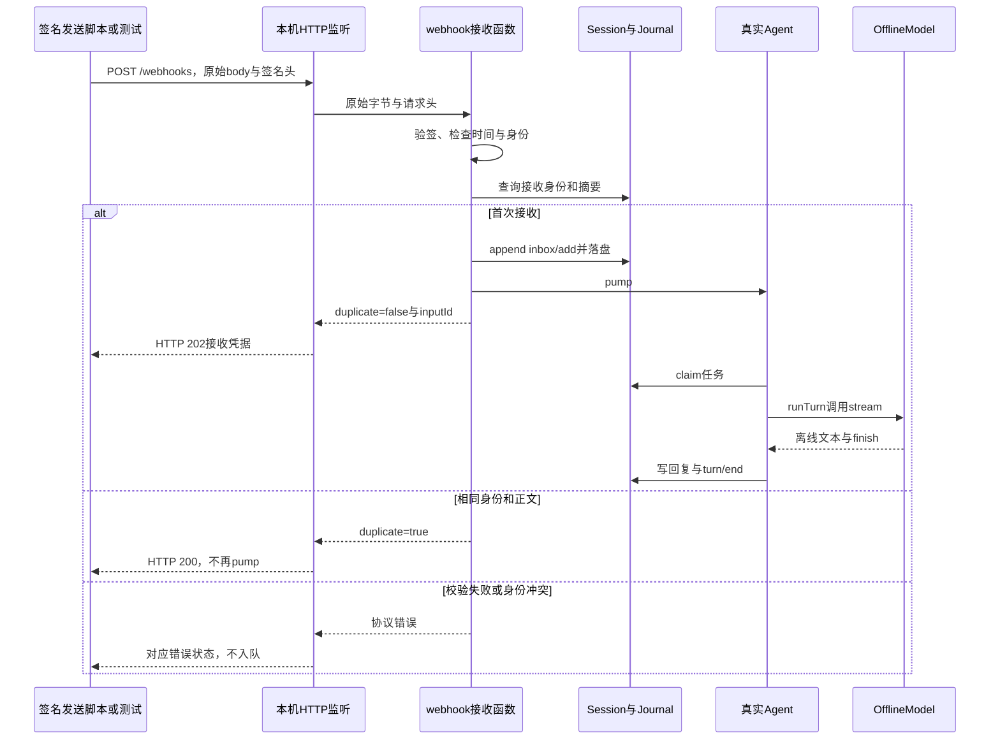
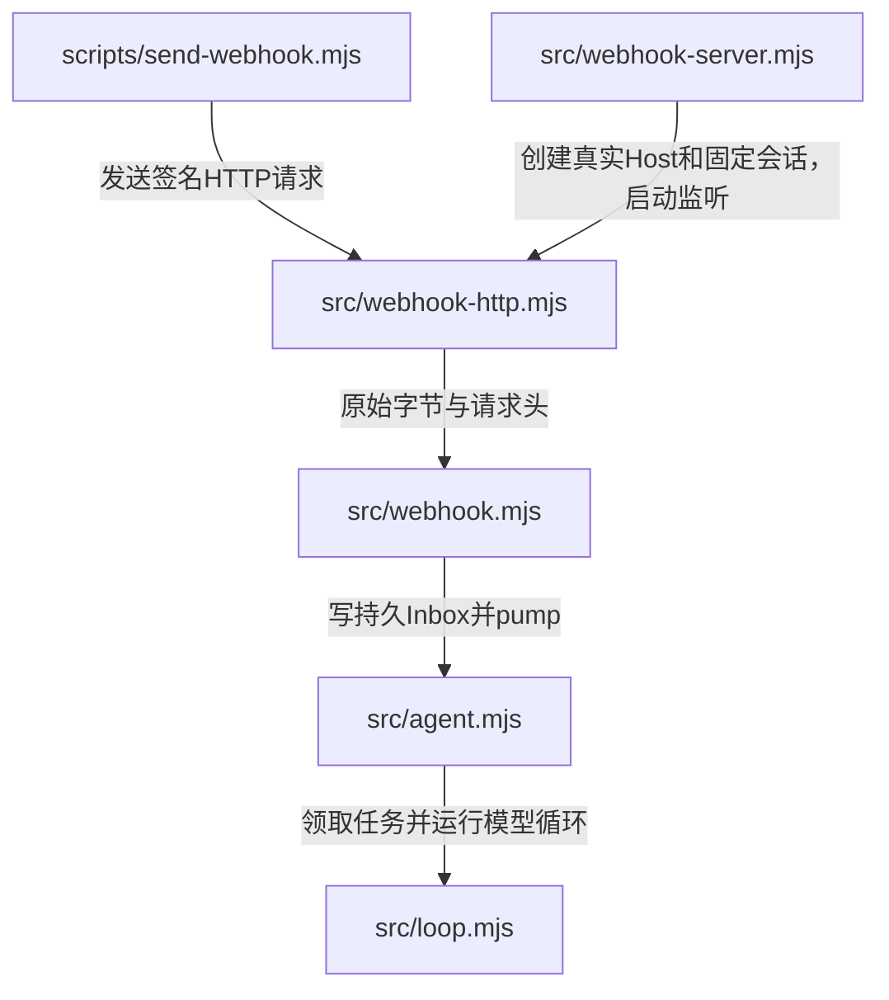
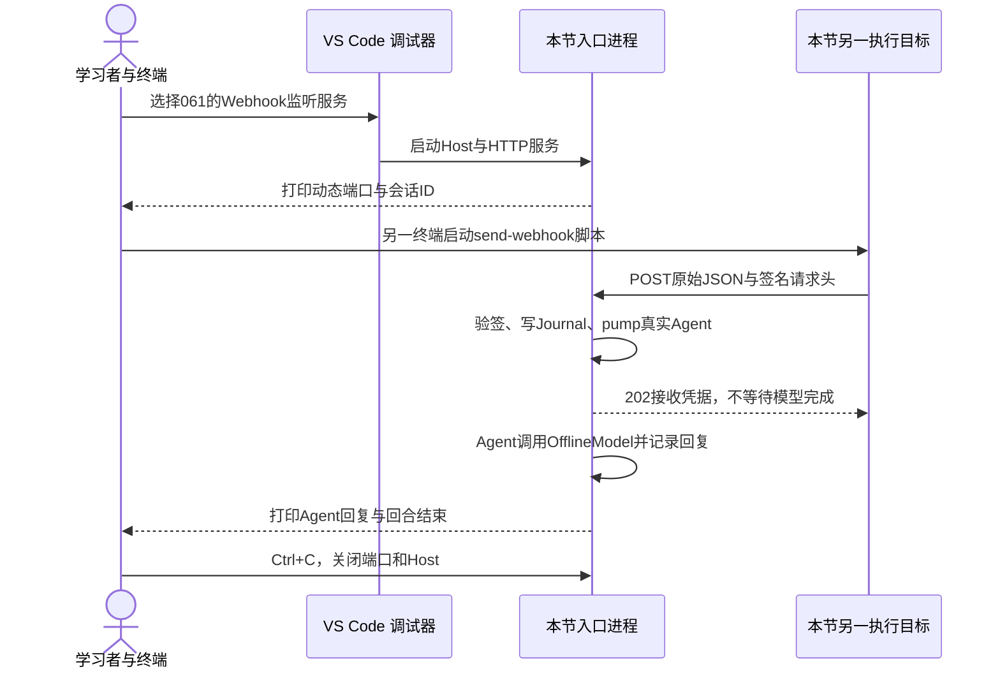
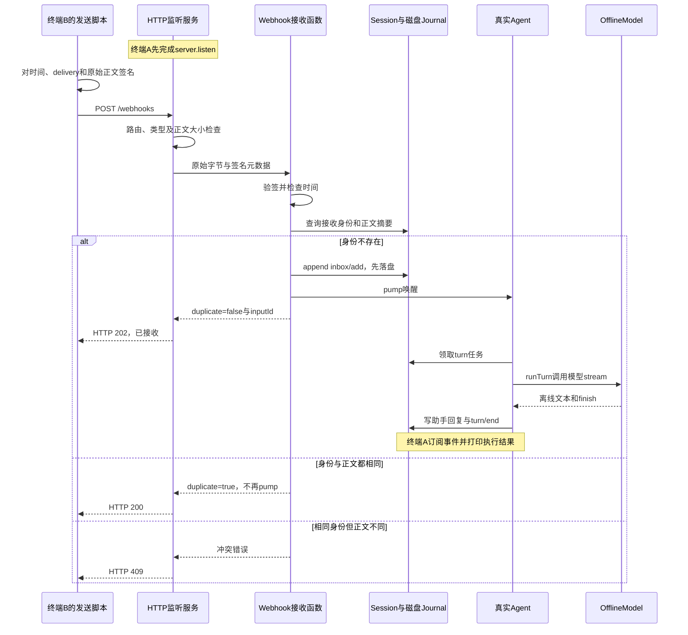

# 061 · Webhook消息按已有会话记录去重

阶段：R09。唯一前置：完成第 060 步，继续同一个工程。

<!-- harness-own-links:start -->
## 当前练习工程文件

以下链接指向 `harness-own` 的当前累计版本；本课下方的完整代码仍保留当步版本，二者可能不同。

[打开练习工程说明](../../../harness-own/README.md)

| 本课文件 | 当前练习工程文件 |
| --- | --- |
| `.vscode/launch.json` | 使用本页下方的本节专用配置，不复制累计版本 |
| `scripts/send-webhook.mjs` | [`harness-own/scripts/send-webhook.mjs`](../../../harness-own/scripts/send-webhook.mjs) |
| `src/webhook-http.mjs` | [`harness-own/src/webhook-http.mjs`](../../../harness-own/src/webhook-http.mjs) |
| `src/webhook-server.mjs` | [`harness-own/src/webhook-server.mjs`](../../../harness-own/src/webhook-server.mjs) |
| `src/webhook.mjs` | [`harness-own/src/webhook.mjs`](../../../harness-own/src/webhook.mjs) |
| `tests/061-webhook.test.mjs` | [`harness-own/tests/061-webhook.test.mjs`](../../../harness-own/tests/061-webhook.test.mjs) |

<!-- harness-own-links:end -->

## 什么时候会用到这一页

外部系统通过HTTP把review任务发送给已有会话。先启动本机Webhook服务，再发送签名请求，观察任务落入Journal并由真实Agent调用离线模型；重复投递只接收一次。这是自定义协议，不是GitHub官方Webhook格式。

### 这次数据怎么走

```text
签名发送脚本 → POST本机/webhooks → HTTP层读取原始字节和请求头 → webhook验签/去重 → Journal保存inbox/add → Agent.pump领取任务 → runTurn调用OfflineModel → Session记录回复与回合结束。HTTP回执只表示接收状态。
```

### 对应时序图

从上往下读；实线箭头表示调用或发送，虚线箭头表示返回或事件通知。`opt`表示可选操作，`alt`表示不同结果，`loop`表示重复，`par`及其`and`分支表示并行；“未接入”及fixture说明按图中标注理解。



**当前接线位置：** src/webhook-server.mjs创建真实Host和会话，调用startWebhook独立监听本机/webhooks，不修改047既有HTTP入口。接收层写入既有Inbox并pump真实Agent，默认OfflineModel；与原版规则创建新Session仍属不同设计。

## 先看目录与调用关系

目录只列本节文件及图中直接用到的前置实现；不是累计工程的完整文件清单。

```text
PROJECT/
├── .vscode/
│   └── launch.json  # 本节创建或替换
├── scripts/
│   └── send-webhook.mjs  # 本节创建或替换
├── src/
│   ├── agent.mjs  # 沿用前置实现
│   ├── loop.mjs  # 沿用前置实现
│   ├── webhook-http.mjs  # 本节创建或替换
│   ├── webhook-server.mjs  # 本节创建或替换
│   └── webhook.mjs  # 本节创建或替换
└── tests/
    └── 061-webhook.test.mjs  # 本节创建或替换
```

### 本节入口怎样调用这些文件

箭头写明实际调用或进程启动；标为“未接入”的文件不是本节测试能命中的目标。




## 这一步具体做什么

创建本章所有文件后运行bun test ./tests/061-webhook.test.mjs。终端A设置HARNESS_WEBHOOK_SECRET=local-demo-only并启动bun src/webhook-server.mjs，终端B用同secret执行发送脚本并填入A打印的地址；具体命令见文末。观察HTTP 202和Agent回复，再重复投递验证HTTP 200。

需要本章新文件的操作，先按下面代码创建文件，再执行；不要在上一步尚不存在的接口上试错。

## 代码为什么放在这一层

HTTP层负责传输与状态码，接收层负责验证与入队，Agent复用已有模型循环。接收身份和任务写在同一Journal事件，避免独立去重库与任务库之间的提交空隙；不等于外部副作用恰好执行一次。

## 本节调试：选什么、为什么、怎么启动

**建议先选：061：本节测试。** 每节的测试入口都固定到本节文件，不依赖编辑器当前打开的 `${file}`。

| 配置名称 | 什么时候选 | 实际入口或目标 | 能观察什么 |
| --- | --- | --- | --- |
| 061：本节测试 | 本节验收 | tests/061-webhook.test.mjs | 本节 Bun 测试进程；入口固定，不依赖当前编辑器文件。 |
| 061：Webhook监听服务 | 本机HTTP到Agent联调 | src/webhook-server.mjs | 监听成功后，另一个终端运行本节发送脚本；Ctrl+C或停止调试释放服务。 |

**为什么这样启动：** 测试使用真实本机HTTP、Host、Journal和Agent；手工演示启动独立监听服务，另一个终端才是HTTP发送方。模型默认为OfflineModel，无需API Key。

使用下方的[本节专用调试配置](#lesson-debug-config)。它只列本节可用目标；要保留个人配置，请先备份并按名称合并。页面上 `harness-own` 的累计文件链接供看当前工程，不是本节调试配置的答案。

1. VS Code 打开自己的 PROJECT；按本节创建源码与配置，断点设在 PROJECT 文件中。
2. 先用终端运行 `bun test ./tests/061-webhook.test.mjs` 确认普通验收，再选表中的配置按 F5。
3. 在下方具体观察点停住；F10 跨过当前语句，F11 只进入当前调试目标。异步等待涉及另一进程时，切换调试会话并继续对端。
4. 变量要在所属调用帧查看；看测试局部变量时选测试帧，看 this 和参数时选实现方法帧。

<details class="debug-details">
<summary>展开本节具体断点和预期</summary>

1. 用“061：本节测试”启动tests/061-webhook.test.mjs。

2. 给src/webhook-http.mjs的server.listen和receive(record, ...)断点。

3. 用“061：Webhook监听服务”启动手工示例，另开终端执行scripts/send-webhook.mjs。

4. 先确认监听成功，再发请求。

5. 在src/webhook.mjs的previous查询、session.append和pump观察身份：首次返回202，重复返回200，冲突返回409。

6. 在src/agent.mjs的inbox.claim与runTurn断点，进入src/loop.mjs的model.stream。

7. 终端A应打印离线回复与completed。

8. HTTP不等待Agent结束。

9. 调试停顿超过请求超时或签名时间窗后需重新发送。

10. 退出时释放端口和Host。

</details>

### 本节调试启动时序

这张图解释如何创建并连接调试目标；上面的业务时序图解释任务本身怎样执行。



暂停断点会影响应用自身的 RPC、取消、进程和网络计时。Bun 测试超时放宽不等于这些计时也被关闭；按本节说明分别设置，普通验收恢复原有时限。

观察完成后退出本节启动的调试会话和进程，再运行 `bun test ./tests/061-webhook.test.mjs`。测试通过只证明本节断言，不代表所有 GUI、外部服务或发布过程均已验证。

## 在哪里写、写什么

操作地点：终端中的 `$PROJECT`，编辑器打开同一个目录。只创建或替换下列文件，其他文件保留上一步版本。文件目录不存在先创建。

```sh
mkdir -p .vscode
```

<a id="lesson-debug-config"></a>

下面是本节专用调试配置，只包含本节入口。program 已固定到本节文件；不是 harness-own 的累计配置。

### 替换 `.vscode/launch.json`

````json
{
  "version": "0.2.0",
  "configurations": [
    {
      "name": "061：本节测试",
      "type": "bun",
      "request": "launch",
      "program": "${workspaceFolder}/tests/061-webhook.test.mjs",
      "cwd": "${workspaceFolder}",
      "runtime": "bun",
      "runtimeArgs": [
        "test",
        "--preload",
        "${workspaceFolder}/scripts/vscode-debug.mjs",
        "--timeout",
        "3600000"
      ],
      "stopOnEntry": false
    },
    {
      "name": "061：Webhook监听服务",
      "type": "bun",
      "request": "launch",
      "program": "${workspaceFolder}/src/webhook-server.mjs",
      "cwd": "${workspaceFolder}",
      "runtime": "bun",
      "runtimeArgs": [
        "--preload",
        "${workspaceFolder}/scripts/vscode-debug.mjs"
      ],
      "stopOnEntry": false,
      "env": {
        "HARNESS_WEBHOOK_SECRET": "local-demo-only"
      }
    }
  ]
}
````

```sh
mkdir -p scripts
```

### 创建 [`scripts/send-webhook.mjs`](../../../harness-own/scripts/send-webhook.mjs)

````javascript
import { randomUUID } from 'node:crypto'
import { webhookSignature } from '../src/webhook.mjs'

// 参数：接收地址、任务正文、可选投递ID；相同ID用于验证重复投递。
const [address, prompt = '请处理这条Webhook任务', delivery = randomUUID()] = process.argv.slice(2)
const secret = process.env.HARNESS_WEBHOOK_SECRET
if (!secret || !address) throw Error('设置HARNESS_WEBHOOK_SECRET后执行：bun scripts/send-webhook.mjs URL "任务" [delivery-id]')
const url = new URL(address)
if (url.protocol !== 'http:' || url.hostname !== '127.0.0.1' || url.pathname !== '/webhooks') throw Error('本示例仅向本机127.0.0.1的/webhooks发送请求')
// 对即将发送的原始字节签名，不在签名后改变JSON空白或字段顺序。
const body = Buffer.from(JSON.stringify({ prompt })), timestamp = String(Date.now())
const signature = webhookSignature(secret, body, { timestamp, delivery })
const response = await fetch(url, {
  method: 'POST', signal: AbortSignal.timeout(5_000), body,
  headers: { 'content-type': 'application/json', 'x-webhook-timestamp': timestamp, 'x-webhook-delivery': delivery, 'x-webhook-signature': signature },
})
console.log('HTTP', response.status, await response.text())
if (!response.ok) process.exitCode = 1
````

```sh
mkdir -p src
```

### 创建 [`src/webhook-http.mjs`](../../../harness-own/src/webhook-http.mjs)

````javascript
import { createServer } from 'node:http'
import { webhook } from './webhook.mjs'

/** 启动独立的本机Webhook入口；固定绑定一个已有会话，不接受请求指定owner或工作区。 */
export async function startWebhook(record, { secret, port = 0, maxBytes = 64 * 1024 } = {}) {
  const receive = webhook({ secret })
  // 响应只报告接收结果，模型回复从Session事件读取，不在HTTP回执中假装完成。
  const server = createServer(async (request, response) => {
    const reply = (status, value) => {
      response.writeHead(status, { 'content-type': 'application/json; charset=utf-8' })
      response.end(JSON.stringify(value))
    }
    try {
      if (request.url !== '/webhooks') { request.resume(); reply(404, { error: '未找到路由' }); return }
      if (request.method !== 'POST') { request.resume(); response.setHeader('allow', 'POST'); reply(405, { error: '只接受POST' }); return }
      if (request.headers['content-type']?.split(';')[0].trim().toLowerCase() !== 'application/json') {
        request.resume(); reply(415, { error: '需要application/json' }); return
      }
      // 保留原始字节验签，并限制正文大小；不能先JSON.parse再序列化后验证。
      const chunks = []; let size = 0
      for await (const chunk of request) {
        size += chunk.length
        if (size > maxBytes) { request.resume(); reply(413, { error: 'Webhook正文过大' }); return }
        chunks.push(chunk)
      }
      const result = receive(record, Buffer.concat(chunks), {
        signature: request.headers['x-webhook-signature'],
        timestamp: request.headers['x-webhook-timestamp'],
        delivery: request.headers['x-webhook-delivery'],
      })
      reply(result.duplicate ? 200 : 202, result)
    } catch (error) {
      // 只暴露协议校验错误；磁盘或内部异常不把本机路径等细节回传。
      if (!response.headersSent && !response.destroyed) reply(error.statusCode ?? 500, { error: error.statusCode ? error.message : 'Webhook内部错误' })
    }
  })
  server.requestTimeout = 10_000
  server.headersTimeout = 5_000
  // 这一行才真正监听TCP端口；等待成功后，调用方才能打印地址或发请求。
  await new Promise((resolve, reject) => {
    server.once('error', reject)
    server.listen(port, '127.0.0.1', () => { server.removeListener('error', reject); resolve() })
  })
  let closing
  return {
    url: 'http://127.0.0.1:' + server.address().port + '/webhooks',
    // 停服务时关闭连接；Host的Agent和日志由拥有它的调用方另行关闭。
    close: () => closing ??= new Promise((resolve, reject) => {
      server.close(error => error ? reject(error) : resolve())
      server.closeAllConnections()
    }),
  }
}
````

```sh
mkdir -p src
```

### 创建 [`src/webhook-server.mjs`](../../../harness-own/src/webhook-server.mjs)

````javascript
import { mkdtempSync, mkdirSync } from 'node:fs'
import { resolve, join } from 'node:path'
import { Host } from './host.mjs'
import { startWebhook } from './webhook-http.mjs'

// 必须显式配置本地演示secret；不用真实账号密钥，不把secret打印到日志。
const secret = process.env.HARNESS_WEBHOOK_SECRET
if (!secret) throw Error('请先设置HARNESS_WEBHOOK_SECRET')
// 默认每次创建独立数据目录并保留日志，演示不会复用其他学习会话。
mkdirSync(resolve('tmp'), { recursive: true })
const home = process.env.HARNESS_WEBHOOK_HOME ?? mkdtempSync(join(resolve('tmp'), 'webhook-061-'))
const host = new Host(home)
let service, unsubscribe
try {
  // 可显式重开旧会话观察磁盘去重；不自动重放未完成任务。
  const record = process.env.HARNESS_WEBHOOK_SESSION
    ? host.open(process.env.HARNESS_WEBHOOK_SESSION, 'webhook-demo')
    : host.create({ cwd: process.cwd(), owner: 'webhook-demo', title: '061 Webhook演示' })
  unsubscribe = record.session.on(event => {
    if (event.type === 'message/assistant') console.log('Agent回复：', event.data.content)
    if (event.type === 'turn/end') console.log('Agent回合结束：', event.data.reason)
  })
  service = await startWebhook(record, { secret, port: Number(process.env.HARNESS_WEBHOOK_PORT ?? 0) })
  console.log('Webhook地址：', service.url)
  console.log('数据目录：', home)
  console.log('会话ID：', record.header.id)
  console.log('模型：OfflineModel；真实Host/Agent/Journal，不请求外部模型。Ctrl+C退出。')
  // 等待退出信号，正常退出后释放端口、Agent和日志锁。
  await new Promise(resolve => {
    const stop = () => { process.off('SIGINT', stop); process.off('SIGTERM', stop); resolve() }
    process.once('SIGINT', stop); process.once('SIGTERM', stop)
  })
} finally {
  try { if (service) await service.close() }
  finally { unsubscribe?.(); await host.close() }
}
````

```sh
mkdir -p src
```

### 创建 [`src/webhook.mjs`](../../../harness-own/src/webhook.mjs)

````javascript
import { createHmac, createHash, timingSafeEqual } from 'node:crypto'

/** 自定义签名同时绑定时间、投递身份和原始正文；与GitHub协议不同。 */
export function webhookSignature(secret, body, { timestamp, delivery }) {
  return 'sha256=' + createHmac('sha256', secret).update(String(timestamp) + '\n' + delivery + '\n').update(body).digest('hex')
}

/** 给接入层提供明确状态码；持久化等未知错误仍由HTTP层报告500。 */
function reject(statusCode, message) { throw Object.assign(Error(message), { statusCode }) }

/** 验签与入队保持同步，避免同一进程的并发请求穿过检查后重复追加。 */
export function webhook({ secret, maxAge = 300_000 }) {
  if (!secret) throw Error('Webhook必须配置secret')
  return (record, body, { signature, timestamp, delivery }) => {
    // 时间使用毫秒字符串，投递身份限制为ASCII；两者都包含在HMAC中。
    if (!/^\d{13}$/.test(String(timestamp)) || !/^[a-zA-Z0-9_-]{1,100}$/.test(delivery ?? '') || Math.abs(Date.now() - Number(timestamp)) > maxAge) reject(401, 'Webhook身份或时间失效')
    const expected = webhookSignature(secret, body, { timestamp, delivery })
    // 固定ASCII格式后再比较字节，避免等字符数却不等字节数造成异常。
    if (!/^sha256=[a-f0-9]{64}$/.test(signature ?? '') || !timingSafeEqual(Buffer.from(signature), Buffer.from(expected))) reject(401, 'Webhook签名错误')
    const identity = 'webhook_' + delivery, digest = createHash('sha256').update(body).digest('hex')
    const previous = record.session.read().find(event => event.type === 'inbox/add' && event.data.id === identity)
    if (previous) {
      if (previous.data.webhookDigest !== digest) reject(409, '相同投递身份的正文不同')
      return { duplicate: true, inputId: identity }
    }
    let value
    try { value = JSON.parse(body.toString()) } catch { reject(400, 'Webhook正文不是合法JSON') }
    if (!value || typeof value.prompt !== 'string' || !value.prompt.trim()) reject(400, 'Webhook缺少非空prompt')
    if (record.agent.closed) reject(503, 'Agent已关闭')
    // 同一条持久日志既记录接收身份又保存任务；摘要用于识别身份复用但正文不同的请求。
    record.session.append('inbox/add', { id: identity, content: value.prompt, destination: 'turn', delivery, webhookDigest: digest })
    // 唤醒真实Agent领取任务，HTTP不等待模型执行结束；入队不等于执行成功。
    record.agent.pump()
    return { duplicate: false, inputId: identity }
  }
}
````

```sh
mkdir -p tests
```

### 创建 [`tests/061-webhook.test.mjs`](../../../harness-own/tests/061-webhook.test.mjs)

````javascript
import { test } from 'bun:test'
import assert from 'node:assert/strict'
import { mkdtemp, rm } from 'node:fs/promises'
import { join } from 'node:path'
import { tmpdir } from 'node:os'
import { webhook, webhookSignature } from '../src/webhook.mjs'
import { startWebhook } from '../src/webhook-http.mjs'
import { Host } from '../src/host.mjs'
import { Events } from '../src/events.mjs'

// 固定测试secret只用于本机测试，不使用真实外部账号凭据。
const secret = '061-local-test-secret'

/** 为原始字节生成自定义协议请求头，允许单项测试覆盖时间或投递身份。 */
function headers(body, delivery = 'delivery-1', timestamp = String(Date.now())) {
  return { 'content-type': 'application/json', 'x-webhook-delivery': delivery, 'x-webhook-timestamp': timestamp,
    'x-webhook-signature': webhookSignature(secret, body, { timestamp, delivery }) }
}

/** 每项HTTP测试使用真实临时Journal、Host和Agent，并在结束时关闭端口和删除目录。 */
async function fixture(run, options = {}) {
  const root = await mkdtemp(join(tmpdir(), 'webhook-061-')), host = new Host(root)
  let service
  try {
    const record = host.create({ cwd: root, owner: 'test' })
    service = await startWebhook(record, { secret, ...options })
    await run({ record, host, service, root })
  } finally {
    try { if (service) await service.close() }
    finally { try { await host.close() } finally { await rm(root, { recursive: true, force: true }) } }
  }
}

test('接收函数验证签名、时间和投递身份，重复请求只唤醒一次', () => {
  let pumps = 0
  const record = { session: new Events(), agent: { pump: () => pumps++ } }, body = Buffer.from('{"prompt":"review"}')
  const timestamp = String(Date.now()), delivery = 'delivery-1'
  const metadata = { timestamp, delivery, signature: webhookSignature(secret, body, { timestamp, delivery }) }
  assert.equal(webhook({ secret })(record, body, metadata).duplicate, false)
  assert.equal(webhook({ secret })(record, body, metadata).duplicate, true)
  assert.equal(pumps, 1)
  assert.throws(() => webhook({ secret })(record, Buffer.from('changed'), metadata), /签名/)
  assert.throws(() => webhook({ secret })(record, body, { ...metadata, delivery: 'delivery-2' }), /签名/)
  assert.throws(() => webhook({ secret })(record, body, { ...metadata, timestamp: String(Number(timestamp) - 1) }), /签名/)
})

test('真实HTTP投递触发Agent与离线模型，并在重开Host后保持去重', async () => {
  await fixture(async ({ record, host, service, root }) => {
    const body = Buffer.from('{"prompt":"来自HTTP的任务"}')
    const response = await fetch(service.url, { method: 'POST', headers: headers(body), body })
    assert.equal(response.status, 202)
    assert.deepEqual(await response.json(), { duplicate: false, inputId: 'webhook_delivery-1' })
    await record.agent.idle()
    assert.equal(record.session.read().findLast(event => event.type === 'message/assistant').data.content, '[离线演示] 来自HTTP的任务')
    assert.equal(record.session.read().findLast(event => event.type === 'turn/end').data.reason, 'completed')
    // 关闭并创建新的Host，从磁盘Journal恢复；不是只重建接收函数。
    await service.close()
    await host.close()
    const reopenedHost = new Host(root)
    let reopenedService
    try {
      const restored = reopenedHost.open(record.header.id, 'test')
      reopenedService = await startWebhook(restored, { secret })
      const duplicate = await fetch(reopenedService.url, { method: 'POST', headers: headers(body), body })
      assert.equal(duplicate.status, 200)
      assert.equal((await duplicate.json()).duplicate, true)
      await restored.agent.idle()
      assert.equal(restored.session.read().filter(event => event.type === 'inbox/add').length, 1)
      assert.equal(restored.session.read().filter(event => event.type === 'turn/start').length, 1)
    } finally {
      try { if (reopenedService) await reopenedService.close() } finally { await reopenedHost.close() }
    }
  })
})

test('同一进程并发重复投递只启动一回合，相同身份不同正文拒绝', async () => {
  await fixture(async ({ record, service }) => {
    const body = Buffer.from('{"prompt":"并发任务"}'), request = { method: 'POST', headers: headers(body), body }
    const replies = await Promise.all([fetch(service.url, request), fetch(service.url, request)])
    assert.deepEqual(replies.map(response => response.status).sort(), [200, 202])
    await record.agent.idle()
    assert.equal(record.session.read().filter(event => event.type === 'turn/start').length, 1)
    const changed = Buffer.from('{"prompt":"另一份正文"}')
    const conflict = await fetch(service.url, { method: 'POST', headers: headers(changed), body: changed })
    assert.equal(conflict.status, 409)
    assert.equal(record.session.read().filter(event => event.type === 'inbox/add').length, 1)
  })
})

test('错误签名、过期、无效JSON与空prompt都不入队', async () => {
  await fixture(async ({ record, service }) => {
    const body = Buffer.from('{"prompt":"review"}')
    const cases = [
      [body, { ...headers(body), 'x-webhook-signature': 'sha256=' + '0'.repeat(64) }, 401],
      [body, headers(body, 'expired', String(Date.now() - 600_000)), 401],
      [Buffer.from('{'), headers(Buffer.from('{')), 400],
      [Buffer.from('null'), headers(Buffer.from('null')), 400],
      [Buffer.from('{"prompt":"  "}'), headers(Buffer.from('{"prompt":"  "}')), 400],
    ]
    for (const [payload, metadata, status] of cases) {
      const response = await fetch(service.url, { method: 'POST', headers: metadata, body: payload })
      assert.equal(response.status, status)
    }
    assert.equal(record.session.read().length, 0)
  })
})

test('路由、方法、内容类型和正文大小受限，关闭后释放端口', async () => {
  await fixture(async ({ record, service }) => {
    assert.equal((await fetch(service.url.replace('/webhooks', '/missing'))).status, 404)
    assert.equal((await fetch(service.url)).status, 405)
    assert.equal((await fetch(service.url, { method: 'POST', body: 'text' })).status, 415)
    const body = Buffer.from('{"prompt":"超过限制的正文"}')
    assert.equal((await fetch(service.url, { method: 'POST', headers: headers(body), body })).status, 413)
    assert.equal(record.session.read().length, 0)
    await service.close()
    await assert.rejects(fetch(service.url, { signal: AbortSignal.timeout(1000) }))
  }, { maxBytes: 8 })
})

test('Agent关闭后拒绝新投递，持久化失败返回500且不报告接收成功', async () => {
  await fixture(async ({ record, service }) => {
    const body = Buffer.from('{"prompt":"review"}')
    record.session.persist = () => { throw Error('测试磁盘错误') }
    const failure = await fetch(service.url, { method: 'POST', headers: headers(body), body })
    assert.equal(failure.status, 500)
    assert.equal(record.session.read().length, 0)
    record.agent.closed = true
    assert.equal((await fetch(service.url, { method: 'POST', headers: headers(body), body })).status, 503)
  })
})
````

## 运行命令与通过标准

```sh
cd "$PROJECT"
bun test ./tests/061-webhook.test.mjs
bun test
```

6项测试验证签名与元数据绑定、真实HTTP触发真实Agent和离线回复、重开Host从Journal恢复后去重、同进程并发、正文冲突及各类接入失败。另提供服务与发送脚本，不声称已连接公网或真实外部模型。

**本步证据的范围：** tests/061-webhook.test.mjs有6项测试，使用真实本机TCP、临时Journal和Host/Agent，模型为OfflineModel；处理函数小测试保留计数替身。重开Host测试重新读盘，不是进程崩溃注入；无公网或真实外部模型验证。

## 不看答案，确认自己能解释

画出发送脚本、HTTP监听、验签去重、Journal、Agent与模型六块，解释202与completed的区别；再区分重建接收函数、重开Host读盘与进程崩溃恢复的证据。

完成后在 LEARNING.md 写一句实际结果和一个卡点。明天只重做这个卡点；第 3 天、第 7 天再做一次，能独立完成就继续下一页，不另开学习路线。

**再改一个条件验证：** 练习：发送delivery-1，再用同身份与另一份合法签名正文投递，观察409且不新增任务；换delivery-2后应返回202。不配置公网投递，不使用真实账号密钥。

## 与当前原版还差哪些

对照本仓库固定原版 `687f282e8625c6b8d11ff58211a90524be2e4317`；这里的“当前”指该本地基线，不是未经检查的上游最新版。

**这一页已经实现：**

- HTTP监听、原始正文读取、大小限制、固定请求头及错误状态码。
- HMAC绑定时间戳、投递身份和原始正文；正文摘要识别重复与身份冲突。
- 任务写入真实Journal并触发真实Agent，离线模型返回可观察回复。
- 启动服务、签名发送与正常退出示例；持久去重与同进程并发测试。

**原版仍有、或本步尚未对齐的部分：**

- 原版GitHub provider读取平台HTTP事件并交给规则创建新Session；本章是自定义协议和既有会话Inbox。
- 原版deliveryId不是本章内建去重状态，不能把自定义语义当作原版复刻。
- 没有公网、外部模型、进程崩溃注入、多进程接收、自动重放或死信处理。
- HTTP接收去重不保证模型或外部工具恰好执行一次；未完成任务需要显式恢复策略。

**原版对照位置：**

- [packages/experimental/webhook/src/index.ts](../../../deepseek-harness/packages/experimental/webhook/src/index.ts)
- [packages/experimental/webhook/src/types.ts](../../../deepseek-harness/packages/experimental/webhook/src/types.ts)
- [packages/experimental/webhook/src/session.ts](../../../deepseek-harness/packages/experimental/webhook/src/session.ts)
- [packages/experimental/webhook-github/src/handler.ts](../../../deepseek-harness/packages/experimental/webhook-github/src/handler.ts)
- [packages/experimental/webhook-github/src/body.ts](../../../deepseek-harness/packages/experimental/webhook-github/src/body.ts)

本步测试通过只证明上面的具体行为；完整差距仍看 [COVERAGE.md](../COVERAGE.md)，不以文件数量、同名类或后面出现另一个模块代替接线证据。

下一步：[第 062 步](062.md)

## 实操：两个终端跑通 HTTP → Agent

### 先看文件分工

```text
PROJECT/
├── src/webhook-server.mjs    # 创建Host与会话，启动服务，打印回复，处理退出
├── src/webhook-http.mjs      # 真正listen，读取原始字节，映射请求头与HTTP响应
├── src/webhook.mjs           # 验签、去重、写Inbox、pump
├── src/host.mjs              # 沿用前置：真实Agent、Journal与OfflineModel
├── scripts/send-webhook.mjs  # 发起带签名的HTTP请求
└── tests/061-webhook.test.mjs # 真实本机HTTP与持久日志集成测试
```

### 步骤1：先在终端A启动监听

先按本节创建所有文件。在自己的PROJECT执行：

```sh
HARNESS_WEBHOOK_SECRET=local-demo-only bun src/webhook-server.mjs
```

终端会打印Webhook地址、独立数据目录、会话ID和模型说明。地址示例为http://127.0.0.1:随机端口/webhooks，必须复制本次真实输出，不能原样输入“随机端口”。真正监听的位置是webhook-http.mjs的server.listen(port, '127.0.0.1', ...)；端口0表示让系统分配空闲端口。设置HARNESS_WEBHOOK_PORT可选择固定端口。

服务默认持续等待请求，终端不会自动结束；观察完成后在终端A按Ctrl+C退出。程序关闭HTTP连接、Agent、Journal和锁，保留数据目录供检查。启动失败也会清理已创建的Host。它只监听本机，不直接接收互联网平台的投递，本章不配置公网入口。

### 步骤2：终端B发送真实HTTP请求

在同一个PROJECT另开终端，将示例端口12345替换成终端A打印的端口：

```sh
HARNESS_WEBHOOK_SECRET=local-demo-only bun scripts/send-webhook.mjs \
  http://127.0.0.1:12345/webhooks '帮我处理这条通知' delivery-1
```

预期终端B收到HTTP 202和duplicate:false、inputId:webhook_delivery-1。这表示已持久入队，不表示模型已处理完成。终端A稍后打印“Agent回复：[离线演示] 帮我处理这条通知”以及“Agent回合结束：completed”。响应与日志在两个终端的显示先后可能不同。

这里不是计数替身：HTTP、Host、Journal、Inbox、Agent和runTurn都是真实实现，只有外部模型被明确替换为OfflineModel，所以无需DeepSeek API Key。换成真实模型需要通过Host的modelFactory接入；不要把离线回复误当成远程模型输出。

### 步骤3：验证重复投递与冲突

再次运行完全相同的发送命令：预期HTTP 200、duplicate:true，不再追加任务或启动新回合。保持delivery-1不变，把任务正文改成另一句话：预期HTTP 409，提示相同投递身份的正文不同。换成delivery-2则是一个新任务。

### 完整时序：哪里监听，哪里调用模型？



### 自定义HTTP协议与错误响应

| 项目 | 本章约定 |
| --- | --- |
| 路由与方法 | POST /webhooks |
| 内容类型与正文 | application/json，非空字符串prompt，默认最多64 KiB |
| x-webhook-timestamp | 当前毫秒时间戳，默认前后5分钟内 |
| x-webhook-delivery | 1～100个ASCII字母、数字、下划线或短横线 |
| x-webhook-signature | sha256=后接小写十六进制HMAC |
| 签名输入 | timestamp + 换行 + delivery + 换行 + 原始body字节 |
| 首次接收 / 重复接收 | 202 / 200 |
| 校验与接入错误 | 400正文无效、401验签或时间失败、404路由、405方法、409身份冲突、413正文过大、415类型不符、503 Agent关闭 |
| 内部错误 | 500；例如Journal写入失败，不回传内部路径 |

这个格式不是GitHub官方Webhook协议，外部发送方必须按本章格式签名。时间、delivery和原始正文都在HMAC范围内，不能签名后改JSON空白、换投递ID或更新时间；重试时由持有secret的发送方重新签名。

### 从磁盘恢复与测试证据

6项测试覆盖：处理函数验签与元数据防篡改；真实HTTP触发真实Agent及离线回复；关闭并重开Host后读取Journal去重；同进程并发重复投递；同ID不同正文冲突；错误正文、请求类型、大小及内部失败不误报成功。它们没有连接外部模型或公网账号系统。

要手工重开同一会话，在终端A正常退出后，使用原输出的数据目录和会话ID：

```sh
HARNESS_WEBHOOK_SECRET=local-demo-only \
HARNESS_WEBHOOK_HOME='/替换为原数据目录' \
HARNESS_WEBHOOK_SESSION='替换为原session_ID' \
bun src/webhook-server.mjs
```

服务会打印新的端口；终端B使用新地址重发原任务与原delivery，仍应返回duplicate:true。集成测试验证的是关闭Host后创建新Host并重新读盘，未做进程崩溃故障注入。已入队后崩溃、模型执行失败和外部工具副作用，不由HTTP接收去重保证“恰好执行一次”；本章也没有自动重放未完成任务、死信或多进程共享同一会话的机制。

### 调试顺序

1. 用“061：本节测试”看自动断言；用“061：Webhook监听服务”看手工链路，配置内使用local-demo-only演示secret。
2. 在webhook-http.mjs的server.listen设断点，确认先启动监听，再去另一个终端发请求。
3. 在receive(record, ...)前观察原始body和请求头；在webhook.mjs的previous查询、append与pump停下，确认只有首次投递入队。
4. 在agent.mjs的inbox.claim和runTurn停下，进入loop.mjs的model.stream，确认是Agent消费任务，而不是模型调用Webhook。
5. 在终端A观察message/assistant与turn/end；HTTP 202不代替这一步。默认请求读取超时10秒、签名时间窗5分钟，长时间停断点后需重新发送签名请求。
6. Ctrl+C或停止调试，确认端口释放。日志仍留在打印的数据目录，可供下次重开检查。
