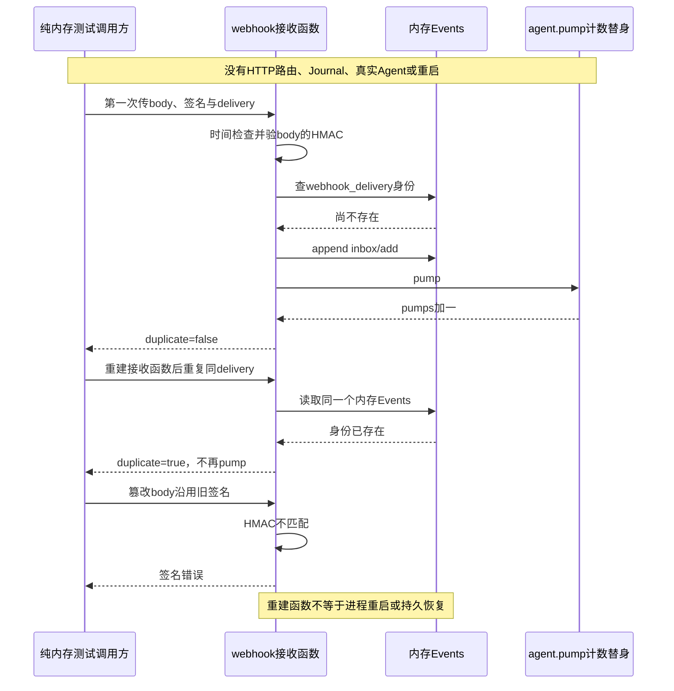

# 061 · Webhook消息按已有会话记录去重

阶段：R09。唯一前置：完成第 060 步，继续同一个工程。

<!-- harness-own-links:start -->
## 当前练习工程文件

以下链接指向 `harness-own` 的当前累计版本；本课下方的完整代码仍保留当步版本，二者可能不同。

[打开练习工程说明](../../../harness-own/README.md)

| 本课文件 | 当前练习工程文件 |
| --- | --- |
| `src/webhook.mjs` | 尚未合入 harness-own |
| `tests/061-webhook.test.mjs` | 尚未合入 harness-own |

<!-- harness-own-links:end -->

## 什么时候会用到这一页

外部系统把同一条review任务重复投递两次，教学实现希望它只进入既有会话Inbox一次。这里讲自定义接收身份和去重的思路，不是直接实现GitHub官方Webhook格式，也不是原版Webhook同语义复刻。

### 这次数据怎么走

```text
调用webhook返回的接收函数 → 检查时间/delivery与body签名 → 扫Session历史寻找webhook_delivery身份 → 首次追加inbox/add → agent.pump；重复身份直接返回duplicate。当前没有HTTP服务器路由。
```

### 对应时序图

从上往下读；实线箭头表示调用或发送，虚线箭头表示返回或事件通知。`opt`表示可选操作，`alt`表示不同结果，`loop`表示重复，`par`及其`and`分支表示并行；“未接入”及fixture说明按图中标注理解。



**当前接线位置：**本章接收函数只由测试调用，没有挂047 HTTP路由，也没有为渠道创建真实Agent。原版Webhook走已验证投递→规则→创建新Session；本章走既有record的Inbox，属于不同设计，后续没有自动对齐。

## 这一步具体做什么

先写完src/webhook.mjs，再运行bun test ./tests/061-webhook.test.mjs。找到测试的body、delivery-1和pumps，第一次调用后pumps=1，重新构造webhook接收函数再调用仍为1；篡改body后签名应拒绝。不要向公网配置Webhook，本章无需真实GitHub secret或外部投递。

需要本章新文件的操作，先按下面代码创建文件，再执行；不要在上一步尚不存在的接口上试错。

## 代码为什么放在这一层

把接收身份放在输入事件里，目的是让“接收过”和“已入队”共享事实来源，减少跨两个存储提交的空隙。不过这个目标必须由真实日志与重启测试验证；重新创建一个函数不等于重启进程。

## 在哪里写、写什么

操作地点：终端中的 `$PROJECT`，编辑器打开同一个目录。只创建或替换下列文件，其他文件保留上一步版本。文件目录不存在先创建。

```sh
mkdir -p src
```

### 创建 `src/webhook.mjs`

````javascript
import { createHmac, timingSafeEqual } from 'node:crypto'

/** 签名验证的是原始正文，不是JSON解析后重新序列化的字符串。 */
export function webhook({ secret, maxAge = 300_000 }) {
  if (!secret) throw Error('Webhook必须配置secret')
  return (record, body, { signature, timestamp, delivery }) => {
    if (!Number.isFinite(Number(timestamp)) || !delivery || !/^[a-zA-Z0-9_-]{1,100}$/.test(delivery) || Math.abs(Date.now() - Number(timestamp)) > maxAge) throw Error('Webhook身份或时间失效')
    const expected = 'sha256=' + createHmac('sha256', secret).update(body).digest('hex'), actual = signature ?? ''
    if (actual.length !== expected.length || !timingSafeEqual(Buffer.from(actual), Buffer.from(expected))) throw Error('Webhook签名错误')
    const identity = 'webhook_' + delivery
    if (record.session.read().some(event => event.type === 'inbox/add' && event.data.id === identity)) return { duplicate: true, inputId: identity }
    const value = JSON.parse(body.toString())
    if (typeof value.prompt !== 'string') throw Error('Webhook缺少prompt')
    // 同一日志里的接收身份就是去重凭据，避免两个存储间的崩溃空隙。
    record.session.append('inbox/add', { id: identity, content: value.prompt, destination: 'turn', delivery })
    record.agent.pump()
    return { duplicate: false, inputId: identity }
  }
}
````

```sh
mkdir -p tests
```

### 创建 `tests/061-webhook.test.mjs`

````javascript
import { test } from 'bun:test'
import assert from 'node:assert/strict'
import { createHmac } from 'node:crypto'
import { webhook } from '../src/webhook.mjs'
import { Events } from '../src/events.mjs'

test('签名防篡改，重建接收器仍按持久Inbox身份去重', () => {
  let pumps = 0
  const record = { session: new Events(), agent: { pump: () => pumps++ } }, body = Buffer.from('{"prompt":"review"}')
  const headers = { timestamp: Date.now(), delivery: 'delivery-1', signature: 'sha256=' + createHmac('sha256', 'secret').update(body).digest('hex') }
  assert.equal(webhook({ secret: 'secret' })(record, body, headers).duplicate, false)
  assert.equal(webhook({ secret: 'secret' })(record, body, headers).duplicate, true)
  assert.equal(pumps, 1)
  assert.throws(() => webhook({ secret: 'secret' })(record, Buffer.from('changed'), headers), /签名/)
})
````

## 运行命令与通过标准

```sh
cd "$PROJECT"
bun test ./tests/061-webhook.test.mjs
bun test
```

现有测试只验证HMAC篡改拒绝，以及同一个内存Events对象被两个接收函数读取时不重复pump。它没有Journal、磁盘、进程重启、HTTP或真实Agent，因此不能声称已验证持久去重和重启恢复。

**本步证据的范围：**tests/061-webhook.test.mjs使用new Events()和仅递增计数的agent.pump替身，没有Journal或模型。签名计算是真实crypto；第二次调用只是重建接收函数，仍共享同一个内存日志。本次未新增真实Webhook接入。

## VS Code：断在哪里、看什么

用“Bun：当前测试”启动tests/061-webhook.test.mjs，断在src/webhook.mjs的identity赋值、session.read().some(...)和session.append('inbox/add', ...)处。监视identity应为webhook_delivery-1、record.session.read().length与测试pumps；第一次F10会追加一条并pump，第二次在some判断直接返回duplicate。篡改body应在签名比较抛错。所有这些代码都在测试进程，当前没有外部HTTP进程可附加。

操作位置：VS Code 打开的是自己的 `$PROJECT`，断点也设在这里的源码，不在教材的 `steps` 目录。

上面的说明若指定CLI、子进程、页面或Electron附加调试，就先按该流程操作；下面这组步骤只用于本章测试入口。“当前测试”不会自动附加子进程，也不会命中浏览器或Electron中的断点。

变量只在所属作用域可见：停在方法内部时看this和参数；要看测试里的局部变量，先在“调用堆栈”选择对应测试帧。正在等待的异步调用者不一定保留可求值的帧，此时在测试调用前后加断点再看，不把未定义误判成业务状态丢失。

沿用第 000 步安装的 Bun 扩展与 `.vscode/launch.json`；本章列出替换配置时，使用本章完整版本。

1. 打开本步测试文件 `tests/061-webhook.test.mjs`，保持它为当前编辑器文件。
2. 在上面指定的函数内单击行号左侧设置断点。
3. “运行和调试”选择 **Bun：当前测试**，按 F5；它执行当前测试，工作目录固定为 PROJECT。
4. 在“变量 / 监视 / 调用堆栈 / 调试控制台”检查状态；F10 逐行执行，F11 进入函数，Shift+F11 返回，F5 继续，Shift+F5 停止。

验收：断点实际命中，能说出当前输入、状态和下一步；只看到进程启动不算完成。长时间暂停会影响真实取消、审批和网络超时，先检查时序，不删超时断言。修正后在集成终端运行 `bun test ./tests/061-webhook.test.mjs`，再运行 `bun test`，保留全部断言。

## 不看答案，确认自己能解释

闭卷画“HTTP接收、验证投递、写Inbox、模型执行”四层，并在当前实现真正存在的层上打勾；再写出重建函数与重启后重读磁盘为什么不同。

完成后在 LEARNING.md 写一句实际结果和一个卡点。明天只重做这个卡点；第 3 天、第 7 天再做一次，能独立完成就继续下一页，不另开学习路线。

**再改一个条件验证：**练习：用同一delivery和另一份合法签名body调用，观察当前实现会直接认duplicate，记录它与“相同身份不同正文应拒绝”的差距。只用固定secret和内存Events，不能把此观察写成已经实现拒绝。

## 与当前原版还差哪些

对照本仓库固定原版 `687f282e8625c6b8d11ff58211a90524be2e4317`；这里的“当前”指该本地基线，不是未经检查的上游最新版。

**这一页已经实现：**

- 自定义HMAC-SHA256正文验签和基本时间/delivery格式检查。
- 按Session里inbox/add身份判断重复，并在首次接收后pump。
- 明确签名针对原始body，不对JSON重编码后验签。

**原版仍有、或本步尚未对齐的部分：**

- 原版GitHub provider实际读取HTTP事件/投递头验签并交给规则创建新Session；本章没有HTTP渠道或规则注册。
- 原版deliveryId只是来源信息，不是内建去重状态；本章持久Inbox去重是自定义语义，不能称原版功能已简化复刻。
- 本章timestamp和delivery未纳入body的HMAC覆盖；重复delivery但不同正文也未显式拒绝。
- 没有真实日志落盘/重启/并发接收测试，不能声称持久接收、执行去重或故障原子性已证明。

**原版对照位置：**

- [packages/experimental/webhook/src/index.ts](../../../deepseek-harness/packages/experimental/webhook/src/index.ts)
- [packages/experimental/webhook/src/types.ts](../../../deepseek-harness/packages/experimental/webhook/src/types.ts)
- [packages/experimental/webhook/src/session.ts](../../../deepseek-harness/packages/experimental/webhook/src/session.ts)
- [packages/experimental/webhook-github/src/handler.ts](../../../deepseek-harness/packages/experimental/webhook-github/src/handler.ts)
- [packages/experimental/webhook-github/src/body.ts](../../../deepseek-harness/packages/experimental/webhook-github/src/body.ts)

本步测试通过只证明上面的具体行为；完整差距仍看 [COVERAGE.md](../COVERAGE.md)，不以文件数量、同名类或后面出现另一个模块代替接线证据。

下一步：[第 062 步](062.md)
