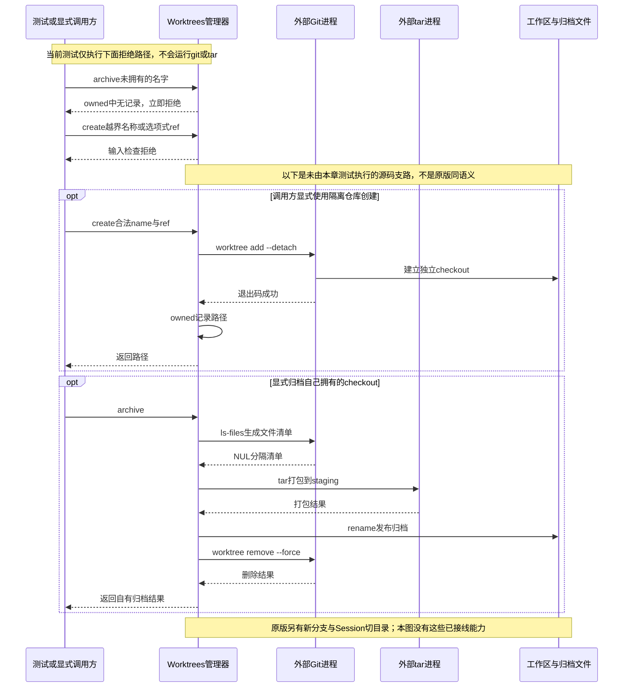

# 062 · 自有Worktree归档与输入检查

阶段：R09。唯一前置：完成第 061 步，继续同一个工程。

## 什么时候会用到这一页

开发者希望在另一个checkout里做修改，避免影响当前目录。教学Worktrees还额外设计了“先tar归档再删除自有checkout”；这和原版“创建新分支并让Session进入新工作区”的行为不同，不能混称同一能力。

### 这次数据怎么走

```text
Worktrees.create校验名字/ref → git worktree add --detach → 内存owned记路径；archive校验owned → git ls-files → tar打包 → rename归档 → git worktree remove --force。当前没有Agent或Session工作目录切换。
```

### 对应时序图

从上往下读；实线箭头表示调用或发送，虚线箭头表示返回或事件通知。`opt`表示可选操作，`alt`表示不同结果，`loop`表示重复，`par`及其`and`分支表示并行；“未接入”及fixture说明按图中标注理解。



**当前接线位置：**Worktrees只在062测试使用，未注册Agent工具、未更新Session cwd。后续没有恢复实现。它额外提供的tar归档删除不能冒充原版worktree服务的同语义简化。

## 这一步具体做什么

先写完worktree.mjs，再运行bun test ./tests/062-worktree.test.mjs。该测试只尝试归档不拥有的名字、../escape名称和以-开头的ref，应该在运行git/tar之前拒绝。不要对当前仓库调用archive来试验：它包含真实删除，现有用例没有建立安全的真实归档测试环境。

需要本章新文件的操作，先按下面代码创建文件，再执行；不要在上一步尚不存在的接口上试错。

## 代码为什么放在这一层

owned表示这份管理器允许删除哪些checkout，先归档再移除是避免误删的教学顺序。它只在内存里保存所有权，不等于Git自身的worktree清单，也不等于原版Session工作目录服务。

## 在哪里写、写什么

操作地点：终端中的 `$PROJECT`，编辑器打开同一个目录。只创建或替换下列文件，其他文件保留上一步版本。文件目录不存在先创建。

```sh
mkdir -p src
```

### 创建 `src/worktree.mjs`

````javascript
import { execute } from './process.mjs'
import { resolve, relative, join } from 'node:path'
import { mkdir, writeFile, rename } from 'node:fs/promises'
import { randomUUID } from 'node:crypto'

/** 只管理自己创建的worktree；删除前留普通文件归档，不自动git commit。 */
export class Worktrees {
  owned = new Map()
  constructor(repository, root) { this.repository = resolve(repository); this.root = resolve(root) }
  async create(name, reference, signal) {
    if (!/^[a-z][a-z0-9-]{0,40}$/.test(name) || typeof reference !== 'string' || reference.startsWith('-')) throw Error('worktree名称/ref不合法')
    const target = join(this.root, name); await mkdir(this.root, { recursive: true })
    const result = await execute({ command: 'git', args: ['-C', this.repository, 'worktree', 'add', '--detach', target, reference], timeout: 60_000 }, signal)
    if (result.code) throw Error('worktree创建失败：' + result.output)
    this.owned.set(name, target); return target
  }
  async archive(name, destination, signal) {
    const target = this.owned.get(name)
    if (!target) throw Error('不是本管理器拥有的worktree')
    const files = await execute({ command: 'git', args: ['-C', target, 'ls-files', '--cached', '--others', '--exclude-standard', '-z'], maxBytes: 1024 * 1024 }, signal)
    if (files.code) throw Error('worktree枚举失败')
    const list = destination + '.files-' + randomUUID(), staging = destination + '.staging'
    // 清单使用NUL分隔，路径有空格/换行时也不改变tar参数语义。
    await writeFile(list, files.output)
    const packed = await execute({ command: 'tar', args: ['-czf', staging, '-C', target, '--null', '-T', list], timeout: 60_000 }, signal)
    if (packed.code) throw Error('worktree归档失败')
    await rename(staging, destination)
    const removed = await execute({ command: 'git', args: ['-C', this.repository, 'worktree', 'remove', '--force', target] }, signal)
    if (removed.code) throw Error('已归档但worktree未删除：' + removed.output)
    this.owned.delete(name)
    return { archive: destination, meaning: '保留tracked和非ignored文件；未创建提交，ignored文件需另行保留。' }
  }
}
````

```sh
mkdir -p tests
```

### 创建 `tests/062-worktree.test.mjs`

````javascript
import { test } from 'bun:test'
import assert from 'node:assert/strict'
import { Worktrees } from '../src/worktree.mjs'

test('未拥有的worktree不能归档或删除；名称/ref不能变成git选项', async () => {
  const manager = new Worktrees(process.cwd(), '/private/tmp/own-worktrees')
  await assert.rejects(manager.archive('someone-else', '/tmp/a.tar.gz', new AbortController().signal), /拥有/)
  await assert.rejects(manager.create('../escape', 'HEAD', new AbortController().signal), /不合法/)
  await assert.rejects(manager.create('safe', '--exec=bad', new AbortController().signal), /不合法/)
})
````

## 运行命令与通过标准

```sh
cd "$PROJECT"
bun test ./tests/062-worktree.test.mjs
bun test
```

测试只证明未拥有路径与恶意名字/ref在外部命令之前被拒绝，没有运行一次真实git worktree或tar。不能依据这项测试宣布创建、归档、删除、恢复或中文文件保留通过。

**本步证据的范围：**tests/062-worktree.test.mjs调用的全是拒绝路径，命令执行器不会真正运行。测试路径字符串不是已创建的隔离Git仓库；本次文档修改也没有创建、归档或删除任何worktree。

## VS Code：断在哪里、看什么

用“Bun：当前测试”启动tests/062-worktree.test.mjs，在src/worktree.mjs的if (!target)和名称/ref校验条件断点；监视name、reference、this.owned.size应为0。F10应直接进入抛错，src/process.mjs的execute断点不应到达。不要为命中tar断点而跳过owned检查或指向日常仓库。

操作位置：VS Code 打开的是自己的 `$PROJECT`，断点也设在这里的源码，不在教材的 `steps` 目录。

上面的说明若指定CLI、子进程、页面或Electron附加调试，就先按该流程操作；下面这组步骤只用于本章测试入口。“当前测试”不会自动附加子进程，也不会命中浏览器或Electron中的断点。

变量只在所属作用域可见：停在方法内部时看this和参数；要看测试里的局部变量，先在“调用堆栈”选择对应测试帧。正在等待的异步调用者不一定保留可求值的帧，此时在测试调用前后加断点再看，不把未定义误判成业务状态丢失。

沿用第 000 步安装的 Bun 扩展与 `.vscode/launch.json`；本章列出替换配置时，使用本章完整版本。

1. 打开本步测试文件 `tests/062-worktree.test.mjs`，保持它为当前编辑器文件。
2. 在上面指定的函数内单击行号左侧设置断点。
3. “运行和调试”选择 **Bun：当前测试**，按 F5；它执行当前测试，工作目录固定为 PROJECT。
4. 在“变量 / 监视 / 调用堆栈 / 调试控制台”检查状态；F10 逐行执行，F11 进入函数，Shift+F11 返回，F5 继续，Shift+F5 停止。

验收：断点实际命中，能说出当前输入、状态和下一步；只看到进程启动不算完成。长时间暂停会影响真实取消、审批和网络超时，先检查时序，不删超时断言。修正后在集成终端运行 `bun test ./tests/062-worktree.test.mjs`，再运行 `bun test`，保留全部断言。

## 不看答案，确认自己能解释

闭卷写出教学实现的detach checkout和原版新建branch的区别，再写出当前owned在进程退出后会发生什么，以及tar文件为什么不自动等于完整Git上下文。

完成后在 LEARNING.md 写一句实际结果和一个卡点。明天只重做这个卡点；第 3 天、第 7 天再做一次，能独立完成就继续下一页，不另开学习路线。

**再改一个条件验证：**练习：只给纯输入测试增加一个以-开头的name，验证它仍在任何git命令前拒绝。真实创建/归档练习需要另建完全隔离Git仓库和恢复核对，当前没有这份自动验收，不在本章冒进执行。

## 与当前原版还差哪些

对照本仓库固定原版 `687f282e8625c6b8d11ff58211a90524be2e4317`；这里的“当前”指该本地基线，不是未经检查的上游最新版。

**这一页已经实现：**

- 显式git argv创建detached worktree的辅助方法。
- 内存所有权检查与先归档后删除的自定义流程。
- 基本名字/ref拒绝和NUL分隔文件清单。

**原版仍有、或本步尚未对齐的部分：**

- 原版创建新分支及checkout、固定基线commit，并切换调用Session工作目录；本章使用--detach且没有Session。
- 原版失败时保留已创建checkout/branch，不自动删除；本章archive/remove是另一套行为，不能算同项完成。
- 本章owned不持久，缺恢复和完整Git上下文；删除过的tracked文件可能让tar失败，临时清单/失败清理也未完整处理。
- 没有真实git/tar、中文空格文件、取消或失败后恢复的测试证据。

**原版对照位置：**

- [packages/experimental/worktree/src/index.ts](../../../deepseek-harness/packages/experimental/worktree/src/index.ts)
- [packages/experimental/worktree/src/types.ts](../../../deepseek-harness/packages/experimental/worktree/src/types.ts)
- [packages/experimental/worktree/src/process.ts](../../../deepseek-harness/packages/experimental/worktree/src/process.ts)
- [packages/experimental/tool-worktree](../../../deepseek-harness/packages/experimental/tool-worktree)

本步测试通过只证明上面的具体行为；完整差距仍看 [COVERAGE.md](../COVERAGE.md)，不以文件数量、同名类或后面出现另一个模块代替接线证据。

下一步：[第 063 步](063.md)
