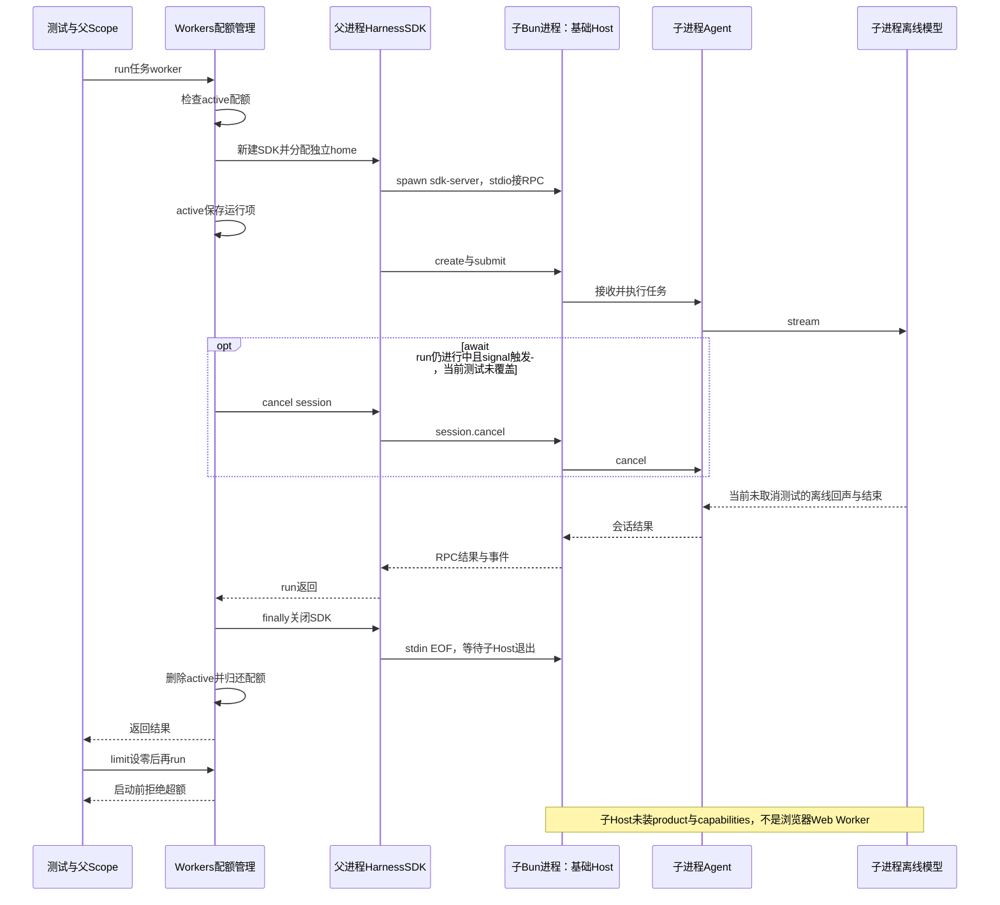

# 063 · 用独立Bun Host执行任务并限制配额

阶段：R09。唯一前置：完成第 062 步，继续同一个工程。

## 什么时候会用到这一页

主程序想把一个任务放到另一个Bun Host进程执行，并且最多允许两项同时占用资源。任务完成或失败后要归还配额，否则后面任务会一直被误判超额。这里的Worker是外部Host，不是浏览器Web Worker。

### 这次数据怎么走

```text
Workers.run → 检查active配额 → HarnessSDK创建独立home并spawn sdk-server → stdio RPC → 子Host/Agent → 结果返回 → finally关闭SDK子进程并删除active项；signal可请求session.cancel。
```

### 对应时序图

从上往下读；实线箭头表示调用或发送，虚线箭头表示返回或事件通知。`opt`表示可选操作，`alt`表示不同结果，`loop`表示重复，`par`及其`and`分支表示并行；“未接入”及fixture说明按图中标注理解。



**当前接线位置：**Workers只被063测试调用，没有装成051子Agent工具后端。sdk-server确实支持有Key时直接DeepSeek、无Key时OfflineModel，但没有装product/capabilities。原版subagent-dsh-sdk与浏览器Dedicated Worker分别是另一套完整领域实现。

## 这一步具体做什么

先写完workers.mjs，再运行env -u DEEPSEEK_API_KEY bun test ./tests/063-workers.test.mjs。测试实际启动另一个Bun sdk-server，完成offline任务worker后检查active.size=0，再把limit设0验证启动前超额拒绝。不要把普通输出worker当成真实模型推理，也无需配置模型Key。

需要本章新文件的操作，先按下面代码创建文件，再执行；不要在上一步尚不存在的接口上试错。

## 代码为什么放在这一层

Workers拥有SDK子进程和配额，Scope则让父生命周期关闭时能收回子资源。独立home隔离会话存储，但不是操作系统沙箱；模型、工具和文件访问仍取决于子Host实际装配。

## 在哪里写、写什么

操作地点：终端中的 `$PROJECT`，编辑器打开同一个目录。只创建或替换下列文件，其他文件保留上一步版本。文件目录不存在先创建。

```sh
mkdir -p src
```

### 创建 `src/workers.mjs`

````javascript
import { HarnessSDK } from './sdk.mjs'
import { join } from 'node:path'
import { randomUUID } from 'node:crypto'

/** 有界外部Worker使用同一SDK协议；拒绝超额，不无限启动进程。 */
export class Workers {
  active = new Map()
  constructor(home, limit = 2, env = process.env) { this.home = home; this.limit = limit; this.env = env }
  async run(scope, cwd, text, signal) {
    if (this.active.size >= this.limit) throw Error('Worker超额')
    const id = randomUUID(), sdk = new HarnessSDK({ home: join(this.home, id), cwd, env: this.env })
    this.active.set(id, sdk)
    const close = scope.own(async () => { await sdk.close(); this.active.delete(id) })
    let sessionId
    const abort = () => { if (sessionId) void sdk.cancel(sessionId).catch(() => {}) }
    signal.addEventListener('abort', abort, { once: true })
    try {
      signal.throwIfAborted(); const session = await sdk.create(); sessionId = session.id
      signal.throwIfAborted(); return await sdk.run(sessionId, text)
    } finally { signal.removeEventListener('abort', abort); await close() }
  }
}
````

```sh
mkdir -p tests
```

### 创建 `tests/063-workers.test.mjs`

````javascript
import { test } from 'bun:test'
import assert from 'node:assert/strict'
import { Workers } from '../src/workers.mjs'
import { Scope } from '../src/scope.mjs'
import { mkdtempSync, rmSync } from 'node:fs'
import { join } from 'node:path'
import { tmpdir } from 'node:os'

test('真实隔离Host进程完成Worker任务，关闭后配额归还', async () => {
  const root = mkdtempSync(join(tmpdir(), 'own-workers-')), workers = new Workers(root), scope = new Scope()
  try {
    const result = await workers.run(scope, root, 'worker', new AbortController().signal)
    assert.match(result.text, /worker/); assert.equal(workers.active.size, 0)
    workers.limit = 0
    await assert.rejects(workers.run(scope, root, 'no', new AbortController().signal), /超额/)
  } finally { await scope.close(); rmSync(root, { recursive: true, force: true }) }
})
````

## 运行命令与通过标准

```sh
cd "$PROJECT"
bun test ./tests/063-workers.test.mjs
bun test
```

测试有真实Bun子Host和stdio RPC，验证普通任务结果、完成后配额归还及limit=0拒绝。它不验证真实并发上限、运行中取消、两个home磁盘隔离、后代或子工具审批；也不证明原版Browser Worker runtime。

**本步证据的范围：**tests/063-workers.test.mjs通过HarnessSDK启动真实Bun进程，外部模型在无Key时为OfflineModel，结果只是带输入的离线文字。不是内存Promise假Worker，但也不是原版完整Worker验收；本次文档改写没有新增进程测试。

## VS Code：断在哪里、看什么

在tests/063-workers.test.mjs用“Bun：当前测试”启动，断在src/workers.mjs的this.active.set(id, sdk)、return await sdk.run(...)和finally的await close()；监视id、sdk.child.pid、this.active.size。F10跨过run等待真实子进程结果后，active.size应从1回到0。F11进入src/sdk.mjs只到父侧RPC；sdk-server/Agent在子进程，本配置不自动附加，子进程内部断点不会因父侧F11就命中。

操作位置：VS Code 打开的是自己的 `$PROJECT`，断点也设在这里的源码，不在教材的 `steps` 目录。

上面的说明若指定CLI、子进程、页面或Electron附加调试，就先按该流程操作；下面这组步骤只用于本章测试入口。“当前测试”不会自动附加子进程，也不会命中浏览器或Electron中的断点。

变量只在所属作用域可见：停在方法内部时看this和参数；要看测试里的局部变量，先在“调用堆栈”选择对应测试帧。正在等待的异步调用者不一定保留可求值的帧，此时在测试调用前后加断点再看，不把未定义误判成业务状态丢失。

沿用第 000 步安装的 Bun 扩展与 `.vscode/launch.json`；本章列出替换配置时，使用本章完整版本。

1. 打开本步测试文件 `tests/063-workers.test.mjs`，保持它为当前编辑器文件。
2. 在上面指定的函数内单击行号左侧设置断点。
3. “运行和调试”选择 **Bun：当前测试**，按 F5；它执行当前测试，工作目录固定为 PROJECT。
4. 在“变量 / 监视 / 调用堆栈 / 调试控制台”检查状态；F10 逐行执行，F11 进入函数，Shift+F11 返回，F5 继续，Shift+F5 停止。

验收：断点实际命中，能说出当前输入、状态和下一步；只看到进程启动不算完成。长时间暂停会影响真实取消、审批和网络超时，先检查时序，不删超时断言。修正后在集成终端运行 `bun test ./tests/063-workers.test.mjs`，再运行 `bun test`，保留全部断言。

## 不看答案，确认自己能解释

闭卷画Workers、HarnessSDK、子sdk-server、子Host四个节点，给每个对象标所有者，再写出任务结束时配额在哪一行归还。

完成后在 LEARNING.md 写一句实际结果和一个卡点。明天只重做这个卡点；第 3 天、第 7 天再做一次，能独立完成就继续下一页，不另开学习路线。

**再改一个条件验证：**练习：给SDK父侧断点停留期间观察active包含的id，再继续到finally确认删除；不要修改limit绕过约束。运行中取消与真正双并发目前没有测试，不能把观察一个任务扩大成这些能力通过。

## 与当前原版还差哪些

对照本仓库固定原版 `687f282e8625c6b8d11ff58211a90524be2e4317`；这里的“当前”指该本地基线，不是未经检查的上游最新版。

**这一页已经实现：**

- 真实Bun子Host、独立home路径和已有SDK/Remote协议复用。
- 内存active配额、Scope关闭、finally回收和基本取消转发。
- 超额时在创建SDK前拒绝。

**原版仍有、或本步尚未对齐的部分：**

- 不是原版Browser Worker的VFS、模块装载、shell仿真和页面传输后端。
- 与原版subagent-dsh-sdk相比，缺初始化配置契约、完整取消/停稳释放、失败分类、后代和公开后端注册。
- 子Host仅基础工具，未完整继承产品能力/权限；没有进入主Agent委派工具链。
- 当前测试不验证并发、取消、异常退出、磁盘隔离或模型工具调用。

**原版对照位置：**

- [packages/subagent/subagent-dsh-sdk/src/index.ts](../../../deepseek-harness/packages/subagent/subagent-dsh-sdk/src/index.ts)
- [packages/subagent/subagent-dsh-sdk/src/run.ts](../../../deepseek-harness/packages/subagent/subagent-dsh-sdk/src/run.ts)
- [packages/sdk/client/src/client.ts](../../../deepseek-harness/packages/sdk/client/src/client.ts)
- [packages/experimental/webworker-runtime/src/worker.ts](../../../deepseek-harness/packages/experimental/webworker-runtime/src/worker.ts)
- [packages/experimental/webworker-runtime/src/node/process-table.ts](../../../deepseek-harness/packages/experimental/webworker-runtime/src/node/process-table.ts)

本步测试通过只证明上面的具体行为；完整差距仍看 [COVERAGE.md](../COVERAGE.md)，不以文件数量、同名类或后面出现另一个模块代替接线证据。

下一步：[第 064 步](064.md)
