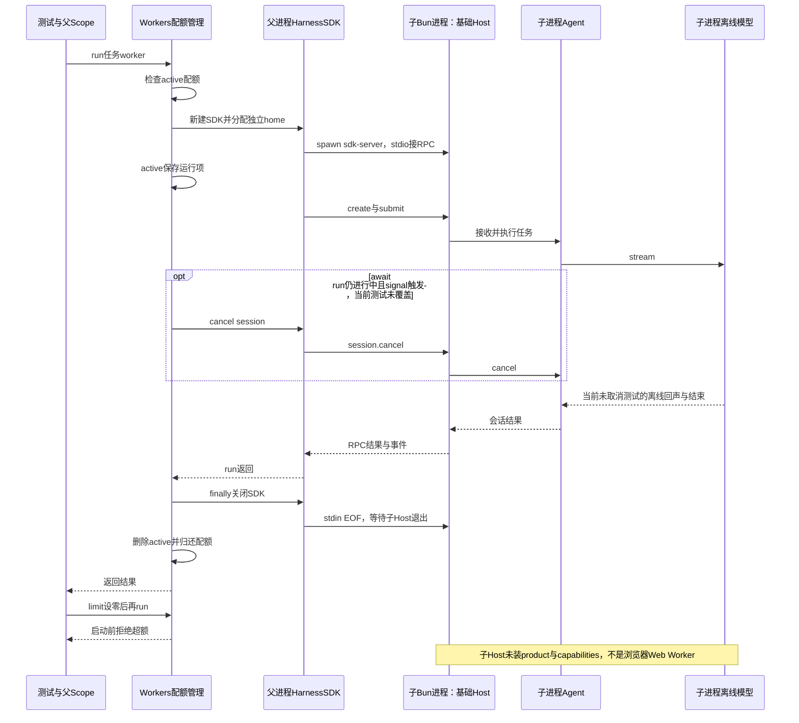
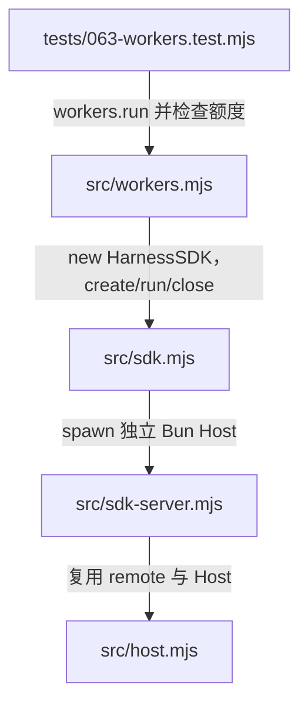
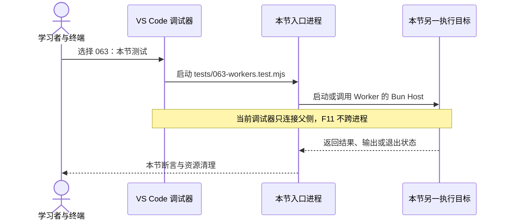

# 063 · 用独立Bun Host执行任务并限制配额

阶段：R09。唯一前置：完成第 062 步，继续同一个工程。

<!-- harness-own-links:start -->
## 当前练习工程文件

以下链接指向 `harness-own` 的当前累计版本；本课下方的完整代码仍保留当步版本，二者可能不同。

[打开练习工程说明](../../../harness-own/README.md)

| 本课文件 | 当前练习工程文件 |
| --- | --- |
| `.vscode/launch.json` | 使用本页下方的本节专用配置，不复制累计版本 |
| `src/workers.mjs` | 尚未合入 harness-own |
| `tests/063-workers.test.mjs` | 尚未合入 harness-own |

<!-- harness-own-links:end -->

## 什么时候会用到这一页

主程序想把一个任务放到另一个Bun Host进程执行，并且最多允许两项同时占用资源。任务完成或失败后要归还配额，否则后面任务会一直被误判超额。这里的Worker是外部Host，不是浏览器Web Worker。

### 这次数据怎么走

```text
Workers.run → 检查active配额 → HarnessSDK创建独立home并spawn sdk-server → stdio RPC → 子Host/Agent → 结果返回 → finally关闭SDK子进程并删除active项；signal可请求session.cancel。
```

### 对应时序图

从上往下读；实线箭头表示调用或发送，虚线箭头表示返回或事件通知。`opt`表示可选操作，`alt`表示不同结果，`loop`表示重复，`par`及其`and`分支表示并行；“未接入”及fixture说明按图中标注理解。



**当前接线位置：** Workers只被063测试调用，没有装成051子Agent工具后端。sdk-server确实支持有Key时直接DeepSeek、无Key时OfflineModel，但没有装product/capabilities。原版subagent-dsh-sdk与浏览器Dedicated Worker分别是另一套完整领域实现。

## 先看目录与调用关系

目录只列本节文件及图中直接用到的前置实现；不是累计工程的完整文件清单。

```text
PROJECT/
├── .vscode/
│   └── launch.json  # 本节创建或替换
├── src/
│   ├── host.mjs  # 沿用前置实现
│   ├── sdk-server.mjs  # 沿用前置实现
│   ├── sdk.mjs  # 沿用前置实现
│   └── workers.mjs  # 本节创建或替换
└── tests/
    └── 063-workers.test.mjs  # 本节创建或替换
```

### 本节入口怎样调用这些文件

箭头写明实际调用或进程启动；标为“未接入”的文件不是本节测试能命中的目标。




## 这一步具体做什么

先写完workers.mjs，再运行env -u DEEPSEEK_API_KEY bun test ./tests/063-workers.test.mjs。测试实际启动另一个Bun sdk-server，完成offline任务worker后检查active.size=0，再把limit设0验证启动前超额拒绝。不要把普通输出worker当成真实模型推理，也无需配置模型Key。

需要本章新文件的操作，先按下面代码创建文件，再执行；不要在上一步尚不存在的接口上试错。

## 代码为什么放在这一层

Workers拥有SDK子进程和配额，Scope则让父生命周期关闭时能收回子资源。独立home隔离会话存储，但不是操作系统沙箱；模型、工具和文件访问仍取决于子Host实际装配。

## 本节调试：选什么、为什么、怎么启动

**建议先选：063：本节测试。** 每节的测试入口都固定到本节文件，不依赖编辑器当前打开的 `${file}`。

| 配置名称 | 什么时候选 | 实际入口或目标 | 能观察什么 |
| --- | --- | --- | --- |
| 063：本节测试 | 本节验收 | tests/063-workers.test.mjs | 本节 Bun 测试进程；入口固定，不依赖当前编辑器文件。 |

**为什么这样启动：** 本节测试直接调用被测模块，选择这一项即可沿测试进入实现；前序 CLI 或其他语言入口不参与这次调试。 Workers 的额度与 SDK 调用在父侧，Agent 在另起的 Host 中，本节普通配置不自动附加。

使用下方的[本节专用调试配置](#lesson-debug-config)。它只列本节可用目标；要保留个人配置，请先备份并按名称合并。页面上 `harness-own` 的累计文件链接供看当前工程，不是本节调试配置的答案。

1. VS Code 打开自己的 PROJECT；按本节创建源码与配置，断点设在 PROJECT 文件中。
2. 先用终端运行 `bun test ./tests/063-workers.test.mjs` 确认普通验收，再选表中的配置按 F5。
3. 在下方具体观察点停住；F10 跨过当前语句，F11 只进入当前调试目标。异步等待涉及另一进程时，切换调试会话并继续对端。
4. 变量要在所属调用帧查看；看测试局部变量时选测试帧，看 this 和参数时选实现方法帧。

<details class="debug-details">
<summary>展开本节具体断点和预期</summary>

1. 在tests/063-workers.test.mjs用“063：本节测试”启动，断在src/workers.mjs的this.active.set(id, sdk)、return await sdk.run(...)和finally的await close()。

2. 监视id、sdk.child.pid、this.active.size。

3. F10跨过run等待真实子进程结果后，active.size应从1回到0。

4. F11进入src/sdk.mjs只到父侧RPC。

5. sdk-server/Agent在子进程，本配置不自动附加，子进程内部断点不会因父侧F11就命中。

</details>

### 本节调试启动时序

这张图解释如何创建并连接调试目标；上面的业务时序图解释任务本身怎样执行。



暂停断点会影响应用自身的 RPC、取消、进程和网络计时。Bun 测试超时放宽不等于这些计时也被关闭；按本节说明分别设置，普通验收恢复原有时限。

观察完成后退出本节启动的调试会话和进程，再运行 `bun test ./tests/063-workers.test.mjs`。测试通过只证明本节断言，不代表所有 GUI、外部服务或发布过程均已验证。

## 在哪里写、写什么

操作地点：终端中的 `$PROJECT`，编辑器打开同一个目录。只创建或替换下列文件，其他文件保留上一步版本。文件目录不存在先创建。

```sh
mkdir -p .vscode
```

<a id="lesson-debug-config"></a>

下面是本节专用调试配置，只包含本节入口。program 已固定到本节文件；不是 harness-own 的累计配置。

### 替换 `.vscode/launch.json`

````json
{
  "version": "0.2.0",
  "configurations": [
    {
      "name": "063：本节测试",
      "type": "bun",
      "request": "launch",
      "program": "${workspaceFolder}/tests/063-workers.test.mjs",
      "cwd": "${workspaceFolder}",
      "runtime": "bun",
      "runtimeArgs": [
        "test",
        "--preload",
        "${workspaceFolder}/scripts/vscode-debug.mjs",
        "--timeout",
        "3600000"
      ],
      "stopOnEntry": false,
      "env": {
        "SDK_DEBUG_HOST": "0"
      }
    }
  ]
}
````

```sh
mkdir -p src
```

### 创建 `src/workers.mjs`

````javascript
import { HarnessSDK } from './sdk.mjs'
import { join } from 'node:path'
import { randomUUID } from 'node:crypto'

/** 有界外部Worker使用同一SDK协议；拒绝超额，不无限启动进程。 */
export class Workers {
  active = new Map()
  constructor(home, limit = 2, env = process.env) { this.home = home; this.limit = limit; this.env = env }
  async run(scope, cwd, text, signal) {
    if (this.active.size >= this.limit) throw Error('Worker超额')
    const id = randomUUID(), sdk = new HarnessSDK({ home: join(this.home, id), cwd, env: this.env })
    this.active.set(id, sdk)
    const close = scope.own(async () => { await sdk.close(); this.active.delete(id) })
    let sessionId
    const abort = () => { if (sessionId) void sdk.cancel(sessionId).catch(() => {}) }
    signal.addEventListener('abort', abort, { once: true })
    try {
      signal.throwIfAborted(); const session = await sdk.create(); sessionId = session.id
      signal.throwIfAborted(); return await sdk.run(sessionId, text)
    } finally { signal.removeEventListener('abort', abort); await close() }
  }
}
````

```sh
mkdir -p tests
```

### 创建 `tests/063-workers.test.mjs`

````javascript
import { test } from 'bun:test'
import assert from 'node:assert/strict'
import { Workers } from '../src/workers.mjs'
import { Scope } from '../src/scope.mjs'
import { mkdtempSync, rmSync } from 'node:fs'
import { join } from 'node:path'
import { tmpdir } from 'node:os'

test('真实隔离Host进程完成Worker任务，关闭后配额归还', async () => {
  const root = mkdtempSync(join(tmpdir(), 'own-workers-')), workers = new Workers(root), scope = new Scope()
  try {
    const result = await workers.run(scope, root, 'worker', new AbortController().signal)
    assert.match(result.text, /worker/); assert.equal(workers.active.size, 0)
    workers.limit = 0
    await assert.rejects(workers.run(scope, root, 'no', new AbortController().signal), /超额/)
  } finally { await scope.close(); rmSync(root, { recursive: true, force: true }) }
})
````

## 运行命令与通过标准

```sh
cd "$PROJECT"
bun test ./tests/063-workers.test.mjs
bun test
```

测试有真实Bun子Host和stdio RPC，验证普通任务结果、完成后配额归还及limit=0拒绝。它不验证真实并发上限、运行中取消、两个home磁盘隔离、后代或子工具审批；也不证明原版Browser Worker runtime。

**本步证据的范围：** tests/063-workers.test.mjs通过HarnessSDK启动真实Bun进程，外部模型在无Key时为OfflineModel，结果只是带输入的离线文字。不是内存Promise假Worker，但也不是原版完整Worker验收；本次文档改写没有新增进程测试。

## 不看答案，确认自己能解释

闭卷画Workers、HarnessSDK、子sdk-server、子Host四个节点，给每个对象标所有者，再写出任务结束时配额在哪一行归还。

完成后在 LEARNING.md 写一句实际结果和一个卡点。明天只重做这个卡点；第 3 天、第 7 天再做一次，能独立完成就继续下一页，不另开学习路线。

**再改一个条件验证：** 练习：给SDK父侧断点停留期间观察active包含的id，再继续到finally确认删除；不要修改limit绕过约束。运行中取消与真正双并发目前没有测试，不能把观察一个任务扩大成这些能力通过。

## 与当前原版还差哪些

对照本仓库固定原版 `687f282e8625c6b8d11ff58211a90524be2e4317`；这里的“当前”指该本地基线，不是未经检查的上游最新版。

**这一页已经实现：**

- 真实Bun子Host、独立home路径和已有SDK/Remote协议复用。
- 内存active配额、Scope关闭、finally回收和基本取消转发。
- 超额时在创建SDK前拒绝。

**原版仍有、或本步尚未对齐的部分：**

- 不是原版Browser Worker的VFS、模块装载、shell仿真和页面传输后端。
- 与原版subagent-dsh-sdk相比，缺初始化配置契约、完整取消/停稳释放、失败分类、后代和公开后端注册。
- 子Host仅基础工具，未完整继承产品能力/权限；没有进入主Agent委派工具链。
- 当前测试不验证并发、取消、异常退出、磁盘隔离或模型工具调用。

**原版对照位置：**

- [packages/subagent/subagent-dsh-sdk/src/index.ts](../../../deepseek-harness/packages/subagent/subagent-dsh-sdk/src/index.ts)
- [packages/subagent/subagent-dsh-sdk/src/run.ts](../../../deepseek-harness/packages/subagent/subagent-dsh-sdk/src/run.ts)
- [packages/sdk/client/src/client.ts](../../../deepseek-harness/packages/sdk/client/src/client.ts)
- [packages/experimental/webworker-runtime/src/worker.ts](../../../deepseek-harness/packages/experimental/webworker-runtime/src/worker.ts)
- [packages/experimental/webworker-runtime/src/node/process-table.ts](../../../deepseek-harness/packages/experimental/webworker-runtime/src/node/process-table.ts)

本步测试通过只证明上面的具体行为；完整差距仍看 [COVERAGE.md](../COVERAGE.md)，不以文件数量、同名类或后面出现另一个模块代替接线证据。

下一步：[第 064 步](064.md)
