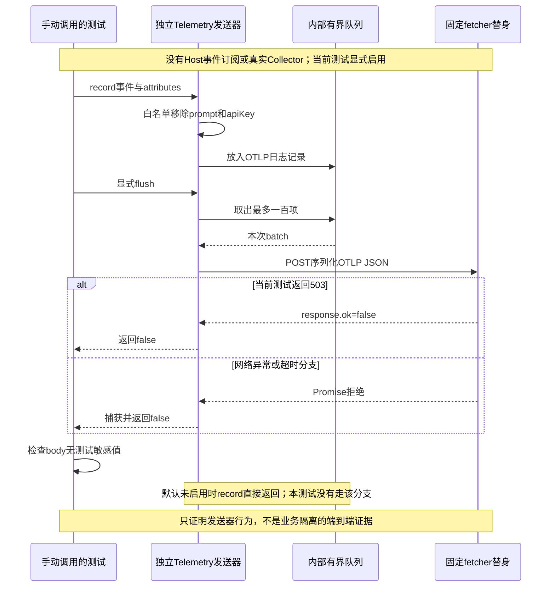

# 064 · 遥测失败不能拖垮任务

阶段：R09。唯一前置：完成第 063 步，继续同一个工程。

<!-- harness-own-links:start -->
## 当前练习工程文件

以下链接指向 `harness-own` 的当前累计版本；本课下方的完整代码仍保留当步版本，二者可能不同。

[打开练习工程说明](../../../harness-own/README.md)

| 本课文件 | 当前练习工程文件 |
| --- | --- |
| `src/telemetry.mjs` | 尚未合入 harness-own |
| `tests/064-telemetry.test.mjs` | 尚未合入 harness-own |

<!-- harness-own-links:end -->

## 什么时候会用到这一页

产品想记录一次turn结束的原因和耗时，但不能把prompt或API Key发到统计服务器，也不能因为Collector返回503让用户任务失败。当前只演示发送器，不是已经接入业务的全链追踪。

### 这次数据怎么走

```text
调用者手动Telemetry.record → 属性白名单 → 有界queue → 手动flush取最多100项 → OTLP JSON格式POST → response.ok或catch返回false；没有Host事件订阅。
```

### 对应时序图

从上往下读；实线箭头表示调用或发送，虚线箭头表示返回或事件通知。`opt`表示可选操作，`alt`表示不同结果，`loop`表示重复，`par`及其`and`分支表示并行；“未接入”及fixture说明按图中标注理解。



**当前接线位置：**Telemetry只在064测试手动调用；Host/Agent、Web和Electron没有订阅并上报事件。后续也未接产品统计开关或全链Trace，不能把它当已开启的遥测系统。

## 这一步具体做什么

先写完telemetry.mjs，再运行bun test ./tests/064-telemetry.test.mjs。测试会把prompt/private text与apiKey/secret-value一起传给record，用固定fetcher截获body并返回503；检查敏感值不在body里、flush返回false。不会连接真实Collector或发送用户数据。

需要本章新文件的操作，先按下面代码创建文件，再执行；不要在上一步尚不存在的接口上试错。

## 代码为什么放在这一层

字段白名单限制允许出站的数据，队列和超时限制资源占用。遥测失败不向业务抛网络异常；但调用方仍须明确决定何时record/flush，单独存在一个发送器不会自动观察Agent。

## 在哪里写、写什么

操作地点：终端中的 `$PROJECT`，编辑器打开同一个目录。只创建或替换下列文件，其他文件保留上一步版本。文件目录不存在先创建。

```sh
mkdir -p src
```

### 创建 `src/telemetry.mjs`

````javascript
import { randomBytes } from 'node:crypto'

/** 默认关闭，只允许明确白名单字段进入OTLP；业务不等待遥测成功。 */
export class Telemetry {
  queue = []
  constructor({ enabled = false, endpoint, fetcher = fetch } = {}) { this.enabled = enabled; this.endpoint = endpoint; this.fetcher = fetcher }
  record(name, attributes = {}) {
    if (!this.enabled) return
    const allowed = ['sessionId', 'requestId', 'toolName', 'reason', 'durationMs', 'inputTokens', 'outputTokens']
    this.queue.push({ timeUnixNano: String(BigInt(Date.now()) * 1_000_000n), severityText: 'INFO', body: { stringValue: name }, attributes: Object.entries(attributes).filter(([key]) => allowed.includes(key)).map(([key, value]) => ({ key, value: { stringValue: String(value) } })) })
    if (this.queue.length > 1000) this.queue.shift()
  }
  /** 有界批次，超时/失败被记录为false，不向业务抛网络异常。 */
  async flush() {
    if (!this.enabled || !this.queue.length) return true
    const batch = this.queue.splice(0, 100)
    try {
      const response = await this.fetcher(this.endpoint, { method: 'POST', signal: AbortSignal.timeout(2000), headers: { 'content-type': 'application/json' }, body: JSON.stringify({ resourceLogs: [{ scopeLogs: [{ scope: { name: 'harness-own' }, logRecords: batch }] }] }) })
      return response.ok
    } catch { return false }
  }
}
````

```sh
mkdir -p tests
```

### 创建 `tests/064-telemetry.test.mjs`

````javascript
import { test } from 'bun:test'
import assert from 'node:assert/strict'
import { Telemetry } from '../src/telemetry.mjs'

test('真正序列化OTLP白名单，Key和prompt不发送，失败不阻断业务', async () => {
  let sent
  const telemetry = new Telemetry({ enabled: true, endpoint: 'http://collector/v1/logs', fetcher: async (url, request) => { sent = request.body; return new Response('', { status: 503 }) } })
  telemetry.record('turn/end', { sessionId: 's', prompt: 'private text', apiKey: 'secret-value', reason: 'completed' })
  assert.equal(await telemetry.flush(), false)
  assert.ok(!sent.includes('private text') && !sent.includes('secret-value'))
  assert.equal(JSON.parse(sent).resourceLogs[0].scopeLogs[0].logRecords[0].body.stringValue, 'turn/end')
})
````

## 运行命令与通过标准

```sh
cd "$PROJECT"
bun test ./tests/064-telemetry.test.mjs
bun test
```

测试验证OTLP JSON结构、两项敏感字段被过滤和固定503返回false。它没有真实HTTP、Collector、业务任务、队列满/超时/退出flush测试，也不证明所有可能字段都完成隐私审查。

**本步证据的范围：**tests/064-telemetry.test.mjs只调用固定fetcher，不启动HTTP服务器或Agent，所谓503是本地Response。真实JSON序列化和过滤确实发生，但不能写成已向Collector发送或已做端到端业务隔离。

## VS Code：断在哪里、看什么

用“Bun：当前测试”启动tests/064-telemetry.test.mjs，断在src/telemetry.mjs的allowed过滤、const batch = this.queue.splice(0, 100)和return response.ok；方法帧监视this.queue.length与batch.length。切到测试回调或调用者帧观察sent：JSON.parse(sent)中attributes应有key为reason、value.stringValue为completed的一项，且原字符串不含private text/secret-value。F10后batch应有一条，flush结果为false。F11进入的是测试固定fetcher，不是外部Collector进程。

操作位置：VS Code 打开的是自己的 `$PROJECT`，断点也设在这里的源码，不在教材的 `steps` 目录。

上面的说明若指定CLI、子进程、页面或Electron附加调试，就先按该流程操作；下面这组步骤只用于本章测试入口。“当前测试”不会自动附加子进程，也不会命中浏览器或Electron中的断点。

变量只在所属作用域可见：停在方法内部时看this和参数；要看测试里的局部变量，先在“调用堆栈”选择对应测试帧。正在等待的异步调用者不一定保留可求值的帧，此时在测试调用前后加断点再看，不把未定义误判成业务状态丢失。

沿用第 000 步安装的 Bun 扩展与 `.vscode/launch.json`；本章列出替换配置时，使用本章完整版本。

1. 打开本步测试文件 `tests/064-telemetry.test.mjs`，保持它为当前编辑器文件。
2. 在上面指定的函数内单击行号左侧设置断点。
3. “运行和调试”选择 **Bun：当前测试**，按 F5；它执行当前测试，工作目录固定为 PROJECT。
4. 在“变量 / 监视 / 调用堆栈 / 调试控制台”检查状态；F10 逐行执行，F11 进入函数，Shift+F11 返回，F5 继续，Shift+F5 停止。

验收：断点实际命中，能说出当前输入、状态和下一步；只看到进程启动不算完成。长时间暂停会影响真实取消、审批和网络超时，先检查时序，不删超时断言。修正后在集成终端运行 `bun test ./tests/064-telemetry.test.mjs`，再运行 `bun test`，保留全部断言。

## 不看答案，确认自己能解释

闭卷给prompt、apiKey、toolName、durationMs四个字段标出当前是否允许出站，再写出网络失败时业务是否应抛错及谁负责flush。

完成后在 LEARNING.md 写一句实际结果和一个卡点。明天只重做这个卡点；第 3 天、第 7 天再做一次，能独立完成就继续下一页，不另开学习路线。

**再改一个条件验证：**练习：让固定fetcher直接抛错，补断言flush仍返回false；仍不访问真实网络。这个异常变体当前没有测试，不等价于真实Collector超时验收。

## 与当前原版还差哪些

对照本仓库固定原版 `687f282e8625c6b8d11ff58211a90524be2e4317`；这里的“当前”指该本地基线，不是未经检查的上游最新版。

**这一页已经实现：**

- 默认关闭、字段白名单、最多1000条内存队列和最多100条单次批次。
- 手动发送OTLP logs JSON，2秒HTTP超时，失败返回false。
- 测试敏感字段没有进入序列化正文。

**原版仍有、或本步尚未对齐的部分：**

- 原版产品统计与Session遥测分别有政策、采集/分享状态和生命周期，本章没有对应接线。
- 没有真实OTel SDK processor/exporter、自动批次调度、完整drain/取消和指标/Trace链。
- 手写队列在flush前取走记录，失败不重投；其丢弃策略与原版不可直接视为相同。
- 当前fixed fetch测试不证明真实Collector兼容、全字段脱敏或遥测故障下真实任务继续。

**原版对照位置：**

- [packages/host/product-telemetry-otel/src/index.ts](../../../deepseek-harness/packages/host/product-telemetry-otel/src/index.ts)
- [packages/client/product-analytics/src/index.ts](../../../deepseek-harness/packages/client/product-analytics/src/index.ts)
- [packages/client/product-analytics/src/events.ts](../../../deepseek-harness/packages/client/product-analytics/src/events.ts)
- [packages/session/session-telemetry/src/index.ts](../../../deepseek-harness/packages/session/session-telemetry/src/index.ts)
- [packages/session/session-telemetry/src/coordinator.ts](../../../deepseek-harness/packages/session/session-telemetry/src/coordinator.ts)

本步测试通过只证明上面的具体行为；完整差距仍看 [COVERAGE.md](../COVERAGE.md)，不以文件数量、同名类或后面出现另一个模块代替接线证据。

下一步：[第 065 步](065.md)
