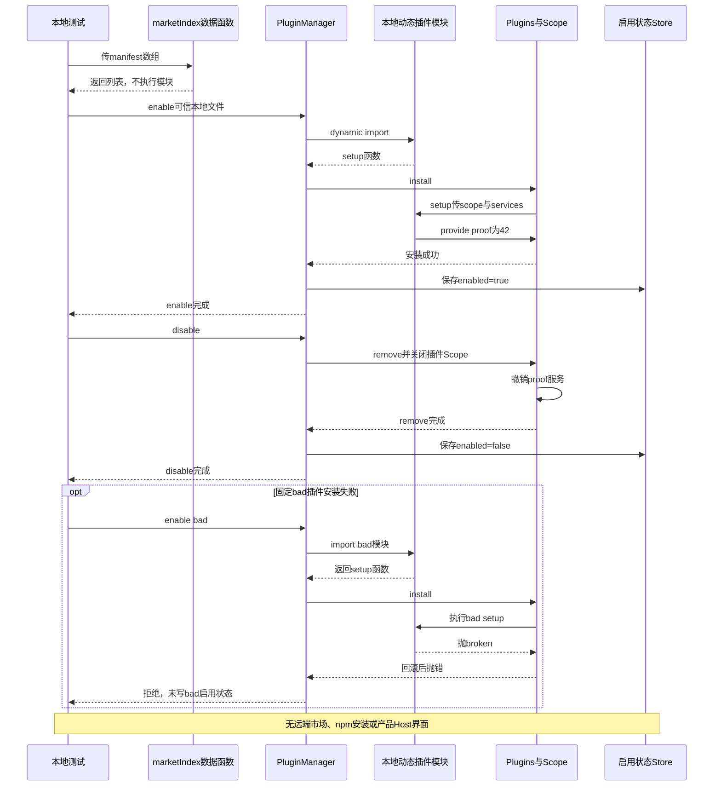

# 065 · 插件市场是数据，执行必须显式装配

阶段：R09。唯一前置：完成第 064 步，继续同一个工程。

<!-- harness-own-links:start -->
## 当前练习工程文件

以下链接指向 `harness-own` 的当前累计版本；本课下方的完整代码仍保留当步版本，二者可能不同。

[打开练习工程说明](../../../harness-own/README.md)

| 本课文件 | 当前练习工程文件 |
| --- | --- |
| `.vscode/launch.json` | 使用本页下方的本节专用配置，不复制累计版本 |
| `src/market.mjs` | [`harness-own/src/market.mjs`](../../../harness-own/src/market.mjs) |
| `tests/065-market.test.mjs` | [`harness-own/tests/065-market.test.mjs`](../../../harness-own/tests/065-market.test.mjs) |

<!-- harness-own-links:end -->

## 什么时候会用到这一页

市场列表里出现插件p不应该立即运行代码；用户显式启用一个可信本地插件后，它提供proof服务=42，禁用后服务应消失。若setup失败，持久配置不能错误地记为已启用。

### 这次数据怎么走

```text
marketIndex过滤/排序条目，仅返回数据；PluginManager.enable显式import本地模块 → Plugins.install执行setup → 成功后Store记录enabled；disable关闭插件Scope并修改状态，restore按Store重新启用。
```

### 对应时序图

从上往下读；实线箭头表示调用或发送，虚线箭头表示返回或事件通知。`opt`表示可选操作，`alt`表示不同结果，`loop`表示重复，`par`及其`and`分支表示并行；“未接入”及fixture说明按图中标注理解。



**当前接线位置：** PluginManager独立于产品Host和原来的Plugins装配，只被065测试使用；没有Web市场页面或CLI管理命令。后续没有npm/Git安装或原版Cordis profile兼容层。

## 这一步具体做什么

先写完market.mjs，再运行bun test ./tests/065-market.test.mjs。测试只在临时目录写两份固定插件：proof成功提供42，bad抛broken。按顺序确认enable后能get proof、disable后get拒绝、bad失败后Store没有bad。无需下载第三方插件或访问市场。

需要本章新文件的操作，先按下面代码创建文件，再执行；不要在上一步尚不存在的接口上试错。

## 代码为什么放在这一层

市场发现属于数据，执行属于用户明确安装的可信代码，二者不能混在一起。Plugins/Scope负责撤销运行贡献，Store记录重启要恢复什么；写enabled必须在setup成功之后。

## 本节调试：选什么、为什么、怎么启动

**建议先选：065：本节测试。** 每节的测试入口都固定到本节文件，不依赖编辑器当前打开的 `${file}`。

| 配置名称 | 什么时候选 | 实际入口或目标 | 能观察什么 |
| --- | --- | --- | --- |
| 065：本节测试 | 本节验收 | tests/065-market.test.mjs | 本节 Bun 测试进程；入口固定，不依赖当前编辑器文件。 |

### 调试路线：先启动谁，再启动谁

本节有 **1 个调试配置、1 条调试路线**。配置是启动或附加按钮；一条路线可能连续使用多个配置。请选择一条路线，不必把所有入口都启动。

| 路线 | 用哪些配置，按顺序 | 谁创建进程 | 结果在哪里看 |
| --- | --- | --- | --- |
| A 自动测试 | “065：本节测试” | F5的launch配置创建；子目标按下方步骤自动创建 | `tests/065-market.test.mjs`与下方列出的本章实现断点 |

先完成本节源码并安装[本节专用调试配置](#lesson-debug-config)。下面的路线只对应本节，不沿用前章端口或旧会话。

本章目前只有这一条已配置路线；源码中未接入测试或没有独立调试入口的能力，不因为后面存在同名模块就自动可调。

<details class="debug-route">
<summary>路线 A：自动测试——启动、断点和退出</summary>

1. 先打开`tests/065-market.test.mjs`及下方“具体断点和预期”列出的实现文件，设置本章断点。
2. 选择“065：本节测试”按F5，配置固定到本章测试；不需要先运行前章服务或CLI。
3. 测试直接驱动本章实现；在同一Bun调试会话内按F10/F11观察，不必另建服务会话。
4. 按下方本章观察点检查变量和断言；断点停顿可能触发实现自己的计时，必要时先继续完成当前调用。

**断点与观察位置：** `tests/065-market.test.mjs`与下方列出的本章实现断点

**结束方式：** 断言结束后测试退出；测试清理自己创建的资源。异常中止后检查本章临时进程，不把尚在等待当作测试通过。

</details>


**为什么这样启动：** 本节测试直接调用被测模块，选择这一项即可沿测试进入实现；前序 CLI 或其他语言入口不参与这次调试。

使用下方的[本节专用调试配置](#lesson-debug-config)。它只列本节可用目标；要保留个人配置，请先备份并按名称合并。页面上 `harness-own` 的累计文件链接供看当前工程，不是本节调试配置的答案。

1. VS Code 打开自己的 PROJECT；按本节创建源码与配置，断点设在 PROJECT 文件中。
2. 先用终端运行 `bun test ./tests/065-market.test.mjs` 确认普通验收，再选表中的配置按 F5。
3. 在下方具体观察点停住；F10 跨过当前语句，F11 只进入当前调试目标。异步等待涉及另一进程时，切换调试会话并继续对端。
4. 变量要在所属调用帧查看；看测试局部变量时选测试帧，看 this 和参数时选实现方法帧。

<details class="debug-details">
<summary>展开本节具体断点和预期</summary>

1. 打开tests/065-market.test.mjs用“065：本节测试”启动，断在src/market.mjs的await import、await this.runtime.install和this.store.update。

2. 监视name、module.setup类型及manager.runtime.services.get('proof')。

3. F11进入临时插件setup，返回后F10看enabled提交。

4. bad应在Store更新前抛错。

5. disable后服务查找应报缺少。

6. import的本地插件仍在当前Bun进程，不是隔离沙箱。

</details>

暂停断点会影响应用自身的 RPC、取消、进程和网络计时。Bun 测试超时放宽不等于这些计时也被关闭；按本节说明分别设置，普通验收恢复原有时限。

观察完成后退出本节启动的调试会话和进程，再运行 `bun test ./tests/065-market.test.mjs`。测试通过只证明本节断言，不代表所有 GUI、外部服务或发布过程均已验证。

## 在哪里写、写什么

操作地点：终端中的 `$PROJECT`，编辑器打开同一个目录。只创建或替换下列文件，其他文件保留上一步版本。文件目录不存在先创建。

```sh
mkdir -p .vscode
```

<a id="lesson-debug-config"></a>

下面是本节专用调试配置，只包含本节入口。program 已固定到本节文件；不是 harness-own 的累计配置。

### 替换 `.vscode/launch.json`

````json
{
  "version": "0.2.0",
  "configurations": [
    {
      "name": "065：本节测试",
      "type": "bun",
      "request": "launch",
      "program": "${workspaceFolder}/tests/065-market.test.mjs",
      "cwd": "${workspaceFolder}",
      "runtime": "bun",
      "runtimeArgs": [
        "test",
        "--preload",
        "${workspaceFolder}/scripts/vscode-debug.mjs",
        "--timeout",
        "3600000"
      ],
      "stopOnEntry": false
    }
  ]
}
````

```sh
mkdir -p src
```

### 创建 [`src/market.mjs`](../../../harness-own/src/market.mjs)

````javascript
import { Plugins } from './plugins.mjs'
import { Store } from './storage.mjs'
import { pathToFileURL } from 'node:url'
import { resolve } from 'node:path'

/** 市场索引是数据，不因为远端声称有插件就自动执行包内代码。 */
export function marketIndex(manifests) {
  return manifests.filter(manifest => manifest.name && manifest.version && manifest.harness?.entry)
    .map(manifest => ({ name: manifest.name, version: manifest.version, description: manifest.description ?? '', entry: manifest.harness.entry }))
    .sort((a, b) => a.name.localeCompare(b.name))
}

/** 显式安装可信本地插件，只有setup成功后才提交启用状态。 */
export class PluginManager {
  constructor(path) { this.store = new Store(path); this.runtime = new Plugins() }
  async enable(name, file, config = {}) {
    const module = await import(pathToFileURL(resolve(file)).href + '?generation=' + Date.now())
    if (typeof module.setup !== 'function') throw Error('插件缺少setup')
    await this.runtime.install(name, context => module.setup(context, config))
    this.store.update(value => ({ ...value, [name]: { file: resolve(file), config, enabled: true } }))
  }
  async disable(name) { await this.runtime.remove(name); this.store.update(value => { if (value[name]) value[name].enabled = false; return value }) }
  async restore() { for (const [name, row] of Object.entries(this.store.read())) if (row.enabled) await this.enable(name, row.file, row.config) }
  async close() { await this.runtime.close() }
}
````

```sh
mkdir -p tests
```

### 创建 [`tests/065-market.test.mjs`](../../../harness-own/tests/065-market.test.mjs)

````javascript
import { test } from 'bun:test'
import assert from 'node:assert/strict'
import { mkdtempSync, writeFileSync, rmSync } from 'node:fs'
import { tmpdir } from 'node:os'
import { join } from 'node:path'
import { PluginManager, marketIndex } from '../src/market.mjs'

test('真实动态import插件、服务撤销和失败状态不提交', async () => {
  const root = mkdtempSync(join(tmpdir(), 'own-market-')), manager = new PluginManager(join(root, 'plugins.json'))
  try {
    const file = join(root, 'plugin.mjs')
    writeFileSync(file, 'export function setup({scope,services}){services.provide(scope,"proof",42)}')
    await manager.enable('proof', file)
    assert.equal(manager.runtime.services.get('proof'), 42)
    await manager.disable('proof'); assert.throws(() => manager.runtime.services.get('proof'), /缺少/)
    writeFileSync(join(root, 'bad.mjs'), 'export function setup(){throw Error("broken")}')
    await assert.rejects(manager.enable('bad', join(root, 'bad.mjs')), /broken/)
    assert.equal(manager.store.read().bad, undefined)
    assert.equal(marketIndex([{ name: 'p', version: '1', harness: { entry: './plugin.mjs' } }]).length, 1)
  } finally { await manager.close(); rmSync(root, { recursive: true, force: true }) }
})
````

## 运行命令与通过标准

```sh
cd "$PROJECT"
bun test ./tests/065-market.test.mjs
bun test
```

测试实际动态import本地模块、撤销服务和拒绝失败setup状态，另检查一个marketIndex条目。没有远程索引、下载安装、兼容检查、真实UI、重启restore或旧版本更新失败回滚测试。

**本步证据的范围：** tests/065-market.test.mjs读写真实临时文件并真实import，代码完全由测试固定生成；无外网、npm安装或模型。当前只有本地生命周期证据，不是完整市场安装验收。

## 不看答案，确认自己能解释

闭卷写出列出、下载、安装、启用、禁用、恢复六个动作，圈出本章实际实现了哪些；再说明为什么禁用Scope和写enabled=false都需要做。

完成后在 LEARNING.md 写一句实际结果和一个卡点。明天只重做这个卡点；第 3 天、第 7 天再做一次，能独立完成就继续下一页，不另开学习路线。

**再改一个条件验证：** 练习：给临时插件增加一次setup日志，并在仅调用marketIndex时断言日志没有出现。只使用测试自建模块；当前未写这个变体，不安装来历不明插件。

## 与当前原版还差哪些

对照本仓库固定原版 `687f282e8625c6b8d11ff58211a90524be2e4317`；这里的“当前”指该本地基线，不是未经检查的上游最新版。

**这一页已经实现：**

- 从输入manifest构造简单市场条目，不自动执行模块。
- 显式启用可信本地文件、动态import、setup成功后记录状态。
- 通过Plugins卸载Scope贡献并提供基础restore方法。

**原版仍有、或本步尚未对齐的部分：**

- 原版市场源注册、HTTP下载与缓存、索引格式/搜索、版本兼容和安装状态计算未实现。
- 原版plugin-manager处理npm/Git、构建审批、Loader/profile变更和安装错误；本章仅本地文件import。
- 同名更新失败保留旧运行实例的事务语义未具备，restore也未测试。
- 插件代码运行在Host进程，不能把动态import称为权限沙箱。

**原版对照位置：**

- [packages/boot/plugin-market/src/index.ts](../../../deepseek-harness/packages/boot/plugin-market/src/index.ts)
- [packages/boot/plugin-market/src/search.ts](../../../deepseek-harness/packages/boot/plugin-market/src/search.ts)
- [packages/boot/plugin-market/src/parse.ts](../../../deepseek-harness/packages/boot/plugin-market/src/parse.ts)
- [packages/boot/plugin-manager/src/index.ts](../../../deepseek-harness/packages/boot/plugin-manager/src/index.ts)
- [packages/boot/plugin-manager/src/operations.ts](../../../deepseek-harness/packages/boot/plugin-manager/src/operations.ts)

本步测试通过只证明上面的具体行为；完整差距仍看 [COVERAGE.md](../COVERAGE.md)，不以文件数量、同名类或后面出现另一个模块代替接线证据。

下一步：[第 066 步](066.md)
