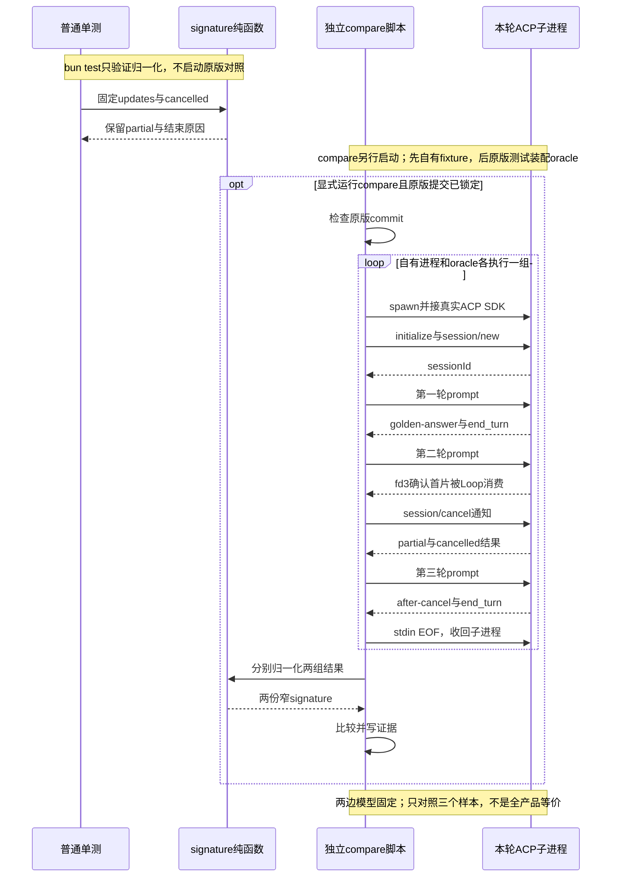

# 067 · 让固定原版和自己的ACP跑同一组样本

阶段：R09。唯一前置：完成第 066 步，继续同一个工程。

## 什么时候会用到这一页

完成自己的ACP后，不能凭文件名相似宣称兼容。先用同样三轮输入，比较固定文字正常结束、首片后取消、取消后同会话继续；差一个partial或停止原因都应被发现。

### 这次数据怎么走

```text
compare-acp分别spawn自己的fixture和原版oracle进程 → 真实ACP SDK客户端发送相同prompt → 固定模型的fd3通知首片已被消费 → 发cancel → 收集updates/stopReason → signature保留文字与结束原因 → 写对照证据。原版只在oracle中加载，不进入自己的产品。
```

### 对应时序图

从上往下读；实线箭头表示调用或发送，虚线箭头表示返回或事件通知。`opt`表示可选操作，`alt`表示不同结果，`loop`表示重复，`par`及其`and`分支表示并行；“未接入”及fixture说明按图中标注理解。



**当前接线位置：**这是独立验收脚本，不是新增业务能力。自己的fixture实际使用Host/Loop/acpApp；oracle导入原版tests/harness.ts并包ACP传输，不等同直接启动原版发布profile。后续068/069也不会让三个样本变成全量契约证明。

## 这一步具体做什么

先写完本章脚本与fixture，再运行bun test ./tests/067-comparison.test.mjs；这一步只测signature函数。真正差分另运行HARNESS_ORACLE_SOURCE=/你的固定原版绝对目录 env -u DEEPSEEK_API_KEY bun scripts/compare-acp.mjs，前提是原版目录为锁定687f282提交并已具备所需依赖。缺原版时明确记未运行，不能把单测绿色当真实差分通过；固定模型不会调用收费服务。

需要本章新文件的操作，先按下面代码创建文件，再执行；不要在上一步尚不存在的接口上试错。

## 代码为什么放在这一层

signature只删除本组样本允许忽略的随机身份，不应过滤partial或cancelled。fd3是测试专用屏障，用事实通知何时取消，避免sleep碰时机。对照样本越窄，结论就必须越窄。

## 在哪里写、写什么

操作地点：终端中的 `$PROJECT`，编辑器打开同一个目录。只创建或替换下列文件，其他文件保留上一步版本。文件目录不存在先创建。

```sh
mkdir -p scripts
```

### 创建 `scripts/compare-acp.mjs`

````javascript
import { spawn, execFileSync } from 'node:child_process'
import { once } from 'node:events'
import { Readable, Writable } from 'node:stream'
import { resolve, join } from 'node:path'
import { pathToFileURL } from 'node:url'
import { mkdtempSync, rmSync, writeFileSync, mkdirSync, readFileSync } from 'node:fs'
import { tmpdir } from 'node:os'
import { setTimeout as delay } from 'node:timers/promises'
import * as acp from '@agentclientprotocol/sdk'

/** 只规范化本组样本允许忽略的身份；停止原因与提交文字不能过滤。 */
export function signature(updates, endings) {
  return { messages: updates.filter(value => value.update.sessionUpdate === 'agent_message_chunk').map(value => value.update.content.text), endings }
}

/** 两边都是外部进程和真实ACP SDK连接；模型输入完全固定。 */
async function scenario(command, args, cwd, environment) {
  const home = mkdtempSync(join(tmpdir(), 'own-diff-')), child = spawn(command, args, { cwd, env: { ...environment, HARNESS_HOME: home }, stdio: ['pipe', 'pipe', 'pipe', 'pipe'] }), exited = once(child, 'close'), updates = [], endings = []
  // 固定模型的独立测试通道确认首片已被Loop消费，取消不依赖随意sleep。
  const firstPartial = once(child.stdio[3], 'data')
  let errors = ''; child.stderr.on('data', bytes => { errors = (errors + bytes.toString()).slice(-8000) })
  const app = acp.client({ name: 'differential-sample' }).onNotification('session/update', ctx => { updates.push(ctx.params) })
  const connection = app.connect(acp.ndJsonStream(Writable.toWeb(child.stdin), Readable.toWeb(child.stdout))), client = connection.agent
  try {
    await client.request(acp.methods.agent.initialize, { protocolVersion: acp.PROTOCOL_VERSION, clientCapabilities: {} })
    const session = await client.request(acp.methods.agent.session.new, { cwd: home, mcpServers: [] })
    const prompt = text => client.request(acp.methods.agent.session.prompt, { sessionId: session.sessionId, prompt: [{ type: 'text', text }] })
    endings.push((await prompt('one')).stopReason)
    const slow = prompt('two'); await firstPartial; await client.notify(acp.methods.agent.session.cancel, { sessionId: session.sessionId }); endings.push((await slow).stopReason)
    endings.push((await prompt('three')).stopReason)
    return { signature: signature(updates, endings), rawUpdates: updates }
  } catch (error) { throw Error(error.message + '\n' + errors) }
  finally { child.stdin.end(); const force = setTimeout(() => child.kill('SIGKILL'), 5000); await exited; clearTimeout(force); rmSync(home, { recursive: true, force: true }) }
}

if (process.argv[1] && import.meta.url === pathToFileURL(process.argv[1]).href) {
  const source = process.env.HARNESS_ORACLE_SOURCE
  if (!source) throw Error('先设置HARNESS_ORACLE_SOURCE，禁止缺原版时假装通过')
  let pinned
  try { pinned = execFileSync('git', ['rev-parse', 'HEAD'], { cwd: source, encoding: 'utf8', stdio: ['ignore', 'pipe', 'ignore'] }).trim() }
  catch { pinned = JSON.parse(readFileSync(resolve(source, '.replica-course.json'), 'utf8')).commit }
  if (pinned !== '687f282e8625c6b8d11ff58211a90524be2e4317') throw Error('原版目录不是锁定提交')
  const own = await scenario(process.execPath, [resolve('tests/fixtures/own-acp.mjs')], process.cwd(), process.env)
  const oracle = await scenario(process.execPath, [resolve('scripts/oracle-acp.mjs')], source, process.env)
  const equal = JSON.stringify(own.signature) === JSON.stringify(oracle.signature)
  mkdirSync('.evidence', { recursive: true })
  writeFileSync('.evidence/acp-comparison.json', JSON.stringify({ baseline: '687f282e8625c6b8d11ff58211a90524be2e4317', scope: '仅固定文字、取消、取消后继续三个ACP样本；不是全产品等价', equal, own, oracle }, null, 2))
  console.log(JSON.stringify({ equal, signature: own.signature }, null, 2))
  if (!equal) process.exitCode = 1
}
````

```sh
mkdir -p scripts
```

### 创建 `scripts/oracle-acp.mjs`

````javascript
import { resolve } from 'node:path'
import { pathToFileURL } from 'node:url'
import { Readable, Writable } from 'node:stream'
import * as acp from '@agentclientprotocol/sdk'
import { writeSync } from 'node:fs'

// 这个文件只属于对照进程：导入原版测试装配，绝不能进入自己的产品构建。
if (!process.env.HARNESS_ORACLE_SOURCE) throw Error('需要显式指定锁定原版目录')
const source = resolve(process.env.HARNESS_ORACLE_SOURCE)
const { makeBridgeHarness, textResponse } = await import(pathToFileURL(resolve(source, 'packages/acp/acp/tests/harness.ts')).href)
const original = await makeBridgeHarness({ script: [textResponse('golden-answer'), 'hang', textResponse('after-cancel')] })
const modelStream = original.adapter.stream.bind(original.adapter)
original.adapter.stream = async function* (request) {
  for await (const chunk of modelStream(request)) { yield chunk; if (chunk.type === 'text-delta' && chunk.text === 'partial') writeSync(3, 'partial-consumed\n') }
}
const peers = new Map()
let delivery = Promise.resolve()
const push = original.sessionUpdates.push.bind(original.sessionUpdates)
original.sessionUpdates.push = (...items) => {
  const length = push(...items)
  for (const item of items) delivery = delivery.then(() => peers.get(item.sessionId)?.notify(acp.methods.client.session.update, item))
  return length
}
original.onPermission = params => peers.get(params.sessionId).request(acp.methods.client.session.requestPermission, params)
const app = acp.agent({ name: 'fixed-upstream-oracle' })
app.onRequest('initialize', ctx => original.client.initialize(ctx.params))
app.onRequest('authenticate', ctx => original.client.authenticate(ctx.params))
app.onRequest('session/new', async ctx => { const result = await original.client.newSession(ctx.params); peers.set(result.sessionId, ctx.client); return result })
app.onRequest('session/prompt', async ctx => { const result = await original.client.prompt(ctx.params); await delivery; return result })
app.onNotification('session/cancel', ctx => original.client.cancel(ctx.params))
app.onRequest('session/list', ctx => original.client.listSessions(ctx.params))
app.onRequest('session/close', ctx => original.client.closeSession(ctx.params))
app.onRequest('session/resume', ctx => original.client.resumeSession(ctx.params))
const connection = app.connect(acp.ndJsonStream(Writable.toWeb(process.stdout), Readable.toWeb(process.stdin)))
try { await connection.closed } finally { await original.dispose() }
````

```sh
mkdir -p tests
```

### 创建 `tests/067-comparison.test.mjs`

````javascript
import { test } from 'bun:test'
import assert from 'node:assert/strict'
import { signature } from '../scripts/compare-acp.mjs'

test('差分只删除随机身份，不吞掉cancelled或partial', () => {
  const result = signature([{ sessionId: 'random', update: { sessionUpdate: 'agent_message_chunk', messageId: 'random', content: { text: 'partial' } } }, { update: { sessionUpdate: 'usage_update' } }], ['cancelled'])
  assert.deepEqual(result, { messages: ['partial'], endings: ['cancelled'] })
})
````

```sh
mkdir -p tests/fixtures
```

### 创建 `tests/fixtures/own-acp.mjs`

````javascript
import { Readable, Writable } from 'node:stream'
import { ndJsonStream } from '@agentclientprotocol/sdk'
import { Host } from '../../src/host.mjs'
import { ScriptModel, answer } from '../../src/model.mjs'
import { acpApp } from '../../src/acp.mjs'
import { writeSync } from 'node:fs'

// 只替换外部模型，自己的Host/Loop/ACP实现全部真实执行。
const host = new Host(process.env.HARNESS_HOME, () => {
  const model = new ScriptModel([answer('golden-answer'), 'hang', answer('after-cancel')]), stream = model.stream.bind(model)
  model.stream = async function* (request) {
    for await (const part of stream(request)) { yield part; if (part.kind === 'text' && part.text === 'partial') writeSync(3, 'partial-consumed\n') }
  }
  return model
})
const connection = acpApp(host).connect(ndJsonStream(Writable.toWeb(process.stdout), Readable.toWeb(process.stdin)))
try { await connection.closed } finally { await host.close() }
````

## 运行命令与通过标准

```sh
cd "$PROJECT"
bun test ./tests/067-comparison.test.mjs
# 固定原版已安装依赖后：HARNESS_ORACLE_SOURCE="原版绝对目录" bun scripts/compare-acp.mjs
bun test
```

普通test只断言signature保留partial/cancelled并忽略usage类型。compare脚本才跑两边真实ACP进程和三轮固定模型；即使equal=true，也只证明文字chunk序列和三个stopReason相同，不证明全部API、工具、审批、UI或数据格式。

**本步证据的范围：**tests/067-comparison.test.mjs是纯函数单测；scripts/compare-acp.mjs才生成.evidence/acp-comparison.json。课程已有历史对照证据也仅覆盖锁定基线的三个样本，本次文档改写未重新运行oracle，不扩大历史结论。

## VS Code：断在哪里、看什么

先用“Bun：当前测试”调tests/067-comparison.test.mjs，断在scripts/compare-acp.mjs的signature，监视updates和endings，F10确认partial与cancelled未丢。调真实比较器时在VS Code给该脚本建立Bun入口并传HARNESS_ORACLE_SOURCE，断在await firstPartial及JSON比较；监视own.signature、oracle.signature、equal。F10跨进程等待；F11不会进入own-acp/oracle子进程，原版测试装配不是当前会话的同进程调用。

操作位置：VS Code 打开的是自己的 `$PROJECT`，断点也设在这里的源码，不在教材的 `steps` 目录。

上面的说明若指定CLI、子进程、页面或Electron附加调试，就先按该流程操作；下面这组步骤只用于本章测试入口。“当前测试”不会自动附加子进程，也不会命中浏览器或Electron中的断点。

变量只在所属作用域可见：停在方法内部时看this和参数；要看测试里的局部变量，先在“调用堆栈”选择对应测试帧。正在等待的异步调用者不一定保留可求值的帧，此时在测试调用前后加断点再看，不把未定义误判成业务状态丢失。

沿用第 000 步安装的 Bun 扩展与 `.vscode/launch.json`；本章列出替换配置时，使用本章完整版本。

1. 打开本步测试文件 `tests/067-comparison.test.mjs`，保持它为当前编辑器文件。
2. 在上面指定的函数内单击行号左侧设置断点。
3. “运行和调试”选择 **Bun：当前测试**，按 F5；它执行当前测试，工作目录固定为 PROJECT。
4. 在“变量 / 监视 / 调用堆栈 / 调试控制台”检查状态；F10 逐行执行，F11 进入函数，Shift+F11 返回，F5 继续，Shift+F5 停止。

验收：断点实际命中，能说出当前输入、状态和下一步；只看到进程启动不算完成。长时间暂停会影响真实取消、审批和网络超时，先检查时序，不删超时断言。修正后在集成终端运行 `bun test ./tests/067-comparison.test.mjs`，再运行 `bun test`，保留全部断言。

## 不看答案，确认自己能解释

闭卷写三轮输入的预期消息和stopReason，写出“普通test”和“真正compare”两个命令各启动几个外部ACP进程，并列出equal=true仍未证明的三项能力。

完成后在 LEARNING.md 写一句实际结果和一个卡点。明天只重做这个卡点；第 3 天、第 7 天再做一次，能独立完成就继续下一页，不另开学习路线。

**再改一个条件验证：**练习：仅在signature单测中把endings改成end_turn，预测与cancelled期望不等；再恢复。双会话、审批失败、工具调用样本需要另写并实跑，当前没有这些样本，不能按愿望扩展通过范围。

## 与当前原版还差哪些

对照本仓库固定原版 `687f282e8625c6b8d11ff58211a90524be2e4317`；这里的“当前”指该本地基线，不是未经检查的上游最新版。

**这一页已经实现：**

- 锁定原版提交，分别启动自己的ACP和原版oracle外部进程。
- 固定模型三轮样本，首片消费屏障和取消后继续。
- 保留partial与停止原因的窄signature比较，输出rawUpdates和范围说明。

**原版仍有、或本步尚未对齐的部分：**

- 没有全量ACP输入/输出、配置、MCP、审批、图片、资源链接、并发与故障矩阵。
- signature不比较usage/thought/tools/permissions等，本组样本也没有覆盖它们。
- oracle依赖原版测试装配，不能据此宣称原版发布profile、打包和完整产品对齐。
- 自有Web/Typert、V4数据、全部工具、平台和发布资格仍需逐项实现与验证。

**原版对照位置：**

- [packages/acp/acp/tests/harness.ts](../../../deepseek-harness/packages/acp/acp/tests/harness.ts)
- [packages/acp/acp/src/index.ts](../../../deepseek-harness/packages/acp/acp/src/index.ts)
- [packages/acp/acp/src/session.ts](../../../deepseek-harness/packages/acp/acp/src/session.ts)
- [packages/acp/acp/src/updates.ts](../../../deepseek-harness/packages/acp/acp/src/updates.ts)

本步测试通过只证明上面的具体行为；完整差距仍看 [COVERAGE.md](../COVERAGE.md)，不以文件数量、同名类或后面出现另一个模块代替接线证据。

下一步：[第 068 步](068.md)

## 原版只在这一步进入独立对照目录

你当前环境已有原版 checkout。以下命令在终端执行，自己的 PROJECT 始终保持独立：

```sh
export ORACLE="/Users/yhding/ws/github.com/deepseek-harness-demo/deepseek-harness"
git -C "$ORACLE" rev-parse HEAD
```

输出必须为 `687f282e8625c6b8d11ff58211a90524be2e4317`。原版对照目录仍遵守上游 pnpm 11.28.5 锁；通过 Bun 执行该工具，仅用于准备上游对照，在原版目录安装，不能把其 node_modules 链接到 PROJECT：

```sh
cd "$ORACLE"
bun x --bun pnpm@11.28.5 install --frozen-lockfile --ignore-scripts
cd "$PROJECT"
HARNESS_ORACLE_SOURCE="$ORACLE" bun scripts/compare-acp.mjs
cat .evidence/acp-comparison.json
```

应得到 `equal: true`，停止原因依次 end_turn、cancelled、end_turn；messages 中保留 golden-answer、partial、after-cancel。缺原版、缺依赖、协议失败或语义不同都不能记通过。

`scripts/oracle-acp.mjs` 只属于测试 oracle，它装配原版真实 Loop/ACP 并固定外部模型。产品代码没有导入它。三个样本相同只是开始；不要删除 COVERAGE 中其他原版要求，或把比较器的过滤规则改到“总能相同”。
