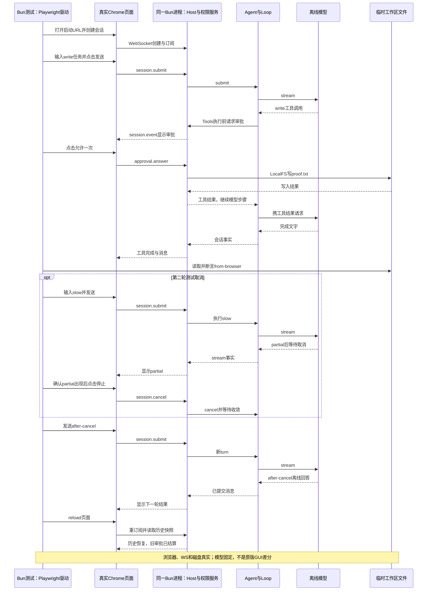
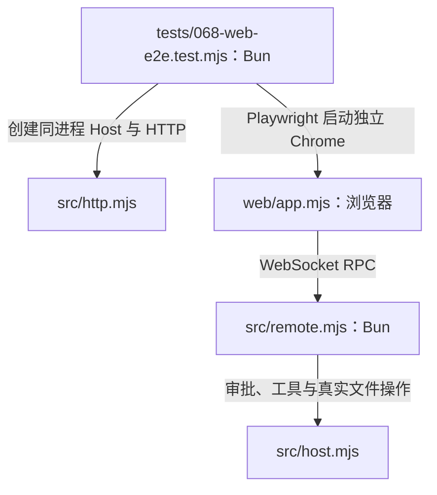
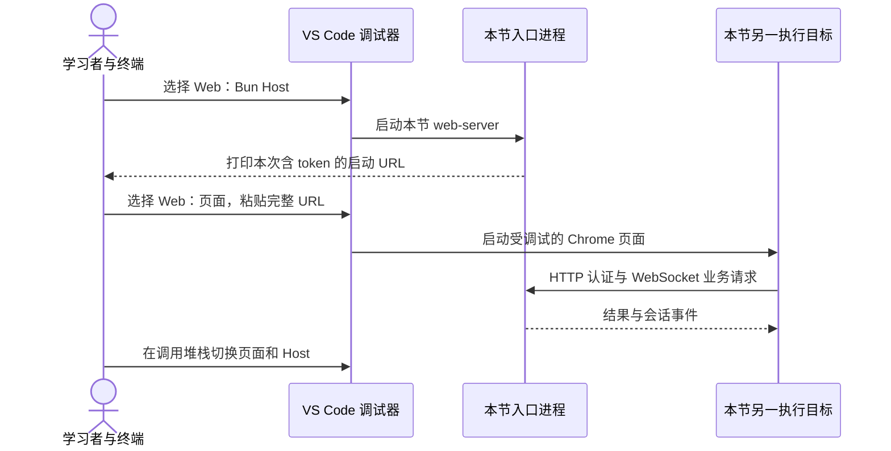

# 068 · 最后亲自贯通浏览器与真实文件

阶段：R09。唯一前置：完成第 067 步，继续同一个工程。

<!-- harness-own-links:start -->
## 当前练习工程文件

以下链接指向 `harness-own` 的当前累计版本；本课下方的完整代码仍保留当步版本，二者可能不同。

[打开练习工程说明](../../../harness-own/README.md)

| 本课文件 | 当前练习工程文件 |
| --- | --- |
| `.vscode/launch.json` | 使用本页下方的本节专用配置，不复制累计版本 |
| `tests/068-web-e2e.test.mjs` | 尚未合入 harness-own |

<!-- harness-own-links:end -->

## 什么时候会用到这一页

用户在真实页面批准写proof.txt，收到partial后点击停止，再发after-cancel，刷新后历史还在且旧审批按钮不复活。只有浏览器按钮、宿主、磁盘一起通过，才能证明这条产品主线接通。

### 这次数据怎么走

```text
真实Chrome页面 → WebSocket RPC → Remote → product/capabilities装配的Host → OfflineModel/Agent/权限/LocalFS → 真实Session日志与磁盘 → 通知/快照 → View/render；刷新后重新订阅同一会话。
```

### 对应时序图

从上往下读；实线箭头表示调用或发送，虚线箭头表示返回或事件通知。`opt`表示可选操作，`alt`表示不同结果，`loop`表示重复，`par`及其`and`分支表示并行；“未接入”及fixture说明按图中标注理解。



**当前接线位置：** 本章真实贯通049/050页面、047传输和051装配，没有换用假的按钮函数。浏览器辅助模块用于测试自己的网页，不等于给Agent注册了059 Browser/CUA工具。

## 先看目录与调用关系

目录只列本节文件及图中直接用到的前置实现；不是累计工程的完整文件清单。

```text
PROJECT/
├── .vscode/
│   └── launch.json  # 本节创建或替换
├── src/
│   ├── host.mjs  # 沿用前置实现
│   ├── http.mjs  # 沿用前置实现
│   └── remote.mjs  # 沿用前置实现
├── tests/
│   └── 068-web-e2e.test.mjs  # 本节创建或替换
└── web/
    └── app.mjs  # 沿用前置实现
```

### 本节入口怎样调用这些文件

箭头写明实际调用或进程启动；标为“未接入”的文件不是本节测试能命中的目标。




## 这一步具体做什么

先写完本章测试，保持此前页面和Host代码，运行env -u DEEPSEEK_API_KEY bun test ./tests/068-web-e2e.test.mjs。测试会开隔离headless Chrome：创建会话、发送write、点允许一次、验证proof.txt；再等partial出现点cancel，发送after-cancel并reload。不要在个人浏览器或日常数据目录运行替代步骤。

需要本章新文件的操作，先按下面代码创建文件，再执行；不要在上一步尚不存在的接口上试错。

## 代码为什么放在这一层

这次验证不直接调用按钮后面的函数，而是经过真实DOM操作和WebSocket。外部模型固定只消除不确定性，权限、文件和持久化仍实际执行；因此能定位产品接线错误，但不能证明真实模型回答质量。

## 本节调试：选什么、为什么、怎么启动

**建议先选：068：本节测试。** 每节的测试入口都固定到本节文件，不依赖编辑器当前打开的 `${file}`。

| 配置名称 | 什么时候选 | 实际入口或目标 | 能观察什么 |
| --- | --- | --- | --- |
| 068：本节测试 | 本节验收 | tests/068-web-e2e.test.mjs | 本节 Bun 测试进程；入口固定，不依赖当前编辑器文件。 |
| Web：Bun Host | 本节手工 Web 操作 | src/web-server.mjs | Host、Remote 与 Agent 的 Bun 调试会话。 |
| Web：页面 | 本节手工 Web 操作 | web/app.mjs | 浏览器 JS 会话，必须使用本次 Host 的 URL。 |

**为什么这样启动：** 页面代码与 Host 代码在两个运行时。先启动 Host 获得动态端口和 token，再启动页面；从页面 F11 不能直接跳到服务端。固定测试只证明该测试实际覆盖的行为。 自动测试把 Host 与 Playwright 客户端装在测试进程，另起 Chrome；手动页面配置不是它的那个浏览器。

使用下方的[本节专用调试配置](#lesson-debug-config)。它只列本节可用目标；要保留个人配置，请先备份并按名称合并。页面上 `harness-own` 的累计文件链接供看当前工程，不是本节调试配置的答案。

1. VS Code 打开自己的 PROJECT；按本节创建源码与配置，断点设在 PROJECT 文件中。
2. 先用终端运行 `bun test ./tests/068-web-e2e.test.mjs` 确认普通验收，再选表中的配置按 F5。
3. 在下方具体观察点停住；F10 跨过当前语句，F11 只进入当前调试目标。异步等待涉及另一进程时，切换调试会话并继续对端。
4. 变量要在所属调用帧查看；看测试局部变量时选测试帧，看 this 和参数时选实现方法帧。

**本节具体断点和预期：** 手工观察用049的“Web：Bun Host”与“Web：页面”两个VS Code会话，断页面web/app.mjs的rpc/render、Host的src/permissions.mjs审批分支和src/loop.mjs的工具执行；沿sessionId、toolCallId与approvalId核对同一次write。F10页面发送后切到Host，F11进入Tools/LocalFS，磁盘应出现from-browser；/slow后等stream=partial再取消。若调自动测试，打开tests/068-web-e2e.test.mjs用“068：本节测试”，可停Host与Playwright客户端，但它另开Chrome，不会自动命中“Web：页面”会话。

### 本节启动前置

- 自动 E2E 需要可用的本机 Chrome；它另开浏览器，与手工 Web：页面会话分开，不能声称已附加自动测试的浏览器。

### 本节调试启动时序

这张图解释如何创建并连接调试目标；上面的业务时序图解释任务本身怎样执行。



暂停断点会影响应用自身的 RPC、取消、进程和网络计时。Bun 测试超时放宽不等于这些计时也被关闭；按本节说明分别设置，普通验收恢复原有时限。

观察完成后退出本节启动的调试会话和进程，再运行 `bun test ./tests/068-web-e2e.test.mjs`。测试通过只证明本节断言，不代表所有 GUI、外部服务或发布过程均已验证。

## 在哪里写、写什么

操作地点：终端中的 `$PROJECT`，编辑器打开同一个目录。只创建或替换下列文件，其他文件保留上一步版本。文件目录不存在先创建。

```sh
mkdir -p .vscode
```

<a id="lesson-debug-config"></a>

下面是本节专用调试配置，只包含本节入口。program 已固定到本节文件；不是 harness-own 的累计配置。

### 替换 `.vscode/launch.json`

````json
{
  "version": "0.2.0",
  "configurations": [
    {
      "name": "068：本节测试",
      "type": "bun",
      "request": "launch",
      "program": "${workspaceFolder}/tests/068-web-e2e.test.mjs",
      "cwd": "${workspaceFolder}",
      "runtime": "bun",
      "runtimeArgs": [
        "test",
        "--preload",
        "${workspaceFolder}/scripts/vscode-debug.mjs",
        "--timeout",
        "3600000"
      ],
      "stopOnEntry": false
    },
    {
      "name": "Web：Bun Host",
      "type": "bun",
      "request": "launch",
      "program": "${workspaceFolder}/src/web-server.mjs",
      "cwd": "${workspaceFolder}",
      "runtime": "bun",
      "runtimeArgs": [
        "--preload",
        "${workspaceFolder}/scripts/vscode-debug.mjs"
      ],
      "stopOnEntry": false,
      "env": {
        "HARNESS_HOME": "${workspaceFolder}/.data-web",
        "HARNESS_PORT": "0"
      }
    },
    {
      "name": "Web：页面",
      "type": "chrome",
      "request": "launch",
      "url": "${input:webBootstrapUrl}",
      "webRoot": "${workspaceFolder}/web",
      "pathMapping": {
        "/view.mjs": "${workspaceFolder}/src/view.mjs"
      }
    }
  ],
  "inputs": [
    {
      "id": "webBootstrapUrl",
      "type": "promptString",
      "description": "粘贴本次 Host 输出的完整 http://127.0.0.1:端口/?token=... 地址"
    }
  ]
}
````

```sh
mkdir -p tests
```

### 创建 `tests/068-web-e2e.test.mjs`

````javascript
import { test } from 'bun:test'
import assert from 'node:assert/strict'
import { mkdtempSync, readFileSync, rmSync } from 'node:fs'
import { join } from 'node:path'
import { tmpdir } from 'node:os'
import { Host } from '../src/host.mjs'
import { product } from '../src/product.mjs'
import { capabilities } from '../src/capabilities.mjs'
import { startHTTP } from '../src/http.mjs'
import { browser } from '../src/browser.mjs'
import { Scope } from '../src/scope.mjs'

test('真正浏览器操作同一Host：审批写文件、首片取消、下一轮、刷新恢复', async () => {
  const root = mkdtempSync(join(tmpdir(), 'own-web-e2e-')), host = new Host(root), scope = new Scope()
  product(host); capabilities(host)
  const web = await startHTTP(host)
  try {
    const executable = process.env.HARNESS_CHROME ?? (process.platform === 'darwin' ? '/Applications/Google Chrome.app/Contents/MacOS/Google Chrome' : process.platform === 'win32' ? 'C:\\Program Files\\Google\\Chrome\\Application\\chrome.exe' : '/usr/bin/google-chrome')
    const app = await browser(scope, executable, { allowLocal: true }), page = app.page
    const pageErrors = []; page.on('pageerror', error => pageErrors.push(error.message))
    await page.goto(web.bootstrap)
    await page.locator('#cwd').fill(root)
    await page.waitForFunction(() => document.querySelector('#connection').textContent === '已连接')
    await page.locator('#create').click()
    await page.waitForFunction(() => document.querySelector('#title').textContent.startsWith('session_'))
    await page.locator('#prompt').fill('/tool write {"path":"proof.txt","text":"from-browser"}')
    await page.locator('#send').click()
    await page.getByRole('button', { name: '允许一次', exact: true }).click()
    await page.waitForFunction(() => document.querySelector('#tools').textContent.includes('completed'))
    assert.equal(readFileSync(join(root, 'proof.txt'), 'utf8'), 'from-browser')
    await page.locator('#prompt').fill('/slow'); await page.locator('#send').click()
    await page.waitForFunction(() => document.querySelector('#stream').textContent === 'partial')
    await page.locator('#cancel').click()
    await page.locator('#prompt').fill('after-cancel'); await page.locator('#send').click()
    await page.waitForFunction(() => document.querySelector('#messages').textContent.includes('[离线演示] after-cancel'))
    await page.reload()
    await page.waitForFunction(() => document.querySelector('#messages').textContent.includes('[离线演示] after-cancel'))
    assert.equal(await page.getByRole('button', { name: '允许一次', exact: true }).count(), 0)
    assert.deepEqual(pageErrors, [])
  } finally { await scope.close(); await web.close(); await host.close(); rmSync(root, { recursive: true, force: true }) }
}, 30_000)
````

## 运行命令与通过标准

```sh
cd "$PROJECT"
bun test ./tests/068-web-e2e.test.mjs
bun test
```

测试验证真实浏览器写文件、首片后取消、下一轮、刷新恢复、不复活旧审批及无pageerror。没有拒绝审批、多窗口文件冲突、真实网络断线、所有面板、真实DeepSeek或原版UI差分；page.reload也不是完整断网故障矩阵。

**本步证据的范围：** tests/068-web-e2e.test.mjs实际启动Chrome、本机HTTP/WS与真实Host，写临时proof.txt；模型为OfflineModel。测试有30秒期限，只覆盖其中列明流程。历史通过记录不能被用来声称本次仅文档改写重跑了全部端到端测试。

## 不看答案，确认自己能解释

闭卷从点击允许开始画到proof.txt写入再回页面completed的链路；给每个箭头标请求、事件或磁盘操作，最后说明刷新为什么不应重新执行write。

完成后在 LEARNING.md 写一句实际结果和一个卡点。明天只重做这个卡点；第 3 天、第 7 天再做一次，能独立完成就继续下一页，不另开学习路线。

**再改一个条件验证：** 练习：在隔离浏览器测试中把允许按钮换为拒绝，补断言proof.txt不存在且还能发下一轮。这个拒绝变体目前没有测试；只修改本章临时工作区测试，不授权真实外部动作。

## 与当前原版还差哪些

对照本仓库固定原版 `687f282e8625c6b8d11ff58211a90524be2e4317`；这里的“当前”指该本地基线，不是未经检查的上游最新版。

**这一页已经实现：**

- 真实Chrome经实际页面和WebSocket驱动同一Host。
- 固定模型触发真实审批和LocalFS写入，并验证文件正文。
- 等待首片后取消、同会话继续、刷新恢复和已结算审批去除。

**原版仍有、或本步尚未对齐的部分：**

- 不是原版GUI全量功能或视觉/交互差分，Markdown、diff、全部设置与领域面板仍有缺口。
- 没有真实模型/外部提供方、拒绝/取消审批、双窗口冲突或网络故障矩阵。
- 该场景不验证原版Typert、V4数据、全部工具、桌面平台或发布资格。

**原版对照位置：**

- [apps/web/tests](../../../deepseek-harness/apps/web/tests)
- [packages/client/ui-conversation/src/client/service.ts](../../../deepseek-harness/packages/client/ui-conversation/src/client/service.ts)
- [packages/client/ui-approval](../../../deepseek-harness/packages/client/ui-approval)
- [packages/api/session-controller/src/index.ts](../../../deepseek-harness/packages/api/session-controller/src/index.ts)
- [packages/api/workspace-files/src/index.ts](../../../deepseek-harness/packages/api/workspace-files/src/index.ts)

本步测试通过只证明上面的具体行为；完整差距仍看 [COVERAGE.md](../COVERAGE.md)，不以文件数量、同名类或后面出现另一个模块代替接线证据。

下一步：[第 069 步](069.md)
