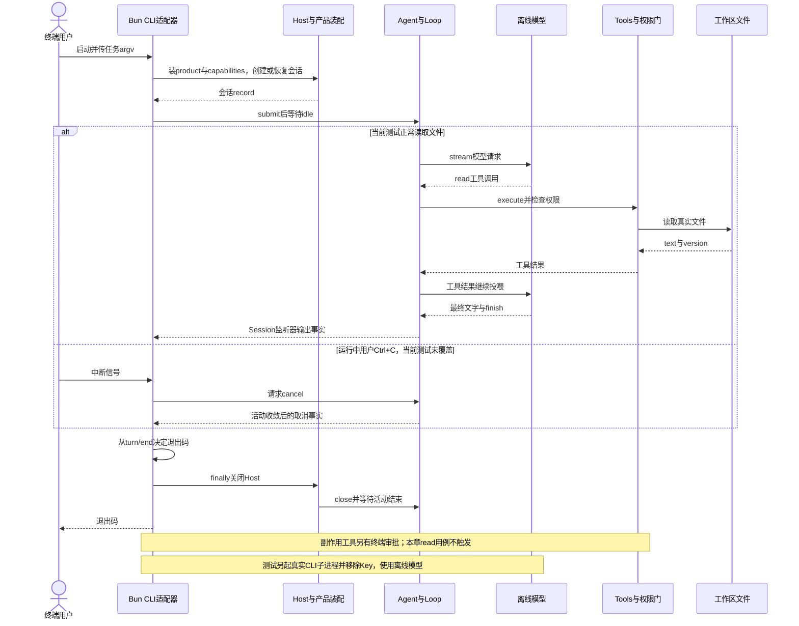

# 069 · 最终CLI也接回同一个持久Host

阶段：R09。唯一前置：完成第 068 步，继续同一个工程。

## 什么时候会用到这一页

回到第000步的命令行入口，现在输入读文件任务应该真的经过Host和工具读取磁盘，不再只回显“收到任务”。CLI负责显示事件、询问审批和处理Ctrl+C，领域实现仍与Web共用。

### 这次数据怎么走

```text
bun run start读取argv → main.run创建Host并装product/capabilities → create或open会话 → Agent.submit → runTurn/Tools/guard/LocalFS → Session事件输出终端 → 根据turn/end设置退出码 → 关闭Host。
```

### 对应时序图

从上往下读；实线箭头表示调用或发送，虚线箭头表示返回或事件通知。`opt`表示可选操作，`alt`表示不同结果，`loop`表示重复，`par`及其`and`分支表示并行；“未接入”及fixture说明按图中标注理解。



**当前接线位置：**最终CLI确实装配product/capabilities并使用同一Host、Agent和文件工具。Web使用同样两层装配，但ACP/SDK入口只使用自己的较基础Host，不能笼统称所有入口能力目录完全相同。最终模型仍是offline或直接DeepSeekModel，未自动改为018 Routes/020 PiModel。

## 这一步具体做什么

先替换本章src/main.mjs并写测试，在练习工程根目录运行env -u DEEPSEEK_API_KEY bun test ./tests/069-cli.test.mjs；再运行env -u DEEPSEEK_API_KEY bun run start '/tool read {"path":"package.json"}'。预期输出包含package.json真实正文与turn/end的completed，并正常退出；移除Key保证本次不调用收费模型。

需要本章新文件的操作，先按下面代码创建文件，再执行；不要在上一步尚不存在的接口上试错。

## 代码为什么放在这一层

CLI只是另一种UI适配：命令行参数变为输入，readline把人类回答交给Approvals，Ctrl+C请求Agent取消。它不应自己实现第二套历史、工具或循环；退出码则让脚本明确区分完成、取消和错误。

## 在哪里写、写什么

操作地点：终端中的 `$PROJECT`，编辑器打开同一个目录。只创建或替换下列文件，其他文件保留上一步版本。文件目录不存在先创建。

```sh
mkdir -p .vscode
```

### 替换 `.vscode/launch.json`

````json
{
  "version": "0.2.0",
  "configurations": [
    {
      "name": "Bun：CLI 入口",
      "type": "bun",
      "request": "launch",
      "program": "${workspaceFolder}/src/main.mjs",
      "cwd": "${workspaceFolder}",
      "runtime": "bun",
      "runtimeArgs": [
        "--preload",
        "${workspaceFolder}/scripts/vscode-debug.mjs"
      ],
      "args": [
        "/tool read {\"path\":\"package.json\"}"
      ],
      "stopOnEntry": false
    },
    {
      "name": "Bun：当前测试",
      "type": "bun",
      "request": "launch",
      "program": "${file}",
      "cwd": "${workspaceFolder}",
      "runtime": "bun",
      "runtimeArgs": [
        "test",
        "--preload",
        "${workspaceFolder}/scripts/vscode-debug.mjs",
        "--timeout",
        "3600000"
      ],
      "stopOnEntry": false
    },
    {
      "name": "Bun：附加子进程",
      "type": "bun",
      "request": "attach",
      "url": "${input:bunInspectorUrl}"
    },
    {
      "name": "Python：SDK 客户端",
      "type": "debugpy",
      "request": "launch",
      "program": "${workspaceFolder}/tests/fixtures/python-sdk.py",
      "cwd": "${workspaceFolder}",
      "python": "/usr/bin/python3",
      "console": "integratedTerminal",
      "env": {
        "PYTHONPATH": "${workspaceFolder}/python"
      },
      "args": [
        "bun",
        "${workspaceFolder}/src/sdk-server.mjs",
        "${workspaceFolder}/.data-python-debug"
      ],
      "justMyCode": true
    },
    {
      "name": "Web：Bun Host",
      "type": "bun",
      "request": "launch",
      "program": "${workspaceFolder}/src/web-server.mjs",
      "cwd": "${workspaceFolder}",
      "runtime": "bun",
      "runtimeArgs": [
        "--preload",
        "${workspaceFolder}/scripts/vscode-debug.mjs"
      ],
      "env": {
        "HARNESS_HOME": "${workspaceFolder}/.data-web",
        "HARNESS_PORT": "0"
      },
      "stopOnEntry": false
    },
    {
      "name": "Web：页面",
      "type": "chrome",
      "request": "launch",
      "url": "${input:webBootstrapUrl}",
      "webRoot": "${workspaceFolder}/web",
      "pathMapping": {
        "/view.mjs": "${workspaceFolder}/src/view.mjs"
      }
    },
    {
      "name": "Electron：Main",
      "type": "node",
      "request": "attach",
      "address": "127.0.0.1",
      "port": 9229,
      "skipFiles": [
        "<node_internals>/**"
      ]
    },
    {
      "name": "Electron：Bun Host",
      "type": "bun",
      "request": "attach",
      "url": "ws://127.0.0.1:6499/harness-host"
    },
    {
      "name": "Electron：Renderer",
      "type": "chrome",
      "request": "attach",
      "address": "127.0.0.1",
      "port": 9222,
      "webRoot": "${workspaceFolder}/web",
      "pathMapping": {
        "/view.mjs": "${workspaceFolder}/src/view.mjs"
      }
    }
  ],
  "inputs": [
    {
      "id": "bunInspectorUrl",
      "type": "promptString",
      "description": "粘贴子进程 Bun Inspector 打印的完整 ws:// 地址"
    },
    {
      "id": "webBootstrapUrl",
      "type": "promptString",
      "description": "粘贴本次 Host 输出的完整 http://127.0.0.1:端口/?token=... 地址"
    }
  ]
}
````

```sh
mkdir -p src
```

### 替换 `src/main.mjs`

````javascript
import { pathToFileURL } from 'node:url'
import { resolve } from 'node:path'
import { createInterface } from 'node:readline/promises'
import { Host } from './host.mjs'
import { product } from './product.mjs'
import { capabilities } from './capabilities.mjs'

/** 保留第000步的输入契约；最后CLI换成真实应用，不让入口永远停在回声。 */
export function input(argv) {
  const prompt = argv.join(' ').trim()
  if (!prompt) throw Error('用法：bun run start "你的任务"')
  return prompt
}

/** CLI是UI适配器，仍然组装同一个Host/Guard/Agent，没有第二套循环。 */
async function run(prompt) {
  const host = new Host(process.env.HARNESS_HOME ?? resolve('.data-cli'))
  product(host); capabilities(host)
  const record = process.env.HARNESS_SESSION ? host.open(process.env.HARNESS_SESSION) : host.create({ cwd: process.cwd() })
  if (process.env.DEEPSEEK_API_KEY) record.settings.set({ backend: 'deepseek', model: process.env.DSH_MODEL ?? 'deepseek-flash', keyRef: 'DEEPSEEK_API_KEY' })
  const terminal = createInterface({ input: process.stdin, output: process.stdout })
  const cancel = () => record.agent.cancel()
  process.on('SIGINT', cancel); terminal.on('SIGINT', cancel)
  console.log('会话：' + record.header.id)
  console.log('模型后端：' + (record.settings.snapshot().backend ?? 'offline（离线演示）'))
  const unsubscribe = record.session.on(event => {
    console.log(event.seq, event.type, JSON.stringify(event.data))
    if (event.type === 'approval/request') void terminal.question('允许这次副作用？输入 yes：').then(answer => record.approvals.answer(record.header.id, event.data.id, answer.trim() === 'yes')).catch(() => {})
  })
  try {
    record.agent.submit(prompt); await record.agent.idle()
    const reason = record.session.read().filter(event => event.type === 'turn/end').at(-1)?.data.reason
    process.exitCode = reason === 'completed' ? 0 : reason === 'cancelled' ? 130 : 1
  } finally { unsubscribe(); process.off('SIGINT', cancel); terminal.close(); await host.close() }
}

if (process.argv[1] && import.meta.url === pathToFileURL(process.argv[1]).href) {
  try { await run(input(process.argv.slice(2))) }
  catch (error) { console.error(error.message); process.exitCode = 1 }
}
````

```sh
mkdir -p tests
```

### 创建 `tests/069-cli.test.mjs`

````javascript
import { test } from 'bun:test'
import assert from 'node:assert/strict'
import { spawnSync } from 'node:child_process'
import { mkdtempSync, writeFileSync, rmSync } from 'node:fs'
import { join, resolve } from 'node:path'
import { tmpdir } from 'node:os'

test('最终CLI真正调用同一个持久Host读取实际工作区文件', () => {
  const root = mkdtempSync(join(tmpdir(), 'own-final-cli-')), env = { ...process.env, HARNESS_HOME: join(root, 'data') }
  delete env.DEEPSEEK_API_KEY; delete env.HARNESS_SESSION
  try {
    writeFileSync(join(root, 'proof.txt'), '真实文件正文')
    const result = spawnSync(process.execPath, [resolve('src/main.mjs'), '/tool read {"path":"proof.txt"}'], { cwd: root, env, encoding: 'utf8', timeout: 10_000 })
    assert.equal(result.status, 0, result.stderr)
    assert.match(result.stdout, /真实文件正文/); assert.match(result.stdout, /completed/)
  } finally { rmSync(root, { recursive: true, force: true }) }
})
````

## 运行命令与通过标准

```sh
cd "$PROJECT"
bun test ./tests/069-cli.test.mjs
bun run start '/tool read {"path":"package.json"}'
bun test
```

测试真实启动Bun CLI子进程，在隔离cwd读取proof.txt，断言真实正文、completed和退出码0。没有验证真人审批、Ctrl+C、HARNESS_SESSION恢复、真实模型或完整原版CLI命令。

**本步证据的范围：**tests/069-cli.test.mjs在真实临时cwd启动另一Bun进程，明确删除Key和HARNESS_SESSION，用OfflineModel生成read工具调用，读取真实文件后验证输出。没有收费网络，也不是原版CLI差分。当前代码存在其他能力不等于全部在本测试验收。

## VS Code：断在哪里、看什么

手工调入口时用本章“Bun：CLI 入口”，将args设为/tool read的完整任务并移除真实Key。断在src/main.mjs的record.agent.submit、src/permissions.mjs的守卫和src/filesystem.mjs的read，监视prompt、record.header.id、call.name及read返回text；F11从submit进入Agent，F10等活动结束，reason应为completed。若用“Bun：当前测试”调tests/069-cli.test.mjs，只会停父测试的spawnSync/断言；CLI是子进程，不会自动命中main.mjs。

操作位置：VS Code 打开的是自己的 `$PROJECT`，断点也设在这里的源码，不在教材的 `steps` 目录。

上面的说明若指定CLI、子进程、页面或Electron附加调试，就先按该流程操作；下面这组步骤只用于本章测试入口。“当前测试”不会自动附加子进程，也不会命中浏览器或Electron中的断点。

变量只在所属作用域可见：停在方法内部时看this和参数；要看测试里的局部变量，先在“调用堆栈”选择对应测试帧。正在等待的异步调用者不一定保留可求值的帧，此时在测试调用前后加断点再看，不把未定义误判成业务状态丢失。

沿用第 000 步安装的 Bun 扩展与 `.vscode/launch.json`；本章列出替换配置时，使用本章完整版本。

1. 打开本步测试文件 `tests/069-cli.test.mjs`，保持它为当前编辑器文件。
2. 在上面指定的函数内单击行号左侧设置断点。
3. “运行和调试”选择 **Bun：当前测试**，按 F5；它执行当前测试，工作目录固定为 PROJECT。
4. 在“变量 / 监视 / 调用堆栈 / 调试控制台”检查状态；F10 逐行执行，F11 进入函数，Shift+F11 返回，F5 继续，Shift+F5 停止。

验收：断点实际命中，能说出当前输入、状态和下一步；只看到进程启动不算完成。长时间暂停会影响真实取消、审批和网络超时，先检查时序，不删超时断言。修正后在集成终端运行 `bun test ./tests/069-cli.test.mjs`，再运行 `bun test`，保留全部断言。

## 不看答案，确认自己能解释

闭卷分别从CLI、Web、ACP和SDK画到Host/Agent，圈出各自协议或UI适配所在层；再写出哪些入口实际装了product/capabilities，不能只写“全都一样”。

完成后在 LEARNING.md 写一句实际结果和一个卡点。明天只重做这个卡点；第 3 天、第 7 天再做一次，能独立完成就继续下一页，不另开学习路线。

**再改一个条件验证：**练习：在隔离cwd把测试任务目标改为missing-069.txt，补断言输出明确工具失败且不包含伪造正文；不要直接假设CLI退出码一定非0，要先查看当前Loop如何把工具错误返回模型。该变体未在已有测试中实现。

## 与当前原版还差哪些

对照本仓库固定原版 `687f282e8625c6b8d11ff58211a90524be2e4317`；这里的“当前”指该本地基线，不是未经检查的上游最新版。

**这一页已经实现：**

- 保留argv输入契约，CLI创建/恢复自有持久会话。
- 通过已有Agent和Tools真实执行read等工具，显示会话事实。
- 基础终端审批、Ctrl+C取消、结果退出码及finally关闭Host。

**原版仍有、或本步尚未对齐的部分：**

- 原版dsh有profile boot、插件与配置命令、启动诊断和完整组合；本章是固定装配的教学CLI。
- 没有原版公开SDK/ACP/Web协议、V4历史和全部工具/配置功能等价。
- Routes重试/RefreshToken、PiModel等独立demo未成为最终CLI默认提供方链。
- 现有测试不验证审批并发、取消恢复、真实模型、所有平台或安装产物资格。

**原版对照位置：**

- [apps/cli/src/bin.ts](../../../deepseek-harness/apps/cli/src/bin.ts)
- [apps/cli/src/args.ts](../../../deepseek-harness/apps/cli/src/args.ts)
- [apps/cli/src/profile-boot.ts](../../../deepseek-harness/apps/cli/src/profile-boot.ts)
- [apps/cli/src/plugin.ts](../../../deepseek-harness/apps/cli/src/plugin.ts)
- [apps/cli/src/process-shutdown.ts](../../../deepseek-harness/apps/cli/src/process-shutdown.ts)
- [packages/boot/app-boot](../../../deepseek-harness/packages/boot/app-boot)

本步测试通过只证明上面的具体行为；完整差距仍看 [COVERAGE.md](../COVERAGE.md)，不以文件数量、同名类或后面出现另一个模块代替接线证据。

这是当前实际实现的最后一步。未取得证据的完整复刻条目仍保持未完成。

## CLI从第000步的入口长成真实应用

在 PROJECT 执行：

```sh
bun run start '/tool read {"path":"package.json"}'
bun run start /slow
```

第一条必须显示真实文件内容与 completed。第二条看到 partial 后按 Ctrl+C，应取消并退出。记录终端打印的会话 ID；下一次恢复同一个会话时执行：

```sh
read -r HARNESS_SESSION
```

此时粘贴刚才的会话 ID 并按回车，再执行：

```sh
export HARNESS_SESSION
bun run start '继续，告诉我刚才进行到哪里'
unset HARNESS_SESSION
```

不要把示例文字“会话ID”当作真实ID。默认 home 是 PROJECT/.data-cli；恢复必须保持同一个 home。真实模型验收继续使用第016步已准备的 .env：

```sh
bun --env-file=.env src/main.mjs '读取 package.json，解释当前项目怎样启动'
```

直接在 VS Code 调试宿主入口：

1. 本章已替换 `.vscode/launch.json`，`Bun：CLI 入口` 的任务参数改成真实读文件。
2. 在 `src/main.mjs` 的 `run`、`src/host.mjs` 的 `permissionGuard` 或 Loop 的 `runTurn` 内设置断点。
3. “运行和调试”选择 **Bun：CLI 入口**，按 F5，沿 CLI → Host → Inbox → Loop → Tools → Journal 单步执行。
4. 查看文件读取结果和 completed；修正后在集成终端重跑本章测试与 `bun test`。

这一步的CLI实际可用，原版完整profile命令、公共协议和数据格式仍按COVERAGE继续验收。
