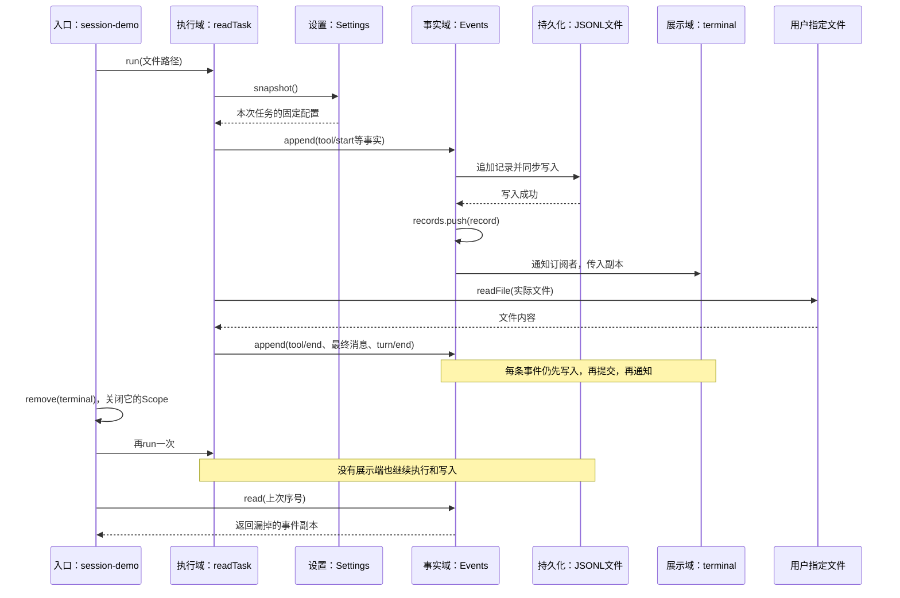

## 先看这一步到底做成什么

操作场景：你在终端输入一个文件名，程序真实读取文件，显示“开始读取、读取完成、最终内容”，并把这些过程记录到会话日志。随后终端展示端退出，同一个读任务继续执行；展示端回来时，根据上次序号补读漏掉的记录。

这就是 Harness 中“执行”和“展示”分开的最小完整使用场景：以后把终端换成 Web、Electron 或 ACP，业务仍向会话提交事实，不去调用某个界面的显示函数。本步的展示端只有终端，尚未实现网页或ACP。

### 把000～004真的接起来

```text
session-demo.mjs：应用入口，沿用000的input校验
└── createReaderApp：compose配置 → Plugins.profile装配
    ├── 共享Services
    │   ├── settings：最新设置，来自004
    │   ├── session：Events，会话事实与订阅入口
    │   └── readTask：真实读文件任务
    └── 根Scope
        ├── settings插件Scope：撤销settings注册
        ├── session插件Scope：撤销session、关闭日志文件
        ├── terminal插件Scope：取消自己的事件订阅
        └── reader插件Scope：停止接收任务、取消并等待当前读取、撤销readTask
```

插件如何关联就在代码里：reader通过`services.get('session')`、`services.get('settings')`获取前面插件提供的对象；terminal获取同一个session。每个插件有自己的Scope，复用同一个Services。

### 一次调用怎样走



### 现在在哪操作、怎样算完成

先按下面“在哪里写、写什么”在自己的PROJECT创建本步文件，再回到集成终端执行：

```sh
bun src/session-demo.mjs package.json
```

你应该看到：

1. 打印本次独立的日志文件路径，位于PROJECT的`.data-005/`。
2. 第一轮显示`[终端] 0 turn/start`到`[终端] 5 turn/end`，并显示自己工程的真实package.json内容。
3. 卸载terminal后，第二轮仍完成，但不再出现`[终端]`事件；它没有调用display来制造“展示成功”。
4. 补读结果为`6:turn/start → 7:message/user → 8:tool/start → 9:tool/end → 10:message/assistant → 11:turn/end`。
5. 退出时显示`应用已退出：插件=0，注册服务=0`。打开打印的JSONL文件，应有12条记录，与`session.read()`一致。

显示回调更新设置时，当前任务仍使用旧快照，下一次任务才使用新版本；集成测试会稳定重现这个时机，不用靠sleep碰运气。

**本步边界：**读任务真的访问文件，日志真的写盘；最终文本直接使用读取结果，没有模型生成。`read(after)`只补读当前进程的会话事实，不自动重新订阅，也没有实现进程重启恢复。最小JSONL写入器没有坏尾修复、恢复或原版V4兼容，这些不能提前记为完成。
